# 2D Polygon Operations

<cite>
**Referenced Files in This Document**
- [IntPolygon.hpp](file://2D/IntPolygon.hpp)
- [IntPolygon.cpp](file://2D/IntPolygon.cpp)
- [FloatPolygons.hpp](file://2D/FloatPolygons.hpp)
- [FloatPolygons.cpp](file://2D/FloatPolygons.cpp)
- [ImageToPolygons.hpp](file://2D/ImageToPolygons.hpp)
- [ImageToPolygons.cpp](file://2D/ImageToPolygons.cpp)
- [CMakeLists.txt](file://2D/CMakeLists.txt)
- [int_polygon_test.cpp](file://tests/IntPolygon/int_polygon_test.cpp)
</cite>

## Table of Contents
1. [Introduction](#introduction)
2. [Project Structure](#project-structure)
3. [Core Components](#core-components)
4. [Architecture Overview](#architecture-overview)
5. [Detailed Component Analysis](#detailed-component-analysis)
6. [Dependency Analysis](#dependency-analysis)
7. [Performance Considerations](#performance-considerations)
8. [Troubleshooting Guide](#troubleshooting-guide)
9. [Conclusion](#conclusion)
10. [Appendices](#appendices)

## Introduction
This document explains HsBaSlicer’s 2D polygon operations built on Clipper2. It focuses on the integer-coordinate and floating-point polygon APIs, boolean operations, simplification, offsetting, point-in-polygon testing, area calculation, coordinate conversion, image-to-polygon workflows, and debugging utilities such as SVG dump functions. The goal is to help slicing workflows use these primitives reliably and efficiently.

## Project Structure
The 2D polygon subsystem lives under `2D/`. The main types and algorithms are split between:
- Integer-coordinate API: `IntPolygon.hpp` / `IntPolygon.cpp`
- Floating-point API and shape/text generators: `FloatPolygons.hpp` / `FloatPolygons.cpp`
- Image-to-polygons and polygon-to-image helpers: `ImageToPolygons.hpp` / `ImageToPolygons.cpp`
- Build configuration for optional debug SVG dumps: `2D/CMakeLists.txt`

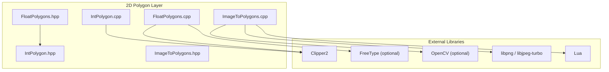

**Diagram sources**
- [IntPolygon.hpp:9-11](file://2D/IntPolygon.hpp#L9-L11)
- [IntPolygon.cpp:15-16](file://2D/IntPolygon.cpp#L15-L16)
- [FloatPolygons.hpp:9-13](file://2D/FloatPolygons.hpp#L9-L13)
- [FloatPolygons.cpp:17-21](file://2D/FloatPolygons.cpp#L17-L21)
- [ImageToPolygons.cpp:15-24](file://2D/ImageToPolygons.cpp#L15-L24)

**Section sources**
- [IntPolygon.hpp:1-241](file://2D/IntPolygon.hpp#L1-L241)
- [FloatPolygons.hpp:1-271](file://2D/FloatPolygons.hpp#L1-L271)
- [ImageToPolygons.hpp:1-83](file://2D/ImageToPolygons.hpp#L1-L83)

## Core Components
- IntPolygon: Integer-coordinate polygon types and Clipper2-based boolean, offset, area, and normalization utilities.
- FloatPolygons: Double-precision polygon types, boolean operations, area, shape generators, text-to-polygons, and integerization conversion.
- ImageToPolygons: Raster-to-polygon thresholding, polygon-to-image rendering, and Lua-driven image generation.

Key responsibilities:
- Provide stable, high-performance geometric primitives for slicing.
- Bridge between floating-point modeling and robust integer arithmetic via Clipper2.
- Offer visualization and debugging tools for complex polygon sets.

**Section sources**
- [IntPolygon.hpp:16-192](file://2D/IntPolygon.hpp#L16-L192)
- [FloatPolygons.hpp:18-221](file://2D/FloatPolygons.hpp#L18-L221)
- [ImageToPolygons.hpp:22-79](file://2D/ImageToPolygons.hpp#L22-L79)

## Architecture Overview
The architecture separates concerns by coordinate precision and domain:
- Floating-point layer (`FloatPolygons`) provides user-friendly geometry creation and analysis.
- Integer layer (`IntPolygon`) performs robust boolean and offset operations using Clipper2.
- Conversion functions bridge between layers with a fixed scaling factor.
- Image utilities convert between raster images and polygons, optionally driven by Lua scripts.

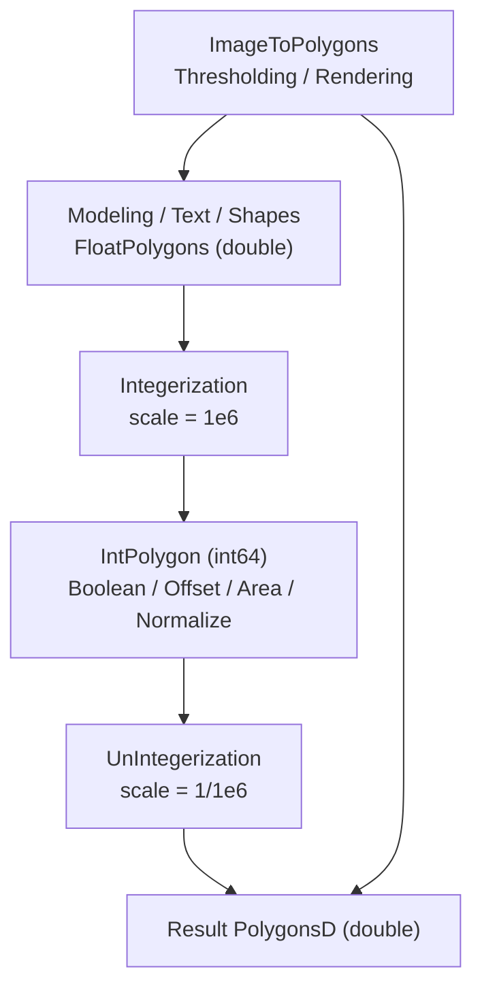

**Diagram sources**
- [FloatPolygons.cpp:176-213](file://2D/FloatPolygons.cpp#L176-L213)
- [IntPolygon.hpp:16-17](file://2D/IntPolygon.hpp#L16-L17)

**Section sources**
- [FloatPolygons.cpp:176-213](file://2D/FloatPolygons.cpp#L176-L213)
- [IntPolygon.hpp:16-17](file://2D/IntPolygon.hpp#L16-L17)

## Detailed Component Analysis

### Integer Coordinate System: IntPolygon
- Types:
  - Point2: 64-bit integer point.
  - Polygon: sequence of integer points.
  - Polygons: collection of integer polygons.
- Scaling:
  - `integerization = 1e6` converts between double and int64 coordinates.
- Boolean operations:
  - Union, Intersection, Difference, Xor for both single polygons and polygon sets.
- Offset:
  - Inflate/deflate polygons with configurable join and end types.
- Simplification and normalization:
  - MakeSimple removes collinear points.
  - MakeSimpleAndSplit splits self-intersecting polygons into simple regions.
  - NormalizeToSimplePolygons normalizes orientation and builds outer/hole relationships.
- Point-in-polygon:
  - Supports even-odd and non-zero winding rules; automatically converts to even-odd when needed.
- Area:
  - Signed area for single polygons and total signed area for polygon sets.
- Debugging:
  - Optional DumpPolygon/DumpPolygons generate SVG files scaled by `1/integerization`.

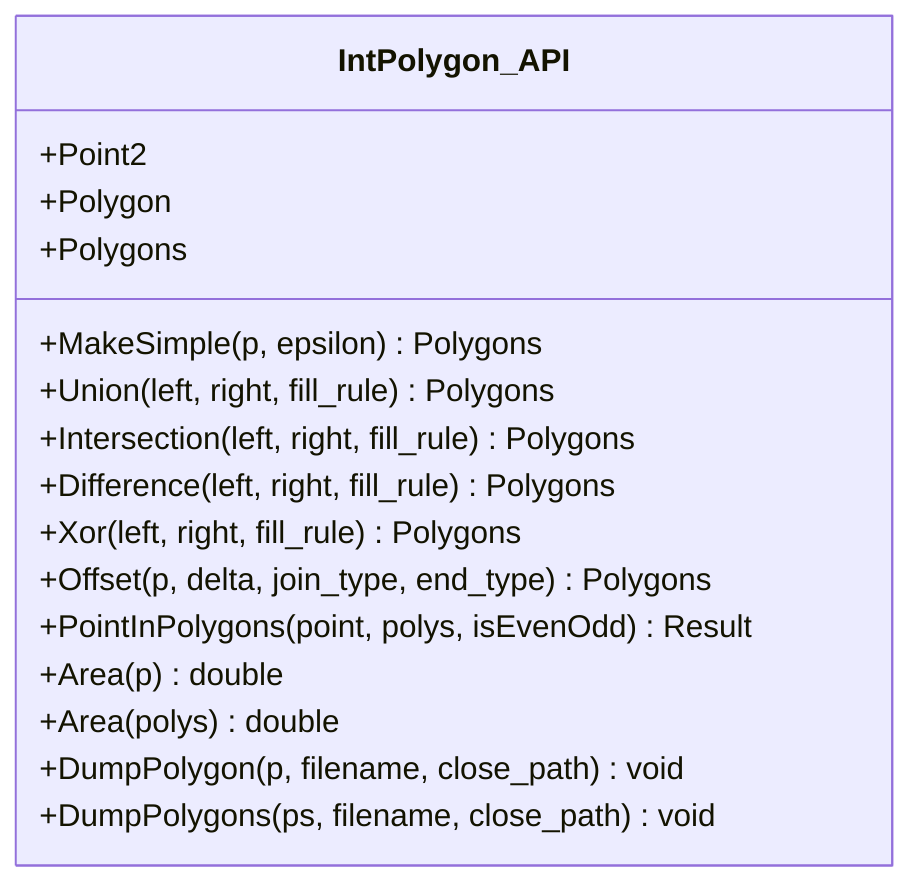

**Diagram sources**
- [IntPolygon.hpp:16-210](file://2D/IntPolygon.hpp#L16-L210)
- [IntPolygon.cpp:19-130](file://2D/IntPolygon.cpp#L19-L130)

**Section sources**
- [IntPolygon.hpp:16-210](file://2D/IntPolygon.hpp#L16-L210)
- [IntPolygon.cpp:19-130](file://2D/IntPolygon.cpp#L19-L130)

#### Boolean Operations: Single Polygons and Sets
- Single-polygon overloads wrap inputs into collections before delegating to Clipper2.
- Set overloads operate directly on collections.
- Fill rule defaults to EvenOdd but can be customized.

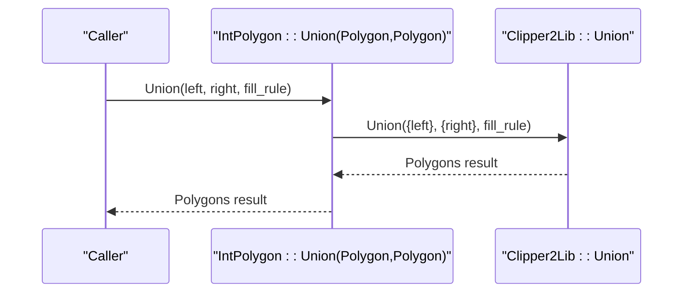

**Diagram sources**
- [IntPolygon.cpp:28-31](file://2D/IntPolygon.cpp#L28-L31)

**Section sources**
- [IntPolygon.cpp:28-60](file://2D/IntPolygon.cpp#L28-L60)

#### Offset Operations: Inflation and Deflation
- Uses Clipper2’s `ClipperOffset` to compute expanded or contracted outlines.
- Positive delta inflates; negative delta deflates.
- Join and end types control corner behavior and open path handling.

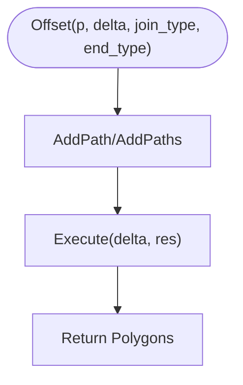

**Diagram sources**
- [IntPolygon.cpp:62-77](file://2D/IntPolygon.cpp#L62-L77)

**Section sources**
- [IntPolygon.cpp:62-77](file://2D/IntPolygon.cpp#L62-L77)

#### Point-in-Polygon Testing
- For even-odd rule: checks each polygon and respects orientation based on signed area.
- For non-zero winding: first unions all polygons into an even-odd representation, then tests.

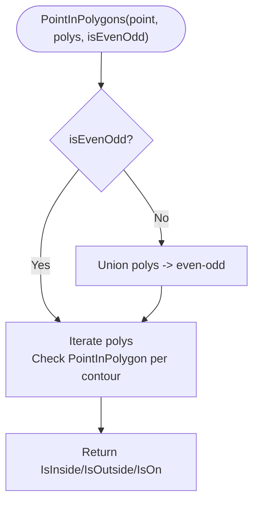

**Diagram sources**
- [IntPolygon.cpp:79-121](file://2D/IntPolygon.cpp#L79-L121)

**Section sources**
- [IntPolygon.cpp:79-121](file://2D/IntPolygon.cpp#L79-L121)

#### Polygon Simplification and Normalization
- MakeSimple: removes collinear vertices using Clipper2’s simplifier.
- MakeSimpleAndSplit: unions input into a tree, splits into simple regions, then simplifies each region.
- NormalizeToSimplePolygons:
  - Splits and simplifies.
  - Normalizes orientation by signed area.
  - Builds parent-child nesting to associate holes with their outer contours.
  - Returns flat list of outer polygons followed by their holes.

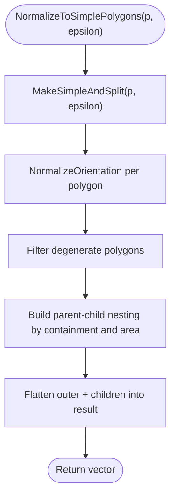

**Diagram sources**
- [IntPolygon.cpp:265-416](file://2D/IntPolygon.cpp#L265-L416)

**Section sources**
- [IntPolygon.cpp:265-416](file://2D/IntPolygon.cpp#L265-L416)

#### Area Calculation
- Single polygon area returns signed area; sign indicates orientation.
- Polygon set area sums signed areas across all polygons.

**Section sources**
- [IntPolygon.cpp:123-130](file://2D/IntPolygon.cpp#L123-L130)

#### Debugging Utilities: SVG Dump
- When compiled with `HSBA_POLYGON_DUMP`, DumpPolygon/DumpPolygons write SVG files.
- Integerized polygons are scaled by `1/integerization` so visual units match model space.

**Section sources**
- [IntPolygon.cpp:132-229](file://2D/IntPolygon.cpp#L132-L229)
- [2D/CMakeLists.txt:24-25](file://2D/CMakeLists.txt#L24-L25)

### Floating-Point Coordinate System: FloatPolygons
- Types:
  - Point2D: double-precision point.
  - PolygonD: sequence of double points.
  - PolygonsD: collection of double polygons.
- Boolean operations:
  - Union, Intersection, Difference, Xor for single polygons and sets.
- Area:
  - Signed area for single polygons and total signed area for sets.
- Shape generators:
  - Rectangle, circle, ellipse, regular polygon.
- Text-to-polygons:
  - Converts UTF-8 text to polygon outlines using FreeType (optional).
- Conversion:
  - Integerization and UnIntegerization bridge between double and int64 using `integerization = 1e6`.
- Debugging:
  - Optional DumpPolygon/DumpPolygons write SVG files without scaling.

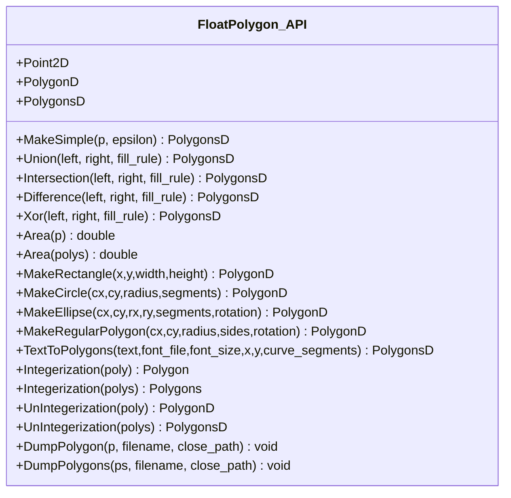

**Diagram sources**
- [FloatPolygons.hpp:18-239](file://2D/FloatPolygons.hpp#L18-L239)
- [FloatPolygons.cpp:25-75](file://2D/FloatPolygons.cpp#L25-L75)

**Section sources**
- [FloatPolygons.hpp:18-239](file://2D/FloatPolygons.hpp#L18-L239)
- [FloatPolygons.cpp:25-75](file://2D/FloatPolygons.cpp#L25-L75)

#### Shape Generators
- Rectangle: four corners plus closing point.
- Circle/Ellipse: parametric sampling with rotation support.
- Regular polygon: equal-angle vertex placement.

**Section sources**
- [FloatPolygons.cpp:294-344](file://2D/FloatPolygons.cpp#L294-L344)

#### Text-to-Polygons
- Requires FreeType if enabled at build time.
- Decomposes glyph outlines into lines and curves, approximating curves with segments.
- Emits closed contours and accumulates results per character.

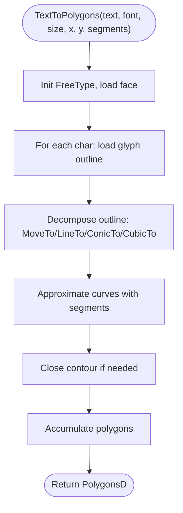

**Diagram sources**
- [FloatPolygons.cpp:346-407](file://2D/FloatPolygons.cpp#L346-L407)

**Section sources**
- [FloatPolygons.cpp:346-407](file://2D/FloatPolygons.cpp#L346-L407)

#### Integerization and UnIntegerization
- Integerization multiplies coordinates by `1e6` and stores in int64.
- UnIntegerization divides coordinates by `1e6` to recover double precision.

**Section sources**
- [FloatPolygons.cpp:176-213](file://2D/FloatPolygons.cpp#L176-L213)
- [IntPolygon.hpp:16-17](file://2D/IntPolygon.hpp#L16-L17)

#### Debugging Utilities: SVG Dump
- When compiled with `HSBA_POLYGON_DUMP`, DumpPolygon/DumpPolygons write SVG files.
- Unlike integerized dumps, float dumps do not scale coordinates.

**Section sources**
- [FloatPolygons.cpp:77-172](file://2D/FloatPolygons.cpp#L77-L172)
- [2D/CMakeLists.txt:24-25](file://2D/CMakeLists.txt#L24-L25)

### Image-to-Polygon Workflows
- FromImage: loads grayscale image, thresholds, extracts contours, simplifies, and returns PolygonsD.
- FromImageMulti: supports multiple thresholds to produce layered polygon sets.
- ToImage: rasterizes PolygonsD to image or SVG; uses OpenCV if available, otherwise manual rasterization.
- LuaToImage/LuaToImageString: execute Lua scripts that receive PolygonsD and return grayscale images.

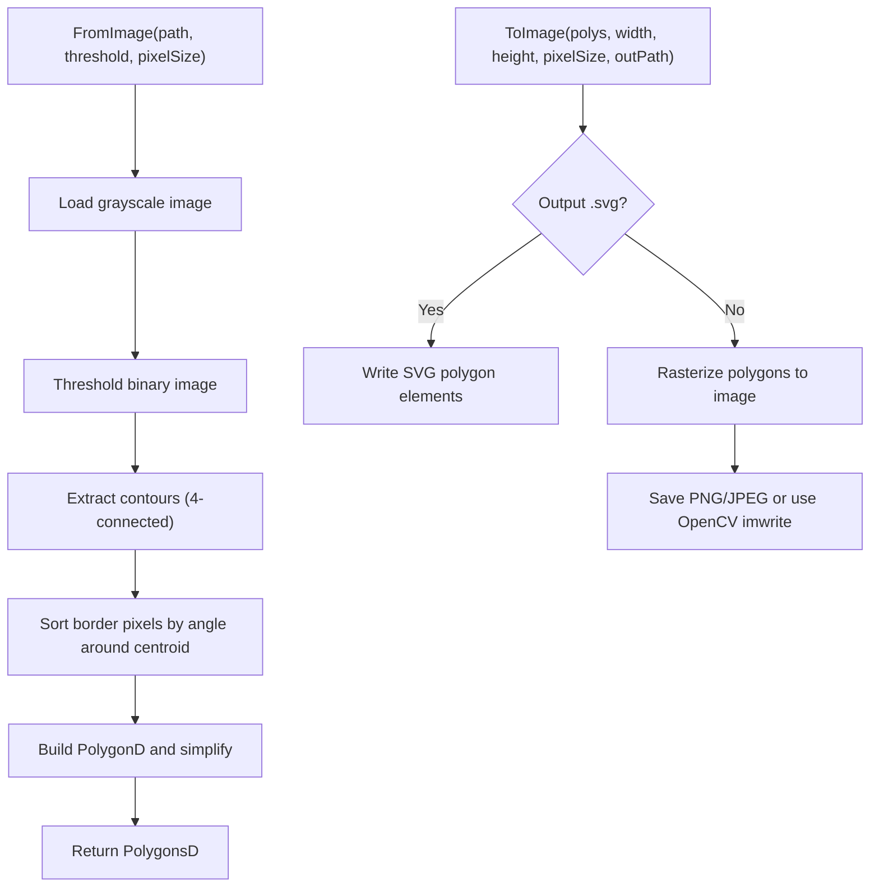

**Diagram sources**
- [ImageToPolygons.cpp:87-174](file://2D/ImageToPolygons.cpp#L87-L174)
- [ImageToPolygons.cpp:291-393](file://2D/ImageToPolygons.cpp#L291-L393)

**Section sources**
- [ImageToPolygons.cpp:87-174](file://2D/ImageToPolygons.cpp#L87-L174)
- [ImageToPolygons.cpp:291-393](file://2D/ImageToPolygons.cpp#L291-L393)

## Dependency Analysis
- IntPolygon depends on Clipper2 for boolean operations, offsets, area, and simplification.
- FloatPolygons depends on Clipper2 for boolean operations and area, and optionally on FreeType for text-to-polygons.
- ImageToPolygons depends on OpenCV (optional), libpng/libjpeg-turbo, and Lua for scripting.

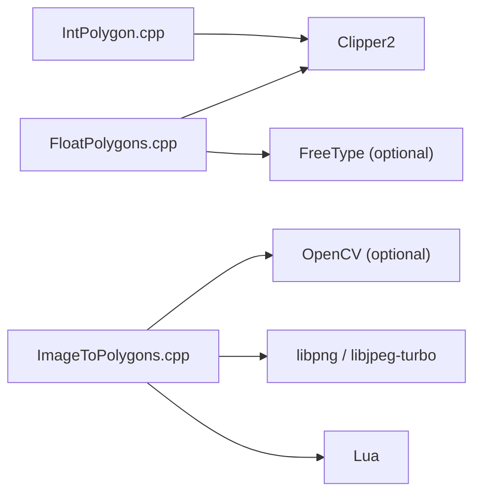

**Diagram sources**
- [IntPolygon.cpp:15-16](file://2D/IntPolygon.cpp#L15-L16)
- [FloatPolygons.cpp:17-21](file://2D/FloatPolygons.cpp#L17-L21)
- [ImageToPolygons.cpp:15-24](file://2D/ImageToPolygons.cpp#L15-L24)

**Section sources**
- [IntPolygon.cpp:15-16](file://2D/IntPolygon.cpp#L15-L16)
- [FloatPolygons.cpp:17-21](file://2D/FloatPolygons.cpp#L17-L21)
- [ImageToPolygons.cpp:15-24](file://2D/ImageToPolygons.cpp#L15-L24)

## Performance Considerations
- Prefer integer arithmetic for robustness: convert large polygon sets to integer coordinates via Integerization before boolean operations.
- Use MakeSimple to reduce vertex count before expensive operations like union or offset.
- NormalizeToSimplePolygons helps downstream consumers by producing well-oriented outer/hole pairs.
- Batch operations: operate on Polygons/PolygonsD rather than looping single polygons where possible.
- Avoid unnecessary conversions: keep data in the appropriate coordinate system until final output.
- Image processing:
  - Use OpenCV path when available for faster rasterization.
  - Tune pixelSize and thresholds to balance accuracy and performance.

[No sources needed since this section provides general guidance]

## Troubleshooting Guide
- Empty or degenerate polygons:
  - NormalizeToSimplePolygons filters small-area polygons and returns empty results for invalid inputs.
- Orientation issues:
  - Signed area indicates orientation; NormalizeToSimplePolygons corrects orientation for consistent hole association.
- Point-in-polygon unexpected results:
  - Ensure correct fill rule; for non-zero winding, the implementation converts to even-odd internally.
- Offset artifacts:
  - Adjust join_type and end_type; very small deltas may produce degenerate shapes.
- Text-to-polygons failures:
  - Verify FreeType availability and font file path; errors are thrown with descriptive messages.
- SVG dumps:
  - Enable HSBA_POLYGON_DUMP at build time; verify output paths and scaling conventions.

**Section sources**
- [IntPolygon.cpp:329-416](file://2D/IntPolygon.cpp#L329-L416)
- [FloatPolygons.cpp:346-407](file://2D/FloatPolygons.cpp#L346-L407)
- [2D/CMakeLists.txt:24-25](file://2D/CMakeLists.txt#L24-L25)

## Conclusion
HsBaSlicer’s 2D polygon layer provides a complete toolkit for slicing workflows:
- Robust integer arithmetic via Clipper2 ensures reliable boolean operations and offsets.
- Floating-point APIs offer convenient geometry creation, text conversion, and visualization.
- Image utilities integrate seamlessly with raster pipelines and scripting.
By combining simplification, normalization, and careful coordinate management, users can process large polygon sets efficiently and debug them effectively.

[No sources needed since this section summarizes without analyzing specific files]

## Appendices

### Practical Examples in Slicing Workflows
- Convert CAD or mesh-derived outlines to PolygonsD, simplify, then integerize for robust boolean operations.
- Compute union of multiple toolpaths, normalize to simple polygons, and render to SVG or image for inspection.
- Use offset to expand or contract boundaries for clearance or kerf compensation.
- Validate point-in-polygon for support placement or collision checks.

[No sources needed since this section provides general guidance]

### Test Coverage Highlights
- Tests validate simplification, area computation, offset inflation/deflation, point-in-polygon rules, hashing, and normalization including nested holes.

**Section sources**
- [int_polygon_test.cpp:62-176](file://tests/IntPolygon/int_polygon_test.cpp#L62-L176)