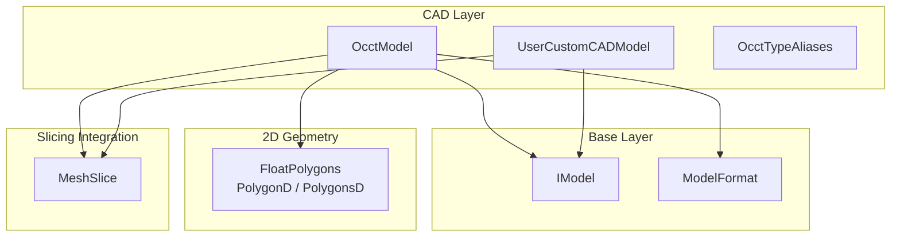
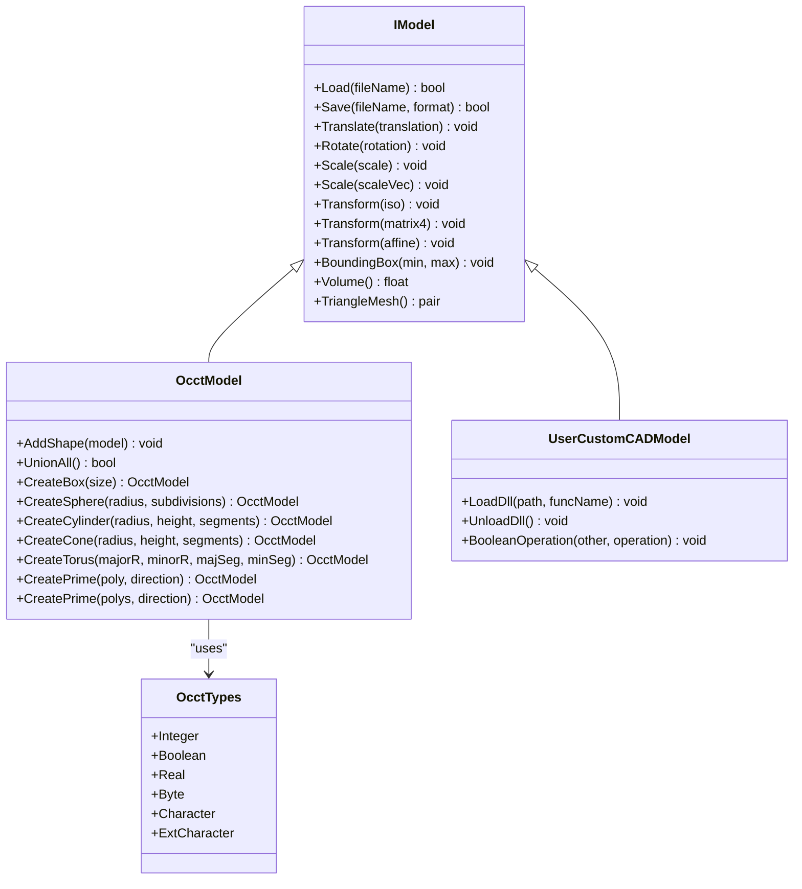
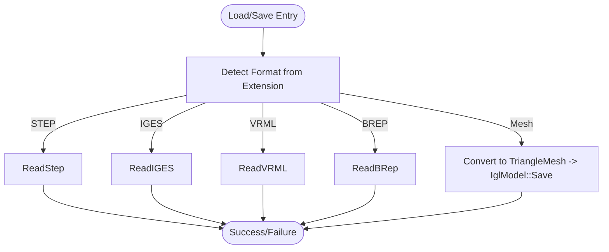
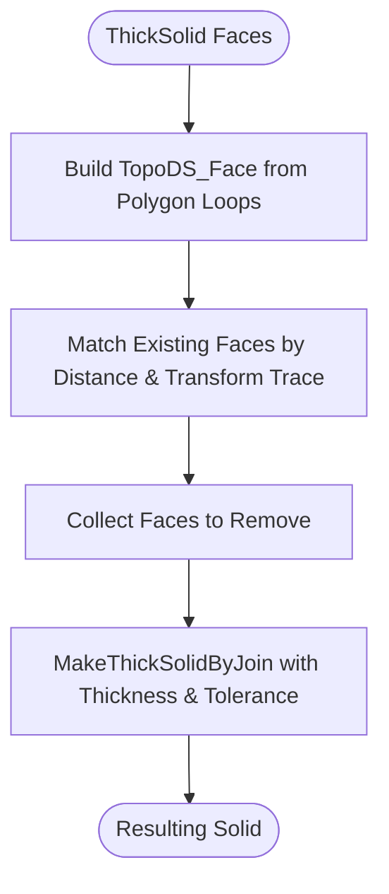
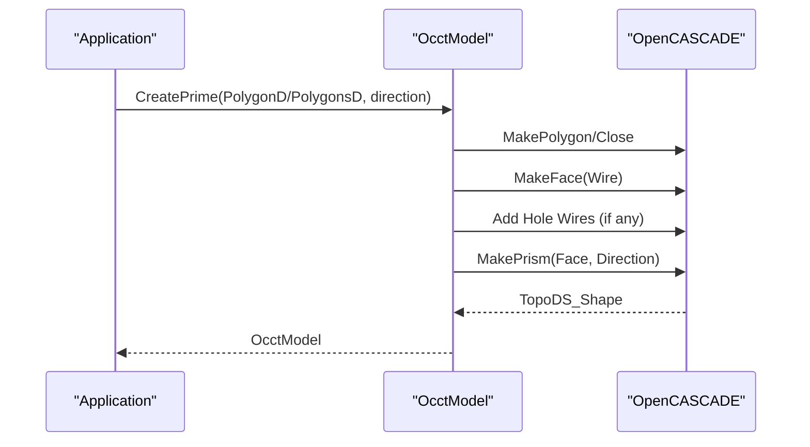
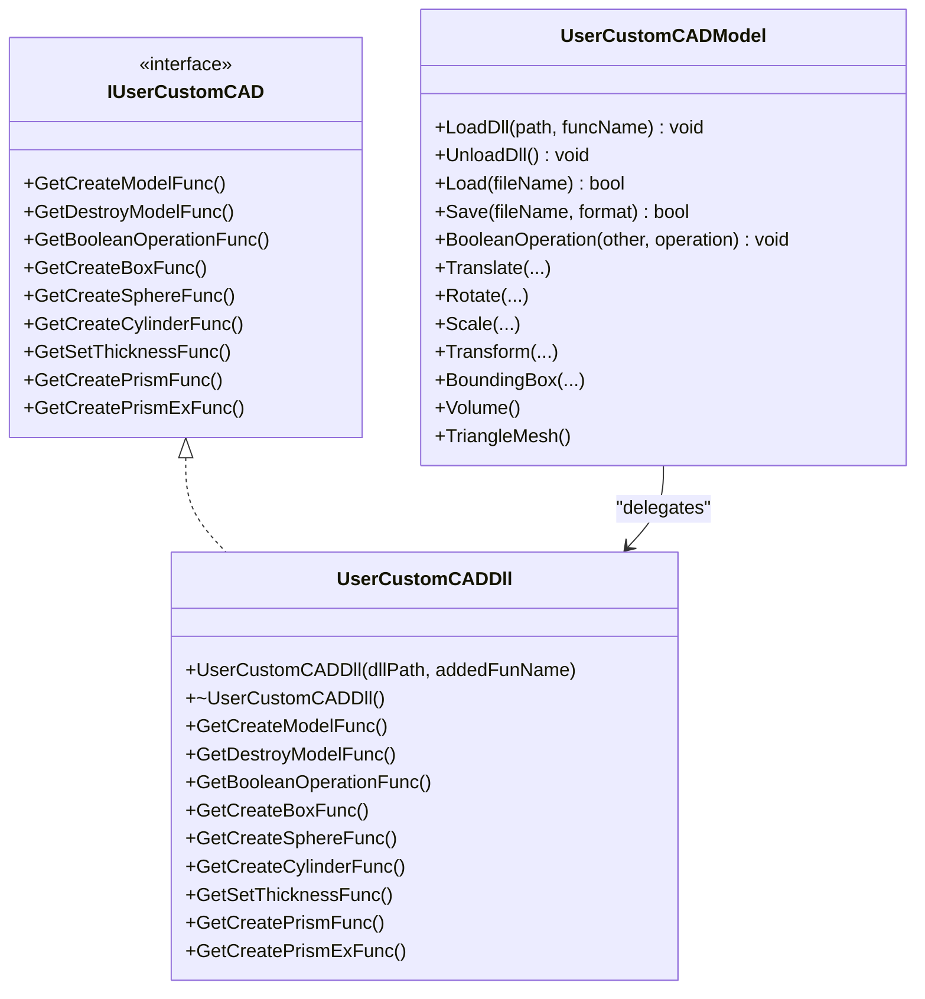
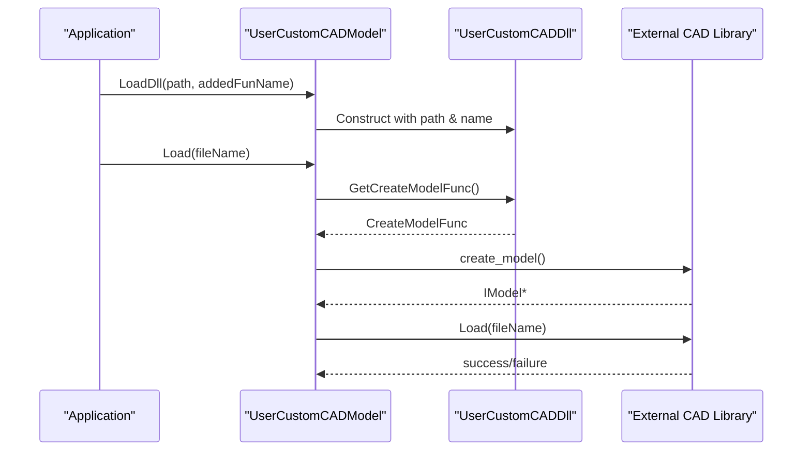
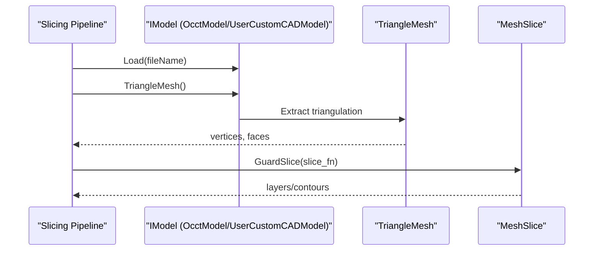
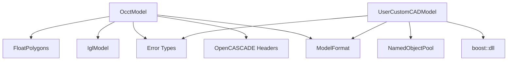

# CAD Model Support

<cite>
**Referenced Files in This Document**
- [OcctModel.hpp](file://cadmodel/OcctModel.hpp)
- [OcctModel.cpp](file://cadmodel/OcctModel.cpp)
- [OcctTypeAliases.hpp](file://cadmodel/OcctTypeAliases.hpp)
- [UserCustomCADModel.hpp](file://cadmodel/UserCustomCADModel.hpp)
- [UserCustomCADModel.cpp](file://cadmodel/UserCustomCADModel.cpp)
- [IModel.hpp](file://base/IModel.hpp)
- [FloatPolygons.hpp](file://2D/FloatPolygons.hpp)
- [occt_model_test.cpp](file://tests/Models/occt_model_test.cpp)
- [mesh_slice.cpp](file://LibHsBaSlicer/Slice/mesh_slice.cpp)
</cite>

## Table of Contents
1. [Introduction](#introduction)
2. [Project Structure](#project-structure)
3. [Core Components](#core-components)
4. [Architecture Overview](#architecture-overview)
5. [Detailed Component Analysis](#detailed-component-analysis)
6. [Dependency Analysis](#dependency-analysis)
7. [Performance Considerations](#performance-considerations)
8. [Troubleshooting Guide](#troubleshooting-guide)
9. [Conclusion](#conclusion)
10. [Appendices](#appendices)

## Introduction
This document explains HsBaSlicer’s CAD model support through OpenCASCADE integration. It focuses on the OcctModel class, which provides B-rep operations, CAD format import/export, geometric modeling primitives, boolean operations, thick-solid/shell operations, and mesh conversion. It also documents the UserCustomCADModel interface for extending CAD functionality with custom implementations loaded from external libraries, as well as type aliases and conversions between OpenCASCADE data structures and HsBaSlicer internal representations. Finally, it covers precision handling, slicing integration, and best practices for complex CAD geometries.

## Project Structure
The CAD-related code is primarily located under the cadmodel directory and integrates with the base IModel abstraction and 2D polygon utilities:

- cadmodel/OcctModel.*: OpenCASCADE-based B-rep model implementation.
- cadmodel/OcctTypeAliases.hpp: OCCT version-conditional scalar type aliases.
- cadmodel/UserCustomCADModel.*: Interface and loader for user-supplied CAD libraries.
- base/IModel.hpp: Common model interface used by all model backends.
- 2D/FloatPolygons.hpp: Double-precision polygon types used for extrusion primitives.
- tests/Models/occt_model_test.cpp: Unit tests demonstrating CAD workflows.
- LibHsBaSlicer/Slice/mesh_slice.cpp: Slicing entry points that depend on mesh extraction from models.

**Diagram sources**
- [OcctModel.hpp:20-125](file://cadmodel/OcctModel.hpp#L20-L125)
- [UserCustomCADModel.hpp:17-121](file://cadmodel/UserCustomCADModel.hpp#L17-L121)
- [IModel.hpp:63-139](file://base/IModel.hpp#L63-L139)
- [FloatPolygons.hpp:16-26](file://2D/FloatPolygons.hpp#L16-L26)
- [mesh_slice.cpp:14-44](file://LibHsBaSlicer/Slice/mesh_slice.cpp#L14-L44)

**Section sources**
- [OcctModel.hpp:20-125](file://cadmodel/OcctModel.hpp#L20-L125)
- [UserCustomCADModel.hpp:17-121](file://cadmodel/UserCustomCADModel.hpp#L17-L121)
- [IModel.hpp:63-139](file://base/IModel.hpp#L63-L139)
- [FloatPolygons.hpp:16-26](file://2D/FloatPolygons.hpp#L16-L26)

## Core Components
- OcctModel: Implements IModel using OpenCASCADE TopoDS_Shape. Supports loading/saving STEP/IGES/VRML/BRep, affine transforms, bounding box, volume, tessellation to triangle mesh, boolean operations (union/intersection/difference/xor), thick-solid/shell creation, and primitive factories (box, sphere, cylinder, cone, torus, extruded polygons).
- UserCustomCADModel: Implements IModel by delegating to a dynamically loaded user CAD library via function pointers. Provides LoadDll/UnloadDll, Load/Save, transformations, boolean operations, bounding box, volume, and TriangleMesh.
- OcctTypeAliases: Maps OCCT scalar types to standard C++ types depending on OCCT version (OCCT 8.0+ vs earlier).
- IModel: Base interface defining common model operations (load/save, transform, bbox, volume, mesh).
- FloatPolygons: Defines PolygonD/PolygonsD used by OcctModel::CreatePrime for extruding 2D contours into solids.

Key responsibilities:
- CAD file I/O and format routing.
- Geometric modeling primitives and boolean operations.
- Precision and tolerance handling for thick-solid and face matching.
- Conversion from B-rep to triangle meshes for slicing pipelines.

**Section sources**
- [OcctModel.hpp:20-125](file://cadmodel/OcctModel.hpp#L20-L125)
- [OcctModel.cpp:61-669](file://cadmodel/OcctModel.cpp#L61-L669)
- [UserCustomCADModel.hpp:17-121](file://cadmodel/UserCustomCADModel.hpp#L17-L121)
- [UserCustomCADModel.cpp:18-330](file://cadmodel/UserCustomCADModel.cpp#L18-L330)
- [OcctTypeAliases.hpp:1-45](file://cadmodel/OcctTypeAliases.hpp#L1-L45)
- [IModel.hpp:63-139](file://base/IModel.hpp#L63-L139)
- [FloatPolygons.hpp:16-26](file://2D/FloatPolygons.hpp#L16-L26)

## Architecture Overview
The CAD layer sits above the base model abstraction and below the slicing pipeline. OcctModel implements IModel directly, while UserCustomCADModel wraps an external CAD library and delegates IModel calls. Both provide TriangleMesh() so downstream components like MeshSlice can operate uniformly.

**Diagram sources**
- [IModel.hpp:63-139](file://base/IModel.hpp#L63-L139)
- [OcctModel.hpp:20-125](file://cadmodel/OcctModel.hpp#L20-L125)
- [UserCustomCADModel.hpp:17-121](file://cadmodel/UserCustomCADModel.hpp#L17-L121)
- [OcctTypeAliases.hpp:22-42](file://cadmodel/OcctTypeAliases.hpp#L22-L42)

## Detailed Component Analysis

### OcctModel: B-rep Operations and CAD Workflows
OcctModel encapsulates a TopoDS_Shape and exposes high-level CAD operations:

- File I/O:
  - Load determines format from extension and dispatches to ReadStep/ReadIGES/ReadVRML/ReadBRep.
  - Save supports STEP/IGES/VRML/BREP; for mesh formats, it converts to a triangle mesh and delegates to IglModel::Save.
- Transformations:
  - Translate/Rotate/Scale/Transform map Eigen types to OCCT gp_Trsf and apply via BRepBuilderAPI_Transform.
- Queries:
  - BoundingBox iterates vertices to compute AABB.
  - Volume uses GProp_GProps for signed volume.
  - TriangleMesh extracts triangulation per face, applies location transforms, and returns libigl-style vertex/face matrices.
- Boolean operations:
  - Union/Intersection/Difference/Xor are exposed as free functions operating on OcctModel shapes.
- Thick-solid/shell:
  - ThickSolid(model, thickness) creates a thickened solid.
  - ThickSolid(model, faces, thickness) builds faces from provided polygons and performs join-based thickening with distance/tolerance checks.
- Primitives:
  - CreateBox/CreateSphere/CreateCylinder/CreateCone/CreateTorus create OCCT primitives.
  - CreatePrime constructs prisms from single or multi-path polygons (outer contour plus holes).

**Diagram sources**
- [OcctModel.cpp:213-271](file://cadmodel/OcctModel.cpp#L213-L271)

Precision and robustness:
- ThickSolid with faces uses a tolerance threshold and distance checks to match existing faces before thickening.
- Extrusion validates polygon validity and handles holes by adding inner wires to the face.

**Diagram sources**
- [OcctModel.cpp:471-540](file://cadmodel/OcctModel.cpp#L471-L540)

Extrusion workflow:
- Single polygon: build closed wire, make face, extrude along direction.
- Multi-path: outer contour plus optional holes; validate each hole and add to face before extrusion.

**Diagram sources**
- [OcctModel.cpp:542-663](file://cadmodel/OcctModel.cpp#L542-L663)

**Section sources**
- [OcctModel.hpp:20-125](file://cadmodel/OcctModel.hpp#L20-L125)
- [OcctModel.cpp:61-669](file://cadmodel/OcctModel.cpp#L61-L669)

### UserCustomCADModel: Extending CAD Functionality
UserCustomCADModel allows integrating custom CAD libraries at runtime:

- IUserCustomCAD defines function pointer contracts for creating models, destroying them, performing named boolean operations, creating primitives, setting thickness, and extruding polygons.
- UserCustomCADDll loads a shared library and resolves exported symbols with a naming convention based on addedFunName (e.g., mycad_create_model).
- UserCustomCADModel manages DLL lifecycle via a NamedObjectPool and delegates IModel methods to the underlying model instance created by the DLL.

**Diagram sources**
- [UserCustomCADModel.hpp:17-121](file://cadmodel/UserCustomCADModel.hpp#L17-L121)
- [UserCustomCADModel.cpp:18-330](file://cadmodel/UserCustomCADModel.cpp#L18-L330)

DLL loading and symbol resolution:
- Functions are resolved by appending suffixes to addedFunName (e.g., "_create_model", "_boolean_operation").
- If a symbol is missing, getters return nullptr; higher-level methods throw RuntimeError when required functions are not available.

**Diagram sources**
- [UserCustomCADModel.cpp:134-173](file://cadmodel/UserCustomCADModel.cpp#L134-L173)

**Section sources**
- [UserCustomCADModel.hpp:17-121](file://cadmodel/UserCustomCADModel.hpp#L17-L121)
- [UserCustomCADModel.cpp:18-330](file://cadmodel/UserCustomCADModel.cpp#L18-L330)

### Type Aliases and Conversions
OcctTypeAliases abstracts OCCT scalar types across versions:

- For OCCT 8.0+, Integer/Boolean/Real map to int/bool/double.
- For earlier versions, they map to Standard_Integer/Standard_Boolean/Standard_Real.

Conversions between OpenCASCADE and HsBaSlicer:
- Eigen vectors/quaternions/matrices are converted to OCCT gp_Vec/gp_Quaternion/gp_Trsf for transformations.
- PolygonD/PolygonsD (double-precision 2D paths) are converted to OCCT edges/wires/faces for extrusion.
- TopoDS_Shape triangulation is extracted and transformed to produce Eigen-based vertex/face matrices for mesh consumers.

**Section sources**
- [OcctTypeAliases.hpp:1-45](file://cadmodel/OcctTypeAliases.hpp#L1-L45)
- [OcctModel.cpp:272-329](file://cadmodel/OcctModel.cpp#L272-L329)
- [OcctModel.cpp:353-400](file://cadmodel/OcctModel.cpp#L353-L400)
- [FloatPolygons.hpp:16-26](file://2D/FloatPolygons.hpp#L16-L26)

### CAD-Specific Operations
- Solid modeling:
  - Boolean operations via BRepAlgoAPI_Fuse/Common/Cut.
  - Thick-solid/shell via BRepOffsetAPI_MakeThickSolid.
  - Primitives via BRepPrimAPI_* constructors.
- Surface operations:
  - Face construction from wires and holes.
  - Tessellation via BRep_Tool::Triangulation.
- Precision handling:
  - Tolerance thresholds in face matching and thickening.
  - Signed volume computation via GProp_GProps.

**Section sources**
- [OcctModel.cpp:451-540](file://cadmodel/OcctModel.cpp#L451-L540)
- [OcctModel.cpp:402-420](file://cadmodel/OcctModel.cpp#L402-L420)
- [OcctModel.cpp:353-400](file://cadmodel/OcctModel.cpp#L353-L400)

### Examples of CAD Model Processing Workflows
- Creating primitives and querying properties:
  - Box creation and volume/bounding-box validation.
  - Sphere creation and volume verification.
- Boolean operations:
  - Union/intersection/difference/xor between overlapping boxes.
- Extrusion:
  - Single polygon extrusion and multi-path extrusion with holes.
  - Non-planar direction extrusion.

These workflows are validated in unit tests.

**Section sources**
- [occt_model_test.cpp:8-134](file://tests/Models/occt_model_test.cpp#L8-L134)

### Integration with Mesh Conversion Pipelines
- OcctModel::TriangleMesh produces Eigen-based vertex/face matrices suitable for mesh processing.
- The slicing subsystem expects mesh inputs; mesh_slice.cpp guards slicing calls and translates foreign exceptions (including OCCT failures) into project IOError types.

**Diagram sources**
- [OcctModel.cpp:353-400](file://cadmodel/OcctModel.cpp#L353-L400)
- [mesh_slice.cpp:14-44](file://LibHsBaSlicer/Slice/mesh_slice.cpp#L14-L44)

**Section sources**
- [mesh_slice.cpp:14-44](file://LibHsBaSlicer/Slice/mesh_slice.cpp#L14-L44)

## Dependency Analysis
- OcctModel depends on:
  - OpenCASCADE headers for B-rep operations, IO, geometry, and properties.
  - base/ModelFormat for format detection.
  - base/error for error types.
  - meshmodel/IglModel for mesh export fallback.
  - 2D/FloatPolygons for polygon types.
- UserCustomCADModel depends on:
  - boost/dll for dynamic library loading.
  - base/object_pool for DLL pooling.
  - base/ModelFormat and base/error for consistent behavior.

**Diagram sources**
- [OcctModel.cpp:1-60](file://cadmodel/OcctModel.cpp#L1-L60)
- [UserCustomCADModel.cpp:1-20](file://cadmodel/UserCustomCADModel.cpp#L1-L20)

**Section sources**
- [OcctModel.cpp:1-60](file://cadmodel/OcctModel.cpp#L1-L60)
- [UserCustomCADModel.cpp:1-20](file://cadmodel/UserCustomCADModel.cpp#L1-L20)

## Performance Considerations
- Tessellation cost:
  - TriangleMesh iterates over faces and may be expensive for complex models; consider caching or limiting tessellation depth where possible.
- Boolean operations:
  - Complex boolean operations can be computationally intensive; prefer simplifying geometry beforehand.
- Thick-solid operations:
  - Face matching and distance computations add overhead; tune tolerance appropriately for your geometry scale.
- Transformations:
  - Applying multiple transforms sequentially rebuilds the shape; batch transforms when feasible.

[No sources needed since this section provides general guidance]

## Troubleshooting Guide
Common issues and resolutions:
- Unsupported model format:
  - Occurs when Load/Save encounters unknown extensions or unsupported formats. Ensure correct file extensions and supported formats (STEP/IGES/VRML/BREP for CAD; mesh formats delegate to IglModel).
- VRML read/write errors:
  - VRML reading requires VrmlData_Scene; ensure proper file stream handling and exception wrapping.
- Missing DLL symbols:
  - UserCustomCADModel throws RuntimeError if required functions are not found; verify symbol names follow the expected naming convention.
- Model not loaded:
  - Transformation/query methods throw RuntimeError if no model is loaded; call Load first.
- Slicing exceptions:
  - Foreign exceptions from CGAL/OCCT are wrapped into IOError by mesh_slice.cpp; inspect error messages for root causes.

**Section sources**
- [OcctModel.cpp:213-271](file://cadmodel/OcctModel.cpp#L213-L271)
- [OcctModel.cpp:110-147](file://cadmodel/OcctModel.cpp#L110-L147)
- [UserCustomCADModel.cpp:151-173](file://cadmodel/UserCustomCADModel.cpp#L151-L173)
- [UserCustomCADModel.cpp:184-266](file://cadmodel/UserCustomCADModel.cpp#L184-L266)
- [mesh_slice.cpp:14-44](file://LibHsBaSlicer/Slice/mesh_slice.cpp#L14-L44)

## Conclusion
HsBaSlicer’s CAD support centers around OcctModel, providing robust B-rep operations, CAD format I/O, geometric primitives, boolean operations, and mesh conversion. UserCustomCADModel enables extensibility through dynamically loaded CAD libraries, maintaining a uniform IModel interface. With careful attention to precision, performance, and error handling, these components integrate smoothly into slicing pipelines and support complex CAD geometries in additive manufacturing workflows.

[No sources needed since this section summarizes without analyzing specific files]

## Appendices
- Best practices:
  - Validate polygon inputs before extrusion; ensure closed loops and correct orientation for holes.
  - Use appropriate tolerances for thick-solid operations relative to model scale.
  - Prefer batching transformations to minimize repeated shape rebuilds.
  - When exporting to mesh formats, ensure sufficient tessellation quality for downstream slicing accuracy.

[No sources needed since this section provides general guidance]