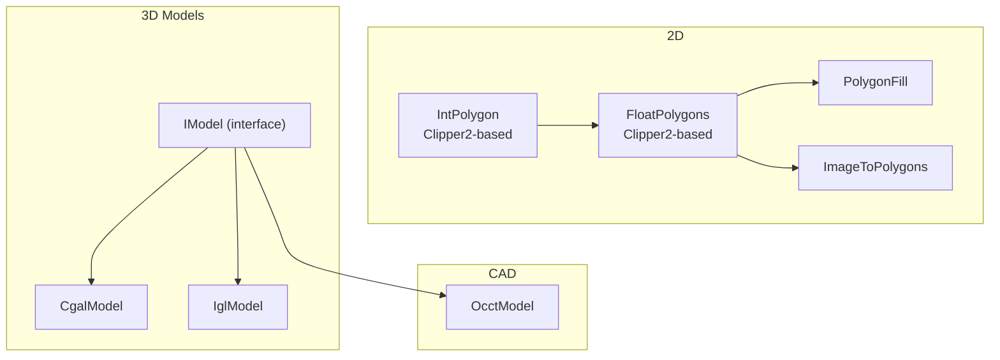
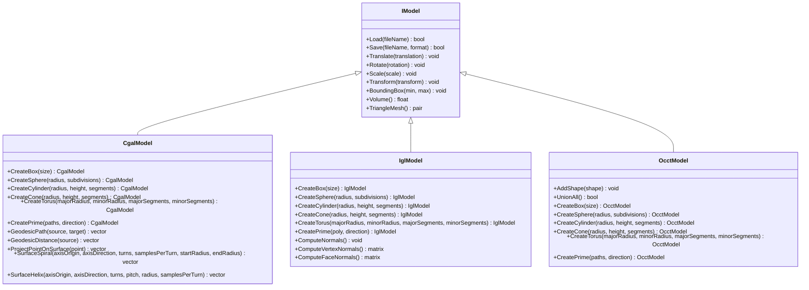
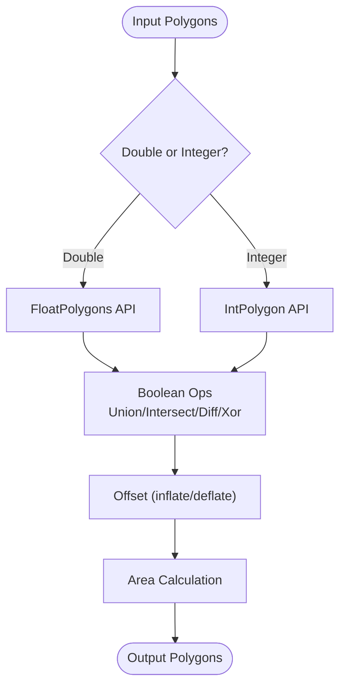
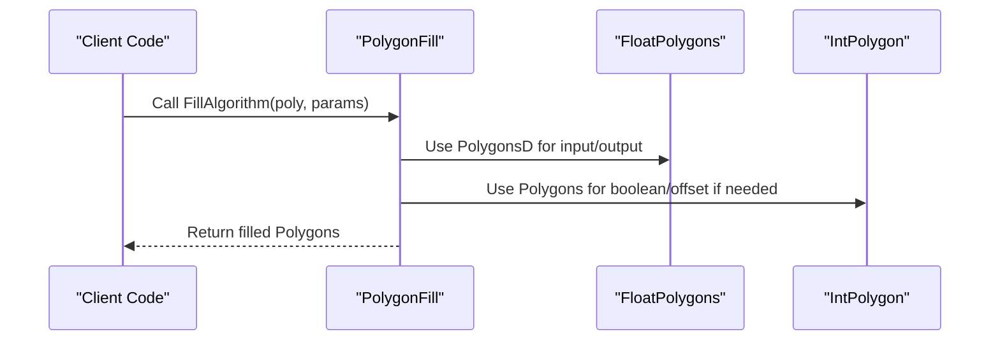
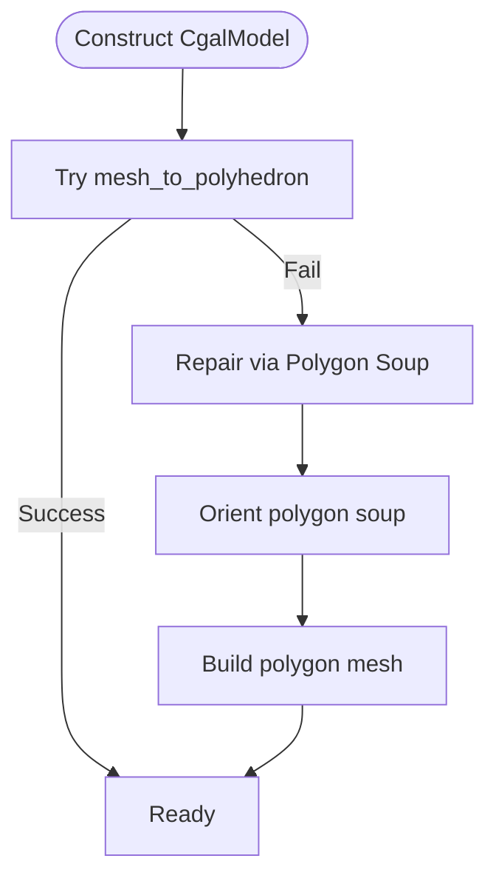
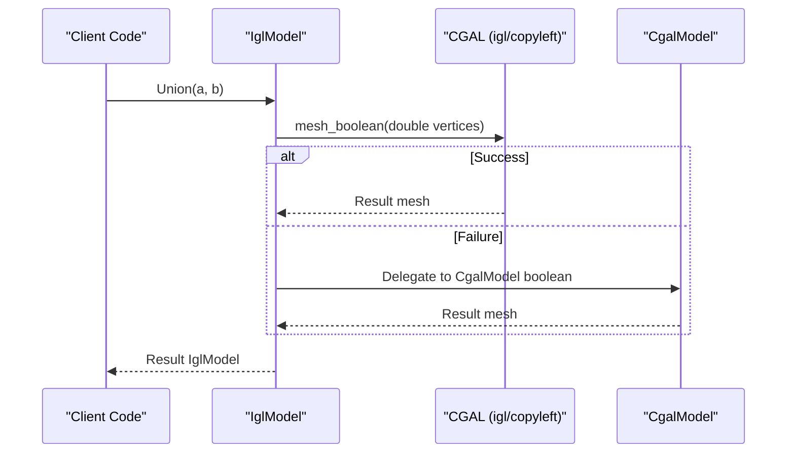
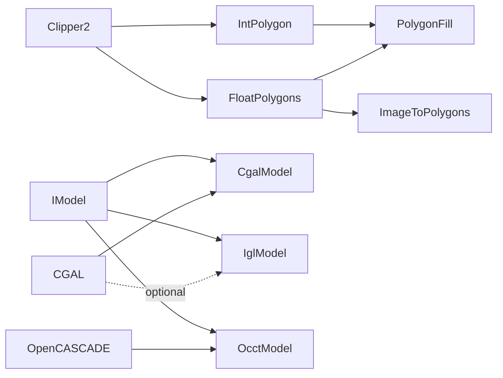

# Geometry Processing

<cite>
**Referenced Files in This Document**
- [IntPolygon.hpp](file://2D/IntPolygon.hpp)
- [IntPolygon.cpp](file://2D/IntPolygon.cpp)
- [FloatPolygons.hpp](file://2D/FloatPolygons.hpp)
- [FloatPolygons.cpp](file://2D/FloatPolygons.cpp)
- [ImageToPolygons.hpp](file://2D/ImageToPolygons.hpp)
- [PolygonFill.hpp](file://2D/PolygonFill.hpp)
- [IModel.hpp](file://base/IModel.hpp)
- [CgalModel.hpp](file://meshmodel/CgalModel.hpp)
- [CgalModel.cpp](file://meshmodel/CgalModel.cpp)
- [IglModel.hpp](file://meshmodel/IglModel.hpp)
- [IglModel.cpp](file://meshmodel/IglModel.cpp)
- [OcctModel.hpp](file://cadmodel/OcctModel.hpp)
</cite>

## Table of Contents
1. [Introduction](#introduction)
2. [Project Structure](#project-structure)
3. [Core Components](#core-components)
4. [Architecture Overview](#architecture-overview)
5. [Detailed Component Analysis](#detailed-component-analysis)
6. [Dependency Analysis](#dependency-analysis)
7. [Performance Considerations](#performance-considerations)
8. [Troubleshooting Guide](#troubleshooting-guide)
9. [Conclusion](#conclusion)

## Introduction
This document explains HsBaSlicer’s geometry processing capabilities with a focus on:
- 2D polygon operations using Clipper2 (integer and double precision types), including boolean operations, offsets, area, point-in-polygon tests, and fill algorithms.
- Mesh processing backends via CGAL and libigl, covering mesh repair, validation, geometric queries, and boolean operations.
- CAD model support through OpenCASCADE (B-rep), including format conversions and B-rep operations.
- API references for the primary classes and functions used throughout the slicing pipeline.

## Project Structure
The geometry processing code is organized into layered modules:
- 2D geometry: integer and double-precision polygons, image-to-polygon conversion, and fill pattern generation.
- 3D models: an abstract IModel interface implemented by CGAL-backed, libigl-backed, and OpenCASCADE-backed models.
- CAD models: OpenCASCADE B-rep primitives and file I/O.

**Diagram sources**
- [IntPolygon.hpp:1-241](file://2D/IntPolygon.hpp#L1-L241)
- [FloatPolygons.hpp:1-271](file://2D/FloatPolygons.hpp#L1-L271)
- [ImageToPolygons.hpp:1-83](file://2D/ImageToPolygons.hpp#L1-L83)
- [PolygonFill.hpp:1-141](file://2D/PolygonFill.hpp#L1-L141)
- [IModel.hpp:1-151](file://base/IModel.hpp#L1-L151)
- [CgalModel.hpp:1-166](file://meshmodel/CgalModel.hpp#L1-L166)
- [IglModel.hpp:1-124](file://meshmodel/IglModel.hpp#L1-L124)
- [OcctModel.hpp:1-132](file://cadmodel/OcctModel.hpp#L1-L132)

**Section sources**
- [IntPolygon.hpp:1-241](file://2D/IntPolygon.hpp#L1-L241)
- [FloatPolygons.hpp:1-271](file://2D/FloatPolygons.hpp#L1-L271)
- [ImageToPolygons.hpp:1-83](file://2D/ImageToPolygons.hpp#L1-L83)
- [PolygonFill.hpp:1-141](file://2D/PolygonFill.hpp#L1-L141)
- [IModel.hpp:1-151](file://base/IModel.hpp#L1-L151)
- [CgalModel.hpp:1-166](file://meshmodel/CgalModel.hpp#L1-L166)
- [IglModel.hpp:1-124](file://meshmodel/IglModel.hpp#L1-L124)
- [OcctModel.hpp:1-132](file://cadmodel/OcctModel.hpp#L1-L132)

## Core Components
- IntPolygon: Integer-coordinate polygon type aliases and Clipper2-based boolean, offset, area, and point-in-polygon utilities.
- FloatPolygons: Double-precision polygon type aliases, shape generators, text-to-polygons, and integer/double conversion helpers.
- ImageToPolygons: Raster image to polygon conversion and polygon rendering to images.
- PolygonFill: Fill pattern generators (offset, line, zigzag, composite, hybrid) and Lua-driven custom fills.
- IModel: Abstract interface for 3D models (load/save, transforms, bounding box, volume, triangle mesh).
- CgalModel: CGAL-backed polyhedral mesh model with Nef-based boolean operations, extrusion from 2D polygons, and surface geodesic/helix operations.
- IglModel: libigl-backed triangle mesh model with normals computation and optional CGAL-based boolean operations.
- OcctModel: OpenCASCADE B-rep model supporting STEP/IGES/VRML/BRep I/O, thick-solid operations, and primitive creation.

**Section sources**
- [IntPolygon.hpp:1-241](file://2D/IntPolygon.hpp#L1-L241)
- [FloatPolygons.hpp:1-271](file://2D/FloatPolygons.hpp#L1-L271)
- [ImageToPolygons.hpp:1-83](file://2D/ImageToPolygons.hpp#L1-L83)
- [PolygonFill.hpp:1-141](file://2D/PolygonFill.hpp#L1-L141)
- [IModel.hpp:1-151](file://base/IModel.hpp#L1-L151)
- [CgalModel.hpp:1-166](file://meshmodel/CgalModel.hpp#L1-L166)
- [IglModel.hpp:1-124](file://meshmodel/IglModel.hpp#L1-L124)
- [OcctModel.hpp:1-132](file://cadmodel/OcctModel.hpp#L1-L132)

## Architecture Overview
HsBaSlicer composes geometry processing across layers:
- 2D layer: Clipper2 provides robust boolean operations and offsets; FloatPolygons adds shape/text generators and coordinate conversions; PolygonFill generates infill patterns.
- 3D layer: IModel defines a uniform interface; CgalModel uses CGAL for precise boolean operations and advanced geometry; IglModel stores Eigen meshes and optionally delegates booleans to CGAL.
- CAD layer: OcctModel wraps TopoDS_Shape for B-rep operations and multi-format I/O.

**Diagram sources**
- [IModel.hpp:110-139](file://base/IModel.hpp#L110-L139)
- [CgalModel.hpp:89-149](file://meshmodel/CgalModel.hpp#L89-L149)
- [IglModel.hpp:96-112](file://meshmodel/IglModel.hpp#L96-L112)
- [OcctModel.hpp:83-109](file://cadmodel/OcctModel.hpp#L83-L109)

## Detailed Component Analysis

### 2D Polygon Operations (Clipper2 Integration)
Key responsibilities:
- Boolean operations: Union, Intersection, Difference, Xor for both single polygons and polygon sets.
- Offsets: Inflate/deflate polygons with configurable join/end types.
- Area and Point-in-Polygon: Signed area calculation and even-odd/non-zero winding rules.
- Simplification and normalization: Remove collinear points and split into simple polygons.
- Coordinate systems: Integerization/un-integerization between double and integer coordinates.

API highlights:
- IntPolygon: MakeSimple, Union/Intersection/Difference/Xor (single and set overloads), Offset, PointInPolygons, Area, NormalizeToSimplePolygons, MakeSimpleAndSplit.
- FloatPolygons: Same boolean/area APIs plus MakeRectangle, MakeCircle, MakeEllipse, MakeRegularPolygon, TextToPolygons, Integerization/UnIntegerization.

**Diagram sources**
- [IntPolygon.hpp:28-192](file://2D/IntPolygon.hpp#L28-L192)
- [FloatPolygons.hpp:27-135](file://2D/FloatPolygons.hpp#L27-L135)

Usage examples (described):
- Compute union of two polygons: call Union(left, right) with desired FillRule.
- Offset a polygon outward by delta: call Offset(p, delta, JoinType::Square, EndType::Polygon).
- Convert text to polygons: call TextToPolygons(utf8_text, font_file, font_size, x, y, curve_segments).

**Section sources**
- [IntPolygon.hpp:28-192](file://2D/IntPolygon.hpp#L28-L192)
- [IntPolygon.cpp:19-130](file://2D/IntPolygon.cpp#L19-L130)
- [FloatPolygons.hpp:27-135](file://2D/FloatPolygons.hpp#L27-L135)
- [FloatPolygons.cpp:25-75](file://2D/FloatPolygons.cpp#L25-L75)

### Polygon Fill Algorithms
Capabilities:
- Offset-based fill: Generate concentric offset lines within the polygon boundary.
- Line fill: Parallel lines at specified spacing and angle.
- Zigzag fill: Simple and improved corner handling variants.
- Composite/Hybrid fills: Combine offset borders with internal fill modes.
- Lua-driven custom fills: Provide scripts or inline code to generate arbitrary fill patterns.

API highlights:
- OffsetFill, LineFill, SimpleZigzagFill, ZigzagFill.
- CompositeOffsetFill, HybridFill with FillMode enum.
- LuaCustomFill, LuaCustomFillString, RegisterLuaPolygonFillFunctions.

**Diagram sources**
- [PolygonFill.hpp:20-136](file://2D/PolygonFill.hpp#L20-L136)
- [FloatPolygons.hpp:18-26](file://2D/FloatPolygons.hpp#L18-L26)
- [IntPolygon.hpp:19-26](file://2D/IntPolygon.hpp#L19-L26)

Usage examples (described):
- Generate parallel line fill: LineFill(poly, spacing, angle_deg, lineThickness).
- Generate composite fill: CompositeOffsetFill(poly, spacing, offsetStep, outwardCount, inwardCount, mode, angle_deg, lineThickness, join_type).
- Custom Lua fill: LuaCustomFill(poly, scriptPath, functionName, lineThickness, lua_reg).

**Section sources**
- [PolygonFill.hpp:20-136](file://2D/PolygonFill.hpp#L20-L136)

### Image-to-Polygon Conversion
Capabilities:
- Thresholding: Convert grayscale images to polygons using single or multiple thresholds.
- Rendering: Export polygons to raster images with configurable foreground/background colors.
- Lua customization: Render pipelines driven by Lua scripts.

API highlights:
- FromImage(path, threshold, pixelSize).
- FromImageMulti(path, thresholds, pixelSize).
- ToImage(polys, width, height, pixelSize, outPath, foreground, background).
- LuaToImage/LuaToImageString for script-driven rendering.

Usage examples (described):
- Extract contours from an image: FromImage("input.png", 128, 1.0).
- Multi-threshold extraction: FromImageMulti("input.png", {50, 128, 200}, 1.0).
- Render polygons to PNG: ToImage(polys, 1024, 1024, 1.0, "output.png").

**Section sources**
- [ImageToPolygons.hpp:22-79](file://2D/ImageToPolygons.hpp#L22-L79)

### Mesh Processing Backends

#### CGAL Backend (CgalModel)
Responsibilities:
- Load/save mesh formats, affine transforms, bounding box, volume.
- Nef-based boolean operations (Union/Intersection/Difference/Xor).
- Primitive creation (box, sphere, cylinder, cone, torus).
- Extrusion from 2D polygons (CreatePrime).
- Advanced surface operations: geodesic path/distance, projection, spiral/helix generation.

Implementation notes:
- Mesh construction attempts direct conversion; if it fails, repairs via CGAL polygon soup orientation and mesh building.
- For CreatePrime, ensures correct winding and triangulation; fixes face orientation to maintain positive volume.

**Diagram sources**
- [CgalModel.cpp:42-84](file://meshmodel/CgalModel.cpp#L42-L84)

API highlights:
- Constructors from Polyhedron_3 or Eigen vertex/face matrices.
- Load/Save, Translate/Rotate/Scale/Transform, BoundingBox, Volume, TriangleMesh.
- Static creators: CreateBox/CreateSphere/CreateCylinder/CreateCone/CreateTorus.
- CreatePrime(PolygonD/PolygonsD, direction).
- GeodesicPath, GeodesicDistance, ProjectPointOnSurface, SurfaceSpiral, SurfaceHelix.

Usage examples (described):
- Create a solid from a closed polygon: CreatePrime(triangle, Vector3f(0,0,1)).
- Compute shortest geodesic between two surface points: GeodesicPath(source, target).
- Generate helix around an axis: SurfaceHelix(axisOrigin, axisDirection, turns, pitch, radius, samplesPerTurn).

**Section sources**
- [CgalModel.hpp:34-155](file://meshmodel/CgalModel.hpp#L34-L155)
- [CgalModel.cpp:42-84](file://meshmodel/CgalModel.cpp#L42-L84)
- [CgalModel.cpp:712-733](file://meshmodel/CgalModel.cpp#L712-L733)
- [CgalModel.cpp:735-755](file://meshmodel/CgalModel.cpp#L735-L755)
- [CgalModel.cpp:922-955](file://meshmodel/CgalModel.cpp#L922-L955)

#### libigl Backend (IglModel)
Responsibilities:
- Store vertices/faces/normals as Eigen matrices.
- Load/save mesh formats, affine transforms, bounding box, volume.
- Compute per-face and per-vertex normals.
- Optional CGAL-based boolean operations with fallback to CgalModel when needed.

Implementation notes:
- Boolean operations promote float vertices to double for CGAL; if that fails, falls back to CgalModel’s Nef boolean.
- Without USE_CGAL, boolean operations throw NotSupportedError.

**Diagram sources**
- [IglModel.cpp:195-230](file://meshmodel/IglModel.cpp#L195-L230)

API highlights:
- Constructors from Eigen matrices (with optional normals).
- Load/Save, Translate/Rotate/Scale/Transform, BoundingBox, Volume, TriangleMesh.
- ComputeNormals, ComputeVertexNormals, ComputeFaceNormals.
- Static creators: CreateBox/CreateSphere/CreateCylinder/CreateCone/CreateTorus.
- CreatePrime(PolygonD/PolygonsD, direction).

Usage examples (described):
- Compute normals: ComputeNormals() or ComputeVertexNormals().
- Create a box: CreateBox(Vector3f(1,1,1)).
- Perform boolean union (if CGAL enabled): Union(a, b).

**Section sources**
- [IglModel.hpp:26-121](file://meshmodel/IglModel.hpp#L26-L121)
- [IglModel.cpp:195-230](file://meshmodel/IglModel.cpp#L195-L230)
- [IglModel.cpp:392-409](file://meshmodel/IglModel.cpp#L392-L409)

### CAD Model Support (OpenCASCADE)
Responsibilities:
- Wrap TopoDS_Shape for B-rep modeling.
- Load/save STEP/IGES/VRML/BRep files.
- Apply transforms, compute bounding boxes, volume, tessellation to triangle mesh.
- B-rep operations: Union/Intersection/Difference/Xor, ThickSolid.
- Primitive creation and extrusion from 2D polygons.

API highlights:
- AddShape(shape) to build compounds.
- UnionAll() to fuse all sub-shapes.
- Load/Save, Translate/Rotate/Scale/Transform, BoundingBox, Volume, TriangleMesh.
- Static creators: CreateBox/CreateSphere/CreateCylinder/CreateCone/CreateTorus.
- CreatePrime(PolygonD/PolygonsD, direction).

Usage examples (described):
- Load a STEP file: Load("model.step").
- Fuse compound shapes: UnionAll().
- Create a solid from a polygon: CreatePrime(poly, Vector3f(0,0,1)).

**Section sources**
- [OcctModel.hpp:22-124](file://cadmodel/OcctModel.hpp#L22-L124)

## Dependency Analysis
- 2D layer depends on Clipper2 for robust boolean operations and offsets.
- FloatPolygons depends on IntPolygon for coordinate conversion and hashing.
- PolygonFill depends on FloatPolygons and IntPolygon for geometry primitives and operations.
- 3D models implement IModel; CgalModel and IglModel provide different computational backends.
- IglModel conditionally depends on CGAL (USE_CGAL) for boolean operations; otherwise throws NotSupportedError.
- CgalModel integrates CGAL libraries for mesh processing, boolean operations, and advanced geometry.
- OcctModel depends on OpenCASCADE for B-rep operations and file I/O.

**Diagram sources**
- [IntPolygon.hpp:9-11](file://2D/IntPolygon.hpp#L9-L11)
- [FloatPolygons.hpp:9-12](file://2D/FloatPolygons.hpp#L9-L12)
- [PolygonFill.hpp:9-10](file://2D/PolygonFill.hpp#L9-L10)
- [IModel.hpp:110-139](file://base/IModel.hpp#L110-L139)
- [CgalModel.hpp:14-22](file://meshmodel/CgalModel.hpp#L14-L22)
- [IglModel.hpp:9-14](file://meshmodel/IglModel.hpp#L9-L14)
- [OcctModel.hpp:11-18](file://cadmodel/OcctModel.hpp#L11-L18)

**Section sources**
- [IntPolygon.hpp:9-11](file://2D/IntPolygon.hpp#L9-L11)
- [FloatPolygons.hpp:9-12](file://2D/FloatPolygons.hpp#L9-L12)
- [PolygonFill.hpp:9-10](file://2D/PolygonFill.hpp#L9-L10)
- [IModel.hpp:110-139](file://base/IModel.hpp#L110-L139)
- [CgalModel.hpp:14-22](file://meshmodel/CgalModel.hpp#L14-L22)
- [IglModel.hpp:9-14](file://meshmodel/IglModel.hpp#L9-L14)
- [OcctModel.hpp:11-18](file://cadmodel/OcctModel.hpp#L11-L18)

## Performance Considerations
- Prefer integer-coordinate operations (IntPolygon) for performance-critical boolean and offset computations; use FloatPolygons for high-precision workflows.
- When using IglModel boolean operations, ensure inputs are well-conditioned; co-planar faces may cause failures in igl::mesh_boolean, triggering fallback to CgalModel.
- For large polygon sets, simplify paths before boolean operations to reduce complexity.
- In CgalModel CreatePrime, ensure correct winding order to avoid inflated volumes due to misinterpreted holes.

[No sources needed since this section provides general guidance]

## Troubleshooting Guide
Common issues and resolutions:
- Empty results from boolean operations:
  - Validate input meshes; check for non-manifold edges or degenerate triangles.
  - For IglModel without CGAL, boolean operations will throw NotSupportedError; enable USE_CGAL or switch to CgalModel.
- Incorrect volume sign in CgalModel:
  - Ensure face orientations are consistent; the implementation reverses orientations if volume is negative after triangulation.
- Text-to-polygons requires FreeType:
  - Ensure HSBA_HAVE_FREETYPE is defined and FreeType is linked; otherwise TextToPolygons will not be available.

**Section sources**
- [IglModel.cpp:392-409](file://meshmodel/IglModel.cpp#L392-L409)
- [CgalModel.cpp:725-733](file://meshmodel/CgalModel.cpp#L725-L733)
- [FloatPolygons.cpp:17-21](file://2D/FloatPolygons.cpp#L17-L21)

## Conclusion
HsBaSlicer provides a comprehensive geometry processing toolkit:
- Robust 2D polygon operations via Clipper2 with flexible fill algorithms.
- Dual 3D backends (CGAL and libigl) offering precise boolean operations and efficient mesh storage/computation.
- Full CAD integration through OpenCASCADE for B-rep modeling and multi-format I/O.
These components integrate seamlessly to support the slicing pipeline from 2D profiles to 3D toolpaths.

[No sources needed since this section summarizes without analyzing specific files]