# Mesh Processing

<cite>
**Referenced Files in This Document**
- [IModel.hpp](file://base/IModel.hpp)
- [CgalModel.hpp](file://meshmodel/CgalModel.hpp)
- [CgalModel.cpp](file://meshmodel/CgalModel.cpp)
- [IglModel.hpp](file://meshmodel/IglModel.hpp)
- [IglModel.cpp](file://meshmodel/IglModel.cpp)
- [FullTopoModel.hpp](file://meshmodel/FullTopoModel.hpp)
- [FullTopoModel.cpp](file://meshmodel/FullTopoModel.cpp)
- [cgal_model_test.cpp](file://tests/Models/cgal_model_test.cpp)
- [igl_model_test.cpp](file://tests/Models/igl_model_test.cpp)
- [full_topo_model_test.cpp](file://tests/Models/full_topo_model_test.cpp)
</cite>

## Table of Contents
1. [Introduction](#introduction)
2. [Project Structure](#project-structure)
3. [Core Components](#core-components)
4. [Architecture Overview](#architecture-overview)
5. [Detailed Component Analysis](#detailed-component-analysis)
6. [Dependency Analysis](#dependency-analysis)
7. [Performance Considerations](#performance-considerations)
8. [Troubleshooting Guide](#troubleshooting-guide)
9. [Conclusion](#conclusion)
10. [Appendices](#appendices)

## Introduction
This document explains HsBaSlicer’s mesh processing capabilities with a focus on multiple backends and slicing-oriented topology. It covers:

- The CGAL-backed `CgalModel` implementation providing advanced computational geometry operations, including robust boolean operations, mesh repair during construction, orientation handling, and surface geodesic/helix/spiral utilities.
- The libigl-backed `IglModel` offering efficient triangle-mesh storage and numerical operations, including normals, volume, transforms, primitives, extrusion, and conditional boolean operations.
- The `FullTopoModel` abstract-style interface that reconstructs full vertex/edge/face topology from an `IModel`, enabling safe and fast Z-slicing, topological checks, Euler characteristic computation, and Lua-driven custom slicing.
- Mesh conversion between formats, coordinate system transformations, and quality-related behaviors such as face orientation correction and winding normalization.
- Usage examples for loading, processing pipelines, and output generation, together with guidance for comparing backend performance characteristics.

## Project Structure
The mesh processing layer is centered under `meshmodel/`. The core abstraction is defined in `base/IModel.hpp`, while concrete backends are implemented in `CgalModel.*` and `IglModel.*`. A slicing-focused topology model is provided by `FullTopoModel.*`. Tests validating behavior live under `tests/Models/`.

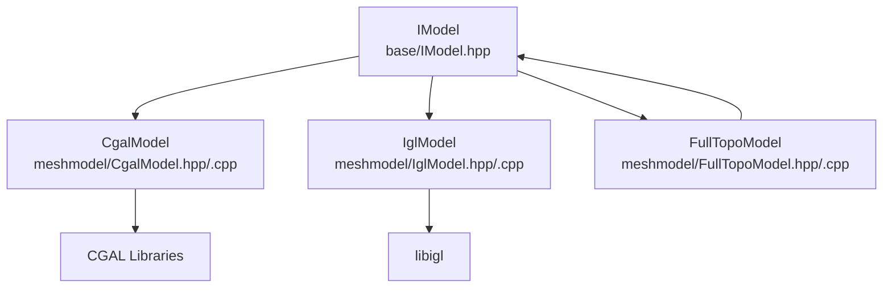

**Diagram sources**
- [IModel.hpp:110-139](file://base/IModel.hpp#L110-L139)
- [CgalModel.hpp:26-155](file://meshmodel/CgalModel.hpp#L26-L155)
- [IglModel.hpp:18-121](file://meshmodel/IglModel.hpp#L18-L121)
- [FullTopoModel.hpp:43-142](file://meshmodel/FullTopoModel.hpp#L43-L142)

**Section sources**
- [IModel.hpp:110-139](file://base/IModel.hpp#L110-L139)
- [CgalModel.hpp:26-155](file://meshmodel/CgalModel.hpp#L26-L155)
- [IglModel.hpp:18-121](file://meshmodel/IglModel.hpp#L18-L121)
- [FullTopoModel.hpp:43-142](file://meshmodel/FullTopoModel.hpp#L43-L142)

## Core Components
- `IModel`: Abstract interface defining load/save, transforms, bounding box, volume, and triangle mesh access.
- `CgalModel`: CGAL-based polyhedral mesh model implementing `IModel`, with Nef-based boolean operations, primitive creation, extrusion, and surface path utilities.
- `IglModel`: libigl-based triangle mesh model implementing `IModel`, with normals, volume, transforms, primitives, extrusion, and optional boolean operations via CGAL fallback.
- `FullTopoModel`: Topology-reconstructed slicing model built from any `IModel`, exposing vertex/edge/face relationships, topological validation, Euler characteristic, and multiple slicing APIs.

Key responsibilities:
- Loading/saving meshes across STL/OBJ/PLY/OFF.
- Applying translation, rotation, scaling, and general affine/isometric transforms.
- Computing bounding boxes and signed volumes.
- Providing boolean operations (union/intersection/difference/xor).
- Creating standard primitives and extruding 2D polygons into solids.
- Reconstructing full topology for slicing and analysis.

**Section sources**
- [IModel.hpp:110-139](file://base/IModel.hpp#L110-L139)
- [CgalModel.hpp:26-155](file://meshmodel/CgalModel.hpp#L26-L155)
- [IglModel.hpp:18-121](file://meshmodel/IglModel.hpp#L18-L121)
- [FullTopoModel.hpp:43-142](file://meshmodel/FullTopoModel.hpp#L43-L142)

## Architecture Overview
HsBaSlicer uses a backend-agnostic interface (`IModel`) to decouple application logic from specific geometry kernels. `CgalModel` and `IglModel` implement this interface, while `FullTopoModel` consumes any `IModel` to build a full topological representation optimized for slicing.

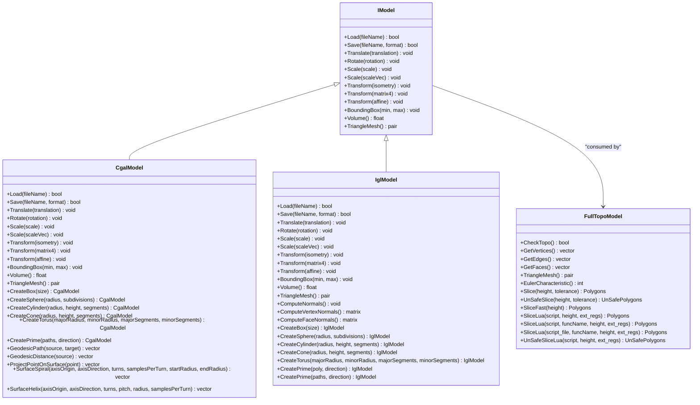

**Diagram sources**
- [IModel.hpp:110-139](file://base/IModel.hpp#L110-L139)
- [CgalModel.hpp:26-155](file://meshmodel/CgalModel.hpp#L26-L155)
- [IglModel.hpp:18-121](file://meshmodel/IglModel.hpp#L18-L121)
- [FullTopoModel.hpp:43-142](file://meshmodel/FullTopoModel.hpp#L43-L142)

## Detailed Component Analysis

### CGAL-Based CgalModel
`CgalModel` wraps a CGAL polyhedron and provides:

- Robust file I/O for STL/OBJ/PLY/OFF.
- Mesh repair during construction from vertex/face data, including polygon soup orientation, duplicate vertex merging, and face orientation correction based on signed volume.
- Transformations applied through CGAL affine transforms.
- Bounding box and volume queries.
- Boolean operations using CGAL Nef polyhedra: union, intersection, difference, symmetric difference.
- Primitive factories for box, sphere, cylinder, cone, torus.
- Extrusion from 2D polygons into closed solids with consistent winding and orientation.
- Surface geodesic path computation, distance field, point projection, spiral, and helix generation.

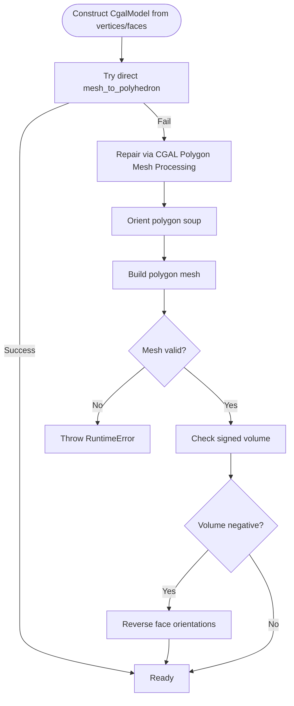

**Diagram sources**
- [CgalModel.cpp:42-119](file://meshmodel/CgalModel.cpp#L42-L119)

Boolean operations use Nef polyhedra:

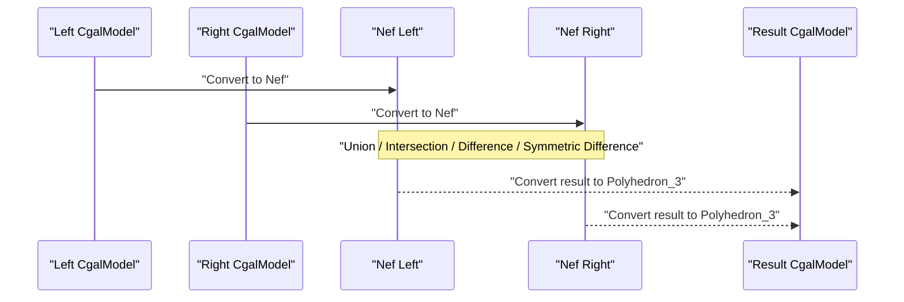

**Diagram sources**
- [CgalModel.cpp:238-276](file://meshmodel/CgalModel.cpp#L238-L276)

Extrusion ensures correct winding and orientation:

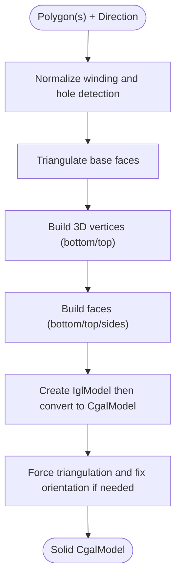

**Diagram sources**
- [CgalModel.cpp:625-733](file://meshmodel/CgalModel.cpp#L625-L733)
- [CgalModel.cpp:735-800](file://meshmodel/CgalModel.cpp#L735-L800)

**Section sources**
- [CgalModel.hpp:26-155](file://meshmodel/CgalModel.hpp#L26-L155)
- [CgalModel.cpp:42-119](file://meshmodel/CgalModel.cpp#L42-L119)
- [CgalModel.cpp:121-157](file://meshmodel/CgalModel.cpp#L121-L157)
- [CgalModel.cpp:158-237](file://meshmodel/CgalModel.cpp#L158-L237)
- [CgalModel.cpp:238-276](file://meshmodel/CgalModel.cpp#L238-L276)
- [CgalModel.cpp:278-445](file://meshmodel/CgalModel.cpp#L278-L445)
- [CgalModel.cpp:625-733](file://meshmodel/CgalModel.cpp#L625-L733)
- [CgalModel.cpp:735-800](file://meshmodel/CgalModel.cpp#L735-L800)

### libigl-Based IglModel
`IglModel` stores vertices, faces, and optional normals as Eigen matrices and provides:

- File I/O for STL/OBJ/PLY/OFF.
- Efficient transforms for row-stored meshes.
- Bounding box and signed volume computation.
- Normals computation (per-face and per-vertex).
- Primitive factories for common shapes.
- Extrusion from 2D polygons into closed solids with consistent winding.
- Conditional boolean operations when CGAL is enabled; otherwise throws not-supported errors.

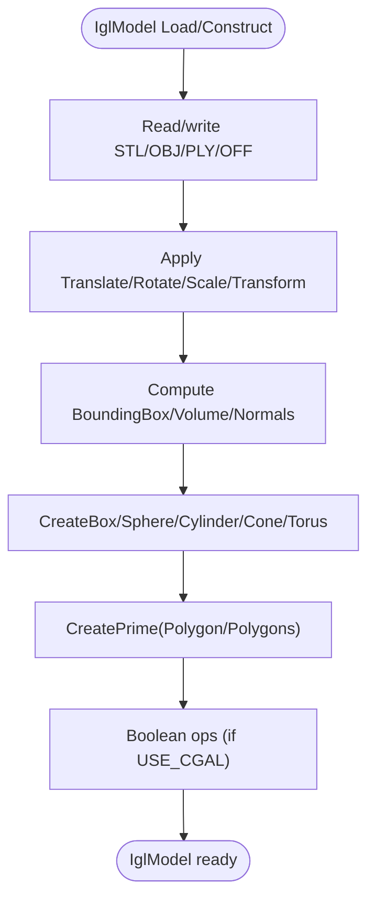

**Diagram sources**
- [IglModel.cpp:64-99](file://meshmodel/IglModel.cpp#L64-L99)
- [IglModel.cpp:101-168](file://meshmodel/IglModel.cpp#L101-L168)
- [IglModel.cpp:170-193](file://meshmodel/IglModel.cpp#L170-L193)
- [IglModel.cpp:411-596](file://meshmodel/IglModel.cpp#L411-L596)
- [IglModel.cpp:598-933](file://meshmodel/IglModel.cpp#L598-L933)

Boolean operation fallback strategy:

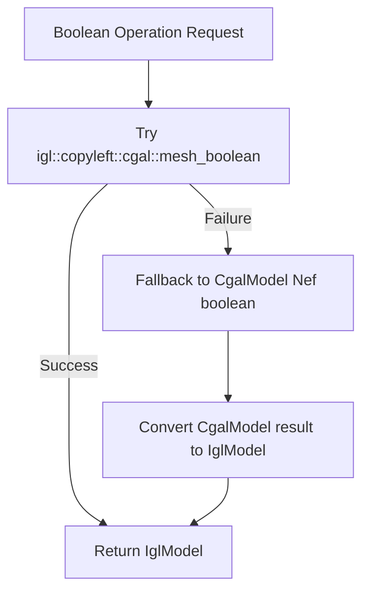

**Diagram sources**
- [IglModel.cpp:195-246](file://meshmodel/IglModel.cpp#L195-L246)

**Section sources**
- [IglModel.hpp:18-121](file://meshmodel/IglModel.hpp#L18-L121)
- [IglModel.cpp:64-99](file://meshmodel/IglModel.cpp#L64-L99)
- [IglModel.cpp:101-168](file://meshmodel/IglModel.cpp#L101-L168)
- [IglModel.cpp:170-193](file://meshmodel/IglModel.cpp#L170-L193)
- [IglModel.cpp:195-246](file://meshmodel/IglModel.cpp#L195-L246)
- [IglModel.cpp:248-409](file://meshmodel/IglModel.cpp#L248-L409)
- [IglModel.cpp:411-596](file://meshmodel/IglModel.cpp#L411-L596)
- [IglModel.cpp:598-933](file://meshmodel/IglModel.cpp#L598-L933)

### FullTopoModel Abstract Interface
`FullTopoModel` reconstructs a full topological manifold from an `IModel`, building explicit vertex/edge/face adjacency structures. It supports:

- Topological completeness check.
- Euler characteristic computation.
- Multiple slicing methods:
  - Safe slice returning only closed contours.
  - Unsafe slice allowing open contours.
  - Fast slice leveraging prebuilt topology.
  - Lua scripting integration for custom slicing logic.

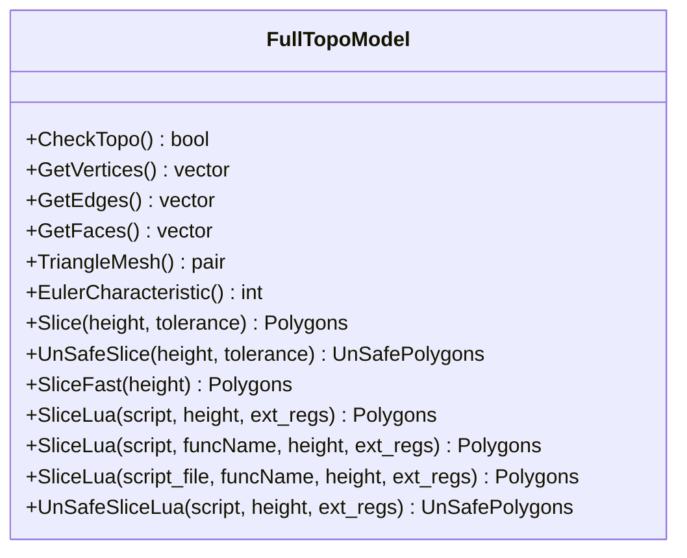

**Diagram sources**
- [FullTopoModel.hpp:43-142](file://meshmodel/FullTopoModel.hpp#L43-L142)

Topology reconstruction and validation:

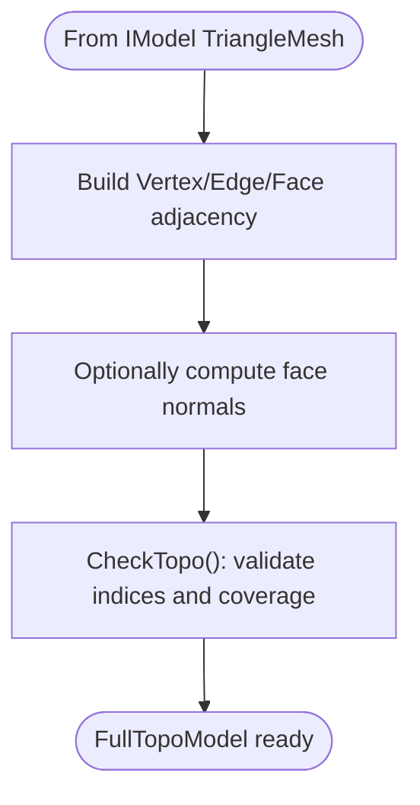

**Diagram sources**
- [FullTopoModel.cpp:27-48](file://meshmodel/FullTopoModel.cpp#L27-L48)
- [FullTopoModel.cpp:50-158](file://meshmodel/FullTopoModel.cpp#L50-L158)
- [FullTopoModel.cpp:160-218](file://meshmodel/FullTopoModel.cpp#L160-L218)

Slicing algorithm overview:

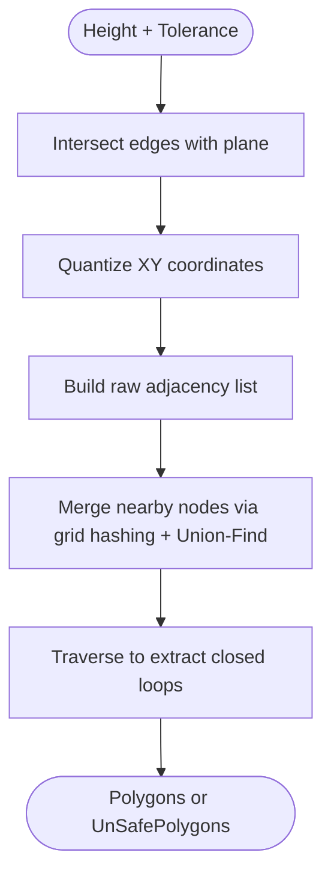

**Diagram sources**
- [FullTopoModel.cpp:328-600](file://meshmodel/FullTopoModel.cpp#L328-L600)
- [FullTopoModel.cpp:604-800](file://meshmodel/FullTopoModel.cpp#L604-L800)

**Section sources**
- [FullTopoModel.hpp:43-142](file://meshmodel/FullTopoModel.hpp#L43-L142)
- [FullTopoModel.cpp:27-48](file://meshmodel/FullTopoModel.cpp#L27-L48)
- [FullTopoModel.cpp:50-158](file://meshmodel/FullTopoModel.cpp#L50-L158)
- [FullTopoModel.cpp:160-218](file://meshmodel/FullTopoModel.cpp#L160-L218)
- [FullTopoModel.cpp:328-600](file://meshmodel/FullTopoModel.cpp#L328-L600)
- [FullTopoModel.cpp:604-800](file://meshmodel/FullTopoModel.cpp#L604-L800)

## Dependency Analysis
- `CgalModel` depends on CGAL libraries for robust geometry, boolean operations, and mesh processing.
- `IglModel` depends on libigl for mesh I/O, normals, volume, and optional CGAL-backed boolean operations.
- `FullTopoModel` depends on `IModel` and uses libigl for normals when requested.

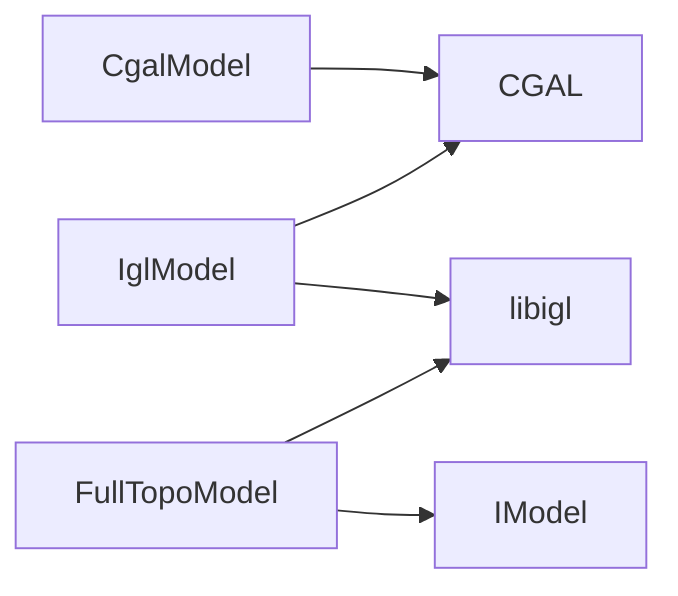

**Diagram sources**
- [CgalModel.cpp:1-34](file://meshmodel/CgalModel.cpp#L1-L34)
- [IglModel.cpp:1-32](file://meshmodel/IglModel.cpp#L1-L32)
- [FullTopoModel.cpp:1-24](file://meshmodel/FullTopoModel.cpp#L1-L24)

**Section sources**
- [CgalModel.cpp:1-34](file://meshmodel/CgalModel.cpp#L1-L34)
- [IglModel.cpp:1-32](file://meshmodel/IglModel.cpp#L1-L32)
- [FullTopoModel.cpp:1-24](file://meshmodel/FullTopoModel.cpp#L1-L24)

## Performance Considerations
- `CgalModel` offers robust boolean operations via Nef polyhedra, which can be computationally intensive but reliable for complex meshes. Construction includes automatic repair and orientation correction.
- `IglModel` is lightweight and efficient for numerical computations. Boolean operations fall back to CGAL when needed; without CGAL, they throw not-supported errors.
- `FullTopoModel` performs topology reconstruction once at construction time, making subsequent slicing faster because the topology is already built.
- For large models, prefer `IglModel` for fast transforms and basic metrics; use `CgalModel` when robust boolean operations or advanced CGAL features are required.
- Use `FullTopoModel.SliceFast` when you need repeated slicing at different heights after initial topology rebuild.

[No sources needed since this section provides general guidance]

## Troubleshooting Guide
Common issues and resolutions:

- Empty or invalid input meshes:
  - `CgalModel` constructor throws runtime errors if mesh conversion fails even after repair attempts. Ensure input triangles are valid and non-empty.
  - `IglModel` boolean functions return empty meshes or throw not-supported errors depending on configuration.

- Unsupported file formats:
  - Both `CgalModel` and `IglModel` throw not-supported errors for unsupported formats. Use supported mesh formats: STL, OBJ, PLY, OFF.

- Orientation and winding problems:
  - `CgalModel` repairs orientation by checking signed volume and reversing face orientations if necessary.
  - `IglModel` and `CgalModel` extrusion routines normalize winding and detect holes to ensure correct solid construction.

- Boolean operations without CGAL:
  - When CGAL is disabled, `IglModel` boolean functions throw not-supported errors. Enable CGAL to use boolean operations.

- Topological incompleteness:
  - `FullTopoModel.CheckTopo` validates index consistency and coverage. If false, some algorithms may produce incorrect results.

**Section sources**
- [CgalModel.cpp:42-119](file://meshmodel/CgalModel.cpp#L42-L119)
- [CgalModel.cpp:133-157](file://meshmodel/CgalModel.cpp#L133-L157)
- [IglModel.cpp:72-99](file://meshmodel/IglModel.cpp#L72-L99)
- [IglModel.cpp:195-246](file://meshmodel/IglModel.cpp#L195-L246)
- [IglModel.cpp:392-409](file://meshmodel/IglModel.cpp#L392-L409)
- [FullTopoModel.cpp:160-218](file://meshmodel/FullTopoModel.cpp#L160-L218)

## Conclusion
HsBaSlicer’s mesh processing layer provides a flexible, multi-backend architecture:

- `CgalModel` delivers robust computational geometry, including advanced boolean operations and surface path utilities.
- `IglModel` offers efficient triangle-mesh operations and numerical workflows, with optional CGAL-backed boolean support.
- `FullTopoModel` standardizes slicing by reconstructing full topology from any `IModel`, enabling safe and fast slicing workflows.

For production pipelines:
- Use `IglModel` for fast, memory-efficient operations.
- Use `CgalModel` when robust boolean operations or advanced CGAL features are required.
- Use `FullTopoModel` for slicing tasks requiring topological guarantees and fast repeated slicing.

[No sources needed since this section summarizes without analyzing specific files]

## Appendices

### Usage Examples

#### Loading and Saving Models
- Load a mesh file into `IglModel` or `CgalModel`.
- Save to STL/OBJ/PLY/OFF using the appropriate `ModelFormat`.

**Section sources**
- [IglModel.cpp:64-99](file://meshmodel/IglModel.cpp#L64-L99)
- [CgalModel.cpp:121-157](file://meshmodel/CgalModel.cpp#L121-L157)

#### Applying Transforms
- Translate, rotate, scale, or apply arbitrary isometric/affine transforms.

**Section sources**
- [IglModel.cpp:101-150](file://meshmodel/IglModel.cpp#L101-L150)
- [CgalModel.cpp:158-204](file://meshmodel/CgalModel.cpp#L158-L204)

#### Boolean Operations
- Perform union, intersection, difference, and xor on `IglModel` or `CgalModel`.

**Section sources**
- [IglModel.cpp:248-409](file://meshmodel/IglModel.cpp#L248-L409)
- [CgalModel.cpp:238-276](file://meshmodel/CgalModel.cpp#L238-L276)

#### Creating Primitives and Extrusions
- Create box, sphere, cylinder, cone, torus.
- Extrude 2D polygons into 3D solids.

**Section sources**
- [IglModel.cpp:411-596](file://meshmodel/IglModel.cpp#L411-L596)
- [IglModel.cpp:598-933](file://meshmodel/IglModel.cpp#L598-L933)
- [CgalModel.cpp:278-445](file://meshmodel/CgalModel.cpp#L278-L445)
- [CgalModel.cpp:625-800](file://meshmodel/CgalModel.cpp#L625-L800)

#### Slicing with FullTopoModel
- Construct from any `IModel`.
- Use safe, unsafe, or fast slicing.
- Integrate Lua scripts for custom slicing logic.

**Section sources**
- [FullTopoModel.cpp:27-48](file://meshmodel/FullTopoModel.cpp#L27-L48)
- [FullTopoModel.cpp:328-600](file://meshmodel/FullTopoModel.cpp#L328-L600)
- [FullTopoModel.cpp:604-800](file://meshmodel/FullTopoModel.cpp#L604-L800)

### Backend Comparison Guidance
- Choose `IglModel` for speed and simplicity.
- Choose `CgalModel` for robustness and advanced geometry.
- Choose `FullTopoModel` for slicing-centric workflows requiring topological integrity.

[No sources needed since this section provides general guidance]