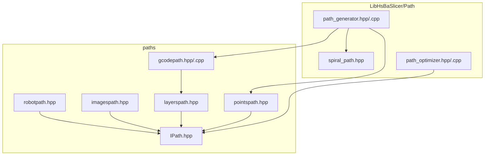
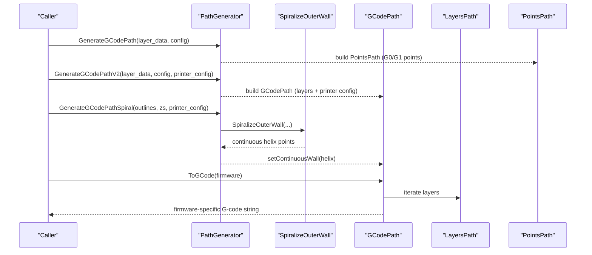
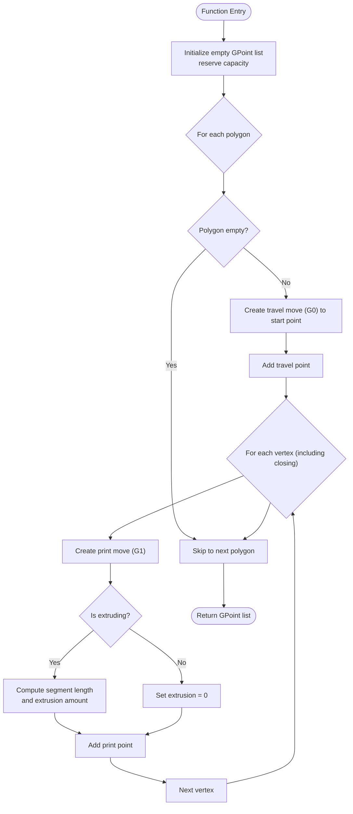
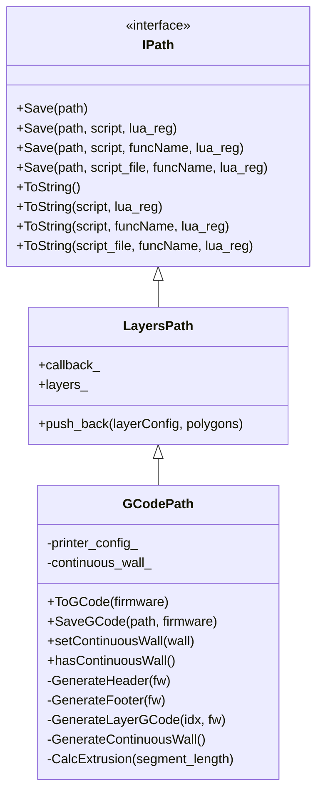
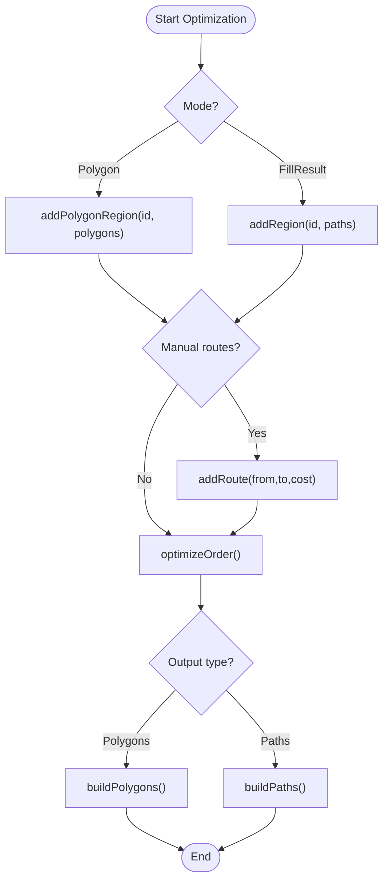
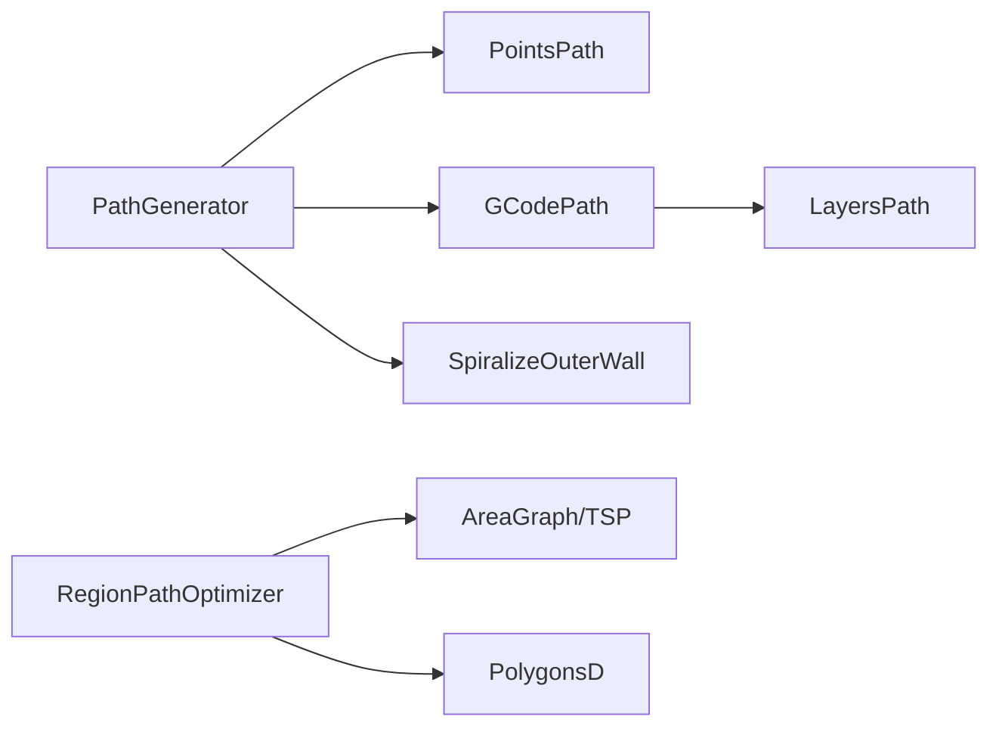

# Path Generation

<cite>
**Referenced Files in This Document**
- [path_generator.hpp](file://LibHsBaSlicer/Path/path_generator.hpp)
- [path_generator.cpp](file://LibHsBaSlicer/Path/path_generator.cpp)
- [IPath.hpp](file://paths/IPath.hpp)
- [gcodepath.hpp](file://paths/gcodepath.hpp)
- [gcodepath.cpp](file://paths/gcodepath.cpp)
- [layerspath.hpp](file://paths/layerspath.hpp)
- [pointspath.hpp](file://paths/pointspath.hpp)
- [robotpath.hpp](file://paths/robotpath.hpp)
- [imagespath.hpp](file://paths/imagespath.hpp)
- [spiral_path.hpp](file://LibHsBaSlicer/Path/spiral_path.hpp)
- [path_optimizer.hpp](file://LibHsBaSlicer/Path/path_optimizer.hpp)
- [path_optimizer.cpp](file://LibHsBaSlicer/Path/path_optimizer.cpp)
- [lua_pipeline.cpp](file://LibHsBaSlicer/Extends/lua_pipeline.cpp)
</cite>

## Table of Contents
1. [Introduction](#introduction)
2. [Project Structure](#project-structure)
3. [Core Components](#core-components)
4. [Architecture Overview](#architecture-overview)
5. [Detailed Component Analysis](#detailed-component-analysis)
6. [Dependency Analysis](#dependency-analysis)
7. [Performance Considerations](#performance-considerations)
8. [Troubleshooting Guide](#troubleshooting-guide)
9. [Conclusion](#conclusion)
10. [Appendices](#appendices)

## Introduction
This document explains the path generation system used by HsBaSlicer for producing printable toolpaths across multiple technologies and firmware targets. It focuses on:

- The PathGenerator API that converts per-layer polygons into G-code, robot paths, image sequences, and layer-based outputs.
- The concrete path types: GCodePath, RobotPath, ImagesPath, LayersPath, PointsPath.
- Path optimization algorithms (region ordering via AreaGraph + genetic TSP).
- Spiral/vase mode continuous wall generation.
- Multi-firmware G-code output (Marlin, RepRap/RRF, Klipper).
- Configuration options, performance tuning parameters, and integration examples.

The goal is to make the system understandable for both new users and experienced integrators working with FDM printers, industrial robots, SLA/SLS image workflows, and other extrusion-style processes.

## Project Structure
The path generation system spans two main areas:

- LibHsBaSlicer/Path: high-level generators and optimizers (G-code generation, spiralization, region optimization).
- paths: core path data structures and exporters (IPath interface and concrete implementations).

**Diagram sources**
- [path_generator.hpp:1-96](file://LibHsBaSlicer/Path/path_generator.hpp#L1-L96)
- [path_generator.cpp:1-139](file://LibHsBaSlicer/Path/path_generator.cpp#L1-L139)
- [spiral_path.hpp:1-63](file://LibHsBaSlicer/Path/spiral_path.hpp#L1-L63)
- [path_optimizer.hpp:1-191](file://LibHsBaSlicer/Path/path_optimizer.hpp#L1-L191)
- [IPath.hpp:1-68](file://paths/IPath.hpp#L1-L68)
- [gcodepath.hpp:1-112](file://paths/gcodepath.hpp#L1-L112)
- [gcodepath.cpp:1-200](file://paths/gcodepath.cpp#L1-L200)
- [layerspath.hpp:1-64](file://paths/layerspath.hpp#L1-L64)
- [pointspath.hpp:1-99](file://paths/pointspath.hpp#L1-L99)
- [robotpath.hpp:1-108](file://paths/robotpath.hpp#L1-L108)
- [imagespath.hpp:1-64](file://paths/imagespath.hpp#L1-L64)

**Section sources**
- [path_generator.hpp:1-96](file://LibHsBaSlicer/Path/path_generator.hpp#L1-L96)
- [path_generator.cpp:1-139](file://LibHsBaSlicer/Path/path_generator.cpp#L1-L139)
- [IPath.hpp:1-68](file://paths/IPath.hpp#L1-L68)

## Core Components
- PathGenerator: entry points to convert per-layer polygon data into different path representations.
- IPath: abstract base for all path outputs; defines Save/ToString APIs with optional Lua post-processing.
- Concrete path types:
  - GCodePath: multi-firmware G-code generator built on LayersPath; supports continuous spiral walls.
  - LayersPath: stores ordered layers of polygons with free-form config strings.
  - PointsPath: sequence of GPoint commands (G0/G1 arcs, velocities, extrusion).
  - RobotPath: brand-specific robot program output (ABB/KUKA/FANUC).
  - ImagesPath: config sidecar plus named image payloads for image-oriented outputs.

Key configuration objects:
- FdmPathConfig: per-layer path generation settings (layer height, line width, speeds, units).
- GCodePrinterConfig: printer-specific G-code emission parameters (nozzle/filament dimensions, temperatures, retraction, speeds, extrusion mode).

Use cases:
- FDM printing: GenerateGCodePathV2 or GenerateGCodePathSpiral for Marlin/RepRap/Klipper.
- Industrial robots: Build RobotPath from toolpath points and emit brand code.
- Image-based slicing: Populate ImagesPath with images and a config file.
- Layer-based analysis: Use LayersPath to store and serialize per-layer polygons.

**Section sources**
- [path_generator.hpp:20-91](file://LibHsBaSlicer/Path/path_generator.hpp#L20-L91)
- [gcodepath.hpp:24-107](file://paths/gcodepath.hpp#L24-L107)
- [layerspath.hpp:17-60](file://paths/layerspath.hpp#L17-L60)
- [pointspath.hpp:16-94](file://paths/pointspath.hpp#L16-L94)
- [robotpath.hpp:15-104](file://paths/robotpath.hpp#L15-L104)
- [imagespath.hpp:16-61](file://paths/imagespath.hpp#L16-L61)

## Architecture Overview
The path generation pipeline transforms sliced polygons into target outputs:

**Diagram sources**
- [path_generator.cpp:61-136](file://LibHsBaSlicer/Path/path_generator.cpp#L61-L136)
- [spiral_path.hpp:31-58](file://LibHsBaSlicer/Path/spiral_path.hpp#L31-L58)
- [gcodepath.cpp:65-141](file://paths/gcodepath.cpp#L65-L141)
- [layerspath.hpp:49-60](file://paths/layerspath.hpp#L49-L60)

## Detailed Component Analysis

### PathGenerator API
Responsibilities:
- Convert per-layer outlines/fills/supports into PointsPath or GCodePath.
- Provide spiralized vase-mode generation using SpiralizeOuterWall.
- Offer helper PolygonsToGPoints to turn polygons into G-point sequences.

Key functions:
- PolygonsToGPoints: builds travel and print moves with velocity and extrusion based on segment length.
- GenerateGCodePath: returns a PointsPath containing ordered G0/G1 points for outlines, fills, supports.
- GenerateGCodePathV2: returns a GCodePath carrying layers with Z metadata and printer configuration.
- GenerateGCodePathSpiral: merges outer contours into a single continuous rising wall.

Configuration:
- FdmPathConfig controls layer height, line width, print/travel speeds, extrusion multiplier, and units.

Output formats:
- PointsPath: low-level G-point stream suitable for custom exporters.
- GCodePath: high-level layer storage with multi-firmware G-code generation.

**Section sources**
- [path_generator.hpp:20-91](file://LibHsBaSlicer/Path/path_generator.hpp#L20-L91)
- [path_generator.cpp:14-136](file://LibHsBaSlicer/Path/path_generator.cpp#L14-L136)

#### Flowchart: PolygonsToGPoints

**Diagram sources**
- [path_generator.cpp:14-58](file://LibHsBaSlicer/Path/path_generator.cpp#L14-L58)

### GCodePath: Multi-Firmware G-code Output
Capabilities:
- Inherits LayersPath to store per-layer polygons and free-form layer configs.
- Generates standard G-code headers/footers tailored to Marlin, RepRap/RRF, and Klipper.
- Supports continuous spiral walls for vase mode.
- Provides ToGCode(firmware), SaveGCode(path, firmware), and Lua-enabled serialization.

Printer configuration:
- GCodePrinterConfig includes nozzle/filament dimensions, temperatures, retraction, speeds, first layer speed, layer height, line width, extrusion multiplier, relative extrusion flag, and retraction enable flag.

Extrusion calculation:
- Uses line width, layer height, segment length, filament diameter, and extrusion multiplier to compute E values.

Firmware differences:
- Marlin: temperature waits, absolute/relative extrusion, retract, home XY, disable motors.
- RepRap: additional fan control commands.
- Klipper: pressure advance, speed/flow factors, fan control via SET_FAN_SPEED.

**Diagram sources**
- [IPath.hpp:20-57](file://paths/IPath.hpp#L20-L57)
- [layerspath.hpp:17-60](file://paths/layerspath.hpp#L17-L60)
- [gcodepath.hpp:62-107](file://paths/gcodepath.hpp#L62-L107)
- [gcodepath.cpp:47-63](file://paths/gcodepath.cpp#L47-L63)

**Section sources**
- [gcodepath.hpp:24-107](file://paths/gcodepath.hpp#L24-L107)
- [gcodepath.cpp:47-200](file://paths/gcodepath.cpp#L47-L200)

### Spiral/Vase Mode
Purpose:
- Produce a single continuous helical outer wall without retractions or per-layer travel jumps.

Algorithm highlights:
- Selects the outermost closed contour per layer.
- Aligns seam vertices between layers to maintain a fixed seam line.
- Ramps Z continuously from one layer’s height to the next.
- Returns a vector of SpiralPoint with distinct Z per point.

Integration:
- GenerateGCodePathSpiral consumes SpiralizeOuterWall results and sets a continuous wall on GCodePath.

**Section sources**
- [spiral_path.hpp:16-58](file://LibHsBaSlicer/Path/spiral_path.hpp#L16-L58)
- [path_generator.cpp:118-136](file://LibHsBaSlicer/Path/path_generator.cpp#L118-L136)

### Region Path Optimization
Goal:
- Minimize total air-move cost by optimizing the visit order of independent polygon regions.

Modes:
- Polygon mode (pre-fill): treats polygons themselves as regions; all vertices are gates; outputs polygons in optimized order for subsequent filling.
- Fill-result mode (post-fill): treats fill paths (multi-point polylines) as regions; head/tail endpoints are gates; outputs complete fill paths.

Modeling:
- Each region becomes an AreaGraph vertex; gates are candidate entry/exit points.
- Intra-region gate-to-gate cost is straight-line distance; inter-region routing cost is also straight-line distance.
- Region visit order solved by genetic TSP; intra-region entry/exit arranged by nearest-neighbor greedy scheme.

API:
- addRegion/addPolygonRegion to register regions.
- addRoute to manually override symmetric air-move costs.
- optimizeOrder to solve region tour.
- buildPaths/buildPolygons to retrieve optimized outputs.

Lua integration:
- RegisterLuaPathOptimizeFunctions exposes PathOptimize.new(), optimizeRegions, optimizePolygons.
- LuaOptimizeRegionPaths/LuaOptimizeRegionPolygons allow embedded scripts for pre-optimization.

**Diagram sources**
- [path_optimizer.hpp:23-95](file://LibHsBaSlicer/Path/path_optimizer.hpp#L23-L95)
- [path_optimizer.cpp:42-116](file://LibHsBaSlicer/Path/path_optimizer.cpp#L42-L116)
- [path_optimizer.cpp:118-204](file://LibHsBaSlicer/Path/path_optimizer.cpp#L118-L204)

**Section sources**
- [path_optimizer.hpp:23-191](file://LibHsBaSlicer/Path/path_optimizer.hpp#L23-L191)
- [path_optimizer.cpp:42-204](file://LibHsBaSlicer/Path/path_optimizer.cpp#L42-L204)

### RobotPath: Industrial Applications
Purpose:
- Produce brand-specific robot language programs (ABB, KUKA, FANUC) from a sequence of RLPoint moves.

Data model:
- RLPoint contains end/middle positions, velocity, motion/command kind, and program index.

Capabilities:
- push_back to accumulate moves.
- Save/ToString families support inline or file-based Lua post-processing.
- Internal generators for ABB, KUKA, and FANUC code.

Use cases:
- Industrial deposition, welding, painting, or material extrusion where robot kinematics and programming languages differ by vendor.

**Section sources**
- [robotpath.hpp:15-104](file://paths/robotpath.hpp#L15-L104)

### ImagesPath: Image Sequence Generation
Purpose:
- Package a configuration file alongside named image payloads for image-oriented outputs (e.g., SLA/SLS layer images).

Capabilities:
- AddImage(path, image_str) to store images keyed by name.
- Save/ToString families support native or Lua post-processing.
- Optional progress callbacks during save operations.

Use cases:
- Slicing workflows that export per-layer images and a corresponding config manifest.

**Section sources**
- [imagespath.hpp:16-61](file://paths/imagespath.hpp#L16-L61)

### LayersPath: Layer-Based Representations
Purpose:
- Store ordered layers of polygons with free-form configuration strings.

Capabilities:
- push_back(layerConfig, polygons) to append layers.
- Save/ToString families support native or Lua post-processing.
- Callback mechanism for status reporting during output.

Use cases:
- Intermediate representation for further processing or exporting to various formats.

**Section sources**
- [layerspath.hpp:17-60](file://paths/layerspath.hpp#L17-L60)

### PointsPath: Low-Level G-Point Stream
Purpose:
- Accumulate GPoint commands (G0/G1/G2/G3, plane selection, units, positioning modes) with velocities and extrusion amounts.

Capabilities:
- push_back(GPoint) to append commands.
- Save/ToString families support native or Lua post-processing.
- Useful for custom exporters or debugging raw motion streams.

**Section sources**
- [pointspath.hpp:16-94](file://paths/pointspath.hpp#L16-L94)

## Dependency Analysis
High-level dependencies:

- PathGenerator depends on:
  - PolygonsD (from 2D geometry).
  - PointsPath for low-level G-point output.
  - GCodePath for multi-firmware output.
  - SpiralizeOuterWall for vase mode.

- GCodePath depends on:
  - LayersPath for layer storage.
  - GCodePrinterConfig for printer parameters.
  - Firmware-specific header/footer generation logic.

- RegionPathOptimizer depends on:
  - AreaGraph (graph modeling) and genetic TSP solver.
  - PolygonsD for input/output.

**Diagram sources**
- [path_generator.cpp:61-136](file://LibHsBaSlicer/Path/path_generator.cpp#L61-L136)
- [gcodepath.cpp:47-63](file://paths/gcodepath.cpp#L47-L63)
- [path_optimizer.cpp:42-116](file://LibHsBaSlicer/Path/path_optimizer.cpp#L42-L116)

**Section sources**
- [path_generator.cpp:61-136](file://LibHsBaSlicer/Path/path_generator.cpp#L61-L136)
- [gcodepath.cpp:47-63](file://paths/gcodepath.cpp#L47-L63)
- [path_optimizer.cpp:42-116](file://LibHsBaSlicer/Path/path_optimizer.cpp#L42-L116)

## Performance Considerations
- Pre-optimization: Use RegionPathOptimizer before filling or after filling to reduce air-move distances. Genetic TSP scales with region count; prefer grouping nearby regions to keep problem size manageable.
- Spiral mode: Continuous wall avoids per-layer retractions and travel jumps, improving surface quality and reducing print time for uniform cross-section models.
- Extrusion calculation: Ensure accurate line_width, layer_height, and filament_diameter to avoid over/under-extrusion.
- Speeds: Tune print_speed and travel_speed appropriately; consider first_layer_speed for adhesion.
- Retraction: Enable/disable retraction based on material and printer behavior; adjust retract_length and retract_speed to minimize stringing.
- Units: Use consistent units (mm vs inch) across configuration and slicer output to avoid scaling errors.

[No sources needed since this section provides general guidance]

## Troubleshooting Guide
Common issues and resolutions:

- Incorrect extrusion:
  - Verify GCodePrinterConfig.line_width, layer_height, filament_diameter, and extrusion_multiplier.
  - Check whether relative_extrusion is set correctly (M82/M83).

- Poor surface quality in vase mode:
  - Ensure per-layer outer contours are valid closed polygons.
  - Confirm layer_zs align with layer_sections and increase smoothly.

- Excessive travel moves:
  - Apply RegionPathOptimizer in fill-result mode to reorder regions and arrange intra-region paths greedily.
  - Optionally use addRoute to enforce preferred transitions between distant regions.

- Firmware incompatibility:
  - Select correct GCodeFirmware (Marlin/RepRap/Klipper).
  - Review generated header/footer for required commands (temperature waits, fan control, pressure advance).

- Lua post-processing not applied:
  - Ensure script path or inline script is provided to Save/ToString methods.
  - Verify function names match registered Lua entry points.

**Section sources**
- [gcodepath.cpp:65-141](file://paths/gcodepath.cpp#L65-L141)
- [gcodepath.cpp:144-193](file://paths/gcodepath.cpp#L144-L193)
- [path_optimizer.cpp:118-204](file://LibHsBaSlicer/Path/path_optimizer.cpp#L118-L204)

## Conclusion
The HsBaSlicer path generation system provides a flexible, extensible framework for converting sliced polygons into multiple output formats:

- G-code for FDM printers with multi-firmware support.
- Robot programs for industrial applications.
- Image sequences for SLA/SLS workflows.
- Layer-based representations for analysis and customization.

Path optimization reduces travel costs through region ordering and intra-path arrangement. Spiral/vase mode enables continuous walls for improved quality and efficiency. Configuration objects allow fine-tuning of print parameters, while Lua hooks enable powerful post-processing and scripting.

Integrators can combine these components to tailor toolpaths for diverse manufacturing technologies and firmware ecosystems.

[No sources needed since this section summarizes without analyzing specific files]

## Appendices

### Configuration Options Summary
- FdmPathConfig:
  - layer_height, line_width, print_speed, travel_speed, extrusion_multiplier, units.
- GCodePrinterConfig:
  - nozzle_diameter, filament_diameter, nozzle_temp, bed_temp, retract_length, retract_speed, print_speed, travel_speed, first_layer_speed, layer_height, line_width, extrusion_multiplier, relative_extrusion, enable_retraction.

**Section sources**
- [path_generator.hpp:20-31](file://LibHsBaSlicer/Path/path_generator.hpp#L20-L31)
- [gcodepath.hpp:32-49](file://paths/gcodepath.hpp#L32-L49)

### Integration Examples

- FDM G-code generation (V2):
  - Build LayerPathData vectors with outlines, fills, supports, and z_height.
  - Call GenerateGCodePathV2 with FdmPathConfig and GCodePrinterConfig.
  - Use ToGCode(firmware) or SaveGCode(path, firmware) to produce Marlin/RepRap/Klipper output.

- Spiral/vase mode:
  - Collect per-layer outer contours and corresponding Z heights.
  - Call GenerateGCodePathSpiral to obtain a GCodePath with a continuous wall.

- Robot path:
  - Create RobotPath with target RLType and initial position.
  - Push RLPoint moves and call ToString/Save to generate brand-specific code.

- Image sequence:
  - Construct ImagesPath with config file name and content.
  - AddImage for each layer image and call Save/ToString.

- Layer-based processing:
  - Use LayersPath.push_back to store layers with free-form config strings.
  - Serialize natively or via Lua scripts.

**Section sources**
- [path_generator.cpp:95-136](file://LibHsBaSlicer/Path/path_generator.cpp#L95-L136)
- [robotpath.hpp:61-104](file://paths/robotpath.hpp#L61-L104)
- [imagespath.hpp:32-61](file://paths/imagespath.hpp#L32-L61)
- [layerspath.hpp:49-60](file://paths/layerspath.hpp#L49-L60)