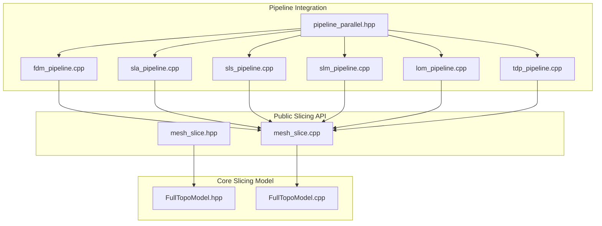
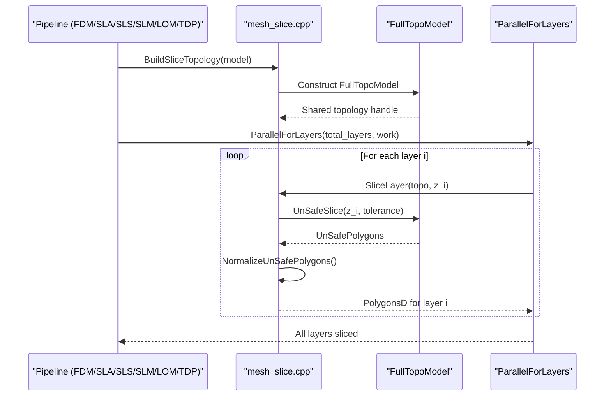
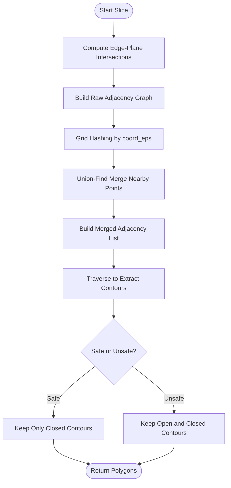
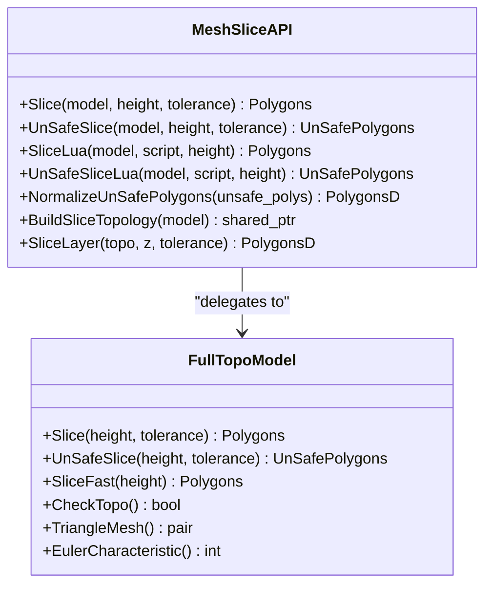
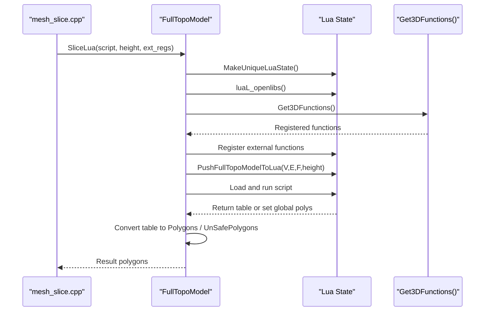
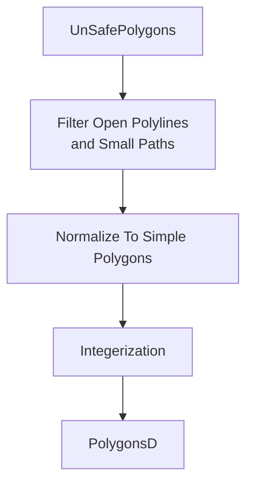
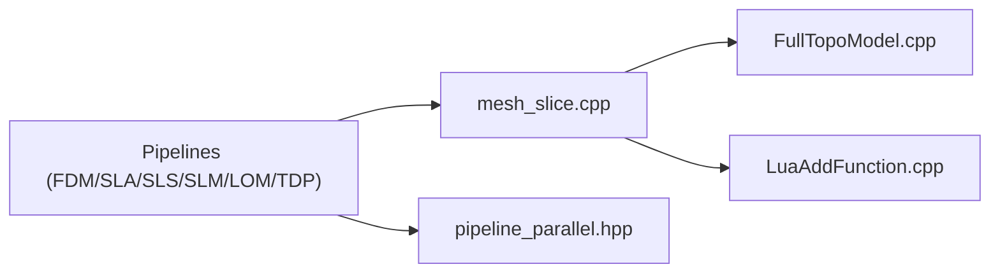

# Slicing Engine

<cite>
**Referenced Files in This Document**
- [mesh_slice.hpp](file://LibHsBaSlicer/Slice/mesh_slice.hpp)
- [mesh_slice.cpp](file://LibHsBaSlicer/Slice/mesh_slice.cpp)
- [FullTopoModel.hpp](file://meshmodel/FullTopoModel.hpp)
- [FullTopoModel.cpp](file://meshmodel/FullTopoModel.cpp)
- [LuaAddFunction.cpp](file://LibHsBaSlicer/Extends/LuaAddFunction.cpp)
- [pipeline_parallel.hpp](file://DllHsBaSlicer/pipeline_parallel.hpp)
- [fdm_pipeline.cpp](file://DllHsBaSlicer/fdm_pipeline.cpp)
- [sla_pipeline.cpp](file://DllHsBaSlicer/sla_pipeline.cpp)
- [sls_pipeline.cpp](file://DllHsBaSlicer/sls_pipeline.cpp)
- [slm_pipeline.cpp](file://DllHsBaSlicer/slm_pipeline.cpp)
- [lom_pipeline.cpp](file://DllHsBaSlicer/lom_pipeline.cpp)
- [tdp_pipeline.cpp](file://DllHsBaSlicer/tdp_pipeline.cpp)
</cite>

## Table of Contents
1. [Introduction](#introduction)
2. [Project Structure](#project-structure)
3. [Core Components](#core-components)
4. [Architecture Overview](#architecture-overview)
5. [Detailed Component Analysis](#detailed-component-analysis)
6. [Dependency Analysis](#dependency-analysis)
7. [Performance Considerations](#performance-considerations)
8. [Troubleshooting Guide](#troubleshooting-guide)
9. [Conclusion](#conclusion)
10. [Appendices](#appendices)

## Introduction
This document explains the core slicing engine implementation used by HsBaSlicer. It focuses on:
- Mesh slicing algorithms, including safe and unsafe slicing methods.
- Tolerance handling and contour extraction.
- Topology-based slicing with BuildSliceTopology and SliceLayer for optimized multi-layer processing.
- The Lua-driven slicing interface for custom slicing algorithms.
- Performance optimization techniques, memory management strategies, and parallel processing considerations.
- Usage examples for basic workflows and advanced customization scenarios.

The slicing engine is centered around a reusable topological mesh representation and exposes both C++ APIs and Lua scripting hooks so that pipeline implementations can slice models efficiently and flexibly.

## Project Structure
The slicing engine spans two main areas:
- Public C++ API surface under LibHsBaSlicer/Slice.
- Core topology and algorithm implementation under meshmodel.

**Diagram sources**
- [mesh_slice.hpp:1-108](file://LibHsBaSlicer/Slice/mesh_slice.hpp#L1-L108)
- [mesh_slice.cpp:1-118](file://LibHsBaSlicer/Slice/mesh_slice.cpp#L1-L118)
- [FullTopoModel.hpp:1-150](file://meshmodel/FullTopoModel.hpp#L1-L150)
- [FullTopoModel.cpp:1-1243](file://meshmodel/FullTopoModel.cpp#L1-L1243)
- [fdm_pipeline.cpp:253-285](file://DllHsBaSlicer/fdm_pipeline.cpp#L253-L285)
- [sla_pipeline.cpp:321-352](file://DllHsBaSlicer/sla_pipeline.cpp#L321-L352)
- [sls_pipeline.cpp:201-231](file://DllHsBaSlicer/sls_pipeline.cpp#L201-L231)
- [slm_pipeline.cpp:254-284](file://DllHsBaSlicer/slm_pipeline.cpp#L254-L284)
- [lom_pipeline.cpp:231-266](file://DllHsBaSlicer/lom_pipeline.cpp#L231-L266)
- [tdp_pipeline.cpp:236-267](file://DllHsBaSlicer/tdp_pipeline.cpp#L236-L267)
- [pipeline_parallel.hpp:38-76](file://DllHsBaSlicer/pipeline_parallel.hpp#L38-L76)

**Section sources**
- [mesh_slice.hpp:1-108](file://LibHsBaSlicer/Slice/mesh_slice.hpp#L1-L108)
- [mesh_slice.cpp:1-118](file://LibHsBaSlicer/Slice/mesh_slice.cpp#L1-L118)
- [FullTopoModel.hpp:1-150](file://meshmodel/FullTopoModel.hpp#L1-L150)
- [FullTopoModel.cpp:1-1243](file://meshmodel/FullTopoModel.cpp#L1-L1243)

## Core Components
The slicing engine provides:
- Safe slicing returning only closed contours.
- Unsafe slicing returning potentially open polylines.
- Lua-driven slicing where scripts receive vertex, edge, face data and return polygon tables.
- Reusable topology construction to avoid rebuilding per layer.
- Layer slicing helper that normalizes results into double-precision polygons.

Key responsibilities:
- mesh_slice.*: Thin, exception-safe public API delegating to FullTopoModel.
- FullTopoModel: Topology reconstruction, intersection computation, adjacency building, tolerance merging, contour traversal, and Lua integration.

**Section sources**
- [mesh_slice.hpp:22-103](file://LibHsBaSlicer/Slice/mesh_slice.hpp#L22-L103)
- [mesh_slice.cpp:45-115](file://LibHsBaSlicer/Slice/mesh_slice.cpp#L45-L115)
- [FullTopoModel.hpp:23-145](file://meshmodel/FullTopoModel.hpp#L23-L145)

## Architecture Overview
At runtime, pipelines call the public slicing API. For multi-layer jobs, they build a shared topology once and then slice layers in parallel. Each layer’s result is normalized into clean polygons suitable for downstream path planning or export.

**Diagram sources**
- [mesh_slice.cpp:105-115](file://LibHsBaSlicer/Slice/mesh_slice.cpp#L105-L115)
- [FullTopoModel.cpp:604-873](file://meshmodel/FullTopoModel.cpp#L604-L873)
- [pipeline_parallel.hpp:38-76](file://DllHsBaSlicer/pipeline_parallel.hpp#L38-L76)
- [fdm_pipeline.cpp:253-285](file://DllHsBaSlicer/fdm_pipeline.cpp#L253-L285)
- [sla_pipeline.cpp:321-352](file://DllHsBaSlicer/sla_pipeline.cpp#L321-L352)
- [sls_pipeline.cpp:201-231](file://DllHsBaSlicer/sls_pipeline.cpp#L201-L231)
- [slm_pipeline.cpp:254-284](file://DllHsBaSlicer/slm_pipeline.cpp#L254-L284)
- [lom_pipeline.cpp:231-266](file://DllHsBaSlicer/lom_pipeline.cpp#L231-L266)
- [tdp_pipeline.cpp:236-267](file://DllHsBaSlicer/tdp_pipeline.cpp#L236-L267)

## Detailed Component Analysis

### Safe and Unsafe Slicing Algorithms
Both Safe and Unsafe slicing share a common geometric approach:
- Compute intersections between edges and the horizontal plane at height z.
- Build an adjacency graph of 2D integerized intersection points.
- Merge nearby points using grid hashing and union-find based on tolerance.
- Traverse the merged adjacency graph to extract contours.

Differences:
- Safe slicing discards open contours and returns only closed polygons.
- Unsafe slicing retains open polylines and marks whether each contour is closed.

Tolerance handling:
- Coordinates are integerized using a scaling factor.
- A coordinate epsilon is derived from the user-provided tolerance.
- Nearby points within the epsilon are merged via union-find over a spatial grid.

Contour extraction:
- Traversal uses angle-based neighbor selection to maintain consistent orientation.
- Closed loops are detected when the next point returns to the start or revisits a visited node.

**Diagram sources**
- [FullTopoModel.cpp:328-600](file://meshmodel/FullTopoModel.cpp#L328-L600)
- [FullTopoModel.cpp:604-873](file://meshmodel/FullTopoModel.cpp#L604-L873)

**Section sources**
- [FullTopoModel.cpp:246-272](file://meshmodel/FullTopoModel.cpp#L246-L272)
- [FullTopoModel.cpp:328-600](file://meshmodel/FullTopoModel.cpp#L328-L600)
- [FullTopoModel.cpp:604-873](file://meshmodel/FullTopoModel.cpp#L604-L873)

### Topology-Based Slicing: BuildSliceTopology and SliceLayer
BuildSliceTopology constructs a FullTopoModel once from the source model. This avoids repeated O(total_faces) topology rebuilds across layers. SliceLayer then slices a single layer from the prebuilt topology and normalizes the result to PolygonsD.

Benefits:
- Reduces per-layer overhead by reusing the same topology.
- Enables safe concurrent slicing because SliceLayer reads the topology const-only.

Usage pattern in pipelines:
- Build topology once before the parallel loop.
- Call SliceLayer inside the parallel worker for each layer.
- Collect PolygonsD results into a vector indexed by layer.

**Diagram sources**
- [mesh_slice.hpp:22-103](file://LibHsBaSlicer/Slice/mesh_slice.hpp#L22-L103)
- [mesh_slice.cpp:45-115](file://LibHsBaSlicer/Slice/mesh_slice.cpp#L45-L115)
- [FullTopoModel.hpp:43-145](file://meshmodel/FullTopoModel.hpp#L43-L145)

**Section sources**
- [mesh_slice.cpp:105-115](file://LibHsBaSlicer/Slice/mesh_slice.cpp#L105-L115)
- [FullTopoModel.hpp:43-145](file://meshmodel/FullTopoModel.hpp#L43-L145)

### Lua-Driven Slicing Interface
Lua-driven slicing allows custom algorithms to operate directly on the topological mesh data exposed as globals:
- V: 1-based array of vertices with x, y, z fields.
- E: 1-based array of edges with vertex indices.
- F: 1-based array of faces with vertex indices.
- height: current slice height.

Two primary interfaces:
- SliceLua: Returns closed polygons; open polylines are filtered out during normalization.
- UnSafeSliceLua: Returns potentially open polylines with a closed flag.

External function registration:
- Get3DFunctions returns registered 3D functions that are injected into the Lua state before loading the script.
- This enables custom geometry helpers or pipeline-specific utilities to be available to the script.

Error handling:
- Lua load and runtime errors are wrapped into project exceptions.
- Missing functions or invalid script content raise descriptive errors.

**Diagram sources**
- [mesh_slice.cpp:65-83](file://LibHsBaSlicer/Slice/mesh_slice.cpp#L65-L83)
- [FullTopoModel.cpp:1027-1130](file://meshmodel/FullTopoModel.cpp#L1027-L1130)
- [FullTopoModel.cpp:1132-1241](file://meshmodel/FullTopoModel.cpp#L1132-L1241)
- [LuaAddFunction.cpp:30-38](file://LibHsBaSlicer/Extends/LuaAddFunction.cpp#L30-L38)

**Section sources**
- [FullTopoModel.hpp:116-132](file://meshmodel/FullTopoModel.hpp#L116-L132)
- [FullTopoModel.cpp:274-324](file://meshmodel/FullTopoModel.cpp#L274-L324)
- [FullTopoModel.cpp:1027-1130](file://meshmodel/FullTopoModel.cpp#L1027-L1130)
- [FullTopoModel.cpp:1132-1241](file://meshmodel/FullTopoModel.cpp#L1132-L1241)
- [LuaAddFunction.cpp:11-38](file://LibHsBaSlicer/Extends/LuaAddFunction.cpp#L11-L38)

### Normalization and Contour Cleaning
NormalizeUnSafePolygons converts raw unsafe polygons into clean double-precision polygons:
- Filters out open polylines and non-simple polygons.
- Converts integer coordinates to floating-point coordinates.
- Reserves capacity to reduce reallocations.

This step is essential for downstream processes like infill, support generation, and export.

**Diagram sources**
- [mesh_slice.cpp:85-103](file://LibHsBaSlicer/Slice/mesh_slice.cpp#L85-L103)

**Section sources**
- [mesh_slice.cpp:85-103](file://LibHsBaSlicer/Slice/mesh_slice.cpp#L85-L103)

## Dependency Analysis
The slicing engine has clear dependency boundaries:
- Public API depends on FullTopoModel for geometry and topology operations.
- Pipelines depend on the public API and use ParallelForLayers for multi-layer execution.
- Lua integration depends on external function registration and Lua adapter utilities.

**Diagram sources**
- [mesh_slice.cpp:1-118](file://LibHsBaSlicer/Slice/mesh_slice.cpp#L1-L118)
- [FullTopoModel.cpp:1-1243](file://meshmodel/FullTopoModel.cpp#L1-L1243)
- [LuaAddFunction.cpp:1-58](file://LibHsBaSlicer/Extends/LuaAddFunction.cpp#L1-L58)
- [pipeline_parallel.hpp:38-76](file://DllHsBaSlicer/pipeline_parallel.hpp#L38-L76)
- [fdm_pipeline.cpp:253-285](file://DllHsBaSlicer/fdm_pipeline.cpp#L253-L285)
- [sla_pipeline.cpp:321-352](file://DllHsBaSlicer/sla_pipeline.cpp#L321-L352)
- [sls_pipeline.cpp:201-231](file://DllHsBaSlicer/sls_pipeline.cpp#L201-L231)
- [slm_pipeline.cpp:254-284](file://DllHsBaSlicer/slm_pipeline.cpp#L254-L284)
- [lom_pipeline.cpp:231-266](file://DllHsBaSlicer/lom_pipeline.cpp#L231-L266)
- [tdp_pipeline.cpp:236-267](file://DllHsBaSlicer/tdp_pipeline.cpp#L236-L267)

**Section sources**
- [mesh_slice.cpp:1-118](file://LibHsBaSlicer/Slice/mesh_slice.cpp#L1-L118)
- [FullTopoModel.cpp:1-1243](file://meshmodel/FullTopoModel.cpp#L1-L1243)
- [LuaAddFunction.cpp:1-58](file://LibHsBaSlicer/Extends/LuaAddFunction.cpp#L1-L58)
- [pipeline_parallel.hpp:38-76](file://DllHsBaSlicer/pipeline_parallel.hpp#L38-L76)

## Performance Considerations
Key performance characteristics:
- Topology rebuild cost: Building FullTopoModel is O(total_faces). Use BuildSliceTopology once and SliceLayer repeatedly to amortize this cost across layers.
- Per-layer slicing complexity: Intersection detection and adjacency building are proportional to the number of intersected edges and faces at the slice plane.
- Tolerance merging: Grid hashing plus union-find reduces duplicate point handling and improves robustness.
- Parallel slicing: ParallelForLayers distributes independent layer work across threads. The shared topology is read-only, making it safe for concurrent access.

Memory management strategies:
- Pre-reserve vectors to reduce allocations during contour extraction and normalization.
- Use shared ownership for the topology object to avoid copying large meshes.
- Lua states are created per script invocation and automatically cleaned up.

Parallel processing considerations:
- HSBA_PIPELINE_THREADS environment variable controls thread count for validation and comparison.
- If total layers is small or requested threads exceed layers, serial execution is used.
- Each layer writes to its own output slot, avoiding contention.

Optimization recommendations:
- Prefer BuildSliceTopology + SliceLayer for multi-layer jobs.
- Tune tolerance to balance precision and performance; larger tolerances reduce point proliferation but may merge distinct features.
- Avoid excessive short tasks in parallel loops; batch work where possible.
- Use SliceFast only when topology completeness is guaranteed and you need a fast path without tolerance merging.

[No sources needed since this section provides general guidance]

## Troubleshooting Guide
Common issues and resolutions:
- Geometry kernel exceptions: CGAL or OCCT failures are translated into IOError through GuardSlice. Check error messages for details.
- Invalid topology: FullTopoModel::CheckTopo validates vertex/edge/face consistency. SliceFast throws if topology is invalid.
- Lua script errors: Load-time and runtime errors are reported with descriptive messages. Ensure the script returns a valid polygon table or sets the global polys.
- Missing Lua functions: When using funcName variants, ensure the function exists in the loaded script.

Debugging tips:
- Inspect EulerCharacteristic to detect holes or non-manifold conditions.
- Validate tolerance values; too small tolerances can lead to many near-duplicate points.
- Use ParallelForLayers progress callbacks to monitor slicing completion.

**Section sources**
- [mesh_slice.cpp:27-42](file://LibHsBaSlicer/Slice/mesh_slice.cpp#L27-L42)
- [FullTopoModel.cpp:160-218](file://meshmodel/FullTopoModel.cpp#L160-L218)
- [FullTopoModel.cpp:875-880](file://meshmodel/FullTopoModel.cpp#L875-L880)
- [FullTopoModel.cpp:1042-1055](file://meshmodel/FullTopoModel.cpp#L1042-L1055)
- [FullTopoModel.cpp:1146-1171](file://meshmodel/FullTopoModel.cpp#L1146-L1171)

## Conclusion
The HsBaSlicer slicing engine provides a robust, efficient, and extensible foundation for planar mesh slicing. Its design separates concerns between a thin public API, a reusable topological model, and pipeline orchestration. Safe and unsafe slicing algorithms handle tolerance and contour extraction consistently, while Lua scripting enables deep customization. For multi-layer processing, BuildSliceTopology and SliceLayer deliver significant performance gains by avoiding repeated topology rebuilds and enabling safe parallel execution.

[No sources needed since this section summarizes without analyzing specific files]

## Appendices

### Basic Slicing Workflow Example
- Single-layer safe slicing:
  - Call Slice(model, height, tolerance).
  - Use returned Polygons for downstream processing.
- Single-layer unsafe slicing:
  - Call UnSafeSlice(model, height, tolerance).
  - Optionally normalize with NormalizeUnSafePolygons.

**Section sources**
- [mesh_slice.hpp:22-47](file://LibHsBaSlicer/Slice/mesh_slice.hpp#L22-L47)
- [mesh_slice.cpp:45-63](file://LibHsBaSlicer/Slice/mesh_slice.cpp#L45-L63)

### Advanced Customization Scenarios
- Multi-layer parallel slicing:
  - Build topology once with BuildSliceTopology.
  - Use ParallelForLayers to call SliceLayer for each layer.
- Lua-driven custom slicing:
  - Provide a script that receives V, E, F, and height.
  - Return a polygon table or set global polys.
  - Use Get3DFunctions to register custom helpers.

**Section sources**
- [mesh_slice.cpp:105-115](file://LibHsBaSlicer/Slice/mesh_slice.cpp#L105-L115)
- [pipeline_parallel.hpp:38-76](file://DllHsBaSlicer/pipeline_parallel.hpp#L38-L76)
- [FullTopoModel.cpp:1027-1130](file://meshmodel/FullTopoModel.cpp#L1027-L1130)
- [LuaAddFunction.cpp:30-38](file://LibHsBaSlicer/Extends/LuaAddFunction.cpp#L30-L38)