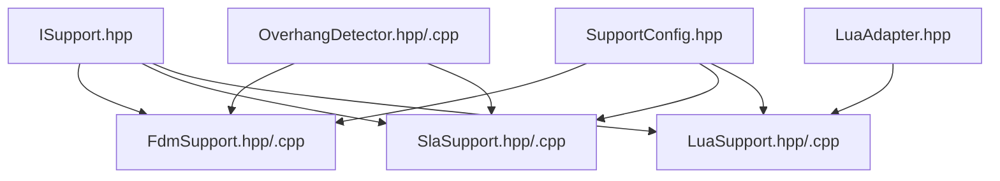
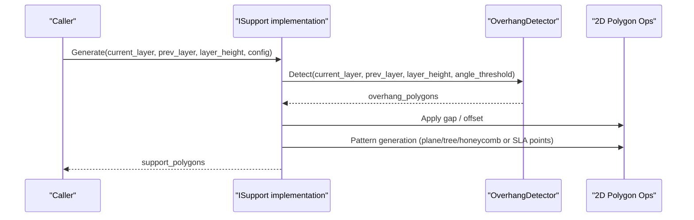
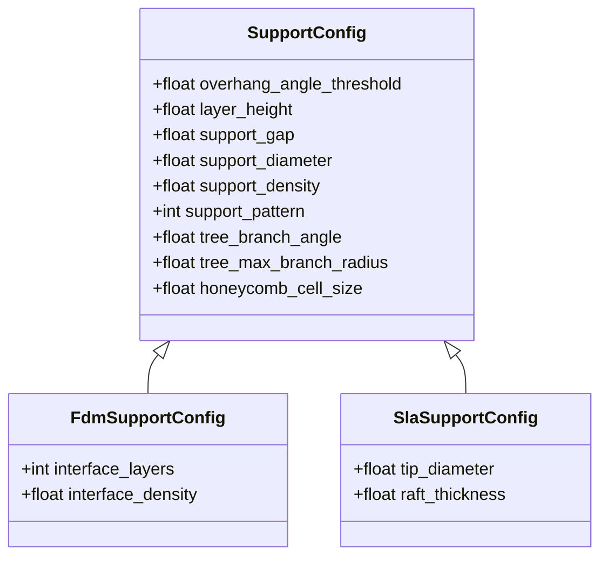
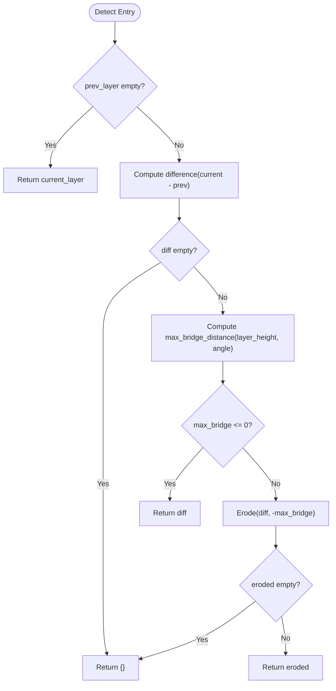
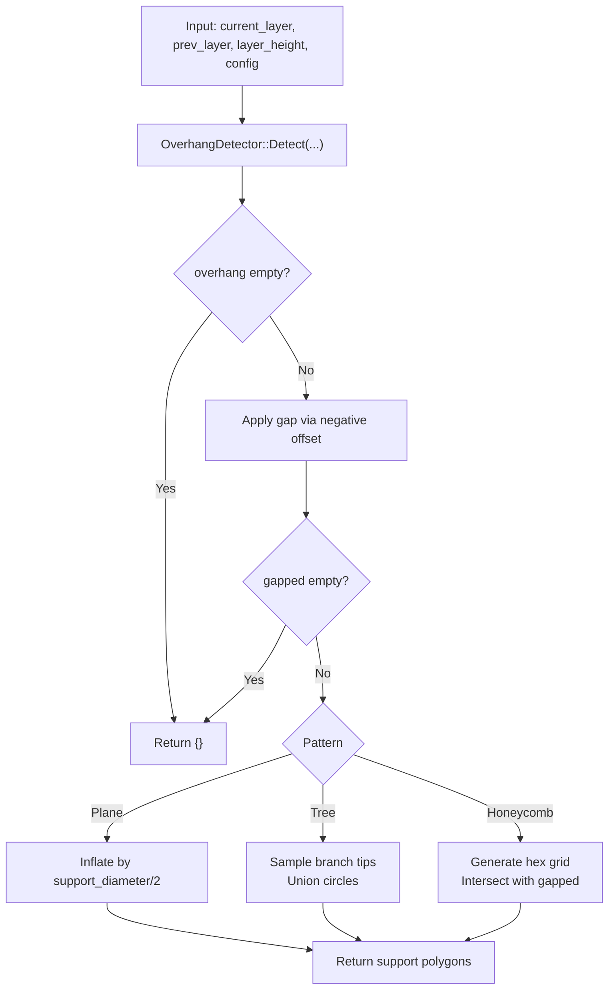
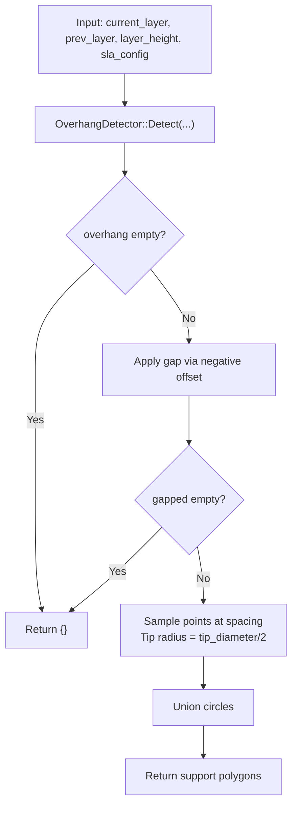
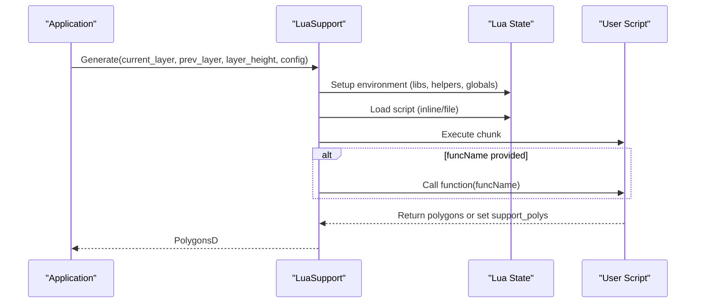
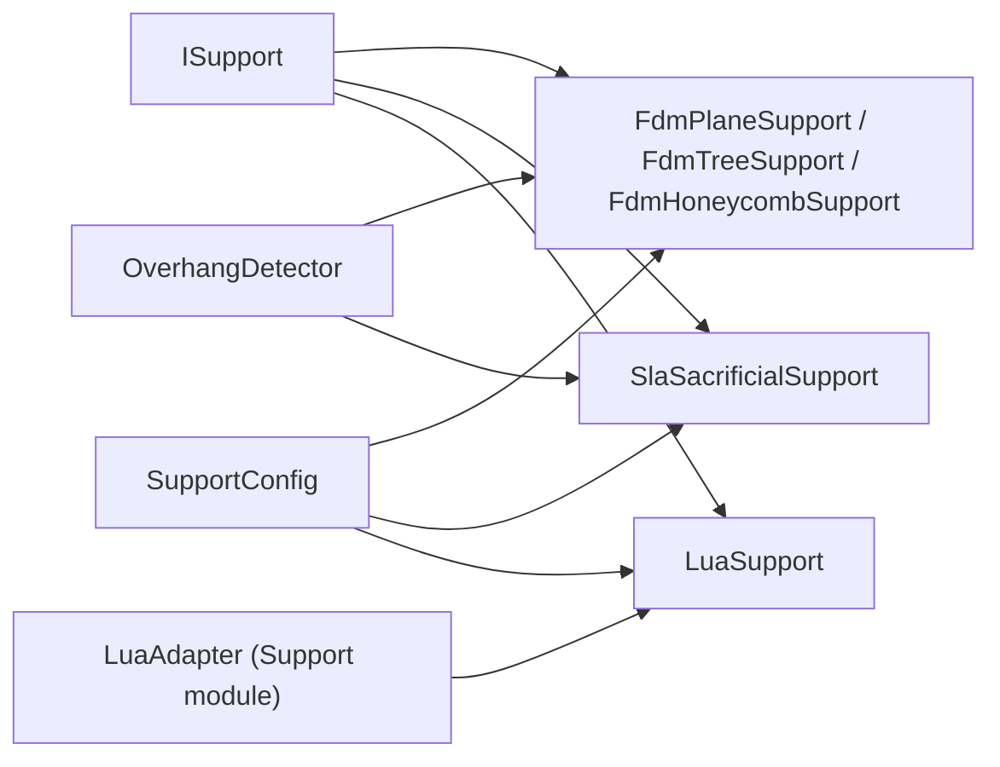

# Support Structure Generation

<cite>
**Referenced Files in This Document**
- [ISupport.hpp](file://support/ISupport.hpp)
- [SupportConfig.hpp](file://support/SupportConfig.hpp)
- [OverhangDetector.hpp](file://support/OverhangDetector.hpp)
- [OverhangDetector.cpp](file://support/OverhangDetector.cpp)
- [FdmSupport.hpp](file://support/FdmSupport.hpp)
- [FdmSupport.cpp](file://support/FdmSupport.cpp)
- [SlaSupport.hpp](file://support/SlaSupport.hpp)
- [SlaSupport.cpp](file://support/SlaSupport.cpp)
- [LuaSupport.hpp](file://support/LuaSupport.hpp)
- [LuaSupport.cpp](file://support/LuaSupport.cpp)
- [LuaAdapter.hpp](file://support/LuaAdapter.hpp)
</cite>

## Table of Contents
1. [Introduction](#introduction)
2. [Project Structure](#project-structure)
3. [Core Components](#core-components)
4. [Architecture Overview](#architecture-overview)
5. [Detailed Component Analysis](#detailed-component-analysis)
6. [Dependency Analysis](#dependency-analysis)
7. [Performance Considerations](#performance-considerations)
8. [Troubleshooting Guide](#troubleshooting-guide)
9. [Conclusion](#conclusion)
10. [Appendices](#appendices)

## Introduction
This document explains the support structure generation system, covering:
- FDM support algorithms: plane, tree, and honeycomb patterns with configurable density and overhang detection
- SLA sacrificial support generation for resin printing
- Automatic overhang detection via OverhangDetector
- Lua-based custom support algorithm development and extension points

The system is designed to be extensible through a common interface and supports both built-in strategies and user-defined scripts.

## Project Structure
Support-related code resides under the support directory and integrates with 2D polygon utilities and Lua scripting:
- Core interfaces and configuration
- Overhang detection
- FDM support generators (plane, tree, honeycomb)
- SLA sacrificial support generator
- Lua-based custom support generator and Lua bindings

**Diagram sources**
- [ISupport.hpp:1-49](file://support/ISupport.hpp#L1-L49)
- [SupportConfig.hpp:1-47](file://support/SupportConfig.hpp#L1-L47)
- [OverhangDetector.hpp:1-54](file://support/OverhangDetector.hpp#L1-L54)
- [OverhangDetector.cpp:1-77](file://support/OverhangDetector.cpp#L1-L77)
- [FdmSupport.hpp:1-67](file://support/FdmSupport.hpp#L1-L67)
- [FdmSupport.cpp:1-236](file://support/FdmSupport.cpp#L1-L236)
- [SlaSupport.hpp:1-46](file://support/SlaSupport.hpp#L1-L46)
- [SlaSupport.cpp:1-120](file://support/SlaSupport.cpp#L1-L120)
- [LuaSupport.hpp:1-85](file://support/LuaSupport.hpp#L1-L85)
- [LuaSupport.cpp:1-175](file://support/LuaSupport.cpp#L1-L175)
- [LuaAdapter.hpp:1-34](file://support/LuaAdapter.hpp#L1-L34)

**Section sources**
- [ISupport.hpp:1-49](file://support/ISupport.hpp#L1-L49)
- [SupportConfig.hpp:1-47](file://support/SupportConfig.hpp#L1-L47)
- [OverhangDetector.hpp:1-54](file://support/OverhangDetector.hpp#L1-L54)
- [FdmSupport.hpp:1-67](file://support/FdmSupport.hpp#L1-L67)
- [SlaSupport.hpp:1-46](file://support/SlaSupport.hpp#L1-L46)
- [LuaSupport.hpp:1-85](file://support/LuaSupport.hpp#L1-L85)
- [LuaAdapter.hpp:1-34](file://support/LuaAdapter.hpp#L1-L34)

## Core Components
- ISupport: Abstract interface defining per-layer support generation and batch generation.
- SupportConfig: Shared configuration including overhang angle threshold, layer height, gap, diameter, density, pattern selection, and pattern-specific parameters.
- OverhangDetector: Computes unsupported regions between adjacent layers based on geometry and angle thresholds.
- FdmPlaneSupport, FdmTreeSupport, FdmHoneycombSupport: Built-in FDM support strategies.
- SlaSacrificialSupport: Thin sacrificial supports for SLA/resin printing.
- LuaSupport: Custom support generator driven by Lua scripts with rich helpers.

Key responsibilities:
- Detect where supports are needed (overhangs).
- Generate cross-section polygons for each strategy.
- Provide a uniform API for all strategies.

**Section sources**
- [ISupport.hpp:16-45](file://support/ISupport.hpp#L16-L45)
- [SupportConfig.hpp:11-43](file://support/SupportConfig.hpp#L11-L43)
- [OverhangDetector.hpp:14-50](file://support/OverhangDetector.hpp#L14-L50)
- [FdmSupport.hpp:13-63](file://support/FdmSupport.hpp#L13-L63)
- [SlaSupport.hpp:13-42](file://support/SlaSupport.hpp#L13-L42)
- [LuaSupport.hpp:21-81](file://support/LuaSupport.hpp#L21-L81)

## Architecture Overview
The support pipeline processes each layer pair to produce support cross-sections:
- OverhangDetector identifies unsupported areas.
- Strategy implementations consume overhangs and apply strategy-specific geometry.
- LuaSupport allows full customization via scripts.

**Diagram sources**
- [FdmSupport.cpp:48-72](file://support/FdmSupport.cpp#L48-L72)
- [FdmSupport.cpp:131-149](file://support/FdmSupport.cpp#L131-L149)
- [FdmSupport.cpp:215-233](file://support/FdmSupport.cpp#L215-L233)
- [SlaSupport.cpp:74-108](file://support/SlaSupport.cpp#L74-L108)
- [OverhangDetector.cpp:37-68](file://support/OverhangDetector.cpp#L37-L68)

## Detailed Component Analysis

### Configuration Model
Shared configuration includes:
- overhang_angle_threshold: degrees used to determine bridgeable spans
- layer_height: mm
- support_gap: separation between model and support
- support_diameter: base size for columns/branches
- support_density: fill density parameter (exposed to Lua)
- support_pattern: integer selector for built-in patterns
- tree_branch_angle, tree_max_branch_radius: tree-specific
- honeycomb_cell_size: hex cell size
- SLA-specific: tip_diameter, raft_thickness

**Diagram sources**
- [SupportConfig.hpp:14-43](file://support/SupportConfig.hpp#L14-L43)

**Section sources**
- [SupportConfig.hpp:11-43](file://support/SupportConfig.hpp#L11-L43)

### Overhang Detection
OverhangDetector computes unsupported regions using geometric difference and erosion based on a maximum bridge distance derived from layer height and angle threshold.

Algorithm highlights:
- If no previous layer exists, entire current layer is considered unsupported.
- Difference between current and previous layers isolates candidate overhangs.
- Max bridge distance = layer_height / tan(angle), with special handling for vertical and flat angles.
- Erosion (negative offset) removes small bridges that can be printed without support.

**Diagram sources**
- [OverhangDetector.cpp:23-35](file://support/OverhangDetector.cpp#L23-L35)
- [OverhangDetector.cpp:37-68](file://support/OverhangDetector.cpp#L37-L68)

**Section sources**
- [OverhangDetector.hpp:14-50](file://support/OverhangDetector.hpp#L14-L50)
- [OverhangDetector.cpp:23-68](file://support/OverhangDetector.cpp#L23-L68)

### FDM Support Strategies
All FDM strategies follow a common flow: detect overhangs, apply gap, then generate pattern-specific geometry.

- Plane support: inflates gapped overhang by half the support diameter to form cylindrical columns.
- Tree support: samples branch tips within the overhang region at regular spacing and unions circles; expansion across layers is handled externally.
- Honeycomb support: generates a grid of hexagonal cells and intersects them with the gapped overhang region.

**Diagram sources**
- [FdmSupport.cpp:48-72](file://support/FdmSupport.cpp#L48-L72)
- [FdmSupport.cpp:77-129](file://support/FdmSupport.cpp#L77-L129)
- [FdmSupport.cpp:131-149](file://support/FdmSupport.cpp#L131-L149)
- [FdmSupport.cpp:155-213](file://support/FdmSupport.cpp#L155-L213)
- [FdmSupport.cpp:215-233](file://support/FdmSupport.cpp#L215-L233)

**Section sources**
- [FdmSupport.hpp:13-63](file://support/FdmSupport.hpp#L13-L63)
- [FdmSupport.cpp:48-72](file://support/FdmSupport.cpp#L48-L72)
- [FdmSupport.cpp:77-149](file://support/FdmSupport.cpp#L77-L149)
- [FdmSupport.cpp:155-233](file://support/FdmSupport.cpp#L155-L233)

### SLA Sacrificial Support
SLA sacrificial supports sample points within the overhang region and place small circular supports spaced by a configured interval. The tip diameter is small for easy removal, while spacing controls density.

**Diagram sources**
- [SlaSupport.cpp:38-71](file://support/SlaSupport.cpp#L38-L71)
- [SlaSupport.cpp:74-108](file://support/SlaSupport.cpp#L74-L108)

**Section sources**
- [SlaSupport.hpp:13-42](file://support/SlaSupport.hpp#L13-L42)
- [SlaSupport.cpp:38-108](file://support/SlaSupport.cpp#L38-L108)

### Lua-Based Custom Support Extension
LuaSupport enables users to replace built-in algorithms with custom logic. It exposes:
- Layer data: current_layer, prev_layer
- Parameters: layer_height, config table with fields mirroring SupportConfig
- Helpers: 2D polygon operations and a Support module exposing constructors for built-in strategies and a generic generate helper

Execution flow:
- Create a Lua state and register libraries and helpers
- Push layer data and config into globals
- Load script (inline or file)
- Optionally call a named function
- Read result from return value or global support_polys

**Diagram sources**
- [LuaSupport.cpp:18-89](file://support/LuaSupport.cpp#L18-L89)
- [LuaSupport.cpp:112-172](file://support/LuaSupport.cpp#L112-L172)
- [LuaAdapter.hpp:13-30](file://support/LuaAdapter.hpp#L13-L30)

**Section sources**
- [LuaSupport.hpp:21-81](file://support/LuaSupport.hpp#L21-L81)
- [LuaSupport.cpp:18-89](file://support/LuaSupport.cpp#L18-L89)
- [LuaSupport.cpp:112-172](file://support/LuaSupport.cpp#L112-L172)
- [LuaAdapter.hpp:13-30](file://support/LuaAdapter.hpp#L13-L30)

## Dependency Analysis
High-level dependencies among support components:

**Diagram sources**
- [ISupport.hpp:16-45](file://support/ISupport.hpp#L16-L45)
- [SupportConfig.hpp:11-43](file://support/SupportConfig.hpp#L11-L43)
- [OverhangDetector.hpp:14-50](file://support/OverhangDetector.hpp#L14-L50)
- [FdmSupport.hpp:13-63](file://support/FdmSupport.hpp#L13-L63)
- [SlaSupport.hpp:13-42](file://support/SlaSupport.hpp#L13-L42)
- [LuaSupport.hpp:21-81](file://support/LuaSupport.hpp#L21-L81)
- [LuaAdapter.hpp:13-30](file://support/LuaAdapter.hpp#L13-L30)

**Section sources**
- [ISupport.hpp:16-45](file://support/ISupport.hpp#L16-L45)
- [SupportConfig.hpp:11-43](file://support/SupportConfig.hpp#L11-L43)
- [OverhangDetector.hpp:14-50](file://support/OverhangDetector.hpp#L14-L50)
- [FdmSupport.hpp:13-63](file://support/FdmSupport.hpp#L13-L63)
- [SlaSupport.hpp:13-42](file://support/SlaSupport.hpp#L13-L42)
- [LuaSupport.hpp:21-81](file://support/LuaSupport.hpp#L21-L81)
- [LuaAdapter.hpp:13-30](file://support/LuaAdapter.hpp#L13-L30)

## Performance Considerations
- Overhang detection uses polygon difference and offset operations; large models benefit from appropriate layer heights and angle thresholds to minimize unnecessary erosion steps.
- FDM tree and SLA sampling iterate over bounding boxes; tune spacing and support_diameter to balance coverage and computation time.
- Honeycomb generation creates many hex cells; adjust honeycomb_cell_size to control the number of generated primitives.
- All strategies perform integerization/unintegerization around offsets; keep layer_height and gaps reasonable to avoid excessive precision loss.
- For Lua-based strategies, prefer efficient polygon operations exposed by the 2D Lua adapter and avoid heavy per-point computations inside scripts.

[No sources needed since this section provides general guidance]

## Troubleshooting Guide
Common issues and resolutions:
- No supports generated:
  - Verify overhang_angle_threshold and layer_height; too high an angle may classify everything as bridgeable.
  - Ensure support_gap is not so large that gapped overhang becomes empty after offset.
- Excessive supports or slow performance:
  - Increase support_diameter spacing (tree/SLA) or increase honeycomb_cell_size.
  - Reduce support_density usage in Lua scripts if generating dense fills.
- Lua script errors:
  - Check load and runtime error messages thrown by LuaSupport when loading or executing scripts.
  - Confirm that the script returns polygons or sets the global support_polys.
  - Validate that the expected function name matches what you pass to LuaSupport.

Operational notes:
- LuaSupport throws explicit errors on Lua state creation failure, script load failure, and function call failure.
- OverhangDetector returns empty results when differences are fully bridgeable or eroded away.

**Section sources**
- [LuaSupport.cpp:112-172](file://support/LuaSupport.cpp#L112-L172)
- [OverhangDetector.cpp:37-68](file://support/OverhangDetector.cpp#L37-L68)

## Conclusion
The support generation system provides robust, configurable algorithms for FDM and SLA workflows, with automatic overhang detection and a flexible Lua extension mechanism. By tuning configuration parameters and selecting appropriate patterns, users can achieve reliable support structures tailored to their materials and geometries.

[No sources needed since this section summarizes without analyzing specific files]

## Appendices

### Configuration Parameters Reference
- overhang_angle_threshold: degrees; higher values reduce supports by allowing larger bridges
- layer_height: mm; affects bridgeability and resolution
- support_gap: mm; separates support from model
- support_diameter: mm; base size for columns/branches and spacing
- support_density: dimensionless; indicates desired fill density (used by scripts/patterns)
- support_pattern: integer; selects built-in pattern (e.g., plane/tree/honeycomb)
- tree_branch_angle: degrees; influences tree branching behavior
- tree_max_branch_radius: mm; limits branch growth
- honeycomb_cell_size: mm; hex cell size for honeycomb pattern
- SLA tip_diameter: mm; small for easy removal
- SLA raft_thickness: mm; base layer thickness for SLA

**Section sources**
- [SupportConfig.hpp:14-43](file://support/SupportConfig.hpp#L14-L43)

### Example Custom Support Patterns (Conceptual)
- Sparse point field: Sample fewer points in low-stress regions and denser near critical overhangs.
- Adaptive density: Use local curvature or area metrics to vary spacing dynamically.
- Hybrid patterns: Combine tree-like branches with localized honeycomb infill for strength-to-weight optimization.

Implementation approach:
- Use LuaSupport to define a function that reads current_layer and config, applies 2D polygon helpers, and returns polygons or sets support_polys.
- Leverage Support.detect_overhang and Support.generate helpers exposed by the Support module for consistency with built-in strategies.

[No sources needed since this section provides conceptual examples]