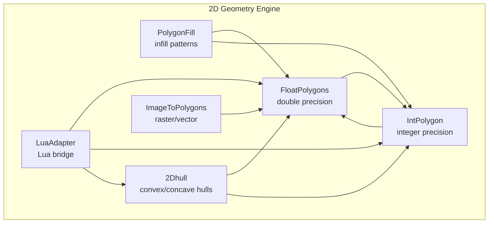
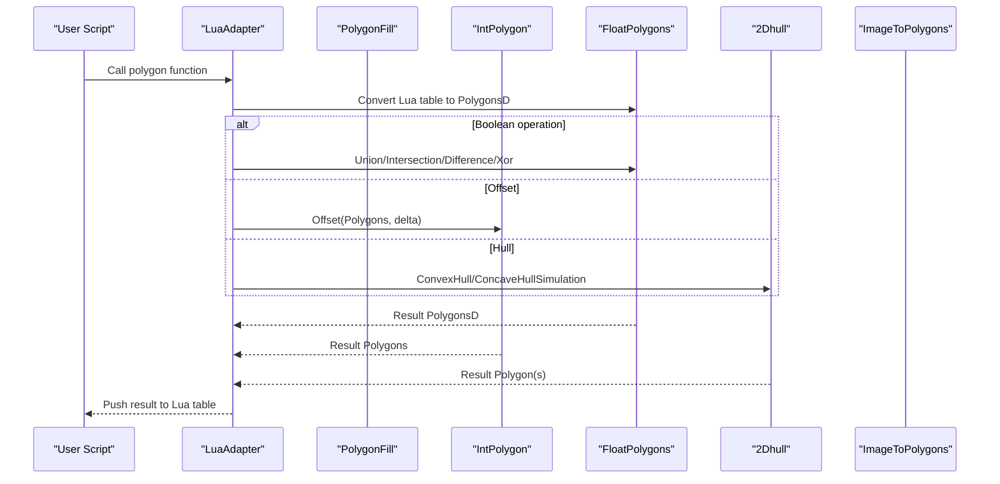
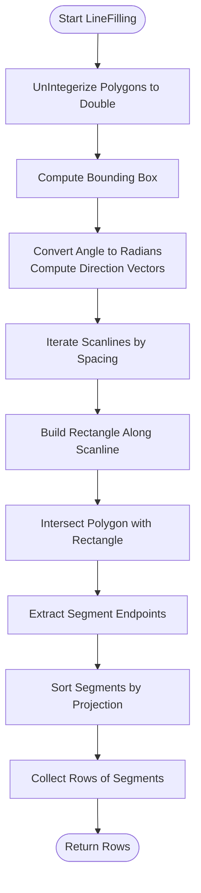
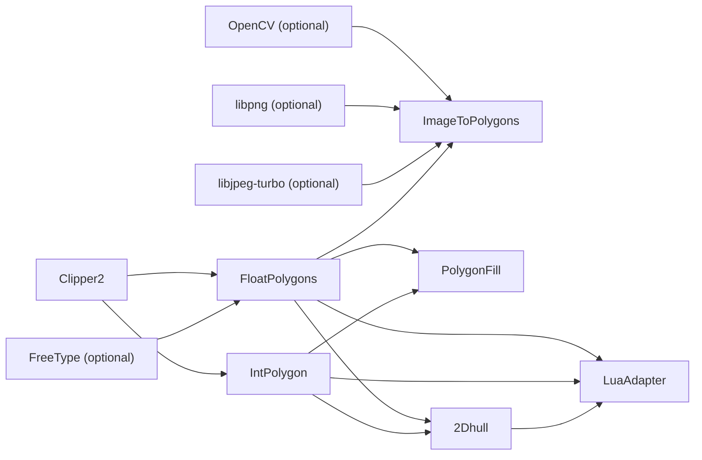

# 2D Geometry Engine (2D/)

<cite>
**Referenced Files in This Document**   
- [FloatPolygons.hpp](file://2D/FloatPolygons.hpp)
- [FloatPolygons.cpp](file://2D/FloatPolygons.cpp)
- [IntPolygon.hpp](file://2D/IntPolygon.hpp)
- [IntPolygon.cpp](file://2D/IntPolygon.cpp)
- [PolygonFill.hpp](file://2D/PolygonFill.hpp)
- [PolygonFill.cpp](file://2D/PolygonFill.cpp)
- [2Dhull.hpp](file://2D/2Dhull.hpp)
- [2Dhull.cpp](file://2D/2Dhull.cpp)
- [ImageToPolygons.hpp](file://2D/ImageToPolygons.hpp)
- [ImageToPolygons.cpp](file://2D/ImageToPolygons.cpp)
- [LuaAdapter.hpp](file://2D/LuaAdapter.hpp)
- [LuaAdapter.cpp](file://2D/LuaAdapter.cpp)
</cite>

## Table of Contents
1. [Introduction](#introduction)
2. [Project Structure](#project-structure)
3. [Core Components](#core-components)
4. [Architecture Overview](#architecture-overview)
5. [Detailed Component Analysis](#detailed-component-analysis)
6. [Dependency Analysis](#dependency-analysis)
7. [Performance Considerations](#performance-considerations)
8. [Troubleshooting Guide](#troubleshooting-guide)
9. [Conclusion](#conclusion)
10. [Appendices](#appendices)

## Introduction
The 2D geometry engine under `2D/` provides the geometric primitives, boolean operations, offsetting, hull computation, raster-to-vector conversion, fill pattern generation, and Lua scripting integration used by HsBaSlicer’s slicing pipeline. It is built on Clipper2 for robust polygonal boolean and offset operations, with a dual-coordinate design: double-precision types for modeling and text generation, and 64-bit integer types for stable boolean arithmetic. The module exposes both C++ APIs and Lua bindings so that users can script custom fills, image processing, and polygon manipulation workflows.

Key responsibilities:
- Represent 2D polygons at double precision and integer precision.
- Provide boolean operations, area calculation, simplification, and offsetting.
- Generate convex and simulated concave hulls.
- Convert between raster images and vector polygons.
- Generate infill patterns such as parallel lines, zigzag, composite offsets, and hybrid fills.
- Expose polygon operations to Lua scripts for flexible customization.

## Project Structure
The `2D/` directory contains six cohesive modules:

| File | Responsibility |
| --- | --- |
| `FloatPolygons.hpp/.cpp` | Double-precision polygon types, boolean operations, shape generators, text-to-polygons, and integerization helpers. |
| `IntPolygon.hpp/.cpp` | Integer-coordinate polygon types, boolean operations, offsetting, point-in-polygon, area, normalization, and SVG dump utilities. |
| `PolygonFill.hpp/.cpp` | Infill algorithms: offset-based borders, line fills, zigzag fills, composite/hybrid fills, and Lua-driven custom fills. |
| `2Dhull.hpp/.cpp` | Convex hull and concave-hull simulation over single or multiple polygons. |
| `ImageToPolygons.hpp/.cpp` | Raster-to-vector thresholding, multi-threshold extraction, polygon-to-image rendering, and Lua-driven image generation. |
| `LuaAdapter.hpp/.cpp` | Conversion between Lua tables and polygon types, plus registration of polygon operation functions into Lua. |

**Diagram sources**
- [FloatPolygons.hpp:16-25](file://2D/FloatPolygons.hpp#L16-L25)
- [IntPolygon.hpp:16-26](file://2D/IntPolygon.hpp#L16-L26)
- [PolygonFill.hpp:9-14](file://2D/PolygonFill.hpp#L9-L14)
- [2Dhull.hpp:9-10](file://2D/2Dhull.hpp#L9-L10)
- [ImageToPolygons.hpp:9-16](file://2D/ImageToPolygons.hpp#L9-L16)
- [LuaAdapter.hpp:9-12](file://2D/LuaAdapter.hpp#L9-L12)

**Section sources**
- [FloatPolygons.hpp:1-271](file://2D/FloatPolygons.hpp#L1-L271)
- [IntPolygon.hpp:1-241](file://2D/IntPolygon.hpp#L1-L241)
- [PolygonFill.hpp:1-141](file://2D/PolygonFill.hpp#L1-L141)
- [2Dhull.hpp:1-75](file://2D/2Dhull.hpp#L1-L75)
- [ImageToPolygons.hpp:1-103](file://2D/ImageToPolygons.hpp#L1-L103)
- [LuaAdapter.hpp:1-84](file://2D/LuaAdapter.hpp#L1-L84)

## Core Components
This section summarizes the core mathematical and algorithmic building blocks exposed by the module.

### Floating-point Polygon Types and Operations
- Types:
  - `Point2D`: double-precision 2D point.
  - `PolygonD`: double-precision polygon path.
  - `PolygonsD`: collection of double-precision polygons.
- Boolean operations:
  - Union, intersection, difference, XOR for single polygons and sets.
- Utilities:
  - Simplify paths by removing collinear points.
  - Area calculation.
  - Shape generators: rectangle, circle, ellipse, regular polygon.
  - Text-to-polygons using FreeType when available.
  - Integerization/un-integerization between double and integer coordinates.

Precision model:
- Modeling uses double precision for smooth curves, text outlines, and user-facing geometry.
- Boolean and offset operations are performed via Clipper2; integerization ensures numerical stability during clipping.

**Section sources**
- [FloatPolygons.hpp:18-25](file://2D/FloatPolygons.hpp#L18-L25)
- [FloatPolygons.hpp:27-191](file://2D/FloatPolygons.hpp#L27-L191)
- [FloatPolygons.cpp:25-75](file://2D/FloatPolygons.cpp#L25-L75)
- [FloatPolygons.cpp:184-221](file://2D/FloatPolygons.cpp#L184-L221)
- [FloatPolygons.cpp:330-429](file://2D/FloatPolygons.cpp#L330-L429)

### Integer Polygon Types and Robust Operations
- Types:
  - `Point2`: 64-bit integer point.
  - `Polygon`: integer polygon path.
  - `Polygons`: collection of integer polygons.
- Scaling constant:
  - `integerization = 1e6`, used to convert between double and integer coordinates.
- Operations:
  - Boolean operations: union, intersection, difference, XOR.
  - Offset (inflate/deflate) with configurable join and end types.
  - Point-in-polygon test supporting even-odd and non-zero winding rules.
  - Area calculation.
  - Normalization helpers to split self-intersecting polygons into simple polygons with correct hole relationships.

Robustness:
- Integer arithmetic avoids floating-point drift during boolean clipping.
- Even-odd normalization ensures consistent inside/outside semantics across complex inputs.

**Section sources**
- [IntPolygon.hpp:16-26](file://2D/IntPolygon.hpp#L16-L26)
- [IntPolygon.hpp:28-192](file://2D/IntPolygon.hpp#L28-L192)
- [IntPolygon.cpp:19-127](file://2D/IntPolygon.cpp#L19-L127)
- [IntPolygon.cpp:278-446](file://2D/IntPolygon.cpp#L278-L446)

### Fill Pattern Generators
Supported fill modes:
- Offset-based border fills.
- Parallel line fills.
- Simple zigzag fills.
- Advanced zigzag fills with improved corner handling.
- Composite offset fills combining outward/inward offsets with internal fill modes.
- Hybrid fills applying offsets first, then filling the last offset region.
- Lua-custom fills driven by external scripts or inline code.

Algorithm highlights:
- Line fills compute scanlines rotated by an angle, intersect them with the polygon, and extract segments.
- Zigzag fills connect segment centers across adjacent rows while ensuring connectors stay within the polygon boundary using binary search.
- Offset-only helper generates inward and outward offset layers up to specified counts.

Configuration:
- Spacing, angle, line thickness, join type, outward/inward layer counts, and fill mode selection.

**Section sources**
- [PolygonFill.hpp:20-136](file://2D/PolygonFill.hpp#L20-L136)
- [PolygonFill.cpp:44-160](file://2D/PolygonFill.cpp#L44-L160)
- [PolygonFill.cpp:504-541](file://2D/PolygonFill.cpp#L504-L541)
- [PolygonFill.cpp:544-800](file://2D/PolygonFill.cpp#L544-L800)

### Hull Computation
- Convex hull:
  - Implemented for both integer and double-precision polygons.
  - Uses angular sorting around the lowest-leftmost point and a monotone chain approach.
- Concave hull simulation:
  - Interpolates additional points along each convex hull edge to simulate concavity.
  - Supports single polygon and multiple polygons.

Use cases:
- Approximating part boundaries.
- Generating toolpaths that follow outer contours with controlled roughness.

**Section sources**
- [2Dhull.hpp:14-72](file://2D/2Dhull.hpp#L14-L72)
- [2Dhull.cpp:16-45](file://2D/2Dhull.cpp#L16-L45)
- [2Dhull.cpp:47-135](file://2D/2Dhull.cpp#L47-L135)
- [2Dhull.cpp:137-218](file://2D/2Dhull.cpp#L137-L218)

### Raster-to-Vector and Vector-to-Raster
Raster-to-vector:
- Load grayscale images using OpenCV when available.
- Thresholding to binary masks.
- Connected-component border tracing and contour extraction.
- Simplification to clean polygonal outlines.
- Multi-threshold support returning one polygon set per threshold.

Vector-to-raster:
- Rasterize polygons into grayscale bitmaps.
- Encode to PNG/JPEG/SVG either to disk or in-memory buffers.
- Lua-driven image generation where scripts return grayscale tables.

Integration:
- Useful for converting STL-derived slices, logos, or user-provided masks into vector layers.

**Section sources**
- [ImageToPolygons.hpp:23-99](file://2D/ImageToPolygons.hpp#L23-L99)
- [ImageToPolygons.cpp:37-76](file://2D/ImageToPolygons.cpp#L37-L76)
- [ImageToPolygons.cpp:98-200](file://2D/ImageToPolygons.cpp#L98-L200)
- [ImageToPolygons.cpp:416-543](file://2D/ImageToPolygons.cpp#L416-L543)
- [ImageToPolygons.cpp:426-514](file://2D/ImageToPolygons.cpp#L426-L514)
- [ImageToPolygons.cpp:545-682](file://2D/ImageToPolygons.cpp#L545-L682)

### Lua Integration
Bridge capabilities:
- Push/pull polygon tables between C++ and Lua.
- Register polygon operation functions:
  - Boolean operations: union, intersection, difference, XOR.
  - Offset operations.
  - Hull operations: convex and concave.
  - Area calculation.
  - Shape generators: rectangle, circle, ellipse, regular polygon.
  - Text-to-polygons.
  - Optional debug SVG dumps.

Fill scripting:
- Custom fill functions registered under a Lua namespace.
- Support for file-based and inline Lua scripts.

Error handling:
- Consistent error reporting from Lua wrappers.
- Validation of argument types and counts.

**Section sources**
- [LuaAdapter.hpp:16-81](file://2D/LuaAdapter.hpp#L16-L81)
- [LuaAdapter.cpp:22-106](file://2D/LuaAdapter.cpp#L22-L106)
- [LuaAdapter.cpp:108-153](file://2D/LuaAdapter.cpp#L108-L153)
- [LuaAdapter.cpp:155-329](file://2D/LuaAdapter.cpp#L155-L329)
- [LuaAdapter.cpp:332-491](file://2D/LuaAdapter.cpp#L332-L491)
- [PolygonFill.cpp:223-502](file://2D/PolygonFill.cpp#L223-L502)

## Architecture Overview
The 2D geometry engine follows a layered architecture:

- Data layer:
  - Double-precision polygons for modeling and text.
  - Integer polygons for robust boolean and offset operations.
- Algorithm layer:
  - Boolean operations, area, simplify, offset, hulls.
  - Fill algorithms composing lower-level operations.
- I/O and scripting layer:
  - Image loading/saving and rasterization.
  - Lua adapters exposing operations to scripts.

**Diagram sources**
- [LuaAdapter.cpp:22-106](file://2D/LuaAdapter.cpp#L22-L106)
- [FloatPolygons.hpp:43-121](file://2D/FloatPolygons.hpp#L43-L121)
- [IntPolygon.hpp:68-168](file://2D/IntPolygon.hpp#L68-L168)
- [2Dhull.hpp:22-72](file://2D/2Dhull.hpp#L22-L72)

## Detailed Component Analysis

### FloatPolygons: Double-Precision Modeling and Conversion
FloatPolygons defines the modeling coordinate space and provides:
- Boolean operations delegating to Clipper2.
- Area computation.
- Path simplification.
- Shape generators for rectangles, circles, ellipses, and regular polygons.
- Text-to-polygons using FreeType when compiled with HSBA_HAVE_FREETYPE.
- Integerization/un-integerization to bridge to integer arithmetic.

Complexity considerations:
- Boolean operations depend on Clipper2 complexity; typical O(n log n) behavior for planar subdivision.
- Text-to-polygons depends on glyph outline decomposition and curve sampling.

Numerical precision:
- Double precision is suitable for modeling but may accumulate rounding errors during repeated boolean operations; hence integerization is used before clipping.

Common use cases:
- Building initial geometry from CAD or text.
- Preparing polygons for boolean operations and offsets.

**Section sources**
- [FloatPolygons.hpp:18-25](file://2D/FloatPolygons.hpp#L18-L25)
- [FloatPolygons.hpp:27-191](file://2D/FloatPolygons.hpp#L27-L191)
- [FloatPolygons.cpp:25-75](file://2D/FloatPolygons.cpp#L25-L75)
- [FloatPolygons.cpp:184-221](file://2D/FloatPolygons.cpp#L184-L221)
- [FloatPolygons.cpp:330-429](file://2D/FloatPolygons.cpp#L330-L429)

### IntPolygon: Integer Arithmetic and Robust Clipping
IntPolygon provides:
- Boolean operations over integer polygons.
- Offset operations with configurable join/end types.
- Point-in-polygon tests supporting even-odd and non-zero winding rules.
- Area calculations.
- Normalization routines to split self-intersecting polygons into simple polygons with proper hole nesting.

Design notes:
- The integerization scale factor `1e6` balances precision and range for typical additive manufacturing dimensions.
- Even-odd normalization ensures consistent inside/outside semantics regardless of input orientation.

Complexity considerations:
- Boolean operations and offsets rely on Clipper2; performance scales with vertex count and topology complexity.
- Normalization involves tree traversal and containment checks; quadratic behavior possible in worst-case nested structures.

Common use cases:
- Stable boolean operations for slicing.
- Generating offset borders for walls and perimeters.
- Validating and cleaning polygon inputs.

**Section sources**
- [IntPolygon.hpp:16-26](file://2D/IntPolygon.hpp#L16-L26)
- [IntPolygon.hpp:28-192](file://2D/IntPolygon.hpp#L28-L192)
- [IntPolygon.cpp:19-127](file://2D/IntPolygon.cpp#L19-L127)
- [IntPolygon.cpp:278-446](file://2D/IntPolygon.cpp#L278-L446)

### PolygonFill: Infill Algorithms
PolygonFill implements several fill strategies:

- OffsetFill:
  - Generates concentric inward offset rings until empty or iteration limit reached.
  - Each ring is closed and added as a polygon path.

- LineFill:
  - Computes rotated scanlines across the bounding box.
  - Intersects each scanline rectangle with the polygon.
  - Extracts line segments ordered along the scan direction.

- SimpleZigzagFill:
  - Builds connected polylines by linking segment centers across adjacent rows.
  - Ensures connectors remain inside the polygon using binary search.

- ZigzagFill:
  - Improved corner handling compared to simple zigzag.

- CompositeOffsetFill and HybridFill:
  - Combine outward/inward offset layers with internal fill modes.
  - Allow tuning of spacing, step size, layer counts, angle, thickness, and join type.

- LuaCustomFill and LuaCustomFillString:
  - Execute user-defined Lua scripts to generate fills.

Flowchart for LineFilling:

**Diagram sources**
- [PolygonFill.cpp:44-160](file://2D/PolygonFill.cpp#L44-L160)

Selection guidance:
- Use OffsetFill for perimeter reinforcement and thin-wall fills.
- Use LineFill for fast, directional infill.
- Use ZigzagFill for stronger inter-layer bonding due to connectivity.
- Use Composite/Hybrid fills for complex parts requiring strong borders and tuned interior patterns.

**Section sources**
- [PolygonFill.hpp:20-136](file://2D/PolygonFill.hpp#L20-L136)
- [PolygonFill.cpp:504-541](file://2D/PolygonFill.cpp#L504-L541)
- [PolygonFill.cpp:544-800](file://2D/PolygonFill.cpp#L544-L800)

### 2Dhull: Convex and Simulated Concave Hulls
ConvexHull:
- Finds the lowest-leftmost point, sorts remaining points by polar angle, and builds the hull using a stack.

ConcaveHullSimulation:
- Computes convex hull first, then interpolates additional points along each edge to simulate concavity.
- Supports single and multiple polygons by aggregating vertices.

Use cases:
- Approximating part silhouettes.
- Generating rough outer contours for toolpath planning.

**Section sources**
- [2Dhull.hpp:14-72](file://2D/2Dhull.hpp#L14-L72)
- [2Dhull.cpp:47-135](file://2D/2Dhull.cpp#L47-L135)
- [2Dhull.cpp:137-218](file://2D/2Dhull.cpp#L137-L218)

### ImageToPolygons: Raster-to-Vector Conversion
Pipeline:
- Load grayscale image (OpenCV if available).
- Apply threshold to create binary mask.
- Trace borders of connected components.
- Sort border pixels by angle around centroid to form closed contours.
- Simplify contours to reduce vertex count.
- Return polygon sets.

Rendering:
- Rasterize polygons to grayscale bitmap.
- Encode to PNG/JPEG/SVG.
- Support in-memory buffer output for performance-sensitive workflows.

Lua integration:
- Scripts can process polygons and return grayscale tables for further processing or saving.

**Section sources**
- [ImageToPolygons.hpp:23-99](file://2D/ImageToPolygons.hpp#L23-L99)
- [ImageToPolygons.cpp:98-200](file://2D/ImageToPolygons.cpp#L98-L200)
- [ImageToPolygons.cpp:416-543](file://2D/ImageToPolygons.cpp#L416-L543)
- [ImageToPolygons.cpp:426-514](file://2D/ImageToPolygons.cpp#L426-L514)
- [ImageToPolygons.cpp:545-682](file://2D/ImageToPolygons.cpp#L545-L682)

### LuaAdapter: Scripting Bridge
Functions exposed to Lua:
- Boolean operations: union, intersection, difference, XOR.
- Offset operations.
- Hull operations: convex and concave.
- Area calculation.
- Shape generators: rectangle, circle, ellipse, regular polygon.
- Text-to-polygons.
- Optional debug SVG dumps.

Data conversion:
- PushPolygonDToLua/PushPolygonsDToLua: push double-precision polygons.
- PushPolygonToLua/PushPolygonsToLua: push integer polygons scaled back to double coordinates.
- LuaTableToPolygonD/LuaTableToPolygonsD: parse double-precision polygons.
- LuaTableToPolygon/LuaTableToPolygons: parse integer polygons.

Registration:
- RegisterLuaPolygonOperations registers the PolygonOperations namespace.
- RegisterLuaPolygonFillFunctions registers the PolygonFill namespace.

Error handling:
- Centralized error formatting for invalid arguments and unknown operations.

**Section sources**
- [LuaAdapter.hpp:16-81](file://2D/LuaAdapter.hpp#L16-L81)
- [LuaAdapter.cpp:22-106](file://2D/LuaAdapter.cpp#L22-L106)
- [LuaAdapter.cpp:108-153](file://2D/LuaAdapter.cpp#L108-L153)
- [LuaAdapter.cpp:155-329](file://2D/LuaAdapter.cpp#L155-L329)
- [LuaAdapter.cpp:332-491](file://2D/LuaAdapter.cpp#L332-L491)
- [PolygonFill.cpp:488-502](file://2D/PolygonFill.cpp#L488-L502)

## Dependency Analysis
The module exhibits clear separation of concerns:

- FloatPolygons depends on Clipper2 and optionally FreeType.
- IntPolygon depends on Clipper2 and provides robust integer arithmetic.
- PolygonFill composes FloatPolygons and IntPolygon to implement fill algorithms.
- 2Dhull depends on both FloatPolygons and IntPolygon for hull computations.
- ImageToPolygons depends on FloatPolygons and optional OpenCV/libpng/libjpeg-turbo.
- LuaAdapter depends on FloatPolygons, IntPolygon, and 2Dhull to expose operations to Lua.

**Diagram sources**
- [FloatPolygons.cpp:7-21](file://2D/FloatPolygons.cpp#L7-L21)
- [IntPolygon.cpp:7-16](file://2D/IntPolygon.cpp#L7-L16)
- [ImageToPolygons.cpp:18-29](file://2D/ImageToPolygons.cpp#L18-L29)
- [PolygonFill.cpp:6-19](file://2D/PolygonFill.cpp#L6-L19)
- [2Dhull.cpp:7-10](file://2D/2Dhull.cpp#L7-L10)
- [LuaAdapter.cpp:5-10](file://2D/LuaAdapter.cpp#L5-L10)

**Section sources**
- [FloatPolygons.cpp:7-21](file://2D/FloatPolygons.cpp#L7-L21)
- [IntPolygon.cpp:7-16](file://2D/IntPolygon.cpp#L7-L16)
- [ImageToPolygons.cpp:18-29](file://2D/ImageToPolygons.cpp#L18-L29)
- [PolygonFill.cpp:6-19](file://2D/PolygonFill.cpp#L6-L19)
- [2Dhull.cpp:7-10](file://2D/2Dhull.cpp#L7-L10)
- [LuaAdapter.cpp:5-10](file://2D/LuaAdapter.cpp#L5-L10)

## Performance Considerations
- Coordinate representation:
  - Use double precision for modeling and text generation.
  - Use integer precision for boolean and offset operations to avoid floating-point drift.
- Integerization scale:
  - `integerization = 1e6` provides sufficient precision for typical AM dimensions while staying within 64-bit integer ranges.
- Boolean operations:
  - Complexity dominated by Clipper2 planar subdivision; expect near O(n log n) behavior for well-formed polygons.
- Fill algorithms:
  - LineFilling iterates scanlines proportional to bounding box size divided by spacing; complexity increases with finer spacing.
  - Zigzag fills perform binary searches for boundary crossings; cost grows with number of segments and iterations.
  - Offset loops are bounded by MAX_FILL_ITERATIONS to prevent runaway computation.
- Image processing:
  - OpenCV-accelerated IO and rasterization improve performance when available.
  - In-memory encoding avoids temporary files for ToImageBuffer.

Optimization recommendations:
- Choose appropriate spacing and line thickness to balance detail and performance.
- Prefer integerization for boolean-heavy workflows.
- Limit offset iterations and use coarse initial steps for large parts.
- Use multi-threshold extraction sparingly; it multiplies processing by the number of thresholds.

[No sources needed since this section provides general guidance]

## Troubleshooting Guide
Common issues and resolutions:

- Empty or invalid polygons:
  - Ensure polygons have at least three vertices and are not degenerate.
  - Use MakeSimple to remove collinear points and normalize orientation.

- Unexpected boolean results:
  - Check fill rule usage; default is EvenOdd.
  - Validate polygon winding and hole orientation; NormalizeToSimplePolygons can help.

- Offset failures:
  - Very small or negative deltas may produce empty results.
  - Adjust join type to handle sharp corners better.

- Lua script errors:
  - Verify function names and argument types.
  - Inspect error messages returned by Lua wrappers.

- Image conversion problems:
  - Confirm image path and format support.
  - For Lua-driven image generation, ensure the script returns a table of integers in range [0, 255].

**Section sources**
- [IntPolygon.cpp:278-446](file://2D/IntPolygon.cpp#L278-L446)
- [LuaAdapter.cpp:16-19](file://2D/LuaAdapter.cpp#L16-L19)
- [ImageToPolygons.cpp:545-682](file://2D/ImageToPolygons.cpp#L545-L682)

## Conclusion
The 2D geometry engine in HsBaSlicer provides a robust foundation for 2D polygon processing essential to slicing workflows. Its dual-coordinate design ensures both modeling flexibility and computational stability. The module supports a wide range of operations including boolean logic, offsets, hulls, raster conversions, and customizable fills via Lua. By understanding the mathematical foundations and algorithmic choices, users can select appropriate tools for additive manufacturing tasks such as wall generation, infill patterning, and slice validation.

[No sources needed since this section summarizes without analyzing specific files]

## Appendices

### Mathematical Foundations Summary
- Boolean operations:
  - Union, intersection, difference, XOR based on planar subdivision.
- Offset operations:
  - Minkowski sum with a circular kernel approximated by polygonal offsets.
- Hull computation:
  - Convex hull via angular sorting and monotone chain.
  - Concave hull simulation via edge interpolation.
- Rasterization:
  - Point-in-polygon tests for pixel coverage.
  - Contour tracing via connected-component border detection.

[No sources needed since this section provides general guidance]