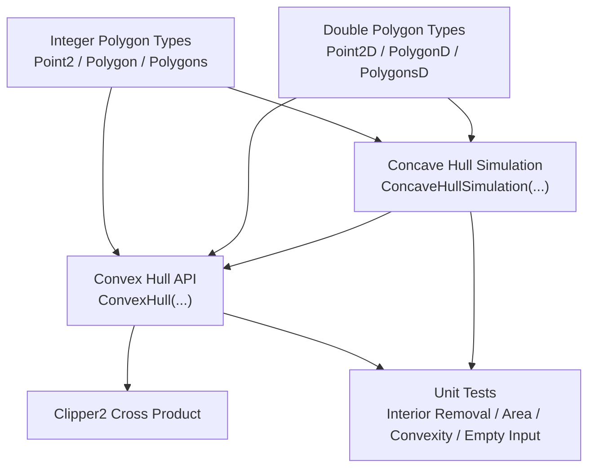
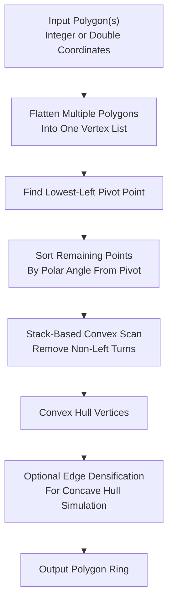
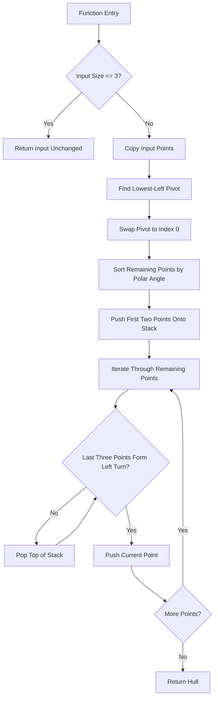
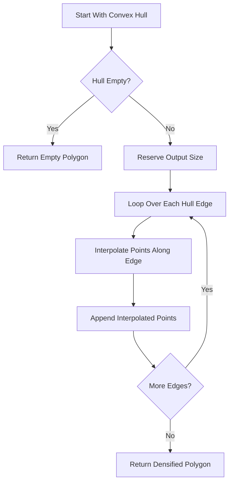
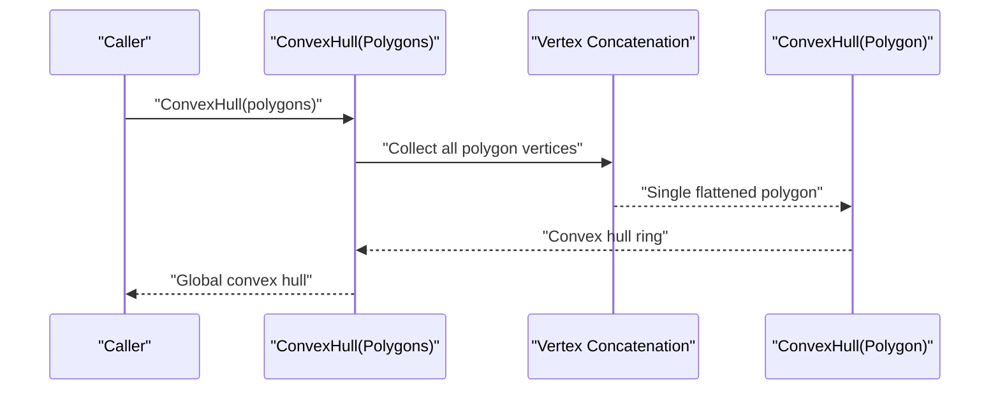
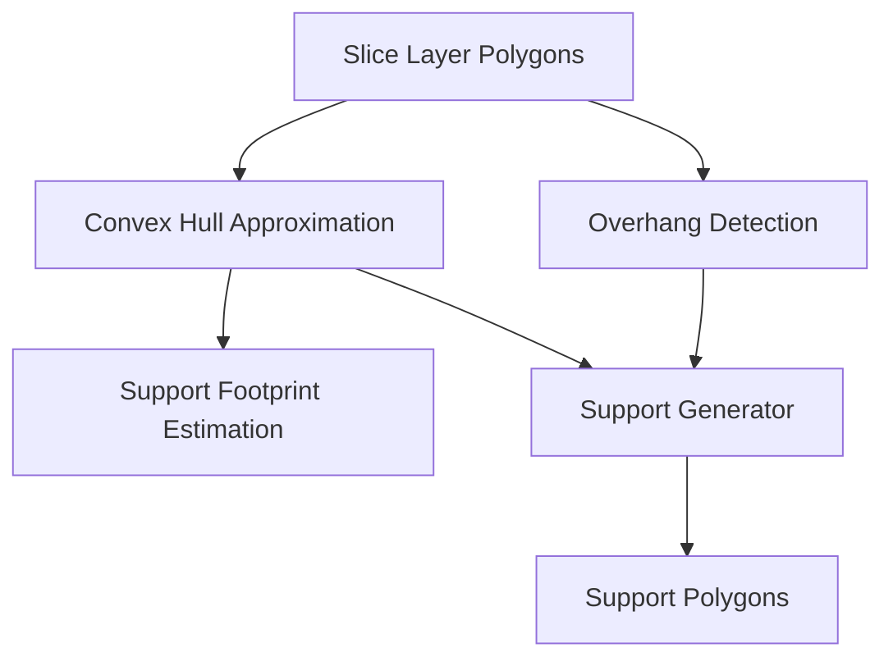
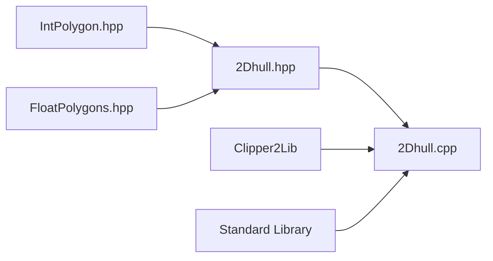

# Convex Hull Computation

<cite>
**Referenced Files in This Document**
- [2Dhull.hpp](file://2D/2Dhull.hpp)
- [2Dhull.cpp](file://2D/2Dhull.cpp)
- [IntPolygon.hpp](file://2D/IntPolygon.hpp)
- [FloatPolygons.hpp](file://2D/FloatPolygons.hpp)
- [2dhull_test.cpp](file://tests/Hull/2dhull_test.cpp)
- [FdmSupport.hpp](file://support/FdmSupport.hpp)
- [LuaAdapter.cpp](file://support/LuaAdapter.cpp)
- [Msg2PipelineConfig.cpp](file://convert/Msg2PipelineConfig.cpp)
- [PipelineConfig2Msg.cpp](file://convert/PipelineConfig2Msg.cpp)
</cite>

## Table of Contents
1. [Introduction](#introduction)
2. [Project Structure](#project-structure)
3. [Core Components](#core-components)
4. [Architecture Overview](#architecture-overview)
5. [Detailed Component Analysis](#detailed-component-analysis)
6. [Dependency Analysis](#dependency-analysis)
7. [Performance Considerations](#performance-considerations)
8. [Troubleshooting Guide](#troubleshooting-guide)
9. [Conclusion](#conclusion)
10. [Appendices](#appendices)

## Introduction
This document explains the 2D convex hull computation used by HsBaSlicer’s geometry engine. The implementation lives in the `2D` module and provides:

- A Graham-scan-style convex hull algorithm for integer-coordinate polygons (`Point2`, `Polygon`, `Polygons`).
- A parallel double-precision version for floating-point coordinates (`Point2D`, `PolygonD`, `PolygonsD`).
- Overloads that accept either a single polygon or a collection of polygons, which is important when computing the global hull of multiple disconnected slices.
- A “concave hull simulation” that densifies each edge of the convex hull with interpolated points; this is not a true concave-hull algorithm but is useful for support generation workflows where more boundary samples are needed.

The algorithms are designed for additive manufacturing use cases such as support structure generation, collision detection, and overhang analysis. They operate on 2D cross-sections produced by slicing, so their performance directly affects slice-time throughput.

## Project Structure
The convex hull functionality is implemented in two files under `2D`:

| File | Responsibility |
|---|---|
| [2Dhull.hpp](file://2D/2Dhull.hpp) | Declares the public API for convex and concave-hull simulation functions across integer and double polygon types. |
| [2Dhull.cpp](file://2D/2Dhull.cpp) | Implements the algorithms, including pivot selection, polar-angle sorting, stack-based scan, and edge interpolation. |
| [IntPolygon.hpp](file://2D/IntPolygon.hpp) | Defines integer coordinate types `Point2`, `Polygon`, and `Polygons`. |
| [FloatPolygons.hpp](file://2D/FloatPolygons.hpp) | Defines double coordinate types `Point2D`, `PolygonD`, and `PolygonsD`. |
| [2dhull_test.cpp](file://tests/Hull/2dhull_test.cpp) | Validates interior point removal, small-polygon passthrough, multi-polygon behavior, area checks, strict convexity, and empty-input handling. |

**Diagram sources**
- [2Dhull.hpp:12-72](file://2D/2Dhull.hpp#L12-L72)
- [2Dhull.cpp:12-219](file://2D/2Dhull.cpp#L12-L219)
- [IntPolygon.hpp:14-26](file://2D/IntPolygon.hpp#L14-L26)
- [FloatPolygons.hpp:16-25](file://2D/FloatPolygons.hpp#L16-L25)
- [2dhull_test.cpp:56-206](file://tests/Hull/2dhull_test.cpp#L56-L206)

**Section sources**
- [2Dhull.hpp:1-74](file://2D/2Dhull.hpp#L1-L74)
- [2Dhull.cpp:1-219](file://2D/2Dhull.cpp#L1-L219)
- [IntPolygon.hpp:1-241](file://2D/IntPolygon.hpp#L1-L241)
- [FloatPolygons.hpp:1-271](file://2D/FloatPolygons.hpp#L1-L271)
- [2dhull_test.cpp:1-208](file://tests/Hull/2dhull_test.cpp#L1-L208)

## Core Components
The core API consists of eight public functions grouped by data type and input shape:

| Function Group | Integer Version | Double Version | Purpose |
|---|---|---|---|
| Single polygon | `ConvexHull(const Polygon&)` | `ConvexHull(const PolygonD&)` | Compute the convex hull of one polygon ring. |
| Multiple polygons | `ConvexHull(const Polygons&)` | `ConvexHull(const PolygonsD&)` | Concatenate all vertices from multiple polygons and compute their global convex hull. |
| Concave simulation | `ConcaveHullSimulation(const Polygon&, int)` | `ConcaveHullSimulation(const PolygonD&, int)` | Densify convex-hull edges with interpolated points. |
| Concave simulation (multi) | `ConcaveHullSimulation(const Polygons&, int)` | `ConcaveHullSimulation(const PolygonsD&, int)` | Concatenate polygons first, then densify the resulting convex hull. |

Key design properties:

- The integer and double implementations are structurally symmetric.
- Multi-polygon overloads flatten all input rings into a single vertex list before calling the single-polygon hull function.
- The concave-hull simulation does not compute a true concave hull; it interpolates additional points along each convex-hull edge.
- The implementation uses `Clipper2Lib::CrossProduct` for orientation tests rather than implementing its own cross product.

**Section sources**
- [2Dhull.hpp:14-72](file://2D/2Dhull.hpp#L14-L72)
- [2Dhull.cpp:47-135](file://2D/2Dhull.cpp#L47-L135)
- [2Dhull.cpp:137-218](file://2D/2Dhull.cpp#L137-L218)

## Architecture Overview
At a high level, the 2D hull pipeline transforms arbitrary 2D polygonal input into a minimal convex boundary representation. For support generation and collision detection, this boundary can be used to approximate footprint size, detect overhang regions, or generate simplified support footprints.

**Diagram sources**
- [2Dhull.cpp:81-116](file://2D/2Dhull.cpp#L81-L116)
- [2Dhull.cpp:164-199](file://2D/2Dhull.cpp#L164-L199)
- [2Dhull.cpp:47-80](file://2D/2Dhull.cpp#L47-L80)
- [2Dhull.cpp:137-163](file://2D/2Dhull.cpp#L137-L163)

## Detailed Component Analysis

### Mathematical Properties of Convex Hulls
A convex hull is the smallest convex polygon that contains all input points. In HsBaSlicer’s 2D geometry engine, the hull is represented as an ordered ring of vertices. Important properties relevant to the implementation include:

- Every internal angle is less than or equal to 180 degrees.
- Any line segment between two points inside or on the boundary remains inside or on the boundary.
- The hull vertices are extreme points of the input set.
- Collinear extreme points may be reduced depending on the turn test used during scanning.
- The output order follows the angular sweep around the pivot, producing a consistently oriented ring.

These properties make the hull suitable for:

- Approximating the bounding footprint of a slice.
- Simplifying complex polygonal shapes for collision checks.
- Providing a conservative outer boundary for support placement.
- Reducing the number of candidate points in downstream geometric operations.

[No sources needed since this section explains general mathematical concepts without analyzing specific code lines]

### Graham-Scan-Style Convex Hull Algorithm
Both integer and double versions implement a Graham-scan-style algorithm:

1. **Early return for small inputs**: If the input has three or fewer points, the function returns the input unchanged.
2. **Pivot selection**: Find the lowest point by y-coordinate, breaking ties by choosing the leftmost x-coordinate.
3. **Swap pivot to front**: Move the pivot to index zero so the remaining points can be sorted relative to it.
4. **Polar-angle sort**: Sort the remaining points by their polar angle around the pivot. When two points have the same angle, the closer point comes first.
5. **Stack scan**: Push the pivot and the next point onto the hull stack, then iterate through the remaining points. For each point, pop the top of the stack while the last three points do not form a strictly left turn.
6. **Push current point**: After removing non-left turns, push the current point onto the hull.

**Diagram sources**
- [2Dhull.cpp:81-116](file://2D/2Dhull.cpp#L81-L116)
- [2Dhull.cpp:164-199](file://2D/2Dhull.cpp#L164-L199)

#### Computational Complexity
- **Time complexity**: `O(n log n)` due to the polar-angle sort. The stack scan itself is linear in the number of sorted points.
- **Space complexity**: `O(n)` for the copied point list and the hull stack.
- **Best case**: Nearly sorted input still requires sorting, so the dominant cost remains `O(n log n)`.
- **Worst case**: All points lie on the convex hull, causing many stack pushes and pops, but the total work remains bounded by `O(n)`.

**Section sources**
- [2Dhull.cpp:81-116](file://2D/2Dhull.cpp#L81-L116)
- [2Dhull.cpp:164-199](file://2D/2Dhull.cpp#L164-L199)

### Concave Hull Simulation
The concave-hull simulation takes the convex hull and inserts additional points along each edge. For each edge from vertex `i` to vertex `j`, it generates `numAdditionalPoints + 1` segments, including the start vertex and evenly spaced interpolated points.

Important behavior:

- The output size is `hull.size() * (numAdditionalPoints + 1)`.
- The first point of the result equals the first point of the convex hull.
- The function reserves memory based on the fixed convex-hull size to avoid reallocation.
- It explicitly avoids modifying the convex-hull vector while iterating, preventing infinite-loop bugs caused by growing the container during traversal.

**Diagram sources**
- [2Dhull.cpp:47-80](file://2D/2Dhull.cpp#L47-L80)
- [2Dhull.cpp:137-163](file://2D/2Dhull.cpp#L137-L163)

**Section sources**
- [2Dhull.cpp:47-80](file://2D/2Dhull.cpp#L47-L80)
- [2Dhull.cpp:137-163](file://2D/2Dhull.cpp#L137-L163)

### Multi-Polygon Interface
The multi-polygon overloads concatenate all input polygon rings into a single vertex list and then call the corresponding single-polygon function. This means:

- Duplicate vertices across different polygons are preserved until the hull algorithm removes them.
- Disconnected components are treated as one point cloud.
- The global convex hull is computed over all vertices, not per-polygon.

**Diagram sources**
- [2Dhull.cpp:127-135](file://2D/2Dhull.cpp#L127-L135)
- [2Dhull.cpp:210-218](file://2D/2Dhull.cpp#L210-L218)

**Section sources**
- [2Dhull.cpp:118-135](file://2D/2Dhull.cpp#L118-L135)
- [2Dhull.cpp:201-218](file://2D/2Dhull.cpp#L201-L218)

### Data Types and Precision
HsBaSlicer separates integer and double coordinate types:

| Type | Coordinate Type | Typical Use |
|---|---|---|
| `Point2` | 64-bit integer | Exact arithmetic for boolean operations and integerized geometry. |
| `Polygon` | Sequence of `Point2` | Integer-coordinate polygon rings. |
| `Polygons` | Collection of `Polygon` | Multiple integer-coordinate rings. |
| `Point2D` | Double | Floating-point geometry, often after slicing or transformation. |
| `PolygonD` | Sequence of `Point2D` | Double-coordinate polygon rings. |
| `PolygonsD` | Collection of `PolygonD` | Multiple double-coordinate rings. |

The integerization factor is defined as `1e6`, allowing conversion between integer and double representations when needed by other parts of the geometry pipeline.

**Section sources**
- [IntPolygon.hpp:16-26](file://2D/IntPolygon.hpp#L16-L26)
- [FloatPolygons.hpp:18-25](file://2D/FloatPolygons.hpp#L18-L25)
- [FloatPolygons.hpp:195-221](file://2D/FloatPolygons.hpp#L195-L221)

### Integration With Support Structure Generation
Although the convex hull functions themselves do not directly generate supports, they fit naturally into support workflows:

- SLA pipeline configuration includes a floor option named `floor_use_convex_hull`, indicating that convex hulls can influence floor or support-related processing.
- FDM support generators operate on layer polygons and produce support cross-sections.
- The Lua adapter exposes support detection and generation APIs, allowing scripts to combine overhang detection, layer geometry, and optional hull-based simplifications.

**Diagram sources**
- [Msg2PipelineConfig.cpp:116-127](file://convert/Msg2PipelineConfig.cpp#L116-L127)
- [PipelineConfig2Msg.cpp:120-127](file://convert/PipelineConfig2Msg.cpp#L120-L127)
- [FdmSupport.hpp:13-42](file://support/FdmSupport.hpp#L13-L42)
- [LuaAdapter.cpp:202-212](file://support/LuaAdapter.cpp#L202-L212)

**Section sources**
- [Msg2PipelineConfig.cpp:116-127](file://convert/Msg2PipelineConfig.cpp#L116-L127)
- [PipelineConfig2Msg.cpp:120-127](file://convert/PipelineConfig2Msg.cpp#L120-L127)
- [FdmSupport.hpp:13-42](file://support/FdmSupport.hpp#L13-L42)
- [LuaAdapter.cpp:202-212](file://support/LuaAdapter.cpp#L202-L212)

## Dependency Analysis
The 2D hull module depends on:

- `IntPolygon.hpp` for integer polygon types.
- `FloatPolygons.hpp` for double polygon types.
- `Clipper2Lib::CrossProduct` for robust orientation testing.
- Standard library sorting and comparison utilities.

**Diagram sources**
- [2Dhull.hpp:9-10](file://2D/2Dhull.hpp#L9-L10)
- [2Dhull.cpp:5-10](file://2D/2Dhull.cpp#L5-L10)

**Section sources**
- [2Dhull.hpp:1-74](file://2D/2Dhull.hpp#L1-L74)
- [2Dhull.cpp:1-219](file://2D/2Dhull.cpp#L1-L219)

## Performance Considerations
For large datasets typical in additive manufacturing slicing:

- **Dominant cost**: Sorting dominates at `O(n log n)`.
- **Memory usage**: The algorithm copies the input and builds a hull stack, so peak memory is proportional to `n`.
- **Multi-polygon overhead**: Flattening multiple polygons adds a linear pass but does not change asymptotic complexity.
- **Concave simulation cost**: Edge interpolation is `O(h * k)`, where `h` is the number of hull vertices and `k = numAdditionalPoints + 1`.
- **Precision choice**: Integer coordinates avoid floating-point rounding during cross products, while double coordinates are necessary when working with transformed or sliced geometry.
- **Optimization opportunities**:
  - Pre-deduplicate collinear or duplicate vertices if known to be frequent.
  - Avoid unnecessary flattening when the input is already a single polygon.
  - Tune `numAdditionalPoints` based on required resolution versus performance budget.
  - Cache hull results when the same slice geometry is reused.

[No sources needed since this section provides general guidance derived from the observed implementation behavior]

## Troubleshooting Guide

### Common Edge Cases

| Case | Expected Behavior | Notes |
|---|---|---|
| Empty polygon | Returns empty polygon for both convex and concave simulation. | Validated by unit tests. |
| Fewer than four points | Returns the input unchanged. | Small-polygon passthrough is tested. |
| Interior point | Removed from the hull. | Verified by tests checking hull size and membership. |
| Collinear points | May be removed by the turn test because the condition uses a non-positive cross-product check. | The comparator sorts collinear points by distance from the pivot. |
| Duplicate vertices | Not explicitly deduplicated before sorting; duplicates may remain in intermediate steps but usually collapse during the scan. | Consider preprocessing if duplicates are common. |
| Numerical precision issues | Double version uses floating-point cross products; very close-to-collinear points can be sensitive to rounding. | Prefer integerized coordinates when possible for exact comparisons. |

### Debugging Recommendations
- Verify the pivot is correctly selected when the lowest point is not the first vertex.
- Confirm that the output ring is closed and consistent with the expected orientation.
- Use the existing test helpers for ring area and strict convexity to validate results.
- Inspect whether the concave-hull simulation produces the expected number of interpolated points.

**Section sources**
- [2Dhull.cpp:81-116](file://2D/2Dhull.cpp#L81-L116)
- [2Dhull.cpp:164-199](file://2D/2Dhull.cpp#L164-L199)
- [2dhull_test.cpp:58-83](file://tests/Hull/2dhull_test.cpp#L58-L83)
- [2dhull_test.cpp:157-173](file://tests/Hull/2dhull_test.cpp#L157-L173)
- [2dhull_test.cpp:195-204](file://tests/Hull/2dhull_test.cpp#L195-L204)

## Conclusion
HsBaSlicer’s 2D convex hull implementation provides a practical, efficient foundation for 2D geometry processing in additive manufacturing pipelines. It offers:

- A clear Graham-scan-style algorithm with integer and double variants.
- Support for single polygons and collections of polygons.
- A concave-hull simulation for edge densification.
- Robust integration points with support generation and overhang detection workflows.

For most slicing tasks, the convex hull gives a fast and reliable approximation of the outer boundary. When higher fidelity is needed, callers can combine it with overhang detection, layer geometry, and support generators rather than replacing the hull algorithm itself.

[No sources needed since this section summarizes without analyzing specific files]

## Appendices

### API Reference Summary

| Function | Input | Output | Notes |
|---|---|---|---|
| `ConvexHull(const Polygon&)` | Integer polygon | Integer polygon | Graham-scan-style hull. |
| `ConvexHull(const Polygons&)` | Multiple integer polygons | Integer polygon | Global hull over all vertices. |
| `ConcaveHullSimulation(const Polygon&, int)` | Integer polygon and interpolation count | Integer polygon | Densifies convex-hull edges. |
| `ConcaveHullSimulation(const Polygons&, int)` | Multiple integer polygons and interpolation count | Integer polygon | Flattens then densifies. |
| `ConvexHull(const PolygonD&)` | Double polygon | Double polygon | Same algorithm for floating-point coordinates. |
| `ConvexHull(const PolygonsD&)` | Multiple double polygons | Double polygon | Global hull over all vertices. |
| `ConcaveHullSimulation(const PolygonD&, int)` | Double polygon and interpolation count | Double polygon | Densifies convex-hull edges. |
| `ConcaveHullSimulation(const PolygonsD&, int)` | Multiple double polygons and interpolation count | Double polygon | Flattens then densifies. |

**Section sources**
- [2Dhull.hpp:14-72](file://2D/2Dhull.hpp#L14-L72)