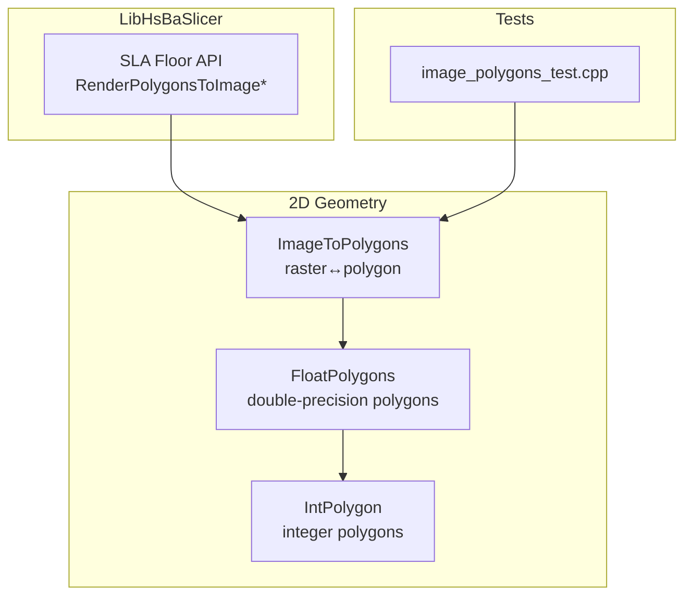
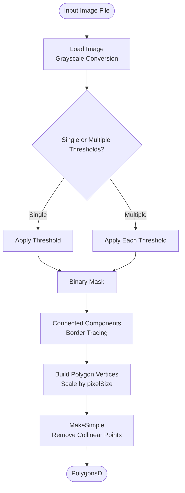
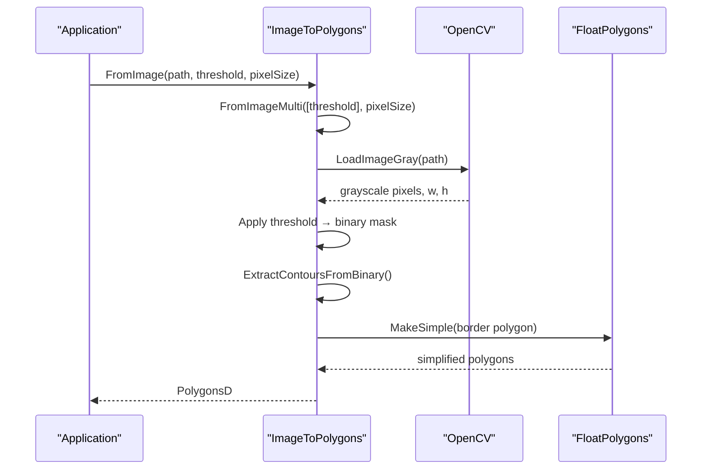
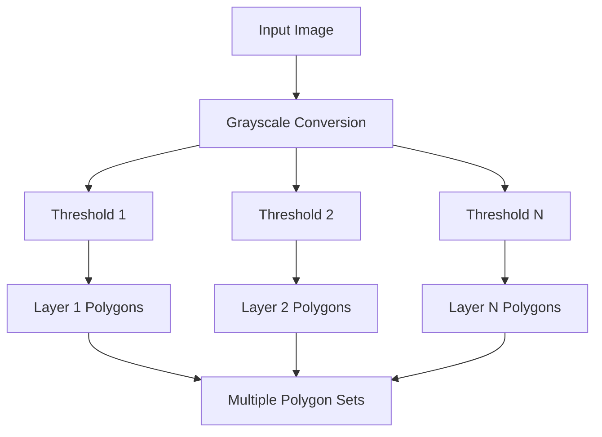
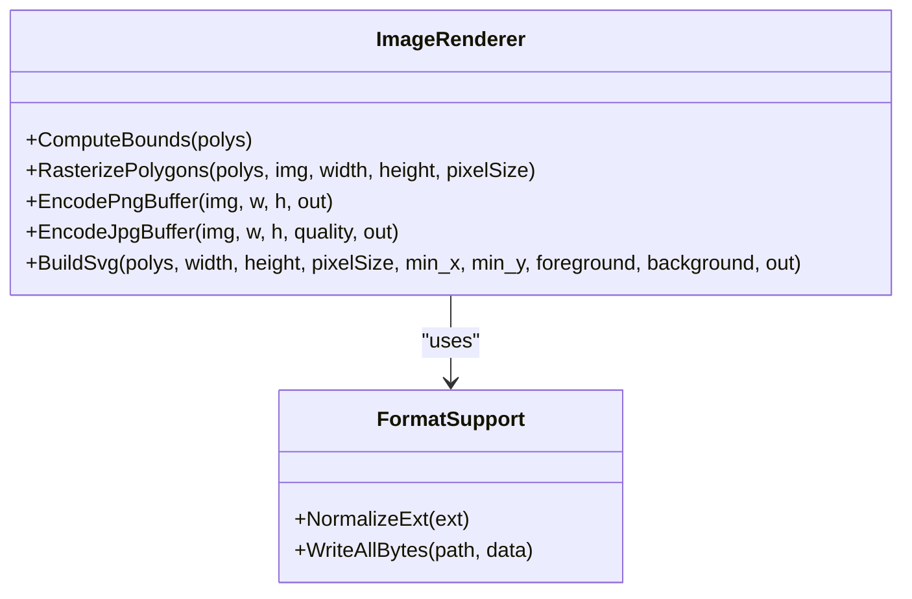
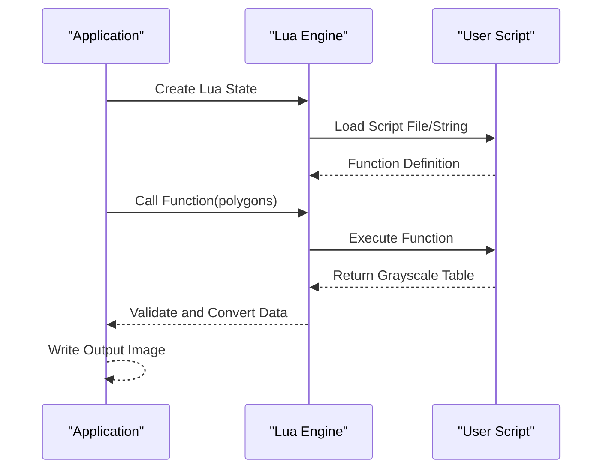
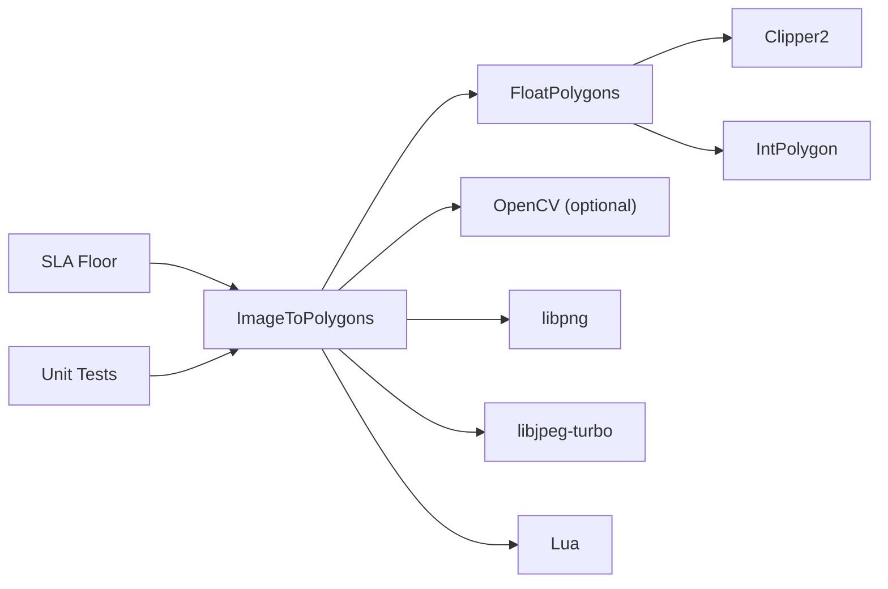

# Image to Polygon Conversion

<cite>
**Referenced Files in This Document**   
- [ImageToPolygons.hpp](file://2D/ImageToPolygons.hpp)
- [ImageToPolygons.cpp](file://2D/ImageToPolygons.cpp)
- [FloatPolygons.hpp](file://2D/FloatPolygons.hpp)
- [IntPolygon.hpp](file://2D/IntPolygon.hpp)
- [image_polygons_test.cpp](file://tests/PolygonFill/image_polygons_test.cpp)
- [sla_floor.cpp](file://LibHsBaSlicer/Floor/sla_floor.cpp)
</cite>

## Table of Contents
1. [Introduction](#introduction)
2. [Project Structure](#project-structure)
3. [Core Components](#core-components)
4. [Architecture Overview](#architecture-overview)
5. [Detailed Component Analysis](#detailed-component-analysis)
6. [Dependency Analysis](#dependency-analysis)
7. [Performance Considerations](#performance-considerations)
8. [Troubleshooting Guide](#troubleshooting-guide)
9. [Conclusion](#conclusion)
10. [Appendices](#appendices)

## Introduction
This document explains the image-to-polygon conversion functionality in HsBaSlicer’s 2D geometry engine. It focuses on how bitmap images are transformed into polygonal boundaries suitable for slicing and 3D printing workflows. The implementation provides:

- Raster-to-vector conversion through grayscale thresholding.
- Multi-threshold extraction for generating multiple material or layer layers from a single image.
- Contour extraction using connected-component labeling and border tracing.
- Polygon simplification and normalization.
- Reverse rendering from polygons back to raster formats (PNG, JPEG, SVG).
- Lua-driven image generation for advanced customization.

The system is designed around double-precision polygon types, optional OpenCV acceleration, and robust error handling validated by unit tests.

## Project Structure
The image-to-polygon feature lives primarily under the `2D` module and integrates with the broader polygon library and SLA floor pipeline.

**Diagram sources**
- [ImageToPolygons.hpp:21-99](file://2D/ImageToPolygons.hpp#L21-L99)
- [FloatPolygons.hpp:18-41](file://2D/FloatPolygons.hpp#L18-L41)
- [IntPolygon.hpp:40-66](file://2D/IntPolygon.hpp#L40-L66)
- [sla_floor.cpp:357-380](file://LibHsBaSlicer/Floor/sla_floor.cpp#L357-L380)
- [image_polygons_test.cpp:24-79](file://tests/PolygonFill/image_polygons_test.cpp#L24-L79)

**Section sources**
- [ImageToPolygons.hpp:21-99](file://2D/ImageToPolygons.hpp#L21-L99)
- [FloatPolygons.hpp:18-41](file://2D/FloatPolygons.hpp#L18-L41)
- [IntPolygon.hpp:40-66](file://2D/IntPolygon.hpp#L40-L66)
- [sla_floor.cpp:357-380](file://LibHsBaSlicer/Floor/sla_floor.cpp#L357-L380)
- [image_polygons_test.cpp:24-79](file://tests/PolygonFill/image_polygons_test.cpp#L24-L79)

## Core Components
The core public interface exposes functions for converting images to polygons and vice versa:

- `FromImage`: Converts an image file to polygons using a single grayscale threshold.
- `FromImageMulti`: Converts an image file to multiple polygon sets using multiple thresholds.
- `ToImage`: Renders polygons to an image file; format is inferred from the output path extension.
- `ToImageBuffer`: Renders polygons to an in-memory buffer; supports PNG, JPEG, and SVG.
- `LuaToImage` / `LuaToImageString`: Render polygons via Lua scripts that return grayscale image tables.

Key configuration parameters include:

| Parameter | Description | Default | Notes |
|---|---|---:|---|
| `threshold` | Grayscale threshold for binarization | `128` | Pixels brighter than threshold become foreground |
| `pixelSize` | Output coordinate size per pixel | `1.0` | Scales pixel coordinates to model units |
| `width`, `height` | Output raster dimensions | Required | Must be positive for rendering |
| `foreground` | Foreground fill value | `255` | White in grayscale |
| `background` | Background fill value | `0` | Black in grayscale |
| `ext` | Output format extension | `.png` | Accepts `.png`, `.jpg`/`.jpeg`, `.svg`; missing dot is normalized |

**Section sources**
- [ImageToPolygons.hpp:23-99](file://2D/ImageToPolygons.hpp#L23-L99)

## Architecture Overview
The conversion pipeline consists of three main phases:

1. **Image Loading and Grayscale Conversion**: Load the input image and convert it to grayscale if needed.
2. **Thresholding and Contour Extraction**: Apply threshold(s), create binary masks, extract contours, and build polygons.
3. **Polygon Simplification and Normalization**: Remove collinear points and ensure simple polygon topology.

**Diagram sources**
- [ImageToPolygons.cpp:37-76](file://2D/ImageToPolygons.cpp#L37-L76)
- [ImageToPolygons.cpp:98-200](file://2D/ImageToPolygons.cpp#L98-L200)
- [ImageToPolygons.cpp:516-543](file://2D/ImageToPolygons.cpp#L516-L543)

**Section sources**
- [ImageToPolygons.cpp:37-76](file://2D/ImageToPolygons.cpp#L37-L76)
- [ImageToPolygons.cpp:98-200](file://2D/ImageToPolygons.cpp#L98-L200)
- [ImageToPolygons.cpp:516-543](file://2D/ImageToPolygons.cpp#L516-L543)

## Detailed Component Analysis

### Raster-to-Vector Conversion Pipeline
The primary conversion flow transforms pixel data into clean polygonal boundaries:

#### Image Loading
- Uses OpenCV when available (`HAS_OPENCV`) for robust image loading and grayscale conversion.
- Supports multi-channel images by converting BGR to grayscale.
- Returns raw grayscale pixel data with width and height.

#### Thresholding
- Applies strict greater-than comparison against the threshold value.
- Creates binary masks where pixels above threshold become foreground (255) and others background (0).
- Supports multiple thresholds for multi-material or multi-layer extraction.

#### Contour Extraction
- Uses 4-connected component labeling (Manhattan distance = 1 neighbors).
- Identifies border pixels by checking neighborhood conditions.
- Sorts border pixels by angle around centroid for proper polygon ordering.
- Scales integer pixel coordinates to double precision using `pixelSize`.

#### Polygon Simplification
- Calls `MakeSimple` to remove collinear points and simplify polygon topology.
- Ensures resulting polygons are valid and non-self-intersecting.

**Diagram sources**
- [ImageToPolygons.cpp:416-424](file://2D/ImageToPolygons.cpp#L416-L424)
- [ImageToPolygons.cpp:516-543](file://2D/ImageToPolygons.cpp#L516-L543)
- [ImageToPolygons.cpp:98-200](file://2D/ImageToPolygons.cpp#L98-L200)

**Section sources**
- [ImageToPolygons.cpp:37-76](file://2D/ImageToPolygons.cpp#L37-L76)
- [ImageToPolygons.cpp:98-200](file://2D/ImageToPolygons.cpp#L98-L200)
- [ImageToPolygons.cpp:416-424](file://2D/ImageToPolygons.cpp#L416-L424)
- [ImageToPolygons.cpp:516-543](file://2D/ImageToPolygons.cpp#L516-L543)

### Multi-Threshold Processing for Multi-Material Printing
The `FromImageMulti` function enables extracting multiple polygon layers from a single image by applying different thresholds. This is particularly useful for:

- **Multi-material printing**: Different intensity levels represent different materials.
- **Layer separation**: Separating features based on brightness or color channel intensity.
- **Selective detail extraction**: Higher thresholds capture only prominent features, lower thresholds capture finer details.

**Diagram sources**
- [ImageToPolygons.cpp:516-543](file://2D/ImageToPolygons.cpp#L516-L543)

**Section sources**
- [ImageToPolygons.cpp:516-543](file://2D/ImageToPolygons.cpp#L516-L543)

### Polygon Rendering and Format Support
The reverse operation converts polygons back to raster formats for visualization and debugging:

#### Supported Formats
- **PNG**: Lossless compression, supports transparency.
- **JPEG**: Lossy compression, smaller file sizes.
- **SVG**: Vector format, scalable without quality loss.

#### Rendering Process
- Computes bounding box of all polygons.
- Maps polygon coordinates to pixel coordinates using `pixelSize`.
- Fills polygons using either OpenCV's `fillPoly` or manual point-in-polygon testing.
- Encodes output using appropriate libraries (libpng, libjpeg-turbo, or direct SVG generation).

**Diagram sources**
- [ImageToPolygons.cpp:291-372](file://2D/ImageToPolygons.cpp#L291-L372)
- [ImageToPolygons.cpp:394-413](file://2D/ImageToPolygons.cpp#L394-L413)
- [ImageToPolygons.cpp:427-497](file://2D/ImageToPolygons.cpp#L427-L497)

**Section sources**
- [ImageToPolygons.cpp:291-372](file://2D/ImageToPolygons.cpp#L291-L372)
- [ImageToPolygons.cpp:394-413](file://2D/ImageToPolygons.cpp#L394-L413)
- [ImageToPolygons.cpp:427-497](file://2D/ImageToPolygons.cpp#L427-L497)

### Lua Integration for Custom Image Generation
The Lua integration allows users to customize image generation through scripting:

#### Features
- Execute Lua scripts from files or inline strings.
- Pass polygon data to Lua functions.
- Receive grayscale image tables from Lua functions.
- Register custom Lua functions for extended functionality.

#### Error Handling
- Comprehensive error checking for script loading, function execution, and data validation.
- Throws `RuntimeError` exceptions for various failure modes.

**Diagram sources**
- [ImageToPolygons.cpp:545-610](file://2D/ImageToPolygons.cpp#L545-L610)
- [ImageToPolygons.cpp:612-682](file://2D/ImageToPolygons.cpp#L612-L682)

**Section sources**
- [ImageToPolygons.cpp:545-610](file://2D/ImageToPolygons.cpp#L545-L610)
- [ImageToPolygons.cpp:612-682](file://2D/ImageToPolygons.cpp#L612-L682)

## Dependency Analysis
The image-to-polygon system has well-defined dependencies:

**Diagram sources**
- [ImageToPolygons.cpp:18-29](file://2D/ImageToPolygons.cpp#L18-L29)
- [FloatPolygons.hpp:9-12](file://2D/FloatPolygons.hpp#L9-L12)
- [sla_floor.cpp:19](file://LibHsBaSlicer/Floor/sla_floor.cpp#L19)
- [image_polygons_test.cpp:4](file://tests/PolygonFill/image_polygons_test.cpp#L4)

**Section sources**
- [ImageToPolygons.cpp:18-29](file://2D/ImageToPolygons.cpp#L18-L29)
- [FloatPolygons.hpp:9-12](file://2D/FloatPolygons.hpp#L9-L12)
- [sla_floor.cpp:19](file://LibHsBaSlicer/Floor/sla_floor.cpp#L19)
- [image_polygons_test.cpp:4](file://tests/PolygonFill/image_polygons_test.cpp#L4)

## Performance Considerations
Several factors affect the performance of image-to-polygon conversion:

### Computational Complexity
- **Image Loading**: O(w × h) for reading and converting pixels.
- **Thresholding**: O(w × h) for creating binary masks.
- **Contour Extraction**: O(w × h) for connected component labeling.
- **Border Tracing**: O(b) where b is the number of border pixels.
- **Polygon Sorting**: O(b log b) for angular sorting of border points.
- **Simplification**: Depends on `MakeSimple` implementation complexity.

### Memory Usage
- **Grayscale Image**: w × h bytes for input image.
- **Binary Mask**: w × h bytes for thresholded data.
- **Seen Array**: w × h bytes for component tracking.
- **Border Points**: Up to O(w × h) in worst case for complex shapes.

### Optimization Strategies
- Use OpenCV for accelerated image operations when available.
- Limit image resolution for large inputs.
- Choose appropriate pixelSize to balance accuracy and performance.
- Use multi-threshold processing judiciously as it processes the image multiple times.

## Troubleshooting Guide

### Common Issues and Solutions

| Issue | Symptoms | Solution |
|-------|----------|----------|
| Empty polygon output | `FromImage` returns empty result | Check image path validity, verify threshold value, ensure image contains bright regions |
| Poor contour quality | Jagged or noisy polygon boundaries | Adjust threshold, consider preprocessing with morphological operations |
| Missing small features | Small details not detected | Lower threshold value, increase image resolution |
| Anti-aliasing artifacts | Staircase patterns along edges | Increase image resolution, use higher threshold values |
| Performance issues | Slow conversion for large images | Reduce image dimensions, optimize pixelSize, use OpenCV acceleration |
| Lua script errors | Runtime exceptions during Lua execution | Validate Lua syntax, check function names, ensure proper data types |

### Debugging Techniques
- Use `ToImage` to visualize intermediate results and verify threshold effectiveness.
- Test with synthetic images containing known shapes to validate algorithm behavior.
- Monitor memory usage for large images to prevent excessive consumption.
- Enable logging in Lua scripts to trace execution flow.

**Section sources**
- [image_polygons_test.cpp:170-190](file://tests/PolygonFill/image_polygons_test.cpp#L170-L190)
- [image_polygons_test.cpp:232-264](file://tests/PolygonFill/image_polygons_test.cpp#L232-L264)

## Conclusion
HsBaSlicer's image-to-polygon conversion system provides a robust foundation for transforming bitmap images into polygonal representations suitable for 3D printing. The implementation combines efficient algorithms with flexible configuration options, supporting both simple single-threshold conversions and complex multi-material workflows.

Key strengths include:
- Efficient raster-to-vector conversion using connected component analysis.
- Flexible multi-threshold processing for multi-material applications.
- Comprehensive format support for both input and output operations.
- Extensible Lua integration for custom processing workflows.
- Robust error handling and comprehensive test coverage.

For optimal results, users should carefully select threshold values based on their specific image characteristics and printing requirements, and consider the trade-offs between image resolution, polygon complexity, and computational efficiency.

## Appendices

### API Reference Summary

| Function | Purpose | Key Parameters | Return Type |
|----------|---------|----------------|-------------|
| `FromImage` | Convert image to polygons | `path`, `threshold`, `pixelSize` | `PolygonsD` |
| `FromImageMulti` | Convert image to multiple polygon sets | `path`, `thresholds`, `pixelSize` | `std::vector<PolygonsD>` |
| `ToImage` | Render polygons to image file | `polys`, `width`, `height`, `pixelSize`, `outPath` | `bool` |
| `ToImageBuffer` | Render polygons to memory buffer | `polys`, `width`, `height`, `pixelSize`, `ext` | `bool` |
| `LuaToImage` | Generate image via Lua script file | `poly`, `scriptPath`, `outPath` | `bool` |
| `LuaToImageString` | Generate image via inline Lua script | `poly`, `script`, `outPath` | `bool` |

### Configuration Best Practices

| Scenario | Recommended Settings | Rationale |
|----------|---------------------|-----------|
| High-contrast black/white images | Threshold: 128, pixelSize: 1.0 | Balanced threshold works well for clear boundaries |
| Multi-material printing | Multiple thresholds: e.g., {100, 180, 220} | Separate materials by intensity ranges |
| Fine detail preservation | Lower threshold, higher image resolution | Captures subtle features while maintaining detail |
| Large industrial images | Reduced resolution, optimized pixelSize | Balances accuracy with computational efficiency |
| Anti-aliased images | Higher threshold values | Reduces staircase artifacts from smooth edges |