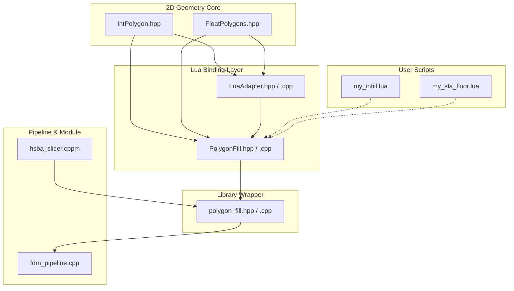
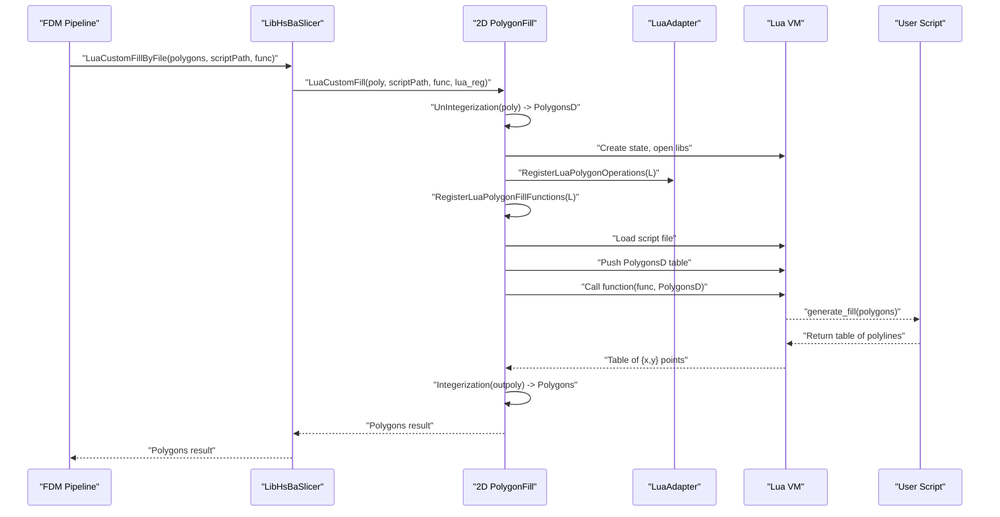
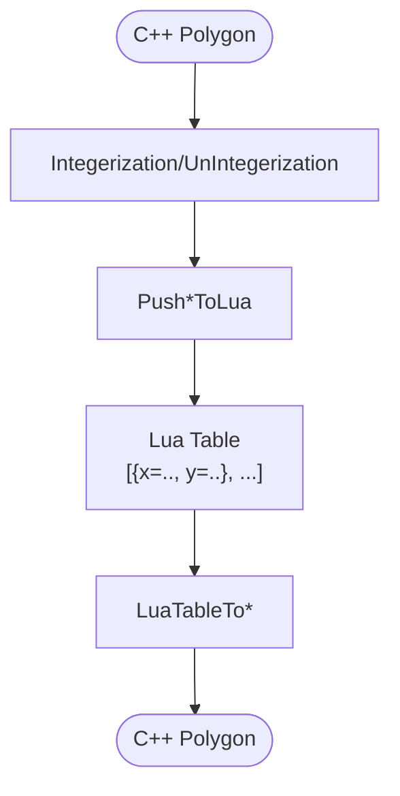
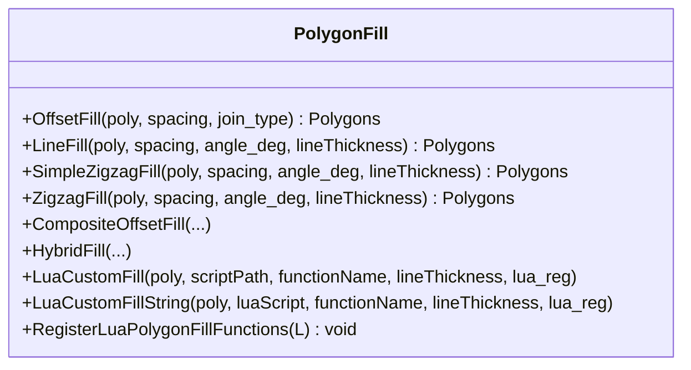
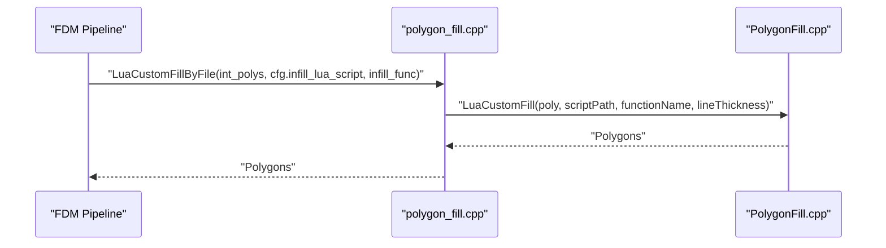
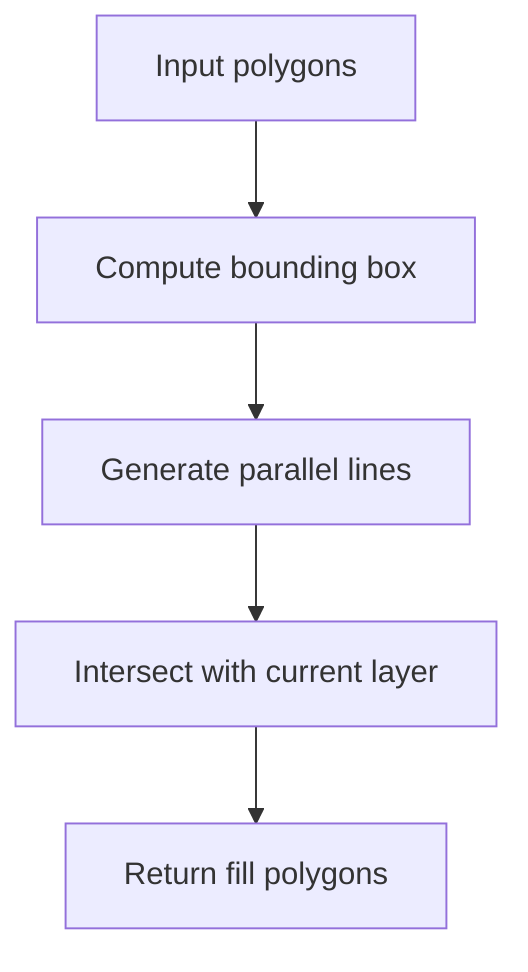
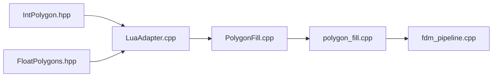

# Lua Scripting Integration

<cite>
**Referenced Files in This Document**
- [LuaAdapter.hpp](file://2D/LuaAdapter.hpp)
- [LuaAdapter.cpp](file://2D/LuaAdapter.cpp)
- [FloatPolygons.hpp](file://2D/FloatPolygons.hpp)
- [IntPolygon.hpp](file://2D/IntPolygon.hpp)
- [PolygonFill.hpp](file://2D/PolygonFill.hpp)
- [PolygonFill.cpp](file://2D/PolygonFill.cpp)
- [polygon_fill.hpp](file://LibHsBaSlicer/Fill/polygon_fill.hpp)
- [polygon_fill.cpp](file://LibHsBaSlicer/Fill/polygon_fill.cpp)
- [path_optimizer.hpp](file://LibHsBaSlicer/Path/path_optimizer.hpp)
- [fdm_pipeline.cpp](file://DllHsBaSlicer/fdm_pipeline.cpp)
- [hsba_slicer.cppm](file://ModuleHsBaSlicer/hsba_slicer.cppm)
- [lua_pipeline_api.md](file://docs/en/lua_pipeline_api.md)
- [my_infill.lua](file://samples/FDM/scripts/my_infill.lua)
- [my_sla_floor.lua](file://samples/SLA/scripts/my_sla_floor.lua)
</cite>

## Table of Contents
1. [Introduction](#introduction)
2. [Project Structure](#project-structure)
3. [Core Components](#core-components)
4. [Architecture Overview](#architecture-overview)
5. [Detailed Component Analysis](#detailed-component-analysis)
6. [Dependency Analysis](#dependency-analysis)
7. [Performance Considerations](#performance-considerations)
8. [Troubleshooting Guide](#troubleshooting-guide)
9. [Conclusion](#conclusion)
10. [Appendices](#appendices)

## Introduction
This document explains the Lua scripting integration for HsBaSlicer’s 2D geometry engine. It focuses on how C++ geometric operations are exposed to Lua through the `LuaAdapter` and related modules, enabling dynamic customization of polygon processing and fill algorithms at runtime. You will learn:

- How the binding architecture bridges C++ polygon types with Lua tables.
- The available Lua API surface under `PolygonOperations`, `PolygonFill`, and related libraries.
- How custom fill scripts integrate into the slicing pipeline.
- Best practices for performance, memory management, debugging, security, and profiling of scripted geometry operations.

## Project Structure
The Lua integration spans several layers:

- 2D geometry core: integer and double-precision polygon types, boolean/offset/hull/text operations.
- Lua adapter: stack conversion helpers and registration of `PolygonOperations`.
- Fill engine: built-in fill generators plus a Lua-driven custom fill entry point.
- Library wrapper: public C++ API that exposes Lua custom fill to consumers.
- Pipeline integration: FDM pipeline invokes Lua custom fill per layer.
- Samples and documentation: example scripts and API reference.

**Diagram sources**
- [LuaAdapter.hpp:1-84](file://2D/LuaAdapter.hpp#L1-L84)
- [LuaAdapter.cpp:1-493](file://2D/LuaAdapter.cpp#L1-L493)
- [FloatPolygons.hpp:1-271](file://2D/FloatPolygons.hpp#L1-L271)
- [IntPolygon.hpp:1-241](file://2D/IntPolygon.hpp#L1-L241)
- [PolygonFill.hpp:1-141](file://2D/PolygonFill.hpp#L1-L141)
- [PolygonFill.cpp:488-502](file://2D/PolygonFill.cpp#L488-L502)
- [polygon_fill.hpp:1-44](file://LibHsBaSlicer/Fill/polygon_fill.hpp#L1-L44)
- [polygon_fill.cpp:1-36](file://LibHsBaSlicer/Fill/polygon_fill.cpp#L1-L36)
- [fdm_pipeline.cpp:334-362](file://DllHsBaSlicer/fdm_pipeline.cpp#L334-L362)
- [hsba_slicer.cppm:1183-1214](file://ModuleHsBaSlicer/hsba_slicer.cppm#L1183-L1214)

**Section sources**
- [LuaAdapter.hpp:1-84](file://2D/LuaAdapter.hpp#L1-L84)
- [LuaAdapter.cpp:1-493](file://2D/LuaAdapter.cpp#L1-L493)
- [FloatPolygons.hpp:1-271](file://2D/FloatPolygons.hpp#L1-L271)
- [IntPolygon.hpp:1-241](file://2D/IntPolygon.hpp#L1-L241)
- [PolygonFill.hpp:1-141](file://2D/PolygonFill.hpp#L1-L141)
- [PolygonFill.cpp:488-502](file://2D/PolygonFill.cpp#L488-L502)
- [polygon_fill.hpp:1-44](file://LibHsBaSlicer/Fill/polygon_fill.hpp#L1-L44)
- [polygon_fill.cpp:1-36](file://LibHsBaSlicer/Fill/polygon_fill.cpp#L1-L36)
- [fdm_pipeline.cpp:334-362](file://DllHsBaSlicer/fdm_pipeline.cpp#L334-L362)
- [hsba_slicer.cppm:1183-1214](file://ModuleHsBaSlicer/hsba_slicer.cppm#L1183-L1214)

## Core Components
This section summarizes the key components involved in exposing 2D geometry to Lua.

- Integer and double-precision polygon types:
  - `Point2`, `Polygon`, `Polygons` (64-bit integers).
  - `Point2D`, `PolygonD`, `PolygonsD` (double precision).
  - Conversion between them via `Integerization`/`UnIntegerization`.
- Boolean and geometric operations:
  - Union, intersection, difference, XOR.
  - Offset, area, convex/concave hull, text-to-polygons, shape constructors.
- Lua adapter:
  - Stack conversion functions to push/pop polygons as Lua tables.
  - Registration of `PolygonOperations` global table.
- Fill engine:
  - Built-in fill generators: offset, line, zigzag, composite, hybrid.
  - Lua custom fill entry points: file-based and string-based.
  - Registration of `PolygonFill` global table.
- Library wrapper:
  - Public API to invoke Lua custom fill from higher layers.
- Pipeline integration:
  - FDM pipeline calls Lua custom fill per layer when configured.

**Section sources**
- [IntPolygon.hpp:16-27](file://2D/IntPolygon.hpp#L16-L27)
- [FloatPolygons.hpp:18-25](file://2D/FloatPolygons.hpp#L18-L25)
- [FloatPolygons.hpp:43-191](file://2D/FloatPolygons.hpp#L43-L191)
- [LuaAdapter.hpp:16-81](file://2D/LuaAdapter.hpp#L16-L81)
- [PolygonFill.hpp:20-136](file://2D/PolygonFill.hpp#L20-L136)
- [polygon_fill.hpp:17-44](file://LibHsBaSlicer/Fill/polygon_fill.hpp#L17-L44)
- [fdm_pipeline.cpp:334-362](file://DllHsBaSlicer/fdm_pipeline.cpp#L334-L362)

## Architecture Overview
The Lua integration follows a layered design:

- Data model: integer polygons for robust geometry; double polygons for Lua-friendly representation.
- Binding: `LuaAdapter` converts between Lua tables and C++ polygon types and registers `PolygonOperations`.
- Fill engine: `PolygonFill` provides built-in algorithms and a Lua hook to run user scripts.
- Consumer APIs: `LibHsBaSlicer` exposes `LuaCustomFillByFile`; module-level wrappers expose it to Lua consumers.
- Pipeline: FDM stage uses the library API to execute per-layer custom fills.

**Diagram sources**
- [fdm_pipeline.cpp:334-362](file://DllHsBaSlicer/fdm_pipeline.cpp#L334-L362)
- [polygon_fill.cpp:35-36](file://LibHsBaSlicer/Fill/polygon_fill.cpp#L35-L36)
- [PolygonFill.cpp:1493-1584](file://2D/PolygonFill.cpp#L1493-L1584)
- [LuaAdapter.cpp:487-491](file://2D/LuaAdapter.cpp#L487-L491)
- [PolygonFill.cpp:498-502](file://2D/PolygonFill.cpp#L498-L502)

## Detailed Component Analysis

### LuaAdapter: Type Conversions and Global Registration
`LuaAdapter` provides:

- Push functions:
  - `PushPolygonDToLua`, `PushPolygonsDToLua`: convert double-precision polygons to Lua tables.
  - `PushPolygonToLua`, `PushPolygonsToLua`: convert integer polygons to Lua tables, dividing coordinates by `integerization`.
- Pull functions:
  - `LuaTableToPolygonD`, `LuaTableToPolygonsD`: read Lua tables into double-precision polygons.
  - `LuaTableToPolygon`, `LuaTableToPolygons`: read Lua tables into integer polygons, multiplying coordinates by `integerization`.
- Registration:
  - `RegisterLuaPolygonOperations(L)` creates the global `PolygonOperations` table and binds boolean, offset, hull, area, construction, and text-to-polygon functions.

**Diagram sources**
- [LuaAdapter.cpp:332-382](file://2D/LuaAdapter.cpp#L332-L382)
- [LuaAdapter.cpp:385-485](file://2D/LuaAdapter.cpp#L385-L485)
- [IntPolygon.hpp:16-17](file://2D/IntPolygon.hpp#L16-L17)

Key implementation notes:

- Error handling uses a helper that formats errors with function names and messages before raising Lua errors.
- Boolean operation dispatcher validates argument count and types, then delegates to C++ boolean operations.
- Shape constructors accept optional parameters with defaults.

**Section sources**
- [LuaAdapter.cpp:16-54](file://2D/LuaAdapter.cpp#L16-L54)
- [LuaAdapter.cpp:108-153](file://2D/LuaAdapter.cpp#L108-L153)
- [LuaAdapter.cpp:155-273](file://2D/LuaAdapter.cpp#L155-L273)
- [LuaAdapter.cpp:311-329](file://2D/LuaAdapter.cpp#L311-L329)
- [LuaAdapter.cpp:332-485](file://2D/LuaAdapter.cpp#L332-L485)
- [LuaAdapter.cpp:487-491](file://2D/LuaAdapter.cpp#L487-L491)

### PolygonFill: Built-in Algorithms and Lua Custom Fill
`PolygonFill` exposes:

- Built-in fill generators:
  - `OffsetFill`, `LineFill`, `SimpleZigzagFill`, `ZigzagFill`.
  - `CompositeOffsetFill`, `HybridFill`, `offsetOnly`.
- Lua integration:
  - `LuaCustomFill(scriptPath, functionName, lineThickness, lua_reg)`.
  - `LuaCustomFillString(luaScript, functionName, lineThickness, lua_reg)`.
  - `RegisterLuaPolygonFillFunctions(L)` registers the `PolygonFill` global table.

**Diagram sources**
- [PolygonFill.hpp:20-136](file://2D/PolygonFill.hpp#L20-L136)
- [PolygonFill.cpp:488-502](file://2D/PolygonFill.cpp#L488-L502)
- [PolygonFill.cpp:504-563](file://2D/PolygonFill.cpp#L504-L563)
- [PolygonFill.cpp:568-679](file://2D/PolygonFill.cpp#L568-L679)
- [PolygonFill.cpp:1493-1669](file://2D/PolygonFill.cpp#L1493-L1669)

Important behaviors:

- Custom fill expects a Lua function returning a table of polylines where each polyline is an array of `{x=.., y=..}` points.
- Returned polylines are converted back to integer polygons via `Integerization`.
- Errors during load/call are wrapped into runtime exceptions with descriptive messages.

**Section sources**
- [PolygonFill.hpp:106-136](file://2D/PolygonFill.hpp#L106-L136)
- [PolygonFill.cpp:488-502](file://2D/PolygonFill.cpp#L488-L502)
- [PolygonFill.cpp:1493-1669](file://2D/PolygonFill.cpp#L1493-L1669)

### Library Wrapper and Pipeline Integration
The library wrapper exposes a convenient API for calling Lua custom fill:

- `LuaCustomFillByFile(poly, scriptPath, functionName, lineThickness)` wraps `2D::LuaCustomFill`.
- The FDM pipeline uses this API to generate per-layer fills when a Lua infill script is configured.

**Diagram sources**
- [polygon_fill.cpp:35-36](file://LibHsBaSlicer/Fill/polygon_fill.cpp#L35-L36)
- [fdm_pipeline.cpp:334-362](file://DllHsBaSlicer/fdm_pipeline.cpp#L334-L362)
- [PolygonFill.cpp:1493-1584](file://2D/PolygonFill.cpp#L1493-L1584)

**Section sources**
- [polygon_fill.hpp:39-44](file://LibHsBaSlicer/Fill/polygon_fill.hpp#L39-L44)
- [polygon_fill.cpp:35-36](file://LibHsBaSlicer/Fill/polygon_fill.cpp#L35-L36)
- [fdm_pipeline.cpp:334-362](file://DllHsBaSlicer/fdm_pipeline.cpp#L334-L362)

### Available Lua API Surface
From the documentation and bindings:

- `PolygonOperations` (2D boolean and construction):
  - `booleanOperation(a, b, op)`
  - `union(a, b)`, `intersection(a, b)`, `difference(a, b)`, `xor(a, b)`
  - `offsetOperation(polys, delta)`
  - `convexHullOperation(polys)`, `concaveHullOperation(polys[, ...])`
  - `area(polygon)`
  - `makeRectangle(xmin, ymin, xmax, ymax)`
  - `makeCircle(cx, cy, r)`
  - `makeEllipse(...)`
  - `makeRegularPolygon(...)`
  - `textToPolygons(...)`
  - Optional debug dumps when compiled with `HSBA_POLYGON_DUMP`.

- `PolygonFill` (fill algorithms):
  - `offsetFill`, `lineFill`, `simpleZigzagFill`, `zigzagFill`, `compositeOffsetFill`, `hybridFill`, `offsetOnly`.

- Path optimization:
  - `PathOptimize.new()`, `optimizeRegions(regions)`, `optimizePolygons(regions)`.

These are registered into the Lua environment used by custom scripts.

**Section sources**
- [lua_pipeline_api.md:140-167](file://docs/en/lua_pipeline_api.md#L140-L167)
- [LuaAdapter.cpp:311-329](file://2D/LuaAdapter.cpp#L311-L329)
- [PolygonFill.cpp:488-502](file://2D/PolygonFill.cpp#L488-L502)
- [path_optimizer.hpp:125-148](file://LibHsBaSlicer/Path/path_optimizer.hpp#L125-L148)

### Example Scripts and Usage Patterns
- FDM custom infill script:
  - Defines `generate_fill(current_layer)`.
  - Uses `PolygonOperations` to compute intersections and offsets.
  - Returns a table of polygons representing fill paths.

- SLA floor script:
  - Defines `generate_floor(bottom_layer, config)`.
  - Uses `PolygonOperations` and `PolygonFill.zigzagFill` to build raft/border/fill.

**Diagram sources**
- [my_infill.lua:18-88](file://samples/FDM/scripts/my_infill.lua#L18-L88)
- [my_sla_floor.lua:33-62](file://samples/SLA/scripts/my_sla_floor.lua#L33-L62)

**Section sources**
- [my_infill.lua:1-89](file://samples/FDM/scripts/my_infill.lua#L1-L89)
- [my_sla_floor.lua:1-64](file://samples/SLA/scripts/my_sla_floor.lua#L1-L64)

## Dependency Analysis
The Lua integration has clear dependency boundaries:

- `LuaAdapter` depends on integer/double polygon types and Clipper2-based operations.
- `PolygonFill` depends on `LuaAdapter` for conversions and registrations.
- `LibHsBaSlicer` polygon fill wrapper depends on `2D::PolygonFill`.
- FDM pipeline depends on the library wrapper to call Lua custom fill.
- Module-level wrappers expose these capabilities to broader consumers.

**Diagram sources**
- [LuaAdapter.cpp:1-10](file://2D/LuaAdapter.cpp#L1-L10)
- [PolygonFill.cpp:16-20](file://2D/PolygonFill.cpp#L16-L20)
- [polygon_fill.cpp:7-9](file://LibHsBaSlicer/Fill/polygon_fill.cpp#L7-L9)
- [fdm_pipeline.cpp:334-362](file://DllHsBaSlicer/fdm_pipeline.cpp#L334-L362)

**Section sources**
- [LuaAdapter.cpp:1-10](file://2D/LuaAdapter.cpp#L1-L10)
- [PolygonFill.cpp:16-20](file://2D/PolygonFill.cpp#L16-L20)
- [polygon_fill.cpp:7-9](file://LibHsBaSlicer/Fill/polygon_fill.cpp#L7-L9)
- [fdm_pipeline.cpp:334-362](file://DllHsBaSlicer/fdm_pipeline.cpp#L334-L362)

## Performance Considerations
- Coordinate scaling:
  - Integer polygons use a fixed scale factor (`integerization = 1e6`) to maintain precision while avoiding floating-point drift.
  - Conversions between integer and double polygons occur at binding boundaries; minimize repeated conversions in hot loops.
- Memory management:
  - Each custom fill invocation creates a new Lua state and loads the script; avoid excessive per-layer script loading if possible.
  - Reuse registration callbacks where feasible to reduce overhead.
- Algorithm complexity:
  - Boolean operations and offsets depend on Clipper2; large polygon sets increase CPU time.
  - Zigzag bridging logic includes binary search and connectivity checks; tune spacing and angles to reduce path fragmentation.
- Profiling:
  - Profile both C++ geometry operations and Lua execution time separately.
  - Use logging around script load/call to identify bottlenecks in I/O or heavy computations inside Lua.

[No sources needed since this section provides general guidance]

## Troubleshooting Guide
Common issues and remedies:

- Argument validation errors:
  - Many Lua-bound functions validate parameter counts and types; ensure correct number and type of arguments.
  - Check error messages produced by the adapter’s error helper.

- Script load or call failures:
  - File-based scripts: verify path and syntax; inspect error message from load/call.
  - String-based scripts: ensure valid Lua code and correct function name.

- Return value mismatches:
  - Custom fill must return a table of polylines where each polyline is an array of `{x=.., y=..}` points.
  - Non-table returns raise runtime errors.

- Debugging geometry:
  - When compiled with `HSBA_POLYGON_DUMP`, use dump functions to visualize intermediate polygons.

**Section sources**
- [LuaAdapter.cpp:16-54](file://2D/LuaAdapter.cpp#L16-L54)
- [PolygonFill.cpp:1517-1535](file://2D/PolygonFill.cpp#L1517-L1535)
- [PolygonFill.cpp:1606-1633](file://2D/PolygonFill.cpp#L1606-L1633)
- [LuaAdapter.cpp:275-309](file://2D/LuaAdapter.cpp#L275-L309)

## Conclusion
HsBaSlicer’s Lua scripting integration provides a robust bridge between C++ 2D geometry and flexible user-defined algorithms. Through `LuaAdapter` and `PolygonFill`, users can customize polygon operations and fill patterns at runtime while leveraging high-performance C++ primitives. By following best practices for type conversions, error handling, memory management, and profiling, you can build efficient and reliable scripted geometry workflows.

[No sources needed since this section summarizes without analyzing specific files]

## Appendices

### API Reference Summary
- `PolygonOperations`:
  - Boolean ops: `union`, `intersection`, `difference`, `xor`, `booleanOperation`.
  - Geometric ops: `offsetOperation`, `convexHullOperation`, `concaveHullOperation`, `area`.
  - Construction: `makeRectangle`, `makeCircle`, `makeEllipse`, `makeRegularPolygon`, `textToPolygons`.
- `PolygonFill`:
  - `offsetFill`, `lineFill`, `simpleZigzagFill`, `zigzagFill`, `compositeOffsetFill`, `hybridFill`, `offsetOnly`.
- Custom fill entry points:
  - `LuaCustomFill(scriptPath, functionName, lineThickness, lua_reg)`.
  - `LuaCustomFillString(luaScript, functionName, lineThickness, lua_reg)`.

**Section sources**
- [lua_pipeline_api.md:140-167](file://docs/en/lua_pipeline_api.md#L140-L167)
- [PolygonFill.hpp:106-136](file://2D/PolygonFill.hpp#L106-L136)
- [LuaAdapter.cpp:311-329](file://2D/LuaAdapter.cpp#L311-L329)
- [PolygonFill.cpp:488-502](file://2D/PolygonFill.cpp#L488-L502)