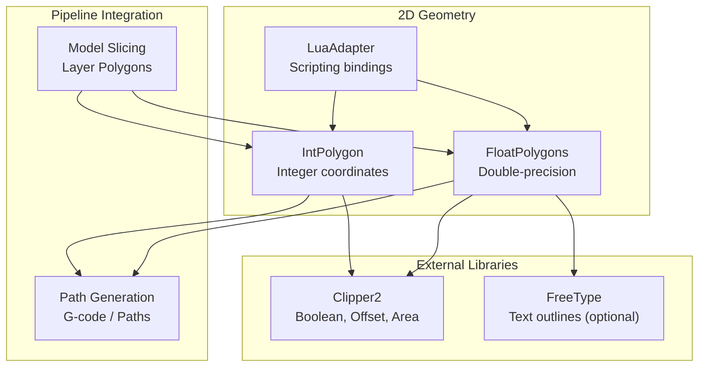
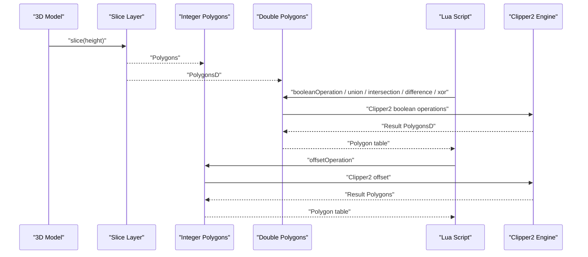
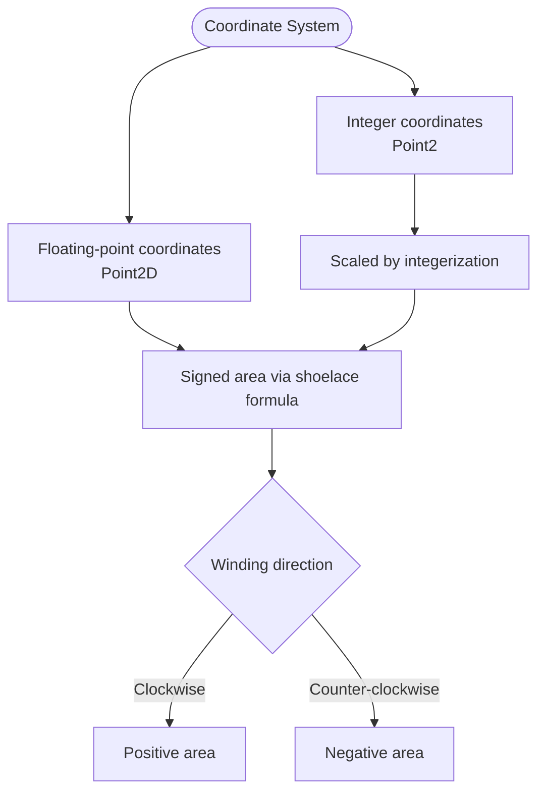
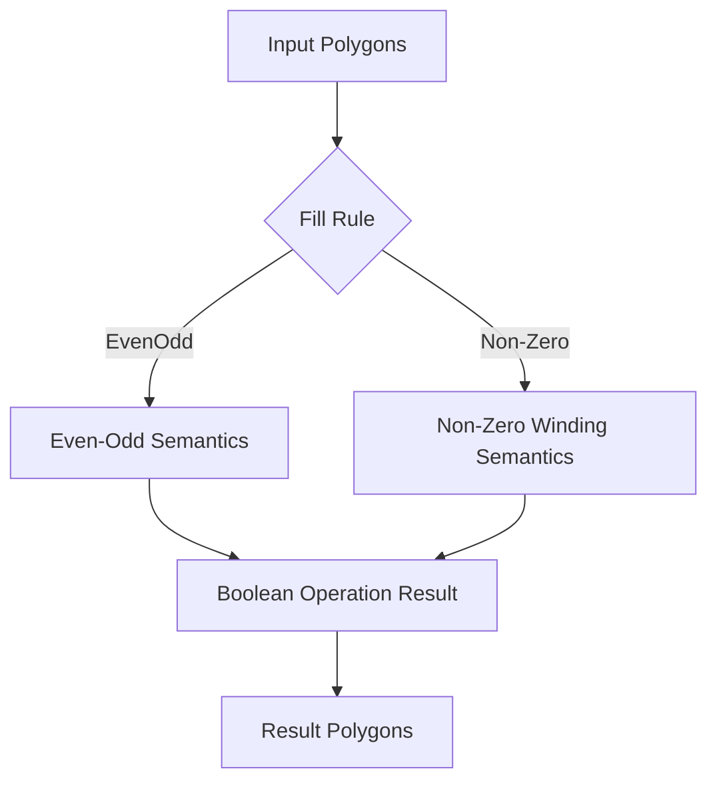
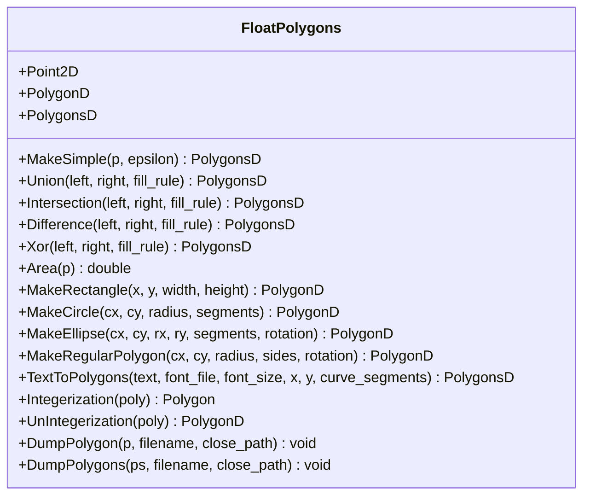
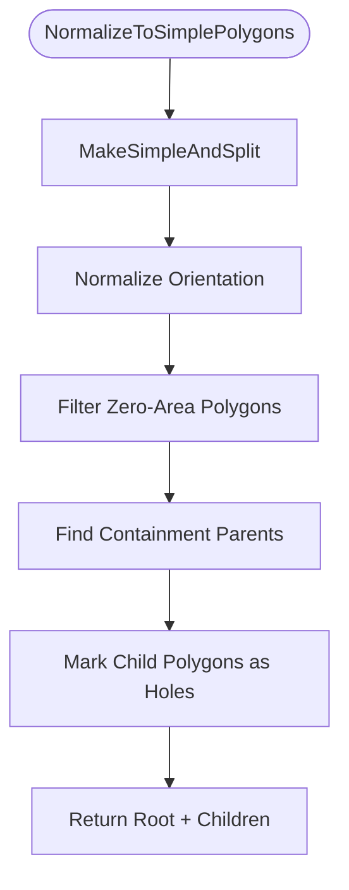
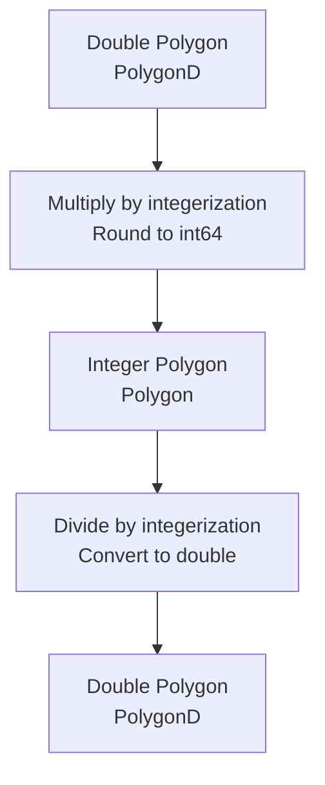
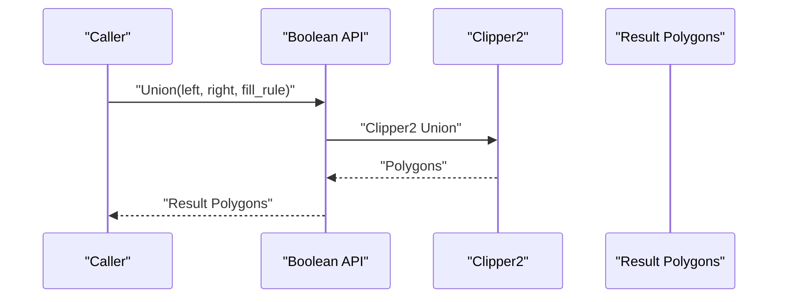
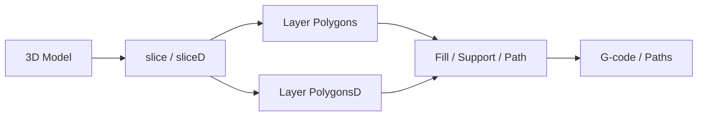
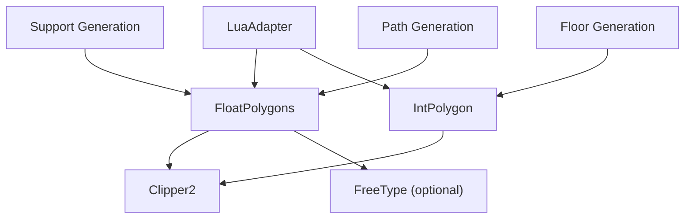

# Polygon Data Structures

<cite>
**Referenced Files in This Document**
- [FloatPolygons.hpp](file://2D/FloatPolygons.hpp)
- [FloatPolygons.cpp](file://2D/FloatPolygons.cpp)
- [IntPolygon.hpp](file://2D/IntPolygon.hpp)
- [IntPolygon.cpp](file://2D/IntPolygon.cpp)
- [LuaAdapter.hpp](file://2D/LuaAdapter.hpp)
- [LuaAdapter.cpp](file://2D/LuaAdapter.cpp)
- [hsba_slicer.cppm](file://ModuleHsBaSlicer/hsba_slicer.cppm)
- [path_generator_test.cpp](file://tests/PathsOut/path_generator_test.cpp)
- [float_polygons_test.cpp](file://tests/PolygonFill/float_polygons_test.cpp)
- [int_polygon_test.cpp](file://tests/IntPolygon/int_polygon_test.cpp)
</cite>

## Table of Contents
1. [Introduction](#introduction)
2. [Project Structure](#project-structure)
3. [Core Components](#core-components)
4. [Architecture Overview](#architecture-overview)
5. [Detailed Component Analysis](#detailed-component-analysis)
6. [Dependency Analysis](#dependency-analysis)
7. [Performance Considerations](#performance-considerations)
8. [Troubleshooting Guide](#troubleshooting-guide)
9. [Conclusion](#conclusion)

## Introduction
This document explains the 2D polygon data structures used by HsBaSlicer’s geometry engine. It covers two parallel systems:

- The **FloatPolygons system**, which uses double-precision coordinates through `Point2D`, `PolygonD`, and `PolygonsD` built on Clipper2’s `PointD`, `PathD`, and `PathsD`. It provides shape constructors, boolean operations, area calculation, text-to-polygon conversion, integerization helpers, STL hash specializations, and optional SVG debugging output.
- The **IntPolygon system**, which uses 64-bit integer coordinates through `Point2`, `Polygon`, and `Polygons` built on Clipper2’s `Point64`, `Path64`, and `Paths64`. It exposes the same core boolean operations plus offsetting, point-in-polygon testing, simplification, normalization into simple polygons with holes, hashing, and optional SVG debugging output.

The design separates high-precision construction and scripting from performance-critical boolean and offset operations that run in integer space. Conversion functions `Integerization` and `UnIntegerization` bridge the two representations using a fixed scaling factor.

## Project Structure
The polygon subsystem lives under `2D/`:

| File | Responsibility |
|---|---|
| `FloatPolygons.hpp` / `FloatPolygons.cpp` | Double-precision types, shape generators, boolean operations, area, text-to-polygons, integerization, hash specializations, debug dump |
| `IntPolygon.hpp` / `IntPolygon.cpp` | Integer-coordinate types, boolean operations, offset, point-in-polygon, simplification, normalization, hash specializations, debug dump |
| `LuaAdapter.hpp` / `LuaAdapter.cpp` | Lua bindings for polygon tables, boolean operations, offsets, hulls, area, shape constructors, and debug dumps |
| `hsba_slicer.cppm` | Module-level slicing API exposing both integer `slice()` and double `sliceD()` layer outputs |
| Test files | Validate boolean results, area behavior, offset behavior, and path generation integration |

**Diagram sources**
- [FloatPolygons.hpp:9-25](file://2D/FloatPolygons.hpp#L9-L25)
- [IntPolygon.hpp:9-26](file://2D/IntPolygon.hpp#L9-L26)
- [LuaAdapter.hpp:9-12](file://2D/LuaAdapter.hpp#L9-L12)
- [hsba_slicer.cppm:179-181](file://ModuleHsBaSlicer/hsba_slicer.cppm#L179-L181)

**Section sources**
- [FloatPolygons.hpp:1-271](file://2D/FloatPolygons.hpp#L1-L271)
- [IntPolygon.hpp:1-241](file://2D/IntPolygon.hpp#L1-L241)
- [LuaAdapter.hpp:1-84](file://2D/LuaAdapter.hpp#L1-L84)
- [hsba_slicer.cppm:179-181](file://ModuleHsBaSlicer/hsba_slicer.cppm#L179-L181)

## Core Components
The polygon system is organized around two coordinate spaces:

| Concept | FloatPolygons | IntPolygon |
|---|---|---|
| Point type | `Point2D` = `Clipper2Lib::PointD` | `Point2` = `Clipper2Lib::Point64` |
| Polygon type | `PolygonD` = `Clipper2Lib::PathD` | `Polygon` = `Clipper2Lib::Path64` |
| Polygon set type | `PolygonsD` = `Clipper2Lib::PathsD` | `Polygons` = `Clipper2Lib::Paths64` |
| Boolean operations | `Union`, `Intersection`, `Difference`, `Xor` | Same four operations |
| Area | `Area(PolygonD)` and `Area(PolygonsD)` | `Area(Polygon)` and `Area(Polygons)` |
| Simplification | `MakeSimple` | `MakeSimple`, `MakeSimpleAndSplit`, `NormalizeToSimplePolygons` |
| Offsetting | Not exposed directly | `Offset` |
| Point-in-polygon | Not exposed directly | `PointInPolygons` |
| Shape creation | `MakeRectangle`, `MakeCircle`, `MakeEllipse`, `MakeRegularPolygon` | None; usually created via float system then integerized |
| Text to polygons | `TextToPolygons` | None |
| Debugging | Optional `DumpPolygon`, `DumpPolygons` | Optional `DumpPolygon`, `DumpPolygons` |
| Hash specialization | `std::hash<PolygonD>`, `std::hash<PolygonsD>` | `std::hash<Polygon>`, `std::hash<Polygons>` |
| Coordinate precision | IEEE 754 double | 64-bit integer scaled by `integerization` |

The floating-point side is convenient for modeling, scripting, and user-facing APIs. The integer side is intended for robust geometric computation where exact arithmetic avoids floating-point edge cases during boolean operations.

**Section sources**
- [FloatPolygons.hpp:16-25](file://2D/FloatPolygons.hpp#L16-L25)
- [IntPolygon.hpp:16-26](file://2D/IntPolygon.hpp#L16-L26)
- [FloatPolygons.hpp:28-178](file://2D/FloatPolygons.hpp#L28-L178)
- [IntPolygon.hpp:28-192](file://2D/IntPolygon.hpp#L28-L192)

## Architecture Overview
At a high level, HsBaSlicer slices 3D models into 2D layers. Each layer can be represented as either integer polygons or double-precision polygons depending on the pipeline stage:

- Model slicing returns `Polygons` for integer pipelines and `PolygonsD` for double pipelines.
- Boolean operations are available in both spaces.
- Offsetting, point-in-polygon checks, and advanced normalization live in the integer space because they rely on robust integer-based algorithms.
- Scripting through Lua works with polygon tables and converts between integer and double representations as needed.

**Diagram sources**
- [hsba_slicer.cppm:179-181](file://ModuleHsBaSlicer/hsba_slicer.cppm#L179-L181)
- [LuaAdapter.cpp:22-53](file://2D/LuaAdapter.cpp#L22-L53)
- [LuaAdapter.cpp:108-119](file://2D/LuaAdapter.cpp#L108-L119)
- [FloatPolygons.cpp:34-66](file://2D/FloatPolygons.cpp#L34-L66)
- [IntPolygon.cpp:28-77](file://2D/IntPolygon.cpp#L28-L77)

**Section sources**
- [hsba_slicer.cppm:179-181](file://ModuleHsBaSlicer/hsba_slicer.cppm#L179-L181)
- [LuaAdapter.cpp:22-119](file://2D/LuaAdapter.cpp#L22-L119)

## Detailed Component Analysis

### Mathematical Foundations of 2D Point Representation
A 2D point in this system is either:

- A double-precision point `Point2D` with floating x and y coordinates.
- An integer point `Point2` with 64-bit integer x and y coordinates.

The signed area returned by `Area` follows the standard shoelace convention: positive values indicate clockwise winding, negative values indicate counter-clockwise winding. This sign is important when interpreting hole orientation and even-odd versus non-zero winding rules.

For integer polygons, the internal coordinate scale is controlled by the constant `integerization`. Coordinates are stored as integers multiplied by this scale, so real-world units are represented with higher precision inside Clipper2’s integer arithmetic.

**Diagram sources**
- [FloatPolygons.hpp:18-25](file://2D/FloatPolygons.hpp#L18-L25)
- [IntPolygon.hpp:16-26](file://2D/IntPolygon.hpp#L16-L26)
- [FloatPolygons.hpp:123-135](file://2D/FloatPolygons.hpp#L123-L135)
- [IntPolygon.hpp:170-192](file://2D/IntPolygon.hpp#L170-L192)

**Section sources**
- [FloatPolygons.hpp:18-25](file://2D/FloatPolygons.hpp#L18-L25)
- [IntPolygon.hpp:16-26](file://2D/IntPolygon.hpp#L16-L26)
- [FloatPolygons.hpp:123-135](file://2D/FloatPolygons.hpp#L123-L135)
- [IntPolygon.hpp:170-192](file://2D/IntPolygon.hpp#L170-L192)

### Polygon Winding Rules and Fill Rules
Both systems expose boolean operations with an explicit `FillRule` parameter defaulting to `EvenOdd`. The integer implementation also supports point-in-polygon queries with an `isEvenOdd` flag. When `isEvenOdd` is false, the implementation first converts the input polygons into an even-odd representation before testing containment.

Key behaviors observed in the code:

- Even-odd rule treats overlapping regions based on parity of coverage.
- Non-zero winding rule would treat overlapping regions based on net winding number.
- For point-in-polygon with even-odd semantics, the implementation accounts for contour orientation by checking the signed area of each contour.

**Diagram sources**
- [FloatPolygons.hpp:43-121](file://2D/FloatPolygons.hpp#L43-L121)
- [IntPolygon.hpp:68-146](file://2D/IntPolygon.hpp#L68-L146)
- [IntPolygon.cpp:79-118](file://2D/IntPolygon.cpp#L79-L118)

**Section sources**
- [FloatPolygons.hpp:43-121](file://2D/FloatPolygons.hpp#L43-L121)
- [IntPolygon.hpp:68-146](file://2D/IntPolygon.hpp#L68-L146)
- [IntPolygon.cpp:79-118](file://2D/IntPolygon.cpp#L79-L118)

### FloatPolygons System
The float system defines:

- `Point2D`, `PolygonD`, `PolygonsD` as aliases over Clipper2’s double types.
- `MakeSimple` for removing collinear points.
- `Union`, `Intersection`, `Difference`, `Xor` for single polygons and polygon sets.
- `Area` for signed area accumulation.
- Shape constructors: `MakeRectangle`, `MakeCircle`, `MakeEllipse`, `MakeRegularPolygon`.
- `TextToPolygons` for converting UTF-8 text to polygon outlines using FreeType when available.
- `Integerization` and `UnIntegerization` for converting between double and integer representations.
- Optional `DumpPolygon` and `DumpPolygons` for writing SVG files.
- Hash specializations for `PolygonD` and `PolygonsD`.

Shape construction details:

- `MakeRectangle` creates a closed rectangle ring starting at the bottom-left corner.
- `MakeCircle` approximates a circle using an ellipse helper with equal radii.
- `MakeEllipse` samples points around an ellipse with optional rotation.
- `MakeRegularPolygon` samples vertices around a regular polygon and closes the ring.
- `TextToPolygons` decomposes font outlines into line segments and quadratic/cubic curve approximations, then builds polygon contours.

**Diagram sources**
- [FloatPolygons.hpp:16-239](file://2D/FloatPolygons.hpp#L16-L239)
- [FloatPolygons.cpp:25-221](file://2D/FloatPolygons.cpp#L25-L221)
- [FloatPolygons.cpp:308-429](file://2D/FloatPolygons.cpp#L308-L429)

**Section sources**
- [FloatPolygons.hpp:16-239](file://2D/FloatPolygons.hpp#L16-L239)
- [FloatPolygons.cpp:25-221](file://2D/FloatPolygons.cpp#L25-L221)
- [FloatPolygons.cpp:308-429](file://2D/FloatPolygons.cpp#L308-L429)

### IntPolygon System
The integer system defines:

- `integerization` as the scaling factor between real-world coordinates and integer coordinates.
- `Point2`, `Polygon`, `Polygons` as aliases over Clipper2’s 64-bit integer types.
- `MakeSimple` for removing collinear points.
- `MakeSimpleAndSplit` to split self-intersecting or complex polygons into simple groups.
- `NormalizeToSimplePolygons` to normalize a polygon or polygon set into simple polygons with proper hole relationships.
- `Union`, `Intersection`, `Difference`, `Xor` for single polygons and polygon sets.
- `Offset` for expanding or contracting polygons.
- `PointInPolygons` for point containment tests with even-odd or non-zero winding support.
- `Area` for signed area accumulation.
- Optional `DumpPolygon` and `DumpPolygons` for writing SVG files.
- Hash specializations for `Polygon` and `Polygons`.

Normalization logic:

1. Split the input polygon into simple groups using a union operation and tree traversal.
2. Normalize orientation so outer contours have consistent winding.
3. Filter out degenerate polygons with near-zero area.
4. Build a parent-child relationship by testing whether one polygon contains another.
5. Return root polygons followed by their child holes.

**Diagram sources**
- [IntPolygon.cpp:278-290](file://2D/IntPolygon.cpp#L278-L290)
- [IntPolygon.cpp:353-446](file://2D/IntPolygon.cpp#L353-L446)

**Section sources**
- [IntPolygon.hpp:16-210](file://2D/IntPolygon.hpp#L16-L210)
- [IntPolygon.cpp:19-127](file://2D/IntPolygon.cpp#L19-L127)
- [IntPolygon.cpp:278-446](file://2D/IntPolygon.cpp#L278-L446)

### Conversion Between Floating-Point and Integer Representations
Conversion is centered on `Integerization` and `UnIntegerization`:

- `Integerization` multiplies each double coordinate by `integerization` and rounds it into a 64-bit integer.
- `UnIntegerization` divides each integer coordinate by `integerization` back to double precision.
- The Lua adapter also performs rounding when converting Lua polygon tables into integer polygons.

Numerical stability considerations:

- The fixed scale `integerization` provides deterministic precision but limits the usable coordinate range. Very large coordinates may overflow 64-bit integers after scaling.
- Rounding occurs when converting from floating-point to integer coordinates, so repeated round-trips may introduce small quantization errors.
- For most slicing workflows, the scale is chosen to balance precision and range; users should avoid extremely large model dimensions if they plan to use integer-space operations extensively.

**Diagram sources**
- [IntPolygon.hpp:16-17](file://2D/IntPolygon.hpp#L16-L17)
- [FloatPolygons.cpp:184-221](file://2D/FloatPolygons.cpp#L184-L221)
- [LuaAdapter.cpp:437-464](file://2D/LuaAdapter.cpp#L437-L464)

**Section sources**
- [IntPolygon.hpp:16-17](file://2D/IntPolygon.hpp#L16-L17)
- [FloatPolygons.cpp:184-221](file://2D/FloatPolygons.cpp#L184-L221)
- [LuaAdapter.cpp:437-464](file://2D/LuaAdapter.cpp#L437-L464)

### Boolean Operations
Both systems provide the same four boolean operations:

| Operation | Meaning |
|---|---|
| `Union` | Combine all filled regions |
| `Intersection` | Keep only regions present in both inputs |
| `Difference` | Subtract the right polygon from the left |
| `Xor` | Keep regions present in exactly one input |

Each overload exists for single polygons and for polygon sets. The implementations delegate to Clipper2’s corresponding functions.

**Diagram sources**
- [FloatPolygons.cpp:34-66](file://2D/FloatPolygons.cpp#L34-L66)
- [IntPolygon.cpp:28-60](file://2D/IntPolygon.cpp#L28-L60)

**Section sources**
- [FloatPolygons.hpp:43-121](file://2D/FloatPolygons.hpp#L43-L121)
- [FloatPolygons.cpp:34-66](file://2D/FloatPolygons.cpp#L34-L66)
- [IntPolygon.hpp:68-146](file://2D/IntPolygon.hpp#L68-L146)
- [IntPolygon.cpp:28-60](file://2D/IntPolygon.cpp#L28-L60)

### Area Calculations
Area functions return signed values:

- Positive area indicates clockwise winding.
- Negative area indicates counter-clockwise winding.
- For polygon sets, the total signed area is summed across all polygons.

Tests verify that area behaves consistently for unions, intersections, differences, and XOR operations, and that simplification preserves enclosed area.

**Section sources**
- [FloatPolygons.hpp:123-135](file://2D/FloatPolygons.hpp#L123-L135)
- [FloatPolygons.cpp:68-75](file://2D/FloatPolygons.cpp#L68-L75)
- [IntPolygon.hpp:180-192](file://2D/IntPolygon.hpp#L180-L192)
- [IntPolygon.cpp:120-127](file://2D/IntPolygon.cpp#L120-L127)
- [int_polygon_test.cpp:35-71](file://tests/IntPolygon/int_polygon_test.cpp#L35-L71)

### Polygon Creation Examples
The float system provides factory functions for common shapes:

- `MakeRectangle(x, y, width, height)`
- `MakeCircle(cx, cy, radius, segments)`
- `MakeEllipse(cx, cy, rx, ry, segments, rotation)`
- `MakeRegularPolygon(cx, cy, radius, sides, rotation)`

These are primarily used for testing, scripting, and generating auxiliary geometry such as support tips or test contours.

**Section sources**
- [FloatPolygons.hpp:137-178](file://2D/FloatPolygons.hpp#L137-L178)
- [FloatPolygons.cpp:308-362](file://2D/FloatPolygons.cpp#L308-L362)
- [float_polygons_test.cpp:77-136](file://tests/PolygonFill/float_polygons_test.cpp#L77-L136)

### Hash Specializations for STL Containers
Both systems define `std::hash` specializations for single polygons and polygon sets. The hash combines the x and y coordinates of each point using Boost’s hash combiner. This enables storing polygons in unordered containers such as `std::unordered_set` or `std::unordered_map`.

Important caveat: these hashes depend on exact coordinate values. Floating-point polygons with slightly different coordinates will generally produce different hashes, even if they represent visually identical shapes.

**Section sources**
- [FloatPolygons.hpp:242-268](file://2D/FloatPolygons.hpp#L242-L268)
- [FloatPolygons.cpp:433-453](file://2D/FloatPolygons.cpp#L433-L453)
- [IntPolygon.hpp:214-240](file://2D/IntPolygon.hpp#L214-L240)
- [IntPolygon.cpp:449-469](file://2D/IntPolygon.cpp#L449-L469)

### Debugging Utilities
When compiled with `HSBA_POLYGON_DUMP`, both systems provide:

- `DumpPolygon` for a single polygon.
- `DumpPolygons` for multiple polygons.

They write SVG files with paths representing polygon outlines. The integer version scales coordinates by `integerization` so the SVG view reflects real-world units. The float version writes coordinates without integerization scaling.

**Section sources**
- [FloatPolygons.hpp:223-239](file://2D/FloatPolygons.hpp#L223-L239)
- [FloatPolygons.cpp:77-180](file://2D/FloatPolygons.cpp#L77-L180)
- [IntPolygon.hpp:194-210](file://2D/IntPolygon.hpp#L194-L210)
- [IntPolygon.cpp:129-234](file://2D/IntPolygon.cpp#L129-L234)

### Integration with the Broader Slicing Pipeline
The module-level slicing API exposes both integer and double layer outputs:

- `slice(height)` returns integer `Polygons`.
- `sliceD(height)` returns double `PolygonsD`.

Downstream components such as path generation consume these polygon types. Tests show that `PolygonsD` contours are converted into G-code points, confirming that the float polygon system integrates with path generation.

**Diagram sources**
- [hsba_slicer.cppm:179-181](file://ModuleHsBaSlicer/hsba_slicer.cppm#L179-L181)
- [path_generator_test.cpp:19-37](file://tests/PathsOut/path_generator_test.cpp#L19-L37)

**Section sources**
- [hsba_slicer.cppm:179-181](file://ModuleHsBaSlicer/hsba_slicer.cppm#L179-L181)
- [path_generator_test.cpp:19-37](file://tests/PathsOut/path_generator_test.cpp#L19-L37)

## Dependency Analysis
The polygon subsystem has clear dependency boundaries:

- Both `FloatPolygons` and `IntPolygon` depend on Clipper2 for boolean operations, area, simplification, and offsetting.
- `FloatPolygons` optionally depends on FreeType for text-to-polygon conversion.
- `LuaAdapter` depends on both polygon systems to expose operations through Lua.
- Higher-level modules such as support generation, floor generation, and path generation consume polygon outputs.

**Diagram sources**
- [FloatPolygons.hpp:9-12](file://2D/FloatPolygons.hpp#L9-L12)
- [IntPolygon.hpp:9-12](file://2D/IntPolygon.hpp#L9-L12)
- [FloatPolygons.cpp:17-21](file://2D/FloatPolygons.cpp#L17-L21)
- [LuaAdapter.cpp:9-12](file://2D/LuaAdapter.cpp#L9-L12)

**Section sources**
- [FloatPolygons.hpp:9-12](file://2D/FloatPolygons.hpp#L9-L12)
- [IntPolygon.hpp:9-12](file://2D/IntPolygon.hpp#L9-L12)
- [FloatPolygons.cpp:17-21](file://2D/FloatPolygons.cpp#L17-L21)
- [LuaAdapter.cpp:9-12](file://2D/LuaAdapter.cpp#L9-L12)

## Performance Considerations
- **Integer vs floating-point**: Integer coordinates avoid many floating-point precision issues during boolean operations and offsetting. They are generally preferred for performance-critical geometric computations.
- **Memory usage**: Polygon storage grows linearly with the number of vertices. Approximating circles and ellipses with more segments increases vertex count and memory usage.
- **Simplification**: `MakeSimple` removes collinear points, reducing vertex count while preserving enclosed area.
- **Normalization**: `NormalizeToSimplePolygons` performs containment checks and can be expensive for large numbers of contours because it compares polygons pairwise.
- **Hashing**: Hash computation iterates over all points; hashing large polygons repeatedly can be costly.
- **Text-to-polygons**: Font outline decomposition and curve approximation add overhead and require FreeType when enabled.

[No sources needed since this section provides general guidance]

## Troubleshooting Guide
Common issues and how to address them:

| Symptom | Likely Cause | Recommended Action |
|---|---|---|
| Unexpected boolean result | Wrong fill rule or winding order | Use `EvenOdd` unless non-zero winding is explicitly required; check signed area to understand orientation |
| Degenerate or empty polygons | Near-zero area or invalid input | Filter polygons with very small area; validate input vertex counts |
| Large coordinate overflow | Integerization scale too large for model size | Avoid extremely large model dimensions in integer space; consider staying in double space or rescaling |
| Small coordinate drift after round-trip | Quantization from `Integerization` / `UnIntegerization` | Accept small rounding error or avoid unnecessary conversions |
| Slow normalization | Many contours with containment checks | Reduce vertex count with `MakeSimple`; simplify input geometry |
| Missing text output | FreeType not available | Build with FreeType or avoid `TextToPolygons` |
| Debug visualization missing | `HSBA_POLYGON_DUMP` not defined | Enable the debug build flag to generate SVG dumps |

**Section sources**
- [IntPolygon.cpp:79-118](file://2D/IntPolygon.cpp#L79-L118)
- [IntPolygon.cpp:353-446](file://2D/IntPolygon.cpp#L353-L446)
- [FloatPolygons.cpp:364-429](file://2D/FloatPolygons.cpp#L364-L429)
- [FloatPolygons.hpp:223-239](file://2D/FloatPolygons.hpp#L223-L239)
- [IntPolygon.hpp:194-210](file://2D/IntPolygon.hpp#L194-L210)

## Conclusion
HsBaSlicer’s 2D polygon system provides two complementary representations:

- Use `PolygonD` and `PolygonsD` for high-precision modeling, scripting, and user-facing APIs.
- Use `Polygon` and `Polygons` for robust, performance-critical boolean operations, offsetting, and normalization.

The shared API surface makes it straightforward to perform unions, intersections, differences, and XOR operations in either coordinate space. Conversion functions allow moving between representations, but users must account for rounding and coordinate range limitations. For slicing pipelines, integer polygons are typically used for core geometry processing, while double polygons are useful for visualization, scripting, and path generation integration.

[No sources needed since this section summarizes without analyzing specific files]