# Polygon Fill Algorithms

<cite>
**Referenced Files in This Document**   
- [PolygonFill.hpp](file://2D/PolygonFill.hpp)
- [PolygonFill.cpp](file://2D/PolygonFill.cpp)
- [polygon_fill.hpp](file://LibHsBaSlicer/Fill/polygon_fill.hpp)
- [polygon_fill.cpp](file://LibHsBaSlicer/Fill/polygon_fill.cpp)
- [fdm_pipeline.cpp](file://DllHsBaSlicer/fdm_pipeline.cpp)
- [tdp_pipeline.cpp](file://DllHsBaSlicer/tdp_pipeline.cpp)
- [waam_pipeline.cpp](file://DllHsBaSlicer/waam_pipeline.cpp)
- [FdmSupport.hpp](file://support/FdmSupport.hpp)
- [FdmSupport.cpp](file://support/FdmSupport.cpp)
- [SupportConfig.hpp](file://support/SupportConfig.hpp)
- [path_optimizer.cpp](file://LibHsBaSlicer/Path/path_optimizer.cpp)
- [fdm_pipeline.proto](file://proto/fdm_pipeline.proto)
- [pipeline_types.h](file://pipelinetypes/pipeline_types.h)
- [polygon_fill_test.cpp](file://tests/PolygonFill/polygon_fill_test.cpp)
</cite>

## Update Summary
**Changes Made**   
- Added comprehensive documentation for the new RandomizeStartPoints algorithm
- Updated core components section to include seam randomization functionality
- Added new section detailing the staggered extrusion seams algorithm
- Updated pipeline integration sections to cover FDM/TDP/WAAM support
- Enhanced troubleshooting guide with seam-related issues
- Updated configuration parameters section with randomize_start_point option

## Table of Contents
1. [Introduction](#introduction)
2. [Project Structure](#project-structure)
3. [Core Components](#core-components)
4. [Architecture Overview](#architecture-overview)
5. [Detailed Component Analysis](#detailed-component-analysis)
6. [Dependency Analysis](#dependency-analysis)
7. [Performance Considerations](#performance-considerations)
8. [Troubleshooting Guide](#troubleshooting-guide)
9. [Conclusion](#conclusion)
10. [Appendices](#appendices)

## Introduction
This document explains the polygon fill algorithms used by HsBaSlicer's 2D geometry engine and how they integrate into the slicing pipeline. It covers built-in fill strategies, composite and hybrid border fills, Lua-based custom fills, support-related honeycomb patterns, and the new RandomizeStartPoints algorithm for staggered extrusion seams. The document also details the relationship between fill generation and toolpath creation, configuration parameters such as spacing, angle, density, wall count, and join type, and discusses their impact on print quality, material usage, and computational performance for FDM, SLA, and SLS workflows.

## Project Structure
The fill system is implemented in two layers:
- A low-level 2D geometry engine under `2D/` that provides offset, line, zigzag, composite, hybrid, and Lua-custom fill functions, plus the new RandomizeStartPoints algorithm.
- A LibHsBaSlicer C++ API wrapper under `LibHsBaSlicer/Fill/` that exposes a simple interface to higher-level pipelines.
- The FDM, TDP, and WAAM pipelines under `DllHsBaSlicer/` consume these APIs during infill generation and path export.
- Support generators under `support/` provide honeycomb patterns for overhang regions, which are conceptually related to fill but operate on support footprints rather than part infill.

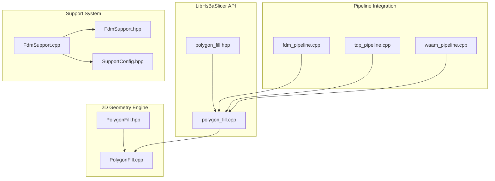

**Diagram sources**
- [PolygonFill.hpp:1-163](file://2D/PolygonFill.hpp#L1-L163)
- [PolygonFill.cpp:1-1832](file://2D/PolygonFill.cpp#L1-L1832)
- [polygon_fill.hpp:1-58](file://LibHsBaSlicer/Fill/polygon_fill.hpp#L1-L58)
- [polygon_fill.cpp:1-59](file://LibHsBaSlicer/Fill/polygon_fill.cpp#L1-L59)
- [fdm_pipeline.cpp:340-352](file://DllHsBaSlicer/fdm_pipeline.cpp#L340-L352)
- [tdp_pipeline.cpp:259-265](file://DllHsBaSlicer/tdp_pipeline.cpp#L259-L265)
- [waam_pipeline.cpp:227-234](file://DllHsBaSlicer/waam_pipeline.cpp#L227-L234)

**Section sources**
- [PolygonFill.hpp:1-163](file://2D/PolygonFill.hpp#L1-L163)
- [polygon_fill.hpp:1-58](file://LibHsBaSlicer/Fill/polygon_fill.hpp#L1-L58)
- [fdm_pipeline.cpp:340-352](file://DllHsBaSlicer/fdm_pipeline.cpp#L340-L352)

## Core Components
The core fill components now include:
- FillMode enumeration defining Line, SimpleZigzag, and Zigzag strategies.
- Offset-based concentric outline generator.
- Parallel line segment generator.
- Simple zigzag connector producing independent segments.
- Advanced zigzag connector with bridge building across disconnected scanline islands.
- CompositeOffsetFill combining base fill with outward/inward offset borders.
- HybridFill generating closed offset borders plus interior fill only on the final inward island.
- **RandomizeStartPoints algorithm for staggered extrusion seams**.
- LuaCustomFill and LuaCustomFillString enabling user-defined fill scripts.
- LibHsBaSlicer wrappers FillPolygon, FillWithBorder, RandomizePathStartPoints, and LuaCustomFillByFile.

Key responsibilities:
- Convert floating-point polygons to integer coordinates for robust geometric operations.
- Compute scanlines or offsets using Clipper2 primitives.
- Build continuous polylines where possible, falling back to extra straight segments when connectivity fails.
- **Stagger extrusion seams by rotating closed contours to deterministic random start points on edge interiors**.
- Provide both pure C++ and Lua-driven fill generation paths.

**Section sources**
- [PolygonFill.hpp:20-124](file://2D/PolygonFill.hpp#L20-L124)
- [PolygonFill.cpp:44-160](file://2D/PolygonFill.cpp#L44-L160)
- [PolygonFill.cpp:504-564](file://2D/PolygonFill.cpp#L504-L564)
- [PolygonFill.cpp:568-800](file://2D/PolygonFill.cpp#L568-L800)
- [PolygonFill.cpp:803-1370](file://2D/PolygonFill.cpp#L803-L1370)
- [PolygonFill.cpp:1372-1491](file://2D/PolygonFill.cpp#L1372-L1491)
- [PolygonFill.cpp:1494-1585](file://2D/PolygonFill.cpp#L1494-L1585)
- [PolygonFill.cpp:625-704](file://2D/PolygonFill.cpp#L625-L704)
- [polygon_fill.hpp:17-53](file://LibHsBaSlicer/Fill/polygon_fill.hpp#L17-L53)
- [polygon_fill.cpp:13-49](file://LibHsBaSlicer/Fill/polygon_fill.cpp#L13-L49)
- [polygon_fill.cpp:35-40](file://LibHsBaSlicer/Fill/polygon_fill.cpp#L35-L40)

## Architecture Overview
The fill architecture separates algorithmic logic from pipeline orchestration:
- The 2D engine computes fill geometries and applies seam randomization.
- The LibHsBaSlicer API exposes a concise interface for pipelines.
- The FDM, TDP, and WAAM pipelines integrate fill generation with support generation and G-code path export.
- Lua scripting allows advanced customization while reusing built-in polygon operations and path optimization helpers.

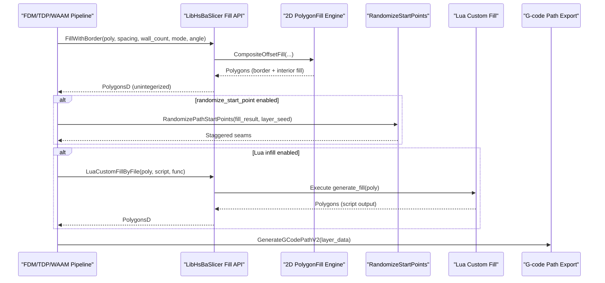

**Diagram sources**
- [fdm_pipeline.cpp:340-352](file://DllHsBaSlicer/fdm_pipeline.cpp#L340-L352)
- [tdp_pipeline.cpp:259-265](file://DllHsBaSlicer/tdp_pipeline.cpp#L259-L265)
- [waam_pipeline.cpp:227-234](file://DllHsBaSlicer/waam_pipeline.cpp#L227-L234)
- [polygon_fill.cpp:27-33](file://LibHsBaSlicer/Fill/polygon_fill.cpp#L27-L33)
- [polygon_fill.cpp:35-40](file://LibHsBaSlicer/Fill/polygon_fill.cpp#L35-L40)
- [polygon_fill.cpp:35-49](file://LibHsBaSlicer/Fill/polygon_fill.cpp#L35-L49)
- [PolygonFill.cpp:1372-1491](file://2D/PolygonFill.cpp#L1372-L1491)

**Section sources**
- [fdm_pipeline.cpp:340-507](file://DllHsBaSlicer/fdm_pipeline.cpp#L340-L507)
- [tdp_pipeline.cpp:259-265](file://DllHsBaSlicer/tdp_pipeline.cpp#L259-L265)
- [waam_pipeline.cpp:227-234](file://DllHsBaSlicer/waam_pipeline.cpp#L227-L234)
- [polygon_fill.cpp:13-49](file://LibHsBaSlicer/Fill/polygon_fill.cpp#L13-L49)

## Detailed Component Analysis

### Fill Mode Enumeration and Strategy Selection
FillMode selects among:
- Line: parallel straight segments.
- SimpleZigzag: connected zigzag with basic bridging.
- Zigzag: advanced zigzag with component-aware bridges along outer ring arcs.

Selection occurs in:
- LibHsBaSlicer FillPolygon dispatcher.
- CompositeOffsetFill and HybridFill internal fillOne closures.

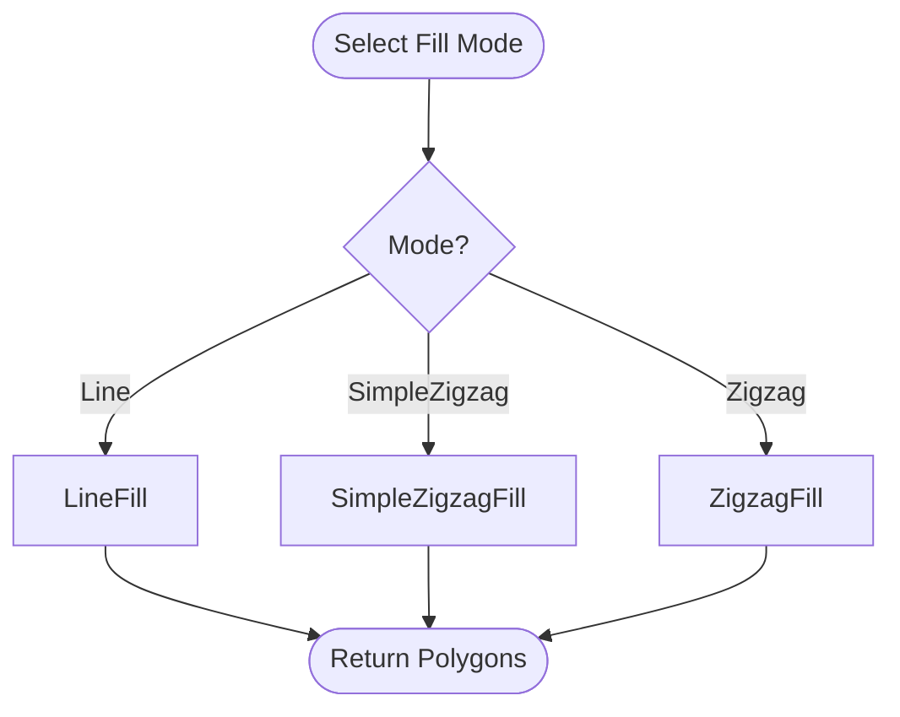

**Diagram sources**
- [polygon_fill.cpp:13-25](file://LibHsBaSlicer/Fill/polygon_fill.cpp#L13-L25)
- [PolygonFill.cpp:1376-1387](file://2D/PolygonFill.cpp#L1376-L1387)
- [PolygonFill.cpp:1468-1479](file://2D/PolygonFill.cpp#L1468-L1479)

**Section sources**
- [PolygonFill.hpp:60-68](file://2D/PolygonFill.hpp#L60-L68)
- [polygon_fill.cpp:13-25](file://LibHsBaSlicer/Fill/polygon_fill.cpp#L13-L25)

### Offset-Based Concentric Outlines
OffsetFill generates concentric outlines by repeatedly applying negative offsets until no more contours remain. Each contour is closed before being added to the result set. This pattern is useful for dense border fills and can be combined with other strategies.

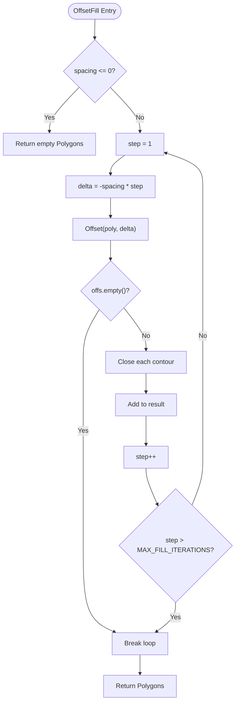

**Diagram sources**
- [PolygonFill.cpp:504-541](file://2D/PolygonFill.cpp#L504-L541)

**Section sources**
- [PolygonFill.cpp:504-541](file://2D/PolygonFill.cpp#L504-L541)

### Parallel Line Segments
LineFilling computes scanlines at a given angle and thickness, intersecting them with the polygon to produce per-row segments. LineFill returns independent two-point segments suitable for extrusion.

Key steps:
- Unintegerize input polygons.
- Compute bounding box and projection axes.
- Sweep lines spaced by spacing.
- Intersect sweep rectangles with polygon.
- Extract segment endpoints along the primary axis.
- Sort segments by start position.

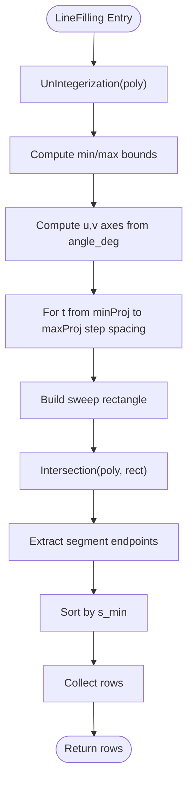

**Diagram sources**
- [PolygonFill.cpp:44-160](file://2D/PolygonFill.cpp#L44-L160)

**Section sources**
- [PolygonFill.cpp:44-160](file://2D/PolygonFill.cpp#L44-L160)
- [PolygonFill.cpp:544-564](file://2D/PolygonFill.cpp#L544-L564)

### Simple Zigzag Connector
SimpleZigzagFill connects centers of adjacent row segments into a single polyline, allowing connections only within the same row or adjacent rows. It clamps segments to ensure endpoints lie inside the polygon and uses binary search to find first/last interior points.

Behavior highlights:
- Alternating direction per row.
- Avoid duplicate points.
- Emit extra straight segments if connection fails.

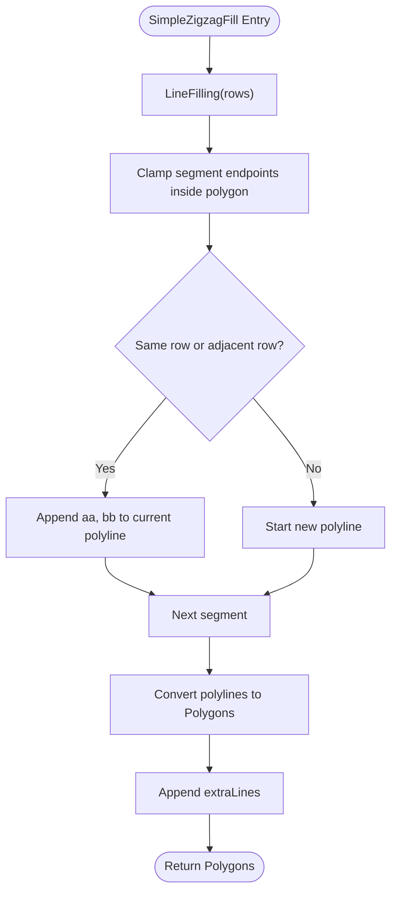

**Diagram sources**
- [PolygonFill.cpp:568-800](file://2D/PolygonFill.cpp#L568-L800)

**Section sources**
- [PolygonFill.cpp:568-800](file://2D/PolygonFill.cpp#L568-L800)

### Advanced Zigzag Connector with Bridges
ZigzagFill improves continuity by computing connectivity across rows using interval overlap and union-find to identify components. When different components appear on adjacent rows, it attempts to build a bridge along the outer ring arc, sampling points at a step derived from lineThickness. If bridging fails, it falls back to midpoint checks and emits extra straight segments.

Complexity considerations:
- Sorting segments per row.
- Flattening segments and computing intervals.
- Union-find across adjacent rows.
- Outer ring distance computation for bridge selection.
- Binary search for interior point clamping.

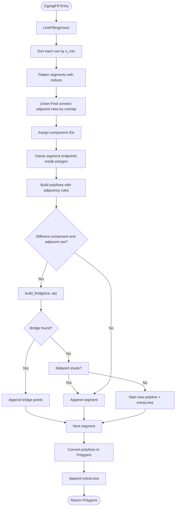

**Diagram sources**
- [PolygonFill.cpp:803-1370](file://2D/PolygonFill.cpp#L803-L1370)

**Section sources**
- [PolygonFill.cpp:803-1370](file://2D/PolygonFill.cpp#L803-L1370)

### RandomizeStartPoints Algorithm for Staggered Extrusion Seams
**Updated** The RandomizeStartPoints algorithm addresses the common issue of visible weak lines caused by aligned extrusion seams across layers and nested rings. It rotates closed contours to deterministic random start points sampled uniformly along their perimeters, inserting new split vertices on edges rather than confining seams to original vertices.

Algorithm characteristics:
- **Uniform arc-length sampling**: Uses prefix length tables and binary search to select random positions along polygon edges.
- **Deterministic seeding**: Same seed produces identical results across platforms using mt19937_64.
- **Optional separation constraint**: Can enforce minimum distance between start points of different loops.
- **Edge interpolation**: Supports splitting at arbitrary points along edges, not just vertices.
- **Closed form preservation**: Maintains the duplicated closing vertex format required by downstream processing.

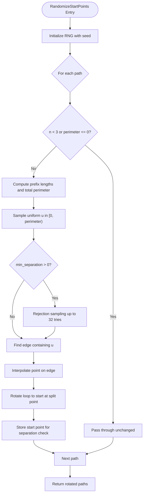

**Diagram sources**
- [PolygonFill.cpp:625-704](file://2D/PolygonFill.cpp#L625-L704)

**Section sources**
- [PolygonFill.cpp:625-704](file://2D/PolygonFill.cpp#L625-L704)
- [PolygonFill.cpp:54-91](file://2D/PolygonFill.cpp#L54-L91)

### Composite Offset Fill
CompositeOffsetFill applies the selected fill strategy to:
- The original polygon.
- Multiple outward offset layers.
- Multiple inward offset layers.

This produces concentric borders around the part and fills the interior region(s). It is used by FillWithBorder to create wall-count borders plus internal infill.

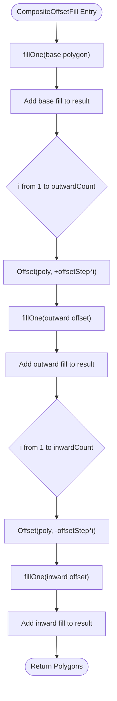

**Diagram sources**
- [PolygonFill.cpp:1372-1428](file://2D/PolygonFill.cpp#L1372-L1428)

**Section sources**
- [PolygonFill.cpp:1372-1428](file://2D/PolygonFill.cpp#L1372-L1428)

### Hybrid Fill
HybridFill generates closed offset borders for outward layers and intermediate inward layers, then fills only the final inward island if it meets minimum area criteria. This approach emphasizes perimeter reinforcement while limiting interior fill to the last viable region.

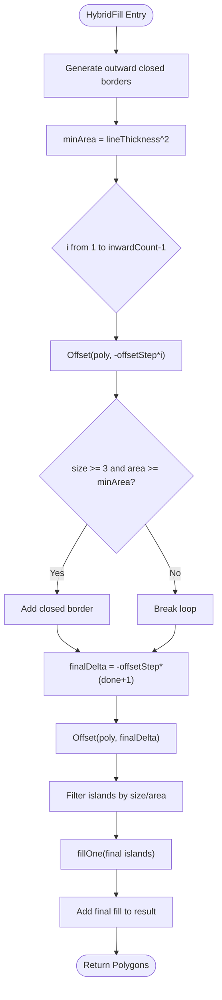

**Diagram sources**
- [PolygonFill.cpp:1430-1491](file://2D/PolygonFill.cpp#L1430-L1491)

**Section sources**
- [PolygonFill.cpp:1430-1491](file://2D/PolygonFill.cpp#L1430-L1491)

### Lua Custom Fill Integration
LuaCustomFill and LuaCustomFillString load a Lua state, register polygon operations and fill functions, optionally inject additional registration callbacks (e.g., path optimization), execute a user-provided function, and collect returned tables of polygons or polylines. Errors during loading, function lookup, or execution raise runtime errors.

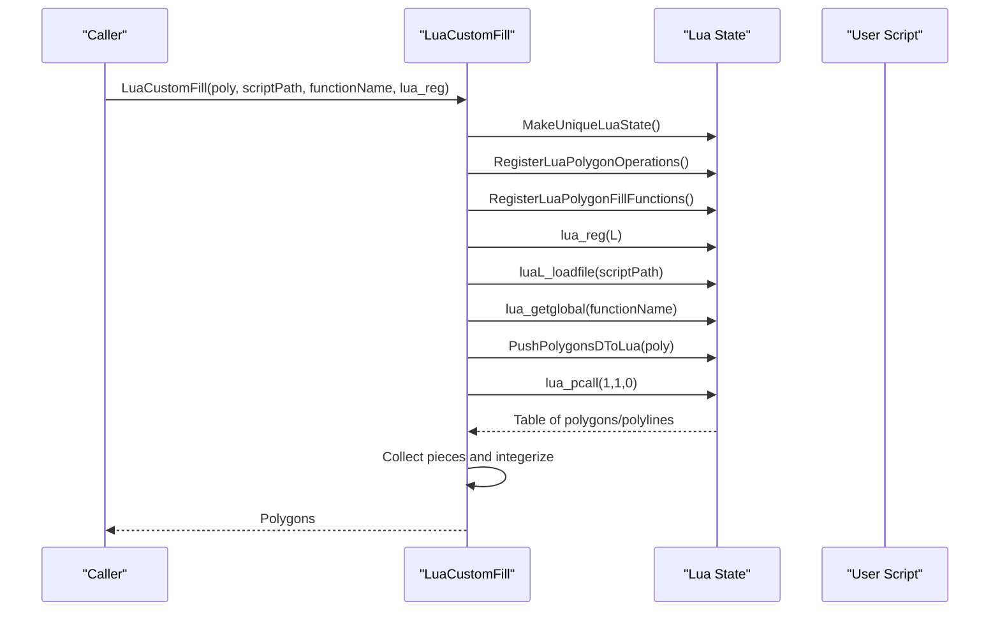

**Diagram sources**
- [PolygonFill.cpp:1494-1585](file://2D/PolygonFill.cpp#L1494-L1585)
- [polygon_fill.cpp:35-49](file://LibHsBaSlicer/Fill/polygon_fill.cpp#L35-L49)

**Section sources**
- [PolygonFill.cpp:1494-1585](file://2D/PolygonFill.cpp#L1494-L1585)
- [polygon_fill.cpp:35-49](file://LibHsBaSlicer/Fill/polygon_fill.cpp#L35-L49)

### Honeycomb Support Pattern
Although not part of the main infill system, the honeycomb support pattern demonstrates hexagonal tessellation within an overhang footprint. It constructs flat-top hexagons on a grid, unions them, and intersects with the gapped overhang region.

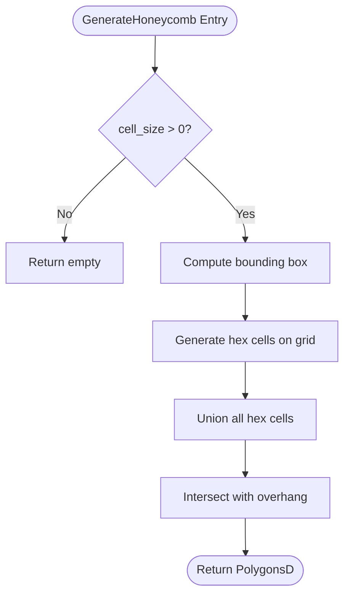

**Diagram sources**
- [FdmSupport.cpp:173-241](file://support/FdmSupport.cpp#L173-L241)

**Section sources**
- [FdmSupport.cpp:173-241](file://support/FdmSupport.cpp#L173-L241)

## Dependency Analysis
The fill system depends on:
- Clipper2 for offset, intersection, union, and point-in-polygon tests.
- Integerization utilities for robust geometry processing.
- Lua adapter functions for data conversion and function registration.
- Path optimizer registration via LibHsBaSlicer when invoking Lua custom fills.
- **Random number generation via std::mt19937_64 for deterministic seam randomization**.

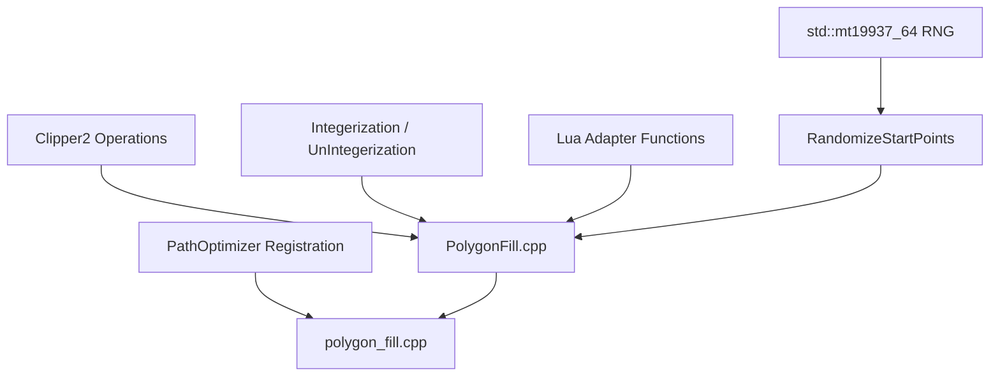

**Diagram sources**
- [PolygonFill.cpp:1-20](file://2D/PolygonFill.cpp#L1-L20)
- [polygon_fill.cpp:7-9](file://LibHsBaSlicer/Fill/polygon_fill.cpp#L7-L9)
- [path_optimizer.cpp:43-72](file://LibHsBaSlicer/Path/path_optimizer.cpp#L43-L72)
- [PolygonFill.cpp:629-660](file://2D/PolygonFill.cpp#L629-L660)

**Section sources**
- [PolygonFill.cpp:1-20](file://2D/PolygonFill.cpp#L1-L20)
- [polygon_fill.cpp:7-9](file://LibHsBaSlicer/Fill/polygon_fill.cpp#L7-L9)
- [path_optimizer.cpp:43-72](file://LibHsBaSlicer/Path/path_optimizer.cpp#L43-L72)
- [PolygonFill.cpp:629-660](file://2D/PolygonFill.cpp#L629-L660)

## Performance Considerations
- Iteration limits: MAX_FILL_ITERATIONS protects against excessive offset loops; MAX_BINARY_SEARCH_ITERATIONS bounds interior point searches.
- Row handling: LargeRowOffset avoids accidental row collisions when tracking connectivity.
- Complexity:
  - LineFilling scales with number of sweep lines and polygon complexity.
  - ZigzagFill adds sorting, union-find, and bridge construction, increasing cost for complex shapes.
  - Composite/Hybrid fills multiply work by number of offset layers.
  - **RandomizeStartPoints adds O(n log n) perimeter computation and optional rejection sampling for separation constraints**.
- Parallelism:
  - FDM pipeline parallelizes FillWithBorder calls across layers.
  - Lua custom fills run serially due to interpreter state constraints.
  - **Seam randomization occurs after fill generation, adding minimal overhead per layer**.
- Memory:
  - Intermediate rows and polylines are constructed per layer; large models may benefit from careful spacing and angle tuning to reduce segment counts.
  - **RandomizeStartPoints creates temporary prefix length arrays and chosen start point vectors**.

Recommendations:
- Use larger spacing for sparse fills to reduce segment count.
- Prefer Zigzag for better continuity on complex concave shapes, accepting higher compute cost.
- Limit outward/inward offset counts to necessary values.
- Tune lineThickness to balance bridge sampling granularity and performance.
- **Enable randomize_start_point for improved surface quality on multi-layer prints, especially with concentric walls**.
- **Use appropriate min_separation values to avoid clustering of seams in nested ring structures**.

[No sources needed since this section provides general guidance]

## Troubleshooting Guide
Common issues and remedies:
- Fill pattern discontinuities:
  - Verify spacing and angle settings; very small spacing increases segment count and may expose numerical edge cases.
  - For zigzag patterns, check that rows are adjacent and components are correctly bridged; fallback extraLines indicate failed bridges.
- Corner handling:
  - Adjust join_type (Square, Bevel, Round, Miter) for offset operations to improve corner quality.
  - Ensure lineThickness is reasonable relative to spacing to avoid degenerate bridges.
- Computational complexity:
  - Reduce outward/inward offset counts.
  - Avoid extremely small cell sizes in custom fills or honeycomb patterns.
- Lua script errors:
  - Confirm function name exists and returns a table.
  - Validate polygon coordinate formats passed to and returned from Lua.
- **Seam alignment issues**:
  - **Enable randomize_start_point to stagger extrusion seams across layers**.
  - **Adjust min_separation parameter to control spacing between seam locations in nested rings**.
  - **Verify that seeds are properly differentiated across layers (typically using layer index)**.
- **Randomization performance**:
  - **Large min_separation values may require many rejection sampling attempts; consider reducing the constraint**.
  - **Very complex polygons with many edges increase perimeter computation time**.

Operational references:
- Error reporting in Lua bindings uses l_report to format messages.
- Runtime exceptions thrown by LuaCustomFill include script load and call failures.
- **RandomizeStartPoints preserves closed form and winding direction while inserting split vertices**.

**Section sources**
- [PolygonFill.cpp:224-229](file://2D/PolygonFill.cpp#L224-L229)
- [PolygonFill.cpp:1517-1536](file://2D/PolygonFill.cpp#L1517-L1536)
- [polygon_fill_test.cpp:208-233](file://tests/PolygonFill/polygon_fill_test.cpp#L208-L233)
- [PolygonFill.cpp:625-704](file://2D/PolygonFill.cpp#L625-L704)

## Conclusion
HsBaSlicer's polygon fill system provides a flexible toolkit for generating high-quality infill patterns tailored to different manufacturing processes. Built-in strategies cover parallel lines and zigzag connectors, while composite and hybrid fills enable precise border control. The new RandomizeStartPoints algorithm addresses seam alignment issues by staggering extrusion seams across layers and nested rings. Lua scripting extends capabilities for custom strategies and integration with path optimization. The FDM, TDP, and WAAM pipelines orchestrate fill generation alongside support structures and exports toolpaths efficiently. Proper parameter tuning—spacing, angle, density, wall count, join type, and randomize_start_point—balances print quality, material usage, and computational performance.

[No sources needed since this section summarizes without analyzing specific files]

## Appendices

### Configuration Parameters and Their Effects
- Spacing: Controls density of fill lines; smaller spacing increases material usage and surface quality but raises computational cost.
- Angle: Rotates fill orientation; alternating angles across layers can improve mechanical properties.
- Density: In FDM pipeline, middle_spacing = fill_spacing / infill_density adjusts effective spacing for target density.
- Wall count: Number of concentric border offsets generated by FillWithBorder.
- Join type: Corner treatment for offset operations; affects visual quality and toolpath smoothness.
- Line thickness: Influences bridge sampling and minimum area thresholds in hybrid fills.
- **randomize_start_point**: Enables staggered extrusion seams by rotating closed contours to deterministic random start points; available in FDM, TDP, and WAAM pipelines.
- **min_separation**: Controls minimum distance between seam locations in nested ring structures; best-effort constraint with rejection sampling.

**Section sources**
- [fdm_pipeline.cpp:322-342](file://DllHsBaSlicer/fdm_pipeline.cpp#L322-L342)
- [PolygonFill.hpp:20-124](file://2D/PolygonFill.hpp#L20-L124)
- [pipeline_types.h:91-96](file://pipelinetypes/pipeline_types.h#L91-L96)
- [pipeline_types.h:774-774](file://pipelinetypes/pipeline_types.h#L774-L774)
- [pipeline_types.h:926-926](file://pipelinetypes/pipeline_types.h#L926-L926)
- [pipeline_types.h:604-604](file://pipelinetypes/pipeline_types.h#L604-L604)

### Relationship Between Fill Algorithms and Toolpath Generation
- Fills are computed per layer and included in LayerPathData alongside outlines and supports.
- **Seam randomization can be applied to fill results before inclusion in layer data**.
- G-code path generation consumes these layer data structures to produce final toolpaths.
- Spiral mode bypasses infill and support, emitting a continuous helix from outlines.

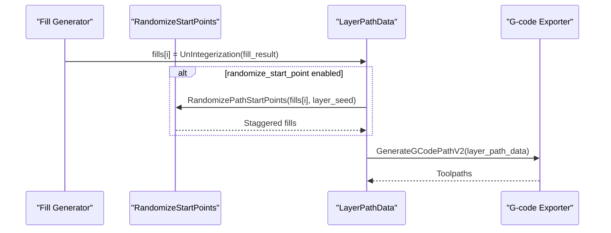

**Diagram sources**
- [fdm_pipeline.cpp:340-352](file://DllHsBaSlicer/fdm_pipeline.cpp#L340-L352)
- [fdm_pipeline.cpp:385-433](file://DllHsBaSlicer/fdm_pipeline.cpp#L385-L433)

**Section sources**
- [fdm_pipeline.cpp:385-433](file://DllHsBaSlicer/fdm_pipeline.cpp#L385-L433)
- [fdm_pipeline.cpp:340-352](file://DllHsBaSlicer/fdm_pipeline.cpp#L340-L352)

### FDM, SLA, SLS, TDP, and WAAM Workflow Notes
- FDM: Uses FillWithBorder and optional Lua infill; supports plane/tree/honeycomb support patterns; **randomize_start_point staggers extrusion seams**.
- SLA: Floor generation differs from FDM infill; support configurations include tip diameter and raft thickness.
- SLS: Export pathways exist but are separate from the 2D fill engine; fill concepts apply to powder bed deposition strategies.
- TDP: Binder jetting process with **randomize_start_point for staggered deposition seams**.
- WAAM: Wire arc additive manufacturing with **randomize_start_point for staggered bead start seams**.

Configuration references:
- FDM fill types defined in protocol message enums.
- Support configuration fields define behavior for plane, tree, and honeycomb patterns.
- **randomize_start_point field available in FDM, TDP, and WAAM pipeline configurations**.

**Section sources**
- [fdm_pipeline.proto:5-17](file://proto/fdm_pipeline.proto#L5-L17)
- [fdm_pipeline.proto:71-72](file://proto/fdm_pipeline.proto#L71-L72)
- [tdp_pipeline.proto:36-37](file://proto/tdp_pipeline.proto#L36-L37)
- [waam_pipeline.proto:78-79](file://proto/waam_pipeline.proto#L78-L79)
- [SupportConfig.hpp:14-43](file://support/SupportConfig.hpp#L14-L43)

### RandomizeStartPoints Implementation Details
**Updated** The RandomizeStartPoints algorithm provides sophisticated seam randomization with the following key features:

- **Arc-length based sampling**: Uniform distribution along polygon perimeter using prefix length tables and binary search.
- **Edge interpolation**: Supports splitting at arbitrary points along edges, not confined to vertices.
- **Deterministic reproducibility**: Same seed produces identical results across platforms using mt19937_64.
- **Separation constraints**: Optional minimum distance enforcement between start points of different loops.
- **Geometric preservation**: Maintains closed form, winding direction, and vertex order while inserting split vertices.

Helper functions:
- **EdgeAtArcPosition**: Locates the edge containing a given arc-length position.
- **LerpPoint**: Performs linear interpolation between two points.
- **RotateToEdgeStart**: Rotates polygon vertices to start at a specified split point.

**Section sources**
- [PolygonFill.cpp:54-91](file://2D/PolygonFill.cpp#L54-L91)
- [PolygonFill.cpp:625-704](file://2D/PolygonFill.cpp#L625-L704)
- [polygon_fill_test.cpp:205-306](file://tests/PolygonFill/polygon_fill_test.cpp#L205-L306)