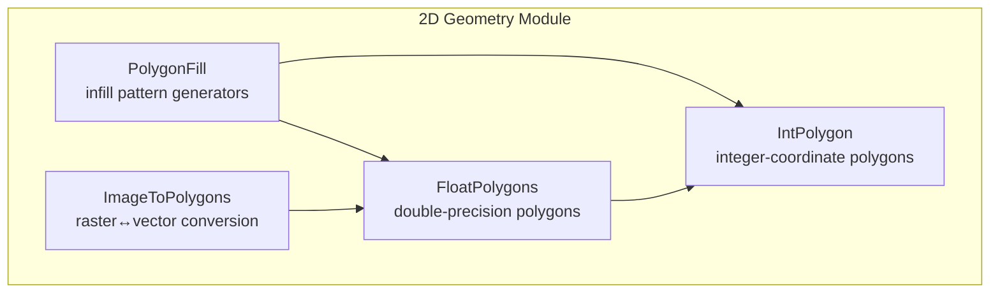
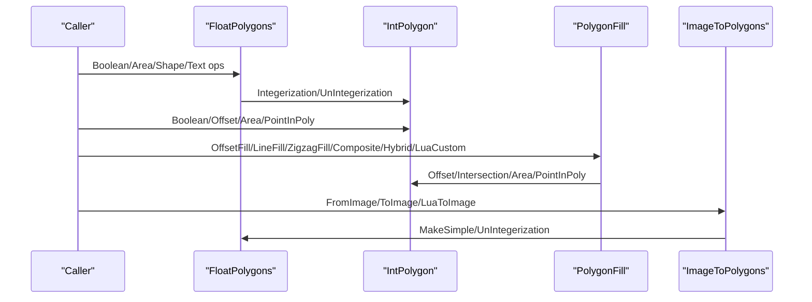
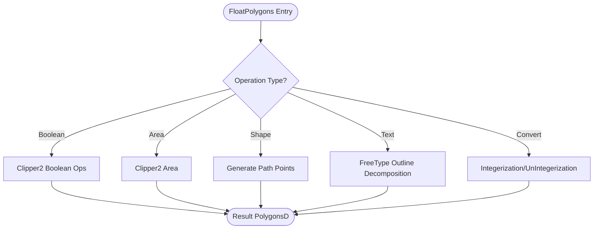
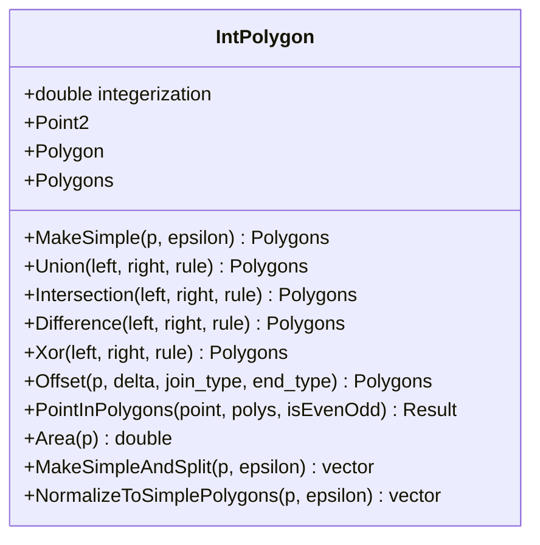
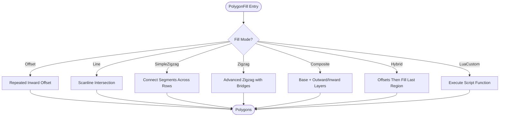
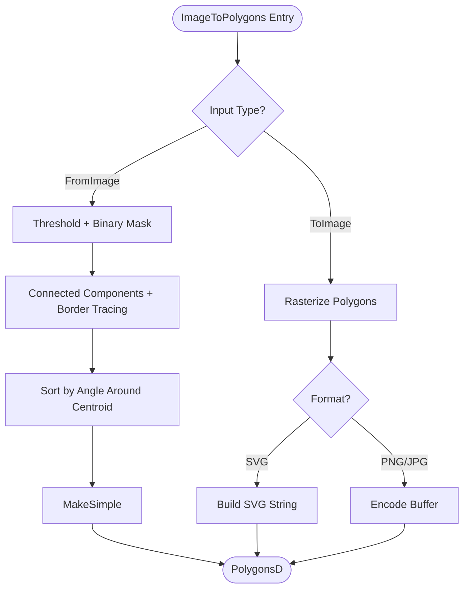
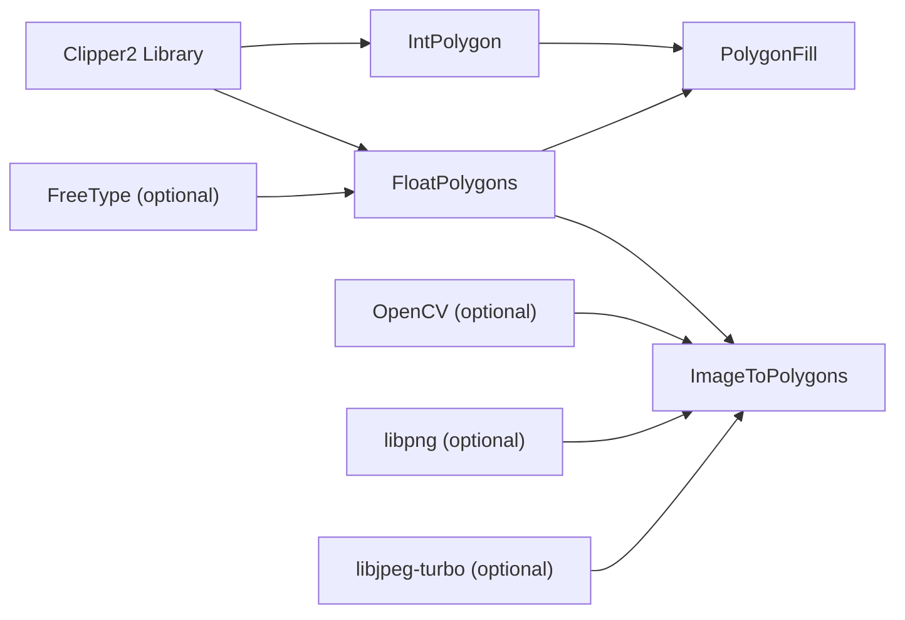

# 2D Geometry Processing / 2D几何处理

<cite>
**Referenced Files in This Document**   
- [FloatPolygons.hpp](file://2D/FloatPolygons.hpp)
- [FloatPolygons.cpp](file://2D/FloatPolygons.cpp)
- [IntPolygon.hpp](file://2D/IntPolygon.hpp)
- [IntPolygon.cpp](file://2D/IntPolygon.cpp)
- [PolygonFill.hpp](file://2D/PolygonFill.hpp)
- [PolygonFill.cpp](file://2D/PolygonFill.cpp)
- [ImageToPolygons.hpp](file://2D/ImageToPolygons.hpp)
- [ImageToPolygons.cpp](file://2D/ImageToPolygons.cpp)
</cite>

## Table of Contents
1. [Introduction](#introduction)
2. [Project Structure](#project-structure)
3. [Core Components](#core-components)
4. [Architecture Overview](#architecture-overview)
5. [Detailed Component Analysis](#detailed-component-analysis)
6. [Dependency Analysis](#dependency-analysis)
7. [Performance Considerations](#performance-considerations)
8. [Troubleshooting Guide](#troubleshooting-guide)
9. [Conclusion](#conclusion)
10. [Appendices](#appendices)

## Introduction
This document describes the 2D geometry processing module responsible for polygon manipulation, computational geometry operations, infill generation, and raster-vector conversion. It focuses on:
- Double-precision polygon operations through `FloatPolygons`, including boolean operations, area computation, shape generators, text-to-polygons, and integer/double conversions.
- Integer-coordinate polygon operations through `IntPolygon`, using Clipper2 for high-performance boolean operations, offsetting, point-in-polygon tests, normalization, and splitting.
- Polygon infill patterns via `PolygonFill`, including offset-based fills, line fills, zigzag fills, composite/hybrid fills, and Lua-driven custom fills.
- Raster-to-vector and vector-to-raster conversion via `ImageToPolygons`, including thresholding, multi-threshold extraction, rendering to PNG/JPEG/SVG, and Lua-driven image generation.

The module is designed for precision-critical slicing workflows where robust boolean logic, stable offsets, and predictable fill patterns are essential.

## Project Structure
The 2D geometry module lives under `2D/` and exposes a layered API:
- `FloatPolygons`: double-precision types and convenience wrappers around Clipper2.
- `IntPolygon`: integer-coordinate types and core geometric primitives backed by Clipper2.
- `PolygonFill`: infill algorithms that combine offsets, scanline intersection, and path connectivity.
- `ImageToPolygons`: raster I/O, contour extraction, and rendering utilities.

**Diagram sources**
- [FloatPolygons.hpp:9-26](file://2D/FloatPolygons.hpp#L9-L26)
- [IntPolygon.hpp:9-26](file://2D/IntPolygon.hpp#L9-L26)
- [PolygonFill.hpp:9-11](file://2D/PolygonFill.hpp#L9-L11)
- [ImageToPolygons.hpp:9](file://2D/ImageToPolygons.hpp#L9)

**Section sources**
- [FloatPolygons.hpp:1-271](file://2D/FloatPolygons.hpp#L1-L271)
- [IntPolygon.hpp:1-241](file://2D/IntPolygon.hpp#L1-L241)
- [PolygonFill.hpp:1-141](file://2D/PolygonFill.hpp#L1-L141)
- [ImageToPolygons.hpp:1-103](file://2D/ImageToPolygons.hpp#L1-L103)

## Core Components
- `FloatPolygons` provides double-precision polygon types (`Point2D`, `PolygonD`, `PolygonsD`) and functions for simplification, boolean operations (union, intersection, difference, xor), area calculation, shape generators (rectangle, circle, ellipse, regular polygon), text-to-polygons via FreeType, and integerization/un-integerization helpers.
- `IntPolygon` defines integer-coordinate types (`Point2`, `Polygon`, `Polygons`) with a scaling constant `integerization = 1e6`. It offers boolean operations, offsetting, point-in-polygon testing, area calculation, simplification, splitting into simple polygons, and orientation normalization.
- `PolygonFill` generates infill patterns: offset-based fills, parallel line fills, simple and advanced zigzag fills, composite fills combining borders and internal fills, hybrid fills applying offsets then filling the last offset region, and Lua-customizable fills.
- `ImageToPolygons` converts images to polygons via thresholding and contour extraction, supports multiple thresholds, renders polygons to PNG/JPEG/SVG or in-memory buffers, and integrates with Lua scripts for custom image generation.

**Section sources**
- [FloatPolygons.hpp:18-221](file://2D/FloatPolygons.hpp#L18-L221)
- [FloatPolygons.cpp:25-221](file://2D/FloatPolygons.cpp#L25-L221)
- [IntPolygon.hpp:16-192](file://2D/IntPolygon.hpp#L16-L192)
- [IntPolygon.cpp:19-127](file://2D/IntPolygon.cpp#L19-L127)
- [PolygonFill.hpp:20-136](file://2D/PolygonFill.hpp#L20-L136)
- [ImageToPolygons.hpp:23-99](file://2D/ImageToPolygons.hpp#L23-L99)

## Architecture Overview
The architecture separates concerns between coordinate precision layers and algorithmic layers:
- Precision layer: `IntPolygon` uses 64-bit integers for robust boolean operations; `FloatPolygons` wraps Clipper2’s double-precision types for user-facing APIs and optional text/vector generation.
- Algorithm layer: `PolygonFill` composes `Offset`, `Intersection`, `Area`, and `PointInPolygons` to build complex infill strategies.
- I/O layer: `ImageToPolygons` bridges raster formats and vector polygons, optionally driven by Lua scripts.

**Diagram sources**
- [FloatPolygons.cpp:184-221](file://2D/FloatPolygons.cpp#L184-L221)
- [IntPolygon.cpp:62-127](file://2D/IntPolygon.cpp#L62-L127)
- [PolygonFill.cpp:504-541](file://2D/PolygonFill.cpp#L504-L541)
- [ImageToPolygons.cpp:416-424](file://2D/ImageToPolygons.cpp#L416-L424)

## Detailed Component Analysis

### FloatPolygons: Double-Precision Polygon Operations
Responsibilities:
- Simplification: `MakeSimple` removes collinear points using Clipper2.
- Boolean operations: `Union`, `Intersection`, `Difference`, `Xor` for single polygons and sets.
- Area computation: `Area` returns signed area based on winding order.
- Shape generators: `MakeRectangle`, `MakeCircle`, `MakeEllipse`, `MakeRegularPolygon`.
- Text-to-polygons: `TextToPolygons` uses FreeType to convert UTF-8 text outlines to polygons.
- Conversion: `Integerization` and `UnIntegerization` bridge double and integer coordinates.

Complexity considerations:
- Simplification and boolean operations delegate to Clipper2; typical complexity depends on polygon vertex counts and intersection topology.
- Text-to-polygons complexity scales with glyph outline complexity and curve segment count.

Precision notes:
- Uses double-precision coordinates for smooth curves and text outlines.
- Integerization factor `integerization` is applied when converting to integer space for robust boolean operations.

**Diagram sources**
- [FloatPolygons.cpp:25-75](file://2D/FloatPolygons.cpp#L25-L75)
- [FloatPolygons.cpp:330-362](file://2D/FloatPolygons.cpp#L330-L362)
- [FloatPolygons.cpp:364-429](file://2D/FloatPolygons.cpp#L364-L429)
- [FloatPolygons.cpp:184-221](file://2D/FloatPolygons.cpp#L184-L221)

**Section sources**
- [FloatPolygons.hpp:27-221](file://2D/FloatPolygons.hpp#L27-L221)
- [FloatPolygons.cpp:25-221](file://2D/FloatPolygons.cpp#L25-L221)

### IntPolygon: Integer-Coordinate Polygon Operations
Responsibilities:
- Types: `Point2`, `Polygon`, `Polygons` with 64-bit integer coordinates.
- Scaling: `integerization = 1e6` for converting between double and integer spaces.
- Boolean operations: `Union`, `Intersection`, `Difference`, `Xor` for single polygons and sets.
- Offsetting: `Offset` inflates/deflates polygons with configurable join and end types.
- Point-in-polygon: `PointInPolygons` supports even-odd and non-zero winding rules.
- Area: `Area` computes signed area.
- Normalization: `NormalizeToSimplePolygons` splits self-intersecting polygons into simple ones and builds hole/outer relationships.
- Splitting: `MakeSimpleAndSplit` decomposes into simple polygons using Clipper2’s polytree.

Algorithm highlights:
- `PointInPolygons` normalizes winding by converting to even-odd if needed, then evaluates containment per polygon while respecting orientation.
- `NormalizeToSimplePolygons` uses area sign to normalize orientation, then determines parent-child relationships among contours to reconstruct proper holes.

Complexity:
- Boolean operations and offsetting rely on Clipper2; performance depends on vertex counts and topology.
- Normalization involves pairwise containment checks; naive implementation is O(n^2) over contours.

**Diagram sources**
- [IntPolygon.hpp:16-192](file://2D/IntPolygon.hpp#L16-L192)
- [IntPolygon.cpp:19-127](file://2D/IntPolygon.cpp#L19-L127)
- [IntPolygon.cpp:278-446](file://2D/IntPolygon.cpp#L278-L446)

**Section sources**
- [IntPolygon.hpp:16-241](file://2D/IntPolygon.hpp#L16-L241)
- [IntPolygon.cpp:19-469](file://2D/IntPolygon.cpp#L19-L469)

### PolygonFill: Infill Pattern Generation
Responsibilities:
- Offset-based fill: `OffsetFill` repeatedly offsets inward to generate concentric paths.
- Line fill: `LineFill` computes parallel lines intersecting the polygon boundary.
- Zigzag fills: `SimpleZigzagFill` connects segments across scanlines; `ZigzagFill` adds advanced corner handling and bridging.
- Composite fill: `CompositeOffsetFill` combines base fill with outward/inward offset layers.
- Hybrid fill: `HybridFill` applies offsets then fills the final innermost region.
- Lua custom fill: `LuaCustomFill` and `LuaCustomFillString` execute user scripts to generate fill patterns.

Key algorithms:
- `LineFilling` projects polygon vertices onto axes aligned with the fill angle, constructs rectangular sweep windows, intersects with the polygon, and extracts ordered segments.
- Zigzag connectivity uses union-find to group segments across adjacent rows, then builds polylines with optional bridges along the outer ring when components differ.
- Binary search helpers locate first/last interior points along segments to clamp scanline intersections accurately.

Complexity:
- Line fill: O(V + S·logS) where V is vertex count and S is number of scanline intersections.
- Zigzag fill: O(S log S + R^2) due to sorting and pairwise row connectivity checks; union-find reduces component merging cost.
- Composite/hybrid fills scale linearly with the number of offset layers and internal fill calls.

**Diagram sources**
- [PolygonFill.cpp:504-541](file://2D/PolygonFill.cpp#L504-L541)
- [PolygonFill.cpp:544-564](file://2D/PolygonFill.cpp#L544-L564)
- [PolygonFill.cpp:568-800](file://2D/PolygonFill.cpp#L568-L800)
- [PolygonFill.cpp:803-1370](file://2D/PolygonFill.cpp#L803-L1370)
- [PolygonFill.cpp:1372-1491](file://2D/PolygonFill.cpp#L1372-L1491)
- [PolygonFill.cpp:1494-1669](file://2D/PolygonFill.cpp#L1494-L1669)

**Section sources**
- [PolygonFill.hpp:20-136](file://2D/PolygonFill.hpp#L20-L136)
- [PolygonFill.cpp:24-502](file://2D/PolygonFill.cpp#L24-L502)
- [PolygonFill.cpp:504-1669](file://2D/PolygonFill.cpp#L504-L1669)

### ImageToPolygons: Raster-Vector Conversion
Responsibilities:
- Image loading: `LoadImageGray` reads grayscale images via OpenCV when available.
- Contour extraction: `ExtractContoursFromBinary` performs 4-connected component labeling, border tracing, angular sorting, and simplification.
- Rendering: `ToImage` and `ToImageBuffer` rasterize polygons to PNG/JPEG/SVG, optionally in memory.
- Multi-threshold: `FromImageMulti` produces multiple polygon sets for different thresholds.
- Lua integration: `LuaToImage` and `LuaToImageString` execute scripts returning grayscale images.

Algorithm highlights:
- Contour extraction uses BFS for connected components, identifies border pixels, sorts by polar angle around centroid, and outputs simplified polygons.
- Rendering falls back to manual rasterization if OpenCV is unavailable, using point-in-polygon tests per pixel.

Complexity:
- Contour extraction: O(W·H) for pixel scanning plus O(B log B) for border sorting where B is border pixel count.
- Manual rasterization: O(W·H·P) where P is number of polygons; optimized path via OpenCV when available.

**Diagram sources**
- [ImageToPolygons.cpp:37-76](file://2D/ImageToPolygons.cpp#L37-L76)
- [ImageToPolygons.cpp:98-200](file://2D/ImageToPolygons.cpp#L98-L200)
- [ImageToPolygons.cpp:327-359](file://2D/ImageToPolygons.cpp#L327-L359)
- [ImageToPolygons.cpp:394-413](file://2D/ImageToPolygons.cpp#L394-L413)
- [ImageToPolygons.cpp:427-497](file://2D/ImageToPolygons.cpp#L427-L497)
- [ImageToPolygons.cpp:516-543](file://2D/ImageToPolygons.cpp#L516-L543)

**Section sources**
- [ImageToPolygons.hpp:23-99](file://2D/ImageToPolygons.hpp#L23-L99)
- [ImageToPolygons.cpp:37-685](file://2D/ImageToPolygons.cpp#L37-L685)

## Dependency Analysis
The module exhibits clear dependency directionality:
- `FloatPolygons` depends on Clipper2 and optionally FreeType for text outlines.
- `IntPolygon` depends on Clipper2 for boolean operations, offsetting, and polytree traversal.
- `PolygonFill` depends on both `FloatPolygons` and `IntPolygon`, composing lower-level operations to produce infill patterns.
- `ImageToPolygons` depends on `FloatPolygons` for simplification and conversion, and optionally OpenCV/libpng/libjpeg-turbo for I/O.

**Diagram sources**
- [FloatPolygons.hpp:9-13](file://2D/FloatPolygons.hpp#L9-L13)
- [IntPolygon.hpp:9-12](file://2D/IntPolygon.hpp#L9-L12)
- [PolygonFill.hpp:9-11](file://2D/PolygonFill.hpp#L9-L11)
- [ImageToPolygons.hpp:9](file://2D/ImageToPolygons.hpp#L9)
- [ImageToPolygons.cpp:18-29](file://2D/ImageToPolygons.cpp#L18-L29)

**Section sources**
- [FloatPolygons.hpp:9-13](file://2D/FloatPolygons.hpp#L9-L13)
- [IntPolygon.hpp:9-12](file://2D/IntPolygon.hpp#L9-L12)
- [PolygonFill.hpp:9-11](file://2D/PolygonFill.hpp#L9-L11)
- [ImageToPolygons.hpp:9](file://2D/ImageToPolygons.hpp#L9)
- [ImageToPolygons.cpp:18-29](file://2D/ImageToPolygons.cpp#L18-L29)

## Performance Considerations
- Use integer-coordinate operations (`IntPolygon`) for robust boolean logic and offsetting; convert to double only when necessary for visualization or text generation.
- Prefer `MakeSimple` before boolean operations to reduce vertex count and improve stability.
- For large images, leverage OpenCV when available to accelerate rasterization and encoding.
- Tune zigzag fill parameters: spacing controls density; lineThickness affects bridge sampling and connector robustness.
- Limit offset iterations in `OffsetFill` via `MAX_FILL_ITERATIONS` to avoid excessive computations on very large areas.
- When generating text outlines, adjust `curve_segments` to balance fidelity and performance.

[No sources needed since this section provides general guidance]

## Troubleshooting Guide
Common issues and resolutions:
- Text-to-polygons fails without FreeType: ensure `HSBA_HAVE_FREETYPE` is defined and FreeType is linked; otherwise `TextToPolygons` throws an error indicating missing support.
- Image loading failures: verify input path and format; OpenCV may not be available, causing `LoadImageGray` to return false.
- Lua script errors: check function names and return types; `LuaToImage` expects a table of grayscale values, while `LuaCustomFill` expects tables representing polygons or polylines.
- Unexpected fill gaps: adjust `spacing` and `lineThickness`; verify polygon orientation and use `NormalizeToSimplePolygons` to fix self-intersections.
- Precision artifacts: increase `integerization` scaling or simplify polygons before boolean operations to reduce floating-point drift.

**Section sources**
- [FloatPolygons.cpp:364-429](file://2D/FloatPolygons.cpp#L364-L429)
- [ImageToPolygons.cpp:37-76](file://2D/ImageToPolygons.cpp#L37-L76)
- [ImageToPolygons.cpp:545-682](file://2D/ImageToPolygons.cpp#L545-L682)
- [PolygonFill.cpp:1494-1669](file://2D/PolygonFill.cpp#L1494-L1669)

## Conclusion
The 2D geometry processing module provides a comprehensive toolkit for polygon manipulation, infill generation, and raster-vector conversion. By separating double-precision and integer-coordinate layers, it achieves both usability and numerical robustness. The modular design allows flexible composition of boolean operations, offsets, and fill patterns, while Lua scripting enables extensibility for custom workflows. Proper parameter tuning and awareness of precision and complexity trade-offs are key to achieving reliable and efficient results.

[No sources needed since this section summarizes without analyzing specific files]

## Appendices
- Practical examples:
  - Compute union of two polygons: call `FloatPolygons::Union` or `IntPolygon::Union` after appropriate coordinate conversion.
  - Generate offset-based infill: call `PolygonFill::OffsetFill` with desired spacing and join type.
  - Convert image to polygons: call `ImageToPolygons::FromImage` with threshold and pixel size.
  - Render polygons to SVG: call `ImageToPolygons::ToImageBuffer` with extension ".svg".

[No sources needed since this section provides general guidance]