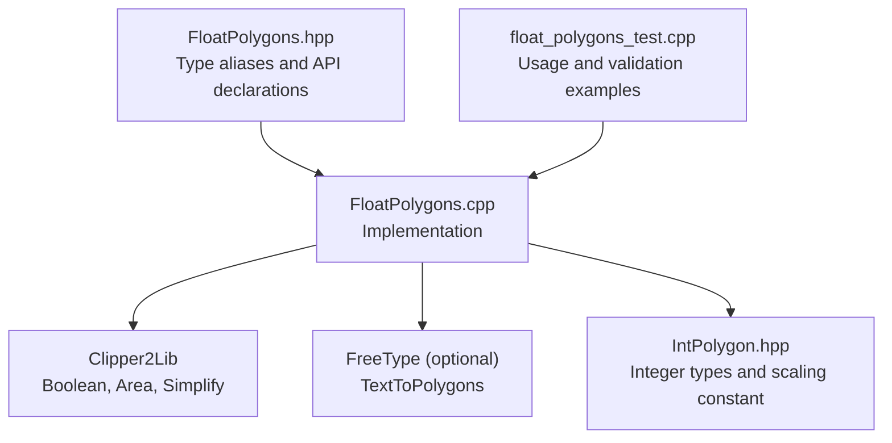
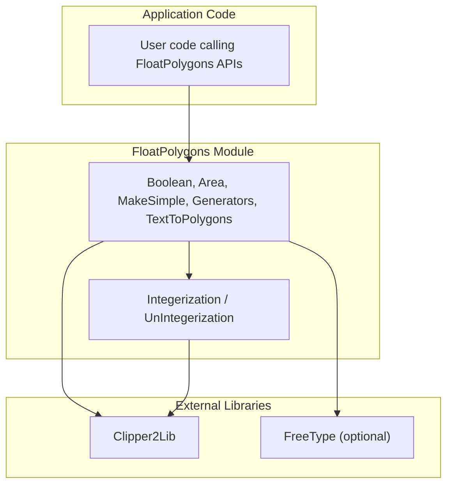
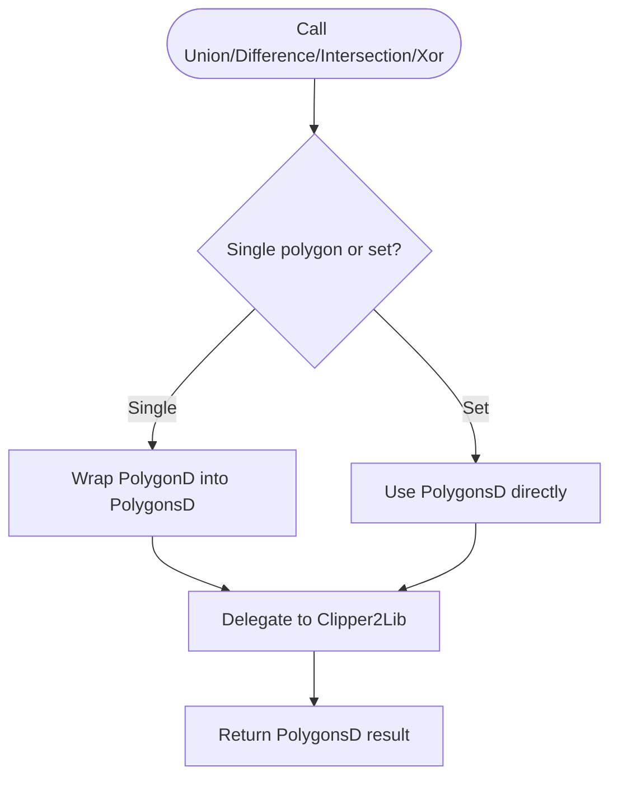
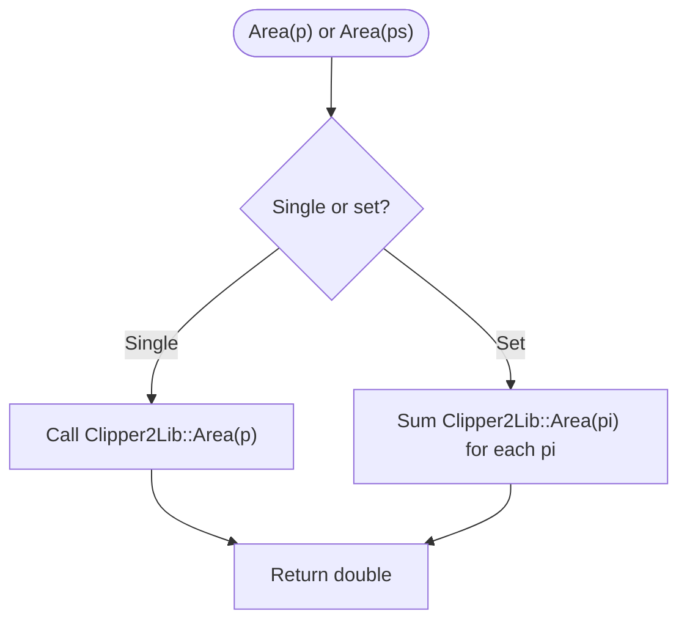
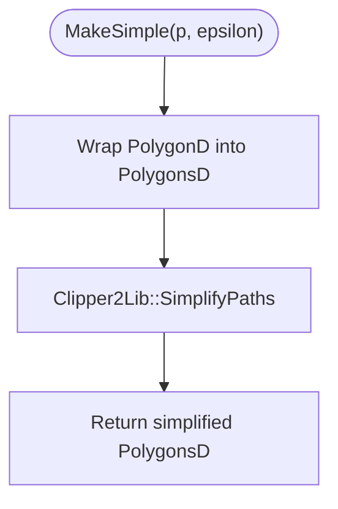
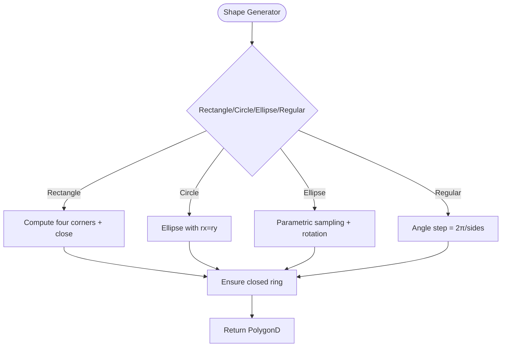
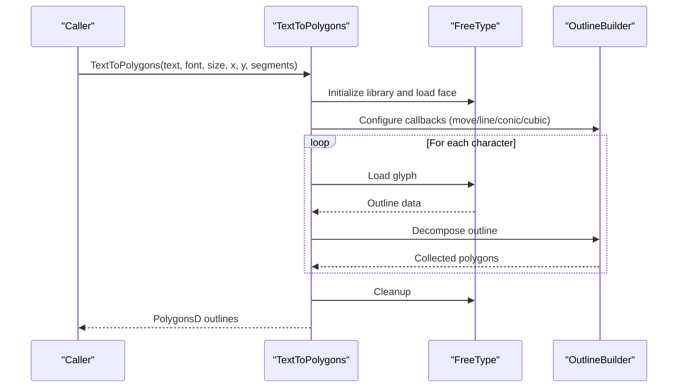
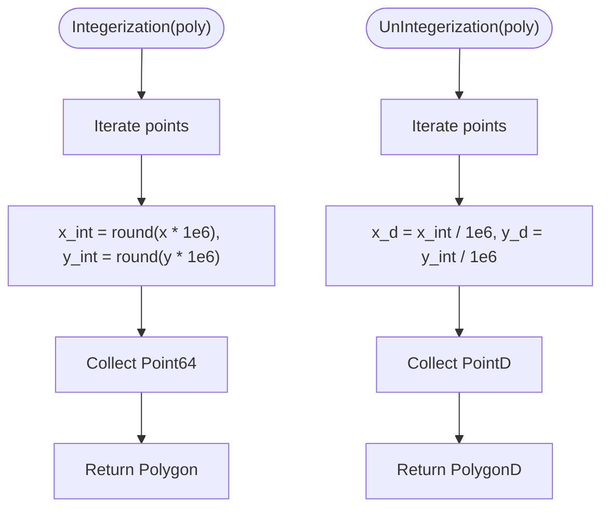
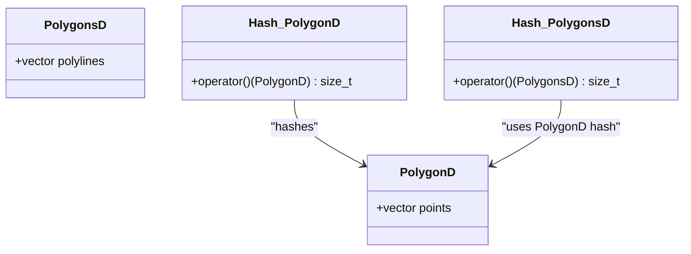
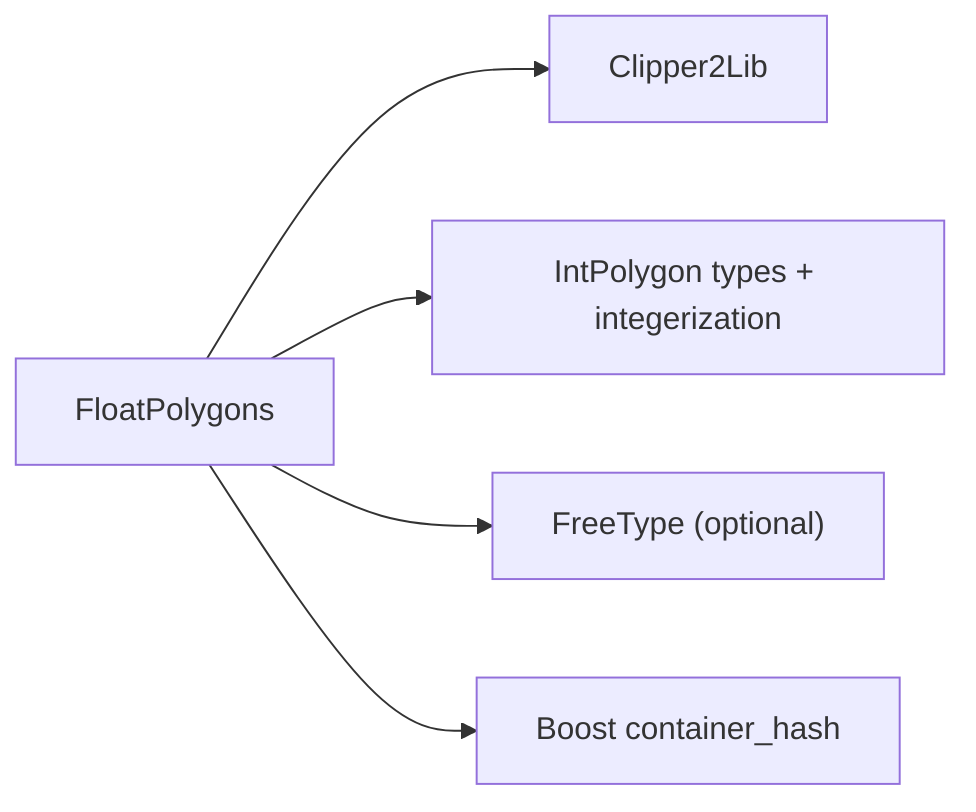

# Float Polygons / 浮点多边形

<cite>
**Referenced Files in This Document**   
- [FloatPolygons.hpp](file://2D/FloatPolygons.hpp)
- [FloatPolygons.cpp](file://2D/FloatPolygons.cpp)
- [IntPolygon.hpp](file://2D/IntPolygon.hpp)
- [float_polygons_test.cpp](file://tests/PolygonFill/float_polygons_test.cpp)
</cite>

## Table of Contents
1. [Introduction](#introduction)
2. [Project Structure](#project-structure)
3. [Core Components](#core-components)
4. [Architecture Overview](#architecture-overview)
5. [Detailed Component Analysis](#detailed-component-analysis)
6. [Dependency Analysis](#dependency-analysis)
7. [Performance Considerations](#performance-considerations)
8. [Troubleshooting Guide](#troubleshooting-guide)
9. [Conclusion](#conclusion)
10. [Appendices](#appendices)

## Introduction
The FloatPolygons module provides double-precision polygon operations for 2D geometry workflows. It defines `Point2D`, `PolygonD`, and `PolygonsD` as aliases over Clipper2Lib’s double-precision types, and exposes boolean operations, area calculation, polygon simplification, shape generators, text-to-polygon conversion, and coordinate conversions between double precision and integer precision. The module is designed to be a practical foundation for slicing, path generation, support generation, and other geometric tasks that require robust floating-point arithmetic while still being compatible with integer-based Clipper2 operations through explicit conversion functions.

## Project Structure
The module is implemented in two files:
- Header: declares type aliases, function signatures, and hash specializations.
- Implementation: implements boolean operations, area, simplification, shape generators, text rendering, integerization, and optional SVG dump utilities.

**Diagram sources**
- [FloatPolygons.hpp:1-271](file://2D/FloatPolygons.hpp#L1-L271)
- [FloatPolygons.cpp:1-453](file://2D/FloatPolygons.cpp#L1-L453)
- [IntPolygon.hpp:1-241](file://2D/IntPolygon.hpp#L1-L241)
- [float_polygons_test.cpp:1-350](file://tests/PolygonFill/float_polygons_test.cpp#L1-L350)

**Section sources**
- [FloatPolygons.hpp:1-271](file://2D/FloatPolygons.hpp#L1-L271)
- [FloatPolygons.cpp:1-453](file://2D/FloatPolygons.cpp#L1-L453)
- [IntPolygon.hpp:1-241](file://2D/IntPolygon.hpp#L1-L241)
- [float_polygons_test.cpp:1-350](file://tests/PolygonFill/float_polygons_test.cpp#L1-L350)

## Core Components
This section documents the primary data types and core APIs exposed by the module.

### Type Aliases
- `Point2D`: Double-precision 2D point aliasing `Clipper2Lib::PointD`.
- `PolygonD`: Double-precision polygon path aliasing `Clipper2Lib::PathD`.
- `PolygonsD`: Collection of double-precision polygons aliasing `Clipper2Lib::PathsD`.

These aliases provide a clean, readable interface over Clipper2Lib’s underlying types while keeping the rest of the codebase independent from low-level library details.

### Boolean Operations
For both single polygons and polygon sets, the module provides:
- `Union(left, right, fill_rule)`
- `Intersection(left, right, fill_rule)`
- `Difference(left, right, fill_rule)`
- `Xor(left, right, fill_rule)`

Each overload accepts an optional `Clipper2Lib::FillRule`, defaulting to `EvenOdd`. Single-polygon overloads wrap inputs into `PolygonsD` before delegating to Clipper2Lib; set overloads pass collections directly.

### Geometric Utilities
- `MakeSimple(p, epsilon)` and `MakeSimple(ps, epsilon)`: Remove collinear points using Clipper2Lib’s simplifier.
- `Area(p)` and `Area(ps)`: Compute signed area(s); positive indicates clockwise orientation, negative counter-clockwise.

### Shape Generators
- `MakeRectangle(x, y, width, height)`: Closed rectangle ring with repeated first vertex.
- `MakeCircle(cx, cy, radius, segments = 64)`: Approximates a circle via ellipse generator.
- `MakeEllipse(cx, cy, rx, ry, segments = 64, rotation = 0.0)`: Generates rotated ellipse approximation.
- `MakeRegularPolygon(cx, cy, radius, sides, rotation = 0.0)`: Regular n-gon; returns empty if `sides < 3`.

### Text-to-Polygon Conversion
- `TextToPolygons(utf8_text, font_file, font_size, x = 0.0, y = 0.0, curve_segments = 8)`: Converts UTF-8 text to polygon outlines using FreeType when available.

### Coordinate System Conversions
- `Integerization(poly)` and `Integerization(polys)`: Convert double coordinates to integer coordinates using a scaling factor.
- `UnIntegerization(poly)` and `UnIntegerization(polys)`: Convert integer coordinates back to double precision.

### Hash Specializations
Hash implementations are provided for `PolygonD` and `PolygonsD`, enabling use in unordered containers.

**Section sources**
- [FloatPolygons.hpp:18-26](file://2D/FloatPolygons.hpp#L18-L26)
- [FloatPolygons.hpp:27-121](file://2D/FloatPolygons.hpp#L27-L121)
- [FloatPolygons.hpp:123-191](file://2D/FloatPolygons.hpp#L123-L191)
- [FloatPolygons.hpp:195-221](file://2D/FloatPolygons.hpp#L195-L221)
- [FloatPolygons.hpp:242-268](file://2D/FloatPolygons.hpp#L242-L268)
- [FloatPolygons.cpp:25-75](file://2D/FloatPolygons.cpp#L25-L75)
- [FloatPolygons.cpp:330-362](file://2D/FloatPolygons.cpp#L330-L362)
- [FloatPolygons.cpp:364-429](file://2D/FloatPolygons.cpp#L364-L429)
- [FloatPolygons.cpp:184-221](file://2D/FloatPolygons.cpp#L184-L221)
- [FloatPolygons.cpp:433-453](file://2D/FloatPolygons.cpp#L433-L453)

## Architecture Overview
At runtime, FloatPolygons acts as a thin abstraction layer over Clipper2Lib for double-precision geometry. Optional FreeType integration enables text outline extraction. Integerization bridges float and integer domains, allowing downstream algorithms to operate on integer coordinates where appropriate.

**Diagram sources**
- [FloatPolygons.cpp:25-75](file://2D/FloatPolygons.cpp#L25-L75)
- [FloatPolygons.cpp:184-221](file://2D/FloatPolygons.cpp#L184-L221)
- [FloatPolygons.cpp:364-429](file://2D/FloatPolygons.cpp#L364-L429)

## Detailed Component Analysis

### Boolean Operations
Both single-polygon and polygon-set overloads delegate to Clipper2Lib. Single-polygon variants construct temporary `PolygonsD` wrappers around input paths.

**Diagram sources**
- [FloatPolygons.cpp:34-66](file://2D/FloatPolygons.cpp#L34-L66)

**Section sources**
- [FloatPolygons.hpp:43-121](file://2D/FloatPolygons.hpp#L43-L121)
- [FloatPolygons.cpp:34-66](file://2D/FloatPolygons.cpp#L34-L66)

### Area Calculation
Area functions compute signed areas. For polygon sets, total area sums individual signed areas. Tests validate absolute net area for generated shapes.

**Diagram sources**
- [FloatPolygons.cpp:68-75](file://2D/FloatPolygons.cpp#L68-L75)

**Section sources**
- [FloatPolygons.hpp:123-135](file://2D/FloatPolygons.hpp#L123-L135)
- [FloatPolygons.cpp:68-75](file://2D/FloatPolygons.cpp#L68-L75)
- [float_polygons_test.cpp:158-163](file://tests/PolygonFill/float_polygons_test.cpp#L158-L163)

### Polygon Simplification
Simplification removes collinear vertices using Clipper2Lib’s simplifier. Tolerance `epsilon` controls sensitivity.

**Diagram sources**
- [FloatPolygons.cpp:25-32](file://2D/FloatPolygons.cpp#L25-L32)

**Section sources**
- [FloatPolygons.hpp:27-41](file://2D/FloatPolygons.hpp#L27-L41)
- [FloatPolygons.cpp:25-32](file://2D/FloatPolygons.cpp#L25-L32)
- [float_polygons_test.cpp:144-156](file://tests/PolygonFill/float_polygons_test.cpp#L144-L156)

### Shape Generators
Generators produce closed rings suitable for boolean operations and area calculations.

- Rectangle: Four corners plus closing vertex.
- Circle/Ellipse: Parametric sampling with optional rotation.
- Regular polygon: Equally spaced vertices around center.

**Diagram sources**
- [FloatPolygons.cpp:308-362](file://2D/FloatPolygons.cpp#L308-L362)

**Section sources**
- [FloatPolygons.hpp:137-178](file://2D/FloatPolygons.hpp#L137-L178)
- [FloatPolygons.cpp:308-362](file://2D/FloatPolygons.cpp#L308-L362)
- [float_polygons_test.cpp:75-113](file://tests/PolygonFill/float_polygons_test.cpp#L75-L113)

### Text-to-Polygon Conversion
When FreeType is available, glyphs are decomposed into line and curve segments, flattened into double-precision points, and assembled into closed contours.

**Diagram sources**
- [FloatPolygons.cpp:364-429](file://2D/FloatPolygons.cpp#L364-L429)

**Section sources**
- [FloatPolygons.hpp:180-191](file://2D/FloatPolygons.hpp#L180-L191)
- [FloatPolygons.cpp:222-305](file://2D/FloatPolygons.cpp#L222-L305)
- [FloatPolygons.cpp:364-429](file://2D/FloatPolygons.cpp#L364-L429)
- [float_polygons_test.cpp:206-245](file://tests/PolygonFill/float_polygons_test.cpp#L206-L245)
- [float_polygons_test.cpp:293-337](file://tests/PolygonFill/float_polygons_test.cpp#L293-L337)

### Integerization and UnIntegerization
Coordinate conversion uses a scaling constant defined in the integer polygon module.

- Scaling factor: `integerization = 1e6`.
- `Integerization`: Multiplies double coordinates by the scale and casts to 64-bit integers.
- `UnIntegerization`: Divides integer coordinates by the scale and converts to double.

**Diagram sources**
- [IntPolygon.hpp:16-17](file://2D/IntPolygon.hpp#L16-L17)
- [FloatPolygons.cpp:184-221](file://2D/FloatPolygons.cpp#L184-L221)

**Section sources**
- [IntPolygon.hpp:16-17](file://2D/IntPolygon.hpp#L16-L17)
- [FloatPolygons.hpp:195-221](file://2D/FloatPolygons.hpp#L195-L221)
- [FloatPolygons.cpp:184-221](file://2D/FloatPolygons.cpp#L184-L221)
- [float_polygons_test.cpp:165-187](file://tests/PolygonFill/float_polygons_test.cpp#L165-L187)

### Hash Specializations
Hashes combine coordinates sequentially using Boost’s hash combiner, enabling equality checks across identical geometries.

**Diagram sources**
- [FloatPolygons.cpp:433-453](file://2D/FloatPolygons.cpp#L433-L453)

**Section sources**
- [FloatPolygons.hpp:242-268](file://2D/FloatPolygons.hpp#L242-L268)
- [FloatPolygons.cpp:433-453](file://2D/FloatPolygons.cpp#L433-L453)
- [float_polygons_test.cpp:189-204](file://tests/PolygonFill/float_polygons_test.cpp#L189-L204)

## Dependency Analysis
FloatPolygons depends on:
- Clipper2Lib for boolean operations, area computation, and path simplification.
- IntPolygon types and the `integerization` constant for coordinate conversion.
- FreeType (conditionally compiled) for text-to-polygon conversion.
- Boost container hash for hash specialization implementation.

**Diagram sources**
- [FloatPolygons.cpp:1-21](file://2D/FloatPolygons.cpp#L1-L21)
- [FloatPolygons.cpp:433-453](file://2D/FloatPolygons.cpp#L433-L453)
- [IntPolygon.hpp:16-17](file://2D/IntPolygon.hpp#L16-L17)

**Section sources**
- [FloatPolygons.cpp:1-21](file://2D/FloatPolygons.cpp#L1-L21)
- [FloatPolygons.cpp:433-453](file://2D/FloatPolygons.cpp#L433-L453)
- [IntPolygon.hpp:16-17](file://2D/IntPolygon.hpp#L16-L17)

## Performance Considerations
- Boolean operations: Complexity scales with the number of vertices and intersections; prefer simplifying polygons (`MakeSimple`) before expensive operations.
- Area calculation: O(n) per polygon; summing over sets remains linear in total vertex count.
- Shape generators: Cost proportional to segment count; higher `segments` improves curvature fidelity but increases memory and processing time.
- Text rendering: Glyph decomposition cost depends on font complexity and `curve_segments`; curved glyphs (TrueType conics or CFF cubics) add flattening overhead.
- Integerization: Constant-time per point; rounding occurs implicitly via casting after multiplication by `1e6`.

[No sources needed since this section provides general guidance]

## Troubleshooting Guide
Common issues and resolutions:
- Missing FreeType support: `TextToPolygons` throws a not-supported error when FreeType is unavailable. Ensure compilation with FreeType enabled.
- Font loading failures: Invalid or missing font files raise runtime errors; verify file paths and permissions.
- Empty results from boolean operations: Disjoint polygons may yield empty intersection; check overlap and coordinate ranges.
- Orientation and hole handling: Signed area can be negative depending on winding; use absolute values when comparing magnitudes.
- SVG dump failures: Writing to unwritable directories silently fails; ensure output paths exist and are writable.

**Section sources**
- [FloatPolygons.cpp:364-382](file://2D/FloatPolygons.cpp#L364-L382)
- [float_polygons_test.cpp:206-210](file://tests/PolygonFill/float_polygons_test.cpp#L206-L210)
- [float_polygons_test.cpp:339-347](file://tests/PolygonFill/float_polygons_test.cpp#L339-L347)

## Conclusion
FloatPolygons offers a concise, high-level interface for double-precision 2D geometry. By wrapping Clipper2Lib and providing convenient generators, simplification, and text conversion, it supports common workflows such as union/difference of complex shapes, area analysis, and converting textual labels into vector outlines. The integerization bridge ensures compatibility with integer-based pipelines while preserving numerical precision where needed.

[No sources needed since this section summarizes without analyzing specific files]

## Appendices

### Practical Examples
- Create a rectangle and compute its area:
  - Use `MakeRectangle` and `Area`.
  - Validate with tests asserting expected area and closed ring structure.
- Generate circles and ellipses:
  - Adjust `segments` for accuracy; rotation preserves area.
- Perform boolean operations:
  - Combine rectangles using `Union`, `Intersection`, `Difference`, `Xor`.
  - Verify net area against expected values.
- Convert text to polygons:
  - Provide a valid font file and UTF-8 string; check non-empty result and positive area.
- Round-trip coordinate conversion:
  - Apply `Integerization` then `UnIntegerization`; verify coordinates within tolerance.

**Section sources**
- [float_polygons_test.cpp:75-113](file://tests/PolygonFill/float_polygons_test.cpp#L75-L113)
- [float_polygons_test.cpp:115-142](file://tests/PolygonFill/float_polygons_test.cpp#L115-L142)
- [float_polygons_test.cpp:165-187](file://tests/PolygonFill/float_polygons_test.cpp#L165-L187)
- [float_polygons_test.cpp:206-245](file://tests/PolygonFill/float_polygons_test.cpp#L206-L245)