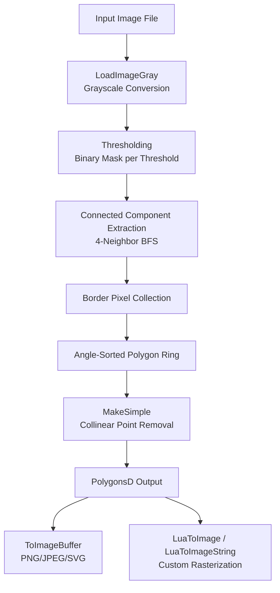
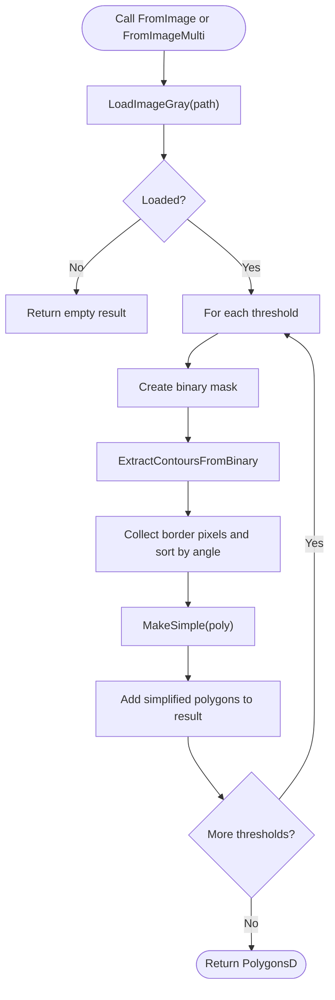
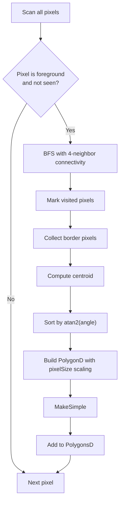
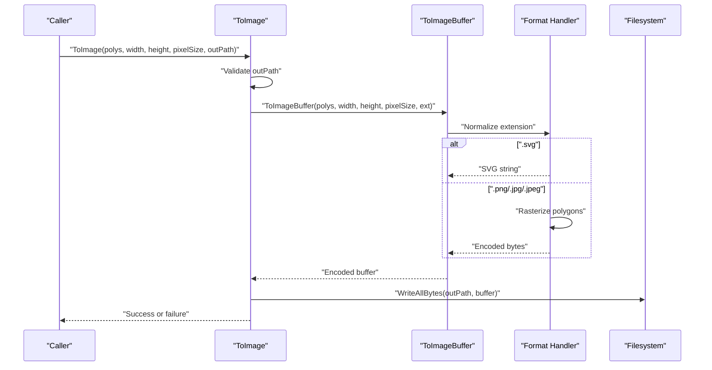
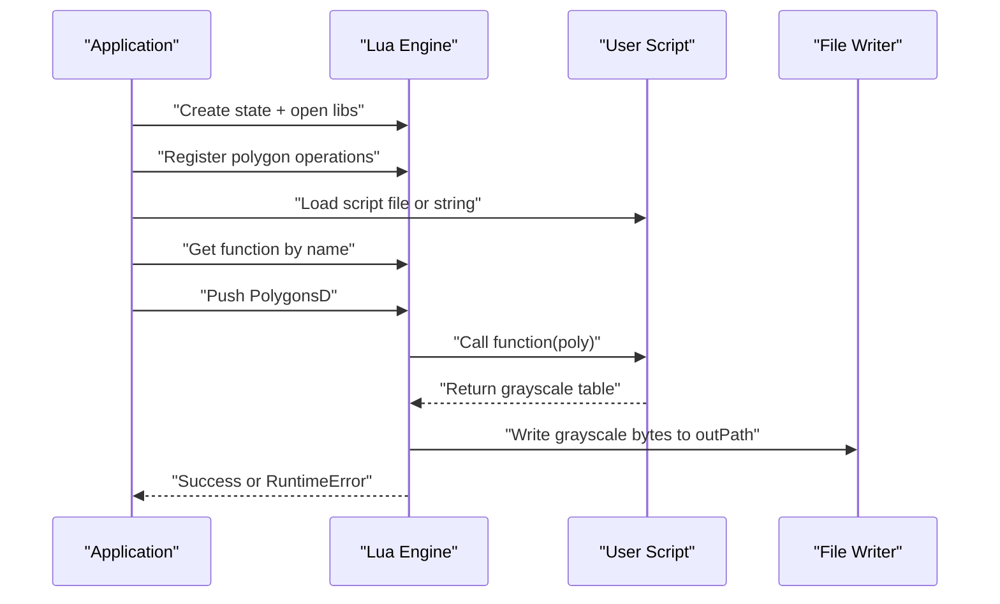
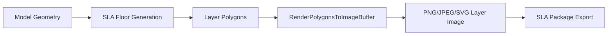
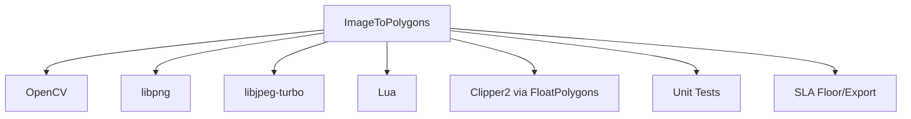

# Image to Polygons / 图像转多边形

<cite>
**Referenced Files in This Document**   
- [ImageToPolygons.hpp](file://2D/ImageToPolygons.hpp)
- [ImageToPolygons.cpp](file://2D/ImageToPolygons.cpp)
- [FloatPolygons.hpp](file://2D/FloatPolygons.hpp)
- [FloatPolygons.cpp](file://2D/FloatPolygons.cpp)
- [IntPolygon.hpp](file://2D/IntPolygon.hpp)
- [image_polygons_test.cpp](file://tests/PolygonFill/image_polygons_test.cpp)
- [sla_floor.cpp](file://LibHsBaSlicer/Floor/sla_floor.cpp)
- [pipeline_types.h](file://pipelinetypes/pipeline_types.h)
</cite>

## Table of Contents
1. [Introduction](#introduction)
2. [Project Structure](#project-structure)
3. [Core Components](#core-components)
4. [Architecture Overview](#architecture-overview)
5. [Detailed Component Analysis](#detailed-component-analysis)
6. [Dependency Analysis](#dependency-analysis)
7. [Performance Considerations](#performance-considerations)
8. [Troubleshooting Guide](#troubleshooting-guide)
9. [Conclusion](#conclusion)
10. [Appendices](#appendices)

## Introduction
The ImageToPolygons module converts raster images into vector polygon representations and also supports the reverse operation: rendering polygons back into raster or vector image formats. It is designed for use cases such as generating printable layer images, exporting SLA/SLS layers, and producing SVG previews.

Key capabilities include:
- Loading an image and converting it to grayscale.
- Thresholding a grayscale image into binary masks.
- Extracting connected components and tracing their borders.
- Converting border pixels into double-precision polygon rings.
- Simplifying polygons by removing collinear points.
- Rendering polygons to PNG, JPEG, or SVG.
- Customizing image generation through Lua scripts.

This document explains the processing pipeline, supported formats, color space handling, preprocessing behavior, parameter controls, examples, and performance guidance.

## Project Structure
The ImageToPolygons functionality lives under the 2D geometry subsystem and integrates with the broader HsBaSlicer pipeline via the SLA floor/export path.

**Diagram sources**
- [ImageToPolygons.cpp:37-76](file://2D/ImageToPolygons.cpp#L37-L76)
- [ImageToPolygons.cpp:98-200](file://2D/ImageToPolygons.cpp#L98-L200)
- [FloatPolygons.cpp:25-32](file://2D/FloatPolygons.cpp#L25-L32)
- [ImageToPolygons.cpp:427-497](file://2D/ImageToPolygons.cpp#L427-L497)
- [ImageToPolygons.cpp:545-681](file://2D/ImageToPolygons.cpp#L545-L681)

**Section sources**
- [ImageToPolygons.hpp:23-99](file://2D/ImageToPolygons.hpp#L23-L99)
- [ImageToPolygons.cpp:37-200](file://2D/ImageToPolygons.cpp#L37-L200)

## Core Components
The public API surface is defined in the header and implemented in the source file. The main operations are:

| Function | Purpose | Key Parameters | Return Type |
|---|---|---|---|
| `FromImage` | Convert one image to polygons using a single threshold | `path`, `threshold`, `pixelSize` | `PolygonsD` |
| `FromImageMulti` | Convert one image to multiple polygon sets using several thresholds | `path`, `thresholds`, `pixelSize` | `std::vector<PolygonsD>` |
| `ToImage` | Render polygons to an image file | `polys`, `width`, `height`, `pixelSize`, `outPath`, `foreground`, `background` | `bool` |
| `ToImageBuffer` | Render polygons to an in-memory buffer (PNG/JPEG/SVG) | `polys`, `width`, `height`, `pixelSize`, `ext`, `outBuffer`, `foreground`, `background` | `bool` |
| `LuaToImage` | Render polygons using a Lua script file | `poly`, `scriptPath`, `outPath`, `functionName`, `lua_reg` | `bool` |
| `LuaToImageString` | Render polygons using inline Lua code | `poly`, `script`, `outPath`, `functionName`, `lua_reg` | `bool` |

Data types used:
- `Point2D`: Double-precision 2D point.
- `PolygonD`: Double-precision polygon ring.
- `PolygonsD`: Collection of double-precision polygons.

These types are aliases over Clipper2 types and provide boolean operations, area calculation, and simplification helpers.

**Section sources**
- [ImageToPolygons.hpp:18-99](file://2D/ImageToPolygons.hpp#L18-L99)
- [FloatPolygons.hpp:18-41](file://2D/FloatPolygons.hpp#L18-L41)

## Architecture Overview
The module has two major directions:

1. **Raster-to-vector**: Load image → grayscale → threshold → extract contours → build polygon rings → simplify.
2. **Vector-to-raster/vector**: Compute bounds → rasterize or generate SVG → encode PNG/JPEG or write SVG string.

**Diagram sources**
- [ImageToPolygons.cpp:416-424](file://2D/ImageToPolygons.cpp#L416-L424)
- [ImageToPolygons.cpp:516-543](file://2D/ImageToPolygons.cpp#L516-L543)
- [ImageToPolygons.cpp:98-200](file://2D/ImageToPolygons.cpp#L98-L200)
- [FloatPolygons.cpp:25-32](file://2D/FloatPolygons.cpp#L25-L32)

**Section sources**
- [ImageToPolygons.cpp:416-543](file://2D/ImageToPolygons.cpp#L416-L543)

## Detailed Component Analysis

### Image Loading and Color Space Handling
`LoadImageGray` reads an image using OpenCV when available and converts multi-channel images to grayscale. If the image is already single-channel, it is used directly. The function returns width, height, and a flat grayscale buffer.

Important behaviors:
- Uses `cv::imread` with unchanged flags.
- Converts BGR to grayscale when needed.
- Returns false on load failure or exception.
- Without OpenCV, grayscale loading is not supported.

Supported input formats depend on OpenCV’s decoder support. Typical formats include PNG, JPEG, BMP, TIFF, and others recognized by OpenCV.

**Section sources**
- [ImageToPolygons.cpp:37-76](file://2D/ImageToPolygons.cpp#L37-L76)

### Thresholding and Binary Masks
Each threshold produces a binary mask where pixels greater than the threshold become foreground and others become background. This is a simple global threshold; adaptive or Otsu-style methods are not applied automatically.

Parameters:
- `threshold`: Grayscale cutoff value.
- `MAX_GRAY_VALUE`: Maximum grayscale value used for foreground.
- `MIN_GRAY_VALUE`: Minimum grayscale value used for background.

Use `FromImageMulti` to generate multiple layers from different thresholds, which is useful for separating light and dark regions.

**Section sources**
- [ImageToPolygons.cpp:516-543](file://2D/ImageToPolygons.cpp#L516-L543)
- [ImageToPolygons.hpp:18-20](file://2D/ImageToPolygons.hpp#L18-L20)

### Contour Extraction and Border Tracing
`ExtractContoursFromBinary` performs connected component analysis using a 4-neighbor breadth-first search. For each component:
- Border pixels are identified by checking neighbors.
- Border pixels are sorted by angle around the component centroid.
- Sorted border pixels form a polygon ring.
- The ring is converted to double-precision coordinates scaled by `pixelSize`.
- The polygon is simplified using `MakeSimple`.

Complexity considerations:
- Connected component traversal is proportional to the number of pixels in the image.
- Border sorting uses angular ordering around the centroid.
- Simplification removes collinear points.

**Diagram sources**
- [ImageToPolygons.cpp:98-200](file://2D/ImageToPolygons.cpp#L98-L200)
- [FloatPolygons.cpp:25-32](file://2D/FloatPolygons.cpp#L25-L32)

**Section sources**
- [ImageToPolygons.cpp:98-200](file://2D/ImageToPolygons.cpp#L98-L200)

### Polygon Simplification
`MakeSimple` delegates to Clipper2’s path simplification, which removes collinear points within a tolerance. In ImageToPolygons, the default epsilon is used, so the simplification is primarily about cleaning up pixel-derived corners rather than aggressive Douglas–Peucker style reduction.

Tuning:
- Increase epsilon to remove more small features.
- Decrease epsilon to preserve fine details.

Note: The current call site does not expose a custom epsilon parameter, so simplification strength is controlled indirectly by adjusting input resolution and thresholds.

**Section sources**
- [FloatPolygons.hpp:27-41](file://2D/FloatPolygons.hpp#L27-L41)
- [FloatPolygons.cpp:25-32](file://2D/FloatPolygons.cpp#L25-L32)
- [ImageToPolygons.cpp:191-195](file://2D/ImageToPolygons.cpp#L191-L195)

### Rendering Polygons Back to Images
`ToImageBuffer` supports three output formats:
- `.svg`: Generates an SVG document string with a background rectangle and polygon elements.
- `.png` or `.jpg`/`.jpeg`: Rasterizes polygons into a grayscale bitmap and encodes it.

When OpenCV is available:
- Polygons are converted to pixel coordinates relative to the bounding box minimum.
- `cv::fillPoly` fills the polygons.
- `cv::imencode` encodes the result.

Without OpenCV:
- A manual rasterizer checks each pixel against each polygon using a ray-casting point-in-polygon test.
- PNG encoding uses libpng.
- JPEG encoding uses libjpeg-turbo.

`ToImage` derives the format from the output file extension and writes the encoded buffer to disk.

**Diagram sources**
- [ImageToPolygons.cpp:499-514](file://2D/ImageToPolygons.cpp#L499-L514)
- [ImageToPolygons.cpp:427-497](file://2D/ImageToPolygons.cpp#L427-L497)
- [ImageToPolygons.cpp:316-359](file://2D/ImageToPolygons.cpp#L316-L359)
- [ImageToPolygons.cpp:361-392](file://2D/ImageToPolygons.cpp#L361-L392)

**Section sources**
- [ImageToPolygons.cpp:291-392](file://2D/ImageToPolygons.cpp#L291-L392)
- [ImageToPolygons.cpp:427-514](file://2D/ImageToPolygons.cpp#L427-L514)

### Lua-Driven Image Generation
`LuaToImage` and `LuaToImageString` allow users to define custom rasterization logic in Lua. They:
- Create a Lua state.
- Open standard libraries.
- Register polygon operations.
- Optionally invoke a registration callback.
- Load a script file or inline script.
- Call a named function with the polygon set.
- Expect a table of grayscale values.
- Write the resulting grayscale bytes to the output path.

Error handling:
- Invalid script loading or execution raises `RuntimeError`.
- Missing function name raises `RuntimeError`.
- Non-table return value raises `RuntimeError`.
- Non-integer table element raises `RuntimeError`.
- Empty output path returns false without throwing.

**Diagram sources**
- [ImageToPolygons.cpp:545-610](file://2D/ImageToPolygons.cpp#L545-L610)
- [ImageToPolygons.cpp:612-681](file://2D/ImageToPolygons.cpp#L612-L681)

**Section sources**
- [ImageToPolygons.cpp:545-681](file://2D/ImageToPolygons.cpp#L545-L681)

### Integration with SLA Pipeline
The SLA floor/export path includes image rendering and package export. It uses `ImageToPolygons` for rendering polygons to images during layer export. The SLA pipeline configuration includes image width and height fields that control output dimensions.

**Diagram sources**
- [sla_floor.cpp:19-27](file://LibHsBaSlicer/Floor/sla_floor.cpp#L19-L27)
- [sla_floor.cpp:372-381](file://LibHsBaSlicer/Floor/sla_floor.cpp#L372-L381)
- [pipeline_types.h:215-218](file://pipelinetypes/pipeline_types.h#L215-L218)

**Section sources**
- [sla_floor.cpp:19-27](file://LibHsBaSlicer/Floor/sla_floor.cpp#L19-L27)
- [sla_floor.cpp:372-381](file://LibHsBaSlicer/Floor/sla_floor.cpp#L372-L381)
- [pipeline_types.h:215-218](file://pipelinetypes/pipeline_types.h#L215-L218)

## Dependency Analysis
The ImageToPolygons module depends on:
- OpenCV for image IO and optional rasterization.
- libpng for PNG encoding when OpenCV is unavailable.
- libjpeg-turbo for JPEG encoding.
- Lua for scripting-driven image generation.
- Clipper2 via FloatPolygons for polygon simplification and geometric operations.

**Diagram sources**
- [ImageToPolygons.cpp:18-29](file://2D/ImageToPolygons.cpp#L18-L29)
- [FloatPolygons.cpp:1-21](file://2D/FloatPolygons.cpp#L1-L21)
- [image_polygons_test.cpp:1-10](file://tests/PolygonFill/image_polygons_test.cpp#L1-L10)
- [sla_floor.cpp:19-27](file://LibHsBaSlicer/Floor/sla_floor.cpp#L19-L27)

**Section sources**
- [ImageToPolygons.cpp:18-29](file://2D/ImageToPolygons.cpp#L18-L29)
- [FloatPolygons.hpp:9-13](file://2D/FloatPolygons.hpp#L9-L13)

## Performance Considerations
- **Image size**: Large images increase memory usage and processing time for grayscale conversion, thresholding, and connected component extraction.
- **Threshold count**: Each additional threshold repeats the full contour extraction pipeline.
- **Polygon complexity**: Many small components produce many small polygons; simplification reduces vertex count but does not eliminate topological complexity.
- **Rasterization cost**: Manual point-in-polygon rasterization is O(width × height × num_polygons). With OpenCV, `cv::fillPoly` is generally faster.
- **Memory layout**: Flat grayscale buffers avoid per-row allocations but still allocate W×H bytes.
- **Parallelism**: The SLA export path runs per-layer work across a thread pool, but ImageToPolygons itself is not internally parallelized.

Optimization recommendations:
- Downscale large images before conversion if high resolution is unnecessary.
- Use fewer thresholds unless multilayer separation is required.
- Choose appropriate `pixelSize` to balance precision and polygon complexity.
- Prefer OpenCV-enabled builds for faster rasterization and broader format support.
- Avoid extremely dense images with noisy textures; preprocess with denoising or smoothing outside this module if needed.

[No sources needed since this section provides general guidance]

## Troubleshooting Guide

Common issues and resolutions:

| Symptom | Likely Cause | Resolution |
|---|---|---|
| `FromImage` returns empty result | Input file missing, unreadable, or unsupported | Verify path and format; ensure OpenCV is available |
| No polygons detected | Threshold too high or too low | Adjust threshold or use `FromImageMulti` |
| Polygons look jagged or have extra vertices | Pixel grid artifacts | Increase `pixelSize` or adjust simplification parameters if exposed |
| `ToImage` fails with non-positive dimensions | Width or height ≤ 0 | Provide positive width and height |
| `ToImage` fails with empty polygon set | No bounds found | Ensure at least one valid polygon |
| `ToImage` fails writing SVG | Output directory unwritable | Check filesystem permissions |
| Lua script errors | Invalid Lua syntax, missing function, wrong return type | Validate script and function name; ensure grayscale table is returned |
| JPEG/PNG encoding fails | Encoder initialization or compression error | Check library availability and image dimensions |

Validation references:
- Missing input returns empty results instead of throwing.
- Non-positive dimensions and empty polygon sets cause `ToImage` to fail.
- Lua functions must return a table of integers clamped to the grayscale range.

**Section sources**
- [image_polygons_test.cpp:170-190](file://tests/PolygonFill/image_polygons_test.cpp#L170-L190)
- [image_polygons_test.cpp:232-264](file://tests/PolygonFill/image_polygons_test.cpp#L232-L264)
- [ImageToPolygons.cpp:545-681](file://2D/ImageToPolygons.cpp#L545-L681)

## Conclusion
The ImageToPolygons module provides a practical pipeline for converting raster images into vector polygons and vice versa. Its core strengths are straightforward threshold-based segmentation, robust contour extraction, and flexible output options including PNG, JPEG, SVG, and Lua-driven customization. For production use, tune thresholds and `pixelSize` to match the target application, prefer OpenCV-enabled builds for performance, and consider pre-processing noisy or complex images to improve polygon quality.

[No sources needed since this section summarizes without analyzing specific files]

## Appendices

### Supported Image Formats
- Input formats depend on OpenCV’s decoder support.
- Output formats:
  - PNG
  - JPEG/JPG
  - SVG

**Section sources**
- [ImageToPolygons.cpp:18-29](file://2D/ImageToPolygons.cpp#L18-L29)
- [ImageToPolygons.cpp:427-497](file://2D/ImageToPolygons.cpp#L427-L497)

### Parameter Controls Summary
| Parameter | Effect | Guidance |
|---|---|---|
| `threshold` | Controls binarization cutoff | Lower thresholds include darker regions; higher thresholds isolate brighter regions |
| `pixelSize` | Scales pixel coordinates to output units | Larger values reduce polygon density; smaller values increase precision |
| `width`, `height` | Output image dimensions | Must be positive; auto-fitting may be handled by higher-level callers |
| `foreground`, `background` | Raster fill colors | Default white foreground and black background |
| `ext` | Output format selector | `.png`, `.jpg`/`.jpeg`, `.svg`; case-insensitive, leading dot optional |
| `functionName` | Lua function to call | Must exist in the loaded script |
| `lua_reg` | Optional Lua registration callback | Useful for exposing custom functions to Lua |

**Section sources**
- [ImageToPolygons.hpp:23-99](file://2D/ImageToPolygons.hpp#L23-L99)
- [ImageToPolygons.cpp:427-514](file://2D/ImageToPolygons.cpp#L427-L514)
- [ImageToPolygons.cpp:545-681](file://2D/ImageToPolygons.cpp#L545-L681)

### Examples

#### Logo Conversion
- Use a high-contrast logo.
- Apply a single threshold that isolates the logo shape.
- Set `pixelSize` to match the desired print scale.
- Export to SVG for scalable printing.

#### Text Conversion
- Use bold text or increase font contrast.
- Apply a threshold that separates strokes from background.
- Consider increasing `pixelSize` to reduce stroke fragmentation.
- Export to SVG for crisp vector text.

#### Complex Graphics
- Use `FromImageMulti` with multiple thresholds to separate light and dark layers.
- Combine or filter resulting polygon sets as needed.
- Simplify polygons by adjusting input resolution or downstream processing.
- Export layers individually for layered printing workflows.

**Section sources**
- [image_polygons_test.cpp:24-79](file://tests/PolygonFill/image_polygons_test.cpp#L24-L79)
- [image_polygons_test.cpp:82-103](file://tests/PolygonFill/image_polygons_test.cpp#L82-L103)

### Optimizing Input Images
- Increase contrast between foreground and background.
- Remove noise using external preprocessing if necessary.
- Resize images to a reasonable resolution before conversion.
- Use monochrome or grayscale inputs for predictable thresholding.
- Avoid anti-aliased edges when exact vector boundaries are required.

[No sources needed since this section provides general guidance]