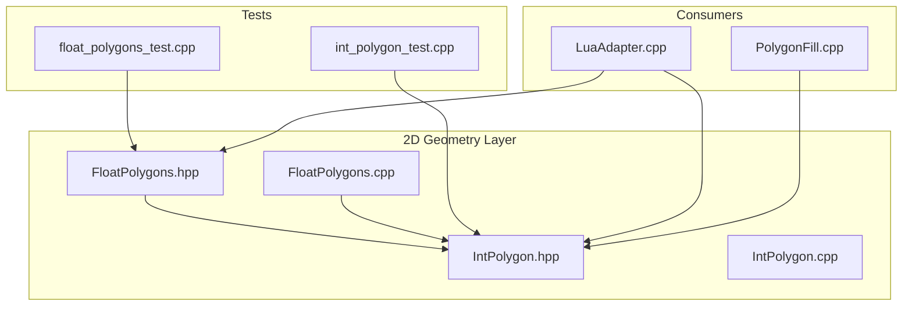
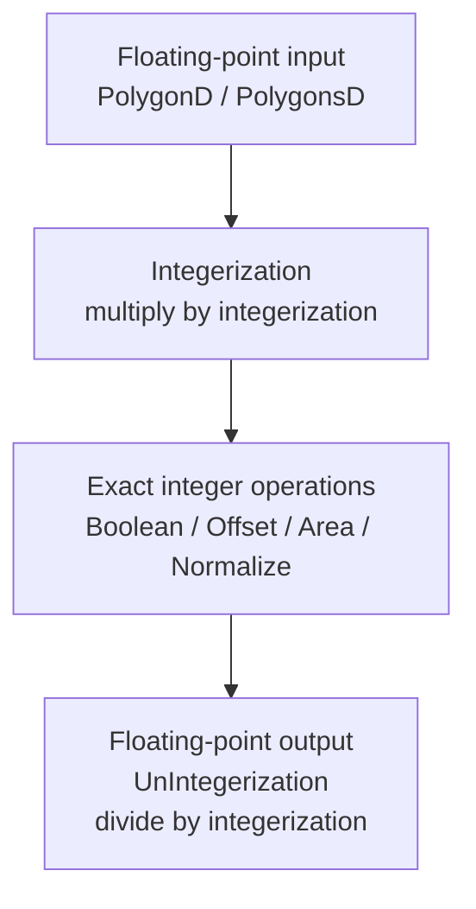
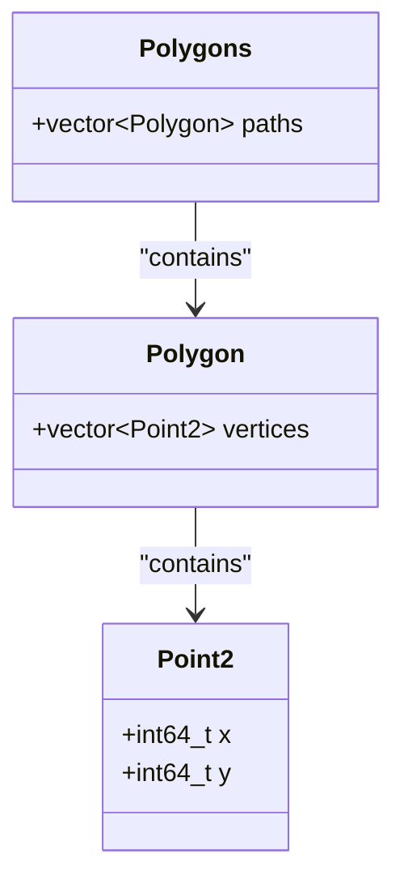
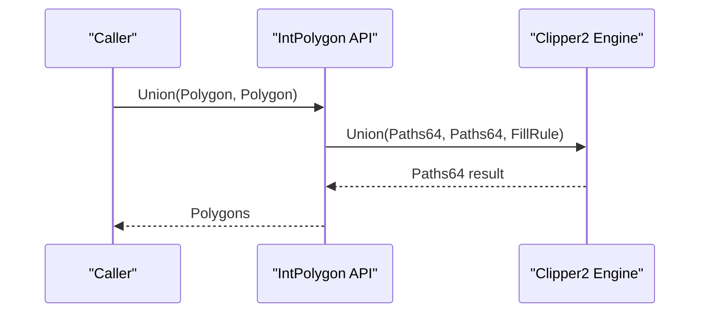
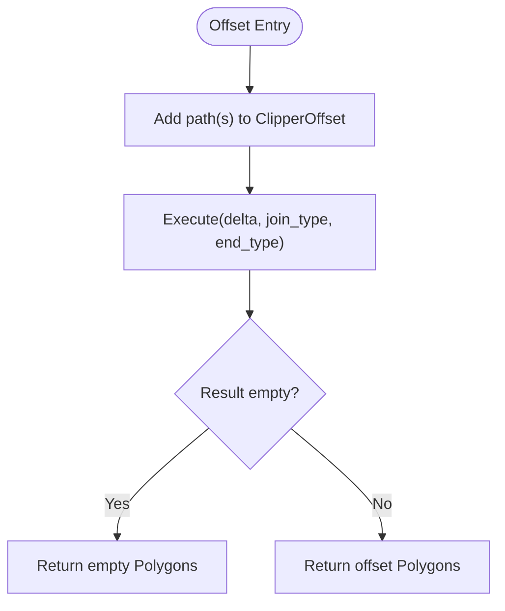
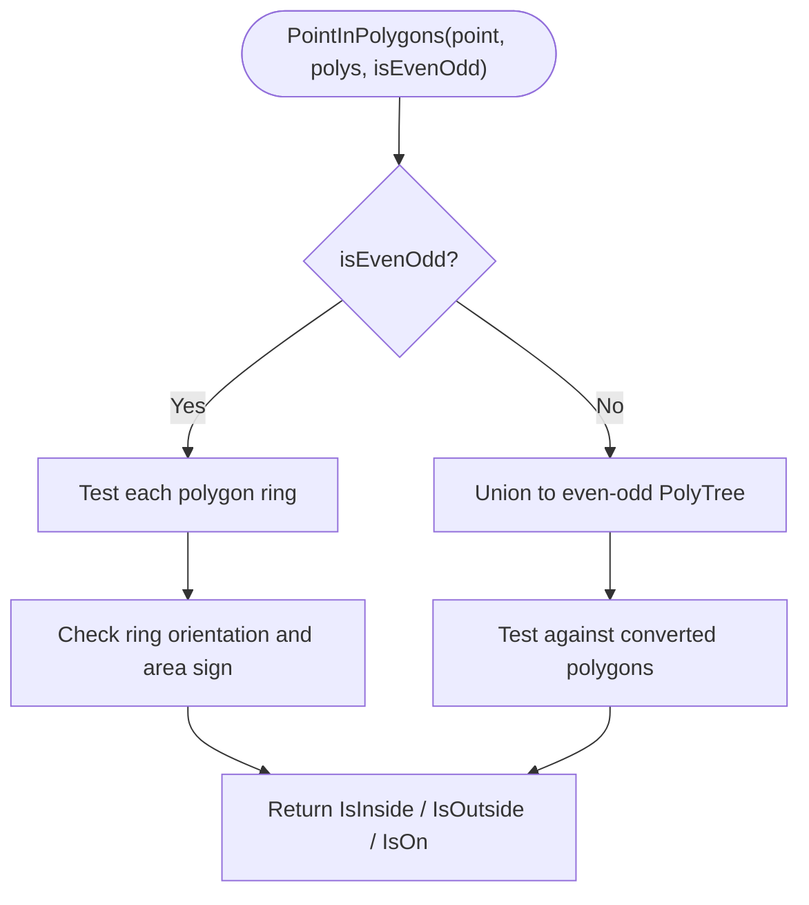
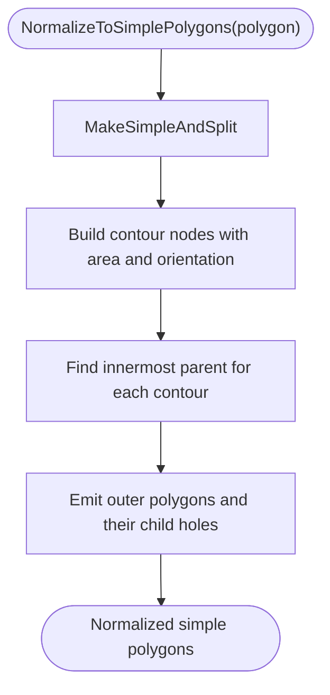
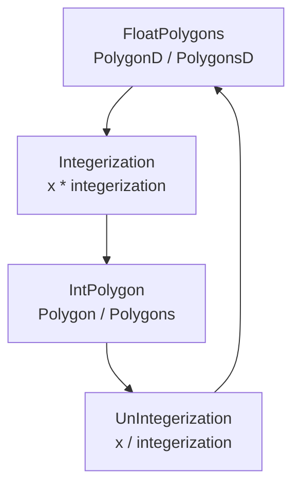
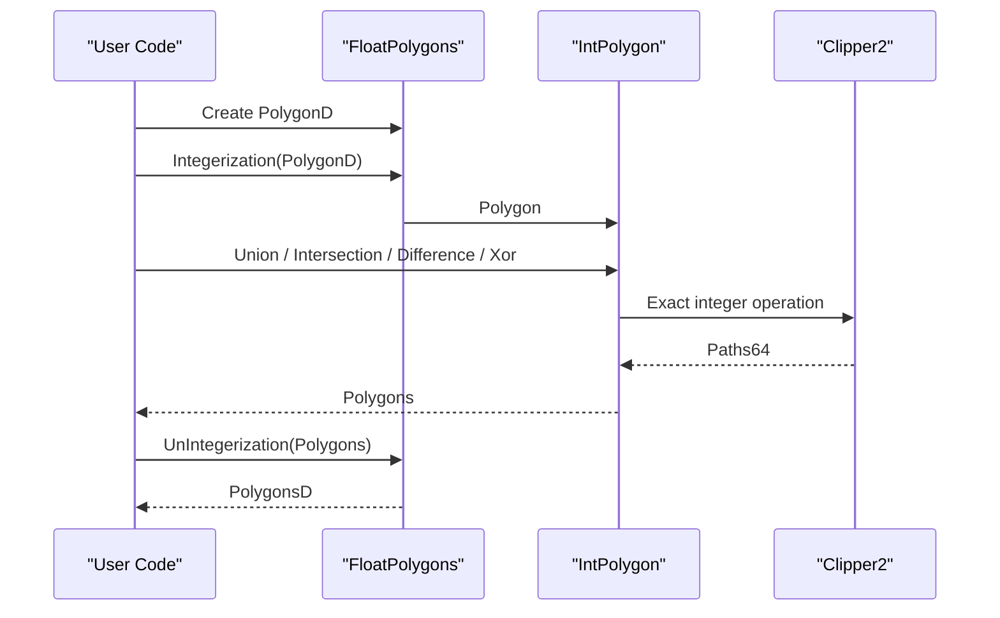
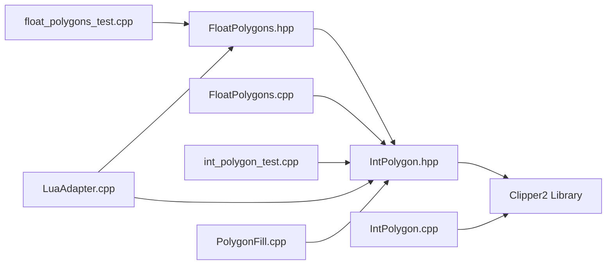

# Integer Polygons / 整数多边形

<cite>
**Referenced Files in This Document**   
- [IntPolygon.hpp](file://2D/IntPolygon.hpp)
- [IntPolygon.cpp](file://2D/IntPolygon.cpp)
- [FloatPolygons.hpp](file://2D/FloatPolygons.hpp)
- [FloatPolygons.cpp](file://2D/FloatPolygons.cpp)
- [int_polygon_test.cpp](file://tests/IntPolygon/int_polygon_test.cpp)
- [float_polygons_test.cpp](file://tests/PolygonFill/float_polygons_test.cpp)
- [LuaAdapter.cpp](file://2D/LuaAdapter.cpp)
- [PolygonFill.cpp](file://2D/PolygonFill.cpp)
</cite>

## Table of Contents
1. [Introduction](#introduction)
2. [Project Structure](#project-structure)
3. [Core Components](#core-components)
4. [Architecture Overview](#architecture-overview)
5. [Detailed Component Analysis](#detailed-component-analysis)
6. [Dependency Analysis](#dependency-analysis)
7. [Performance Considerations](#performance-considerations)
8. [Troubleshooting Guide](#troubleshooting-guide)
9. [Conclusion](#conclusion)
10. [Appendices](#appendices)

## Introduction
This document explains the IntPolygon module that provides high-performance, exact integer-coordinate polygon operations for HsBaSlicer. The module is built on Clipper2 and exposes:
- `Point2`, `Polygon`, and `Polygons` as 64-bit integer types.
- Boolean operations: union, intersection, difference, and XOR.
- Offset (inflate/deflate), area calculation, point-in-polygon testing, simplification, splitting, and normalization.
- Conversion between floating-point polygons (`FloatPolygons`) and integer polygons through a fixed scaling factor called `integerization`.

The key design idea is to perform computationally sensitive geometry in exact integer arithmetic while keeping floating-point APIs for input/output, model generation, and user-facing workflows.

## Project Structure
The relevant code lives under the 2D geometry layer:
- `2D/IntPolygon.hpp` and `2D/IntPolygon.cpp` define the integer polygon API and its Clipper2-backed implementation.
- `2D/FloatPolygons.hpp` and `2D/FloatPolygons.cpp` define double-precision polygon types, shape generators, text-to-polygons, and conversion functions.
- Tests validate boolean operations, offset behavior, point-in-polygon rules, hashing, and integerization round-trips.
- Consumers such as Lua adapters and polygon fill logic use both integer and floating-point representations.

**Diagram sources**
- [IntPolygon.hpp:1-241](file://2D/IntPolygon.hpp#L1-L241)
- [IntPolygon.cpp:1-469](file://2D/IntPolygon.cpp#L1-L469)
- [FloatPolygons.hpp:1-271](file://2D/FloatPolygons.hpp#L1-L271)
- [FloatPolygons.cpp:1-453](file://2D/FloatPolygons.cpp#L1-L453)
- [int_polygon_test.cpp:1-190](file://tests/IntPolygon/int_polygon_test.cpp#L1-L190)
- [float_polygons_test.cpp:168-187](file://tests/PolygonFill/float_polygons_test.cpp#L168-L187)
- [LuaAdapter.cpp:365-367](file://2D/LuaAdapter.cpp#L365-L367)
- [LuaAdapter.cpp:456-457](file://2D/LuaAdapter.cpp#L456-L457)
- [PolygonFill.cpp:584-586](file://2D/PolygonFill.cpp#L584-L586)
- [PolygonFill.cpp:649-652](file://2D/PolygonFill.cpp#L649-L652)

**Section sources**
- [IntPolygon.hpp:1-241](file://2D/IntPolygon.hpp#L1-L241)
- [FloatPolygons.hpp:1-271](file://2D/FloatPolygons.hpp#L1-L271)

## Core Components
The IntPolygon module defines three core types and a set of geometric operations:
- `Point2`: a 2D point with 64-bit integer coordinates.
- `Polygon`: a path made of `Point2` points.
- `Polygons`: a collection of `Polygon`s.

It also defines:
- A precision scale constant `integerization = 1e6`.
- Boolean operations for single polygons and sets of polygons.
- Offset operations for expansion or contraction.
- Area computation for single polygons and polygon sets.
- Point-in-polygon testing with even-odd and non-zero winding support.
- Simplification, splitting, and normalization utilities.
- Hash specializations for `Polygon` and `Polygons`.

These types are aliases over Clipper2’s 64-bit types, so all heavy geometry work happens in exact integer space.

**Section sources**
- [IntPolygon.hpp:16-26](file://2D/IntPolygon.hpp#L16-L26)
- [IntPolygon.hpp:28-192](file://2D/IntPolygon.hpp#L28-L192)
- [IntPolygon.hpp:214-240](file://2D/IntPolygon.hpp#L214-L240)

## Architecture Overview
The architecture separates floating-point input/output from exact integer processing:

**Diagram sources**
- [FloatPolygons.cpp:184-221](file://2D/FloatPolygons.cpp#L184-L221)
- [IntPolygon.cpp:19-127](file://2D/IntPolygon.cpp#L19-L127)

### Data Flow Summary
1. Floating-point polygons are created by shape generators, image loaders, CAD exporters, or user scripts.
2. They are converted to integer polygons using `Integerization`, which multiplies coordinates by `integerization`.
3. Exact boolean operations, offsets, area calculations, and normalization run on integer data.
4. Results can be converted back to floating-point via `UnIntegerization` for visualization, export, or further floating-point processing.

**Section sources**
- [FloatPolygons.cpp:184-221](file://2D/FloatPolygons.cpp#L184-L221)
- [IntPolygon.cpp:19-127](file://2D/IntPolygon.cpp#L19-L127)

## Detailed Component Analysis

### Type Model: Point2, Polygon, Polygons
The integer types are thin aliases over Clipper2’s 64-bit types:
- `Point2` corresponds to `Clipper2Lib::Point64`.
- `Polygon` corresponds to `Clipper2Lib::Path64`.
- `Polygons` corresponds to `Clipper2Lib::Paths64`.

This means memory layout and iteration semantics follow standard C++ vector-like containers, while arithmetic stays in 64-bit integers.

**Diagram sources**
- [IntPolygon.hpp:19-26](file://2D/IntPolygon.hpp#L19-L26)

**Section sources**
- [IntPolygon.hpp:19-26](file://2D/IntPolygon.hpp#L19-L26)

### Boolean Operations
The module exposes:
- `Union(left, right)`
- `Intersection(left, right)`
- `Difference(left, right)`
- `Xor(left, right)`

Each function has overloads for:
- Two single polygons.
- Two polygon sets.

Internally, these call Clipper2’s boolean engine with 64-bit integer paths.

**Diagram sources**
- [IntPolygon.cpp:28-47](file://2D/IntPolygon.cpp#L28-L47)

**Section sources**
- [IntPolygon.hpp:68-146](file://2D/IntPolygon.hpp#L68-L146)
- [IntPolygon.cpp:28-60](file://2D/IntPolygon.cpp#L28-L60)

### Offset Operations
Offset operations inflate or deflate polygons:
- Positive delta expands the polygon.
- Negative delta contracts the polygon.
- Join type controls corner handling.
- End type controls open-path behavior.

**Diagram sources**
- [IntPolygon.cpp:62-77](file://2D/IntPolygon.cpp#L62-L77)

**Section sources**
- [IntPolygon.hpp:148-168](file://2D/IntPolygon.hpp#L148-L168)
- [IntPolygon.cpp:62-77](file://2D/IntPolygon.cpp#L62-L77)

### Area Computation
Area functions return signed area values:
- Positive area indicates clockwise orientation.
- Negative area indicates counter-clockwise orientation.
- For polygon sets, area sums signed areas across all paths.

This sign convention is used internally for orientation normalization and hole detection.

**Section sources**
- [IntPolygon.hpp:180-192](file://2D/IntPolygon.hpp#L180-L192)
- [IntPolygon.cpp:120-127](file://2D/IntPolygon.cpp#L120-L127)

### Point-in-Polygon Testing
`PointInPolygons` supports:
- Even-odd rule.
- Non-zero winding rule.
- Hole-aware results when the winding rule is not even-odd.

When the winding rule is not even-odd, the implementation converts the polygon set into an even-odd representation before testing.

**Diagram sources**
- [IntPolygon.cpp:79-118](file://2D/IntPolygon.cpp#L79-L118)

**Section sources**
- [IntPolygon.hpp:170-178](file://2D/IntPolygon.hpp#L170-L178)
- [IntPolygon.cpp:79-118](file://2D/IntPolygon.cpp#L79-L118)

### Simplification, Splitting, and Normalization
The module provides:
- `MakeSimple`: removes collinear points.
- `MakeSimpleAndSplit`: splits self-intersecting polygons into simple regions.
- `NormalizeToSimplePolygons`: normalizes orientation, builds parent-child nesting, and returns simple polygons with holes represented as separate rings.

**Diagram sources**
- [IntPolygon.cpp:278-290](file://2D/IntPolygon.cpp#L278-L290)
- [IntPolygon.cpp:353-446](file://2D/IntPolygon.cpp#L353-L446)

**Section sources**
- [IntPolygon.hpp:28-66](file://2D/IntPolygon.hpp#L28-L66)
- [IntPolygon.cpp:19-26](file://2D/IntPolygon.cpp#L19-L26)
- [IntPolygon.cpp:278-290](file://2D/IntPolygon.cpp#L278-L290)
- [IntPolygon.cpp:353-446](file://2D/IntPolygon.cpp#L353-L446)

### Hash Specializations
Hash implementations allow `Polygon` and `Polygons` to be used as keys in hash-based containers. The hash combines coordinates sequentially.

**Section sources**
- [IntPolygon.hpp:214-240](file://2D/IntPolygon.hpp#L214-L240)
- [IntPolygon.cpp:449-469](file://2D/IntPolygon.cpp#L449-L469)

### Floating-Point Polygon Types and Conversion
`FloatPolygons` defines:
- `Point2D`, `PolygonD`, `PolygonsD`.
- Shape generators: rectangle, circle, ellipse, regular polygon.
- Text-to-polygons using FreeType when available.
- Conversion functions: `Integerization` and `UnIntegerization`.

Conversion uses the same `integerization` constant:
- `Integerization` multiplies double coordinates by `integerization`.
- `UnIntegerization` divides integer coordinates by `integerization`.

**Diagram sources**
- [FloatPolygons.hpp:18-25](file://2D/FloatPolygons.hpp#L18-L25)
- [FloatPolygons.hpp:195-221](file://2D/FloatPolygons.hpp#L195-L221)
- [FloatPolygons.cpp:184-221](file://2D/FloatPolygons.cpp#L184-L221)

**Section sources**
- [FloatPolygons.hpp:18-25](file://2D/FloatPolygons.hpp#L18-L25)
- [FloatPolygons.hpp:137-221](file://2D/FloatPolygons.hpp#L137-L221)
- [FloatPolygons.cpp:184-221](file://2D/FloatPolygons.cpp#L184-L221)

### Typical Workflows

#### From Floating-Point Input to Integer Processing
1. Create or load floating-point polygons.
2. Call `Integerization` to convert to integer coordinates.
3. Perform boolean operations, offsets, area checks, or normalization.
4. Optionally convert results back to floating-point.

**Diagram sources**
- [FloatPolygons.cpp:184-221](file://2D/FloatPolygons.cpp#L184-L221)
- [IntPolygon.cpp:28-60](file://2D/IntPolygon.cpp#L28-L60)

#### From Image or Text to Integer Polygons
- Image-to-polygons and text-to-polygons produce floating-point outlines.
- These are typically integerized before being passed to boolean or offset operations.

**Section sources**
- [FloatPolygons.hpp:180-191](file://2D/FloatPolygons.hpp#L180-L191)
- [FloatPolygons.cpp:364-429](file://2D/FloatPolygons.cpp#L364-L429)

## Dependency Analysis
The dependency relationships show how integer and floating-point modules interact with consumers and tests.

**Diagram sources**
- [IntPolygon.hpp:9-12](file://2D/IntPolygon.hpp#L9-L12)
- [IntPolygon.cpp:5-15](file://2D/IntPolygon.cpp#L5-L15)
- [FloatPolygons.hpp:9-13](file://2D/FloatPolygons.hpp#L9-L13)
- [FloatPolygons.cpp:5-15](file://2D/FloatPolygons.cpp#L5-L15)
- [int_polygon_test.cpp:6-6](file://tests/IntPolygon/int_polygon_test.cpp#L6-L6)
- [float_polygons_test.cpp:168-187](file://tests/PolygonFill/float_polygons_test.cpp#L168-L187)
- [LuaAdapter.cpp:365-367](file://2D/LuaAdapter.cpp#L365-L367)
- [LuaAdapter.cpp:456-457](file://2D/LuaAdapter.cpp#L456-L457)
- [PolygonFill.cpp:584-586](file://2D/PolygonFill.cpp#L584-L586)
- [PolygonFill.cpp:649-652](file://2D/PolygonFill.cpp#L649-L652)

**Section sources**
- [IntPolygon.hpp:9-12](file://2D/IntPolygon.hpp#L9-L12)
- [FloatPolygons.hpp:9-13](file://2D/FloatPolygons.hpp#L9-L13)

## Performance Considerations

### Advantages of Integer Arithmetic
- **Exact boolean operations**: Clipper2’s integer engine avoids floating-point rounding errors during edge intersections and topology construction.
- **Stable offsets**: Integer arithmetic reduces numerical drift when inflating or deflating complex shapes.
- **Deterministic area computation**: Signed area is computed exactly for integer coordinates.
- **Large coordinate support**: Using 64-bit integers allows larger coordinate ranges without overflow, provided intermediate computations remain within safe bounds.

### Precision and Scaling
- The scaling factor `integerization = 1e6` gives six decimal places of precision when converting from double to integer.
- Coordinates are multiplied by this factor during integerization and divided during un-integerization.
- This is suitable for most slicing and 2D geometry tasks where sub-millimeter precision is needed.

### Memory Usage Patterns
- `Polygon` stores a sequence of `Point2` objects.
- `Polygons` stores a sequence of `Polygon` objects.
- Each `Point2` contains two 64-bit integers.
- Memory usage grows linearly with the number of vertices and polygons.
- Avoid unnecessary copies by passing references and reusing `Polygons` containers when possible.

### Best Practices for Large Coordinate Values
- Keep coordinates within a range that avoids 64-bit overflow during boolean operations.
- Prefer working in a normalized coordinate system when possible.
- Use `MakeSimple` to reduce vertex count before expensive operations.
- Use `NormalizeToSimplePolygons` to obtain well-formed simple polygons with predictable orientation.
- When exporting or visualizing, convert back to floating-point only at the final step.

[No sources needed since this section provides general guidance]

## Troubleshooting Guide

### Common Issues

#### Unexpected Boolean Operation Results
- Verify that input polygons are closed and have reasonable orientation.
- Use `MakeSimple` to remove collinear points.
- Use `NormalizeToSimplePolygons` to split self-intersecting polygons.

#### Point-in-Polygon Returns Outside for Holes
- The implementation treats nested rings with opposite orientation as holes.
- Ensure outer rings have positive area and hole rings have negative area when constructing manual polygons.

#### Precision Loss After Round-Trip Conversion
- Remember that `Integerization` rounds to the nearest integer after multiplying by `integerization`.
- If sub-micrometer precision matters, consider whether the application needs more precision or should avoid repeated conversions.

#### Offset Produces Degenerate or Empty Results
- Very small deltas relative to polygon size may produce no valid offset.
- Large deltas may cause overlapping or self-intersecting results; simplify or normalize afterward.

**Section sources**
- [IntPolygon.cpp:79-118](file://2D/IntPolygon.cpp#L79-L118)
- [IntPolygon.cpp:278-290](file://2D/IntPolygon.cpp#L278-L290)
- [IntPolygon.cpp:353-446](file://2D/IntPolygon.cpp#L353-L446)
- [int_polygon_test.cpp:87-123](file://tests/IntPolygon/int_polygon_test.cpp#L87-L123)

## Conclusion
The IntPolygon module provides a robust foundation for exact 2D polygon geometry in HsBaSlicer. By combining Clipper2’s integer engine with a clear separation between floating-point I/O and integer processing, it delivers reliable boolean operations, offsets, area calculations, and normalization. The conversion functions make it easy to integrate with existing floating-point pipelines while preserving computational stability.

For best results:
- Use floating-point types for input and output.
- Use integer types for geometry processing.
- Keep coordinate scales reasonable.
- Simplify and normalize before expensive operations.
- Validate results with area checks and point-in-polygon tests.

[No sources needed since this section summarizes without analyzing specific files]

## Appendices

### API Reference Summary

#### Integer Polygon Types
- `Point2`: 64-bit integer point.
- `Polygon`: 64-bit integer path.
- `Polygons`: collection of 64-bit integer paths.

#### Integer Polygon Operations
- `MakeSimple`
- `MakeSimpleAndSplit`
- `NormalizeToSimplePolygons`
- `Union`
- `Intersection`
- `Difference`
- `Xor`
- `Offset`
- `PointInPolygons`
- `Area`

#### Floating-Point Polygon Types
- `Point2D`: double-precision point.
- `PolygonD`: double-precision path.
- `PolygonsD`: collection of double-precision paths.

#### Floating-Point Polygon Operations
- `MakeSimple`
- `Union`
- `Intersection`
- `Difference`
- `Xor`
- `Area`
- `MakeRectangle`
- `MakeCircle`
- `MakeEllipse`
- `MakeRegularPolygon`
- `TextToPolygons`
- `Integerization`
- `UnIntegerization`

**Section sources**
- [IntPolygon.hpp:16-192](file://2D/IntPolygon.hpp#L16-L192)
- [FloatPolygons.hpp:18-221](file://2D/FloatPolygons.hpp#L18-L221)