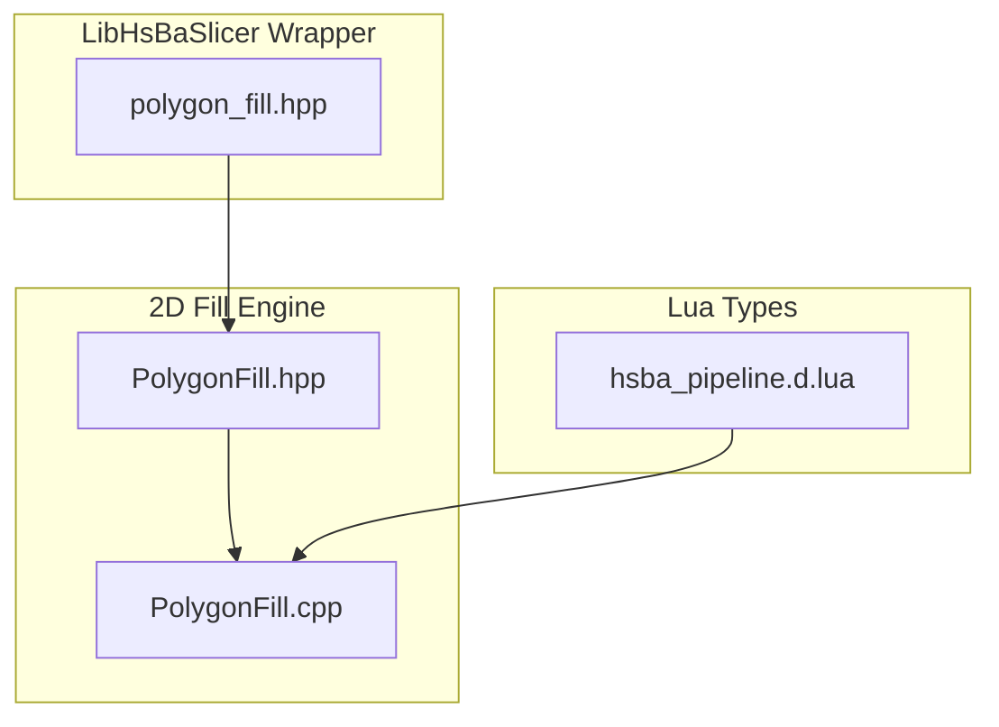
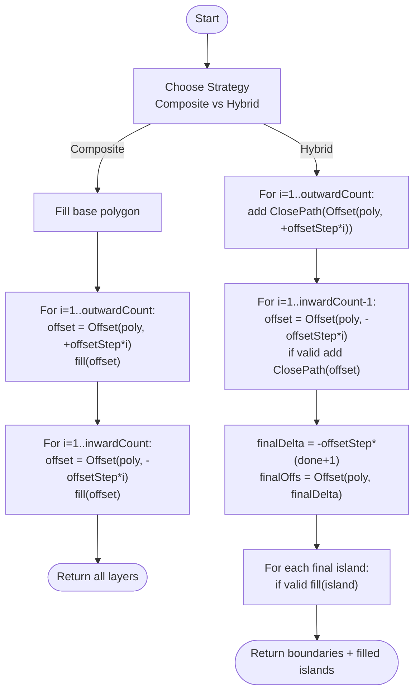
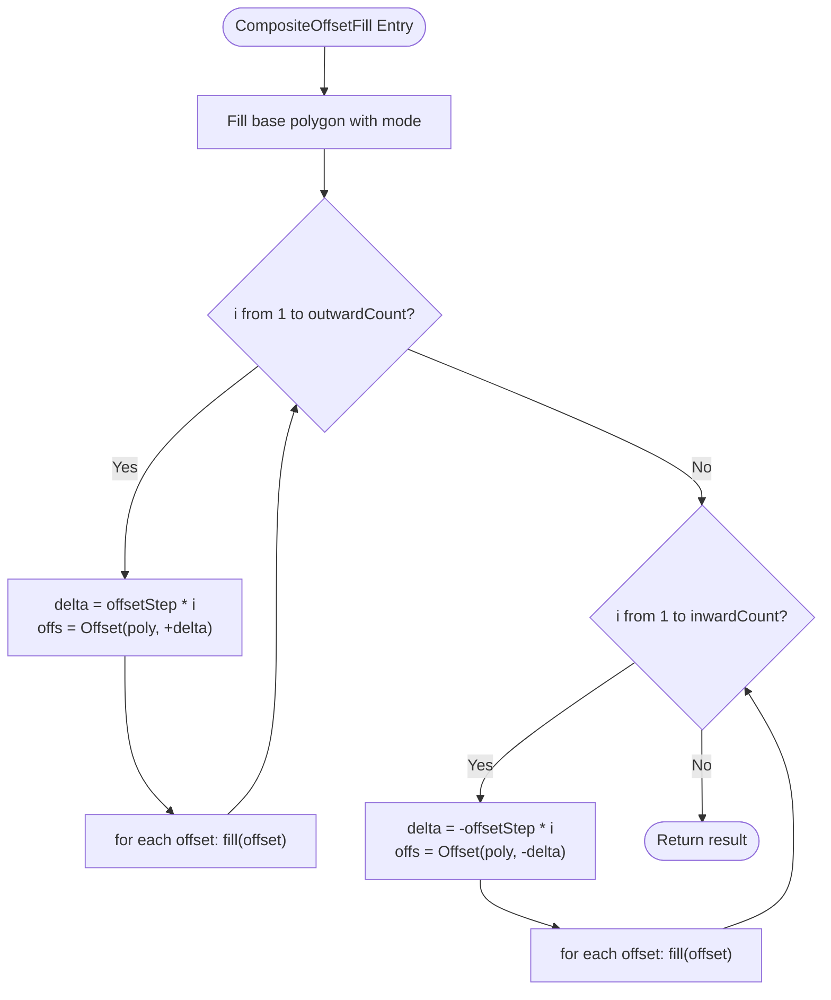
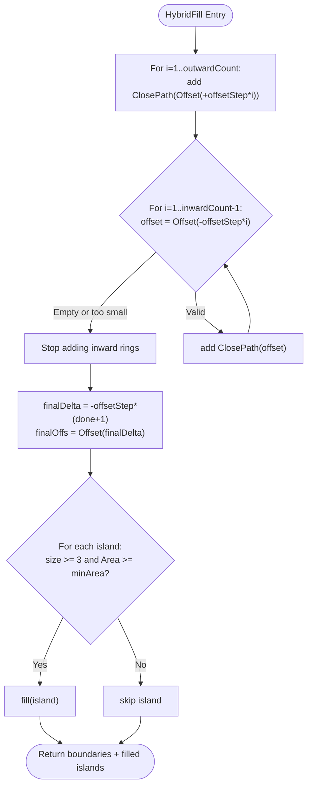
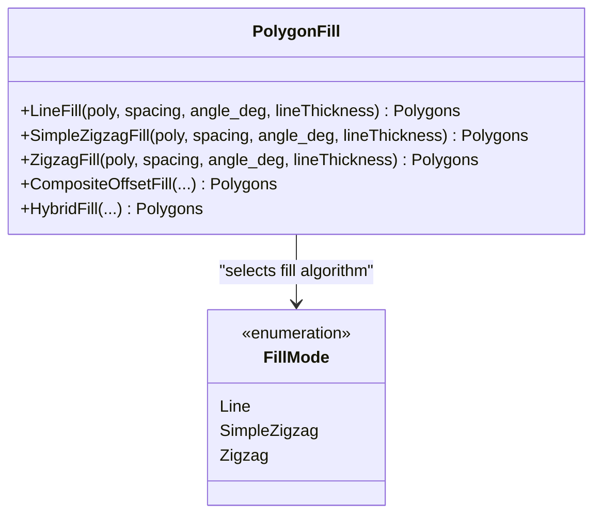
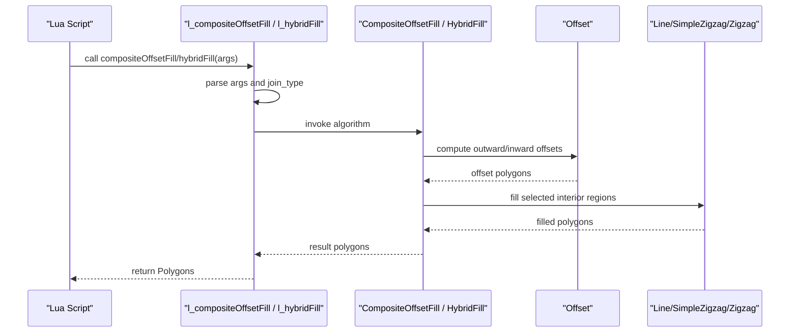
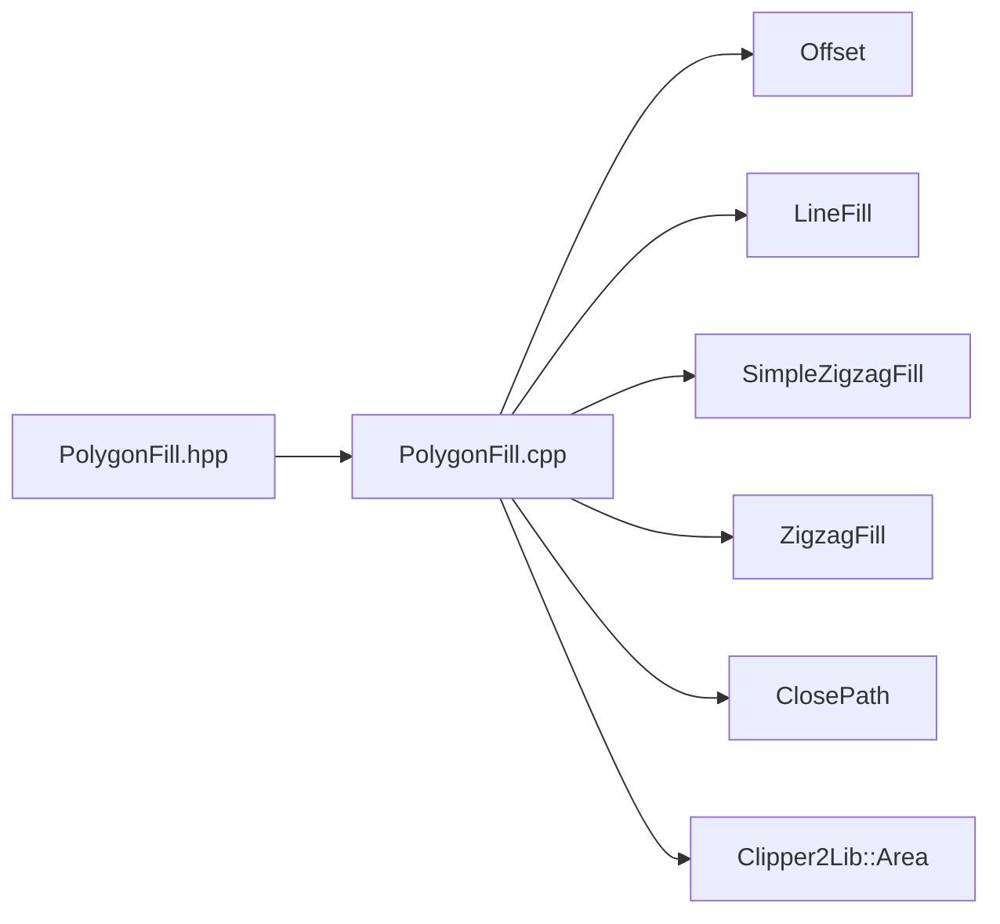

# Composite & Hybrid Fills / 复合与混合填充

<cite>
**Referenced Files in This Document**
- [PolygonFill.hpp](file://2D/PolygonFill.hpp)
- [PolygonFill.cpp](file://2D/PolygonFill.cpp)
- [polygon_fill.hpp](file://LibHsBaSlicer/Fill/polygon_fill.hpp)
- [hsba_pipeline.d.lua](file://types/hsba_pipeline.d.lua)
</cite>

## Table of Contents
1. [Introduction](#introduction)
2. [Project Structure](#project-structure)
3. [Core Components](#core-components)
4. [Architecture Overview](#architecture-overview)
5. [Detailed Component Analysis](#detailed-component-analysis)
6. [Dependency Analysis](#dependency-analysis)
7. [Performance Considerations](#performance-considerations)
8. [Troubleshooting Guide](#troubleshooting-guide)
9. [Conclusion](#conclusion)
10. [Appendices](#appendices)

## Introduction
This document explains the CompositeOffsetFill and HybridFill algorithms that combine offset operations with internal fill patterns. It focuses on:
- The multi-layer approach controlled by outwardCount and inwardCount.
- The role of offsetStep in separating layers.
- How FillMode options Line, SimpleZigzag, and Zigzag are applied to interior regions.
- The hybrid strategy of applying offsets first and then filling only the last offset polygons.
- The composite strategy of combining border offsets with internal fills.
- Configuration examples and guidance for selecting strategies based on part requirements.

These algorithms live in the 2D polygon fill engine and are exposed through a C++ API and Lua bindings.

## Project Structure
The relevant code is organized as follows:
- Public API declarations for polygon fill modes and composite/hybrid functions are in the 2D header.
- Implementations of CompositeOffsetFill and HybridFill are in the 2D source file.
- A LibHsBaSlicer wrapper exposes a simplified FillPolygon API and a border-aware FillWithBorder API.
- Lua type definitions declare the function signatures used by scripts.

**Diagram sources**
- [PolygonFill.hpp:63-102](file://2D/PolygonFill.hpp#L63-L102)
- [PolygonFill.cpp:319-431](file://2D/PolygonFill.cpp#L319-L431)
- [polygon_fill.hpp:17-37](file://LibHsBaSlicer/Fill/polygon_fill.hpp#L17-L37)
- [hsba_pipeline.d.lua:59-60](file://types/hsba_pipeline.d.lua#L59-L60)

**Section sources**
- [PolygonFill.hpp:63-102](file://2D/PolygonFill.hpp#L63-L102)
- [PolygonFill.cpp:319-431](file://2D/PolygonFill.cpp#L319-L431)
- [polygon_fill.hpp:17-37](file://LibHsBaSlicer/Fill/polygon_fill.hpp#L17-L37)
- [hsba_pipeline.d.lua:59-60](file://types/hsba_pipeline.d.lua#L59-L60)

## Core Components
- FillMode enumeration defines three interior fill patterns:
  - Line: parallel line fill.
  - SimpleZigzag: simple zigzag fill.
  - Zigzag: advanced zigzag fill.
- CompositeOffsetFill generates a multi-layer composite pattern:
  - Base polygon filled using the selected FillMode.
  - Outward offset layers filled independently.
  - Inward offset layers filled independently.
- HybridFill applies offsets first and then fills only the final inward offset region:
  - Adds closed boundary rings for each outward offset layer.
  - Adds closed boundary rings for intermediate inward offset layers until area or vertex count becomes too small.
  - Fills the last valid inward offset island using the selected FillMode.

Key parameters:
- spacing: distance between internal fill lines.
- offsetStep: separation between successive offset layers.
- outwardCount: number of outward offset layers.
- inwardCount: number of inward offset layers.
- mode: FillMode applied to interior regions.
- angle_deg: orientation of fill lines.
- lineThickness: thickness of fill lines; also used as a minimum area threshold in HybridFill.
- join_type: corner join style for offset operations.

**Section sources**
- [PolygonFill.hpp:63-102](file://2D/PolygonFill.hpp#L63-L102)
- [PolygonFill.cpp:1372-1491](file://2D/PolygonFill.cpp#L1372-L1491)

## Architecture Overview
CompositeOffsetFill and HybridFill share common building blocks:
- Offset: computes outward/inward polygon offsets with a given join type.
- FillMode dispatch: selects LineFill, SimpleZigzagFill, or ZigzagFill for interior regions.
- Layer iteration: loops over outwardCount and inwardCount to generate multiple layers.

**Diagram sources**
- [PolygonFill.cpp:1372-1491](file://2D/PolygonFill.cpp#L1372-L1491)

## Detailed Component Analysis

### CompositeOffsetFill
CompositeOffsetFill builds a multi-layer structure by filling every offset ring:
- Base layer: the original polygon is filled using the selected FillMode.
- Outward layers: for each i from 1 to outwardCount, compute an outward offset at delta = offsetStep * i and fill it.
- Inward layers: for each i from 1 to inwardCount, compute an inward offset at delta = -offsetStep * i and fill it.

Behavioral notes:
- Every layer is filled independently, producing concentric fill rings around the original shape.
- Larger outwardCount increases outer structural density; larger inwardCount increases inner structural density.
- offsetStep controls the spacing between adjacent layers; smaller values produce denser concentric structures.

**Diagram sources**
- [PolygonFill.cpp:1372-1428](file://2D/PolygonFill.cpp#L1372-L1428)

**Section sources**
- [PolygonFill.cpp:1372-1428](file://2D/PolygonFill.cpp#L1372-L1428)

### HybridFill
HybridFill uses a two-phase strategy:
- Phase 1: Add closed boundary rings for outward offsets and for intermediate inward offsets until they become too small.
- Phase 2: Compute the final inward offset and fill only those islands that meet validity checks (vertex count and area).

Validity checks:
- Minimum vertex count: fewer than 3 vertices means the polygon cannot form a valid area.
- Minimum area threshold: computed from lineThickness squared; very small areas are skipped to avoid noise.

Result composition:
- Boundary rings: each outward and intermediate inward offset is added as a closed path without internal fill.
- Final fill: only the last inward offset islands are filled using the selected FillMode.

**Diagram sources**
- [PolygonFill.cpp:1430-1491](file://2D/PolygonFill.cpp#L1430-L1491)

**Section sources**
- [PolygonFill.cpp:1430-1491](file://2D/PolygonFill.cpp#L1430-L1491)

### FillMode Options
FillMode determines how interior regions are filled:
- Line: parallel line fill.
- SimpleZigzag: simple zigzag fill.
- Zigzag: advanced zigzag fill.

Dispatch logic:
- Both CompositeOffsetFill and HybridFill select the appropriate fill function based on mode.
- Default behavior in CompositeOffsetFill falls back to Zigzag when mode is not explicitly set.

**Diagram sources**
- [PolygonFill.hpp:63-68](file://2D/PolygonFill.hpp#L63-L68)
- [PolygonFill.cpp:1376-1387](file://2D/PolygonFill.cpp#L1376-L1387)
- [PolygonFill.cpp:1468-1479](file://2D/PolygonFill.cpp#L1468-L1479)

**Section sources**
- [PolygonFill.hpp:63-68](file://2D/PolygonFill.hpp#L63-L68)
- [PolygonFill.cpp:1376-1387](file://2D/PolygonFill.cpp#L1376-L1387)
- [PolygonFill.cpp:1468-1479](file://2D/PolygonFill.cpp#L1468-L1479)

### Lua Bindings and Type Definitions
Both algorithms are exposed to Lua:
- l_compositeOffsetFill parses arguments and calls CompositeOffsetFill.
- l_hybridFill parses arguments and calls HybridFill.
- hsba_pipeline.d.lua declares the function signatures for script authors.

Common Lua parameters:
- polys: input polygons.
- spacing: internal fill spacing.
- offsetStep: layer separation.
- outwardCount: number of outward layers.
- inwardCount: number of inward layers.
- mode: string "Line", "SimpleZigzag", or "Zigzag".
- angle_deg: fill angle in degrees.
- lineThickness: fill line thickness.
- opts.join_type: optional string "Square", "Bevel", "Round", or "Miter".

**Diagram sources**
- [PolygonFill.cpp:319-374](file://2D/PolygonFill.cpp#L319-L374)
- [PolygonFill.cpp:377-431](file://2D/PolygonFill.cpp#L377-L431)
- [hsba_pipeline.d.lua:59-60](file://types/hsba_pipeline.d.lua#L59-L60)

**Section sources**
- [PolygonFill.cpp:319-431](file://2D/PolygonFill.cpp#L319-L431)
- [hsba_pipeline.d.lua:59-60](file://types/hsba_pipeline.d.lua#L59-L60)

## Dependency Analysis
CompositeOffsetFill and HybridFill depend on:
- Offset: geometry offset computation with join types.
- FillMode dispatch: selection among LineFill, SimpleZigzagFill, ZigzagFill.
- Polygon utilities: ClosePath and area/vertex checks in HybridFill.

**Diagram sources**
- [PolygonFill.cpp:1372-1491](file://2D/PolygonFill.cpp#L1372-L1491)

**Section sources**
- [PolygonFill.cpp:1372-1491](file://2D/PolygonFill.cpp#L1372-L1491)

## Performance Considerations
- Layer count scaling:
  - Increasing outwardCount and inwardCount linearly increases the number of offset computations and fill operations.
  - For large models, prefer moderate counts to avoid excessive processing time.
- offsetStep tuning:
  - Smaller offsetStep yields denser layers but more computational work.
  - Larger offsetStep reduces layer density and may skip thin regions.
- lineThickness impact:
  - In HybridFill, lineThickness influences the minimum area threshold; thicker lines raise the threshold and skip tiny islands.
- Join type effects:
  - Different join types affect corner geometry complexity; Square is default and generally efficient.

[No sources needed since this section provides general guidance]

## Troubleshooting Guide
Common issues and remedies:
- No output from HybridFill:
  - Check if inward offsets collapse to invalid polygons (fewer than 3 vertices) or fall below the minimum area threshold derived from lineThickness.
  - Increase offsetStep or reduce inwardCount to keep islands valid.
- Excessive memory usage:
  - Reduce outwardCount and inwardCount.
  - Use larger offsetStep to decrease layer density.
- Unexpected corner artifacts:
  - Adjust join_type to Bevel, Round, or Miter depending on desired corner behavior.
- Incorrect fill pattern:
  - Verify FillMode selection ("Line", "SimpleZigzag", "Zigzag").
  - Confirm angle_deg and spacing values match expectations.

**Section sources**
- [PolygonFill.cpp:1444-1489](file://2D/PolygonFill.cpp#L1444-L1489)

## Conclusion
CompositeOffsetFill and HybridFill provide complementary strategies for combining offset-based borders with internal fills:
- Use CompositeOffsetFill when you need fully filled concentric layers both outward and inward.
- Use HybridFill when you want boundary rings plus a single filled core region defined by the final inward offset.
Select parameters thoughtfully:
- outwardCount and inwardCount control structural density.
- offsetStep controls layer separation.
- FillMode controls interior fill aesthetics and mechanical properties.
- lineThickness and join_type refine corner behavior and minimum feature size.

[No sources needed since this section summarizes without analyzing specific files]

## Appendices

### Configuration Examples
- Dense shell with sparse core:
  - outwardCount = 3, inwardCount = 1, offsetStep = 1.0 mm, mode = Zigzag.
  - Result: multiple filled outer shells and one filled inner core.
- Strong perimeter with minimal interior:
  - outwardCount = 2, inwardCount = 0, offsetStep = 1.5 mm, mode = Line.
  - Result: two filled outward rings around the base polygon.
- Hybrid boundary with filled center:
  - outwardCount = 2, inwardCount = 3, offsetStep = 1.0 mm, mode = SimpleZigzag.
  - Result: closed boundary rings for outward and intermediate inward offsets, plus a filled final inward island.

[No sources needed since this section provides conceptual configuration examples]

### Selection Guidance
- Structural strength:
  - Prefer Zigzag for higher interlocking strength.
  - Prefer Line for directional stiffness along fill direction.
- Surface quality:
  - SimpleZigzag can reduce toolpath complexity while maintaining reasonable coverage.
- Thin features:
  - Increase lineThickness to avoid tiny islands in HybridFill.
  - Reduce inwardCount to prevent collapsing offsets.

[No sources needed since this section provides general guidance]