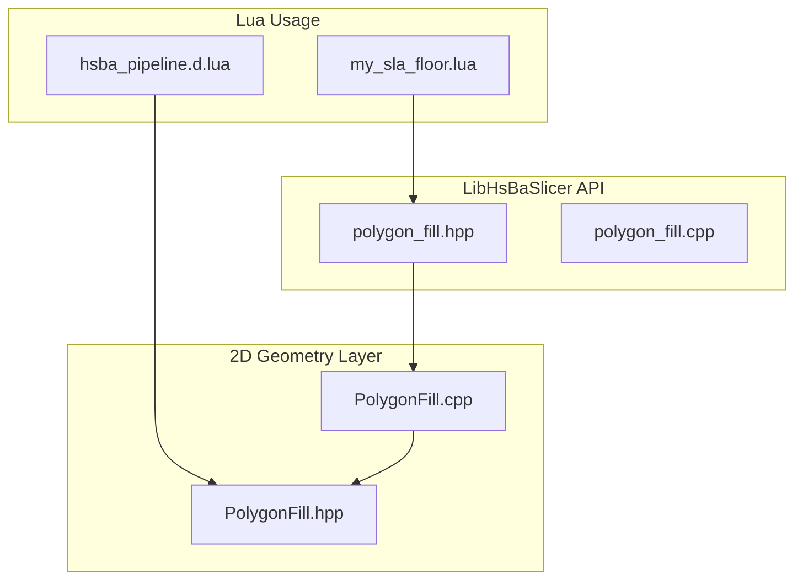
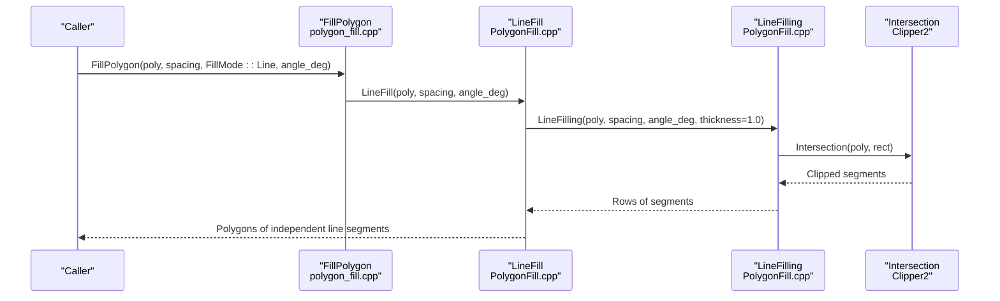
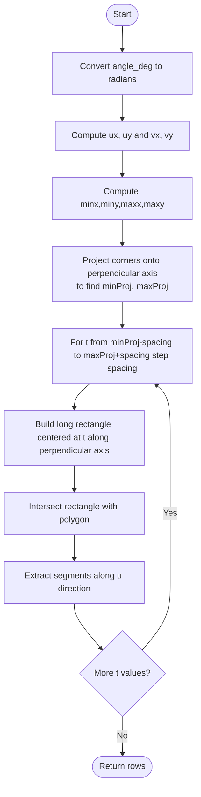
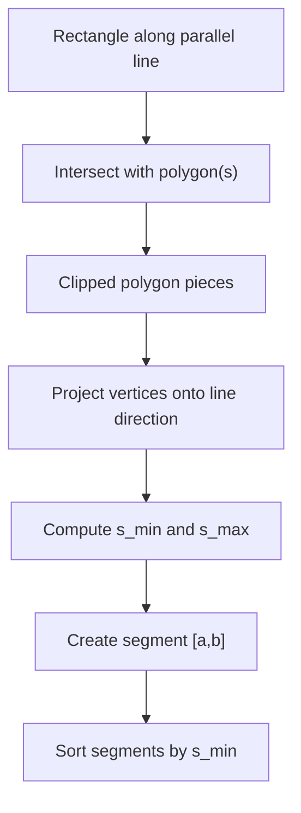
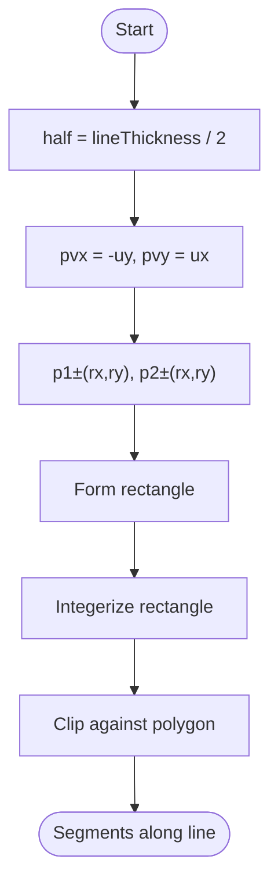
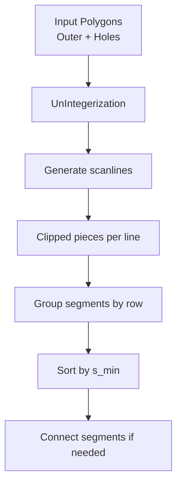
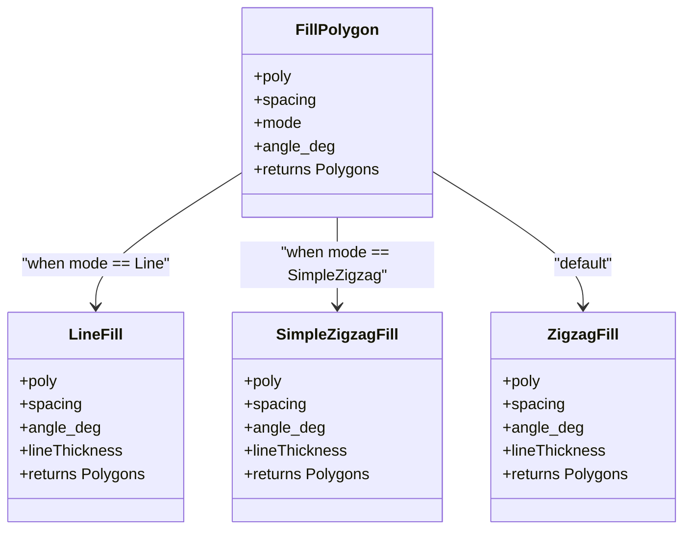
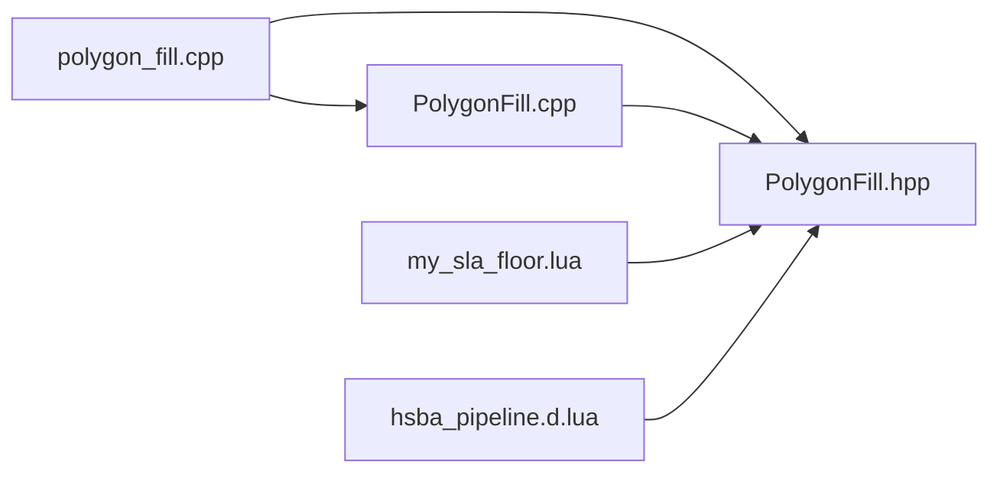

# Line Fill Algorithm / 直线填充算法

<cite>
**Referenced Files in This Document**   
- [PolygonFill.hpp](file://2D/PolygonFill.hpp)
- [PolygonFill.cpp](file://2D/PolygonFill.cpp)
- [polygon_fill.hpp](file://LibHsBaSlicer/Fill/polygon_fill.hpp)
- [polygon_fill.cpp](file://LibHsBaSlicer/Fill/polygon_fill.cpp)
- [my_sla_floor.lua](file://samples/SLA/scripts/my_sla_floor.lua)
- [hsba_pipeline.d.lua](file://types/hsba_pipeline.d.lua)
</cite>

## Table of Contents
1. [Introduction](#introduction)
2. [Project Structure](#project-structure)
3. [Core Components](#core-components)
4. [Architecture Overview](#architecture-overview)
5. [Detailed Component Analysis](#detailed-component-analysis)
6. [Dependency Analysis](#dependency-analysis)
7. [Performance Considerations](#performance-considerations)
8. [Troubleshooting Guide](#troubleshooting-guide)
9. [Conclusion](#conclusion)
10. [Appendices](#appendices)

## Introduction
This document explains the LineFill algorithm used by HsBaSlicer to generate parallel line patterns for polygon filling. It covers:
- How parallel lines are calculated at a specified angle in degrees.
- How intersections with polygon boundaries are detected.
- How line thickness is managed during scanline generation.
- How spacing controls the distance between adjacent parallel lines.
- How complex polygons and holes are handled.
- Practical examples for angles such as 0°, 45°, and 90°.
- Recommendations for optimal line orientation based on mechanical strength requirements.

The implementation lives in the 2D geometry layer and is exposed through both C++ APIs and Lua scripting.

## Project Structure
The LineFill functionality is implemented in the 2D polygon fill module and wrapped by the LibHsBaSlicer API. The relevant files are:
- `2D/PolygonFill.hpp` and `2D/PolygonFill.cpp`: core algorithms, including `LineFill`, `SimpleZigzagFill`, `ZigzagFill`, and shared helpers.
- `LibHsBaSlicer/Fill/polygon_fill.hpp` and `polygon_fill.cpp`: public C++ API that dispatches to the 2D engine.
- Sample Lua scripts and type definitions show how users call these functions from Lua.

**Diagram sources**
- [PolygonFill.hpp:30-38](file://2D/PolygonFill.hpp#L30-L38)
- [PolygonFill.cpp:44-160](file://2D/PolygonFill.cpp#L44-L160)
- [polygon_fill.hpp:17-25](file://LibHsBaSlicer/Fill/polygon_fill.hpp#L17-L25)
- [polygon_fill.cpp:13-25](file://LibHsBaSlicer/Fill/polygon_fill.cpp#L13-L25)
- [my_sla_floor.lua:54-58](file://samples/SLA/scripts/my_sla_floor.lua#L54-L58)
- [hsba_pipeline.d.lua:56-60](file://types/hsba_pipeline.d.lua#L56-L60)

**Section sources**
- [PolygonFill.hpp:30-38](file://2D/PolygonFill.hpp#L30-L38)
- [polygon_fill.hpp:17-25](file://LibHsBaSlicer/Fill/polygon_fill.hpp#L17-L25)

## Core Components
- `LineFill(poly, spacing, angle_deg, lineThickness = 0.5)` generates independent straight-line segments representing parallel fills across the input polygon(s).
- `SimpleZigzagFill` and `ZigzagFill` build connected zigzag paths using the same underlying scanline data produced by the shared helper.
- `CompositeOffsetFill` and `HybridFill` combine offset borders with internal fills using any supported fill mode, including Line.
- The LibHsBaSlicer API exposes `FillPolygon(mode, angle_deg)` and `FillWithBorder(border_count, mode, angle_deg)` to select fill modes and angles.

Key responsibilities:
- Geometric calculation of parallel lines at a given angle.
- Intersection detection via polygon clipping.
- Thickness management through rectangular scanlines.
- Handling multiple polygons and holes.

**Section sources**
- [PolygonFill.hpp:30-85](file://2D/PolygonFill.hpp#L30-L85)
- [polygon_fill.hpp:17-37](file://LibHsBaSlicer/Fill/polygon_fill.hpp#L17-L37)

## Architecture Overview
The LineFill pipeline consists of:
1. Input polygon set (outer boundary plus optional holes).
2. Shared scanline generator that computes rows of clipped segments along parallel lines.
3. Output formatters:
   - `LineFill` returns independent two-point polylines.
   - Zigzag variants connect segments into continuous paths.
4. Higher-level APIs that choose fill modes and compose border offsets.

**Diagram sources**
- [polygon_fill.cpp:13-25](file://LibHsBaSlicer/Fill/polygon_fill.cpp#L13-L25)
- [PolygonFill.cpp:544-564](file://2D/PolygonFill.cpp#L544-L564)
- [PolygonFill.cpp:44-160](file://2D/PolygonFill.cpp#L44-L160)

## Detailed Component Analysis

### Parallel Line Generation and Angle Calculation
The core geometric step converts the user-specified angle in degrees into unit vectors:
- `ux, uy` is the direction vector along the parallel lines.
- `vx, vy` is the perpendicular direction used to step between parallel lines.

The algorithm:
- Converts `angle_deg` to radians using a constant factor.
- Computes `ux = cos(angle)`, `uy = sin(angle)`.
- Derives `vx = -uy`, `vy = ux` to get the orthogonal direction.
- Projects bounding box corners onto the perpendicular axis to determine the range of parallel lines.
- Iterates from `minProj - spacing` to `maxProj + spacing` with step `spacing`.

**Diagram sources**
- [PolygonFill.cpp:70-110](file://2D/PolygonFill.cpp#L70-L110)

**Section sources**
- [PolygonFill.cpp:26-31](file://2D/PolygonFill.cpp#L26-L31)
- [PolygonFill.cpp:70-110](file://2D/PolygonFill.cpp#L70-L110)

### Intersection Detection with Polygon Boundaries
For each parallel line position:
- A long rectangle is constructed aligned with the line direction.
- The rectangle width equals the line thickness.
- The rectangle is intersected with the input polygon(s) using a polygon intersection operation.
- Each resulting clipped polygon is converted back to floating point coordinates.
- For each clipped polygon, the algorithm projects vertices onto the line direction to compute minimum and maximum extents along the line.
- These extrema define a segment `[a, b]` along the parallel line.
- Segments are sorted by their start coordinate along the line direction.

This approach robustly handles:
- Complex polygon shapes.
- Multiple disjoint regions.
- Holes inside the outer boundary.

**Diagram sources**
- [PolygonFill.cpp:103-158](file://2D/PolygonFill.cpp#L103-L158)

**Section sources**
- [PolygonFill.cpp:103-158](file://2D/PolygonFill.cpp#L103-L158)

### Line Thickness Management
Line thickness is applied by constructing a rectangle whose width equals the line thickness:
- The rectangle is centered on the parallel line.
- Its length is large enough to cover the projected polygon extent.
- The rectangle’s normal direction is perpendicular to the line direction.
- After intersection, the resulting segments represent the filled area at the requested thickness.

Important notes:
- In `LineFill`, the public function calls the shared helper with an internal thickness value of 1.0 to compute row segments; the final output is independent two-point segments rather than thickened rectangles.
- Zigzag variants pass the actual `lineThickness` to the helper to ensure connector bridges and boundary arcs respect the extrusion width.

**Diagram sources**
- [PolygonFill.cpp:97-110](file://2D/PolygonFill.cpp#L97-L110)

**Section sources**
- [PolygonFill.cpp:97-110](file://2D/PolygonFill.cpp#L97-L110)
- [PolygonFill.cpp:544-564](file://2D/PolygonFill.cpp#L544-L564)

### Handling Complex Polygons and Holes
The algorithm operates on a list of polygons where:
- There can be one outer polygon and multiple holes.
- The shared helper un-integerizes the input polygons before processing.
- Intersection results may produce multiple disconnected pieces per scanline.
- Segments are grouped per row and sorted by their projection along the line direction.

This design ensures:
- Holes are naturally excluded because they reduce the clipped area.
- Disconnected regions are represented as separate segments or polylines.
- Zigzag connectors only link segments within the same row or adjacent rows, avoiding unintended loops.

**Diagram sources**
- [PolygonFill.cpp:44-50](file://2D/PolygonFill.cpp#L44-L50)
- [PolygonFill.cpp:148-158](file://2D/PolygonFill.cpp#L148-L158)

**Section sources**
- [PolygonFill.cpp:44-50](file://2D/PolygonFill.cpp#L44-L50)
- [PolygonFill.cpp:148-158](file://2D/PolygonFill.cpp#L148-L158)

### Public API and Mode Selection
The LibHsBaSlicer API provides:
- `FillPolygon(poly, spacing, mode, angle_deg)`: selects fill mode and angle.
- `FillWithBorder(poly, spacing, border_count, fill_mode, angle_deg)`: composes border offsets with interior fill.

When `mode == FillMode::Line`, the API delegates directly to `LineFill`.

**Diagram sources**
- [polygon_fill.cpp:13-25](file://LibHsBaSlicer/Fill/polygon_fill.cpp#L13-L25)
- [PolygonFill.hpp:30-68](file://2D/PolygonFill.hpp#L30-L68)

**Section sources**
- [polygon_fill.cpp:13-25](file://LibHsBaSlicer/Fill/polygon_fill.cpp#L13-L25)
- [polygon_fill.hpp:17-37](file://LibHsBaSlicer/Fill/polygon_fill.hpp#L17-L37)

### Practical Examples: Angles and Effects
Examples demonstrate how different angles affect print quality and material usage:

- **0°**: Lines run horizontally.
  - Good for layers where horizontal strength is sufficient.
  - Often produces consistent surface texture.
  - Material usage depends on spacing and thickness.

- **45°**: Diagonal lines.
  - Can improve isotropic strength compared to 0° or 90°.
  - May increase path length slightly due to diagonal traversal.
  - Useful when balanced mechanical properties are desired.

- **90°**: Lines run vertically.
  - Aligns with vertical load directions.
  - May differ from 0° in surface appearance and support interaction.

These examples are illustrative; actual outcomes depend on polygon shape, spacing, thickness, and printer mechanics.

[No sources needed since this section provides conceptual guidance]

### Recommendations for Optimal Line Orientation
Recommendations are based on typical mechanical behavior and should be validated for specific materials and printers:

- **Primary load direction alignment**:
  - If loads are primarily horizontal, prefer 0°.
  - If loads are primarily vertical, prefer 90°.
  - For diagonal loads, consider 45° or -45°.

- **Isotropic strength**:
  - Use 45° or alternating 45°/-45° patterns to balance strength in multiple directions.

- **Surface quality and warping**:
  - 0° often yields smoother surfaces in FDM printing.
  - 45° can reduce visible layer lines but may increase stair-stepping artifacts.

- **Material usage**:
  - Smaller spacing increases material usage.
  - Larger spacing reduces material but lowers density and strength.

[No sources needed since this section provides general guidance]

## Dependency Analysis
The dependencies among components are:
- `polygon_fill.cpp` depends on `PolygonFill.hpp` and uses `LineFill`, `SimpleZigzagFill`, `ZigzagFill`.
- `PolygonFill.cpp` implements the core algorithms and depends on polygon operations like `Offset`, `Intersection`, `PointInPolygons`, and integerization utilities.
- Lua scripts call into the registered functions provided by `PolygonFill.cpp`.

**Diagram sources**
- [polygon_fill.cpp:5-9](file://LibHsBaSlicer/Fill/polygon_fill.cpp#L5-L9)
- [PolygonFill.cpp:6-19](file://2D/PolygonFill.cpp#L6-L19)
- [my_sla_floor.lua:54-58](file://samples/SLA/scripts/my_sla_floor.lua#L54-L58)
- [hsba_pipeline.d.lua:56-60](file://types/hsba_pipeline.d.lua#L56-L60)

**Section sources**
- [polygon_fill.cpp:5-9](file://LibHsBaSlicer/Fill/polygon_fill.cpp#L5-L9)
- [PolygonFill.cpp:6-19](file://2D/PolygonFill.cpp#L6-L19)

## Performance Considerations
- **Spacing**: Smaller spacing increases the number of parallel lines and thus computational cost.
- **Polygon complexity**: More vertices and holes increase intersection computations.
- **Binary search iterations**: Used to clamp segments to polygon interiors; bounded by a constant to avoid excessive iterations.
- **Integerization precision**: Converting between float and integer coordinates affects accuracy and performance.
- **MAX_FILL_ITERATIONS**: Limits repeated offset operations to prevent runaway loops.

Optimization tips:
- Choose spacing appropriate for required density.
- Simplify polygons where possible.
- Avoid extremely small line thickness unless necessary.

[No sources needed since this section provides general guidance]

## Troubleshooting Guide
Common issues and remedies:
- **Empty fill result**:
  - Check that `spacing > 0`.
  - Verify polygon validity and non-zero area.
- **Unexpected gaps**:
  - Inspect `angle_deg` and ensure it matches intended orientation.
  - Adjust `lineThickness` if segments appear too thin.
- **Excessive computation time**:
  - Reduce polygon vertex count.
  - Increase spacing to fewer lines.
  - Validate that `MAX_BINARY_SEARCH_ITERATIONS` is not being exceeded due to numerical issues.

Relevant constants and safeguards:
- `DEG_TO_RAD_FACTOR` for angle conversion.
- `MAX_FILL_ITERATIONS` for offset loops.
- `MAX_BINARY_SEARCH_ITERATIONS` for clamping.
- `INTEGERIZATION_PRECISION` for coordinate scaling.

**Section sources**
- [PolygonFill.cpp:26-31](file://2D/PolygonFill.cpp#L26-L31)
- [PolygonFill.cpp:504-541](file://2D/PolygonFill.cpp#L504-L541)

## Conclusion
The LineFill algorithm in HsBaSlicer provides a robust method for generating parallel line fills over complex polygons with holes. It uses precise geometric calculations for angle handling, reliable intersection detection via polygon clipping, and configurable line thickness. The public API supports multiple fill modes and integrates with Lua scripting for flexible usage. By selecting appropriate angles, spacing, and thickness, users can balance print quality, material usage, and mechanical strength according to application requirements.

[No sources needed since this section summarizes without analyzing specific files]

## Appendices

### API Reference Summary
- `LineFill(poly, spacing, angle_deg, lineThickness = 0.5)`
  - Returns independent line segments.
  - Uses shared scanline generation.
- `SimpleZigzagFill(poly, spacing, angle_deg, lineThickness)`
  - Connects segments into simple zigzag paths.
- `ZigzagFill(poly, spacing, angle_deg, lineThickness)`
  - Advanced zigzag with improved corner handling and bridging.
- `FillPolygon(poly, spacing, mode, angle_deg)`
  - Dispatches to selected fill mode.
- `FillWithBorder(poly, spacing, border_count, fill_mode, angle_deg)`
  - Composes border offsets with interior fill.

**Section sources**
- [PolygonFill.hpp:30-85](file://2D/PolygonFill.hpp#L30-L85)
- [polygon_fill.hpp:17-37](file://LibHsBaSlicer/Fill/polygon_fill.hpp#L17-L37)