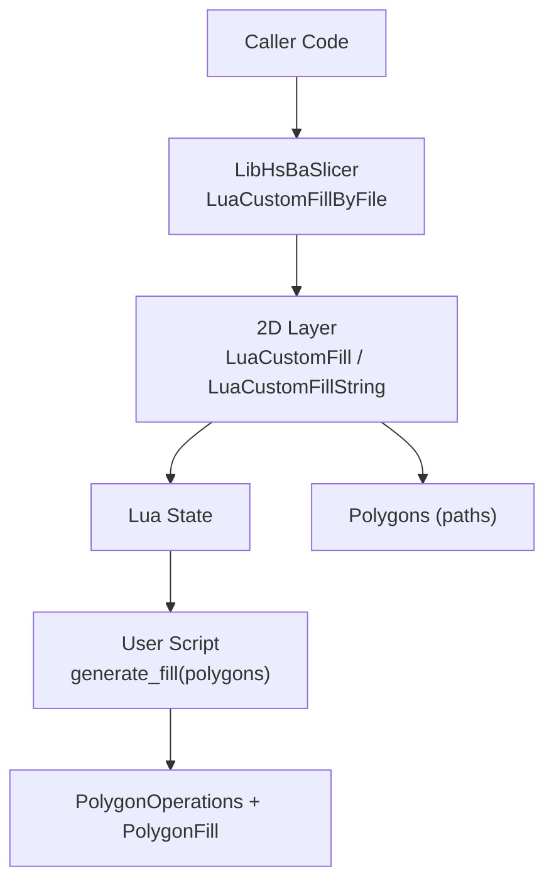
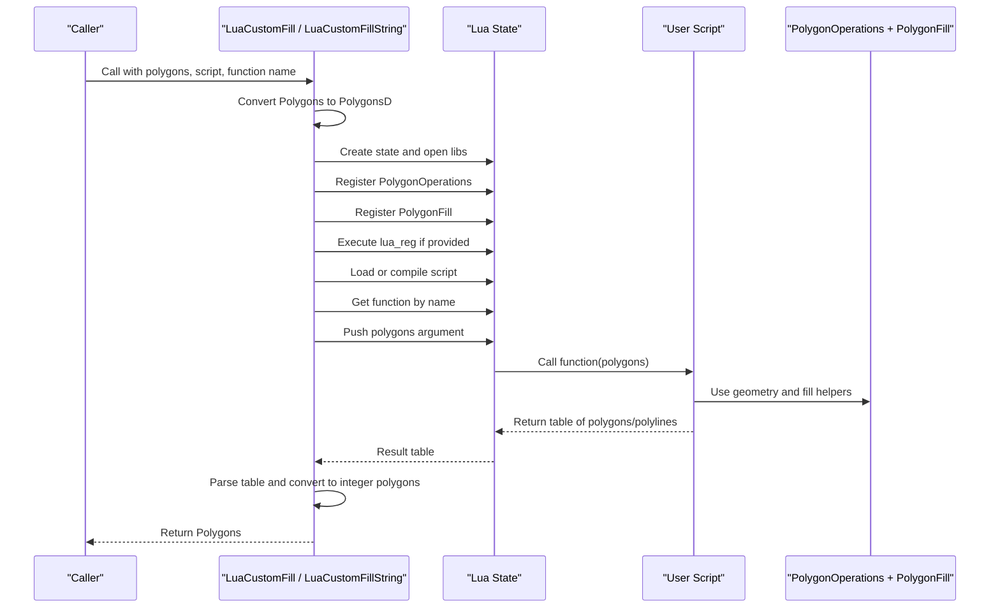
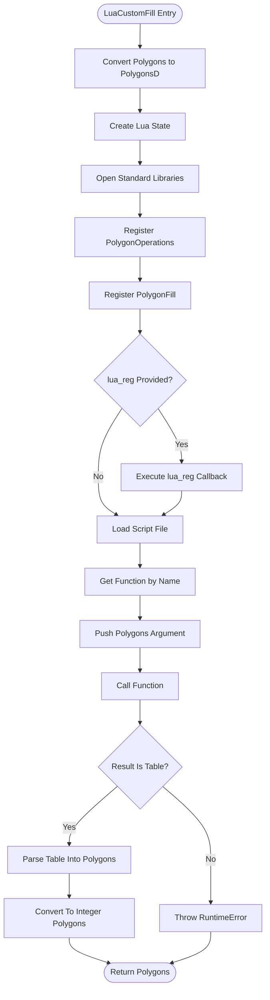
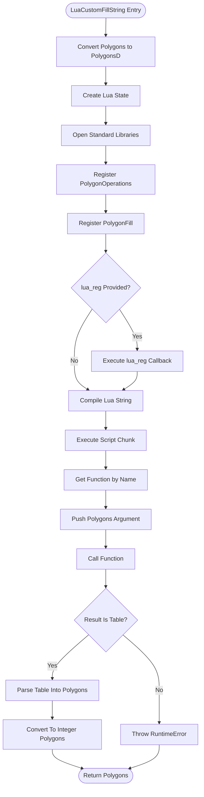
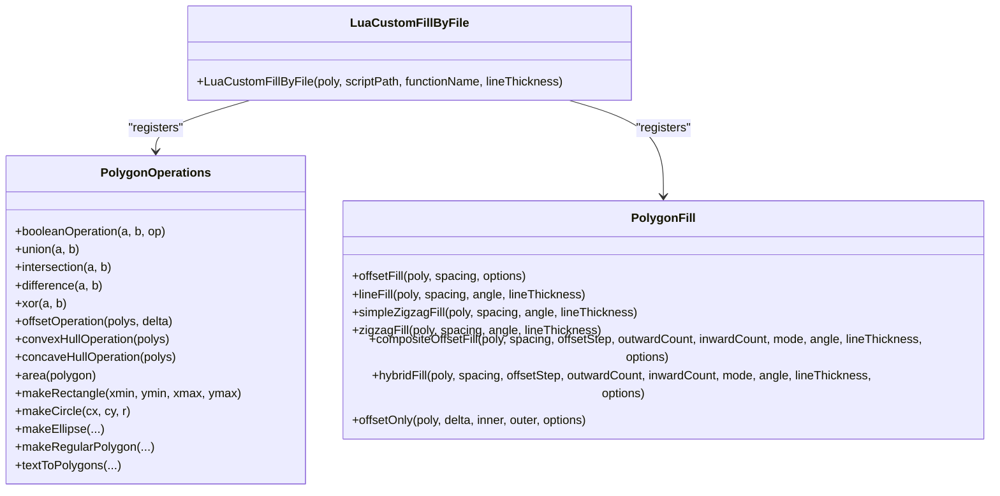
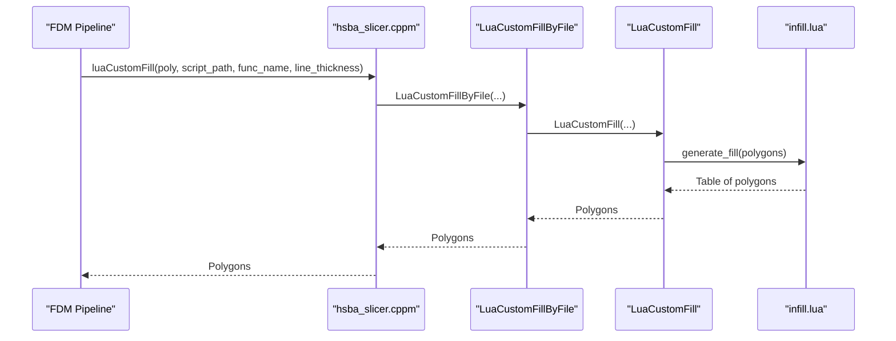
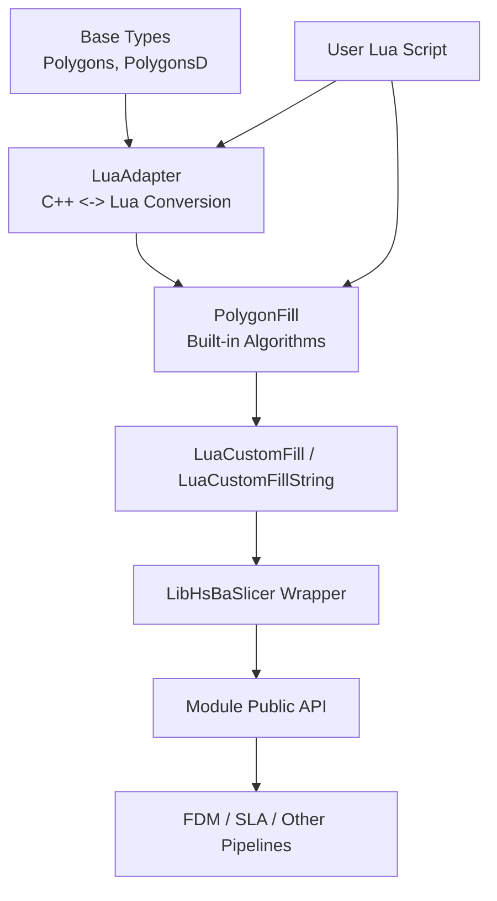

# Lua Custom Fills / Lua自定义填充

<cite>
**Referenced Files in This Document**
- [PolygonFill.hpp](file://2D/PolygonFill.hpp)
- [PolygonFill.cpp](file://2D/PolygonFill.cpp)
- [LuaAdapter.hpp](file://2D/LuaAdapter.hpp)
- [LuaAdapter.cpp](file://2D/LuaAdapter.cpp)
- [polygon_fill.hpp](file://LibHsBaSlicer/Fill/polygon_fill.hpp)
- [polygon_fill.cpp](file://LibHsBaSlicer/Fill/polygon_fill.cpp)
- [hsba_slicer.cppm](file://ModuleHsBaSlicer/hsba_slicer.cppm)
- [my_infill.lua](file://samples/FDM/scripts/my_infill.lua)
- [custom_fill.lua](file://tests/PolygonFill/custom_fill.lua)
- [polygon_fill_test.cpp](file://tests/PolygonFill/polygon_fill_test.cpp)
</cite>

## Table of Contents
1. [Introduction](#introduction)
2. [Project Structure](#project-structure)
3. [Core Components](#core-components)
4. [Architecture Overview](#architecture-overview)
5. [Detailed Component Analysis](#detailed-component-analysis)
6. [Dependency Analysis](#dependency-analysis)
7. [Performance Considerations](#performance-considerations)
8. [Troubleshooting Guide](#troubleshooting-guide)
9. [Conclusion](#conclusion)
10. [Appendices](#appendices)

## Introduction
This document explains the custom fill generation system powered by Lua scripting in HsBaSlicer. It focuses on `LuaCustomFill` and `LuaCustomFillString`, which allow users to define custom 2D fill patterns through Lua scripts. The documentation covers:

- Script interface requirements, including the expected function signature and return format.
- Available helper functions exposed to scripts via `PolygonOperations` and `PolygonFill`.
- The registration system for custom Lua functions through `lua_reg`.
- Error handling mechanisms when loading or executing scripts.
- Performance considerations for running custom scripts inside the slicing pipeline.
- Practical examples such as spiral-like fills, organic structures, and process-specific optimizations.
- Best practices, debugging techniques, and integration points with the main slicer.

The goal is to make it easy for both new and experienced developers to write reliable, efficient custom fill algorithms that integrate cleanly with the rest of the slicer.

## Project Structure
The custom fill feature spans several layers:

- **2D geometry layer**: Polygon data types, polygon operations, and the core Lua glue code.
- **Fill engine layer**: Built-in fill algorithms and their Lua bindings under `PolygonFill`.
- **Library API layer**: A thin wrapper exposing `LuaCustomFillByFile` to callers outside the 2D module.
- **Module layer**: Integration into the slicer’s public C++ module and pipeline configuration.
- **Script layer**: User-defined Lua scripts implementing a fill generator function.

**Diagram sources**
- [polygon_fill.cpp:35-49](file://LibHsBaSlicer/Fill/polygon_fill.cpp#L35-L49)
- [PolygonFill.cpp:1494-1665](file://2D/PolygonFill.cpp#L1494-L1665)
- [PolygonFill.cpp:488-502](file://2D/PolygonFill.cpp#L488-L502)
- [LuaAdapter.cpp:487-491](file://2D/LuaAdapter.cpp#L487-L491)

**Section sources**
- [PolygonFill.hpp:106-136](file://2D/PolygonFill.hpp#L106-L136)
- [polygon_fill.hpp:39-53](file://LibHsBaSlicer/Fill/polygon_fill.hpp#L39-L53)
- [hsba_slicer.cppm:485-498](file://ModuleHsBaSlicer/hsba_slicer.cppm#L485-L498)

## Core Components
The core components are:

| Component | Responsibility | Key Behavior |
|---|---|---|
| `LuaCustomFill` | Executes a Lua script file and calls a named function with polygon input | Loads script, registers helpers, calls function, parses returned table of polygons |
| `LuaCustomFillString` | Executes inline Lua code and calls a named function with polygon input | Compiles string, executes chunk, calls function, parses returned table of polygons |
| `RegisterLuaPolygonFillFunctions` | Exposes built-in fill algorithms to Lua | Creates `PolygonFill` namespace with offset, line, zigzag, composite, hybrid, and offset-only functions |
| `RegisterLuaPolygonOperations` | Exposes 2D boolean and construction helpers to Lua | Creates `PolygonOperations` namespace with union, intersection, difference, xor, offset, hulls, area, shape factories, and text-to-polygons |
| `LuaCustomFillByFile` | Library-level wrapper around `LuaCustomFill` | Composes external 2D functions and path optimization helpers before calling the core implementation |

The expected user script function signature is:

- Function name: configurable, default `generate_fill`.
- Input: one argument representing the current layer polygons.
- Return: a table containing polygons or polylines. Each polygon is represented as an array of point objects with numeric `x` and `y` fields.

Important clarification: although the objective mentions `generate_fill(polygons, spacing, lineThickness)`, the actual implementation passes only the polygon list to the script function. Spacing and line thickness are used by the C++ glue layer and built-in fill algorithms, but they are not automatically passed as extra arguments to the user function. Scripts should use internal defaults or compute values from the input polygons.

**Section sources**
- [PolygonFill.hpp:106-136](file://2D/PolygonFill.hpp#L106-L136)
- [PolygonFill.cpp:1494-1665](file://2D/PolygonFill.cpp#L1494-L1665)
- [PolygonFill.cpp:488-502](file://2D/PolygonFill.cpp#L488-L502)
- [LuaAdapter.cpp:487-491](file://2D/LuaAdapter.cpp#L487-L491)
- [polygon_fill.cpp:35-49](file://LibHsBaSlicer/Fill/polygon_fill.cpp#L35-L49)

## Architecture Overview
The execution flow for custom fill generation is:

1. The caller invokes either `LuaCustomFill` or `LuaCustomFillString`.
2. The C++ layer converts integer polygons to double-precision polygons for Lua.
3. A fresh Lua state is created and standard libraries are opened.
4. Helper namespaces are registered:
   - `PolygonOperations` for geometry construction and boolean operations.
   - `PolygonFill` for built-in fill algorithms.
   - Optional `lua_reg` callback for additional custom functions.
5. The script is loaded or compiled.
6. The target function is retrieved from the global scope.
7. The polygon argument is pushed onto the Lua stack.
8. The function is called and must return exactly one result.
9. The result must be a table; each element is interpreted as a polygon or polyline.
10. Points are read as tables with `x` and `y` numeric fields.
11. Results are converted back to integer polygons and returned to the caller.

**Diagram sources**
- [PolygonFill.cpp:1494-1665](file://2D/PolygonFill.cpp#L1494-L1665)
- [PolygonFill.cpp:488-502](file://2D/PolygonFill.cpp#L488-L502)
- [LuaAdapter.cpp:487-491](file://2D/LuaAdapter.cpp#L487-L491)

## Detailed Component Analysis

### LuaCustomFill
`LuaCustomFill` loads a Lua script file and calls a named function. Its responsibilities include:

- Converting input integer polygons to double-precision polygons.
- Creating a unique Lua state.
- Opening standard Lua libraries.
- Registering polygon operation helpers.
- Registering polygon fill helpers.
- Executing any optional `lua_reg` callback.
- Loading the script file.
- Retrieving the requested function.
- Passing the polygon argument.
- Calling the function and validating its return value.
- Parsing the returned table into output polygons.

Error handling occurs at multiple stages:

- Lua state creation failure throws a runtime error.
- Script load failure throws a runtime error with the Lua error message.
- Missing function name throws a runtime error.
- Function call failure throws a runtime error with the Lua error message.
- Non-table return value throws a runtime error.

**Diagram sources**
- [PolygonFill.cpp:1494-1585](file://2D/PolygonFill.cpp#L1494-L1585)

**Section sources**
- [PolygonFill.hpp:106-117](file://2D/PolygonFill.hpp#L106-L117)
- [PolygonFill.cpp:1494-1585](file://2D/PolygonFill.cpp#L1494-L1585)

### LuaCustomFillString
`LuaCustomFillString` is similar to `LuaCustomFill`, but it compiles and executes an inline Lua string instead of loading a file. The differences are:

- Script source is provided as a string.
- The string is compiled and executed as a chunk before retrieving the function.
- All other behavior, including helper registration, argument passing, return validation, and polygon parsing, is the same.

Error handling includes:

- Lua state creation failure.
- String compilation failure.
- Chunk execution failure.
- Missing function name.
- Function call failure.
- Non-table return value.

**Diagram sources**
- [PolygonFill.cpp:1587-1665](file://2D/PolygonFill.cpp#L1587-L1665)

**Section sources**
- [PolygonFill.hpp:119-130](file://2D/PolygonFill.hpp#L119-L130)
- [PolygonFill.cpp:1587-1665](file://2D/PolygonFill.cpp#L1587-L1665)

### Registration System for Custom Lua Functions
The registration system supports two levels:

1. **Built-in helpers**:
   - `PolygonOperations`: Boolean operations, offset, hulls, area, shape factories, and text-to-polygons.
   - `PolygonFill`: Built-in fill algorithms such as offset, line, simple zigzag, zigzag, composite offset, hybrid, and offset-only.

2. **External registration callback**:
   - The `lua_reg` parameter allows callers to inject additional Lua functions into the script environment.
   - `LuaCustomFillByFile` composes external 2D functions and path optimization helpers into this callback.

**Diagram sources**
- [LuaAdapter.cpp:316-329](file://2D/LuaAdapter.cpp#L316-L329)
- [LuaAdapter.cpp:487-491](file://2D/LuaAdapter.cpp#L487-L491)
- [PolygonFill.cpp:488-502](file://2D/PolygonFill.cpp#L488-L502)
- [polygon_fill.cpp:35-49](file://LibHsBaSlicer/Fill/polygon_fill.cpp#L35-L49)

**Section sources**
- [LuaAdapter.cpp:316-329](file://2D/LuaAdapter.cpp#L316-L329)
- [LuaAdapter.cpp:487-491](file://2D/LuaAdapter.cpp#L487-L491)
- [PolygonFill.cpp:488-502](file://2D/PolygonFill.cpp#L488-L502)
- [polygon_fill.cpp:35-49](file://LibHsBaSlicer/Fill/polygon_fill.cpp#L35-L49)

### Data Model and Serialization Between C++ and Lua
The bridge between C++ polygons and Lua tables follows a strict structure:

- Input polygons are converted to double-precision polygons before being passed to Lua.
- Each polygon is a Lua table.
- Each point is a Lua table with numeric `x` and `y` fields.
- The script returns a table of polygons or polylines.
- The C++ side iterates the returned table and reads each point’s `x` and `y`.
- Empty polygons are skipped.
- Double-precision results are converted back to integer polygons.

**Diagram sources**
- [PolygonFill.cpp:1494-1665](file://2D/PolygonFill.cpp#L1494-L1665)
- [LuaAdapter.cpp:332-345](file://2D/LuaAdapter.cpp#L332-L345)

**Section sources**
- [PolygonFill.cpp:1494-1665](file://2D/PolygonFill.cpp#L1494-L1665)
- [LuaAdapter.cpp:332-345](file://2D/LuaAdapter.cpp#L332-L345)

### Example Scripts
Two example scripts demonstrate the expected interface:

- `custom_fill.lua` defines `generate_fill` and returns two diagonal polylines.
- `my_infill.lua` implements a parallel-line infill algorithm using `PolygonOperations.intersection`.

Key observations:

- The script defines a function matching the configured function name.
- The function receives the current layer polygons.
- The function returns a table of polygons or polylines.
- Geometry construction and boolean operations are performed through `PolygonOperations`.
- Built-in fill algorithms can be reused through `PolygonFill`.

**Section sources**
- [custom_fill.lua:1-16](file://tests/PolygonFill/custom_fill.lua#L1-L16)
- [my_infill.lua:1-89](file://samples/FDM/scripts/my_infill.lua#L1-L89)

### Integration With the Main Slicing Pipeline
The custom fill feature integrates into the slicer through multiple layers:

- The library API exposes `LuaCustomFillByFile`.
- The module layer provides `luaCustomFill`, which delegates to the library API.
- The FDM pipeline uses the library API when a Lua infill script is configured.
- Tests verify that the fill stage exposes path optimization helpers through the same mechanism.

**Diagram sources**
- [hsba_slicer.cppm:667-674](file://ModuleHsBaSlicer/hsba_slicer.cppm#L667-L674)
- [hsba_slicer.cppm:1184-1188](file://ModuleHsBaSlicer/hsba_slicer.cppm#L1184-L1188)
- [polygon_fill.cpp:35-49](file://LibHsBaSlicer/Fill/polygon_fill.cpp#L35-L49)
- [PolygonFill.cpp:1494-1665](file://2D/PolygonFill.cpp#L1494-L1665)

**Section sources**
- [hsba_slicer.cppm:667-674](file://ModuleHsBaSlicer/hsba_slicer.cppm#L667-L674)
- [hsba_slicer.cppm:1184-1188](file://ModuleHsBaSlicer/hsba_slicer.cppm#L1184-L1188)
- [polygon_fill.cpp:35-49](file://LibHsBaSlicer/Fill/polygon_fill.cpp#L35-L49)

## Dependency Analysis
The dependencies form a layered architecture:

- The 2D layer depends on polygon geometry, Lua adapters, and Clipper-based operations.
- The fill layer depends on the 2D layer and exposes built-in algorithms.
- The library layer wraps the 2D layer and adds path optimization registration.
- The module layer exposes convenience functions and integrates with pipeline configuration.
- Scripts depend on `PolygonOperations` and optionally `PolygonFill`.

**Diagram sources**
- [LuaAdapter.cpp:316-329](file://2D/LuaAdapter.cpp#L316-L329)
- [PolygonFill.cpp:488-502](file://2D/PolygonFill.cpp#L488-L502)
- [PolygonFill.cpp:1494-1665](file://2D/PolygonFill.cpp#L1494-L1665)
- [polygon_fill.cpp:35-49](file://LibHsBaSlicer/Fill/polygon_fill.cpp#L35-L49)
- [hsba_slicer.cppm:1184-1188](file://ModuleHsBaSlicer/hsba_slicer.cppm#L1184-L1188)

**Section sources**
- [LuaAdapter.cpp:316-329](file://2D/LuaAdapter.cpp#L316-L329)
- [PolygonFill.cpp:488-502](file://2D/PolygonFill.cpp#L488-L502)
- [polygon_fill.cpp:35-49](file://LibHsBaSlicer/Fill/polygon_fill.cpp#L35-L49)
- [hsba_slicer.cppm:1184-1188](file://ModuleHsBaSlicer/hsba_slicer.cppm#L1184-L1188)

## Performance Considerations
Custom fill scripts run inside a freshly created Lua state for each call. This design isolates scripts but introduces overhead:

- Creating a Lua state has a fixed cost.
- Loading or compiling a script has a fixed cost.
- Registering helpers runs on every call unless cached externally.
- Converting between C++ polygons and Lua tables involves memory allocation.
- Iterating returned tables and converting points to integer polygons adds CPU work.

Recommendations:

- Prefer file-based scripts for reusable algorithms; avoid recompiling large inline strings repeatedly.
- Keep script logic focused on geometry generation; delegate heavy computation to built-in `PolygonFill` functions where possible.
- Avoid excessive nested loops over large vertex sets.
- Use `PolygonOperations` for boolean operations rather than reimplementing them in Lua.
- If performance is critical, consider optimizing the generated paths after the script returns, using available path optimization helpers when exposed by the caller.
- Test scripts with representative layer sizes to detect expensive operations early.

[No sources needed since this section provides general guidance]

## Troubleshooting Guide
Common issues and their causes:

| Symptom | Likely Cause | Resolution |
|---|---|---|
| Runtime error about failed Lua state creation | Lua initialization failed | Check environment and build configuration; ensure Lua is available. |
| Failed to load Lua script | Invalid file path or malformed script | Verify script path and syntax. |
| Lua function not found | Wrong function name or missing global function | Ensure the configured function name exists globally. |
| Error calling Lua function | Runtime error inside script | Inspect script logic and helper usage. |
| Lua function did not return a table | Script returned number, string, nil, or another non-table type | Return a table of polygons or polylines. |
| Empty fill result | Script returned empty table or invalid polygons | Validate polygon coordinates and ensure non-empty output. |
| Coordinates appear scaled | Integerization conversion | Remember that final polygons are integerized; coordinate scaling is expected. |

Validation tests confirm these behaviors:

- A script returning a non-table raises a runtime error.
- A missing function name raises a runtime error.
- Inline script compilation and execution errors are reported.

**Section sources**
- [PolygonFill.cpp:1494-1665](file://2D/PolygonFill.cpp#L1494-L1665)
- [polygon_fill_test.cpp:140-175](file://tests/PolygonFill/polygon_fill_test.cpp#L140-L175)
- [polygon_fill_test.cpp:250-258](file://tests/PolygonFill/polygon_fill_test.cpp#L250-L258)

## Conclusion
`LuaCustomFill` and `LuaCustomFillString` provide a flexible extension point for custom 2D fill generation. They expose a well-defined contract:

- Input: current layer polygons.
- Output: table of polygons or polylines.
- Helpers: `PolygonOperations` for geometry and `PolygonFill` for built-in algorithms.
- Extension: `lua_reg` for additional custom functions.

For reliable development, follow the documented interface, validate return values, use built-in helpers where appropriate, and test scripts against realistic layer geometries. When integrating with the slicer, prefer the library API and module wrappers so that external 2D functions and path optimization helpers are available in the script environment.

[No sources needed since this section summarizes without analyzing specific files]

## Appendices

### API Reference Summary

| API | Purpose | Notes |
|---|---|---|
| `LuaCustomFill(poly, scriptPath, functionName, lineThickness, lua_reg)` | Execute Lua script file | Default function name is `generate_fill`; returns polygons. |
| `LuaCustomFillString(poly, script, functionName, lineThickness, lua_reg)` | Execute inline Lua string | Same contract as file-based version. |
| `RegisterLuaPolygonFillFunctions(L)` | Register built-in fill algorithms | Exposes `PolygonFill` namespace. |
| `RegisterLuaPolygonOperations(L)` | Register geometry helpers | Exposes `PolygonOperations` namespace. |
| `LuaCustomFillByFile(poly, scriptPath, functionName, lineThickness)` | Library wrapper | Composes external 2D functions and path optimization helpers. |

**Section sources**
- [PolygonFill.hpp:106-136](file://2D/PolygonFill.hpp#L106-L136)
- [polygon_fill.hpp:39-53](file://LibHsBaSlicer/Fill/polygon_fill.hpp#L39-L53)

### Script Development Best Practices
- Define a single top-level function matching the configured function name.
- Accept one polygon argument.
- Return a table of polygons or polylines.
- Represent points as tables with numeric `x` and `y`.
- Use `PolygonOperations` for boolean operations and shape construction.
- Use `PolygonFill` for proven fill algorithms when possible.
- Handle empty input gracefully.
- Keep coordinate ranges reasonable to avoid precision or performance problems.
- Log or assert intermediate results during development.
- Test both file-based and inline script paths if your application supports both.

**Section sources**
- [custom_fill.lua:1-16](file://tests/PolygonFill/custom_fill.lua#L1-L16)
- [my_infill.lua:1-89](file://samples/FDM/scripts/my_infill.lua#L1-L89)
- [polygon_fill_test.cpp:140-175](file://tests/PolygonFill/polygon_fill_test.cpp#L140-L175)