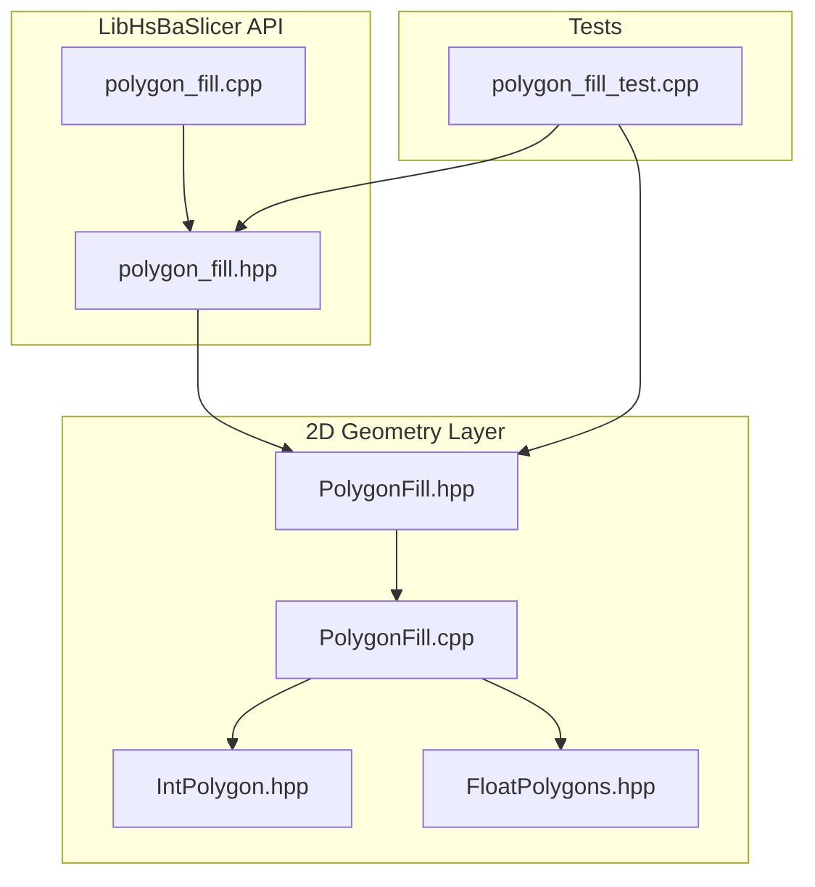
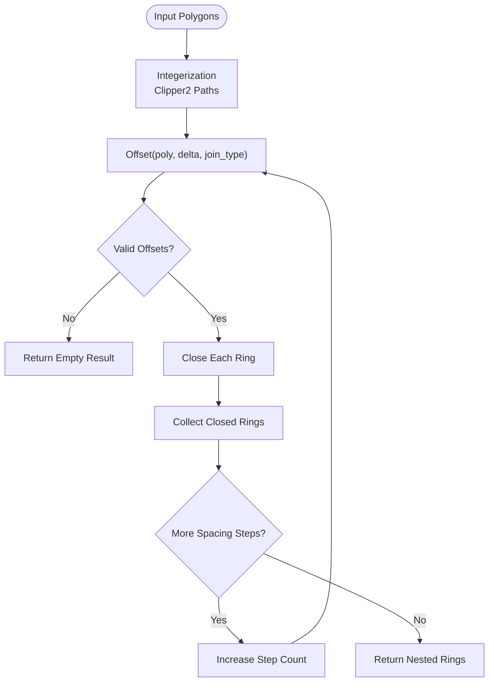
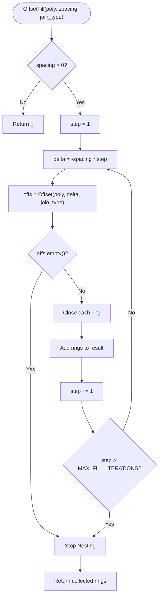
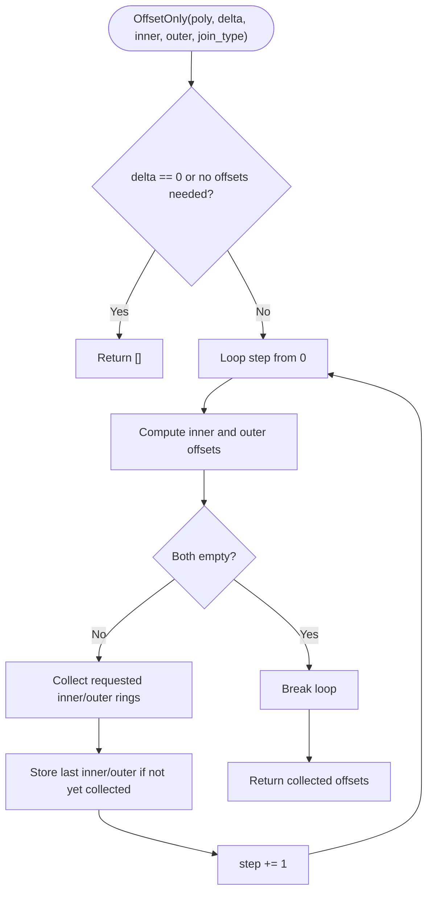
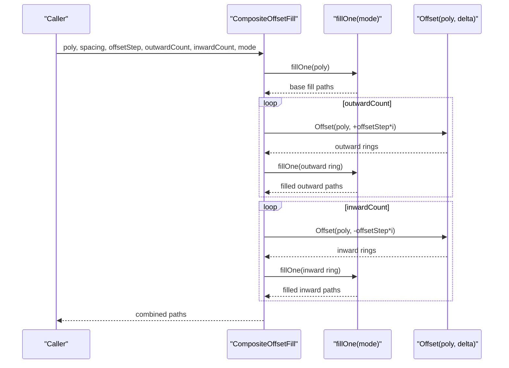
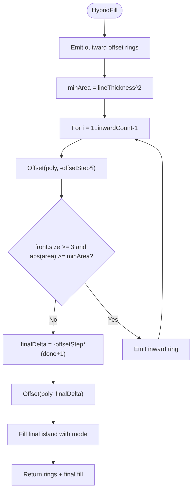
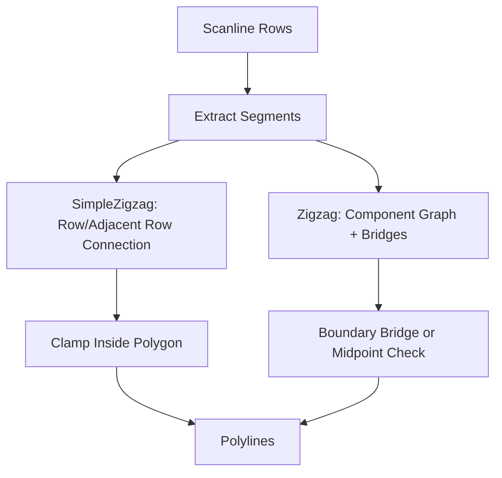
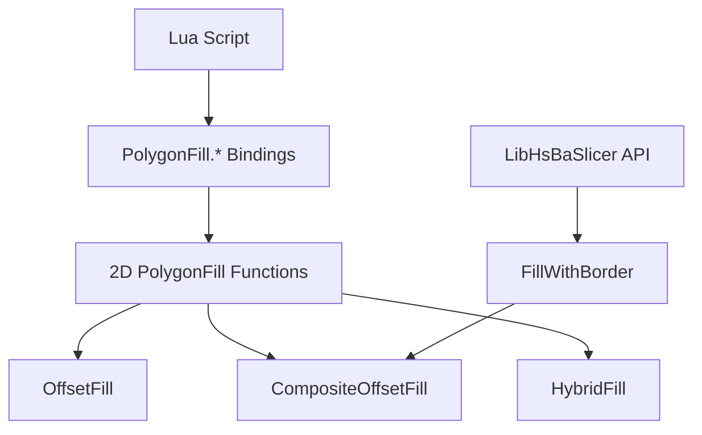
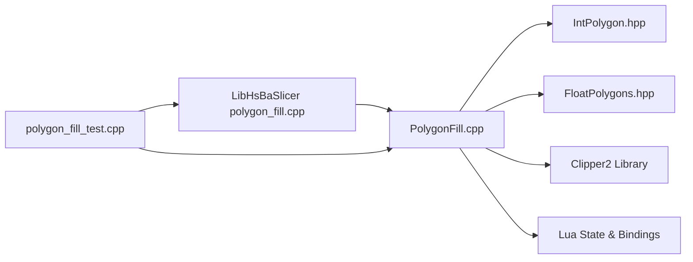

# Offset Fill Algorithm / 偏移填充算法

<cite>
**Referenced Files in This Document**   
- [PolygonFill.hpp](file://2D/PolygonFill.hpp)
- [PolygonFill.cpp](file://2D/PolygonFill.cpp)
- [IntPolygon.hpp](file://2D/IntPolygon.hpp)
- [FloatPolygons.hpp](file://2D/FloatPolygons.hpp)
- [polygon_fill.hpp](file://LibHsBaSlicer/Fill/polygon_fill.hpp)
- [polygon_fill.cpp](file://LibHsBaSlicer/Fill/polygon_fill.cpp)
- [polygon_fill_test.cpp](file://tests/PolygonFill/polygon_fill_test.cpp)
</cite>

## Table of Contents
1. [Introduction](#introduction)
2. [Project Structure](#project-structure)
3. [Core Components](#core-components)
4. [Architecture Overview](#architecture-overview)
5. [Detailed Component Analysis](#detailed-component-analysis)
6. [Dependency Analysis](#dependency-analysis)
7. [Performance Considerations](#performance-considerations)
8. [Troubleshooting Guide](#troubleshooting-guide)
9. [Conclusion](#conclusion)
10. [Appendices](#appendices)

## Introduction
This document explains the Offset Fill algorithm used by HsBaSlicer to generate offset-based fill patterns for polygons. The core idea is to repeatedly shrink a polygon inward at a fixed spacing distance, producing parallel closed contours that can be used as boundary rings or as input to other fill strategies.

The implementation supports:
- One outer boundary with multiple holes.
- Inward nesting until the polygon disappears.
- Corner joining through Clipper2’s join types: Square, Bevel, Round, and Miter.
- Integration with line and zigzag fills via composite and hybrid fill functions.
- Integer-coordinate geometry backed by Clipper2, with floating-point conversion for Lua and scanline operations.
- Safety limits such as maximum iteration counts and non-positive spacing handling.

## Project Structure
The Offset Fill functionality lives primarily in the 2D geometry layer and is exposed through both C++ APIs and Lua bindings.

**Diagram sources**
- [PolygonFill.hpp:1-141](file://2D/PolygonFill.hpp#L1-L141)
- [PolygonFill.cpp:1-1669](file://2D/PolygonFill.cpp#L1-L1669)
- [IntPolygon.hpp:1-44](file://2D/IntPolygon.hpp#L1-L44)
- [FloatPolygons.hpp:1-45](file://2D/FloatPolygons.hpp#L1-L45)
- [polygon_fill.hpp:1-58](file://LibHsBaSlicer/Fill/polygon_fill.hpp#L1-L58)
- [polygon_fill.cpp:1-52](file://LibHsBaSlicer/Fill/polygon_fill.cpp#L1-L52)
- [polygon_fill_test.cpp:1-691](file://tests/PolygonFill/polygon_fill_test.cpp#L1-L691)

**Section sources**
- [PolygonFill.hpp:1-141](file://2D/PolygonFill.hpp#L1-L141)
- [polygon_fill.hpp:1-58](file://LibHsBaSlicer/Fill/polygon_fill.hpp#L1-L58)

## Core Components
The key components related to Offset Fill are:

| Component | Responsibility | Key Parameters | Output |
|---|---|---|---|
| `OffsetFill` | Generates nested inward offset rings at a given spacing | `poly`, `spacing`, `join_type` | Collection of closed integer polygons |
| `OffsetOnly` | Produces inner and outer offset layers up to specified counts | `poly`, `delta`, `inner`, `outer`, `join_type` | Offset paths plus last inner/outer results |
| `CompositeOffsetFill` | Combines base fill with outward/inward offset fills | `poly`, `spacing`, `offsetStep`, `outwardCount`, `inwardCount`, `mode`, `angle_deg`, `lineThickness`, `join_type` | Base fill plus filled offset boundaries |
| `HybridFill` | Emits offset rings first, then fills the final surviving island | `poly`, `spacing`, `offsetStep`, `outwardCount`, `inwardCount`, `mode`, `angle_deg`, `lineThickness`, `join_type` | Offset rings plus final interior fill |
| `LineFill` | Generates independent parallel line segments | `poly`, `spacing`, `angle_deg`, `lineThickness` | Two-point polylines clipped to polygon |
| `SimpleZigzagFill` | Connects adjacent scanline segments into serpentine paths | `poly`, `spacing`, `angle_deg`, `lineThickness` | Connected polylines inside polygon |
| `ZigzagFill` | Advanced zigzag with component bridging along polygon boundary | `poly`, `spacing`, `angle_deg`, `lineThickness` | Robust connected zigzag paths |

**Section sources**
- [PolygonFill.hpp:20-102](file://2D/PolygonFill.hpp#L20-L102)
- [PolygonFill.cpp:504-541](file://2D/PolygonFill.cpp#L504-L541)
- [PolygonFill.cpp:162-221](file://2D/PolygonFill.cpp#L162-L221)
- [PolygonFill.cpp:1372-1428](file://2D/PolygonFill.cpp#L1372-L1428)
- [PolygonFill.cpp:1430-1491](file://2D/PolygonFill.cpp#L1430-L1491)
- [PolygonFill.cpp:543-564](file://2D/PolygonFill.cpp#L543-L564)
- [PolygonFill.cpp:566-801](file://2D/PolygonFill.cpp#L566-L801)
- [PolygonFill.cpp:803-1370](file://2D/PolygonFill.cpp#L803-L1370)

## Architecture Overview
Offset Fill is part of a broader polygon filling system. At a high level:

1. Input polygons are represented as integer coordinates using Clipper2.
2. Floating-point conversions are used where needed, especially for Lua and scanline logic.
3. The core offset operation delegates to Clipper2’s offset engine through a wrapper function.
4. Offset Fill repeatedly applies negative offsets until no valid polygon remains.
5. Composite and Hybrid fills combine offset rings with internal fill modes.
6. Zigzag fills use scanline intersection, interval clamping, connectivity analysis, and optional boundary bridges.

**Diagram sources**
- [PolygonFill.cpp:504-541](file://2D/PolygonFill.cpp#L504-L541)
- [PolygonFill.cpp:33-42](file://2D/PolygonFill.cpp#L33-L42)
- [IntPolygon.hpp:15-26](file://2D/IntPolygon.hpp#L15-L26)

**Section sources**
- [PolygonFill.cpp:504-541](file://2D/PolygonFill.cpp#L504-L541)
- [IntPolygon.hpp:15-26](file://2D/IntPolygon.hpp#L15-L26)

## Detailed Component Analysis

### OffsetFill Algorithm
`OffsetFill` generates concentric inward offset rings for a polygon set. It treats the input as one outer boundary with multiple holes, although the underlying Clipper2 offset operation can handle general polygon sets.

Key behavior:
- If `spacing <= 0`, it returns an empty result immediately.
- It iteratively computes negative offsets: `-spacing * step`.
- Each returned offset ring is closed so the first and last vertices coincide.
- It stops when the offset result becomes empty or when the iteration count exceeds `MAX_FILL_ITERATIONS`.

**Diagram sources**
- [PolygonFill.cpp:504-541](file://2D/PolygonFill.cpp#L504-L541)
- [PolygonFill.cpp:33-42](file://2D/PolygonFill.cpp#L33-L42)

#### Mathematical Approach
The mathematical approach is based on polygon offsetting:
- A positive offset expands the polygon outward.
- A negative offset shrinks the polygon inward.
- Repeated negative offsets produce nested contours at equal spacing distances.
- The actual geometric computation is delegated to Clipper2, which handles:
  - Parallel edge generation.
  - Corner construction according to the selected join type.
  - Handling of holes and multiple contours.

In this codebase:
- `Offset` is a wrapper around Clipper2’s offset functionality.
- `EndType::Polygon` ensures closed polygon output.
- `JoinType` controls corner behavior.

#### Join Types
The supported join types are:
- **Square**: Square corners.
- **Bevel**: Flattened corners.
- **Round**: Rounded corners.
- **Miter**: Extended sharp corners.

These values are passed directly to Clipper2 and are also parsed from Lua strings `"Square"`, `"Bevel"`, `"Round"`, and `"Miter"`.

#### Multiple Holes
The header comment states that only one outer polygon and multiple holes are supported conceptually. However, the implementation uses Clipper2’s general polygon offset, which can process multiple contours. The tests demonstrate single-square inputs, while the algorithm itself does not explicitly enforce a single outer boundary before calling `Offset`.

#### Tolerance and Numerical Precision
Precision handling includes:
- `integerization = 1e6`: Converts between double and 64-bit integer coordinates.
- `INTEGERIZATION_PRECISION = 100.0`: Used to compute small epsilon adjustments during zigzag segment clamping.
- Binary search tolerance: `MAX_BINARY_SEARCH_ITERATIONS = 40` for finding entry/exit points along edges.
- Small-distance checks like `1e-12` and `1e-9` avoid degenerate segments and duplicate points.

**Section sources**
- [PolygonFill.hpp:20-28](file://2D/PolygonFill.hpp#L20-L28)
- [PolygonFill.cpp:26-31](file://2D/PolygonFill.cpp#L26-L31)
- [PolygonFill.cpp:33-42](file://2D/PolygonFill.cpp#L33-L42)
- [PolygonFill.cpp:504-541](file://2D/PolygonFill.cpp#L504-L541)
- [IntPolygon.hpp:15-26](file://2D/IntPolygon.hpp#L15-L26)
- [polygon_fill_test.cpp:177-200](file://tests/PolygonFill/polygon_fill_test.cpp#L177-L200)

### OffsetOnly Function
`OffsetOnly` provides more control over how many inner and outer offset layers are generated. It returns:
- The requested number of inner and outer offset rings.
- The last inner and outer offset results through an output pair.

This is useful when higher-level algorithms need to know the final surviving contour after repeated offsetting.

**Diagram sources**
- [PolygonFill.cpp:162-221](file://2D/PolygonFill.cpp#L162-L221)

**Section sources**
- [PolygonFill.cpp:162-221](file://2D/PolygonFill.cpp#L162-L221)

### CompositeOffsetFill
`CompositeOffsetFill` combines:
1. A base fill of the original polygon.
2. Outward offset rings filled independently.
3. Inward offset rings filled independently.

It supports three fill modes:
- `Line`: Parallel straight lines.
- `SimpleZigzag`: Serpentine connection without advanced bridging.
- `Zigzag`: Advanced zigzag with boundary-aware bridges.

**Diagram sources**
- [PolygonFill.cpp:1372-1428](file://2D/PolygonFill.cpp#L1372-L1428)
- [PolygonFill.cpp:1376-1388](file://2D/PolygonFill.cpp#L1376-L1388)

**Section sources**
- [PolygonFill.hpp:70-85](file://2D/PolygonFill.hpp#L70-L85)
- [PolygonFill.cpp:1372-1428](file://2D/PolygonFill.cpp#L1372-L1428)

### HybridFill
`HybridFill` is different from `CompositeOffsetFill`:
- It emits outward offset rings as closed paths.
- It emits intermediate inward offset rings as closed paths.
- It stops collecting inward rings when the area falls below a threshold based on `lineThickness`.
- It then fills only the final surviving offset island instead of all inward rings.

This makes HybridFill suitable for cases where you want visible border rings plus a compact interior fill.

**Diagram sources**
- [PolygonFill.cpp:1430-1491](file://2D/PolygonFill.cpp#L1430-L1491)

**Section sources**
- [PolygonFill.hpp:87-102](file://2D/PolygonFill.hpp#L87-L102)
- [PolygonFill.cpp:1430-1491](file://2D/PolygonFill.cpp#L1430-L1491)

### LineFill and Zigzag Fills
Although not strictly part of Offset Fill, these fills are tightly coupled because `CompositeOffsetFill` and `HybridFill` call them for interior regions.

`LineFill`:
- Computes scanlines perpendicular to the fill direction.
- Intersects thick rectangles with the polygon.
- Extracts intervals along the fill direction.
- Returns two-point polylines.

`SimpleZigzagFill`:
- Uses the same scanline rows.
- Connects segments within the same row or adjacent rows.
- Clamps endpoints to stay inside the polygon.

`ZigzagFill`:
- Builds a connectivity graph across rows.
- Detects disconnected components.
- Attempts to bridge across the polygon boundary when necessary.
- Falls back to extra straight segments when bridging fails.

**Diagram sources**
- [PolygonFill.cpp:44-160](file://2D/PolygonFill.cpp#L44-L160)
- [PolygonFill.cpp:543-564](file://2D/PolygonFill.cpp#L543-L564)
- [PolygonFill.cpp:566-801](file://2D/PolygonFill.cpp#L566-L801)
- [PolygonFill.cpp:803-1370](file://2D/PolygonFill.cpp#L803-L1370)

**Section sources**
- [PolygonFill.cpp:44-160](file://2D/PolygonFill.cpp#L44-L160)
- [PolygonFill.cpp:543-564](file://2D/PolygonFill.cpp#L543-L564)
- [PolygonFill.cpp:566-801](file://2D/PolygonFill.cpp#L566-L801)
- [PolygonFill.cpp:803-1370](file://2D/PolygonFill.cpp#L803-L1370)

### Lua Bindings and Lib API
Offset Fill is exposed to Lua through:
- `PolygonFill.offsetFill`
- `PolygonFill.compositeOffsetFill`
- `PolygonFill.hybridFill`
- `PolygonFill.offsetOnly`

The LibHsBaSlicer API wraps the 2D engine:
- `FillPolygon` dispatches to line or zigzag fills.
- `FillWithBorder` uses `CompositeOffsetFill` with zero outward offsets and `border_count` inward offsets.

**Diagram sources**
- [PolygonFill.cpp:231-266](file://2D/PolygonFill.cpp#L231-L266)
- [PolygonFill.cpp:319-375](file://2D/PolygonFill.cpp#L319-L375)
- [PolygonFill.cpp:377-432](file://2D/PolygonFill.cpp#L377-L432)
- [PolygonFill.cpp:434-486](file://2D/PolygonFill.cpp#L434-L486)
- [polygon_fill.cpp:27-33](file://LibHsBaSlicer/Fill/polygon_fill.cpp#L27-L33)

**Section sources**
- [PolygonFill.cpp:231-266](file://2D/PolygonFill.cpp#L231-L266)
- [PolygonFill.cpp:319-375](file://2D/PolygonFill.cpp#L319-L375)
- [polygon_fill.hpp:17-37](file://LibHsBaSlicer/Fill/polygon_fill.hpp#L17-L37)
- [polygon_fill.cpp:13-33](file://LibHsBaSlicer/Fill/polygon_fill.cpp#L13-L33)

## Dependency Analysis
The Offset Fill system depends on several lower-level components:

**Diagram sources**
- [PolygonFill.cpp:1-20](file://2D/PolygonFill.cpp#L1-L20)
- [IntPolygon.hpp:1-44](file://2D/IntPolygon.hpp#L1-L44)
- [FloatPolygons.hpp:1-45](file://2D/FloatPolygons.hpp#L1-L45)
- [polygon_fill.cpp:1-52](file://LibHsBaSlicer/Fill/polygon_fill.cpp#L1-L52)
- [polygon_fill_test.cpp:1-12](file://tests/PolygonFill/polygon_fill_test.cpp#L1-L12)

**Section sources**
- [PolygonFill.cpp:1-20](file://2D/PolygonFill.cpp#L1-L20)
- [IntPolygon.hpp:1-44](file://2D/IntPolygon.hpp#L1-L44)
- [FloatPolygons.hpp:1-45](file://2D/FloatPolygons.hpp#L1-L45)

## Performance Considerations
Offset Fill performance is influenced by:

| Factor | Impact | Guidance |
|---|---|---|
| `spacing` | Smaller spacing increases the number of nested rings | Use larger spacing for fast preview; reduce only when needed |
| Polygon complexity | More vertices increase offset cost | Simplify input polygons before offsetting |
| `outwardCount` and `inwardCount` | Each offset layer may trigger additional fill computations | Keep counts reasonable for large models |
| `join_type` | Round joins can be more expensive than Square or Bevel | Prefer Square or Bevel for performance-critical workflows |
| `MAX_FILL_ITERATIONS` | Prevents infinite loops but may truncate very fine fills | Default limit is 10,000 iterations |
| Zigzag bridging | Boundary bridges add overhead | Use `SimpleZigzagFill` when complex bridging is unnecessary |
| Integerization precision | High precision avoids numerical errors but increases memory usage | `integerization = 1e6` balances accuracy and performance |

Recommended parameter ranges:
- For thin-wall manufacturing (SLA/SLS): smaller spacing with Round or Miter joins for smooth borders.
- For bulk infill (FDM/LOM): larger spacing with Square or Bevel joins for speed.
- For support structures: moderate spacing with Zigzag fills to balance strength and material usage.

[No sources needed since this section provides general guidance]

## Troubleshooting Guide

### Offset Fill Returns Empty
Possible causes:
- `spacing <= 0`.
- Polygon too small relative to spacing.
- Excessive inward offset causing early disappearance.

Checks:
- Ensure `spacing > 0`.
- Verify polygon area is sufficient for the chosen spacing.
- Inspect whether `OffsetOnly` produces any intermediate rings.

**Section sources**
- [PolygonFill.cpp:504-510](file://2D/PolygonFill.cpp#L504-L510)
- [polygon_fill_test.cpp:197-200](file://tests/PolygonFill/polygon_fill_test.cpp#L197-L200)

### Unexpected Corner Shapes
Possible causes:
- Wrong `join_type` string in Lua.
- Sharp angles with Miter joins producing long spikes.
- Very small features making Round joins visually indistinct.

Checks:
- Confirm `join_type` is one of `"Square"`, `"Bevel"`, `"Round"`, `"Miter"`.
- Compare visual output for different join types.
- Increase feature size or switch to Round/Bevel for smoother results.

**Section sources**
- [PolygonFill.cpp:237-256](file://2D/PolygonFill.cpp#L237-L256)
- [PolygonFill.cpp:344-363](file://2D/PolygonFill.cpp#L344-L363)
- [polygon_fill_test.cpp:223-245](file://tests/PolygonFill/polygon_fill_test.cpp#L223-L245)

### Zigzag Paths Leave Polygon or Have Gaps
Possible causes:
- Disconnected components across rows.
- Bridging failed due to narrow gaps.
- Degenerate segments near origin due to uninitialized fallback.

Checks:
- Verify all output vertices remain inside the original polygon.
- Test concave shapes like U-shaped polygons.
- Test stacked or staggered islands.

**Section sources**
- [polygon_fill_test.cpp:542-571](file://tests/PolygonFill/polygon_fill_test.cpp#L542-L571)
- [polygon_fill_test.cpp:613-688](file://tests/PolygonFill/polygon_fill_test.cpp#L613-L688)

### Lua Custom Fill Errors
Possible causes:
- Script file load failure.
- Missing function name.
- Non-table return value.

Checks:
- Validate script path and syntax.
- Ensure the expected function exists.
- Ensure the function returns a table of polygons or polylines.

**Section sources**
- [PolygonFill.cpp:1493-1585](file://2D/PolygonFill.cpp#L1493-L1585)
- [polygon_fill_test.cpp:255-258](file://tests/PolygonFill/polygon_fill_test.cpp#L255-L258)

## Conclusion
The Offset Fill algorithm in HsBaSlicer provides a robust foundation for generating parallel offset contours. It relies on Clipper2 for precise geometric offsetting, supports multiple join types, and integrates closely with line and zigzag fill strategies. For practical use:

- Choose `spacing` based on manufacturing resolution and desired fill density.
- Select `join_type` based on surface quality requirements.
- Use `CompositeOffsetFill` when you want independent fills for each offset ring.
- Use `HybridFill` when you want visible border rings plus a compact interior fill.
- Validate results with the provided test patterns, especially for concave shapes and multi-contour inputs.

[No sources needed since this section summarizes without analyzing specific files]

## Appendices

### Parameter Reference Table

| Function | Parameters | Meaning | Typical Range |
|---|---|---|---|
| `OffsetFill` | `poly` | Input polygon set | Any valid Clipper2 polygon |
| `OffsetFill` | `spacing` | Distance between nested rings | Positive value |
| `OffsetFill` | `join_type` | Corner style | Square, Bevel, Round, Miter |
| `CompositeOffsetFill` | `spacing` | Internal fill spacing | Positive value |
| `CompositeOffsetFill` | `offsetStep` | Offset layer step | Positive value |
| `CompositeOffsetFill` | `outwardCount` | Number of outward rings | Non-negative integer |
| `CompositeOffsetFill` | `inwardCount` | Number of inward rings | Non-negative integer |
| `HybridFill` | `spacing` | Interior fill spacing | Positive value |
| `HybridFill` | `offsetStep` | Offset layer step | Positive value |
| `HybridFill` | `outwardCount` | Number of outward rings | Non-negative integer |
| `HybridFill` | `inwardCount` | Number of inward rings | Non-negative integer |

**Section sources**
- [PolygonFill.hpp:20-102](file://2D/PolygonFill.hpp#L20-L102)

### Example Scenarios

| Scenario | Recommended Settings | Expected Result |
|---|---|---|
| Thin SLA wall border | `spacing` small, `join_type = Round` | Smooth rounded border rings |
| FDM infill | `spacing` medium-large, `join_type = Square` | Fast, blocky offset rings |
| SLS powder bed | `spacing` small-medium, `join_type = Miter` | Sharp angled borders with dense fill |
| Support structure | `spacing` moderate, `mode = Zigzag` | Strong zigzag pattern with boundary awareness |

[No sources needed since this section provides conceptual examples]