# Polygon Fill Algorithms / 多边形填充算法

<cite>
**Referenced Files in This Document**
- [PolygonFill.hpp](file://2D/PolygonFill.hpp)
- [PolygonFill.cpp](file://2D/PolygonFill.cpp)
- [polygon_fill.hpp](file://LibHsBaSlicer/Fill/polygon_fill.hpp)
- [polygon_fill.cpp](file://LibHsBaSlicer/Fill/polygon_fill.cpp)
- [fdm_pipeline.cpp](file://DllHsBaSlicer/fdm_pipeline.cpp)
- [FdmSupport.hpp](file://support/FdmSupport.hpp)
- [FdmSupport.cpp](file://support/FdmSupport.cpp)
- [polygon_fill_test.cpp](file://tests/PolygonFill/polygon_fill_test.cpp)
</cite>

## Table of Contents
1. [Introduction](#introduction)
2. [Project Structure](#project-structure)
3. [Core Components](#core-components)
4. [Architecture Overview](#architecture-overview)
5. [Detailed Component Analysis](#detailed-component-analysis)
6. [Dependency Analysis](#dependency-analysis)
7. [Performance Considerations](#performance-considerations)
8. [Troubleshooting Guide](#troubleshooting-guide)
9. [Conclusion](#conclusion)
10. [Appendices](#appendices)

## Introduction
This document explains the Polygon Fill module that generates 2D infill patterns for 3D printing layers. It covers the core fill algorithms, density and orientation control, boundary adaptation, integration with the FDM slicing pipeline, and customization through Lua scripts. The implementation provides:

- Offset-based concentric rings.
- Parallel line fills.
- Simple zigzag fills.
- Advanced zigzag fills with connectivity and bridging.
- Composite and hybrid fills combining borders and internal patterns.
- Custom pattern generation via Lua scripts.
- Honeycomb support geometry generation used by FDM support structures.

The module is designed to produce polylines or polygons suitable for path planning and G-code generation, while keeping all generated vertices inside the original layer outlines.

## Project Structure
The Polygon Fill system spans three main layers:

| Layer | Responsibility | Key Files |
|---|---|---|
| 2D fill engine | Core geometric fill algorithms and Lua bindings | `2D/PolygonFill.hpp`, `2D/PolygonFill.cpp` |
| Lib API wrapper | Public C++ API for fill, border fill, and Lua custom fill | `LibHsBaSlicer/Fill/polygon_fill.hpp`, `LibHsBaSlicer/Fill/polygon_fill.cpp` |
| Slicing pipeline integration | Converts slice outlines into filled paths per layer | `DllHsBaSlicer/fdm_pipeline.cpp` |
| Support geometry | Honeycomb support structure generation | `support/FdmSupport.hpp`, `support/FdmSupport.cpp` |
| Tests | Behavioral verification of fill algorithms, Lua bindings, and optimization exposure | `tests/PolygonFill/polygon_fill_test.cpp` |

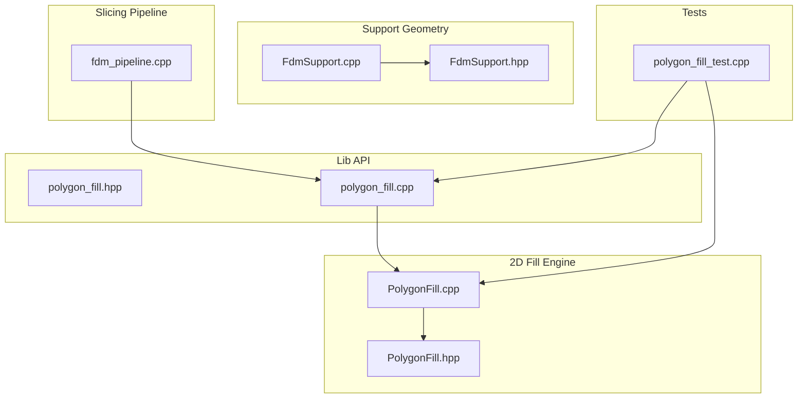

**Diagram sources**
- [PolygonFill.hpp:1-141](file://2D/PolygonFill.hpp#L1-L141)
- [PolygonFill.cpp:1-1669](file://2D/PolygonFill.cpp#L1-L1669)
- [polygon_fill.hpp:1-58](file://LibHsBaSlicer/Fill/polygon_fill.hpp#L1-L58)
- [polygon_fill.cpp:1-52](file://LibHsBaSlicer/Fill/polygon_fill.cpp#L1-L52)
- [fdm_pipeline.cpp:300-497](file://DllHsBaSlicer/fdm_pipeline.cpp#L300-L497)
- [FdmSupport.hpp:46-63](file://support/FdmSupport.hpp#L46-L63)
- [FdmSupport.cpp:173-269](file://support/FdmSupport.cpp#L173-L269)
- [polygon_fill_test.cpp:1-691](file://tests/PolygonFill/polygon_fill_test.cpp#L1-L691)

**Section sources**
- [PolygonFill.hpp:1-141](file://2D/PolygonFill.hpp#L1-L141)
- [polygon_fill.hpp:1-58](file://LibHsBaSlicer/Fill/polygon_fill.hpp#L1-L58)
- [fdm_pipeline.cpp:300-497](file://DllHsBaSlicer/fdm_pipeline.cpp#L300-L497)

## Core Components
The core components are:

| Component | Purpose | Main Functions |
|---|---|---|
| Offset fill | Generates nested concentric rings inward | `OffsetFill` |
| Line fill | Generates independent parallel line segments | `LineFill`, `LineFilling` |
| Simple zigzag fill | Connects scanline centers into a serpentine polyline | `SimpleZigzagFill` |
| Zigzag fill | Builds connected zigzag paths with component-aware bridging | `ZigzagFill` |
| Composite offset fill | Combines base fill with outward/inward offset borders | `CompositeOffsetFill` |
| Hybrid fill | Emits offset borders and fills only the final inner region | `HybridFill` |
| Lua custom fill | Executes user-defined pattern generation | `LuaCustomFill`, `LuaCustomFillString` |
| Lib API | Exposes fill functions to higher layers | `FillPolygon`, `FillWithBorder`, `LuaCustomFillByFile` |
| Honeycomb support | Generates hexagonal cells for overhang support | `GenerateHoneycomb` |

Key configuration parameters include:

| Parameter | Meaning | Typical Use |
|---|---|---|
| `spacing` | Distance between fill lines or offset rings | Controls fill density |
| `angle_deg` | Orientation angle of parallel or zigzag fills | Aligns print direction |
| `lineThickness` | Thickness used for clipping and bridge sampling | Affects boundary precision |
| `outwardCount` | Number of outward offset borders | Adds external reinforcement |
| `inwardCount` | Number of inward offset borders | Creates internal walls |
| `join_type` | Corner join style for offset operations | Square, Bevel, Round, Miter |
| `fill_mode` | Internal fill algorithm selection | Line, SimpleZigzag, Zigzag |
| `infill_density` | Density-to-spacing conversion factor | Lower density means larger spacing |

**Section sources**
- [PolygonFill.hpp:20-136](file://2D/PolygonFill.hpp#L20-L136)
- [polygon_fill.hpp:17-53](file://LibHsBaSlicer/Fill/polygon_fill.hpp#L17-L53)
- [fdm_pipeline.cpp:50-68](file://DllHsBaSlicer/fdm_pipeline.cpp#L50-L68)
- [fdm_pipeline.cpp:322-342](file://DllHsBaSlicer/fdm_pipeline.cpp#L322-L342)

## Architecture Overview
The fill pipeline integrates with the FDM slicing process as follows:

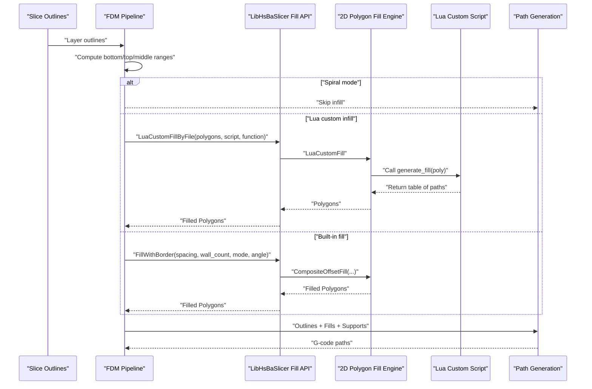

**Diagram sources**
- [fdm_pipeline.cpp:312-433](file://DllHsBaSlicer/fdm_pipeline.cpp#L312-L433)
- [polygon_fill.cpp:13-49](file://LibHsBaSlicer/Fill/polygon_fill.cpp#L13-L49)
- [PolygonFill.cpp:1493-1585](file://2D/PolygonFill.cpp#L1493-L1585)

## Detailed Component Analysis

### Offset Fill
Offset fill generates concentric rings by repeatedly offsetting the input polygon inward until no more valid offsets exist. Each ring is closed so the first and last vertex coincide.

Key behaviors:
- Non-positive spacing returns empty results.
- Iteration is bounded by `MAX_FILL_ITERATIONS`.
- Rings are closed using `ClosePath`.
- Join type affects corner rounding and mitering.

Complexity:
- Time complexity is approximately O(k × P), where k is the number of successful offset iterations and P is the total polygon vertex count across all offset levels.
- Space complexity grows with the number of generated rings.

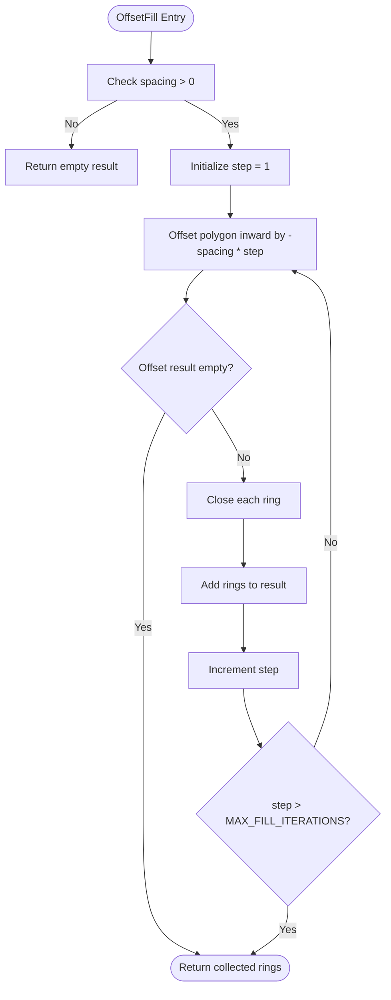

**Diagram sources**
- [PolygonFill.cpp:504-541](file://2D/PolygonFill.cpp#L504-L541)
- [PolygonFill.cpp:33-42](file://2D/PolygonFill.cpp#L33-L42)

**Section sources**
- [PolygonFill.cpp:504-541](file://2D/PolygonFill.cpp#L504-L541)
- [polygon_fill_test.cpp:177-200](file://tests/PolygonFill/polygon_fill_test.cpp#L177-L200)

### Line Fill
Line fill produces independent straight-line segments aligned at a given angle. Internally it computes scan rows, intersects them with the polygon, and extracts entry/exit points along the scan direction.

Key behaviors:
- Uses `LineFilling` to compute row segments.
- Returns one two-point polygon per segment.
- Angle controls orientation; spacing controls density.
- Boundary adaptation uses polygon intersection and projection.

Complexity:
- Bounding box computation is O(V).
- Row generation depends on projected span length divided by spacing.
- Intersection and sorting dominate runtime.

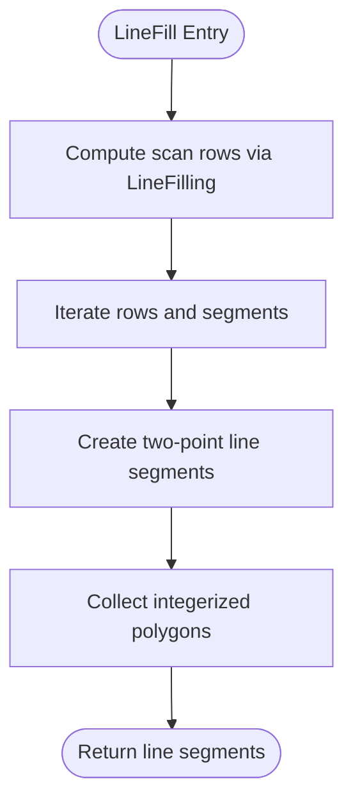

**Diagram sources**
- [PolygonFill.cpp:543-564](file://2D/PolygonFill.cpp#L543-L564)
- [PolygonFill.cpp:44-160](file://2D/PolygonFill.cpp#L44-L160)

**Section sources**
- [PolygonFill.cpp:44-160](file://2D/PolygonFill.cpp#L44-L160)
- [PolygonFill.cpp:543-564](file://2D/PolygonFill.cpp#L543-L564)
- [polygon_fill_test.cpp:26-84](file://tests/PolygonFill/polygon_fill_test.cpp#L26-L84)

### Simple Zigzag Fill
Simple zigzag fill connects centers of adjacent scanline segments into a single serpentine polyline. It allows connections only within the same row or adjacent rows and clamps segment endpoints to stay inside the polygon.

Key behaviors:
- Alternates traversal direction per row.
- Uses binary search to find first and last interior points.
- Avoids duplicate connection points.
- Produces polylines rather than isolated segments.

Complexity:
- Sorting and row iteration are O(R × S log S), where R is number of rows and S is average segments per row.
- Point-in-polygon checks use binary search with bounded iterations.

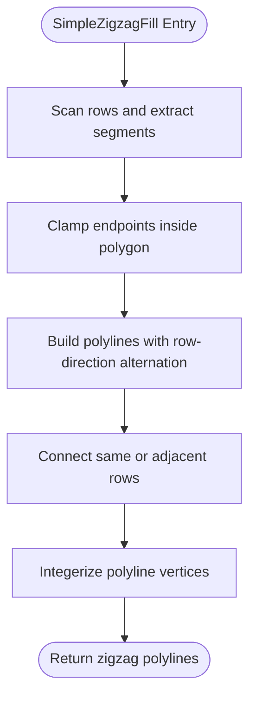

**Diagram sources**
- [PolygonFill.cpp:566-800](file://2D/PolygonFill.cpp#L566-L800)

**Section sources**
- [PolygonFill.cpp:566-800](file://2D/PolygonFill.cpp#L566-L800)
- [polygon_fill_test.cpp:58-84](file://tests/PolygonFill/polygon_fill_test.cpp#L58-L84)

### Zigzag Fill
Zigzag fill is an advanced version that builds connectivity across multiple contours and handles complex shapes such as concave U-shaped regions. It uses union-find to group segments into connected components and constructs bridges along the outer boundary when direct connections fail.

Key behaviors:
- Sorts segments by projection coordinate.
- Groups segments into components using interval overlap between adjacent rows.
- Clamps segment endpoints to interior.
- Attempts boundary-following bridges when components differ.
- Falls back to midpoint-inside checks and extra straight segments when bridging fails.

Complexity:
- Union-find operations are nearly constant time per operation.
- Adjacent-row connectivity check is O(N²) in worst case due to pairwise comparison.
- Bridge construction involves boundary distance calculation and sampling.

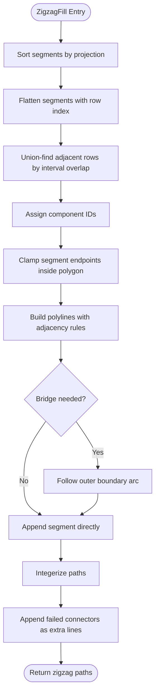

**Diagram sources**
- [PolygonFill.cpp:803-1370](file://2D/PolygonFill.cpp#L803-L1370)

**Section sources**
- [PolygonFill.cpp:803-1370](file://2D/PolygonFill.cpp#L803-L1370)
- [polygon_fill_test.cpp:542-571](file://tests/PolygonFill/polygon_fill_test.cpp#L542-L571)
- [polygon_fill_test.cpp:619-688](file://tests/PolygonFill/polygon_fill_test.cpp#L619-L688)

### Composite Offset Fill
Composite offset fill combines a base internal fill with outward and inward offset borders. The internal fill can be line, simple zigzag, or zigzag.

Key behaviors:
- Applies base fill to the original polygon.
- Generates outward offset borders and fills each outward island.
- Generates inward offset borders and fills each inward island.
- Reuses the selected fill mode for all regions.

Complexity:
- Depends on number of offset layers and fill cost per layer.
- Generally O((outward + inward) × FillCost).

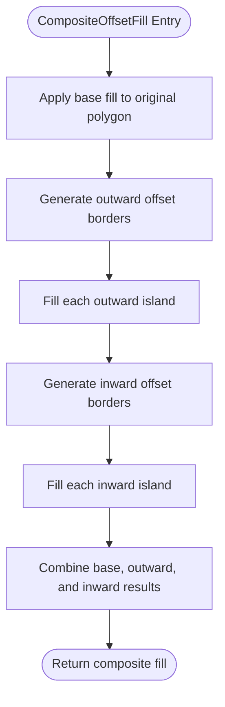

**Diagram sources**
- [PolygonFill.cpp:1372-1428](file://2D/PolygonFill.cpp#L1372-L1428)

**Section sources**
- [PolygonFill.cpp:1372-1428](file://2D/PolygonFill.cpp#L1372-L1428)
- [polygon_fill_test.cpp:108-138](file://tests/PolygonFill/polygon_fill_test.cpp#L108-L138)

### Hybrid Fill
Hybrid fill emits offset borders first, then applies internal fill only to the final inward offset region. It skips very small islands based on area thresholds derived from line thickness.

Key behaviors:
- Emits closed outward offset borders.
- Emits intermediate inward offset borders until area becomes too small.
- Fills only the final valid inward island.
- Uses minimum area threshold to avoid degenerate fills.

Complexity:
- Similar to composite fill but reduces internal fill work by targeting only the final island.

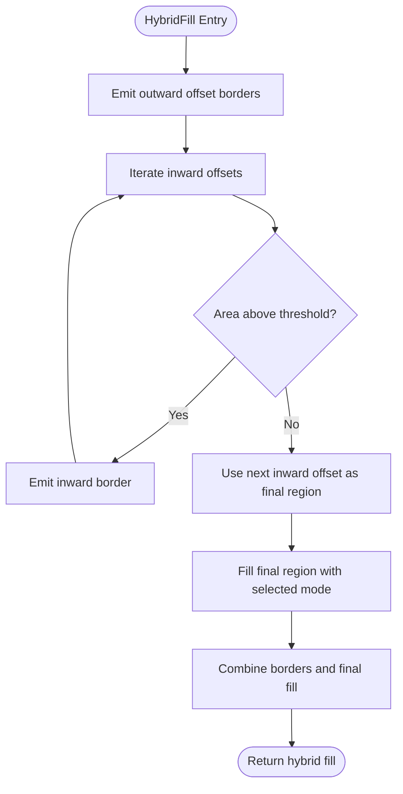

**Diagram sources**
- [PolygonFill.cpp:1430-1491](file://2D/PolygonFill.cpp#L1430-L1491)

**Section sources**
- [PolygonFill.cpp:1430-1491](file://2D/PolygonFill.cpp#L1430-L1491)
- [polygon_fill_test.cpp:132-138](file://tests/PolygonFill/polygon_fill_test.cpp#L132-L138)

### Lua Custom Fill
Lua custom fill executes a user-provided script to generate fill patterns. It creates a Lua state, registers polygon operations and fill functions, loads the script, calls the target function, and converts returned tables into integer polygons.

Key behaviors:
- Registers `PolygonFill.*` functions for use inside scripts.
- Supports file-based and inline script execution.
- Validates return value must be a table.
- Throws `RuntimeError` on script load, function lookup, or call failures.
- Converts float polygons from Lua to integer polygons for downstream processing.

Integration with path optimization:
- `LuaCustomFillByFile` composes 2D polygon functions with path optimization functions so scripts can optimize regions before output.

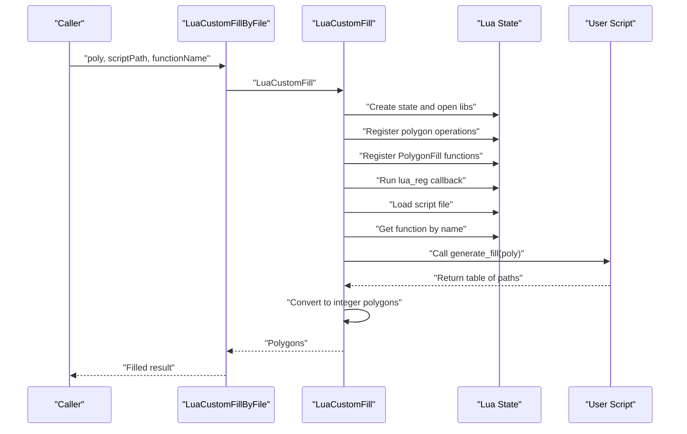

**Diagram sources**
- [polygon_fill.cpp:35-49](file://LibHsBaSlicer/Fill/polygon_fill.cpp#L35-L49)
- [PolygonFill.cpp:1493-1585](file://2D/PolygonFill.cpp#L1493-L1585)
- [PolygonFill.cpp:1587-1600](file://2D/PolygonFill.cpp#L1587-L1600)

**Section sources**
- [polygon_fill.cpp:35-49](file://LibHsBaSlicer/Fill/polygon_fill.cpp#L35-L49)
- [PolygonFill.cpp:1493-1585](file://2D/PolygonFill.cpp#L1493-L1585)
- [polygon_fill_test.cpp:140-175](file://tests/PolygonFill/polygon_fill_test.cpp#L140-L175)
- [polygon_fill_test.cpp:202-258](file://tests/PolygonFill/polygon_fill_test.cpp#L202-L258)
- [polygon_fill_test.cpp:516-540](file://tests/PolygonFill/polygon_fill_test.cpp#L516-L540)

### Honeycomb Support Pattern
Although not part of the general infill API, honeycomb generation is closely related because it demonstrates how structured 2D patterns are produced and clipped to a target region.

Key behaviors:
- Generates flat-top hexagons across a bounding box.
- Offsets every other row by half cell width.
- Unions all hexagons and intersects with the overhang region.
- Used by FDM support generation after applying a gap.

Complexity:
- Hexagon generation is proportional to bounding box area divided by cell size.
- Union and intersection depend on Clipper2 operations.

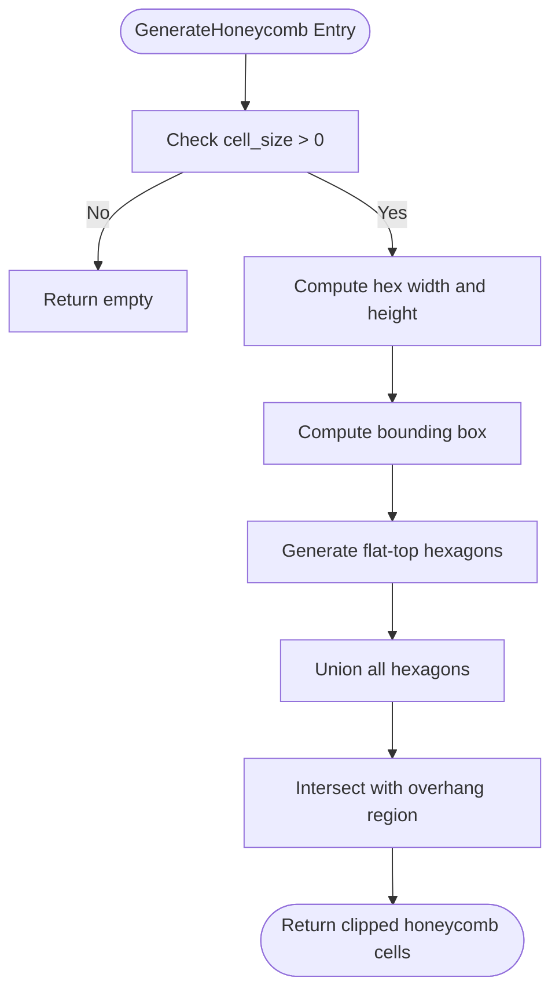

**Diagram sources**
- [FdmSupport.cpp:173-242](file://support/FdmSupport.cpp#L173-L242)

**Section sources**
- [FdmSupport.cpp:173-242](file://support/FdmSupport.cpp#L173-L242)
- [FdmSupport.hpp:46-63](file://support/FdmSupport.hpp#L46-L63)

## Dependency Analysis
The following diagram shows how the modules depend on each other:

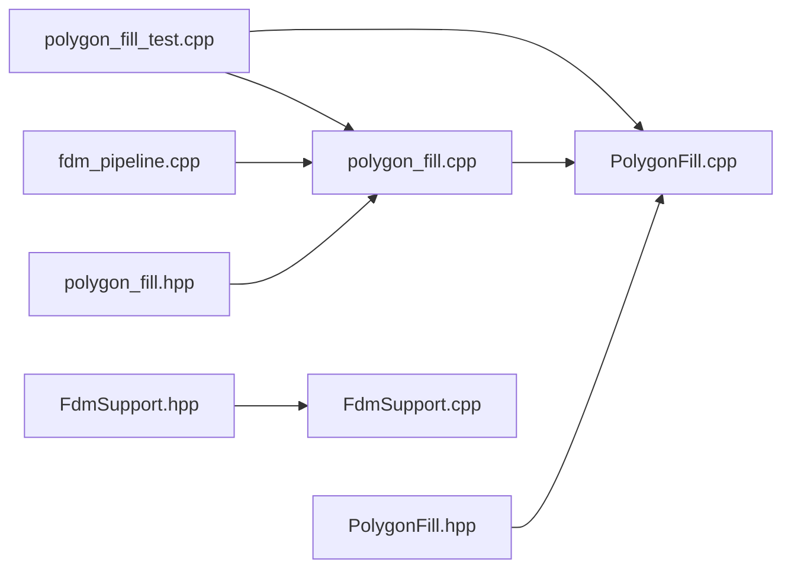

**Diagram sources**
- [PolygonFill.hpp:1-141](file://2D/PolygonFill.hpp#L1-L141)
- [PolygonFill.cpp:1-1669](file://2D/PolygonFill.cpp#L1-L1669)
- [polygon_fill.hpp:1-58](file://LibHsBaSlicer/Fill/polygon_fill.hpp#L1-L58)
- [polygon_fill.cpp:1-52](file://LibHsBaSlicer/Fill/polygon_fill.cpp#L1-L52)
- [fdm_pipeline.cpp:300-497](file://DllHsBaSlicer/fdm_pipeline.cpp#L300-L497)
- [polygon_fill_test.cpp:1-691](file://tests/PolygonFill/polygon_fill_test.cpp#L1-L691)
- [FdmSupport.hpp:46-63](file://support/FdmSupport.hpp#L46-L63)
- [FdmSupport.cpp:173-269](file://support/FdmSupport.cpp#L173-L269)

**Section sources**
- [PolygonFill.hpp:1-141](file://2D/PolygonFill.hpp#L1-L141)
- [polygon_fill.hpp:1-58](file://LibHsBaSlicer/Fill/polygon_fill.hpp#L1-L58)
- [fdm_pipeline.cpp:300-497](file://DllHsBaSlicer/fdm_pipeline.cpp#L300-L497)

## Performance Considerations
- **Offset fill**: Best for thin-walled or shell-like fills. Performance degrades with many nested rings; use reasonable spacing to limit iterations.
- **Line fill**: Fastest for sparse fills. Suitable when connectivity is not required.
- **Simple zigzag fill**: Good balance between speed and continuity. Avoid extremely small spacing because of increased row count.
- **Zigzag fill**: Most robust for complex shapes but computationally heavier due to connectivity analysis and bridging.
- **Composite/hybrid fill**: More expensive because they apply fill to multiple offset regions. Use only when border reinforcement is necessary.
- **Lua custom fill**: Adds interpreter overhead and should be used serially in the pipeline. Prefer built-in fills for performance-critical paths.
- **Density control**: In the FDM pipeline, middle-layer spacing is computed as `fill_spacing / infill_density`. Lower density increases spacing and reduces fill cost.
- **Parallelization**: Built-in fill per layer is parallelized; Lua infill runs sequentially because the Lua interpreter state is shared.

[No sources needed since this section provides general guidance]

## Troubleshooting Guide
Common issues and their causes:

| Issue | Likely Cause | Resolution |
|---|---|---|
| Offset fill returns empty | Spacing is zero or negative | Ensure spacing is positive |
| Zigzag fill produces unexpected gaps | Complex concave shape or disconnected islands | Verify bridging logic and consider adjusting spacing or angle |
| Zigzag fill contains origin `(0,0)` unexpectedly | Fallback path emitted uninitialized point | Update to fixed behavior that stays within bounding box |
| Lua custom fill throws error | Script load failure, missing function, or non-table return | Validate script syntax, function name, and return type |
| Fill does not match expected density | Incorrect `infill_density` or `fill_spacing` | Adjust density or spacing according to pipeline formula |
| Honeycomb support not generated | Cell size too small or overhang region empty | Increase cell size or verify overhang detection |

**Section sources**
- [PolygonFill.cpp:504-541](file://2D/PolygonFill.cpp#L504-L541)
- [PolygonFill.cpp:1493-1585](file://2D/PolygonFill.cpp#L1493-L1585)
- [polygon_fill_test.cpp:177-200](file://tests/PolygonFill/polygon_fill_test.cpp#L177-L200)
- [polygon_fill_test.cpp:202-258](file://tests/PolygonFill/polygon_fill_test.cpp#L202-L258)
- [polygon_fill_test.cpp:619-688](file://tests/PolygonFill/polygon_fill_test.cpp#L619-L688)
- [FdmSupport.cpp:173-242](file://support/FdmSupport.cpp#L173-L242)

## Conclusion
The Polygon Fill module provides a flexible and robust set of infill algorithms for 3D printing. It supports basic patterns like offset rings and parallel lines, advanced zigzag connectivity for complex geometries, composite and hybrid strategies for border reinforcement, and extensible Lua-driven custom patterns. Integration with the FDM pipeline ensures that fill density, orientation, and layer type are handled consistently, while tests validate correctness, Lua binding coverage, and path optimization exposure. For new fill patterns, the Lua custom fill interface offers a practical extension point without modifying core C++ code.

[No sources needed since this section summarizes without analyzing specific files]

## Appendices

### Fill Configuration Examples
| Scenario | Recommended Fill | Parameters |
|---|---|---|
| Low-strength lightweight infill | Line or SimpleZigzag | Small density, moderate spacing |
| Strong directional strength | Zigzag | Angle aligned with load direction |
| Wall-reinforced parts | Composite or Hybrid | Outward/inward border counts |
| Custom aesthetic or functional pattern | Lua custom fill | Script defines geometry |
| Overhang support | Honeycomb support | Cell size tuned to layer height |

**Section sources**
- [fdm_pipeline.cpp:322-342](file://DllHsBaSlicer/fdm_pipeline.cpp#L322-L342)
- [polygon_fill_test.cpp:108-175](file://tests/PolygonFill/polygon_fill_test.cpp#L108-L175)
- [FdmSupport.cpp:173-242](file://support/FdmSupport.cpp#L173-L242)