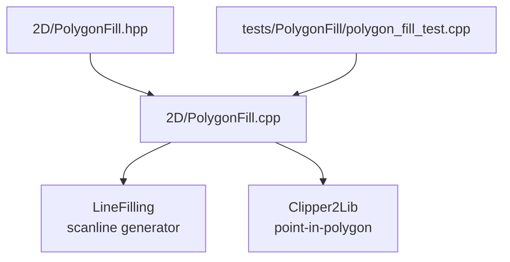
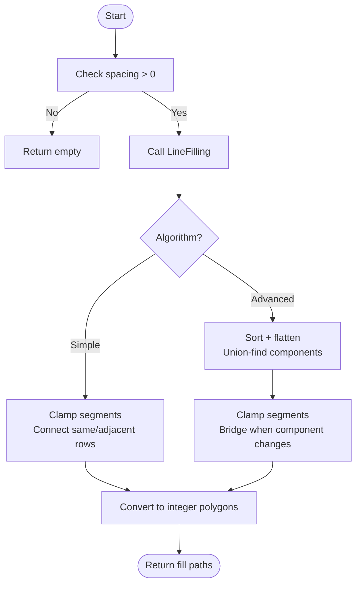
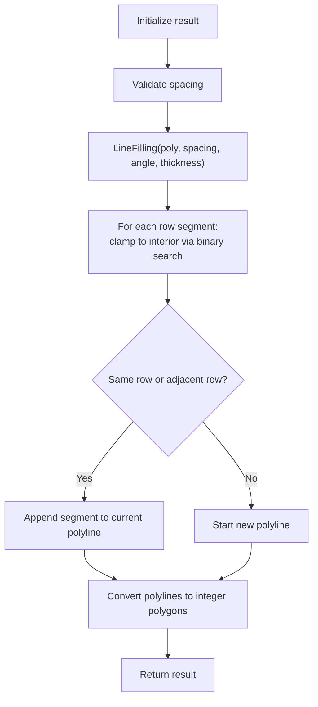
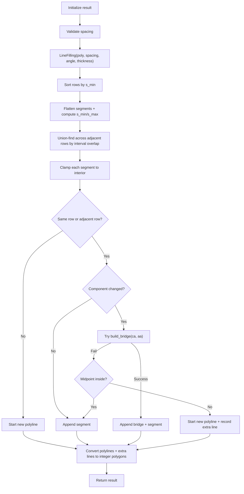
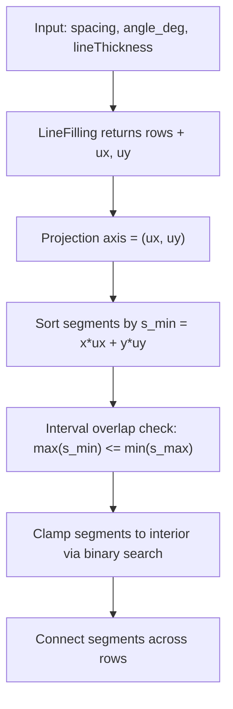
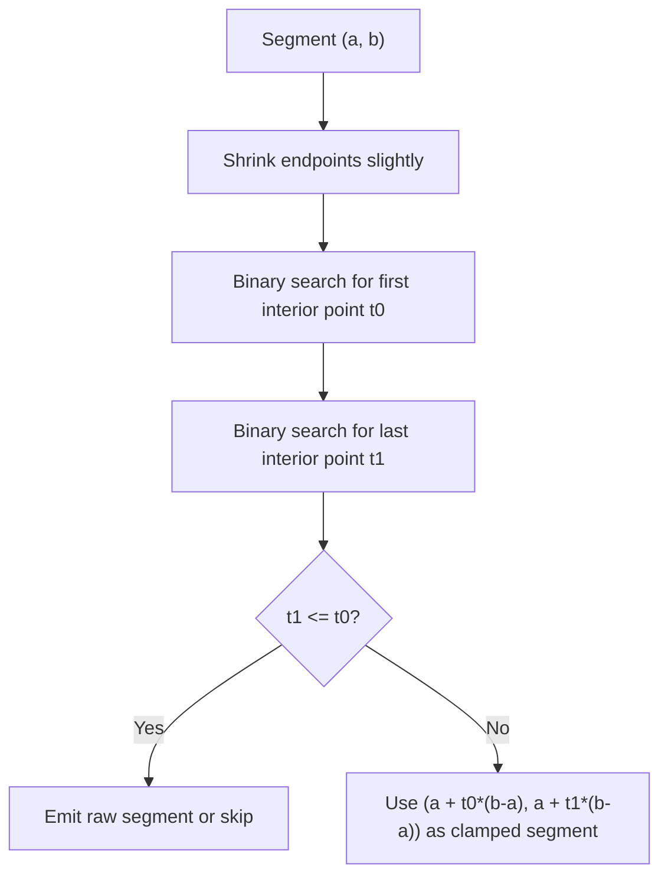
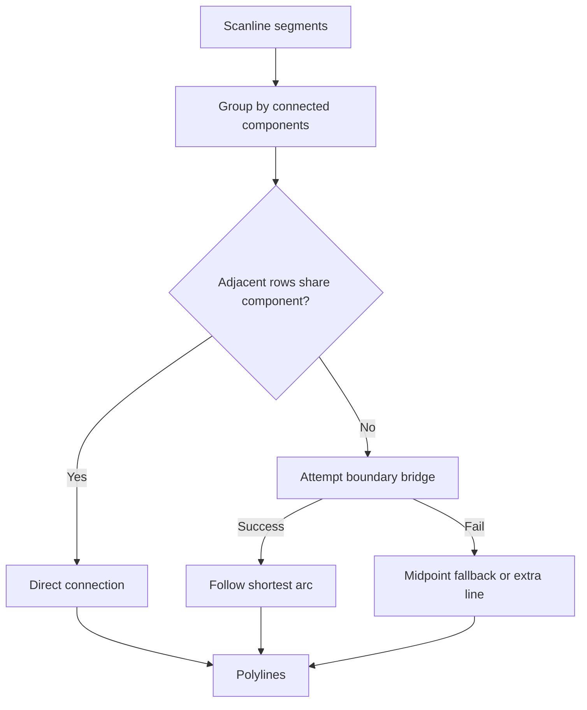
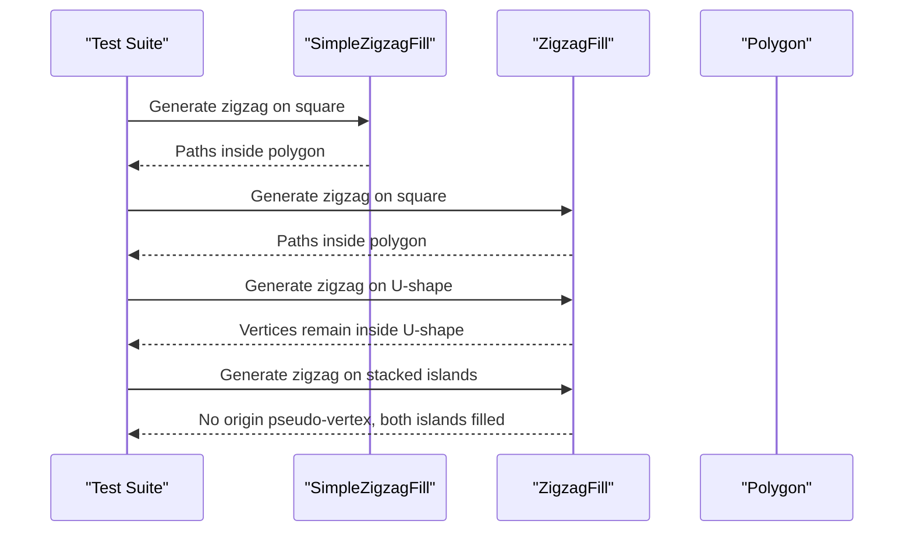
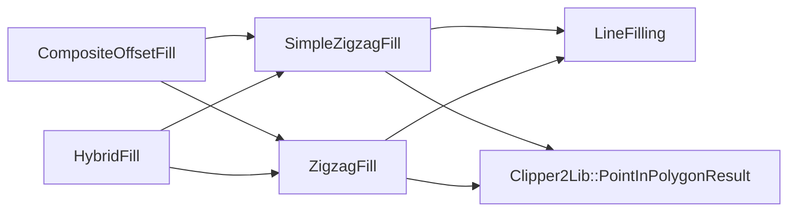

# Zigzag Fill Algorithms / 之字形填充算法

<cite>
**Referenced Files in This Document**
- [PolygonFill.hpp](file://2D/PolygonFill.hpp)
- [PolygonFill.cpp](file://2D/PolygonFill.cpp)
- [polygon_fill_test.cpp](file://tests/PolygonFill/polygon_fill_test.cpp)
</cite>

## Table of Contents
1. [Introduction](#introduction)
2. [Project Structure](#project-structure)
3. [Core Components](#core-components)
4. [Architecture Overview](#architecture-overview)
5. [Detailed Component Analysis](#detailed-component-analysis)
6. [Dependency Analysis](#dependency-analysis)
7. [Performance Considerations](#performance-considerations)
8. [Troubleshooting Guide](#troubleshooting-guide)
9. [Conclusion](#conclusion)

## Introduction
This document explains the two zigzag polygon fill algorithms implemented in the project: `SimpleZigzagFill` and `ZigzagFill`. Both generate connected zigzag paths by scanning a polygon at a configurable angle and spacing, but they differ significantly in connectivity handling, corner behavior, and robustness on complex or concave shapes.

The key differences are:
- `SimpleZigzagFill` builds a simple serpentine path by connecting scanline segments between adjacent rows without explicit component-aware bridging.
- `ZigzagFill` computes connected components across rows using union-find, clamps segments to the polygon interior, and attempts to build boundary-following bridges when adjacent rows belong to different components. This improves corner handling and reduces overhang-like artifacts.

Both algorithms return integer polylines representing fill paths; they do not perform extrusion themselves.

## Project Structure
The zigzag fill logic lives in the 2D geometry module alongside other polygon fill generators. The public API is declared in the header, while implementations and Lua bindings are in the source file. Tests validate correctness for squares, concave U-shapes, stacked islands, and staggered islands.

**Diagram sources**
- [PolygonFill.hpp:40-58](file://2D/PolygonFill.hpp#L40-L58)
- [PolygonFill.cpp:568-801](file://2D/PolygonFill.cpp#L568-L801)
- [PolygonFill.cpp:803-1370](file://2D/PolygonFill.cpp#L803-L1370)
- [polygon_fill_test.cpp:58-83](file://tests/PolygonFill/polygon_fill_test.cpp#L58-L83)

**Section sources**
- [PolygonFill.hpp:40-58](file://2D/PolygonFill.hpp#L40-L58)
- [PolygonFill.cpp:568-801](file://2D/PolygonFill.cpp#L568-L801)
- [PolygonFill.cpp:803-1370](file://2D/PolygonFill.cpp#L803-L1370)
- [polygon_fill_test.cpp:58-83](file://tests/PolygonFill/polygon_fill_test.cpp#L58-L83)

## Core Components
- `SimpleZigzagFill`: Generates a connected zigzag path by iterating through scanline segments returned by `LineFilling`, clamping each segment to the polygon interior, and appending them into polylines while allowing connectors only within the same row or the immediately adjacent row. It does not explicitly compute connected components across rows.
- `ZigzagFill`: Performs additional preprocessing: sorts segments along the scan direction, flattens them into a list with projected coordinates, computes connected components across adjacent rows using union-find, clamps segments to the interior, and builds boundary-following bridges when adjacent rows change components. It also includes fallbacks to avoid emitting uninitialized points.

Public API signatures:
- `Polygons SimpleZigzagFill(const Polygons& poly, double spacing, double angle_deg, double lineThickness = 0.5)`
- `Polygons ZigzagFill(const Polygons& poly, double spacing, double angle_deg, double lineThickness = 0.5)`

These functions are also exposed to Lua as `simpleZigzagFill` and `zigzagFill`.

**Section sources**
- [PolygonFill.hpp:40-58](file://2D/PolygonFill.hpp#L40-L58)
- [PolygonFill.cpp:568-801](file://2D/PolygonFill.cpp#L568-L801)
- [PolygonFill.cpp:803-1370](file://2D/PolygonFill.cpp#L803-L1370)

## Architecture Overview
At a high level, both algorithms follow this pipeline:
1. Validate spacing and early-return if invalid.
2. Call `LineFilling` to obtain scanline segments per row, plus direction vectors and float polygons.
3. Clamp each segment to the polygon interior using binary search against point-in-polygon tests.
4. Build polylines by connecting segments across rows.
5. Convert polylines to integer output polygons.

`ZigzagFill` adds:
- Sorting segments by projection along the scan direction.
- Union-find based connected component computation across adjacent rows.
- Boundary-following bridge construction when components change between adjacent rows.
- Fallback logic to prevent emitting uninitialized pseudo-vertices.

**Diagram sources**
- [PolygonFill.cpp:568-801](file://2D/PolygonFill.cpp#L568-L801)
- [PolygonFill.cpp:803-1370](file://2D/PolygonFill.cpp#L803-L1370)

## Detailed Component Analysis

### SimpleZigzagFill
`SimpleZigzagFill` implements a straightforward serpentine zigzag:
- It calls `LineFilling` to get rows of segments.
- For each segment, it shrinks endpoints slightly to avoid edge cases, then uses binary search to find the first and last interior points along the segment.
- If no interior span exists, it emits the raw segment.
- It appends segments into polylines, allowing connections only within the same row or the next row. This avoids long-range jumps that could create loops or invalid paths.
- Finally, it converts polylines to integer polygons.

Key behaviors:
- No explicit component tracking across rows.
- Connectors are limited to adjacent rows to keep the path simple.
- Corner handling relies on the underlying scanline geometry; there is no dedicated bridge-building step.

**Diagram sources**
- [PolygonFill.cpp:568-801](file://2D/PolygonFill.cpp#L568-L801)

**Section sources**
- [PolygonFill.cpp:568-801](file://2D/PolygonFill.cpp#L568-L801)

### ZigzagFill
`ZigzagFill` is more sophisticated:
- It sorts each row’s segments by their minimum projection along the scan direction.
- It flattens all segments into a list with metadata (row index, original index, endpoints, min/max projections).
- It computes connected components across adjacent rows using union-find, considering interval overlap along the projection axis.
- It clamps segments to the interior and builds polylines similarly to the simple version, but now it can detect when adjacent rows belong to different components.
- When a component change occurs between adjacent rows, it attempts to build a bridge by finding interior entry/exit points and tracing the shortest arc along the outer polygon boundary. If bridging fails, it falls back to checking the midpoint or emitting extra straight segments.

Corner handling improvements:
- Bridges follow the polygon boundary rather than cutting across open notches, reducing overhang-like artifacts.
- Fallbacks ensure no uninitialized points are emitted even when clamping fails.

**Diagram sources**
- [PolygonFill.cpp:803-1370](file://2D/PolygonFill.cpp#L803-L1370)

**Section sources**
- [PolygonFill.cpp:803-1370](file://2D/PolygonFill.cpp#L803-L1370)

### Zigzag Angle Calculation and Peak-to-Peak Distance Control
- The zigzag angle is passed as `angle_deg` and used by `LineFilling` to determine the scan direction. The direction vector `(ux, uy)` is returned by `LineFilling` and used to sort segments and compute projections (`s_min`, `s_max`).
- Peak-to-peak distance control is achieved through `spacing`: it determines the separation between parallel scanlines. Smaller spacing yields denser zigzags; larger spacing yields sparser ones.
- The algorithm adapts to polygon boundaries by clamping each scanline segment to the interior using binary search against point-in-polygon queries. This ensures generated paths stay within the polygon.

**Diagram sources**
- [PolygonFill.cpp:803-915](file://2D/PolygonFill.cpp#L803-L915)
- [PolygonFill.cpp:948-1002](file://2D/PolygonFill.cpp#L948-L1002)

**Section sources**
- [PolygonFill.cpp:803-915](file://2D/PolygonFill.cpp#L803-L915)
- [PolygonFill.cpp:948-1002](file://2D/PolygonFill.cpp#L948-L1002)

### Intersection Calculations with Polygon Edges
Instead of computing exact intersections with polygon edges, both algorithms use:
- Binary search along each segment to find the first and last interior points.
- Point-in-polygon tests from Clipper2Lib to decide whether a point is inside.
This approach is numerically stable and avoids explicit intersection math, while still ensuring paths remain within the polygon.

**Diagram sources**
- [PolygonFill.cpp:590-644](file://2D/PolygonFill.cpp#L590-L644)
- [PolygonFill.cpp:948-1002](file://2D/PolygonFill.cpp#L948-L1002)

**Section sources**
- [PolygonFill.cpp:590-644](file://2D/PolygonFill.cpp#L590-L644)
- [PolygonFill.cpp:948-1002](file://2D/PolygonFill.cpp#L948-L1002)

### Path Optimization Techniques
- Adjacent-row-only connections prevent long-range jumps that could create loops or invalid paths.
- Union-find groups segments into connected components, enabling smarter bridging decisions.
- Bridge construction follows the shortest arc along the outer polygon boundary, minimizing detours.
- Fallbacks avoid emitting uninitialized points and preserve coverage even when bridging fails.

**Diagram sources**
- [PolygonFill.cpp:828-915](file://2D/PolygonFill.cpp#L828-L915)
- [PolygonFill.cpp:1004-1122](file://2D/PolygonFill.cpp#L1004-L1122)

**Section sources**
- [PolygonFill.cpp:828-915](file://2D/PolygonFill.cpp#L828-L915)
- [PolygonFill.cpp:1004-1122](file://2D/PolygonFill.cpp#L1004-L1122)

### Visual Comparisons: Simple vs Advanced
While this document does not include images, the test suite demonstrates behavioral differences:
- Both algorithms produce paths whose vertices lie inside or on the boundary of the original polygon.
- For a concave U-shaped polygon, `ZigzagFill` must route around the notch; the test asserts that every vertex remains inside the shape, validating improved corner handling.
- For stacked and staggered islands, `ZigzagFill` avoids emitting uninitialized pseudo-vertices and ensures coverage of both islands.

**Diagram sources**
- [polygon_fill_test.cpp:58-83](file://tests/PolygonFill/polygon_fill_test.cpp#L58-L83)
- [polygon_fill_test.cpp:542-571](file://tests/PolygonFill/polygon_fill_test.cpp#L542-L571)
- [polygon_fill_test.cpp:619-647](file://tests/PolygonFill/polygon_fill_test.cpp#L619-L647)

**Section sources**
- [polygon_fill_test.cpp:58-83](file://tests/PolygonFill/polygon_fill_test.cpp#L58-L83)
- [polygon_fill_test.cpp:542-571](file://tests/PolygonFill/polygon_fill_test.cpp#L542-L571)
- [polygon_fill_test.cpp:619-647](file://tests/PolygonFill/polygon_fill_test.cpp#L619-L647)

## Dependency Analysis
The zigzag algorithms depend on:
- `LineFilling` for scanline generation.
- Clipper2Lib for point-in-polygon tests.
- Integerization utilities for converting between float and integer coordinates.
- The `FillMode` enum and composite/hybrid fill functions that dispatch to zigzag variants.

**Diagram sources**
- [PolygonFill.cpp:568-801](file://2D/PolygonFill.cpp#L568-L801)
- [PolygonFill.cpp:803-1370](file://2D/PolygonFill.cpp#L803-L1370)
- [PolygonFill.cpp:1372-1450](file://2D/PolygonFill.cpp#L1372-L1450)

**Section sources**
- [PolygonFill.cpp:568-801](file://2D/PolygonFill.cpp#L568-L801)
- [PolygonFill.cpp:803-1370](file://2D/PolygonFill.cpp#L803-L1370)
- [PolygonFill.cpp:1372-1450](file://2D/PolygonFill.cpp#L1372-L1450)

## Performance Considerations
- `SimpleZigzagFill` is simpler and likely faster due to fewer preprocessing steps.
- `ZigzagFill` performs sorting, union-find, and potential bridge construction, which adds overhead but improves robustness on complex geometries.
- Binary search iterations are bounded by a constant maximum, keeping point-in-polygon checks predictable.
- Clamping and bridge sampling use fixed-step distances tied to integerization and line thickness, balancing accuracy and performance.

[No sources needed since this section provides general guidance]

## Troubleshooting Guide
Common issues and mitigations:
- Empty results: Ensure `spacing > 0`; both algorithms return empty polygons otherwise.
- Vertices outside polygon: Both algorithms clamp segments to the interior; if unexpected exterior points appear, verify input polygon orientation and validity.
- Uninitialized pseudo-vertices: The advanced implementation includes fixes to avoid emitting default-origin points; tests assert bounds for stacked and staggered islands.
- Corner overhangs: Prefer `ZigzagFill` for concave shapes; its bridge logic routes along the boundary instead of cutting across notches.

**Section sources**
- [PolygonFill.cpp:568-574](file://2D/PolygonFill.cpp#L568-L574)
- [PolygonFill.cpp:803-809](file://2D/PolygonFill.cpp#L803-L809)
- [polygon_fill_test.cpp:619-647](file://tests/PolygonFill/polygon_fill_test.cpp#L619-L647)
- [polygon_fill_test.cpp:657-688](file://tests/PolygonFill/polygon_fill_test.cpp#L657-L688)

## Conclusion
`SimpleZigzagFill` provides a fast, straightforward zigzag fill suitable for simple polygons where corner handling is less critical. `ZigzagFill` adds significant robustness through connected component analysis, boundary-following bridges, and careful fallbacks, making it preferable for concave or multi-island shapes. Both algorithms adapt to polygon boundaries via clamping and maintain path continuity across scanlines, with `ZigzagFill` offering improved corner handling and reduced overhang artifacts.

[No sources needed since this section summarizes without analyzing specific files]