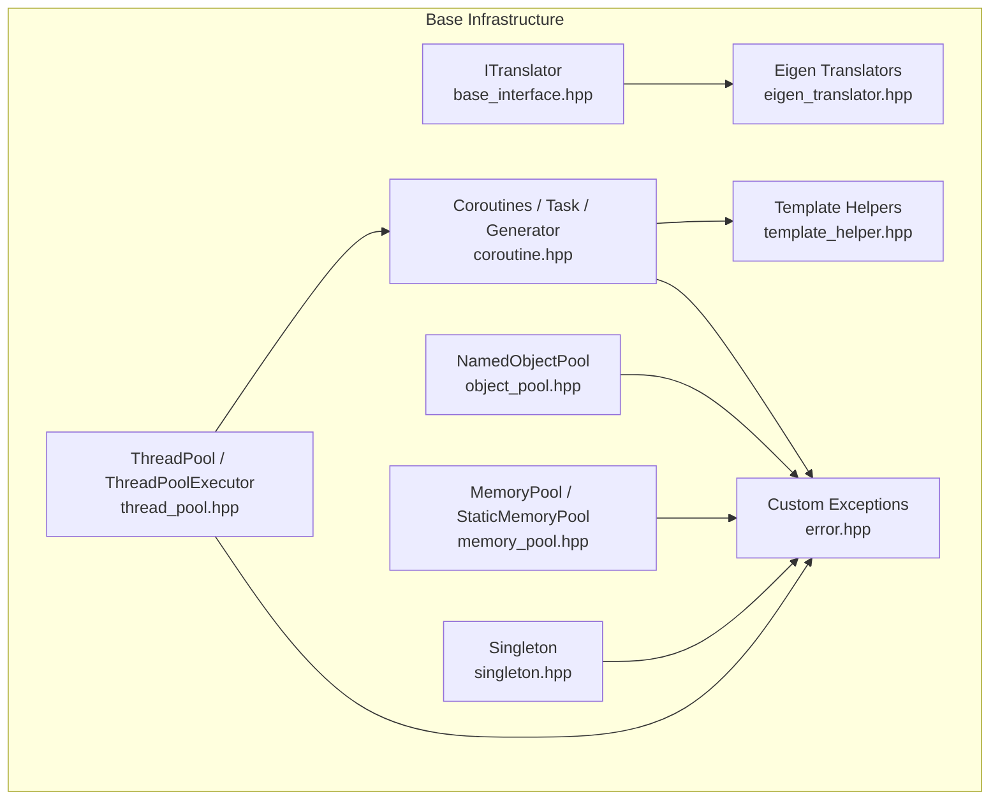
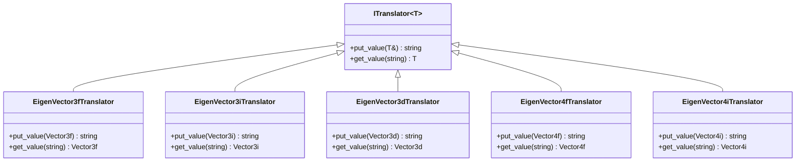
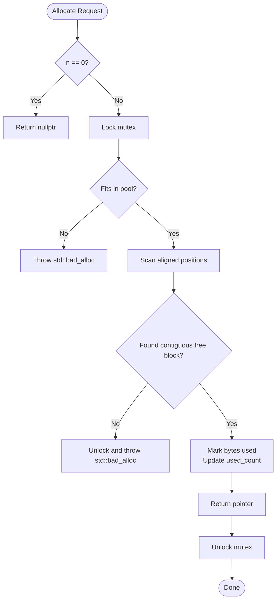
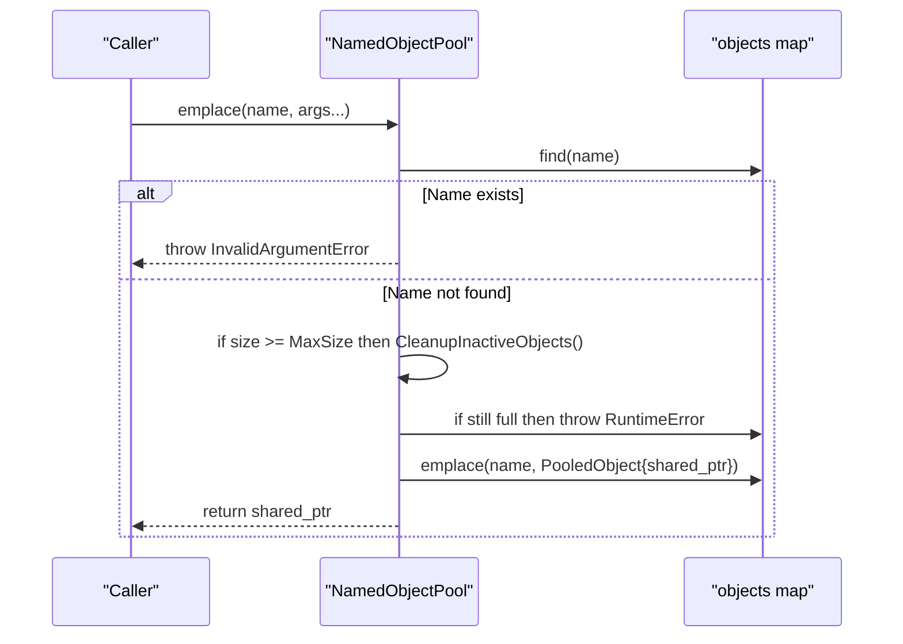
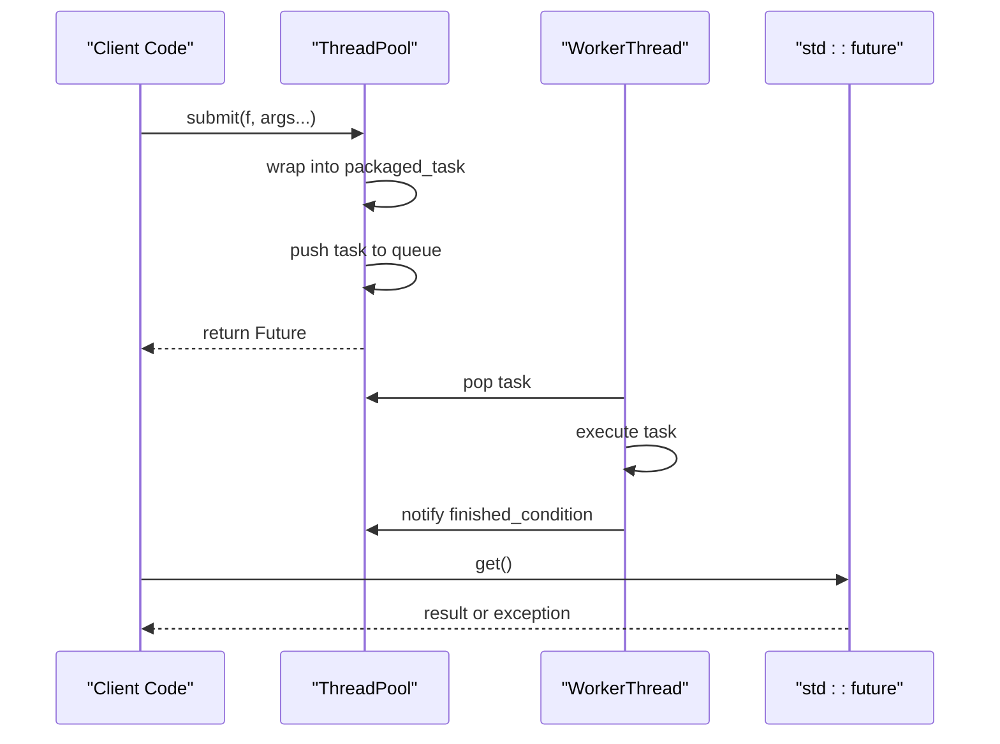
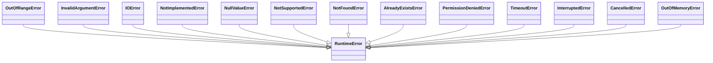
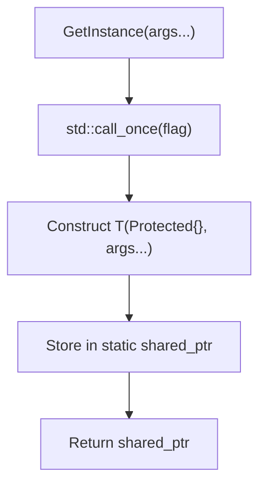
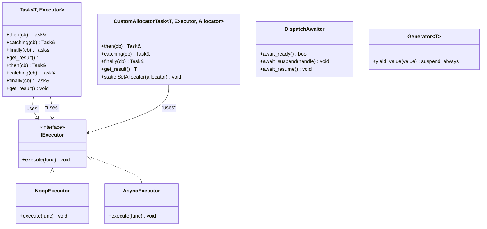
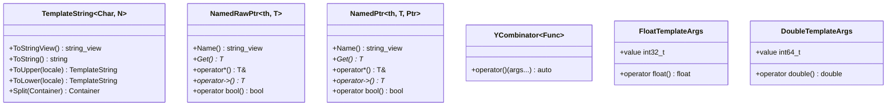
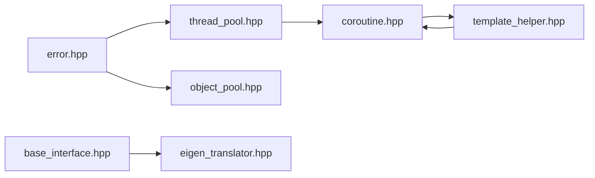

# Base Infrastructure / 基础基础设施

<cite>
**Referenced Files in This Document**   
- [base_interface.hpp](file://base/base_interface.hpp)
- [memory_pool.hpp](file://base/memory_pool.hpp)
- [object_pool.hpp](file://base/object_pool.hpp)
- [thread_pool.hpp](file://base/thread_pool.hpp)
- [error.hpp](file://base/error.hpp)
- [singleton.hpp](file://base/singleton.hpp)
- [coroutine.hpp](file://base/coroutine.hpp)
- [template_helper.hpp](file://base/template_helper.hpp)
- [eigen_translator.hpp](file://base/eigen_translator.hpp)
</cite>

## Table of Contents
1. [Introduction](#introduction)
2. [Project Structure](#project-structure)
3. [Core Components](#core-components)
4. [Architecture Overview](#architecture-overview)
5. [Detailed Component Analysis](#detailed-component-analysis)
6. [Dependency Analysis](#dependency-analysis)
7. [Performance Considerations](#performance-considerations)
8. [Troubleshooting Guide](#troubleshooting-guide)
9. [Conclusion](#conclusion)
10. [Appendices](#appendices)

## Introduction
This document describes HsBaSlicer’s base infrastructure module, which provides foundational components used throughout the framework. It covers:
- Type-to-string conversion via the ITranslator template interface
- Memory management utilities including MemoryPool and StaticMemoryPool allocators
- Object lifecycle management through NamedObjectPool
- Threading primitives with ThreadPool and coroutine executor integration
- Error handling mechanisms using custom exception types
- Singleton pattern implementation for global state management
- Coroutine support for asynchronous operations
- Utility templates such as TemplateString, enum helpers, and named pointer wrappers

The goal is to explain core interfaces, configuration options, performance characteristics, memory usage patterns, and integration examples showing how higher-level modules use these components.

## Project Structure
The base infrastructure lives under the `base` directory and exposes reusable C++ primitives that other modules depend on. The most relevant files are:
- Interface and translator definitions
- Memory and object pools
- Concurrency and coroutines
- Error types
- Singleton and utility templates



**Diagram sources**
- [base_interface.hpp:13-25](file://base/base_interface.hpp#L13-L25)
- [memory_pool.hpp:19-208](file://base/memory_pool.hpp#L19-L208)
- [object_pool.hpp:16-283](file://base/object_pool.hpp#L16-L283)
- [thread_pool.hpp:25-214](file://base/thread_pool.hpp#L25-L214)
- [error.hpp:15-145](file://base/error.hpp#L15-L145)
- [singleton.hpp:14-61](file://base/singleton.hpp#L14-L61)
- [coroutine.hpp:41-773](file://base/coroutine.hpp#L41-L773)
- [template_helper.hpp:42-737](file://base/template_helper.hpp#L42-L737)
- [eigen_translator.hpp:47-90](file://base/eigen_translator.hpp#L47-L90)

**Section sources**
- [base_interface.hpp:1-28](file://base/base_interface.hpp#L1-L28)
- [memory_pool.hpp:1-375](file://base/memory_pool.hpp#L1-L375)
- [object_pool.hpp:1-286](file://base/object_pool.hpp#L1-L286)
- [thread_pool.hpp:1-214](file://base/thread_pool.hpp#L1-L214)
- [error.hpp:1-147](file://base/error.hpp#L1-L147)
- [singleton.hpp:1-63](file://base/singleton.hpp#L1-L63)
- [coroutine.hpp:1-1091](file://base/coroutine.hpp#L1-L1091)
- [template_helper.hpp:1-780](file://base/template_helper.hpp#L1-L780)
- [eigen_translator.hpp:47-90](file://base/eigen_translator.hpp#L47-L90)

## Core Components
This section summarizes the primary building blocks:
- ITranslator: a type-to-string conversion interface
- MemoryPool and StaticMemoryPool: STL-compatible allocators backed by fixed-size pools
- NamedObjectPool: a name-based shared-object pool with automatic cleanup
- ThreadPool: a worker thread pool with futures and optional coroutine executor
- Custom exceptions: a hierarchy rooted at RuntimeError
- Singleton: a thread-safe singleton factory
- Coroutines: Task, generators, executors, and awaiters
- Template helpers: compile-time strings, enum utilities, named pointers, and more

Key responsibilities:
- Provide efficient resource allocation and reuse
- Offer safe concurrency primitives
- Standardize error reporting
- Enable asynchronous programming through coroutines
- Support generic string conversions and reflection-like utilities

**Section sources**
- [base_interface.hpp:13-25](file://base/base_interface.hpp#L13-L25)
- [memory_pool.hpp:43-208](file://base/memory_pool.hpp#L43-L208)
- [object_pool.hpp:22-283](file://base/object_pool.hpp#L22-L283)
- [thread_pool.hpp:29-214](file://base/thread_pool.hpp#L29-L214)
- [error.hpp:15-145](file://base/error.hpp#L15-L145)
- [singleton.hpp:21-61](file://base/singleton.hpp#L21-L61)
- [coroutine.hpp:47-773](file://base/coroutine.hpp#L47-L773)
- [template_helper.hpp:50-737](file://base/template_helper.hpp#L50-L737)

## Architecture Overview
The base layer composes small, focused components that higher layers compose into pipelines, model processing, export, and scripting integrations.

```mermaid
classDiagram
class ITranslator~T~ {
+put_value(T&) string
+get_value(string) T
}
class MemoryPool~T, PoolSize~ {
+allocate(n, hint) T*
+deallocate(p, n) void
+construct(p, args...) void
+destroy(p) void
+max_size() size_t
}
class StaticMemoryPool~T, PoolSize~ {
+allocate(n, hint) T*
+deallocate(p, n) void
+construct(p, args...) void
+destroy(p) void
+max_size() size_t
+UsedCount() size_t
}
class NamedObjectPool~T, MaxSize~ {
+emplace(name, args...) shared_ptr<T>
+insert(name, ptr) shared_ptr<T>
+get(name) shared_ptr<T>
+remove(name) bool
+Contains(name) bool
+size() size_t
+Cleanup() size_t
+GetNames() vector<string>
}
class ThreadPool {
+submit(f, args...) future<R>
+PendingTasks() size_t
+ActiveTasks() size_t
+WaitAll() void
}
class ThreadPoolExecutor {
+execute(func) void
+SetDefaultPool(pool) void
}
class RuntimeError
class OutOfRangeError
class InvalidArgumentError
class IOError
class NotImplementedError
class NullValueError
class NotSupportedError
class NotFoundError
class AlreadyExistsError
class PermissionDeniedError
class TimeoutError
class InterruptedError
class CancelledError
class OutOfMemoryError
class Singleton~T~ {
+GetInstance(args...) shared_ptr<T>
}
class IExecutor {
<<interface>>
+execute(func) void
}
class Task~T, Executor~ {
+then(cb) Task&
+catching(cb) Task&
+finally(cb) Task&
+get_result() T
}
class TemplateString~Char, N~ {
+ToStringView() string_view
+ToString() string
+ToUpper(locale) TemplateString
+ToLower(locale) TemplateString
+Split(Container) Container
}
ITranslator <.. EigenTranslators : "implemented by"
ThreadPoolExecutor ..|> IExecutor
NamedObjectPool --> RuntimeError : "throws"
ThreadPool --> RuntimeError : "throws"
MemoryPool --> std : : bad_alloc : "throws"
StaticMemoryPool --> std : : bad_alloc : "throws"
Task --> IExecutor : "uses"
Singleton --> RuntimeError : "may throw"
```

**Diagram sources**
- [base_interface.hpp:13-25](file://base/base_interface.hpp#L13-L25)
- [memory_pool.hpp:43-208](file://base/memory_pool.hpp#L43-L208)
- [memory_pool.hpp:215-372](file://base/memory_pool.hpp#L215-L372)
- [object_pool.hpp:22-283](file://base/object_pool.hpp#L22-L283)
- [thread_pool.hpp:29-214](file://base/thread_pool.hpp#L29-L214)
- [error.hpp:15-145](file://base/error.hpp#L15-L145)
- [singleton.hpp:21-61](file://base/singleton.hpp#L21-L61)
- [coroutine.hpp:47-773](file://base/coroutine.hpp#L47-L773)
- [template_helper.hpp:50-737](file://base/template_helper.hpp#L50-L737)
- [eigen_translator.hpp:47-90](file://base/eigen_translator.hpp#L47-L90)

## Detailed Component Analysis

### ITranslator Template Interface
ITranslator defines a bidirectional converter between a type T and its string representation. Implementations include Eigen vector translators used by configuration and serialization layers.

Key points:
- put_value converts T to string
- get_value parses string back to T
- Used by translation layers (for example, Eigen vectors)



**Diagram sources**
- [base_interface.hpp:13-25](file://base/base_interface.hpp#L13-L25)
- [eigen_translator.hpp:47-90](file://base/eigen_translator.hpp#L47-L90)

Integration notes:
- Higher-level modules can register or use these translators when serializing/deserializing geometry or pipeline parameters.
- Consumers should handle parsing errors from get_value appropriately.

**Section sources**
- [base_interface.hpp:13-25](file://base/base_interface.hpp#L13-L25)
- [eigen_translator.hpp:47-90](file://base/eigen_translator.hpp#L47-L90)

### Memory Management: MemoryPool and StaticMemoryPool
Both MemoryPool and StaticMemoryPool implement STL allocator semantics over fixed-size buffers. They provide:
- allocate/deallocate
- construct/destroy
- max_size
- Thread safety via mutex
- Exception behavior on overflow

Differences:
- MemoryPool uses a shared state (shared_ptr), allowing multiple instances to share the same pool.
- StaticMemoryPool is a static, globally shared pool; all instances compare equal and expose UsedCount.



**Diagram sources**
- [memory_pool.hpp:111-142](file://base/memory_pool.hpp#L111-L142)
- [memory_pool.hpp:266-296](file://base/memory_pool.hpp#L266-L296)

Configuration and behavior:
- Pool capacity is set at compile time via template parameter PoolSize.
- Allocation fails with std::bad_alloc if insufficient space remains.
- Deallocate validates pointer bounds and marks bytes free.

Usage patterns:
- Use MemoryPool when you need instance-scoped or shared-pool semantics.
- Use StaticMemoryPool for global pooling with zero per-instance overhead.
- Both integrate with STL containers via allocator template parameter.

**Section sources**
- [memory_pool.hpp:28-34](file://base/memory_pool.hpp#L28-L34)
- [memory_pool.hpp:43-208](file://base/memory_pool.hpp#L43-L208)
- [memory_pool.hpp:215-372](file://base/memory_pool.hpp#L215-L372)

### Object Lifecycle Management: NamedObjectPool
NamedObjectPool manages named shared objects with:
- emplace/insert/allocate to create or insert objects
- get/operator[] to retrieve shared pointers
- remove and Contains for existence checks
- CleanupInactiveObjects to reclaim inactive entries
- Capacity enforcement via MaxSize



**Diagram sources**
- [object_pool.hpp:66-92](file://base/object_pool.hpp#L66-L92)
- [object_pool.hpp:262-279](file://base/object_pool.hpp#L262-L279)

Behavioral notes:
- Duplicate names raise InvalidArgumentError.
- When full, it attempts to clean up inactive objects before throwing RuntimeError.
- Inactive means the shared reference count equals one (only the pool holds it).

**Section sources**
- [object_pool.hpp:22-283](file://base/object_pool.hpp#L22-L283)

### Threading Primitives: ThreadPool and ThreadPoolExecutor
ThreadPool manages worker threads and tasks:
- submit wraps functions into packaged tasks and returns futures
- PendingTasks and ActiveTasks report queue and execution status
- WaitAll blocks until all tasks complete
- Destructor signals stop and joins workers

ThreadPoolExecutor integrates with coroutines:
- Implements IExecutor.execute by submitting to a ThreadPool
- Supports a default pool fallback



**Diagram sources**
- [thread_pool.hpp:67-90](file://base/thread_pool.hpp#L67-L90)
- [thread_pool.hpp:118-154](file://base/thread_pool.hpp#L118-L154)

Configuration and options:
- Constructor accepts num_threads; defaults to hardware_concurrency.
- Submitting to a stopped pool throws RuntimeError.
- ThreadPoolExecutor can be constructed with an explicit pool or uses a default pool.

**Section sources**
- [thread_pool.hpp:29-162](file://base/thread_pool.hpp#L29-L162)
- [thread_pool.hpp:164-214](file://base/thread_pool.hpp#L164-L214)

### Error Handling Mechanisms
The base layer defines a consistent exception hierarchy rooted at RuntimeError. Common categories include:
- OutOfRangeError
- InvalidArgumentError
- IOError
- NotImplementedError
- NullValueError
- NotSupportedError
- NotFoundError
- AlreadyExistsError
- PermissionDeniedError
- TimeoutError
- InterruptedError
- CancelledError
- OutOfMemoryError

These exceptions are thrown by various base components to signal invalid states, resource issues, or unsupported operations.



**Diagram sources**
- [error.hpp:15-145](file://base/error.hpp#L15-L145)

**Section sources**
- [error.hpp:15-145](file://base/error.hpp#L15-L145)

### Singleton Pattern Implementation
Singleton provides a thread-safe, shared_ptr-managed singleton factory:
- GetInstance constructs the underlying type exactly once using std::call_once
- Requires the target type to have a constructor taking a Protected sentinel plus user arguments
- Prevents copying/moving of the Singleton wrapper



**Diagram sources**
- [singleton.hpp:35-41](file://base/singleton.hpp#L35-L41)
- [singleton.hpp:47-61](file://base/singleton.hpp#L47-L61)

Usage requirements:
- Define a nested struct Protected inside the singleton class.
- Make Singleton<T> a friend to allow construction.
- Pass constructor arguments through GetInstance.

**Section sources**
- [singleton.hpp:21-61](file://base/singleton.hpp#L21-L61)

### Coroutine Support
The coroutine subsystem provides:
- IExecutor interface for scheduling work
- NoopExecutor and AsyncExecutor implementations
- Task<T, Executor> and Task<void, Executor> with Result wrappers
- DispatchAwaiter for initial suspension onto an executor
- CustomAllocatorTask variants for allocator-aware promises
- Generator for coroutine-based iteration



**Diagram sources**
- [coroutine.hpp:47-773](file://base/coroutine.hpp#L47-L773)

Integration with ThreadPool:
- ThreadPoolExecutor implements IExecutor and submits work to a ThreadPool.
- When enabled, coroutines can schedule continuations on the thread pool.

**Section sources**
- [coroutine.hpp:47-773](file://base/coroutine.hpp#L47-L773)
- [thread_pool.hpp:164-214](file://base/thread_pool.hpp#L164-L214)

### Utility Templates
Template helpers provide:
- TemplateString: fixed-size compile-time string with conversions, case transforms, splitting, and formatting
- EnumName/EnumFromName: runtime-friendly enum name utilities
- AllValidEnum and related helpers for validated enum dispatch
- NamedRawPtr and NamedPtr: named pointer wrappers for debugging and clarity
- YCombinator for recursive lambdas where explicit this is unavailable
- FloatTemplateArgs/DoubleTemplateArgs for non-type template float/double compatibility



**Diagram sources**
- [template_helper.hpp:50-305](file://base/template_helper.hpp#L50-L305)
- [template_helper.hpp:558-621](file://base/template_helper.hpp#L558-L621)
- [template_helper.hpp:623-666](file://base/template_helper.hpp#L623-L666)
- [template_helper.hpp:689-709](file://base/template_helper.hpp#L689-L709)
- [template_helper.hpp:668-687](file://base/template_helper.hpp#L668-L687)

**Section sources**
- [template_helper.hpp:50-305](file://base/template_helper.hpp#L50-L305)
- [template_helper.hpp:376-555](file://base/template_helper.hpp#L376-L555)
- [template_helper.hpp:558-666](file://base/template_helper.hpp#L558-L666)
- [template_helper.hpp:668-737](file://base/template_helper.hpp#L668-L737)

## Dependency Analysis
The base components form a layered dependency graph:
- ITranslator is implemented by specialized translators (for example, Eigen translators)
- ThreadPool depends on coroutine interfaces and error types
- NamedObjectPool depends on error types
- Coroutines depend on template helpers and error types
- Memory pools may throw standard exceptions but are part of the base error ecosystem



**Diagram sources**
- [error.hpp:15-145](file://base/error.hpp#L15-L145)
- [thread_pool.hpp:25-214](file://base/thread_pool.hpp#L25-L214)
- [object_pool.hpp:16-283](file://base/object_pool.hpp#L16-L283)
- [coroutine.hpp:41-773](file://base/coroutine.hpp#L41-L773)
- [template_helper.hpp:42-737](file://base/template_helper.hpp#L42-L737)
- [base_interface.hpp:13-25](file://base/base_interface.hpp#L13-L25)
- [eigen_translator.hpp:47-90](file://base/eigen_translator.hpp#L47-L90)

**Section sources**
- [error.hpp:15-145](file://base/error.hpp#L15-L145)
- [thread_pool.hpp:25-214](file://base/thread_pool.hpp#L25-L214)
- [object_pool.hpp:16-283](file://base/object_pool.hpp#L16-L283)
- [coroutine.hpp:41-773](file://base/coroutine.hpp#L41-L773)
- [template_helper.hpp:42-737](file://base/template_helper.hpp#L42-L737)
- [base_interface.hpp:13-25](file://base/base_interface.hpp#L13-L25)
- [eigen_translator.hpp:47-90](file://base/eigen_translator.hpp#L47-L90)

## Performance Considerations
- MemoryPool and StaticMemoryPool:
  - Fixed-size pools reduce heap fragmentation and allocation overhead.
  - First-fit scanning across byte arrays has O(PoolSize) worst-case per allocation.
  - Mutex contention occurs on every allocate/deallocate; consider batching allocations.
  - StaticMemoryPool offers zero per-instance overhead and equality semantics.
- NamedObjectPool:
  - Uses shared_mutex for concurrent reads and writes.
  - CleanupInactiveObjects scans the map; call periodically or rely on lazy cleanup on insertion.
  - Avoid excessive churn of short-lived objects; prefer stable lifetimes.
- ThreadPool:
  - Task submission incurs packaging and queueing overhead; batch work where possible.
  - Tune thread count based on workload (CPU-bound vs I/O-bound).
  - Exceptions in tasks are caught internally; propagate via future.get().
- Coroutines:
  - Initial suspension dispatches onto the configured executor.
  - Task.Result stores either value or exception pointer; avoid unnecessary copies.
  - CustomAllocatorTask allows allocator control for promise storage.

[No sources needed since this section provides general guidance]

## Troubleshooting Guide
Common issues and resolutions:
- Pool exhaustion:
  - MemoryPool/StaticMemoryPool throw std::bad_alloc when capacity is exceeded. Increase PoolSize or reduce allocation frequency.
- Invalid pointer deallocation:
  - Deallocating pointers outside pool bounds throws std::invalid_argument. Ensure only allocated pointers are returned to the caller.
- Duplicate object names:
  - NamedObjectPool throws InvalidArgumentError on duplicate names. Validate names before insertion.
- Full object pool:
  - NamedObjectPool throws RuntimeError when full and no inactive objects exist. Reduce active references or increase MaxSize.
- Stopped thread pool:
  - Submitting to a stopped ThreadPool throws RuntimeError. Ensure the pool outlives submitted tasks.
- Zero thread count:
  - ThreadPool constructor throws InvalidArgumentError if num_threads is zero.
- Coroutines without executor:
  - If no default pool is set, ThreadPoolExecutor creates a default pool. For deterministic behavior, configure a known pool.

**Section sources**
- [memory_pool.hpp:111-142](file://base/memory_pool.hpp#L111-L142)
- [memory_pool.hpp:156-175](file://base/memory_pool.hpp#L156-L175)
- [memory_pool.hpp:266-296](file://base/memory_pool.hpp#L266-L296)
- [memory_pool.hpp:305-324](file://base/memory_pool.hpp#L305-L324)
- [object_pool.hpp:66-92](file://base/object_pool.hpp#L66-L92)
- [object_pool.hpp:100-115](file://base/object_pool.hpp#L100-L115)
- [object_pool.hpp:135-156](file://base/object_pool.hpp#L135-L156)
- [thread_pool.hpp:37-46](file://base/thread_pool.hpp#L37-L46)
- [thread_pool.hpp:77-89](file://base/thread_pool.hpp#L77-L89)

## Conclusion
HsBaSlicer’s base infrastructure provides robust, composable primitives for type conversion, memory and object lifecycle management, concurrency, error handling, singletons, coroutines, and utility templates. These components enable higher-level modules to focus on domain logic while relying on predictable performance, clear error semantics, and modern C++ features.

[No sources needed since this section summarizes without analyzing specific files]

## Appendices

### Integration Examples

- Using ITranslator with Eigen vectors:
  - Implement or use provided translators to convert Eigen vectors to/from strings for configuration or serialization.

- Using MemoryPool with STL containers:
  - Instantiate MemoryPool or StaticMemoryPool and pass it as the allocator template argument to containers like std::vector or std::list.

- Using NamedObjectPool:
  - Create objects by name, retrieve shared pointers, and rely on automatic cleanup when external references drop.

- Using ThreadPool:
  - Submit tasks with submit, collect results via futures, and wait for completion with WaitAll.

- Using ThreadPoolExecutor with coroutines:
  - Configure a ThreadPool and set it as the default or pass it explicitly to ThreadPoolExecutor to schedule coroutine continuations.

- Using Singleton:
  - Define a class with a Protected struct and a friend declaration, then obtain the instance via GetInstance.

- Using TemplateString:
  - Build compile-time strings, convert to string views or strings, transform case, split, and format with std::format.

[No sources needed since this section provides general guidance]