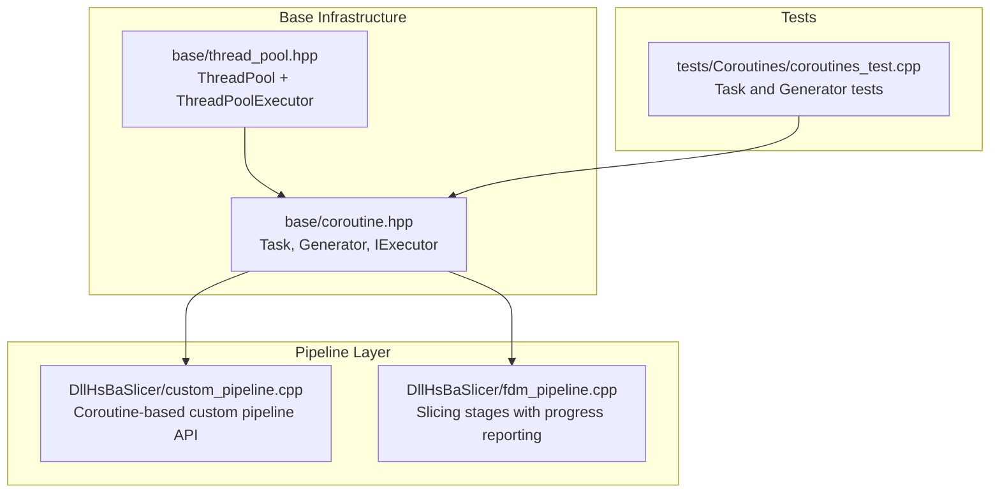
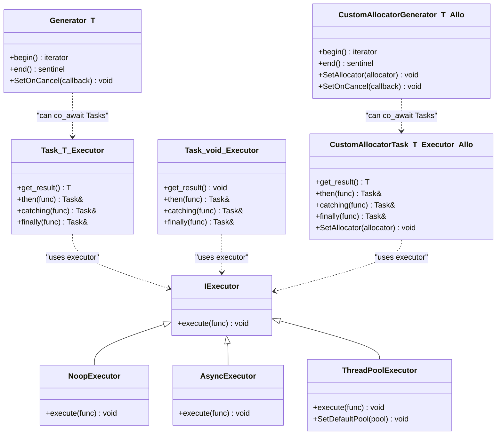
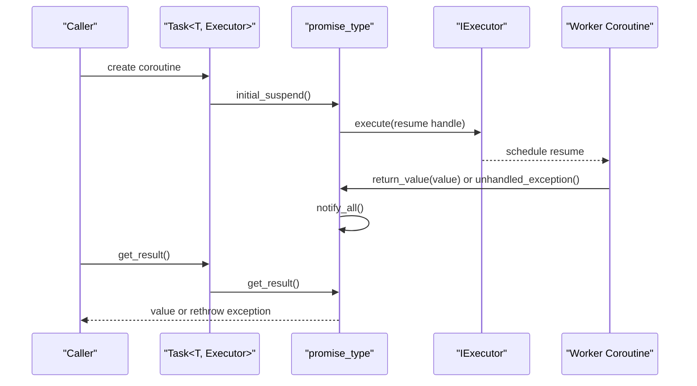
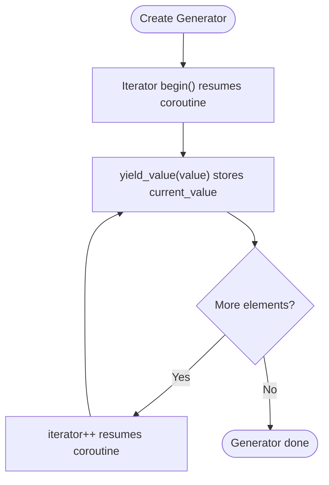
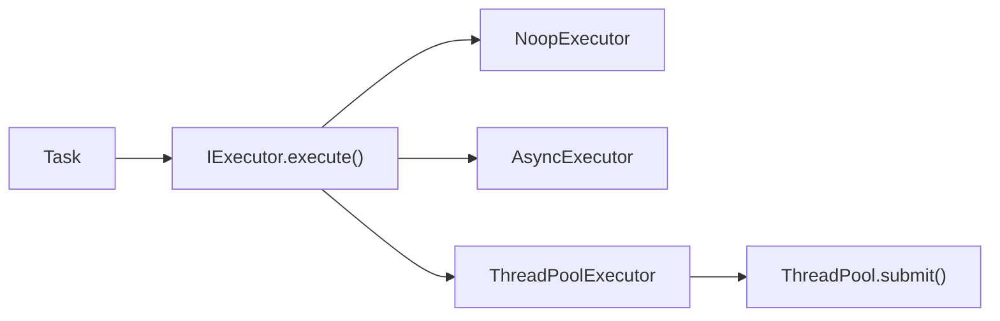
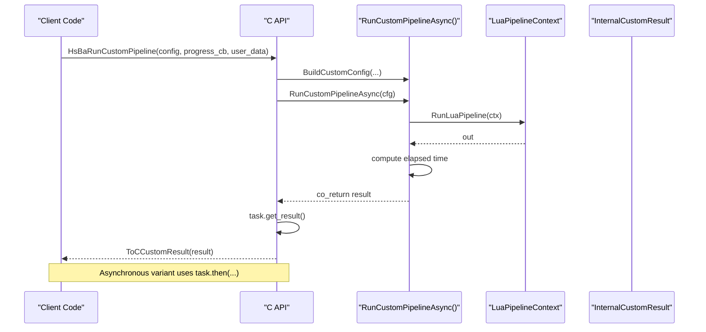
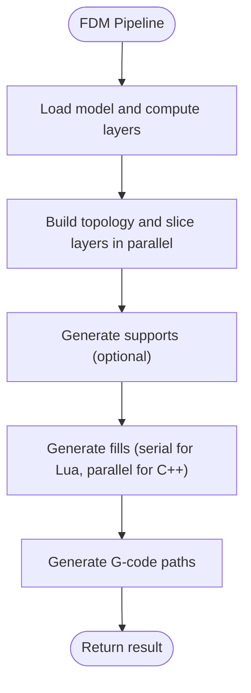
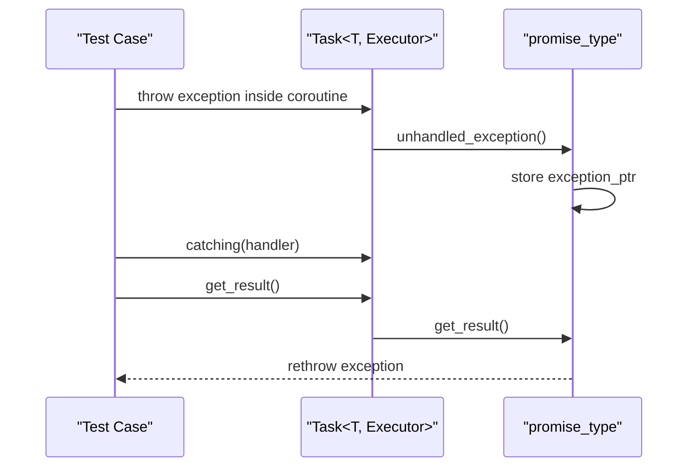
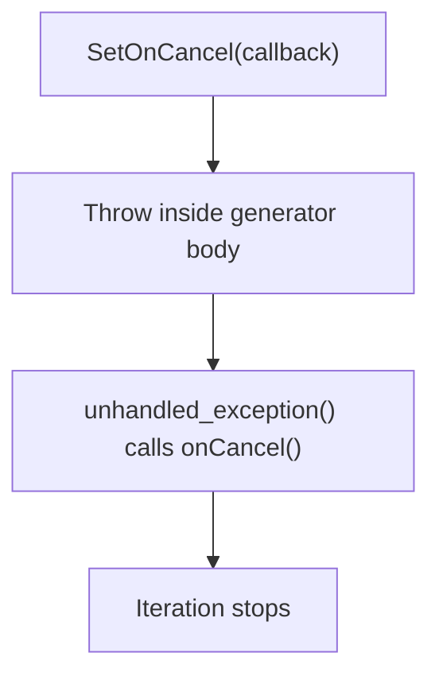
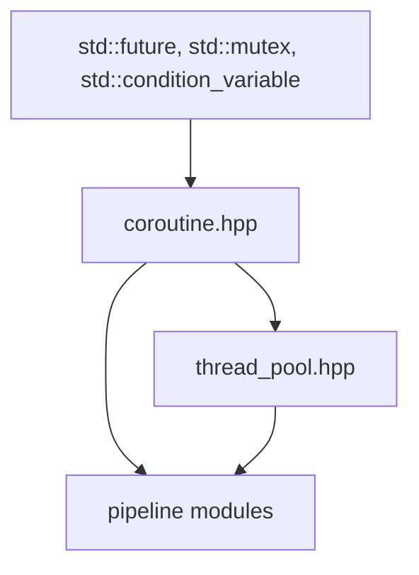

# Coroutines / 协程支持

<cite>
**Referenced Files in This Document**   
- [coroutine.hpp](file://base/coroutine.hpp)
- [thread_pool.hpp](file://base/thread_pool.hpp)
- [coroutines_test.cpp](file://tests/Coroutines/coroutines_test.cpp)
- [custom_pipeline.cpp](file://DllHsBaSlicer/custom_pipeline.cpp)
- [fdm_pipeline.cpp](file://DllHsBaSlicer/fdm_pipeline.cpp)
- [coroutine.md (English)](file://docs/en/base/coroutine.md)
- [coroutine.md (Chinese)](file://docs/zh/base/coroutine.md)
</cite>

## Table of Contents
1. [Introduction](#introduction)
2. [Project Structure](#project-structure)
3. [Core Components](#core-components)
4. [Architecture Overview](#architecture-overview)
5. [Detailed Component Analysis](#detailed-component-analysis)
6. [Dependency Analysis](#dependency-analysis)
7. [Performance Considerations](#performance-considerations)
8. [Troubleshooting Guide](#troubleshooting-guide)
9. [Conclusion](#conclusion)
10. [Appendices](#appendices)

## Introduction
This document explains coroutine support in HsBaSlicer’s base infrastructure and how it enables non-blocking slicing workflows, progress reporting, and long-running tasks. The core coroutine primitives are implemented in the base layer and are used by pipeline code to compose asynchronous stages while keeping UI or caller threads responsive.

Key ideas:
- `Task` represents a C++20 coroutine that can be awaited, chained, and executed on pluggable executors.
- `Generator` provides lazy iteration over computed values and supports cancellation hooks.
- Executors abstract where coroutines resume: inline, background threads, or application thread pools.
- Pipeline stages use `co_return`, `co_await`, and progress callbacks to report work without blocking.

[No sources needed since this section summarizes without analyzing specific files]

## Project Structure
The coroutine system is centered in the base library and integrated into pipeline modules:

**Diagram sources**
- [coroutine.hpp:41-773](file://base/coroutine.hpp#L41-L773)
- [thread_pool.hpp:164-209](file://base/thread_pool.hpp#L164-L209)
- [custom_pipeline.cpp:176-200](file://DllHsBaSlicer/custom_pipeline.cpp#L176-L200)
- [fdm_pipeline.cpp:230-429](file://DllHsBaSlicer/fdm_pipeline.cpp#L230-L429)
- [coroutines_test.cpp:9-244](file://tests/Coroutines/coroutines_test.cpp#L9-L244)

**Section sources**
- [coroutine.hpp:41-773](file://base/coroutine.hpp#L41-L773)
- [thread_pool.hpp:164-209](file://base/thread_pool.hpp#L164-L209)
- [custom_pipeline.cpp:176-200](file://DllHsBaSlicer/custom_pipeline.cpp#L176-L200)
- [fdm_pipeline.cpp:230-429](file://DllHsBaSlicer/fdm_pipeline.cpp#L230-L429)
- [coroutines_test.cpp:9-244](file://tests/Coroutines/coroutines_test.cpp#L9-L244)

## Core Components
The coroutine subsystem exposes three main primitives:

- Executor interface and implementations
  - `IExecutor`: abstract executor for resuming coroutines.
  - `NoopExecutor`: resumes immediately on the current thread.
  - `AsyncExecutor`: uses platform async execution.
  - `ThreadPoolExecutor`: integrates with `ThreadPool` when enabled.

- Task types
  - `Task<T, Executor>`: coroutine returning `T`.
  - `Task<void, Executor>`: coroutine returning no value.
  - `CustomAllocatorTask<T, Executor, Allocator>`: coroutine task using a custom allocator.

- Generator types
  - `Generator<T>`: lazy iterator over yielded values.
  - `CustomAllocatorGenerator<T, Allocator>`: generator with custom allocator.
  - `GeneratorInvoke`: maps a callback lazily over a container.

These components provide:
- Non-blocking composition via `co_await`.
- Chained callbacks: `then`, `catching`, `finally`.
- Exception propagation across coroutine boundaries.
- Cancellation hook for generators.

**Section sources**
- [coroutine.hpp:47-773](file://base/coroutine.hpp#L47-L773)
- [coroutine.hpp:785-1091](file://base/coroutine.hpp#L785-L1091)
- [thread_pool.hpp:164-209](file://base/thread_pool.hpp#L164-L209)

## Architecture Overview
The coroutine architecture separates scheduling from computation:

**Diagram sources**
- [coroutine.hpp:47-773](file://base/coroutine.hpp#L47-L773)
- [coroutine.hpp:785-1091](file://base/coroutine.hpp#L785-L1091)
- [thread_pool.hpp:164-209](file://base/thread_pool.hpp#L164-L209)

## Detailed Component Analysis

### Task Execution Model
`Task` implements a promise-based coroutine with:
- Initial suspension that dispatches through an executor.
- Final suspension that waits until completion.
- Thread-safe result storage with condition variable notification.
- Callback registration for completion, error handling, and cleanup.

**Diagram sources**
- [coroutine.hpp:234-316](file://base/coroutine.hpp#L234-L316)
- [coroutine.hpp:414-488](file://base/coroutine.hpp#L414-L488)

**Section sources**
- [coroutine.hpp:207-382](file://base/coroutine.hpp#L207-L382)
- [coroutine.hpp:388-555](file://base/coroutine.hpp#L388-L555)

### Generator and Lazy Pipelines
`Generator` yields values lazily and supports:
- Iteration via a custom iterator.
- Cancellation hook via `SetOnCancel`.
- Co-awaiting `Task` objects inside generator bodies.

**Diagram sources**
- [coroutine.hpp:785-893](file://base/coroutine.hpp#L785-L893)
- [coroutine.hpp:901-1042](file://base/coroutine.hpp#L901-L1042)

**Section sources**
- [coroutine.hpp:785-893](file://base/coroutine.hpp#L785-L893)
- [coroutine.hpp:901-1042](file://base/coroutine.hpp#L901-L1042)

### Executor Integration with Threading
Executors control where coroutine continuations run:

- `NoopExecutor`: immediate execution; useful for testing and deterministic behavior.
- `AsyncExecutor`: delegates to platform async execution.
- `ThreadPoolExecutor`: submits work to `ThreadPool`; requires build-time feature flag.

**Diagram sources**
- [coroutine.hpp:47-70](file://base/coroutine.hpp#L47-L70)
- [thread_pool.hpp:164-209](file://base/thread_pool.hpp#L164-L209)

**Section sources**
- [coroutine.hpp:47-70](file://base/coroutine.hpp#L47-L70)
- [thread_pool.hpp:164-209](file://base/thread_pool.hpp#L164-L209)

### Coroutine-Based Pipeline Stages
The custom pipeline demonstrates coroutine usage at the API boundary:

- A coroutine function returns a result via `co_return`.
- Progress callbacks are wrapped and invoked during pipeline execution.
- The synchronous C API wraps the coroutine and blocks on `get_result()`.
- The asynchronous C API attaches a `then` callback to deliver results asynchronously.

**Diagram sources**
- [custom_pipeline.cpp:176-200](file://DllHsBaSlicer/custom_pipeline.cpp#L176-L200)
- [custom_pipeline.cpp:120-163](file://DllHsBaSlicer/custom_pipeline.cpp#L120-L163)

**Section sources**
- [custom_pipeline.cpp:120-163](file://DllHsBaSlicer/custom_pipeline.cpp#L120-L163)
- [custom_pipeline.cpp:176-200](file://DllHsBaSlicer/custom_pipeline.cpp#L176-L200)

### Slicing Algorithms and Progress Reporting
The FDM pipeline shows how slicing stages integrate with progress reporting and parallelism:

- Preprocess stage loads model and computes layer count.
- Slicing stage builds topology once and slices layers in parallel.
- Support and infill stages adapt to configuration and may run serially or in parallel.
- Path generation produces final G-code output.

**Diagram sources**
- [fdm_pipeline.cpp:230-429](file://DllHsBaSlicer/fdm_pipeline.cpp#L230-L429)

**Section sources**
- [fdm_pipeline.cpp:230-429](file://DllHsBaSlicer/fdm_pipeline.cpp#L230-L429)

### Error Propagation Across Coroutine Boundaries
Errors thrown inside coroutines are captured and rethrown when awaited:

- Tests verify exceptions propagate from both `Task<int>` and `Task<void>`.
- `catching` allows handling errors without blocking.
- `finally` runs regardless of success or failure.

**Diagram sources**
- [coroutine.hpp:242-248](file://base/coroutine.hpp#L242-L248)
- [coroutine.hpp:422-428](file://base/coroutine.hpp#L422-L428)
- [coroutines_test.cpp:181-242](file://tests/Coroutines/coroutines_test.cpp#L181-L242)

**Section sources**
- [coroutines_test.cpp:181-242](file://tests/Coroutines/coroutines_test.cpp#L181-L242)
- [coroutine.hpp:242-248](file://base/coroutine.hpp#L242-L248)
- [coroutine.hpp:422-428](file://base/coroutine.hpp#L422-L428)

### Cancellation Handling in Generators
Generators expose a global cancellation hook:

- `SetOnCancel` registers a callback invoked on unhandled exceptions.
- Tests demonstrate setting the hook and verifying iteration stops at expected points.

**Diagram sources**
- [coroutine.hpp:822-827](file://base/coroutine.hpp#L822-L827)
- [coroutine.hpp:940-945](file://base/coroutine.hpp#L940-L945)
- [coroutines_test.cpp:61-89](file://tests/Coroutines/coroutines_test.cpp#L61-L89)

**Section sources**
- [coroutine.hpp:822-827](file://base/coroutine.hpp#L822-L827)
- [coroutine.hpp:940-945](file://base/coroutine.hpp#L940-L945)
- [coroutines_test.cpp:61-89](file://tests/Coroutines/coroutines_test.cpp#L61-L89)

## Dependency Analysis
The coroutine system depends on standard concurrency primitives and optional threading integration:

**Diagram sources**
- [coroutine.hpp:25-39](file://base/coroutine.hpp#L25-L39)
- [thread_pool.hpp:13-23](file://base/thread_pool.hpp#L13-L23)
- [custom_pipeline.cpp:176-200](file://DllHsBaSlicer/custom_pipeline.cpp#L176-L200)
- [fdm_pipeline.cpp:230-429](file://DllHsBaSlicer/fdm_pipeline.cpp#L230-L429)

**Section sources**
- [coroutine.hpp:25-39](file://base/coroutine.hpp#L25-L39)
- [thread_pool.hpp:13-23](file://base/thread_pool.hpp#L13-L23)
- [custom_pipeline.cpp:176-200](file://DllHsBaSlicer/custom_pipeline.cpp#L176-L200)
- [fdm_pipeline.cpp:230-429](file://DllHsBaSlicer/fdm_pipeline.cpp#L230-L429)

## Performance Considerations
- Executor choice affects overhead:
  - `NoopExecutor` avoids thread switching but does not offload work.
  - `AsyncExecutor` uses platform async mechanisms; suitable for IO-bound work.
  - `ThreadPoolExecutor` integrates with a bounded worker pool; preferred for CPU-bound parallel stages.
- Parallel slicing and filling reduce total time by distributing independent layer computations.
- Serial Lua-based stages avoid interpreter state sharing issues.
- Generator iteration is lazy, reducing memory pressure compared to eager mapping.
- Custom allocators allow tuning allocation patterns for high-frequency coroutine allocations.

[No sources needed since this section provides general guidance]

## Troubleshooting Guide
Common issues and resolutions:

- Exceptions not propagated:
  - Ensure you call `get_result()` or attach `catching` to observe errors.
  - Verify that exceptions are thrown before `co_return`.

- Callbacks not invoked:
  - Confirm that the task completes; check executor configuration.
  - Use `finally` for cleanup even if success path is missing.

- Generator stops early:
  - Check cancellation hook and exceptions inside generator body.
  - Validate loop conditions and `co_yield` placement.

- Deadlocks or hangs:
  - Avoid blocking on `get_result()` from a thread that also executes the executor.
  - Prefer asynchronous APIs (`then`) in UI threads.

**Section sources**
- [coroutines_test.cpp:181-242](file://tests/Coroutines/coroutines_test.cpp#L181-L242)
- [coroutine.hpp:242-248](file://base/coroutine.hpp#L242-L248)
- [coroutine.hpp:422-428](file://base/coroutine.hpp#L422-L428)

## Conclusion
HsBaSlicer’s coroutine infrastructure provides a robust foundation for non-blocking slicing workflows. `Task` and `Generator` enable composable asynchronous pipelines, while executors decouple scheduling from computation. Pipeline modules leverage these primitives to report progress, parallelize independent work, and maintain responsiveness. For best results, choose appropriate executors, prefer asynchronous APIs in UI contexts, and use generators for lazy data processing.

[No sources needed since this section summarizes without analyzing specific files]

## Appendices

### API Reference Summary
- Executor interface and implementations
  - `IExecutor::execute`
  - `NoopExecutor`
  - `AsyncExecutor`
  - `ThreadPoolExecutor`

- Task types
  - `Task<T, Executor>`
  - `Task<void, Executor>`
  - `CustomAllocatorTask<T, Executor, Allocator>`

- Generator types
  - `Generator<T>`
  - `CustomAllocatorGenerator<T, Allocator>`
  - `GeneratorInvoke`

**Section sources**
- [coroutine.hpp:47-773](file://base/coroutine.hpp#L47-L773)
- [coroutine.hpp:785-1091](file://base/coroutine.hpp#L785-L1091)
- [thread_pool.hpp:164-209](file://base/thread_pool.hpp#L164-L209)

### Usage Examples Reference
- Basic task creation and awaiting
- Generator iteration
- Chained callbacks
- Custom allocator usage
- Coroutine chaining

**Section sources**
- [coroutine.md (English):1-143](file://docs/en/base/coroutine.md#L1-L143)
- [coroutine.md (Chinese):1-49](file://docs/zh/base/coroutine.md#L1-L49)