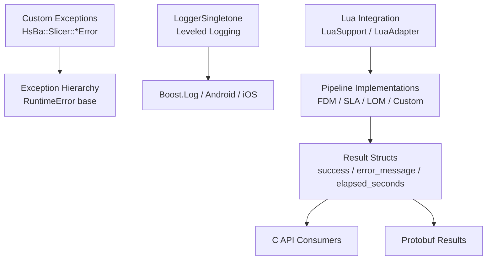
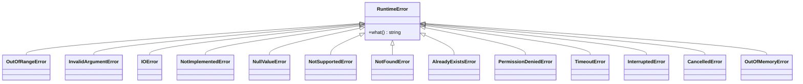
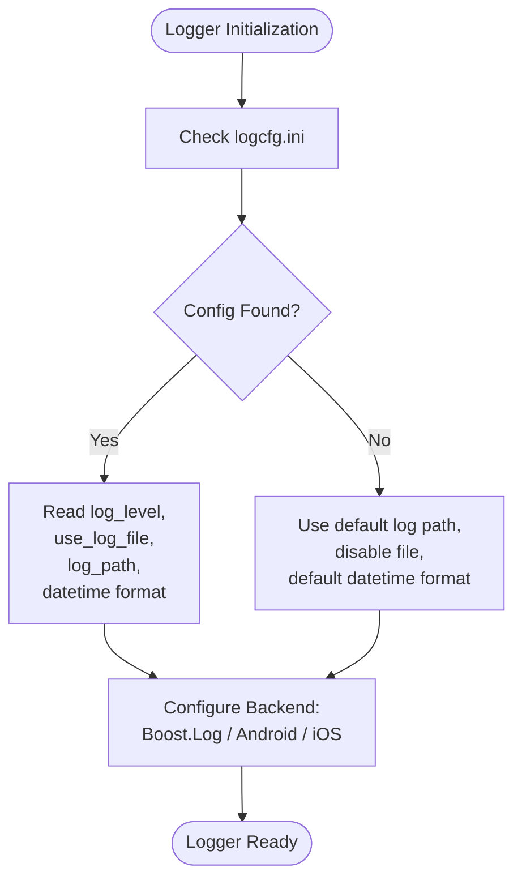
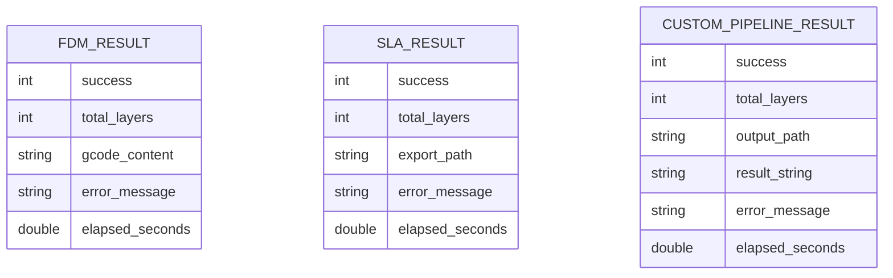
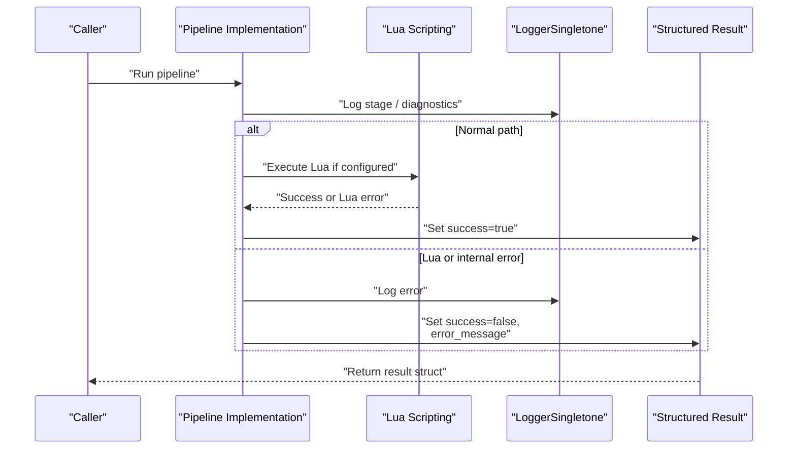
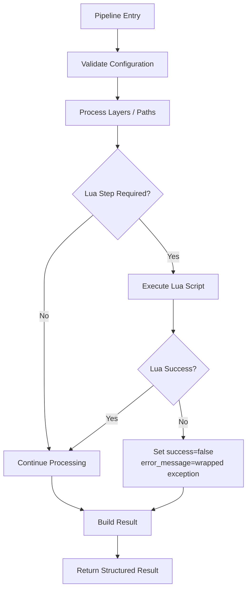
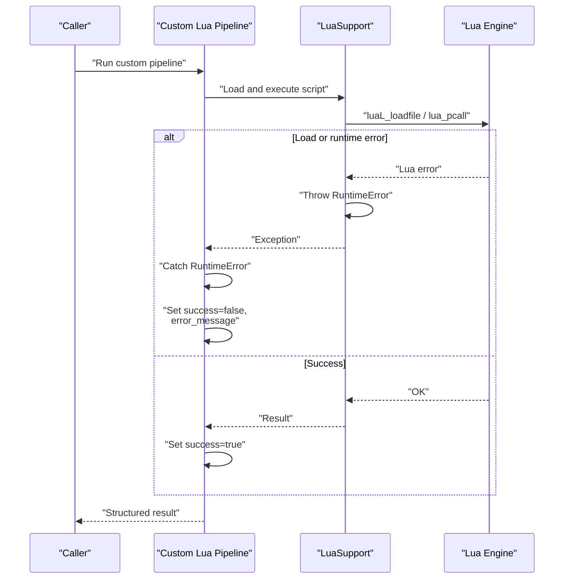
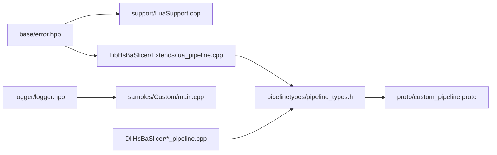

# Error Handling / 错误处理

<cite>
**Referenced Files in This Document**
- [error.hpp](file://base/error.hpp)
- [error.cpp](file://base/error.cpp)
- [logger.hpp](file://logger/logger.hpp)
- [logger.cpp](file://logger/logger.cpp)
- [pipeline_types.h](file://pipelinetypes/pipeline_types.h)
- [lua_pipeline.cpp](file://LibHsBaSlicer/Extends/lua_pipeline.cpp)
- [fdm_pipeline.cpp](file://DllHsBaSlicer/fdm_pipeline.cpp)
- [lom_pipeline.cpp](file://DllHsBaSlicer/lom_pipeline.cpp)
- [sla_pipeline.cpp](file://DllHsBaSlicer/sla_pipeline.cpp)
- [LuaSupport.cpp](file://support/LuaSupport.cpp)
- [LuaAdapter.cpp](file://support/LuaAdapter.cpp)
- [custom_pipeline.proto](file://proto/custom_pipeline.proto)
</cite>

## Table of Contents
1. [Introduction](#introduction)
2. [Project Structure](#project-structure)
3. [Core Components](#core-components)
4. [Architecture Overview](#architecture-overview)
5. [Detailed Component Analysis](#detailed-component-analysis)
6. [Dependency Analysis](#dependency-analysis)
7. [Performance Considerations](#performance-considerations)
8. [Troubleshooting Guide](#troubleshooting-guide)
9. [Conclusion](#conclusion)

## Introduction
This document explains HsBaSlicer’s error handling system from a code-level perspective. It covers the custom exception hierarchy, how errors propagate through C++ and Lua pipeline layers, how results are reported to callers, how logging integrates with error reporting, and what debugging support is available. It also provides practical guidance for throwing and catching exceptions, recovering from recoverable failures, generating user-friendly messages, and keeping error boundaries clean during high-performance slicing operations.

The repository does not define numeric error codes or an explicit error-code enumeration. Instead, it uses:
- A typed exception hierarchy under `HsBa::Slicer`.
- Structured result objects containing success flags, layer counts, output paths, elapsed time, and UTF-8 error messages.
- A cross-platform singleton logger that records contextual information including source location.

## Project Structure
Error-related functionality is primarily split across three areas:

| Area | Responsibility | Key files |
|---|---|---|
| Custom exceptions | Typed runtime errors inheriting from `std::runtime_error` | [base/error.hpp](file://base/error.hpp), [base/error.cpp](file://base/error.cpp) |
| Logging infrastructure | Thread-safe logger with leveled output, file/console/iOS/Android backends | [logger/logger.hpp](file://logger/logger.hpp), [logger/logger.cpp](file://logger/logger.cpp) |
| Pipeline error propagation | Result structs, C API conversion, Lua integration, coroutine-based pipelines | [pipelinetypes/pipeline_types.h](file://pipelinetypes/pipeline_types.h), [LibHsBaSlicer/Extends/lua_pipeline.cpp](file://LibHsBaSlicer/Extends/lua_pipeline.cpp), [DllHsBaSlicer/fdm_pipeline.cpp](file://DllHsBaSlicer/fdm_pipeline.cpp), [DllHsBaSlicer/lom_pipeline.cpp](file://DllHsBaSlicer/lom_pipeline.cpp), [DllHsBaSlicer/sla_pipeline.cpp](file://DllHsBaSlicer/sla_pipeline.cpp) |
| Lua scripting error boundary | Lua script loading, execution, and wrapper bindings | [support/LuaSupport.cpp](file://support/LuaSupport.cpp), [support/LuaAdapter.cpp](file://support/LuaAdapter.cpp) |
| Cross-language result model | Protobuf representation of custom pipeline results | [proto/custom_pipeline.proto](file://proto/custom_pipeline.proto) |

**Diagram sources**
- [base/error.hpp:15-145](file://base/error.hpp#L15-L145)
- [logger/logger.hpp:27-122](file://logger/logger.hpp#L27-L122)
- [logger/logger.cpp:39-222](file://logger/logger.cpp#L39-L222)
- [pipelinetypes/pipeline_types.h:120-127](file://pipelinetypes/pipeline_types.h#L120-L127)
- [LibHsBaSlicer/Extends/lua_pipeline.cpp:1022-1045](file://LibHsBaSlicer/Extends/lua_pipeline.cpp#L1022-L1045)
- [proto/custom_pipeline.proto:23-30](file://proto/custom_pipeline.proto#L23-L30)

**Section sources**
- [base/error.hpp:1-147](file://base/error.hpp#L1-L147)
- [logger/logger.hpp:1-196](file://logger/logger.hpp#L1-L196)
- [logger/logger.cpp:1-422](file://logger/logger.cpp#L1-L422)
- [pipelinetypes/pipeline_types.h:1-800](file://pipelinetypes/pipeline_types.h#L1-L800)
- [LibHsBaSlicer/Extends/lua_pipeline.cpp:1022-1045](file://LibHsBaSlicer/Extends/lua_pipeline.cpp#L1022-L1045)
- [proto/custom_pipeline.proto:23-30](file://proto/custom_pipeline.proto#L23-L30)

## Core Components

### Custom Exception Hierarchy
HsBaSlicer defines a small but expressive exception hierarchy rooted at `std::runtime_error`. All custom errors live in namespace `HsBa::Slicer`. The base class is `RuntimeError`, and specialized errors include:

- `OutOfRangeError`
- `InvalidArgumentError`
- `IOError`
- `NotImplementedError`
- `NullValueError`
- `NotSupportedError`
- `NotFoundError`
- `AlreadyExistsError`
- `PermissionDeniedError`
- `TimeoutError`
- `InterruptedError`
- `CancelledError`
- `OutOfMemoryError`

These classes do not add new fields; they provide semantic type discrimination so callers can catch specific failure categories while still accessing the standard `what()` message.

**Diagram sources**
- [base/error.hpp:15-145](file://base/error.hpp#L15-L145)

**Section sources**
- [base/error.hpp:15-145](file://base/error.hpp#L15-L145)
- [base/error.cpp:1-5](file://base/error.cpp#L1-L5)

### Logging Integration
The logging subsystem is implemented by `LoggerSingletone` in namespace `HsBa::Slicer::Log`. It is a thread-safe singleton that supports:

- Leveled logging via integer levels.
- Source location capture using `std::source_location`.
- Console output on desktop platforms.
- File output controlled by `logcfg.ini`.
- Platform-specific backends: Boost.Log on desktop, Android kernel log, iOS system log.
- Fluent literals such as `_log_debug`, `_log_info`, `_log_warning`, `_log_error`.

Default behavior:
- Debug builds default to a more verbose level.
- Release builds default to warning-level filtering unless configured otherwise.
- If `logcfg.ini` is missing or malformed, defaults are used.

**Diagram sources**
- [logger/logger.cpp:136-222](file://logger/logger.cpp#L136-L222)

**Section sources**
- [logger/logger.hpp:27-122](file://logger/logger.hpp#L27-L122)
- [logger/logger.cpp:39-222](file://logger/logger.cpp#L39-L222)
- [logger/logger.cpp:242-379](file://logger/logger.cpp#L242-L379)
- [logger/logger.cpp:380-422](file://logger/logger.cpp#L380-L422)

### Pipeline Result Model
All public pipeline APIs return structured results rather than raw exceptions. Each result contains:

- `success`: Boolean-like flag indicating whether the pipeline completed successfully.
- `total_layers`: Layer count when applicable.
- Output field: G-code content, export path, or output path depending on the pipeline.
- `error_message`: UTF-8 error message when `success` is false.
- `elapsed_seconds`: Wall-clock duration of the pipeline operation.

Examples include FDM, SLA, SLS, SLM, LOM, 3DP/WAAM, file transfer, and custom Lua pipelines.

**Diagram sources**
- [pipelinetypes/pipeline_types.h:120-127](file://pipelinetypes/pipeline_types.h#L120-L127)
- [pipelinetypes/pipeline_types.h:225-232](file://pipelinetypes/pipeline_types.h#L225-L232)
- [pipelinetypes/pipeline_types.h:711-719](file://pipelinetypes/pipeline_types.h#L711-L719)
- [proto/custom_pipeline.proto:23-30](file://proto/custom_pipeline.proto#L23-L30)

**Section sources**
- [pipelinetypes/pipeline_types.h:120-127](file://pipelinetypes/pipeline_types.h#L120-L127)
- [pipelinetypes/pipeline_types.h:225-232](file://pipelinetypes/pipeline_types.h#L225-L232)
- [pipelinetypes/pipeline_types.h:711-719](file://pipelinetypes/pipeline_types.h#L711-L719)
- [proto/custom_pipeline.proto:23-30](file://proto/custom_pipeline.proto#L23-L30)

## Architecture Overview
HsBaSlicer separates internal error signaling from external error reporting:

1. Internal components throw typed exceptions from `HsBa::Slicer`.
2. Pipeline implementations catch exceptions where appropriate and convert them into structured result objects.
3. C API wrappers translate internal results into C-compatible structs.
4. Lua integration catches `RuntimeError` and wraps its message into the pipeline result.
5. Callers inspect `success` and `error_message`; optional progress callbacks report intermediate stages.
6. Logging records diagnostic context independently of exception flow.

**Diagram sources**
- [LibHsBaSlicer/Extends/lua_pipeline.cpp:1022-1045](file://LibHsBaSlicer/Extends/lua_pipeline.cpp#L1022-L1045)
- [DllHsBaSlicer/fdm_pipeline.cpp:199-210](file://DllHsBaSlicer/fdm_pipeline.cpp#L199-L210)
- [DllHsBaSlicer/lom_pipeline.cpp:298-305](file://DllHsBaSlicer/lom_pipeline.cpp#L298-L305)
- [DllHsBaSlicer/sla_pipeline.cpp:391-413](file://DllHsBaSlicer/sla_pipeline.cpp#L391-L413)
- [logger/logger.hpp:44-83](file://logger/logger.hpp#L44-L83)

## Detailed Component Analysis

### Custom Exception Classes
The exception classes are intentionally lightweight. They inherit constructors and `what()` from `std::runtime_error`, which keeps performance predictable and avoids redundant storage.

Key design points:
- Use `RuntimeError` for general runtime failures.
- Use domain-specific subclasses to make error classification easier.
- Do not rely on numeric error codes; use exception types plus human-readable messages.

Recommended usage patterns:
- Throw `InvalidArgumentError` for invalid configuration values.
- Throw `IOError` for file read/write failures.
- Throw `NotFoundError` when a required resource is missing.
- Throw `NotImplementedError` for unimplemented features.
- Throw `TimeoutError` or `InterruptedError` for cancellable operations.

**Section sources**
- [base/error.hpp:15-145](file://base/error.hpp#L15-L145)

### Logging System
The logger is designed for cross-platform diagnostics and should be used alongside exceptions, not as a replacement for structured error reporting.

Important behaviors:
- `LogDebug`, `LogInfo`, `LogWarning`, `LogError` wrap the central `Log` method.
- Source location is automatically captured.
- Desktop logging uses Boost.Log with console and optional file sinks.
- Android and iOS use platform-native logging.
- Configuration comes from `logcfg.ini` with fallback defaults.

Best practices:
- Log warnings for recoverable conditions.
- Log errors when an operation fails before converting to a result object.
- Avoid excessive debug logging in hot loops.
- Use fluent literals for concise logging calls.

**Section sources**
- [logger/logger.hpp:27-122](file://logger/logger.hpp#L27-L122)
- [logger/logger.cpp:39-222](file://logger/logger.cpp#L39-L222)
- [logger/logger.cpp:242-379](file://logger/logger.cpp#L242-L379)
- [logger/logger.cpp:380-422](file://logger/logger.cpp#L380-L422)

### Error Propagation Through Pipelines
Pipelines follow a consistent pattern:

1. Build internal configuration.
2. Run asynchronous or synchronous processing.
3. Catch exceptions and set `success = false` with a descriptive `error_message`.
4. Record timing information.
5. Convert internal results to C API results.

Examples in the codebase:
- FDM pipeline converts internal results to C results and carries `success`, `gcode_content`, `error_message`, and `elapsed_seconds`.
- LOM pipeline catches exceptions and prefixes the message with a pipeline error label.
- SLA pipeline sets `success = false` and writes an error message when reading a Lua support script fails.
- Custom Lua pipeline catches `RuntimeError` and wraps the message into the result.

**Diagram sources**
- [DllHsBaSlicer/fdm_pipeline.cpp:199-210](file://DllHsBaSlicer/fdm_pipeline.cpp#L199-L210)
- [DllHsBaSlicer/lom_pipeline.cpp:298-305](file://DllHsBaSlicer/lom_pipeline.cpp#L298-L305)
- [DllHsBaSlicer/sla_pipeline.cpp:391-413](file://DllHsBaSlicer/sla_pipeline.cpp#L391-L413)
- [LibHsBaSlicer/Extends/lua_pipeline.cpp:1022-1045](file://LibHsBaSlicer/Extends/lua_pipeline.cpp#L1022-L1045)

**Section sources**
- [DllHsBaSlicer/fdm_pipeline.cpp:199-210](file://DllHsBaSlicer/fdm_pipeline.cpp#L199-L210)
- [DllHsBaSlicer/lom_pipeline.cpp:298-305](file://DllHsBaSlicer/lom_pipeline.cpp#L298-L305)
- [DllHsBaSlicer/sla_pipeline.cpp:391-413](file://DllHsBaSlicer/sla_pipeline.cpp#L391-L413)
- [LibHsBaSlicer/Extends/lua_pipeline.cpp:1022-1045](file://LibHsBaSlicer/Extends/lua_pipeline.cpp#L1022-L1045)

### Lua Scripting Error Boundary
Lua integration is a critical error boundary because Lua scripts can fail during load, execution, or function invocation.

Observed behavior:
- `LuaSupport` throws `RuntimeError` when script loading fails.
- `LuaSupport` throws `RuntimeError` when script execution fails.
- `LuaSupport` throws `RuntimeError` when calling a named function fails.
- The custom Lua pipeline catches `RuntimeError` and converts it into a structured result with `success = false` and a prefixed error message.

**Diagram sources**
- [support/LuaSupport.cpp:130-179](file://support/LuaSupport.cpp#L130-L179)
- [LibHsBaSlicer/Extends/lua_pipeline.cpp:1022-1045](file://LibHsBaSlicer/Extends/lua_pipeline.cpp#L1022-L1045)

**Section sources**
- [support/LuaSupport.cpp:130-179](file://support/LuaSupport.cpp#L130-L179)
- [support/LuaAdapter.cpp:1-155](file://support/LuaAdapter.cpp#L1-L155)
- [LibHsBaSlicer/Extends/lua_pipeline.cpp:1022-1045](file://LibHsBaSlicer/Extends/lua_pipeline.cpp#L1022-L1045)

### Error Reporting Hierarchy
The error reporting hierarchy is layered:

| Layer | Purpose | Mechanism |
|---|---|---|
| Low-level algorithms | Signal invalid state or unsupported operation | Throw `HsBa::Slicer::*Error` |
| Mid-level modules | Wrap low-level failures and add context | Catch and rethrow or convert to higher-level exceptions |
| Pipeline layer | Provide stable C/C++ API contracts | Catch exceptions and populate `success` and `error_message` |
| C API / Protobuf | Expose results to consumers | Copy result fields into C structs or protobuf messages |
| Logging layer | Record diagnostics | Independent of exception flow |

There is no global error-code registry. Consumers should check `success` first, then inspect `error_message`, and optionally use logs for deeper diagnosis.

**Section sources**
- [pipelinetypes/pipeline_types.h:120-127](file://pipelinetypes/pipeline_types.h#L120-L127)
- [pipelinetypes/pipeline_types.h:225-232](file://pipelinetypes/pipeline_types.h#L225-L232)
- [pipelinetypes/pipeline_types.h:711-719](file://pipelinetypes/pipeline_types.h#L711-L719)
- [proto/custom_pipeline.proto:23-30](file://proto/custom_pipeline.proto#L23-L30)

## Dependency Analysis
The following diagram shows how error handling dependencies connect across the codebase.

**Diagram sources**
- [base/error.hpp:15-145](file://base/error.hpp#L15-L145)
- [support/LuaSupport.cpp:130-179](file://support/LuaSupport.cpp#L130-L179)
- [LibHsBaSlicer/Extends/lua_pipeline.cpp:1022-1045](file://LibHsBaSlicer/Extends/lua_pipeline.cpp#L1022-L1045)
- [pipelinetypes/pipeline_types.h:120-127](file://pipelinetypes/pipeline_types.h#L120-L127)
- [proto/custom_pipeline.proto:23-30](file://proto/custom_pipeline.proto#L23-L30)

**Section sources**
- [base/error.hpp:15-145](file://base/error.hpp#L15-L145)
- [support/LuaSupport.cpp:130-179](file://support/LuaSupport.cpp#L130-L179)
- [LibHsBaSlicer/Extends/lua_pipeline.cpp:1022-1045](file://LibHsBaSlicer/Extends/lua_pipeline.cpp#L1022-L1045)
- [pipelinetypes/pipeline_types.h:120-127](file://pipelinetypes/pipeline_types.h#L120-L127)
- [proto/custom_pipeline.proto:23-30](file://proto/custom_pipeline.proto#L23-L30)

## Performance Considerations
Exception handling has measurable cost in tight loops common to slicing operations. Follow these guidelines:

- Prefer validation and early returns for expected invalid inputs instead of throwing exceptions in hot paths.
- Reserve exceptions for truly exceptional conditions such as I/O failures, out-of-memory situations, or unrecoverable algorithm states.
- Keep exception messages concise; avoid heavy string construction inside hot loops.
- Use logging selectively: debug logs can dominate output and slow down production runs.
- Separate diagnostic logging from error reporting: logging should not replace structured result fields.
- For Lua integration, avoid repeated script loads; cache scripts when possible and only reload when explicitly requested.
- When measuring performance, exclude logging overhead by configuring a higher minimum log level.

[No sources needed since this section provides general guidance]

## Troubleshooting Guide

### Common Symptoms and Causes

| Symptom | Likely Cause | Recommended Action |
|---|---|---|
| Pipeline reports `success = false` with a generic message | Exception caught at pipeline boundary without enough context | Add targeted logging before the failing step; ensure error messages describe the failed resource or parameter |
| Lua pipeline fails with a wrapped `RuntimeError` | Lua script load, execution, or function call failed | Inspect the Lua script path, function name, and script contents; enable debug logging |
| No log file is created | `logcfg.ini` missing or `use_log_file` disabled | Verify configuration file exists and contains valid entries |
| Error message contains `<lua error>` | Lua error string was empty | Improve Lua error handling to produce meaningful messages |
| High CPU or memory usage during slicing | Excessive logging or repeated allocations in error paths | Reduce log verbosity; avoid constructing large strings in error branches |

### Debugging Steps
1. Enable debug logging in development builds or configure `logcfg.ini` to increase verbosity.
2. Reproduce the failure and capture the log output.
3. Inspect the returned result structure:
   - Check `success`.
   - Read `error_message`.
   - Review `elapsed_seconds` to identify long-running steps.
4. If the failure occurs in Lua:
   - Confirm the script path and function name.
   - Test the script independently.
   - Look for `RuntimeError` wrapping around Lua errors.
5. If the failure occurs in file I/O:
   - Check permissions and paths.
   - Use `IOError` or equivalent semantics in your own code.
6. If the failure is related to cancellation or timeout:
   - Use `TimeoutError` or `InterruptedError` to signal the condition.
   - Ensure the caller handles recovery or retry logic.

**Section sources**
- [logger/logger.cpp:136-222](file://logger/logger.cpp#L136-L222)
- [support/LuaSupport.cpp:130-179](file://support/LuaSupport.cpp#L130-L179)
- [LibHsBaSlicer/Extends/lua_pipeline.cpp:1022-1045](file://LibHsBaSlicer/Extends/lua_pipeline.cpp#L1022-L1045)
- [pipelinetypes/pipeline_types.h:120-127](file://pipelinetypes/pipeline_types.h#L120-L127)

## Conclusion
HsBaSlicer’s error handling system combines typed C++ exceptions, structured result reporting, and cross-platform logging. The framework favors clear API contracts over numeric error codes: internal components throw `HsBa::Slicer::*Error` exceptions, pipeline layers convert those exceptions into `success`/`error_message` results, and consumers inspect those results while using logs for diagnostics.

For maintainable and high-performance slicing operations:
- Use exceptions sparingly in hot paths.
- Preserve detailed context in error messages.
- Keep Lua errors visible through structured results.
- Configure logging appropriately for development versus production.
- Treat `success = false` as the primary contract for callers, and use logs and exception types for developer-facing diagnosis.

[No sources needed since this section summarizes without analyzing specific files]