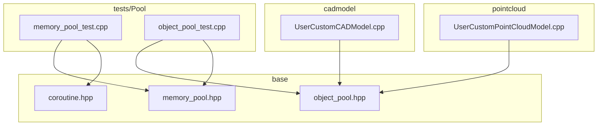
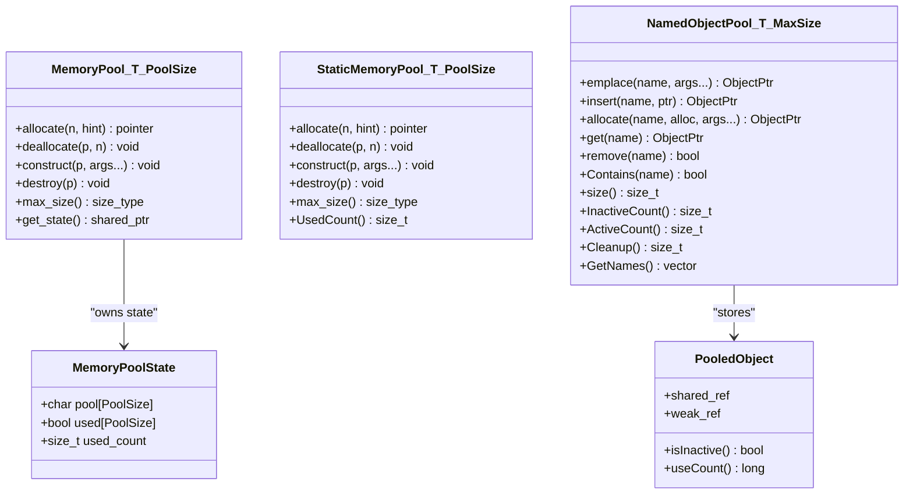
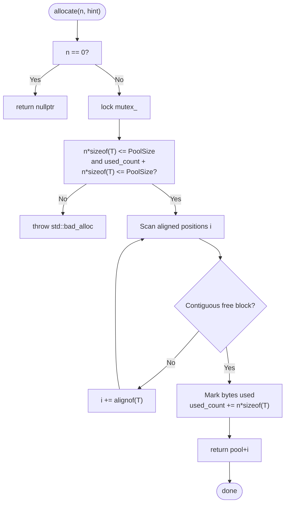
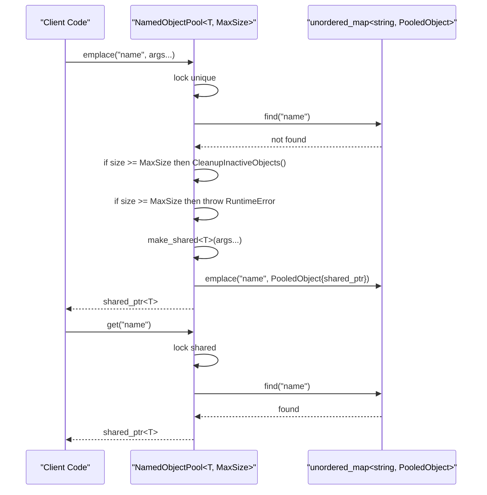
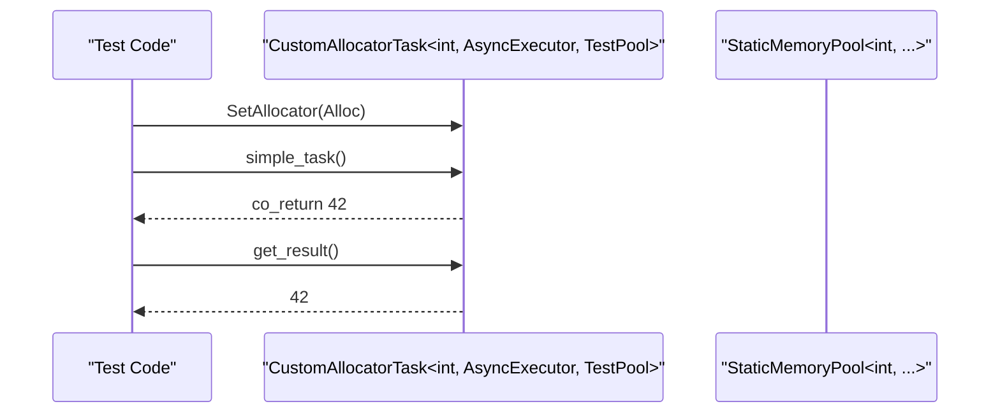
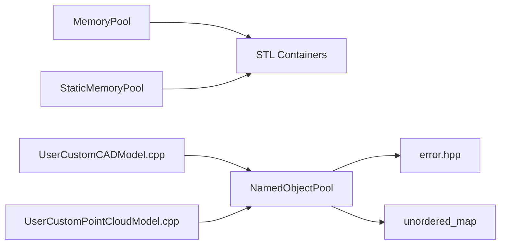

# Memory Management / 内存管理

<cite>
**Referenced Files in This Document**
- [memory_pool.hpp](file://base/memory_pool.hpp)
- [object_pool.hpp](file://base/object_pool.hpp)
- [coroutine.hpp](file://base/coroutine.hpp)
- [memory_pool_test.cpp](file://tests/Pool/memory_pool_test.cpp)
- [object_pool_test.cpp](file://tests/Pool/object_pool_test.cpp)
- [UserCustomCADModel.cpp](file://cadmodel/UserCustomCADModel.cpp)
- [UserCustomPointCloudModel.cpp](file://pointcloud/UserCustomPointCloudModel.cpp)
</cite>

## Table of Contents
1. [Introduction](#introduction)
2. [Project Structure](#project-structure)
3. [Core Components](#core-components)
4. [Architecture Overview](#architecture-overview)
5. [Detailed Component Analysis](#detailed-component-analysis)
6. [Dependency Analysis](#dependency-analysis)
7. [Performance Considerations](#performance-considerations)
8. [Troubleshooting Guide](#troubleshooting-guide)
9. [Conclusion](#conclusion)

## Introduction
This document explains HsBaSlicer’s memory management subsystem with a focus on:
- MemoryPool and StaticMemoryPool for efficient allocation of primitive types and fixed-size objects.
- NamedObjectPool for managing collections of objects with automatic lifecycle management, constructor parameter forwarding, and exception safety guarantees.
- How these pools integrate with standard containers, smart pointers, and coroutines to optimize performance-critical operations.
- Practical usage patterns, error handling, and best practices to avoid memory fragmentation.

The content is derived from the source code and tests, ensuring accurate API behavior and implementation details.

## Project Structure
The memory management subsystem lives under base/, with unit tests under tests/Pool/. Real-world usage appears in cadmodel/ and pointcloud/.

**Diagram sources**
- [memory_pool.hpp:1-375](file://base/memory_pool.hpp#L1-L375)
- [object_pool.hpp:1-286](file://base/object_pool.hpp#L1-L286)
- [coroutine.hpp:557-772](file://base/coroutine.hpp#L557-L772)
- [memory_pool_test.cpp:1-100](file://tests/Pool/memory_pool_test.cpp#L1-L100)
- [object_pool_test.cpp:1-162](file://tests/Pool/object_pool_test.cpp#L1-L162)
- [UserCustomCADModel.cpp:22](file://cadmodel/UserCustomCADModel.cpp#L22)
- [UserCustomPointCloudModel.cpp:19](file://pointcloud/UserCustomPointCloudModel.cpp#L19)

**Section sources**
- [memory_pool.hpp:1-375](file://base/memory_pool.hpp#L1-L375)
- [object_pool.hpp:1-286](file://base/object_pool.hpp#L1-L286)
- [memory_pool_test.cpp:1-100](file://tests/Pool/memory_pool_test.cpp#L1-L100)
- [object_pool_test.cpp:1-162](file://tests/Pool/object_pool_test.cpp#L1-L162)
- [UserCustomCADModel.cpp:22](file://cadmodel/UserCustomCADModel.cpp#L22)
- [UserCustomPointCloudModel.cpp:19](file://pointcloud/UserCustomPointCloudModel.cpp#L19)

## Core Components
- MemoryPool<T, PoolSize>: A thread-safe, instance-scoped allocator backed by a fixed-size aligned buffer. It supports STL container integration via the Allocator interface and provides construct/destroy for placement new semantics.
- StaticMemoryPool<T, PoolSize>: A process-wide static allocator with the same interface as MemoryPool but sharing one global buffer across all instances.
- NamedObjectPool<T, MaxSize>: A name-based object registry that manages shared ownership (std::shared_ptr), supports emplace and allocate overloads, tracks active/inactive states, and performs cleanup of inactive entries when capacity is reached.

Key responsibilities:
- Reduce heap fragmentation and allocation overhead for hot paths.
- Provide deterministic lifetime control through RAII and reference counting.
- Enable custom allocators for coroutine tasks and generators.

**Section sources**
- [memory_pool.hpp:28-208](file://base/memory_pool.hpp#L28-L208)
- [memory_pool.hpp:215-372](file://base/memory_pool.hpp#L215-L372)
- [object_pool.hpp:22-283](file://base/object_pool.hpp#L22-L283)

## Architecture Overview
HsBaSlicer composes low-level allocators with higher-level object management:

**Diagram sources**
- [memory_pool.hpp:28-208](file://base/memory_pool.hpp#L28-L208)
- [memory_pool.hpp:215-372](file://base/memory_pool.hpp#L215-L372)
- [object_pool.hpp:35-46](file://base/object_pool.hpp#L35-L46)
- [object_pool.hpp:60-259](file://base/object_pool.hpp#L60-L259)

## Detailed Component Analysis

### MemoryPool<T, PoolSize>
Purpose:
- Provides an STL-compatible allocator backed by a fixed-size, aligned buffer.
- Thread-safe allocation/deallocation using a mutex.
- Supports construction and destruction at preallocated memory via construct/destroy.

Initialization parameters:
- T: element type.
- PoolSize: total bytes available in the pool.

Allocation/deallocation pattern:
- allocate(n, hint):
  - Validates n > 0.
  - Locks mutex.
  - Checks if requested bytes fit within PoolSize and current used_count.
  - Scans for a contiguous block aligned to alignof(T).
  - Marks bytes as used and updates used_count.
  - Throws std::bad_alloc if insufficient space or no aligned slot found.
- deallocate(p, n):
  - Validates p and bounds relative to the pool buffer.
  - Unmarks bytes and decrements used_count.
  - Throws std::invalid_argument if out-of-bounds.

Memory layout optimization:
- Uses alignas(std::max_align_t) for the underlying buffer to satisfy alignment requirements for any type.
- Tracks per-byte usage to ensure contiguous allocation while respecting alignment.

Complexity:
- allocate: O(PoolSize / alignof(T)) scan in worst case; constant-time bookkeeping once a slot is found.
- deallocate: O(n * sizeof(T)) to unmark bytes.

Exception safety:
- Strong guarantee for successful allocations; partial marking is avoided by scanning before committing.
- Throws std::bad_alloc on failure; std::invalid_argument on invalid deallocation.

Integration points:
- Works with std::vector, std::list, and std::allocate_shared.
- Used by coroutine tasks/generators via CustomAllocatorTask/Generator.

**Diagram sources**
- [memory_pool.hpp:111-142](file://base/memory_pool.hpp#L111-L142)

**Section sources**
- [memory_pool.hpp:28-208](file://base/memory_pool.hpp#L28-L208)

### StaticMemoryPool<T, PoolSize>
Purpose:
- Process-wide allocator with a single static buffer shared by all instances.
- Useful for global pooling where multiple components should share memory.

Key differences from MemoryPool:
- All instances are considered equal (operator== returns true).
- Exposes UsedCount() to query current allocated bytes.
- Uses inline static members for buffer, used flags, and counter.

Behavior:
- Same allocate/deallocate semantics as MemoryPool, including alignment-aware scanning and bounds checks.
- Thread-safe via a static mutex.

**Section sources**
- [memory_pool.hpp:215-372](file://base/memory_pool.hpp#L215-L372)

### NamedObjectPool<T, MaxSize>
Purpose:
- Name-based registry of shared objects with automatic lifecycle management.
- Supports default construction via emplace and custom allocator via allocate.
- Tracks active/inactive objects based on shared_ptr use count.

Lifecycle management:
- emplace(name, args...): constructs T(args...) and stores it under name.
- insert(name, ptr): inserts an already constructed shared_ptr.
- allocate(name, alloc, args...): constructs T using a provided allocator.
- get(name)/operator[]: retrieves shared_ptr by name.
- remove(name): removes entry by name.
- Cleanup(): removes inactive entries (use_count == 1).

Capacity and cleanup policy:
- When adding an object and the pool is at capacity, it first attempts to clean up inactive objects.
- If still full, throws RuntimeError.
- Duplicate names throw InvalidArgumentError.

Thread safety:
- Uses std::shared_mutex for concurrent reads and exclusive writes.

**Diagram sources**
- [object_pool.hpp:66-92](file://base/object_pool.hpp#L66-L92)
- [object_pool.hpp:162-173](file://base/object_pool.hpp#L162-L173)

**Section sources**
- [object_pool.hpp:22-283](file://base/object_pool.hpp#L22-L283)

### Integration with Coroutines and Containers
- CustomAllocatorTask<T, Executor, Allocator> allows coroutine promise allocation to be routed through a custom allocator (e.g., StaticMemoryPool).
- Tests demonstrate setting a global allocator for tasks and generators and using pool-backed vectors/lists.

**Diagram sources**
- [coroutine.hpp:557-772](file://base/coroutine.hpp#L557-L772)
- [memory_pool_test.cpp:16-26](file://tests/Pool/memory_pool_test.cpp#L16-L26)
- [memory_pool_test.cpp:76-98](file://tests/Pool/memory_pool_test.cpp#L76-L98)

**Section sources**
- [coroutine.hpp:557-772](file://base/coroutine.hpp#L557-L772)
- [memory_pool_test.cpp:1-100](file://tests/Pool/memory_pool_test.cpp#L1-L100)

## Dependency Analysis
- MemoryPool and StaticMemoryPool depend on:
  - <cstddef>, <memory>, <mutex>, <new>, <stdexcept>.
  - They expose STL allocator traits (value_type, pointer, rebind, etc.).
- NamedObjectPool depends on:
  - <memory>, <mutex>, <shared_mutex>, <unordered_map>, and project error types (InvalidArgumentError, RuntimeError).
- Usage in framework:
  - cadmodel/UserCustomCADModel.cpp uses NamedObjectPool<UserCustomCADDll, 10> dllPool.
  - pointcloud/UserCustomPointCloudModel.cpp uses NamedObjectPool<UserCustomPointCloudDll, 10> dllPool.

**Diagram sources**
- [memory_pool.hpp:1-18](file://base/memory_pool.hpp#L1-L18)
- [object_pool.hpp:9-14](file://base/object_pool.hpp#L9-L14)
- [UserCustomCADModel.cpp:22](file://cadmodel/UserCustomCADModel.cpp#L22)
- [UserCustomPointCloudModel.cpp:19](file://pointcloud/UserCustomPointCloudModel.cpp#L19)

**Section sources**
- [memory_pool.hpp:1-18](file://base/memory_pool.hpp#L1-L18)
- [object_pool.hpp:9-14](file://base/object_pool.hpp#L9-L14)
- [UserCustomCADModel.cpp:22](file://cadmodel/UserCustomCADModel.cpp#L22)
- [UserCustomPointCloudModel.cpp:19](file://pointcloud/UserCustomPointCloudModel.cpp#L19)

## Performance Considerations
- Allocation locality:
  - Both MemoryPool and StaticMemoryPool allocate contiguous blocks within a fixed buffer, improving cache locality compared to scattered heap allocations.
- Contention:
  - Both allocators use a mutex around allocate/deallocate. For high-concurrency scenarios, consider partitioning pools by thread or task to reduce contention.
- Fragmentation avoidance:
  - Prefer allocating many small, short-lived objects through pools rather than frequent new/delete.
  - Use StaticMemoryPool for globally shared resources to avoid per-instance overhead.
- Container integration:
  - Using pool-backed containers (e.g., std::vector<T, MemoryPool<T, Size>>) reduces dynamic resizing costs and keeps elements in pooled memory.
- Smart pointers:
  - std::allocate_shared with a pool allocator ensures both control block and payload can be managed consistently.
- Coroutine tasks:
  - CustomAllocatorTask enables coroutine promises to be allocated from a pool, reducing allocation spikes during asynchronous work.

Practical guidance:
- Choose PoolSize large enough to accommodate peak working set sizes.
- Avoid mixing pool-backed and heap-backed lifetimes for the same logical group.
- Monitor UsedCount() (for StaticMemoryPool) and ActiveCount()/InactiveCount() (for NamedObjectPool) to tune capacities.

[No sources needed since this section provides general guidance]

## Troubleshooting Guide
Common issues and resolutions:
- std::bad_alloc from MemoryPool/StaticMemoryPool:
  - Cause: Requested allocation exceeds remaining pool capacity or cannot be aligned.
  - Resolution: Increase PoolSize or reduce simultaneous allocations; verify alignment requirements of T.
- std::invalid_argument from deallocate:
  - Cause: Pointer not belonging to the pool or out-of-bounds range.
  - Resolution: Ensure deallocate is called only with pointers returned by the same pool instance.
- RuntimeError from NamedObjectPool:
  - Cause: Pool at capacity and no inactive objects available after cleanup attempt.
  - Resolution: Increase MaxSize or explicitly call Cleanup(); ensure external shared_ptrs are released promptly.
- InvalidArgumentError from NamedObjectPool:
  - Cause: Duplicate name insertion.
  - Resolution: Use unique names or remove existing entries before inserting.

Operational tips:
- Use Contains(name) before get(name) to avoid null results.
- Periodically call Cleanup() to reclaim inactive objects and prevent growth.
- For mixed allocation strategies, prefer allocate(name, alloc, ...) when you need explicit control over object storage.

**Section sources**
- [memory_pool.hpp:111-175](file://base/memory_pool.hpp#L111-L175)
- [memory_pool.hpp:266-324](file://base/memory_pool.hpp#L266-L324)
- [object_pool.hpp:66-155](file://base/object_pool.hpp#L66-L155)
- [object_pool.hpp:241-279](file://base/object_pool.hpp#L241-L279)

## Conclusion
HsBaSlicer’s memory management subsystem provides:
- Low-level, thread-safe allocators (MemoryPool, StaticMemoryPool) optimized for fixed-size, high-frequency allocations.
- A robust object registry (NamedObjectPool) with automatic lifecycle management, capacity limits, and support for custom allocators.
- Seamless integration with STL containers, smart pointers, and coroutine tasks to minimize allocation overhead and fragmentation.

Adopting these pools in performance-critical paths—such as geometry processing, path generation, and model loading—can significantly reduce heap churn and improve throughput. Proper sizing, careful lifetime management, and periodic cleanup are key to maintaining predictable memory behavior.

[No sources needed since this section summarizes without analyzing specific files]