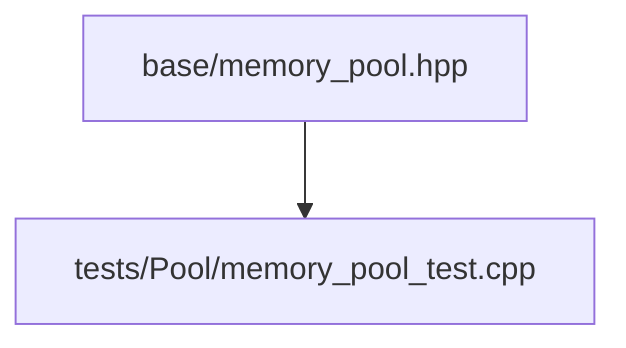
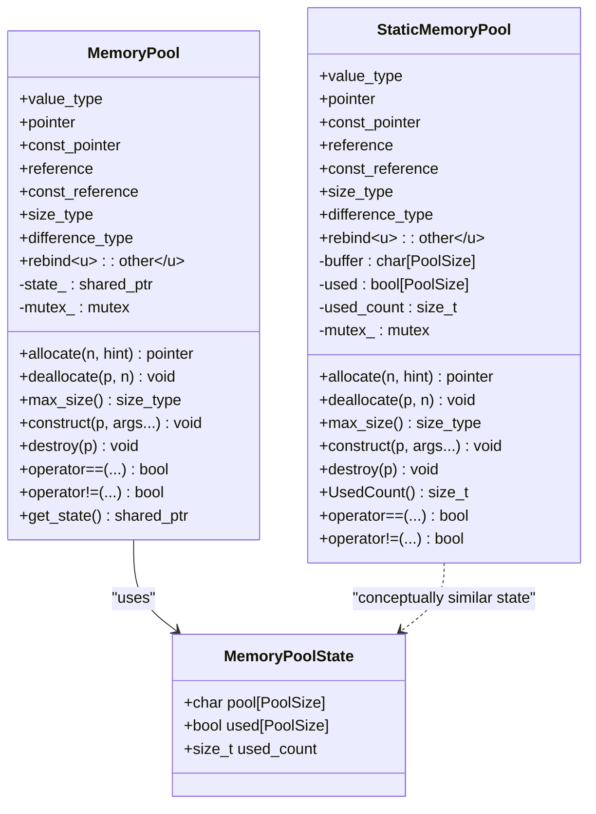
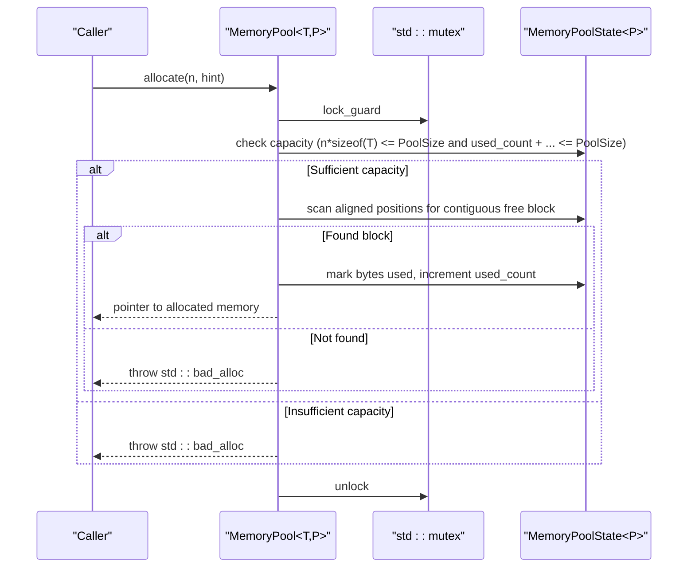
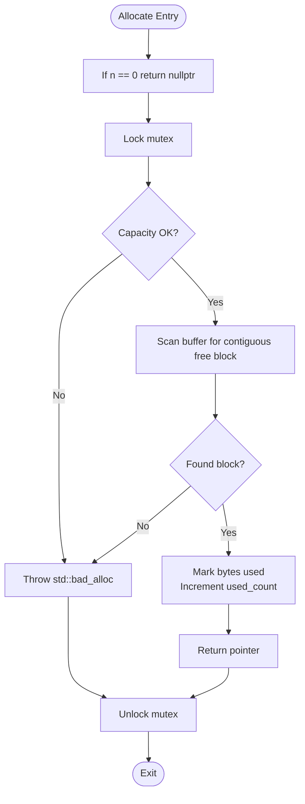
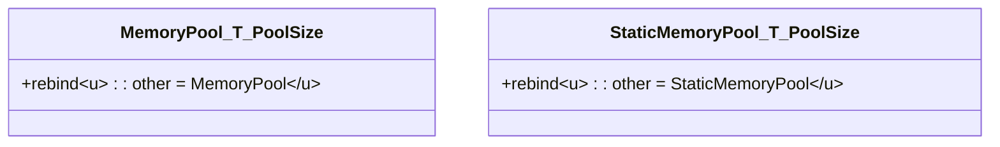
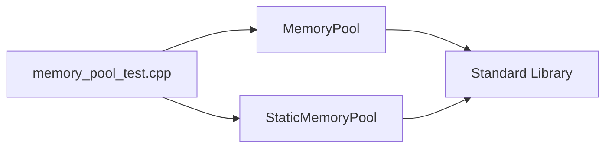

# MemoryPool / 内存池分配器

<cite>
**Referenced Files in This Document**
- [memory_pool.hpp](file://base/memory_pool.hpp)
- [memory_pool_test.cpp](file://tests/Pool/memory_pool_test.cpp)
</cite>

## Table of Contents
1. [Introduction](#introduction)
2. [Project Structure](#project-structure)
3. [Core Components](#core-components)
4. [Architecture Overview](#architecture-overview)
5. [Detailed Component Analysis](#detailed-component-analysis)
6. [Dependency Analysis](#dependency-analysis)
7. [Performance Considerations](#performance-considerations)
8. [Troubleshooting Guide](#troubleshooting-guide)
9. [Conclusion](#conclusion)
10. [Appendices](#appendices)

## Introduction
This document explains the fixed-size memory pool allocator implemented by the MemoryPool template class and its companion StaticMemoryPool. The design provides efficient allocation for primitive types and small objects within a pre-allocated buffer, with thread-safe operations, alignment handling using std::max_align_t, and bounds checking. It also covers instance-specific pools versus shared state between allocators, performance characteristics compared to standard new/delete, best practices for choosing PoolSize, rebind support for different container types, and exception safety guarantees provided by the allocator interface.

## Project Structure
The memory pool implementation is contained in a single header file under base/, and usage examples are covered by tests under tests/Pool/.

**Diagram sources**
- [memory_pool.hpp:1-375](file://base/memory_pool.hpp#L1-L375)
- [memory_pool_test.cpp:1-100](file://tests/Pool/memory_pool_test.cpp#L1-L100)

**Section sources**
- [memory_pool.hpp:1-375](file://base/memory_pool.hpp#L1-L375)
- [memory_pool_test.cpp:1-100](file://tests/Pool/memory_pool_test.cpp#L1-L100)

## Core Components
- MemoryPoolState<T, PoolSize>: Holds the aligned character array serving as the pool, a per-byte usage bitmap, and a used byte counter.
- MemoryPool<T, PoolSize>: An STL-compatible allocator that uses a shared state (shared_ptr<MemoryPoolState>) to provide thread-safe allocate/deallocate with mutex protection, alignment handling, and bounds checks.
- StaticMemoryPool<T, PoolSize>: A static variant where all instances share one global buffer and usage tracking; it exposes UsedCount() and equality semantics indicating all instances are equal.

Key responsibilities:
- Fixed-size allocation from a contiguous buffer.
- Alignment guarantee via alignas(std::max_align_t).
- Thread-safety via std::mutex around allocate/deallocate.
- Bounds checking on deallocation and capacity checks on allocation.
- STL Allocator interface compliance including rebind and propagate traits.

**Section sources**
- [memory_pool.hpp:21-34](file://base/memory_pool.hpp#L21-L34)
- [memory_pool.hpp:43-208](file://base/memory_pool.hpp#L43-L208)
- [memory_pool.hpp:215-372](file://base/memory_pool.hpp#L215-L372)

## Architecture Overview
The allocator architecture centers on two allocator classes sharing a common pattern:
- Instance-scoped pool backed by a shared state object (MemoryPool).
- Process-wide static pool with global storage (StaticMemoryPool).

**Diagram sources**
- [memory_pool.hpp:21-34](file://base/memory_pool.hpp#L21-L34)
- [memory_pool.hpp:43-208](file://base/memory_pool.hpp#L43-L208)
- [memory_pool.hpp:215-372](file://base/memory_pool.hpp#L215-L372)

## Detailed Component Analysis

### MemoryPoolState
- Purpose: Encapsulates the raw pool buffer, per-byte usage bitmap, and current used byte count.
- Alignment: The buffer is aligned to std::max_align_t to satisfy any type’s alignment requirement.
- Usage tracking: A boolean array tracks which bytes are allocated; used_count maintains the total allocated bytes.

Complexity considerations:
- Allocation scans for a contiguous free region; worst-case O(PoolSize * n) due to nested loops over alignment steps and block checks.
- Deallocate is O(n) to clear the bitmap and update used_count.

Thread safety:
- State access is protected by the owning allocator’s mutex during allocate/deallocate.

**Section sources**
- [memory_pool.hpp:21-34](file://base/memory_pool.hpp#L21-L34)

### MemoryPool<T, PoolSize>
Allocator interface highlights:
- Type aliases and propagation traits define an instance-scoped allocator that does not propagate across container copy/move/swap and is not always equal.
- rebind<U>::other allows containers to request allocators for different element types while preserving PoolSize.
- Construction and assignment share the same underlying state via shared_ptr<MemoryPoolState>, enabling multiple allocators to coordinate allocations against the same buffer.

Allocation algorithm:
- Early exit for zero-sized requests.
- Capacity check: throws std::bad_alloc if requested size exceeds PoolSize or would exceed used_count.
- Alignment-aware scan: iterates starting positions at stride alignof(T), then checks for a contiguous free block of n*sizeof(T) bytes.
- On success, marks bytes as used, increments used_count, and returns a pointer into the pool.

Deallocation algorithm:
- Validates non-null pointer and presence of state.
- Locks mutex, computes offset relative to pool start, validates bounds, clears bitmap entries, and decrements used_count.
- Throws std::invalid_argument if the pointer is out of pool bounds.

Exception safety:
- allocate throws std::bad_alloc on insufficient capacity or failure to find a suitable block.
- deallocate throws std::invalid_argument for invalid pointers.
- construct and destroy perform placement new and destructor calls without additional exceptions beyond those thrown by user-defined constructors/destructors.

STL integration:
- Compatible with std::vector, std::list, and smart pointers via allocate_shared when passed explicitly.

**Diagram sources**
- [memory_pool.hpp:111-142](file://base/memory_pool.hpp#L111-L142)
- [memory_pool.hpp:21-34](file://base/memory_pool.hpp#L21-L34)

**Section sources**
- [memory_pool.hpp:43-208](file://base/memory_pool.hpp#L43-L208)

### StaticMemoryPool<T, PoolSize>
Allocator interface highlights:
- All instances are considered equal and propagate on container copy/move/swap, reflecting process-wide shared state.
- rebind<U>::other supports different element types with the same PoolSize.
- Exposes UsedCount() to query current used bytes under mutex protection.

Allocation algorithm:
- Similar to MemoryPool but operates on a static buffer and static usage bitmap.
- Scans every byte position (no alignment stride optimization) to find a contiguous free block.

Deallocation algorithm:
- Validates pointer and bounds, clears bitmap entries, and decrements used_count under mutex.

Equality semantics:
- operator== returns true for any two instances; operator!= returns false.

**Diagram sources**
- [memory_pool.hpp:266-296](file://base/memory_pool.hpp#L266-L296)

**Section sources**
- [memory_pool.hpp:215-372](file://base/memory_pool.hpp#L215-L372)

### Rebind Mechanism
Both allocators expose a rebind struct so that containers can adapt to different element types while keeping the same pool size. For example, a container of U will request an allocator of type MemoryPool<U, PoolSize> or StaticMemoryPool<U, PoolSize>.

**Diagram sources**
- [memory_pool.hpp:71-75](file://base/memory_pool.hpp#L71-L75)
- [memory_pool.hpp:241-245](file://base/memory_pool.hpp#L241-L245)

**Section sources**
- [memory_pool.hpp:71-75](file://base/memory_pool.hpp#L71-L75)
- [memory_pool.hpp:241-245](file://base/memory_pool.hpp#L241-L245)

### Exception Safety Guarantees
- allocate:
  - Throws std::bad_alloc if requested size exceeds pool capacity or no suitable aligned block is found.
- deallocate:
  - Throws std::invalid_argument if the pointer is null, state is missing, or the pointer lies outside the pool bounds.
- construct/destroy:
  - Forward constructor arguments via placement new; destructor invocation may throw if user-defined destructors do so.

These guarantees ensure predictable behavior under resource exhaustion and invalid usage.

**Section sources**
- [memory_pool.hpp:111-142](file://base/memory_pool.hpp#L111-L142)
- [memory_pool.hpp:156-175](file://base/memory_pool.hpp#L156-L175)
- [memory_pool.hpp:185-198](file://base/memory_pool.hpp#L185-L198)
- [memory_pool.hpp:266-296](file://base/memory_pool.hpp#L266-L296)
- [memory_pool.hpp:305-324](file://base/memory_pool.hpp#L305-L324)
- [memory_pool.hpp:333-347](file://base/memory_pool.hpp#L333-L347)

## Dependency Analysis
Internal dependencies:
- MemoryPool depends on std::shared_ptr, std::mutex, std::bad_alloc, std::invalid_argument, and std::max_align_t.
- StaticMemoryPool similarly depends on std::mutex and standard exceptions.

External usage patterns:
- Tests demonstrate integration with std::vector, std::list, and std::allocate_shared.
- Coroutine utilities reference the allocators through custom allocator wrappers.

**Diagram sources**
- [memory_pool.hpp:1-18](file://base/memory_pool.hpp#L1-L18)
- [memory_pool.hpp:43-208](file://base/memory_pool.hpp#L43-L208)
- [memory_pool.hpp:215-372](file://base/memory_pool.hpp#L215-L372)
- [memory_pool_test.cpp:1-100](file://tests/Pool/memory_pool_test.cpp#L1-L100)

**Section sources**
- [memory_pool.hpp:1-18](file://base/memory_pool.hpp#L1-L18)
- [memory_pool_test.cpp:1-100](file://tests/Pool/memory_pool_test.cpp#L1-L100)

## Performance Considerations
- Allocation strategy:
  - MemoryPool uses alignment-strided scanning to reduce misaligned candidates, improving practical performance for aligned types.
  - StaticMemoryPool performs a linear scan over every byte, which is simpler but potentially slower than the aligned stride approach.
- Contention:
  - Both allocators use a mutex around allocate/deallocate, introducing contention under high concurrency.
- Fragmentation:
  - First-fit allocation may lead to fragmentation over time; repeated allocate/deallocate patterns can degrade performance.
- Throughput vs. new/delete:
  - Avoiding heap management overhead can improve throughput for many small, short-lived objects.
  - However, large allocations or highly variable lifetimes may negate benefits due to fragmentation and locking.

Best practices for choosing PoolSize:
- Estimate peak concurrent allocations of the target type(s) and multiply by sizeof(T) plus a safety margin.
- Prefer larger pools for hot paths with frequent allocations to reduce contention and fragmentation.
- Monitor used_count (via StaticMemoryPool::UsedCount()) to tune PoolSize based on observed usage.
- Separate pools by type to avoid cross-type fragmentation and to align strides appropriately.

[No sources needed since this section provides general guidance]

## Troubleshooting Guide
Common issues and resolutions:
- std::bad_alloc during allocate:
  - Cause: Requested size exceeds PoolSize or cumulative usage would overflow the pool.
  - Resolution: Increase PoolSize or reduce concurrent allocations; verify lifetime management to avoid leaks.
- std::invalid_argument during deallocate:
  - Cause: Pointer is null, not owned by the pool, or lies outside pool bounds.
  - Resolution: Ensure pointers originate from the same allocator instance and are not double-freed.
- Unexpected sharing of state:
  - Cause: Copying MemoryPool shares the underlying state via shared_ptr.
  - Resolution: If isolation is required, create separate pool instances; otherwise, leverage sharing intentionally.
- Equality semantics confusion:
  - StaticMemoryPool instances compare equal because they share global state; this is expected.

Operational tips:
- Use get_state() to inspect shared state when debugging MemoryPool instances.
- Use UsedCount() to monitor StaticMemoryPool usage and detect potential leaks.

**Section sources**
- [memory_pool.hpp:111-142](file://base/memory_pool.hpp#L111-L142)
- [memory_pool.hpp:156-175](file://base/memory_pool.hpp#L156-L175)
- [memory_pool.hpp:199-203](file://base/memory_pool.hpp#L199-L203)
- [memory_pool.hpp:349-365](file://base/memory_pool.hpp#L349-L365)

## Conclusion
MemoryPool and StaticMemoryPool provide a robust, STL-compatible fixed-size allocator tailored for efficient allocation of small, frequently created objects. They offer thread-safe operations, alignment guarantees, and clear exception semantics. Choose MemoryPool for instance-scoped pools with optional state sharing, and StaticMemoryPool for process-wide pooling with uniform equality semantics. Carefully select PoolSize based on workload characteristics and monitor usage to maintain performance and stability.

[No sources needed since this section summarizes without analyzing specific files]

## Appendices

### Usage Examples from Tests
- Creating instance-specific pools and using them with std::vector and std::list.
- Using allocate_shared with both MemoryPool and StaticMemoryPool.
- Integrating with coroutine utilities via custom allocator wrappers.

**Section sources**
- [memory_pool_test.cpp:30-51](file://tests/Pool/memory_pool_test.cpp#L30-L51)
- [memory_pool_test.cpp:53-74](file://tests/Pool/memory_pool_test.cpp#L53-L74)
- [memory_pool_test.cpp:76-98](file://tests/Pool/memory_pool_test.cpp#L76-L98)