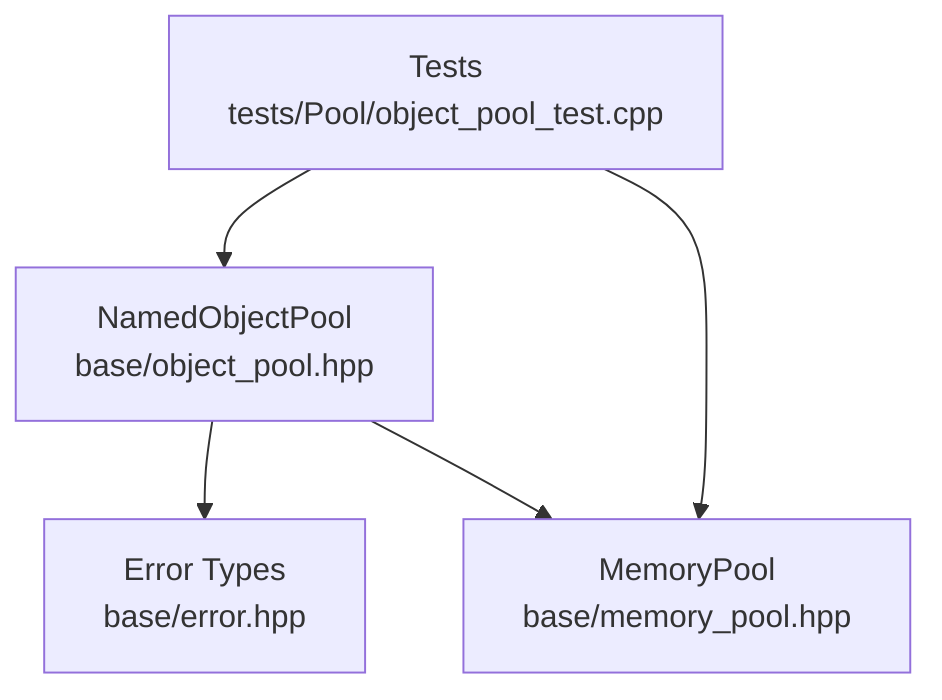
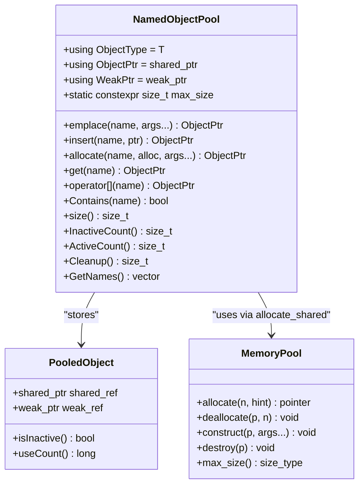
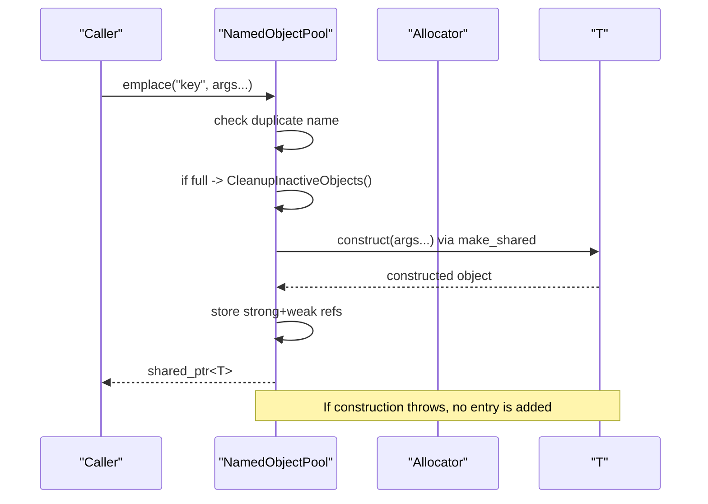
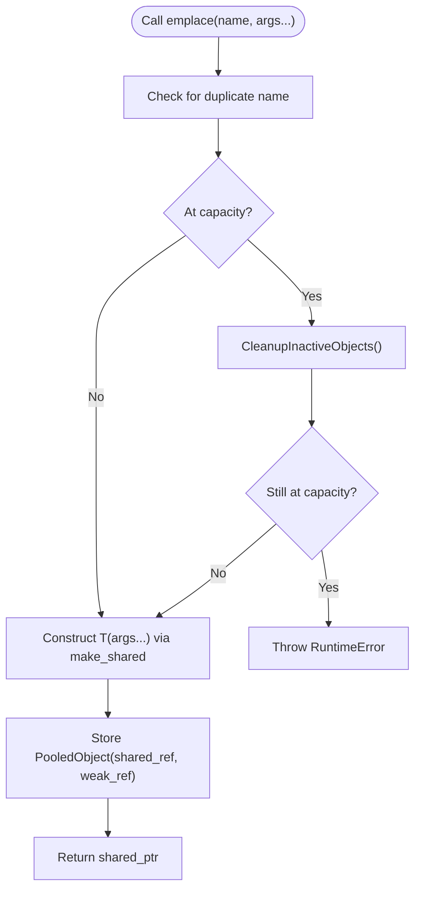
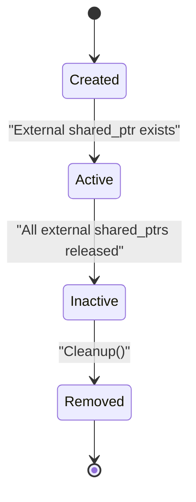
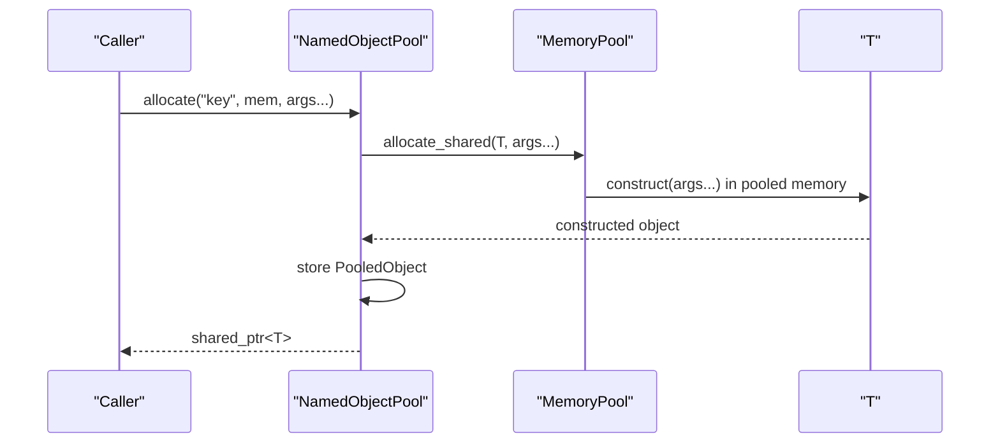
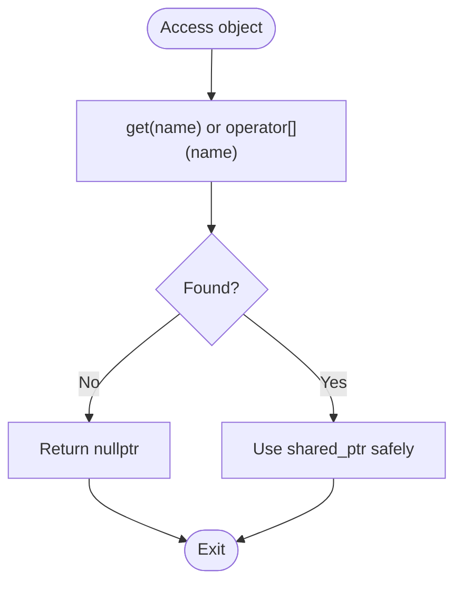
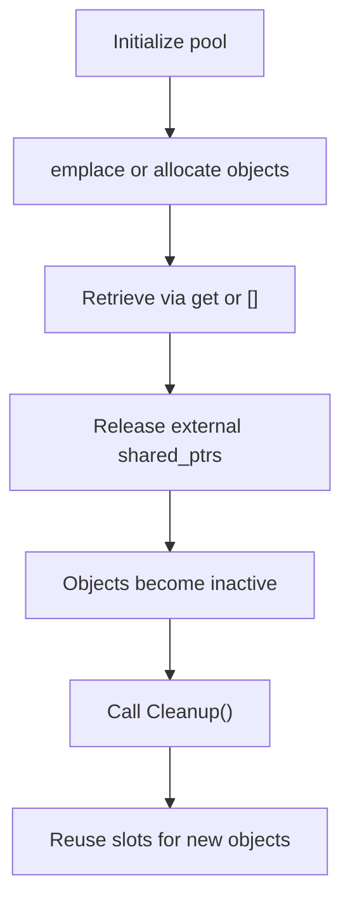
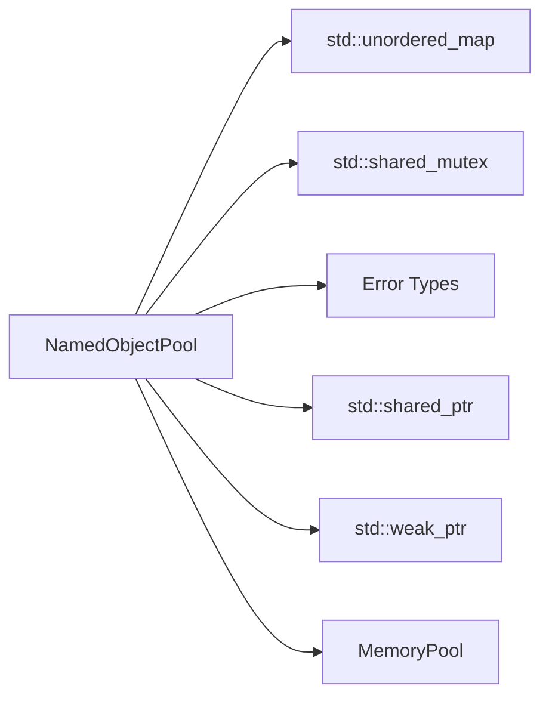

# ObjectPool / 对象池管理

<cite>
**Referenced Files in This Document**
- [object_pool.hpp](file://base/object_pool.hpp)
- [memory_pool.hpp](file://base/memory_pool.hpp)
- [error.hpp](file://base/error.hpp)
- [object_pool_test.cpp](file://tests/Pool/object_pool_test.cpp)
</cite>

## Table of Contents
1. [Introduction](#introduction)
2. [Project Structure](#project-structure)
3. [Core Components](#core-components)
4. [Architecture Overview](#architecture-overview)
5. [Detailed Component Analysis](#detailed-component-analysis)
6. [Dependency Analysis](#dependency-analysis)
7. [Performance Considerations](#performance-considerations)
8. [Troubleshooting Guide](#troubleshooting-guide)
9. [Conclusion](#conclusion)
10. [Appendices](#appendices)

## Introduction
This document explains the object pool implementation used for managing collections of objects with automatic lifecycle management. It focuses on:
- Constructor parameter forwarding through emplace and allocate
- RAII-based ownership using shared pointers
- Exception safety during construction and destruction
- Integration with custom allocators such as MemoryPool
- Automatic cleanup when external references drop to zero
- Safe access patterns, including avoiding dangling references
- Practical usage patterns and performance benefits over repeated dynamic allocation

The implementation is thread-safe and capacity-bounded, making it suitable for performance-critical code paths where predictable memory behavior and deterministic cleanup are important.

## Project Structure
The object pool functionality lives under the base utilities and is exercised by dedicated tests:
- Core implementation: base/object_pool.hpp
- Custom allocator support: base/memory_pool.hpp
- Error types: base/error.hpp
- Tests: tests/Pool/object_pool_test.cpp

**Diagram sources**
- [object_pool.hpp:1-286](file://base/object_pool.hpp#L1-L286)
- [memory_pool.hpp:1-375](file://base/memory_pool.hpp#L1-L375)
- [object_pool_test.cpp:1-162](file://tests/Pool/object_pool_test.cpp#L1-L162)

**Section sources**
- [object_pool.hpp:1-286](file://base/object_pool.hpp#L1-L286)
- [memory_pool.hpp:1-375](file://base/memory_pool.hpp#L1-L375)
- [object_pool_test.cpp:1-162](file://tests/Pool/object_pool_test.cpp#L1-L162)

## Core Components
- NamedObjectPool<T, MaxSize>: A named, thread-safe pool that stores std::shared_ptr<T>. It supports:
  - emplace(name, args...) to construct objects in place with perfect forwarding
  - insert(name, ptr) to register an already constructed shared pointer
  - allocate(name, alloc, args...) to construct objects via a custom allocator
  - get(name), operator to retrieve shared pointers
  - Contains(name), size(), ActiveCount(), InactiveCount() for state queries
  - Cleanup() to remove inactive entries
  - GetNames() to enumerate names
- PooledObject: Internal holder pairing a strong and weak reference to detect activity based on use_count
- MemoryPool<T, PoolSize> and StaticMemoryPool<T, PoolSize>: Allocator-compatible pools providing fixed-size memory regions with proper alignment and thread-safety

Key behaviors:
- Capacity enforcement: When at MaxSize, adding new objects triggers lazy cleanup of inactive entries; if still full, a runtime error is thrown
- Activity detection: An entry is considered inactive when its internal shared_ptr has use_count equal to 1 (only held by the pool)
- Thread safety: Uses std::shared_mutex to allow concurrent reads and exclusive writes

**Section sources**
- [object_pool.hpp:22-46](file://base/object_pool.hpp#L22-L46)
- [object_pool.hpp:66-92](file://base/object_pool.hpp#L66-L92)
- [object_pool.hpp:99-115](file://base/object_pool.hpp#L99-L115)
- [object_pool.hpp:135-156](file://base/object_pool.hpp#L135-L156)
- [object_pool.hpp:162-195](file://base/object_pool.hpp#L162-L195)
- [object_pool.hpp:201-259](file://base/object_pool.hpp#L201-L259)
- [object_pool.hpp:262-283](file://base/object_pool.hpp#L262-L283)
- [memory_pool.hpp:43-208](file://base/memory_pool.hpp#L43-L208)
- [memory_pool.hpp:215-372](file://base/memory_pool.hpp#L215-L372)

## Architecture Overview
The object pool owns objects via std::shared_ptr and exposes them to callers. External holders keep objects alive; when all external holders release their references, the object becomes inactive and can be cleaned up. Custom allocators integrate seamlessly through allocate_shared.

**Diagram sources**
- [object_pool.hpp:22-46](file://base/object_pool.hpp#L22-L46)
- [object_pool.hpp:66-92](file://base/object_pool.hpp#L66-L92)
- [object_pool.hpp:135-156](file://base/object_pool.hpp#L135-L156)
- [memory_pool.hpp:43-208](file://base/memory_pool.hpp#L43-L208)

## Detailed Component Analysis

### NamedObjectPool Lifecycle and Ownership Model
- Construction and insertion:
  - emplace forwards constructor arguments to T’s constructor via perfect forwarding and constructs the object inside a shared_ptr
  - insert accepts an existing shared_ptr and registers it under a name
  - allocate uses a provided allocator with allocate_shared to construct the object with custom memory semantics
- Ownership model:
  - The pool holds a strong reference; external users hold additional strong references
  - When external references drop to zero, the pool’s strong reference remains; the object is marked inactive but not immediately destroyed
  - Cleanup removes inactive entries, releasing the pool’s strong reference and allowing destruction
- Exception safety:
  - If construction throws, no entry is added; the pool remains consistent
  - Duplicate names throw an invalid argument error before any modification
  - If the pool is full after cleanup, a runtime error is thrown
- Thread safety:
  - Read operations use shared locks; write operations use exclusive locks

**Diagram sources**
- [object_pool.hpp:66-92](file://base/object_pool.hpp#L66-L92)
- [object_pool.hpp:262-279](file://base/object_pool.hpp#L262-L279)

**Section sources**
- [object_pool.hpp:66-92](file://base/object_pool.hpp#L66-L92)
- [object_pool.hpp:99-115](file://base/object_pool.hpp#L99-L115)
- [object_pool.hpp:135-156](file://base/object_pool.hpp#L135-L156)
- [object_pool.hpp:262-279](file://base/object_pool.hpp#L262-L279)

### Constructor Parameter Forwarding Mechanism
- emplace uses template parameter packs and std::forward to forward arbitrary constructor arguments to T’s constructor without unnecessary copies or moves
- allocate similarly forwards both the allocator and constructor arguments to allocate_shared, enabling integration with custom allocators while preserving value categories

**Diagram sources**
- [object_pool.hpp:66-92](file://base/object_pool.hpp#L66-L92)
- [object_pool.hpp:262-279](file://base/object_pool.hpp#L262-L279)

**Section sources**
- [object_pool.hpp:66-92](file://base/object_pool.hpp#L66-L92)
- [object_pool.hpp:135-156](file://base/object_pool.hpp#L135-L156)

### RAII-Based Ownership and Automatic Cleanup
- RAII guarantees:
  - Objects are created within shared_ptr; destruction occurs when the last shared_ptr is released
  - The pool maintains a strong reference; external references extend lifetime
  - When external references are gone, the object becomes inactive; manual Cleanup removes it from the pool
- Destructor behavior:
  - The pool destructor clears all entries, ensuring destruction of remaining objects even if Cleanup was not called

**Diagram sources**
- [object_pool.hpp:55-59](file://base/object_pool.hpp#L55-L59)
- [object_pool.hpp:219-245](file://base/object_pool.hpp#L219-L245)
- [object_pool.hpp:262-279](file://base/object_pool.hpp#L262-L279)

**Section sources**
- [object_pool.hpp:55-59](file://base/object_pool.hpp#L55-L59)
- [object_pool.hpp:219-245](file://base/object_pool.hpp#L219-L245)
- [object_pool.hpp:262-279](file://base/object_pool.hpp#L262-L279)

### Integration with Custom Allocators like MemoryPool
- allocate(name, alloc, args...) constructs objects using allocate_shared with the provided allocator
- MemoryPool provides an STL-compliant allocator interface with fixed-size storage, proper alignment, and thread-safety
- Tests demonstrate mixing default allocation and MemoryPool-backed allocation in the same pool

**Diagram sources**
- [object_pool.hpp:135-156](file://base/object_pool.hpp#L135-L156)
- [memory_pool.hpp:111-142](file://base/memory_pool.hpp#L111-L142)
- [memory_pool.hpp:185-198](file://base/memory_pool.hpp#L185-L198)

**Section sources**
- [object_pool.hpp:135-156](file://base/object_pool.hpp#L135-L156)
- [memory_pool.hpp:43-208](file://base/memory_pool.hpp#L43-L208)
- [object_pool_test.cpp:83-113](file://tests/Pool/object_pool_test.cpp#L83-L113)

### Access Patterns and Iterator Support
- Retrieval:
  - get(name) returns a shared_ptr; returns nullptr if not found
  - operator[] provides convenient subscript access
- Enumeration:
  - GetNames() returns a list of all registered names
- Iteration:
  - There is no direct iterator over managed objects; iterate over names and retrieve shared pointers per name
- Safety:
  - Always check returned shared_ptr for nullptr before dereferencing
  - Avoid storing raw pointers derived from shared_ptr beyond the lifetime of the owning shared_ptr

**Diagram sources**
- [object_pool.hpp:162-195](file://base/object_pool.hpp#L162-L195)
- [object_pool.hpp:249-259](file://base/object_pool.hpp#L249-L259)

**Section sources**
- [object_pool.hpp:162-195](file://base/object_pool.hpp#L162-L195)
- [object_pool.hpp:249-259](file://base/object_pool.hpp#L249-L259)

### Practical Usage Examples and Best Practices
- Basic creation and retrieval:
  - Create a pool, emplace objects with unique names, retrieve via get or operator[]
- Lifetime management:
  - Keep external shared_ptrs to control lifetime; when they go out of scope, objects become inactive
  - Call Cleanup to reclaim inactive entries and free pool slots
- Capacity limits:
  - If the pool reaches MaxSize, adding new objects triggers cleanup; if still full, a runtime error is thrown
- Mixing allocators:
  - Use emplace for default allocation and allocate with MemoryPool for custom memory semantics

**Diagram sources**
- [object_pool_test.cpp:9-33](file://tests/Pool/object_pool_test.cpp#L9-L33)
- [object_pool_test.cpp:35-59](file://tests/Pool/object_pool_test.cpp#L35-L59)
- [object_pool_test.cpp:116-141](file://tests/Pool/object_pool_test.cpp#L116-L141)

**Section sources**
- [object_pool_test.cpp:9-33](file://tests/Pool/object_pool_test.cpp#L9-L33)
- [object_pool_test.cpp:35-59](file://tests/Pool/object_pool_test.cpp#L35-L59)
- [object_pool_test.cpp:83-113](file://tests/Pool/object_pool_test.cpp#L83-L113)
- [object_pool_test.cpp:116-141](file://tests/Pool/object_pool_test.cpp#L116-L141)

## Dependency Analysis
- NamedObjectPool depends on:
  - std::shared_ptr and std::weak_ptr for ownership and activity tracking
  - std::shared_mutex for thread-safe access
  - std::unordered_map for name-to-object mapping
  - Error types for exception signaling
- MemoryPool integrates via standard allocator interface:
  - Provides allocate/deallocate/construct/destroy
  - Ensures alignment and bounds checking
  - Offers static and instance variants for different sharing models

**Diagram sources**
- [object_pool.hpp:9-14](file://base/object_pool.hpp#L9-L14)
- [object_pool.hpp:281-283](file://base/object_pool.hpp#L281-L283)
- [memory_pool.hpp:43-208](file://base/memory_pool.hpp#L43-L208)

**Section sources**
- [object_pool.hpp:9-14](file://base/object_pool.hpp#L9-L14)
- [object_pool.hpp:281-283](file://base/object_pool.hpp#L281-L283)
- [memory_pool.hpp:43-208](file://base/memory_pool.hpp#L43-L208)

## Performance Considerations
- Reduced allocation overhead:
  - Using MemoryPool minimizes heap fragmentation and reduces allocation calls in hot paths
- Lazy cleanup:
  - Cleanup is triggered only when necessary (at capacity), avoiding frequent scans
- Thread safety cost:
  - shared_mutex allows concurrent reads; write operations serialize access
- Capacity planning:
  - Choose MaxSize based on expected active set to minimize cleanup frequency
- Avoiding raw pointers:
  - Prefer shared_ptr to prevent dangling references and ensure deterministic destruction

[No sources needed since this section provides general guidance]

## Troubleshooting Guide
Common issues and resolutions:
- Duplicate name errors:
  - Ensure unique names for each emplace/insert/allocate call
  - See InvalidArgumentError usage in duplicate checks
- Pool full exceptions:
  - Increase MaxSize or ensure external references are released so inactive objects can be cleaned
  - See RuntimeError thrown when pool remains full after cleanup
- Dangling references:
  - Do not store raw pointers derived from shared_ptr beyond the lifetime of the owning shared_ptr
  - Always check for nullptr when retrieving objects
- Misuse of iterators:
  - Iterate over GetNames() and retrieve shared_ptr per name; avoid assuming stable iteration order or persistent iterators across modifications

Relevant test cases:
- Normal usage and retrieval
- RAII behavior and inactive counting
- Mixed allocation with MemoryPool
- Capacity limits and cleanup behavior
- Name enumeration

**Section sources**
- [object_pool.hpp:71-85](file://base/object_pool.hpp#L71-L85)
- [object_pool.hpp:101-112](file://base/object_pool.hpp#L101-L112)
- [object_pool.hpp:139-152](file://base/object_pool.hpp#L139-L152)
- [object_pool_test.cpp:9-33](file://tests/Pool/object_pool_test.cpp#L9-L33)
- [object_pool_test.cpp:35-59](file://tests/Pool/object_pool_test.cpp#L35-L59)
- [object_pool_test.cpp:83-113](file://tests/Pool/object_pool_test.cpp#L83-L113)
- [object_pool_test.cpp:116-141](file://tests/Pool/object_pool_test.cpp#L116-L141)

## Conclusion
NamedObjectPool provides a robust, thread-safe, and capacity-bounded mechanism for managing object lifetimes with automatic cleanup. Its design emphasizes:
- Safe ownership via shared_ptr
- Flexible construction with perfect forwarding
- Integration with custom allocators like MemoryPool
- Predictable resource reclamation through explicit or implicit cleanup

Adopting this pattern eliminates manual memory management in performance-critical paths, reduces allocation overhead, and ensures safe, maintainable code.

[No sources needed since this section summarizes without analyzing specific files]

## Appendices

### API Reference Summary
- Creation and registration:
  - emplace(name, args...): constructs and registers an object
  - insert(name, ptr): registers an existing shared_ptr
  - allocate(name, alloc, args...): constructs via a custom allocator
- Access:
  - get(name), operator: retrieve shared_ptr or nullptr
- State:
  - Contains(name), size(), ActiveCount(), InactiveCount()
- Maintenance:
  - Cleanup(): remove inactive entries
  - GetNames(): enumerate names

**Section sources**
- [object_pool.hpp:66-92](file://base/object_pool.hpp#L66-L92)
- [object_pool.hpp:99-115](file://base/object_pool.hpp#L99-L115)
- [object_pool.hpp:135-156](file://base/object_pool.hpp#L135-L156)
- [object_pool.hpp:162-195](file://base/object_pool.hpp#L162-L195)
- [object_pool.hpp:201-259](file://base/object_pool.hpp#L201-L259)