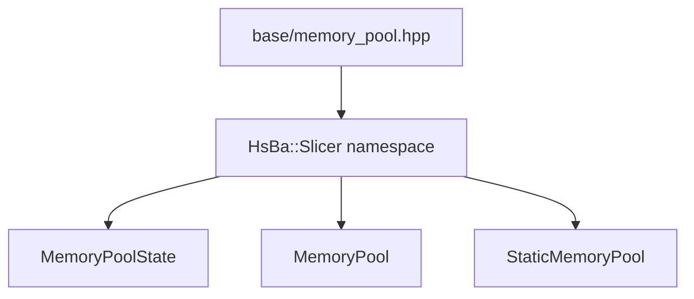
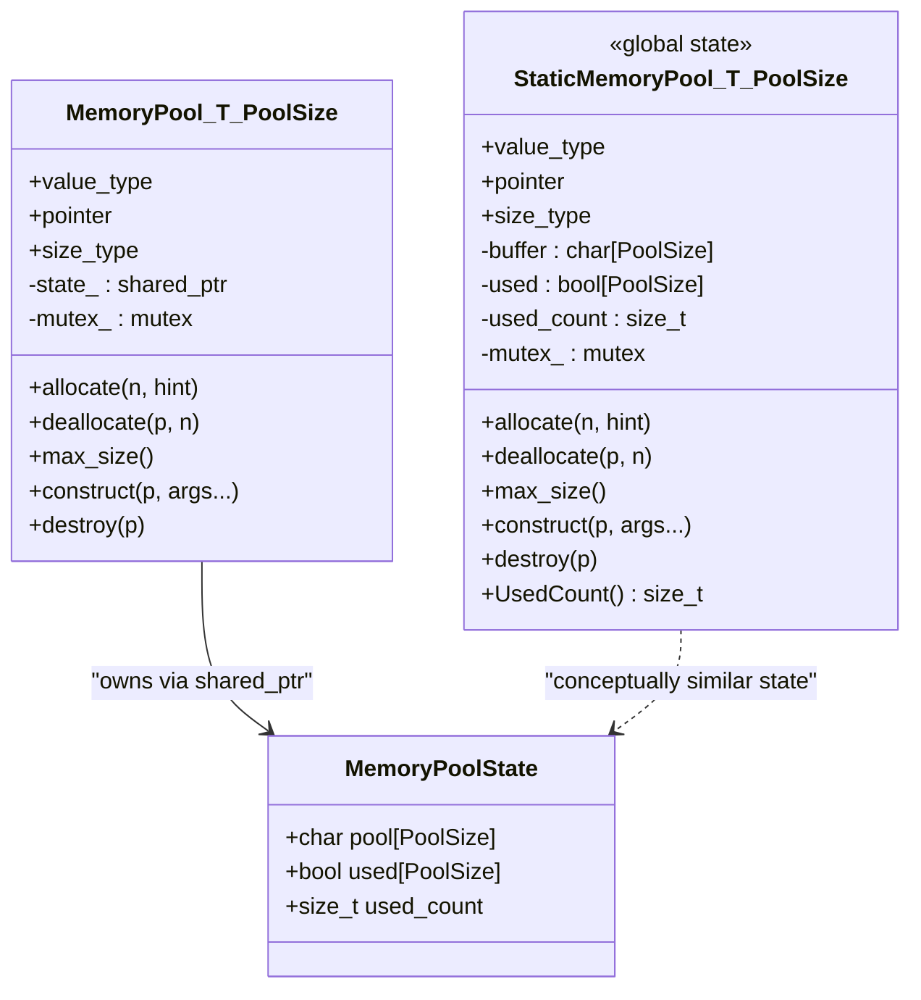
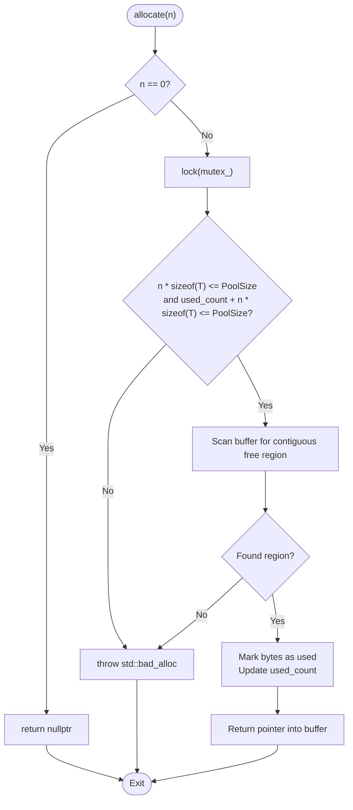
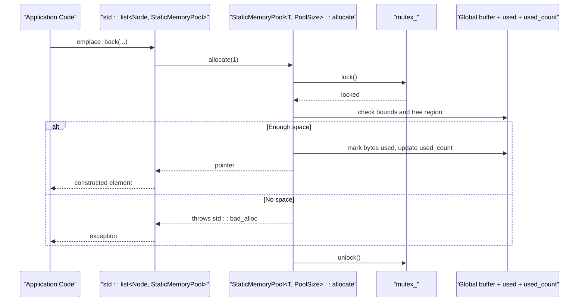
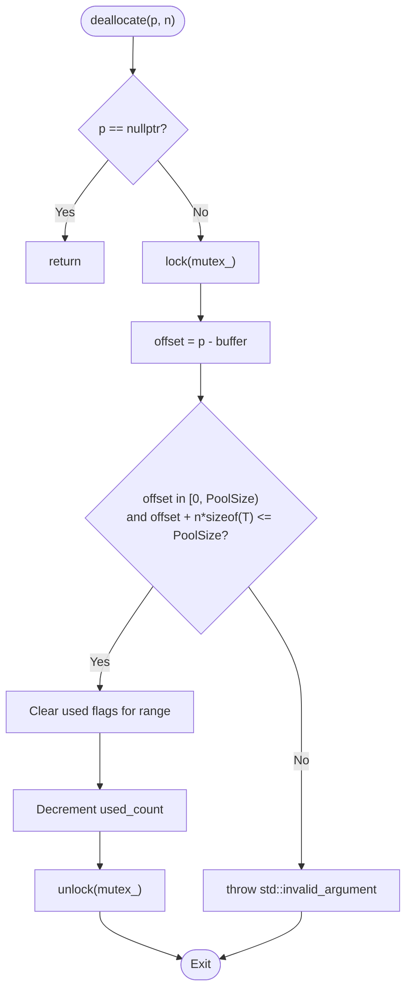
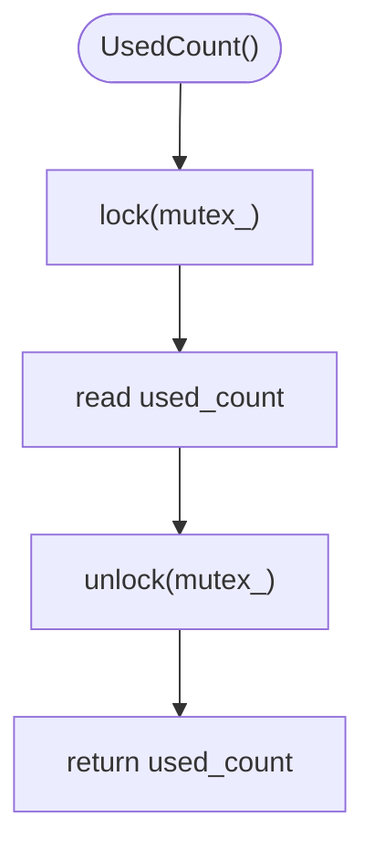
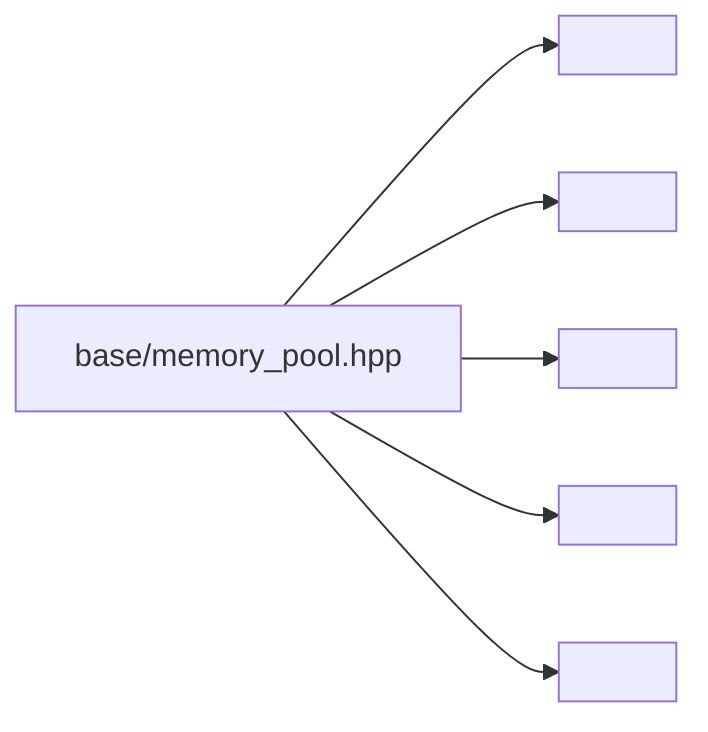

# StaticMemoryPool / 静态内存池

<cite>
**Referenced Files in This Document**
- [memory_pool.hpp](file://base/memory_pool.hpp)
- [memory_pool.md (English)](file://docs/en/base/memory_pool.md)
</cite>

## Table of Contents
1. [Introduction](#introduction)
2. [Project Structure](#project-structure)
3. [Core Components](#core-components)
4. [Architecture Overview](#architecture-overview)
5. [Detailed Component Analysis](#detailed-component-analysis)
6. [Dependency Analysis](#dependency-analysis)
7. [Performance Considerations](#performance-considerations)
8. [Troubleshooting Guide](#troubleshooting-guide)
9. [Conclusion](#conclusion)

## Introduction
This document focuses on the `StaticMemoryPool<T, PoolSize>` template class that provides a global shared memory pool across all instances. It explains how static buffer storage is implemented via inline static members, why all `StaticMemoryPool<T, PoolSize>` instances share the same underlying memory, and what this means for multi-threaded access. It also contrasts `StaticMemoryPool` with the regular `MemoryPool`, documents the allocator traits (`propagate_on_container_*` set to `true_type` and `is_always_equal` being `true`), details the `UsedCount()` method for monitoring utilization, and outlines thread-safety mechanisms. Finally, it discusses application-wide resource management use cases, warns about potential memory exhaustion, and provides debugging strategies for static pool overflow scenarios.

## Project Structure
The implementation lives in a single header under the base utilities:

**Diagram sources**
- [memory_pool.hpp:21-34](file://base/memory_pool.hpp#L21-L34)
- [memory_pool.hpp:43-208](file://base/memory_pool.hpp#L43-L208)
- [memory_pool.hpp:215-372](file://base/memory_pool.hpp#L215-L372)

**Section sources**
- [memory_pool.hpp:1-18](file://base/memory_pool.hpp#L1-L18)

## Core Components
- `MemoryPoolState<PoolSize>`: Holds the raw byte buffer, per-byte usage flags, and used byte count.
- `MemoryPool<T, PoolSize>`: Per-instance or shared-state memory pool allocator using `std::shared_ptr<MemoryPoolState<...>>`.
- `StaticMemoryPool<T, PoolSize>`: Global singleton-like allocator backed by inline static members; all instances of the same template parameters share one buffer and state.

Key differences relevant to this document:
- `StaticMemoryPool` uses inline static members for buffer, usage bitmap, used count, and mutex.
- `StaticMemoryPool` sets `propagate_on_container_copy_assignment`, `propagate_on_container_move_assignment`, `propagate_on_container_swap`, and `is_always_equal` to `true_type`, indicating containers treat allocators as globally equivalent and propagate them during container operations.
- `StaticMemoryPool` exposes `UsedCount()` to monitor current bytes allocated from the global pool.

**Section sources**
- [memory_pool.hpp:21-34](file://base/memory_pool.hpp#L21-L34)
- [memory_pool.hpp:43-208](file://base/memory_pool.hpp#L43-L208)
- [memory_pool.hpp:215-372](file://base/memory_pool.hpp#L215-L372)

## Architecture Overview
At a high level, both allocators implement the STL Allocator interface but differ in where the pool state resides:

**Diagram sources**
- [memory_pool.hpp:21-34](file://base/memory_pool.hpp#L21-L34)
- [memory_pool.hpp:43-208](file://base/memory_pool.hpp#L43-L208)
- [memory_pool.hpp:215-372](file://base/memory_pool.hpp#L215-L372)

## Detailed Component Analysis

### StaticMemoryPool<T, PoolSize>: Global Shared Pool
`StaticMemoryPool` implements an STL-compatible allocator whose state is stored in inline static members. This makes every instance of `StaticMemoryPool<T, PoolSize>` share the same buffer, usage bitmap, used count, and mutex.

- Inline static storage:
  - `buffer`: aligned raw byte array of size `PoolSize`.
  - `used`: per-byte allocation tracking.
  - `used_count`: total bytes currently allocated.
  - `mutex_`: protects concurrent access.

- Allocator traits:
  - `propagate_on_container_copy_assignment = true_type`
  - `propagate_on_container_move_assignment = true_type`
  - `propagate_on_container_swap = true_type`
  - `is_always_equal = true_type`
  These traits tell standard containers that allocator equality is always true and that allocator propagation should occur during container copy/move/swap.

- Equality semantics:
  - `operator==` returns true for any two `StaticMemoryPool` instances.
  - `operator!=` returns false.

- Monitoring utilization:
  - `UsedCount()` returns the number of bytes currently allocated from the global pool, protected by the mutex.

**Diagram sources**
- [memory_pool.hpp:266-296](file://base/memory_pool.hpp#L266-L296)

Thread safety:
- All mutating operations (`allocate`, `deallocate`, `UsedCount`) lock `mutex_` before accessing shared state.

Differences from `MemoryPool`:
- Storage model:
  - `MemoryPool` stores state in a `std::shared_ptr<MemoryPoolState<PoolSize>>`, allowing multiple instances to share state explicitly.
  - `StaticMemoryPool` stores state in inline static members, making sharing implicit and global.
- Allocator traits:
  - `MemoryPool` sets `propagate_on_container_*` to `false_type` and `is_always_equal` to `false_type`.
  - `StaticMemoryPool` sets them to `true_type`.
- Equality:
  - `MemoryPool` compares underlying shared state pointers.
  - `StaticMemoryPool` always reports equality.

Use cases:
- Application-wide resource management where all components should draw from a single fixed-size memory arena.
- Scenarios requiring deterministic memory behavior and minimal allocator overhead.
- Environments where you want to monitor global pool utilization via `UsedCount()`.

Warnings:
- The pool has a fixed capacity. Once exhausted, allocations throw `std::bad_alloc`.
- Because the pool is global, contention can increase under heavy multi-threaded workloads.
- Misuse (e.g., allocating beyond expected lifetime or leaking nodes) can lead to permanent pool exhaustion.

**Section sources**
- [memory_pool.hpp:215-372](file://base/memory_pool.hpp#L215-L372)

### Usage Flow: Allocating Through a Container
When a standard container uses `StaticMemoryPool`, each node allocation goes through the global pool.

**Diagram sources**
- [memory_pool.hpp:266-296](file://base/memory_pool.hpp#L266-L296)

### Deallocate Flow

**Diagram sources**
- [memory_pool.hpp:305-324](file://base/memory_pool.hpp#L305-L324)

### UsedCount() Monitoring
`UsedCount()` returns the current number of bytes allocated from the global pool. It is thread-safe because it locks the mutex before reading `used_count`.

**Diagram sources**
- [memory_pool.hpp:361-365](file://base/memory_pool.hpp#L361-L365)

## Dependency Analysis
- Internal dependencies:
  - `<cstddef>`, `<memory>`, `<mutex>`, `<new>`, `<stdexcept>` are included to support size types, smart pointers, synchronization, placement new, and exceptions.
- External integration:
  - Designed to be used with STL containers that accept custom allocators (e.g., `std::list`, `std::vector`).
  - Traits like `is_always_equal = true_type` allow containers to optimize allocator comparisons and propagation.

**Diagram sources**
- [memory_pool.hpp:13-17](file://base/memory_pool.hpp#L13-L17)

**Section sources**
- [memory_pool.hpp:13-17](file://base/memory_pool.hpp#L13-L17)
- [memory_pool.hpp:233-236](file://base/memory_pool.hpp#L233-L236)

## Performance Considerations
- Allocation strategy:
  - First-fit scan over the byte buffer; not optimized for alignment-aware block sizes. This may cause fragmentation and linear-time scans in worst cases.
- Contention:
  - Single global mutex can become a bottleneck under heavy multi-threaded allocation/deallocation patterns.
- Overhead:
  - Zero per-instance overhead due to inline static state; beneficial when many allocator objects exist.
- Capacity planning:
  - Choose `PoolSize` based on peak demand; otherwise, frequent `std::bad_alloc` will degrade performance and correctness.

[No sources needed since this section provides general guidance]

## Troubleshooting Guide
Common issues and strategies:

- Pool exhaustion:
  - Symptom: Frequent `std::bad_alloc` from `allocate`.
  - Actions:
    - Monitor `UsedCount()` periodically to detect growth trends.
    - Increase `PoolSize` if workload legitimately requires more memory.
    - Identify leaks or long-lived allocations that prevent reuse.

- Incorrect deallocation:
  - Symptom: `std::invalid_argument` from `deallocate` due to out-of-bounds pointer.
  - Actions:
    - Ensure every `allocate` is paired with a matching `deallocate`.
    - Validate lifetimes of allocated objects; avoid double-free or dangling pointers.

- Multi-threading pitfalls:
  - Symptom: Inconsistent `used_count` or deadlocks under load.
  - Actions:
    - Avoid holding locks across long operations.
    - Profile contention hotspots; consider batching allocations where possible.

- Debugging static pool overflow:
  - Use `UsedCount()` at key lifecycle points to establish baselines.
  - Add logging around `allocate`/`deallocate` to track allocation bursts.
  - Reduce concurrency temporarily to isolate contention vs. capacity issues.

**Section sources**
- [memory_pool.hpp:266-296](file://base/memory_pool.hpp#L266-L296)
- [memory_pool.hpp:305-324](file://base/memory_pool.hpp#L305-L324)
- [memory_pool.hpp:361-365](file://base/memory_pool.hpp#L361-L365)

## Conclusion
`StaticMemoryPool<T, PoolSize>` offers a global, singleton-like memory allocator backed by inline static members. All instances of the same template parameters share one buffer and state, which simplifies application-wide resource management and enables global utilization monitoring via `UsedCount()`. Compared to `MemoryPool`, it differs in storage model and allocator traits: `StaticMemoryPool` propagates allocators and treats all instances as equal. While it reduces per-instance overhead and improves locality, it introduces global contention and requires careful capacity planning to avoid exhaustion. Use it when you need deterministic, application-wide pooling and can bound memory usage effectively.

[No sources needed since this section summarizes without analyzing specific files]