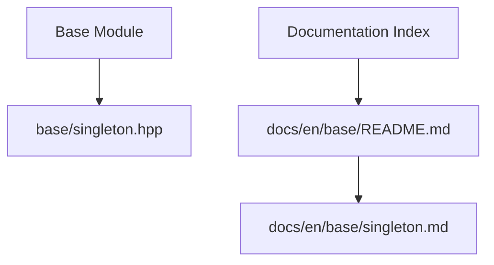
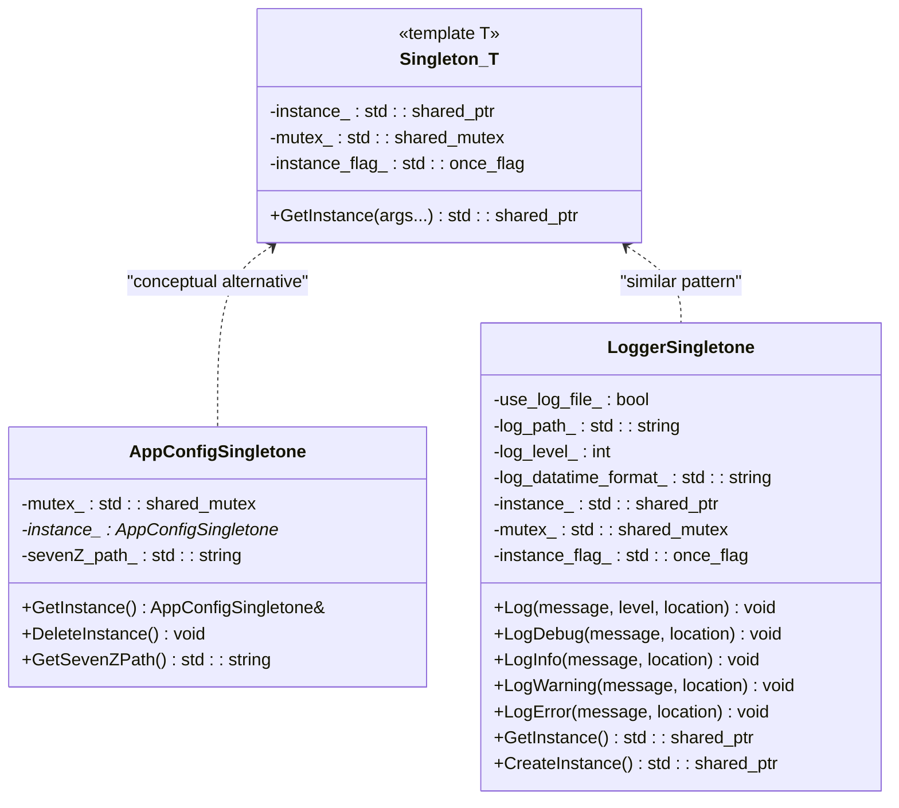
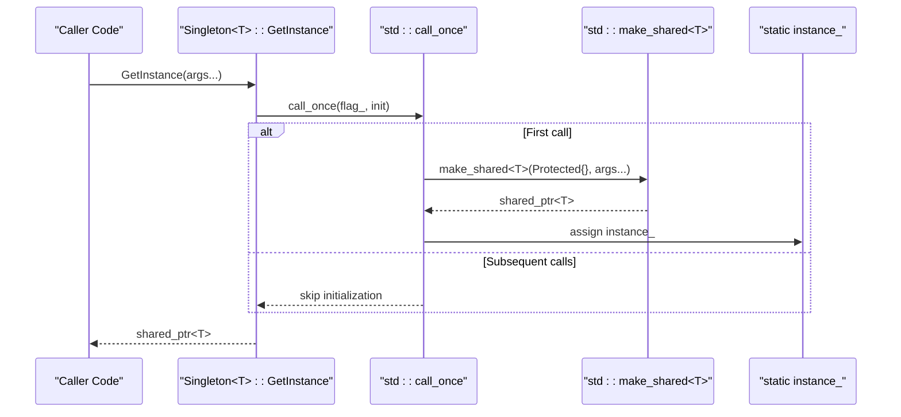
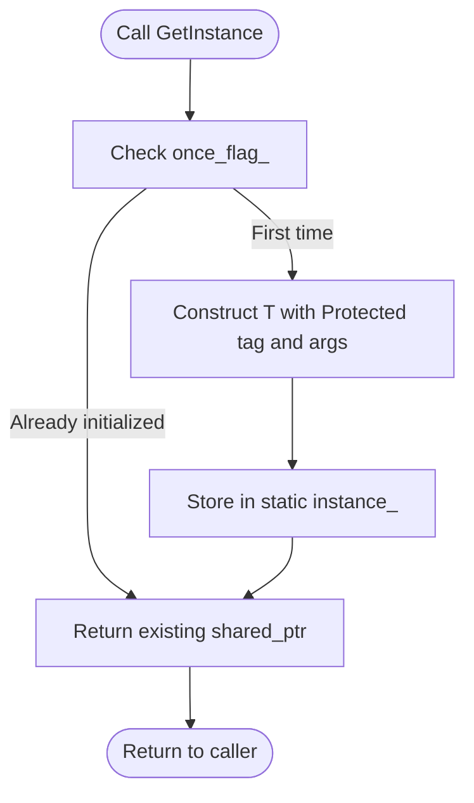
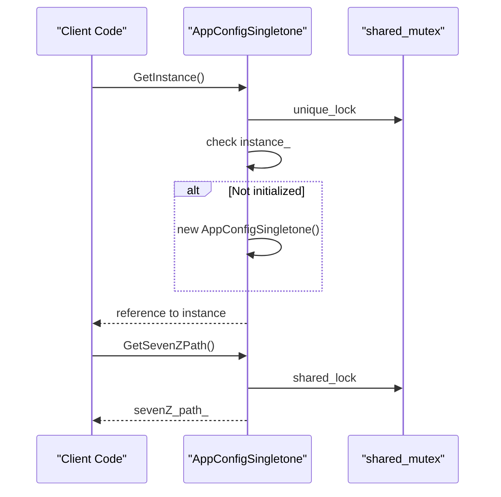
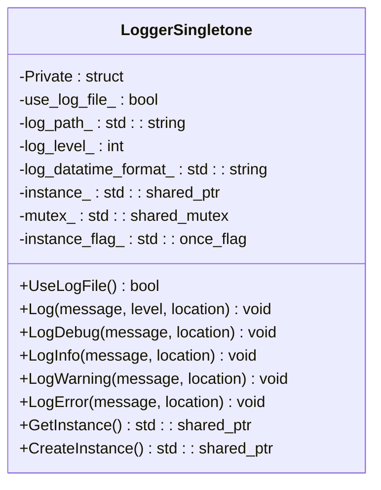
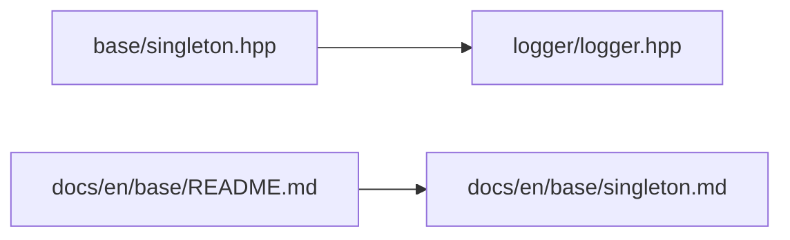

# Singleton Pattern / 单例模式

<cite>
**Referenced Files in This Document**   
- [singleton.hpp](file://base/singleton.hpp)
- [app_config.hpp](file://utils/app_config.hpp)
- [app_config.cpp](file://utils/app_config.cpp)
- [logger.hpp](file://logger/logger.hpp)
- [README.md](file://docs/en/base/README.md)
- [singleton.md](file://docs/en/base/singleton.md)
</cite>

## Table of Contents
1. [Introduction](#introduction)
2. [Project Structure](#project-structure)
3. [Core Components](#core-components)
4. [Architecture Overview](#architecture-overview)
5. [Detailed Component Analysis](#detailed-component-analysis)
6. [Dependency Analysis](#dependency-analysis)
7. [Performance Considerations](#performance-considerations)
8. [Troubleshooting Guide](#troubleshooting-guide)
9. [Conclusion](#conclusion)
10. [Appendices](#appendices)

## Introduction
This document explains the singleton pattern implementation in HsBaSlicer, focusing on the `Singleton` template class that provides thread-safe global instance management, lazy initialization, and shared ownership semantics. It also documents real usage patterns for configuration managers and logging services, shows how to construct singletons safely across translation units, and discusses alternatives where a full singleton is not appropriate.

The core goals are:
- Understand how `HsBa::Slicer::Utils::Singleton<T>` guarantees one instance per type.
- Learn how to define a singleton-compatible class with a protected constructor tag.
- See how application configuration and logger components use singleton-like patterns.
- Evaluate thread safety, memory lifetime, destruction ordering, and multi-translation-unit pitfalls.

## Project Structure
The singleton infrastructure lives in the base utilities module. The documentation index lists it as a core component alongside delegates, coroutines, reflection, and pools.

**Diagram sources**
- [README.md:1-35](file://docs/en/base/README.md#L1-L35)

**Section sources**
- [README.md:1-35](file://docs/en/base/README.md#L1-L35)

## Core Components
The central component is the `Singleton` template class. It exposes a static factory method that constructs the target type exactly once using `std::call_once`, stores the instance in a `std::shared_ptr`, and returns a shared pointer to callers. Construction requires the target type to be constructible from a protected tag followed by user-provided arguments.

Key characteristics:
- Thread-safe lazy initialization via `std::call_once`.
- Shared ownership through `std::shared_ptr`.
- Protected construction enforced by a nested `Protected` tag.
- Static storage for the instance, mutex, and initialization flag.

**Diagram sources**
- [singleton.hpp:21-53](file://base/singleton.hpp#L21-L53)
- [app_config.hpp:19-46](file://utils/app_config.hpp#L19-L46)
- [logger.hpp:35-122](file://logger/logger.hpp#L35-L122)

**Section sources**
- [singleton.hpp:14-53](file://base/singleton.hpp#L14-L53)

## Architecture Overview
At runtime, consumers request a singleton instance through a static accessor. For the template-based `Singleton<T>`, the first call initializes the object; subsequent calls return the same shared pointer. Other components implement similar patterns manually or adapt the template approach.

**Diagram sources**
- [singleton.hpp:35-40](file://base/singleton.hpp#L35-L40)
- [singleton.hpp:55-60](file://base/singleton.hpp#L55-L60)

## Detailed Component Analysis

### Singleton Template Class
The template enforces controlled construction and safe initialization:
- `GetInstance` forwards constructor arguments after a protected tag.
- `requires std::constructible_from<T, Protected, Args...>` ensures compile-time compatibility.
- `std::call_once` guarantees exactly one initialization across threads.
- The instance is stored in a static `std::shared_ptr`, enabling shared ownership and automatic cleanup when no references remain.

**Diagram sources**
- [singleton.hpp:35-40](file://base/singleton.hpp#L35-L40)
- [singleton.hpp:55-60](file://base/singleton.hpp#L55-L60)

Usage requirements:
- Define a nested `Protected` struct inside your singleton type.
- Provide a constructor whose first parameter is `Protected`, followed by your configuration parameters.
- Make `HsBa::Slicer::Utils::Singleton<T>` a friend if you need private access during construction.

**Section sources**
- [singleton.hpp:21-53](file://base/singleton.hpp#L21-L53)
- [singleton.md:14-48](file://docs/en/base/singleton.md#L14-L48)

### Application Configuration Singleton
The application configuration component implements its own singleton pattern rather than inheriting from `Singleton<T>`. It uses a raw pointer plus explicit `DeleteInstance`, along with a `shared_mutex` for read/write synchronization.

Key behaviors:
- `GetInstance` performs double-checked locking with a `unique_lock`.
- `DeleteInstance` releases the heap-allocated instance under lock.
- `GetSevenZPath` reads the path under a `shared_lock`.

**Diagram sources**
- [app_config.cpp:14-26](file://utils/app_config.cpp#L14-L26)
- [app_config.cpp:38-42](file://utils/app_config.cpp#L38-L42)
- [app_config.hpp:19-46](file://utils/app_config.hpp#L19-L46)

Memory and lifecycle considerations:
- The instance is allocated on the heap and must be explicitly destroyed via `DeleteInstance`.
- Read operations use a shared lock; write operations (initialization and deletion) use an exclusive lock.
- If `DeleteInstance` is called while other threads hold references, callers may observe dangling pointers unless they manage lifetimes carefully.

**Section sources**
- [app_config.hpp:19-46](file://utils/app_config.hpp#L19-L46)
- [app_config.cpp:9-42](file://utils/app_config.cpp#L9-L42)

### Logger Singleton
The logger component defines a singleton-like service with a private tag and static initialization helpers. It includes multiple logging entry points and fluent literal helpers.

Important aspects:
- `GetInstance` returns a `std::shared_ptr<LoggerSingletone>`.
- `CreateInstance` encapsulates creation logic.
- Static members include `instance_`, `mutex_`, and `instance_flag_`.
- Logging methods accept source location information for diagnostics.

**Diagram sources**
- [logger.hpp:35-122](file://logger/logger.hpp#L35-L122)

Thread-safety notes:
- The logger exposes static logging functions that likely coordinate through internal synchronization.
- Consumers should obtain the logger instance early and avoid constructing competing loggers.

**Section sources**
- [logger.hpp:27-122](file://logger/logger.hpp#L27-L122)

### Usage Patterns

#### Configuration Manager
Recommended approach:
- Use `Singleton<AppConfigSingletone>` if you want uniform lifecycle management and shared ownership.
- Alternatively, keep the current manual singleton but ensure `DeleteInstance` is called at application shutdown and guard against concurrent access.

Best practices:
- Centralize configuration loading before starting worker threads.
- Avoid mutating configuration concurrently without locks.
- Prefer immutable snapshots of configuration for read-heavy paths.

#### Service Locator
A service locator can be implemented as a singleton registry:
- Register services during startup.
- Resolve services by key or type.
- Ensure registration happens before consumers request services.

Caution:
- Global registries increase coupling and complicate testing.
- Prefer dependency injection where possible.

#### Shared Resources
Examples include caches, file handles, or external tool wrappers.
- Wrap resources in RAII objects.
- Use `std::shared_ptr` to share ownership safely.
- Initialize resources lazily only if necessary.

**Section sources**
- [app_config.hpp:19-46](file://utils/app_config.hpp#L19-L46)
- [app_config.cpp:14-42](file://utils/app_config.cpp#L14-L42)
- [logger.hpp:35-122](file://logger/logger.hpp#L35-L122)

## Dependency Analysis
The base singleton header is independent and used by higher-level components. The logger includes the singleton header, indicating alignment with the project’s singleton philosophy even though it implements its own static initialization helpers.

**Diagram sources**
- [singleton.hpp:1-12](file://base/singleton.hpp#L1-L12)
- [logger.hpp:24-25](file://logger/logger.hpp#L24-L25)
- [README.md:1-35](file://docs/en/base/README.md#L1-L35)

**Section sources**
- [singleton.hpp:1-12](file://base/singleton.hpp#L1-L12)
- [logger.hpp:24-25](file://logger/logger.hpp#L24-L25)
- [README.md:1-35](file://docs/en/base/README.md#L1-L35)

## Performance Considerations
- Lazy initialization cost: `std::call_once` incurs minimal overhead after the first initialization.
- Locking strategy: Manual singletons like `AppConfigSingletone` use fine-grained locks for reads and writes; prefer this pattern for hot paths.
- Memory allocation: Using `std::shared_ptr` avoids manual leaks but adds reference counting overhead. For performance-critical singletons, consider owning the instance statically or in a dedicated manager.
- Destruction ordering: Global or static singletons can suffer from order-of-destruction issues across translation units. Prefer explicit shutdown or a dedicated lifecycle manager.

[No sources needed since this section provides general guidance]

## Troubleshooting Guide

Common issues and resolutions:
- Multiple instances created:
  - Cause: Missing `std::call_once` or incorrect double-checked locking.
  - Resolution: Use `Singleton<T>::GetInstance` or replicate its pattern precisely.
- Crash during destruction:
  - Cause: Dangling references after `DeleteInstance` or static destruction order problems.
  - Resolution: Ensure all references are released before destruction; add explicit shutdown sequencing.
- Compilation errors with protected constructors:
  - Cause: Missing `Protected` tag or missing friend declaration.
  - Resolution: Add the nested `Protected` struct and declare `Singleton<T>` as a friend if needed.
- Thread safety violations:
  - Cause: Reading/writing shared state without locks.
  - Resolution: Protect mutable state with `std::shared_mutex` or `std::mutex`; use `shared_lock` for reads and `unique_lock` for writes.

**Section sources**
- [singleton.hpp:35-40](file://base/singleton.hpp#L35-L40)
- [app_config.cpp:14-36](file://utils/app_config.cpp#L14-L36)
- [logger.hpp:35-122](file://logger/logger.hpp#L35-L122)

## Conclusion
HsBaSlicer’s singleton infrastructure centers on a modern C++ template that guarantees thread-safe, lazy, and shared-owned initialization. Real-world components such as application configuration and logging demonstrate both template-based and manual singleton patterns. When adopting singletons:
- Prefer `Singleton<T>` for uniform lifecycle and safety.
- Keep configuration and resource initialization centralized.
- Be mindful of destruction ordering and concurrency.
- Consider alternatives like dependency injection or scoped managers when singletons introduce unnecessary coupling.

[No sources needed since this section summarizes without analyzing specific files]

## Appendices

### API Reference Summary

- `HsBa::Slicer::Utils::Singleton<T>::GetInstance(Args&&...)`:
  - Returns `std::shared_ptr<T>`.
  - Lazily constructs `T` with a protected tag and forwarded arguments.
  - Uses `std::call_once` for thread-safe initialization.

- `AppConfigSingletone`:
  - `GetInstance()`: Returns a reference to the singleton instance.
  - `DeleteInstance()`: Destroys the singleton instance.
  - `GetSevenZPath() const`: Returns the configured 7-Zip path.

- `LoggerSingletone`:
  - `GetInstance()`: Returns a shared pointer to the logger.
  - `CreateInstance()`: Creates the logger instance.
  - Logging methods: `Log`, `LogDebug`, `LogInfo`, `LogWarning`, `LogError`.

**Section sources**
- [singleton.hpp:35-40](file://base/singleton.hpp#L35-L40)
- [app_config.hpp:21-46](file://utils/app_config.hpp#L21-L46)
- [logger.hpp:35-122](file://logger/logger.hpp#L35-L122)