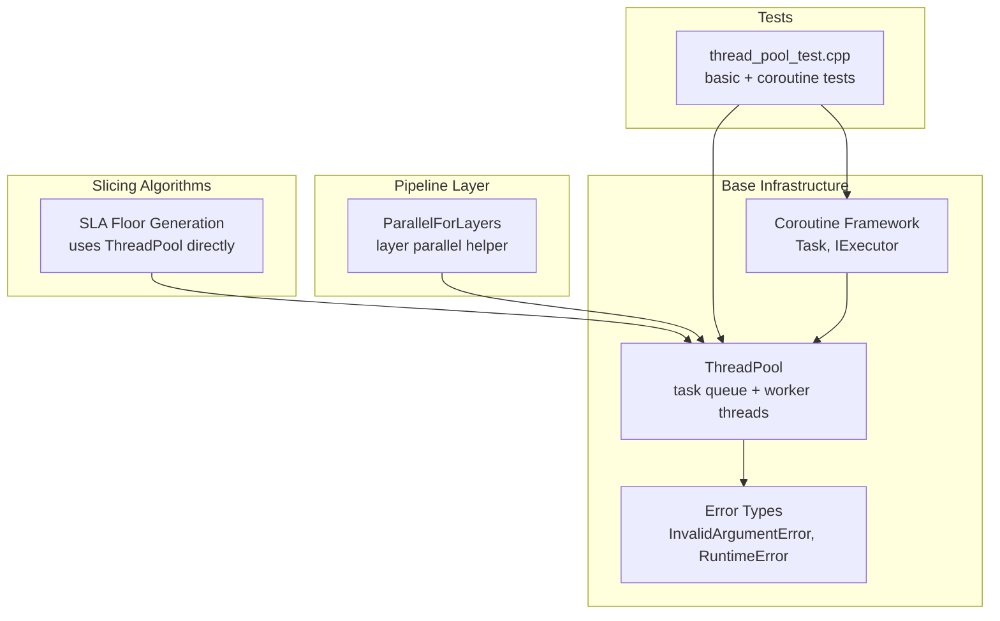
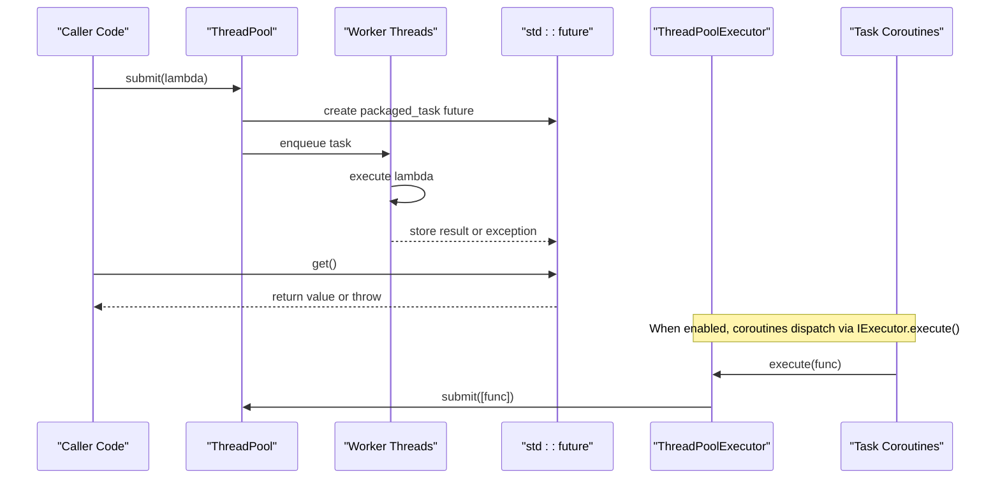
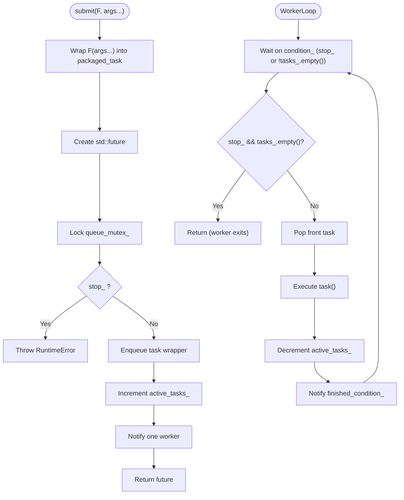
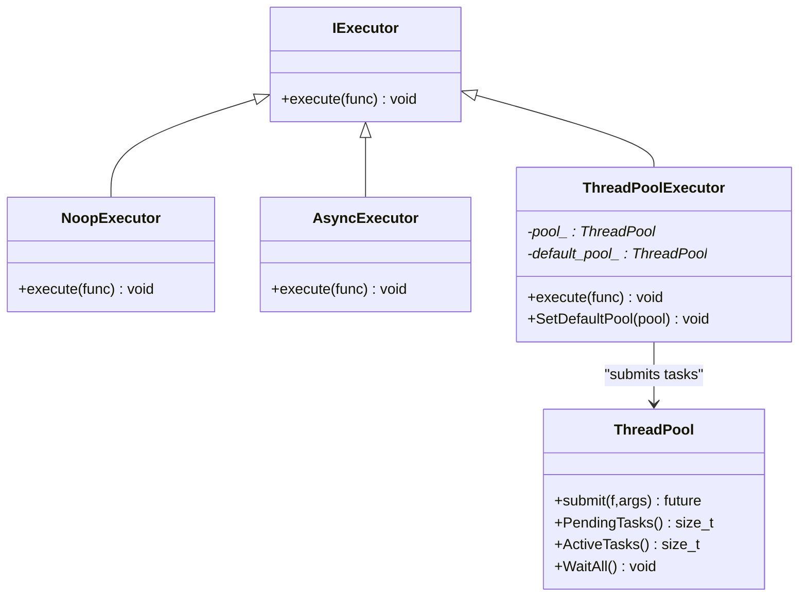
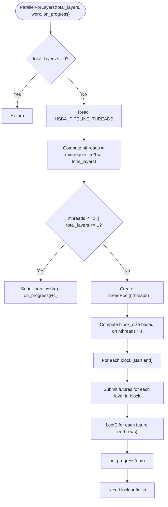
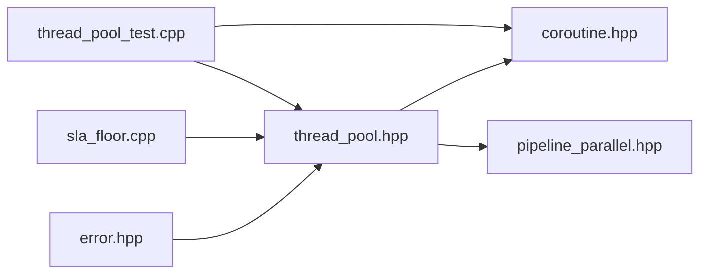

# Threading Utilities / 线程工具

<cite>
**Referenced Files in This Document**
- [thread_pool.hpp](file://base/thread_pool.hpp)
- [coroutine.hpp](file://base/coroutine.hpp)
- [pipeline_parallel.hpp](file://DllHsBaSlicer/pipeline_parallel.hpp)
- [sla_floor.cpp](file://LibHsBaSlicer/Floor/sla_floor.cpp)
- [thread_pool_test.cpp](file://tests/Pool/thread_pool_test.cpp)
- [error.hpp](file://base/error.hpp)
</cite>

## Table of Contents
1. [Introduction](#introduction)
2. [Project Structure](#project-structure)
3. [Core Components](#core-components)
4. [Architecture Overview](#architecture-overview)
5. [Detailed Component Analysis](#detailed-component-analysis)
6. [Dependency Analysis](#dependency-analysis)
7. [Performance Considerations](#performance-considerations)
8. [Troubleshooting Guide](#troubleshooting-guide)
9. [Conclusion](#conclusion)
10. [Appendices](#appendices)

## Introduction
This document explains the threading utilities in HsBaSlicer’s base infrastructure, focusing on the ThreadPool implementation and its integration with slicing pipelines and coroutines. It covers thread creation, task queue management, worker lifecycle, synchronization, task submission patterns using std::function and lambdas, result retrieval via std::future, error propagation from workers, configuration options such as thread count adjustment through environment variables, graceful shutdown behavior, and practical guidance for parallel processing workflows in slicing algorithms.

## Project Structure
The threading utilities are centered around a small set of header-only or lightweight components:
- ThreadPool is defined in the base library and provides a general-purpose concurrent task executor.
- Coroutine support is provided by a coroutine framework that can use ThreadPoolExecutor as an execution context.
- A pipeline helper wraps ThreadPool to parallelize per-layer work in slicing hot paths.
- Real-world usage appears in floor generation code and unit tests.

**Diagram sources**
- [thread_pool.hpp:29-162](file://base/thread_pool.hpp#L29-L162)
- [coroutine.hpp:47-70](file://base/coroutine.hpp#L47-L70)
- [pipeline_parallel.hpp:41-117](file://DllHsBaSlicer/pipeline_parallel.hpp#L41-L117)
- [sla_floor.cpp:412-456](file://LibHsBaSlicer/Floor/sla_floor.cpp#L412-L456)
- [thread_pool_test.cpp:14-85](file://tests/Pool/thread_pool_test.cpp#L14-L85)

**Section sources**
- [thread_pool.hpp:1-214](file://base/thread_pool.hpp#L1-L214)
- [coroutine.hpp:1-800](file://base/coroutine.hpp#L1-L800)
- [pipeline_parallel.hpp:1-122](file://DllHsBaSlicer/pipeline_parallel.hpp#L1-L122)
- [sla_floor.cpp:408-456](file://LibHsBaSlicer/Floor/sla_floor.cpp#L408-L456)
- [thread_pool_test.cpp:1-87](file://tests/Pool/thread_pool_test.cpp#L1-L87)

## Core Components
- ThreadPool: A bounded pool of worker threads executing tasks submitted via submit(). It exposes PendingTasks(), ActiveTasks(), and WaitAll() for monitoring and synchronization.
- ThreadPoolExecutor: An executor adapter implementing the coroutine IExecutor interface, allowing Task-based coroutines to run on ThreadPool.
- ParallelForLayers: A helper that distributes layer indices across ThreadPool, batching work and invoking progress callbacks serially on the caller thread.
- Coroutine Task system: Provides Task<T, Executor>, awaiters, and executors (NoopExecutor, AsyncExecutor, ThreadPoolExecutor).

Key responsibilities:
- Thread lifecycle management and graceful shutdown.
- Thread-safe task queueing and execution.
- Result delivery through std::future.
- Optional coroutine scheduling via IExecutor.

**Section sources**
- [thread_pool.hpp:29-162](file://base/thread_pool.hpp#L29-L162)
- [thread_pool.hpp:164-210](file://base/thread_pool.hpp#L164-L210)
- [coroutine.hpp:47-70](file://base/coroutine.hpp#L47-L70)
- [pipeline_parallel.hpp:41-117](file://DllHsBaSlicer/pipeline_parallel.hpp#L41-L117)

## Architecture Overview
The threading architecture integrates three layers:
- Execution layer: ThreadPool owns worker threads and a guarded task queue.
- Scheduling layer: ThreadPoolExecutor bridges coroutine Task to ThreadPool.
- Application layer: Pipeline helpers and slicing algorithms submit work and collect results.

**Diagram sources**
- [thread_pool.hpp:67-90](file://base/thread_pool.hpp#L67-L90)
- [thread_pool.hpp:118-154](file://base/thread_pool.hpp#L118-L154)
- [thread_pool.hpp:180-184](file://base/thread_pool.hpp#L180-L184)
- [coroutine.hpp:180-198](file://base/coroutine.hpp#L180-L198)

## Detailed Component Analysis

### ThreadPool Implementation
ThreadPool manages:
- Worker threads created at construction; each runs a loop pulling tasks from a queue.
- A mutex-protected queue of std::function<void()> tasks.
- Two condition variables: one for waking workers when new tasks arrive or shutdown is requested, another for signaling completion to WaitAll().
- Atomic flags/counters: stop_ and active_tasks_.

Thread creation and lifecycle:
- Constructor validates num_threads > 0 and spawns workers.
- Destructor sets stop_, notifies all workers, and joins them.

Task submission and result retrieval:
- submit() wraps the callable into a packaged_task and returns a std::future.
- Workers invoke the task and decrement active_tasks_; exceptions are caught inside the worker loop but do not prevent other tasks from running.

Synchronization:
- PendingTasks() and ActiveTasks() provide visibility into queue state.
- WaitAll() blocks until the queue is empty and no active tasks remain.

Graceful shutdown:
- Setting stop_ ensures workers exit after draining the queue.
- Destruction waits for all workers to join.

**Diagram sources**
- [thread_pool.hpp:67-90](file://base/thread_pool.hpp#L67-L90)
- [thread_pool.hpp:118-154](file://base/thread_pool.hpp#L118-L154)

Configuration and error handling:
- Constructor throws InvalidArgumentError if num_threads == 0.
- submit() throws RuntimeError if called after shutdown.

**Section sources**
- [thread_pool.hpp:37-46](file://base/thread_pool.hpp#L37-L46)
- [thread_pool.hpp:47-61](file://base/thread_pool.hpp#L47-L61)
- [thread_pool.hpp:67-90](file://base/thread_pool.hpp#L67-L90)
- [thread_pool.hpp:94-111](file://base/thread_pool.hpp#L94-L111)
- [thread_pool.hpp:118-154](file://base/thread_pool.hpp#L118-L154)
- [error.hpp](file://base/error.hpp)

### ThreadPoolExecutor and Coroutine Integration
ThreadPoolExecutor implements IExecutor.execute() by forwarding functions to ThreadPool.submit(). It supports:
- Per-instance pool binding.
- A static default pool fallback.
- Conditional compilation for coroutine support.

**Diagram sources**
- [coroutine.hpp:47-70](file://base/coroutine.hpp#L47-L70)
- [thread_pool.hpp:164-210](file://base/thread_pool.hpp#L164-L210)

Usage examples:
- Unit tests demonstrate setting a default pool and using Task<int, ThreadPoolExecutor>.
- Mixed usage shows combining futures and coroutines within the same pool.

**Section sources**
- [thread_pool.hpp:164-210](file://base/thread_pool.hpp#L164-L210)
- [thread_pool_test.cpp:39-85](file://tests/Pool/thread_pool_test.cpp#L39-L85)

### ParallelForLayers Helper
ParallelForLayers is designed for slicing hot paths where layers are independent:
- Reads HSBA_PIPELINE_THREADS to override worker count.
- Falls back to hardware_concurrency when unset.
- Serializes progress callbacks on the calling thread.
- Batches layer submissions to reduce callback overhead.
- Re-throws worker exceptions via futures.get().

**Diagram sources**
- [pipeline_parallel.hpp:41-117](file://DllHsBaSlicer/pipeline_parallel.hpp#L41-L117)

Real-world usage:
- SLA floor generation uses a similar pattern, reading HSBA_PIPELINE_THREADS and constructing a ThreadPool to process layers concurrently.

**Section sources**
- [pipeline_parallel.hpp:41-117](file://DllHsBaSlicer/pipeline_parallel.hpp#L41-L117)
- [sla_floor.cpp:412-456](file://LibHsBaSlicer/Floor/sla_floor.cpp#L412-L456)

### Task Submission Patterns and Error Propagation
- Callable types: Any function object compatible with std::invoke_result_t, including lambdas capturing local state.
- Arguments: Forwarded to the wrapped packaged_task.
- Results: Returned via std::future; exceptions thrown in workers are rethrown when future.get() is called.
- Worker exception handling: The worker catches std::exception to avoid crashing the pool, decrements active_tasks_, and continues processing subsequent tasks.

Common pitfalls:
- Submitting tasks after shutdown triggers RuntimeError.
- Not collecting futures may delay resource cleanup or hide exceptions.
- Excessive short-lived tasks increase queue contention.

**Section sources**
- [thread_pool.hpp:67-90](file://base/thread_pool.hpp#L67-L90)
- [thread_pool.hpp:140-153](file://base/thread_pool.hpp#L140-L153)
- [thread_pool_test.cpp:14-37](file://tests/Pool/thread_pool_test.cpp#L14-L37)

## Dependency Analysis
The threading subsystem has clear boundaries:
- ThreadPool depends on standard concurrency primitives and error types.
- Coroutine framework defines IExecutor and provides executors; ThreadPoolExecutor adapts ThreadPool.
- Pipeline helpers depend on ThreadPool and environment variables for tuning.
- Slicing algorithms consume ThreadPool directly or via helpers.

**Diagram sources**
- [thread_pool.hpp:1-24](file://base/thread_pool.hpp#L1-L24)
- [coroutine.hpp:1-40](file://base/coroutine.hpp#L1-L40)
- [pipeline_parallel.hpp:1-18](file://DllHsBaSlicer/pipeline_parallel.hpp#L1-L18)
- [sla_floor.cpp:408-456](file://LibHsBaSlicer/Floor/sla_floor.cpp#L408-L456)
- [thread_pool_test.cpp:1-10](file://tests/Pool/thread_pool_test.cpp#L1-L10)

**Section sources**
- [thread_pool.hpp:1-24](file://base/thread_pool.hpp#L1-L24)
- [coroutine.hpp:1-40](file://base/coroutine.hpp#L1-L40)
- [pipeline_parallel.hpp:1-18](file://DllHsBaSlicer/pipeline_parallel.hpp#L1-L18)

## Performance Considerations
- Thread count selection:
  - Default to hardware_concurrency unless overridden by HSBA_PIPELINE_THREADS.
  - Cap nthreads to total_layers to avoid idle workers.
- Work granularity:
  - Batch layer submissions to reduce callback overhead and improve throughput.
  - Avoid submitting too many tiny tasks; prefer coarser chunks.
- Memory and synchronization:
  - Minimize shared mutable state between workers; use per-layer outputs indexed by layer id.
  - Use atomic counters only when necessary; prefer partitioned ranges.
- Exception safety:
  - Ensure work() writes only to its own output slot to avoid data races.
  - Collect futures promptly to surface errors early.

[No sources needed since this section provides general guidance]

## Troubleshooting Guide
Common issues and resolutions:
- Runtime error when submitting after shutdown:
  - Cause: ThreadPool destructor sets stop_ and rejects further submissions.
  - Resolution: Ensure all futures are collected before pool destruction; avoid long-lived pools beyond their scope.
- Exceptions swallowed in workers:
  - Behavior: Worker catches std::exception to keep the pool alive; exceptions propagate via future.get().
  - Resolution: Always call future.get() to observe errors; wrap heavy work in try/catch if you need localized recovery.
- Deadlocks or stalls:
  - Cause: Blocking operations inside tasks or excessive synchronization.
  - Resolution: Keep tasks non-blocking; limit lock scopes; avoid nested blocking calls.
- Environment variable misconfiguration:
  - HSBA_PIPELINE_THREADS=1 forces serial path; invalid values fall back to hardware_concurrency.
  - Resolution: Set positive integer values to control parallelism; verify with profiling.

**Section sources**
- [thread_pool.hpp:77-82](file://base/thread_pool.hpp#L77-L82)
- [thread_pool.hpp:140-153](file://base/thread_pool.hpp#L140-L153)
- [pipeline_parallel.hpp:49-72](file://DllHsBaSlicer/pipeline_parallel.hpp#L49-L72)

## Conclusion
HsBaSlicer’s threading utilities provide a robust, configurable foundation for parallelizing slicing workloads. ThreadPool offers safe task submission, result retrieval, and graceful shutdown, while ThreadPoolExecutor enables coroutine-based scheduling. The ParallelForLayers helper demonstrates best practices for layer-wise parallelism, including environment-driven tuning and serialized progress reporting. By following the guidelines here—careful thread count selection, coarse-grained task batching, disciplined exception handling, and minimal shared state—you can achieve reliable and efficient parallel processing in slicing algorithms.

[No sources needed since this section summarizes without analyzing specific files]

## Appendices

### API Reference Summary
- ThreadPool:
  - Constructor: explicit(size_t num_threads = hardware_concurrency()).
  - submit(): template<F, Args...> -> std::future<invoke_result_t<F, Args...>>.
  - PendingTasks(): size_t.
  - ActiveTasks(): size_t.
  - WaitAll(): void.
- ThreadPoolExecutor:
  - execute(std::function<void()>&&): void.
  - SetDefaultPool(ThreadPool*): void.
- ParallelForLayers:
  - ParallelForLayers(int total_layers, const std::function<void(int)>& work, const std::function<void(int)>& on_progress = nullptr): void.

**Section sources**
- [thread_pool.hpp:37-111](file://base/thread_pool.hpp#L37-L111)
- [thread_pool.hpp:180-188](file://base/thread_pool.hpp#L180-L188)
- [pipeline_parallel.hpp:41-42](file://DllHsBaSlicer/pipeline_parallel.hpp#L41-L42)