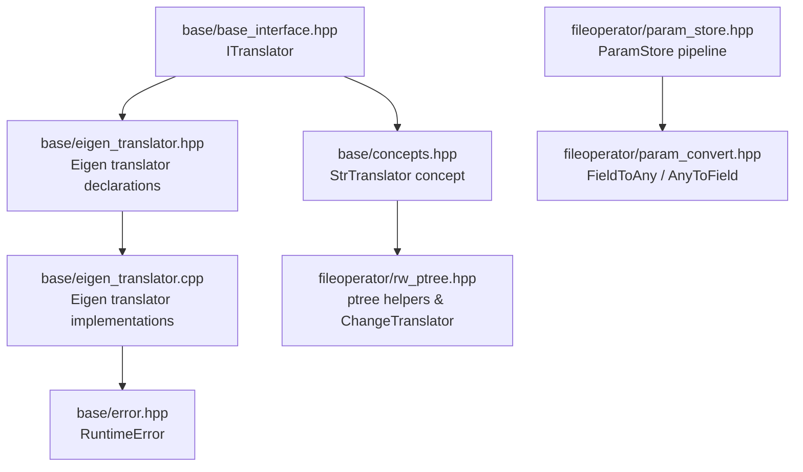
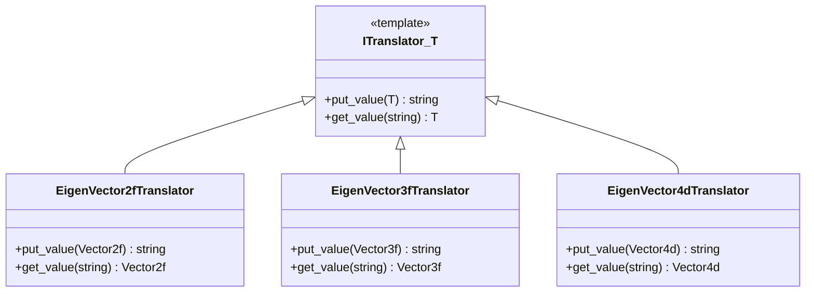
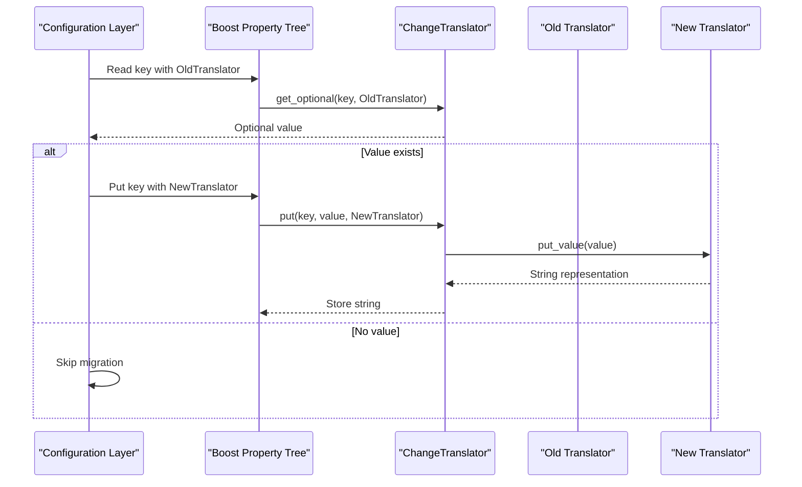
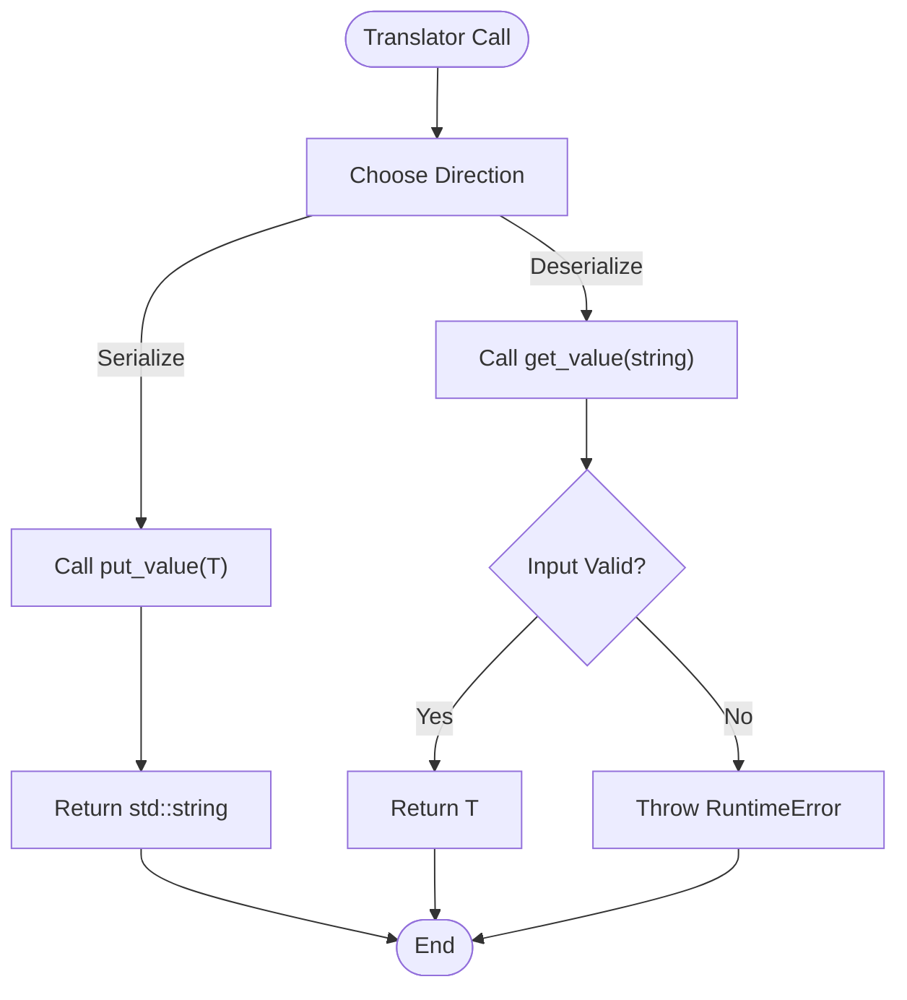
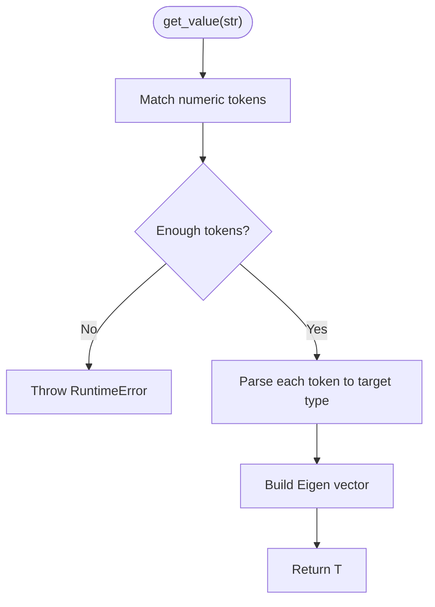
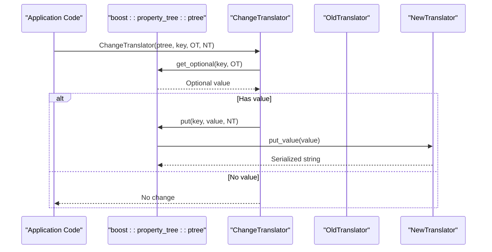
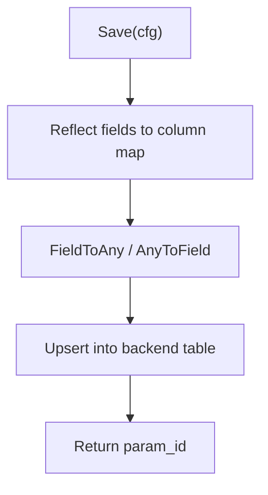
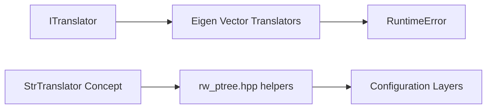

# Type Translators / 类型转换器

<cite>
**Referenced Files in This Document**   
- [base_interface.hpp](file://base/base_interface.hpp)
- [concepts.hpp](file://base/concepts.hpp)
- [eigen_translator.hpp](file://base/eigen_translator.hpp)
- [eigen_translator.cpp](file://base/eigen_translator.cpp)
- [error.hpp](file://base/error.hpp)
- [rw_ptree.hpp](file://fileoperator/rw_ptree.hpp)
- [param_store.hpp](file://fileoperator/param_store.hpp)
- [param_convert.hpp](file://fileoperator/param_convert.hpp)
</cite>

## Table of Contents
1. [Introduction](#introduction)
2. [Project Structure](#project-structure)
3. [Core Components](#core-components)
4. [Architecture Overview](#architecture-overview)
5. [Detailed Component Analysis](#detailed-component-analysis)
6. [Dependency Analysis](#dependency-analysis)
7. [Performance Considerations](#performance-considerations)
8. [Troubleshooting Guide](#troubleshooting-guide)
9. [Conclusion](#conclusion)

## Introduction
This document explains the type translator system used by HsBaSlicer’s base infrastructure to convert between C++ types and their string representations. The central abstraction is the `ITranslator<T>` template interface, which defines a bidirectional contract:

- `put_value(T)` serializes a value into a string.
- `get_value(std::string)` parses a string back into a value.

The repository provides concrete translators for Eigen vector types and integrates these translators with configuration systems such as Boost property trees and higher-level parameter persistence layers.

## Project Structure
The type translator system lives primarily under `base/`, while its integration points are exposed through `fileoperator/` configuration utilities and parameter storage.

**Diagram sources**
- [base_interface.hpp:13-25](file://base/base_interface.hpp#L13-L25)
- [concepts.hpp:40-48](file://base/concepts.hpp#L40-L48)
- [eigen_translator.hpp:16-107](file://base/eigen_translator.hpp#L16-L107)
- [eigen_translator.cpp:13-228](file://base/eigen_translator.cpp#L13-L228)
- [error.hpp:15-27](file://base/error.hpp#L15-L27)
- [rw_ptree.hpp:382-400](file://fileoperator/rw_ptree.hpp#L382-L400)
- [param_store.hpp:28-64](file://fileoperator/param_store.hpp#L28-L64)
- [param_convert.hpp:21-32](file://fileoperator/param_convert.hpp#L21-L32)

**Section sources**
- [base_interface.hpp:13-25](file://base/base_interface.hpp#L13-L25)
- [eigen_translator.hpp:16-107](file://base/eigen_translator.hpp#L16-L107)
- [rw_ptree.hpp:382-400](file://fileoperator/rw_ptree.hpp#L382-L400)

## Core Components
The core components are:

- `ITranslator<T>`: A pure virtual template interface that requires two methods:
  - `std::string put_value(const T&)`: Converts a typed value into a string representation.
  - `T get_value(const std::string&)`: Parses a string into a typed value.
- Concrete translators for Eigen vectors:
  - `EigenVector2fTranslator`, `EigenVector2iTranslator`, `EigenVector2dTranslator`
  - `EigenVector3fTranslator`, `EigenVector3iTranslator`, `EigenVector3dTranslator`
  - `EigenVector4fTranslator`, `EigenVector4iTranslator`, `EigenVector4dTranslator`
  - `EigenVectorXfTranslator`
- Supporting concepts and error types:
  - `StrTranslator<T, Translator>` concept enforces compatible `put_value` and `get_value` signatures.
  - `RuntimeError` is thrown when parsing fails.

**Diagram sources**
- [base_interface.hpp:19-25](file://base/base_interface.hpp#L19-L25)
- [eigen_translator.hpp:21-26](file://base/eigen_translator.hpp#L21-L26)
- [eigen_translator.hpp:48-53](file://base/eigen_translator.hpp#L48-L53)
- [eigen_translator.hpp:93-98](file://base/eigen_translator.hpp#L93-L98)

**Section sources**
- [base_interface.hpp:13-25](file://base/base_interface.hpp#L13-L25)
- [eigen_translator.hpp:16-107](file://base/eigen_translator.hpp#L16-L107)

## Architecture Overview
The translator system bridges typed domain objects and textual configuration formats. The typical flow is:

1. Configuration data is represented as strings in Boost property trees or other text-based formats.
2. `ChangeTranslator` reads an existing value using an old translator and writes it using a new translator.
3. Custom translators implement `put_value` and `get_value` to serialize and parse specific types.
4. Parameter persistence layers use reflection and conversion utilities to store and load structured configurations.

**Diagram sources**
- [rw_ptree.hpp:382-400](file://fileoperator/rw_ptree.hpp#L382-L400)
- [concepts.hpp:40-48](file://base/concepts.hpp#L40-L48)

**Section sources**
- [rw_ptree.hpp:382-400](file://fileoperator/rw_ptree.hpp#L382-L400)

## Detailed Component Analysis

### ITranslator Template Interface
`ITranslator<T>` defines the minimal contract for bidirectional conversion:

- `put_value(const T&) -> std::string`
  - Input: A const reference to the source value.
  - Output: A string encoding the value.
- `get_value(const std::string&) -> T`
  - Input: A string containing serialized data.
  - Output: A reconstructed value of type `T`.
  - Behavior on invalid input: Throws `RuntimeError`.

Usage patterns:
- Implement one translator per type family (for example, Eigen vectors).
- Use the translator with Boost property tree helpers to migrate or persist values.
- Combine with reflection-driven configuration systems to support heterogeneous fields.

**Diagram sources**
- [base_interface.hpp:20-25](file://base/base_interface.hpp#L20-L25)
- [error.hpp:17-27](file://base/error.hpp#L17-L27)

**Section sources**
- [base_interface.hpp:13-25](file://base/base_interface.hpp#L13-L25)
- [error.hpp:15-27](file://base/error.hpp#L15-L27)

### Eigen Vector Translators
The Eigen translators provide consistent serialization formats for fixed-size and dynamic-size vectors. Their behavior can be summarized as follows:

- Serialization format:
  - Fixed-size vectors use parenthesized, comma-separated components.
  - Integer vectors parse integer tokens.
  - Floating-point vectors parse floating-point tokens including scientific notation.
- Parsing strategy:
  - Regular expressions extract numeric tokens from the string.
  - Missing tokens cause a `RuntimeError`.
- Dimension-specific classes:
  - `EigenVector2*Translator` for 2D vectors.
  - `EigenVector3*Translator` for 3D vectors.
  - `EigenVector4*Translator` for 4D vectors.
  - `EigenVectorXfTranslator` for dynamic-length float vectors.

**Diagram sources**
- [eigen_translator.cpp:15-37](file://base/eigen_translator.cpp#L15-L37)
- [eigen_translator.cpp:85-108](file://base/eigen_translator.cpp#L85-L108)
- [eigen_translator.cpp:156-179](file://base/eigen_translator.cpp#L156-L179)
- [error.hpp:17-27](file://base/error.hpp#L17-L27)

**Section sources**
- [eigen_translator.hpp:16-107](file://base/eigen_translator.hpp#L16-L107)
- [eigen_translator.cpp:13-228](file://base/eigen_translator.cpp#L13-L228)
- [error.hpp:15-27](file://base/error.hpp#L15-L27)

### Integration with Configuration Systems

#### Boost Property Tree Migration
`ChangeTranslator` enables safe migration of stored values by reading with an old translator and writing with a new translator. This supports evolving serialization formats without losing configuration data.

Key behaviors:
- Reads optional values using the old translator.
- If present, writes them using the new translator.
- Relies on the `StrTranslator` concept to ensure compatible interfaces.

**Diagram sources**
- [rw_ptree.hpp:382-400](file://fileoperator/rw_ptree.hpp#L382-L400)
- [concepts.hpp:40-48](file://base/concepts.hpp#L40-L48)

**Section sources**
- [rw_ptree.hpp:382-400](file://fileoperator/rw_ptree.hpp#L382-L400)
- [concepts.hpp:40-48](file://base/concepts.hpp#L40-L48)

#### Parameter Store Pipeline
The parameter store pipeline uses reflection and conversion utilities to persist structured configuration objects. While this layer does not directly call `ITranslator`, it demonstrates how translation fits into broader configuration workflows:

- Reflection exposes fields via `AnyObject::ForeachField`.
- Conversion utilities bridge field types to SQL adapter whitelist types.
- Errors propagate upward so callers can handle invalid or unsupported conversions.

**Diagram sources**
- [param_store.hpp:28-64](file://fileoperator/param_store.hpp#L28-L64)
- [param_convert.hpp:21-32](file://fileoperator/param_convert.hpp#L21-L32)

**Section sources**
- [param_store.hpp:28-64](file://fileoperator/param_store.hpp#L28-L64)
- [param_convert.hpp:21-32](file://fileoperator/param_convert.hpp#L21-L32)

### Implementing Custom Translators
To add a custom translator:

1. Create a class derived from `ITranslator<T>`.
2. Implement `put_value(const T&)` to produce a stable string format.
3. Implement `get_value(const std::string&)` to parse the string into `T`.
4. Throw `RuntimeError` when the input cannot be parsed.
5. Register or use the translator where needed, for example with Boost property tree helpers.

Recommended practices:
- Keep the string format deterministic and human-readable when possible.
- Validate all required components before constructing the result.
- Provide clear error messages indicating the problematic input.
- Avoid unnecessary allocations inside hot paths; reuse buffers if appropriate.

**Section sources**
- [base_interface.hpp:19-25](file://base/base_interface.hpp#L19-L25)
- [error.hpp:17-27](file://base/error.hpp#L17-L27)

## Dependency Analysis
The translator system has clear boundaries:

- `ITranslator<T>` depends only on `std::string`.
- Eigen translators depend on Eigen types and throw `RuntimeError`.
- Configuration helpers depend on the `StrTranslator` concept and Boost property tree APIs.
- Parameter store utilities depend on reflection and conversion abstractions rather than direct translator usage.

**Diagram sources**
- [base_interface.hpp:19-25](file://base/base_interface.hpp#L19-L25)
- [eigen_translator.cpp:13-228](file://base/eigen_translator.cpp#L13-L228)
- [error.hpp:17-27](file://base/error.hpp#L17-L27)
- [concepts.hpp:40-48](file://base/concepts.hpp#L40-L48)
- [rw_ptree.hpp:382-400](file://fileoperator/rw_ptree.hpp#L382-L400)

**Section sources**
- [base_interface.hpp:19-25](file://base/base_interface.hpp#L19-L25)
- [eigen_translator.cpp:13-228](file://base/eigen_translator.cpp#L13-L228)
- [concepts.hpp:40-48](file://base/concepts.hpp#L40-L48)
- [rw_ptree.hpp:382-400](file://fileoperator/rw_ptree.hpp#L382-L400)

## Performance Considerations
When implementing or using type translators, consider the following performance characteristics:

- String formatting cost:
  - `put_value` typically allocates a new string. For high-frequency serialization, consider preallocated buffers or lightweight formatting strategies.
- Parsing cost:
  - `get_value` may construct regular expressions and iterate over matches. Reusing compiled regex objects reduces overhead.
- Memory management:
  - Avoid repeated allocations inside tight loops.
  - Prefer small fixed-size arrays for intermediate parsing results.
- Exception handling:
  - Throwing exceptions during parsing is correct but can be expensive in hot paths. Validate inputs early when possible.
- Integration overhead:
  - Using translators with Boost property tree adds indirection; cache translator instances where appropriate.

[No sources needed since this section provides general guidance]

## Troubleshooting Guide
Common issues and resolutions:

- Invalid string format:
  - Symptom: `RuntimeError` thrown from `get_value`.
  - Cause: Missing numeric tokens or malformed serialization.
  - Resolution: Ensure the string conforms to the expected format produced by `put_value`.
- Mismatched translator versions:
  - Symptom: Configuration migration fails or produces unexpected values.
  - Cause: Using an incompatible old or new translator.
  - Resolution: Update both sides consistently using `ChangeTranslator`.
- Unexpected type conversions:
  - Symptom: Values appear truncated or rounded.
  - Cause: Integer vs floating-point translator mismatch.
  - Resolution: Use the correct translator for the target type.

**Section sources**
- [eigen_translator.cpp:15-37](file://base/eigen_translator.cpp#L15-L37)
- [eigen_translator.cpp:85-108](file://base/eigen_translator.cpp#L85-L108)
- [eigen_translator.cpp:156-179](file://base/eigen_translator.cpp#L156-L179)
- [error.hpp:17-27](file://base/error.hpp#L17-L27)
- [rw_ptree.hpp:382-400](file://fileoperator/rw_ptree.hpp#L382-L400)

## Conclusion
The type translator system in HsBaSlicer provides a clean, extensible mechanism for converting between typed values and string representations. The `ITranslator<T>` interface defines a simple bidirectional contract, while concrete Eigen translators demonstrate robust parsing and serialization patterns. Integration with Boost property tree helpers and parameter persistence layers shows how translators fit into real-world configuration workflows. By following the recommended implementation practices and performance guidelines, developers can extend the system safely and efficiently.

[No sources needed since this section summarizes without analyzing specific files]