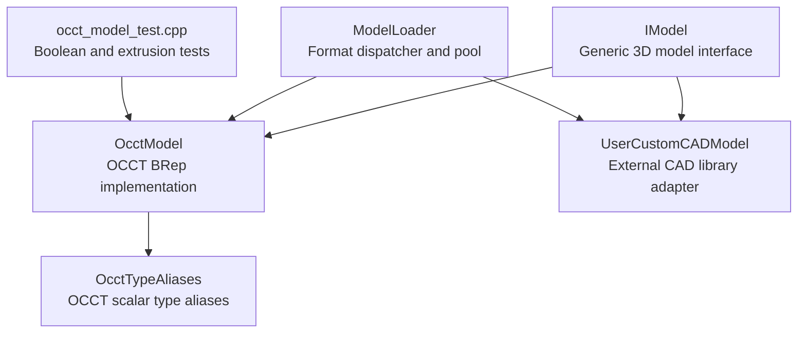
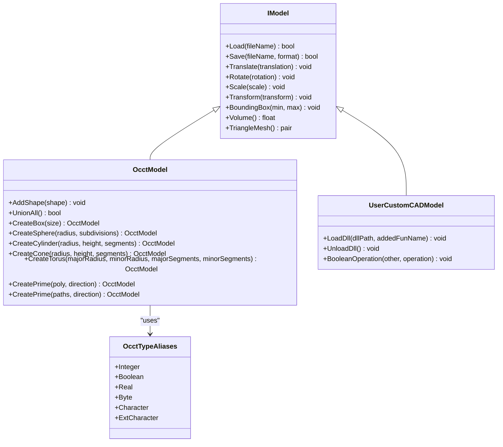
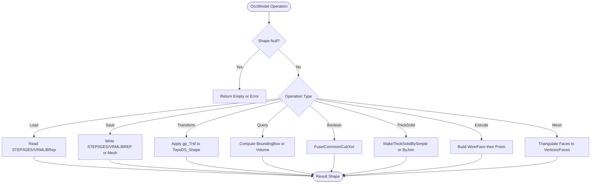
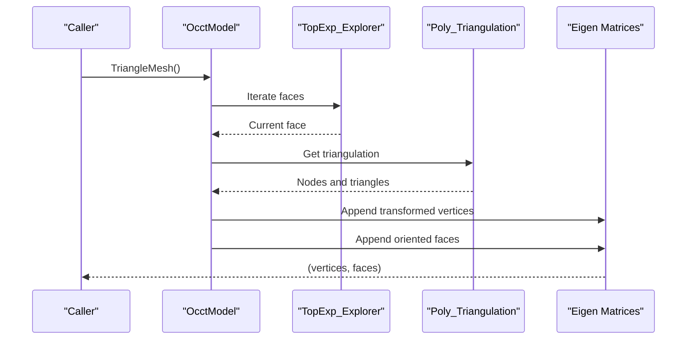
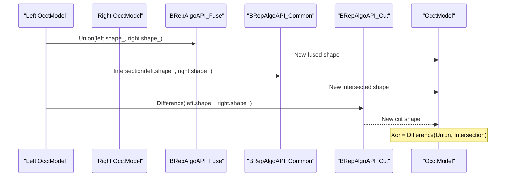
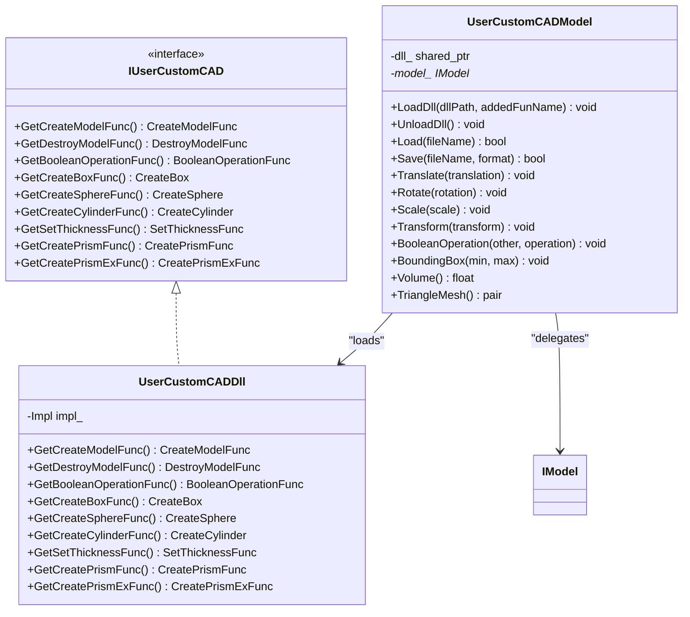
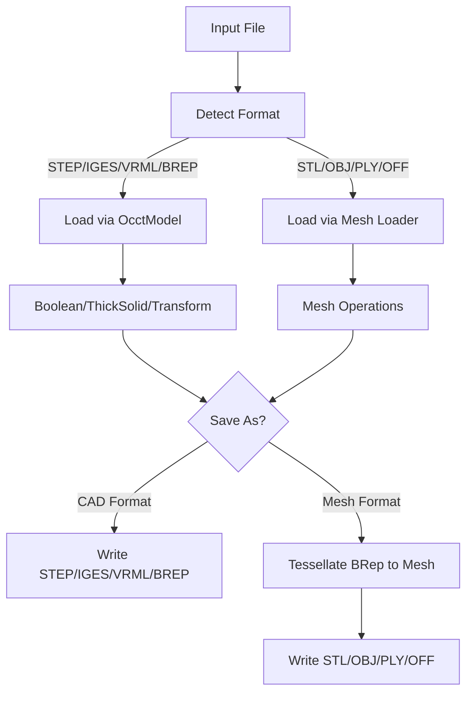
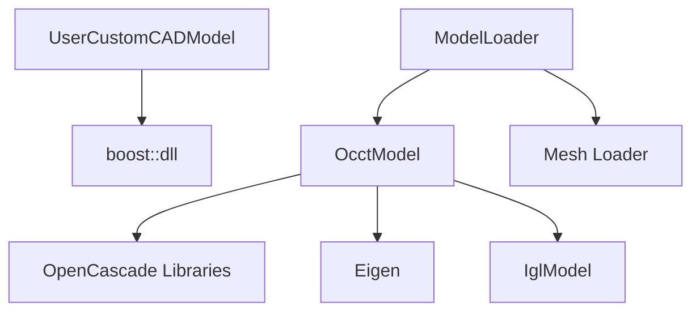

# CAD Model Processing

<cite>
**Referenced Files in This Document**   
- [OcctModel.hpp](file://cadmodel/OcctModel.hpp)
- [OcctModel.cpp](file://cadmodel/OcctModel.cpp)
- [OcctTypeAliases.hpp](file://cadmodel/OcctTypeAliases.hpp)
- [UserCustomCADModel.hpp](file://cadmodel/UserCustomCADModel.hpp)
- [UserCustomCADModel.cpp](file://cadmodel/UserCustomCADModel.cpp)
- [IModel.hpp](file://base/IModel.hpp)
- [ModelLoader.hpp](file://preprocess/ModelLoader.hpp)
- [occt_model_test.cpp](file://tests/Models/occt_model_test.cpp)
</cite>

## Table of Contents
1. [Introduction](#introduction)
2. [Project Structure](#project-structure)
3. [Core Components](#core-components)
4. [Architecture Overview](#architecture-overview)
5. [Detailed Component Analysis](#detailed-component-analysis)
6. [Dependency Analysis](#dependency-analysis)
7. [Performance Considerations](#performance-considerations)
8. [Troubleshooting Guide](#troubleshooting-guide)
9. [Conclusion](#conclusion)
10. [Appendices](#appendices)

## Introduction
This document explains the CAD model processing module that implements B-Rep operations using OpenCascade (OCCT). It focuses on:

- `OcctModel`: an OCCT-based implementation of the generic `IModel` interface, providing loading and saving of STEP, IGES, VRML, and BRep files, affine transforms, bounding-box and volume queries, boolean operations, thick-solid shell creation, primitive factories, and polygon extrusion.
- `UserCustomCADModel`: a plugin-style adapter that loads external CAD libraries through function pointers, enabling custom CAD kernels while keeping the same `IModel` contract.
- Type aliases for OCCT scalar types, ensuring compatibility across OCCT versions.
- Integration between CAD models and mesh representations via tessellation and conversion to libigl-style meshes.
- Practical workflows for coordinate system handling, tolerance usage, performance considerations for large models, and migration strategies between CAD formats.

The goal is to make these concepts accessible to both new users and experienced developers who need to manipulate or extend the CAD pipeline.

## Project Structure
The CAD processing area lives under `cadmodel`, with supporting interfaces and utilities elsewhere:

**Diagram sources**
- [IModel.hpp:110-139](file://base/IModel.hpp#L110-L139)
- [OcctModel.hpp:22-124](file://cadmodel/OcctModel.hpp#L22-L124)
- [OcctTypeAliases.hpp:22-42](file://cadmodel/OcctTypeAliases.hpp#L22-L42)
- [UserCustomCADModel.hpp:75-121](file://cadmodel/UserCustomCADModel.hpp#L75-L121)
- [ModelLoader.hpp:23-59](file://preprocess/ModelLoader.hpp#L23-L59)
- [occt_model_test.cpp:34-48](file://tests/Models/occt_model_test.cpp#L34-L48)

**Section sources**
- [OcctModel.hpp:22-124](file://cadmodel/OcctModel.hpp#L22-L124)
- [OcctModel.cpp:76-270](file://cadmodel/OcctModel.cpp#L76-L270)
- [OcctTypeAliases.hpp:1-45](file://cadmodel/OcctTypeAliases.hpp#L1-L45)
- [UserCustomCADModel.hpp:27-121](file://cadmodel/UserCustomCADModel.hpp#L27-L121)
- [UserCustomCADModel.cpp:24-149](file://cadmodel/UserCustomCADModel.cpp#L24-L149)
- [IModel.hpp:65-139](file://base/IModel.hpp#L65-L139)
- [ModelLoader.hpp:23-59](file://preprocess/ModelLoader.hpp#L23-L59)

## Core Components
This section summarizes the main components involved in CAD model processing.

### IModel Interface
`IModel` defines the common contract for all 3D model implementations:

- File I/O: `Load(fileName)` and `Save(fileName, format)`.
- Transformations: translation, rotation, scaling, and general transforms.
- Queries: axis-aligned bounding box and signed volume.
- Mesh export: triangle mesh as vertices and faces.

It also exposes C-compatible vector and polygon structures used by external plugins.

**Section sources**
- [IModel.hpp:65-139](file://base/IModel.hpp#L65-L139)

### OcctModel
`OcctModel` wraps an OCCT `TopoDS_Shape` and provides:

- Loading and saving for STEP, IGES, VRML, and BRep.
- Boolean operations: union, intersection, difference, XOR.
- Thick-solid shell creation.
- Primitive creation: box, sphere, cylinder, cone, torus.
- Polygon extrusion into prisms.
- Bounding box and volume computation.
- Tessellation into a libigl-style mesh.

It implements `IModel`, so it can be used anywhere a generic model is expected.

**Section sources**
- [OcctModel.hpp:22-124](file://cadmodel/OcctModel.hpp#L22-L124)
- [OcctModel.cpp:76-270](file://cadmodel/OcctModel.cpp#L76-L270)
- [OcctModel.cpp:331-407](file://cadmodel/OcctModel.cpp#L331-L407)
- [OcctModel.cpp:451-539](file://cadmodel/OcctModel.cpp#L451-L539)
- [OcctModel.cpp:542-663](file://cadmodel/OcctModel.cpp#L542-L663)

### OcctTypeAliases
`OcctTypes` maps OCCT scalar types to standard C++ types when building against OCCT 8.0+, and falls back to legacy OCCT types otherwise. This makes code portable across OCCT versions.

**Section sources**
- [OcctTypeAliases.hpp:1-45](file://cadmodel/OcctTypeAliases.hpp#L1-L45)

### UserCustomCADModel
`UserCustomCADModel` allows extending CAD functionality through an external DLL/SO:

- Loads a user-provided CAD library.
- Resolves factory functions such as create/destroy model, primitives, thickness, extrusion, and named boolean operations.
- Delegates `IModel` methods to the loaded model instance.
- Ensures safe lifetime management and error reporting.

**Section sources**
- [UserCustomCADModel.hpp:27-121](file://cadmodel/UserCustomCADModel.hpp#L27-L121)
- [UserCustomCADModel.cpp:24-149](file://cadmodel/UserCustomCADModel.cpp#L24-L149)
- [UserCustomCADModel.cpp:151-325](file://cadmodel/UserCustomCADModel.cpp#L151-L325)

### ModelLoader
`ModelLoader` is a unified loader that dispatches to the appropriate kernel based on file extension:

- Mesh formats are handled by mesh-specific loaders.
- BRep formats are handled by `OcctModel`.
- Provides higher-level operations like thick-solid and boolean operations when OCCT is available.

**Section sources**
- [ModelLoader.hpp:23-59](file://preprocess/ModelLoader.hpp#L23-L59)
- [ModelLoader.hpp:94-133](file://preprocess/ModelLoader.hpp#L94-L133)

## Architecture Overview
The CAD architecture separates the generic model contract from concrete implementations and plugin adapters.

**Diagram sources**
- [IModel.hpp:110-139](file://base/IModel.hpp#L110-L139)
- [OcctModel.hpp:22-124](file://cadmodel/OcctModel.hpp#L22-L124)
- [UserCustomCADModel.hpp:75-121](file://cadmodel/UserCustomCADModel.hpp#L75-L121)
- [OcctTypeAliases.hpp:22-42](file://cadmodel/OcctTypeAliases.hpp#L22-L42)

## Detailed Component Analysis

### OcctModel: B-Rep Operations and Geometry
`OcctModel` is the central OCCT integration point. It stores a `TopoDS_Shape` and exposes high-level CAD operations.

#### Key Responsibilities
- **File I/O**: Reads/writes STEP, IGES, VRML, and BRep.
- **Transforms**: Translation, rotation, uniform/non-uniform scaling, and arbitrary affine transforms.
- **Queries**: Axis-aligned bounding box and signed volume.
- **Boolean operations**: Union, intersection, difference, XOR.
- **Thick solids**: Shell creation with optional face exclusion.
- **Primitives**: Box, sphere, cylinder, cone, torus.
- **Extrusion**: Single polygon or multi-path polygons with holes.
- **Tessellation**: Converts B-Rep faces to triangles.

**Diagram sources**
- [OcctModel.cpp:76-270](file://cadmodel/OcctModel.cpp#L76-L270)
- [OcctModel.cpp:272-329](file://cadmodel/OcctModel.cpp#L272-L329)
- [OcctModel.cpp:331-407](file://cadmodel/OcctModel.cpp#L331-L407)
- [OcctModel.cpp:451-539](file://cadmodel/OcctModel.cpp#L451-L539)
- [OcctModel.cpp:542-663](file://cadmodel/OcctModel.cpp#L542-L663)

#### Coordinate System Handling
- Transforms use OCCT transformation classes (`gp_Trsf`, `gp_Quaternion`, `gp_Vec`) applied to the underlying shape.
- The bounding box iterates over vertices and computes min/max coordinates.
- Extrusion uses a direction vector to build a prism; the test suite validates volume and bounding box behavior for planar and non-planar directions.

**Section sources**
- [OcctModel.cpp:272-329](file://cadmodel/OcctModel.cpp#L272-L329)
- [OcctModel.cpp:331-351](file://cadmodel/OcctModel.cpp#L331-L351)
- [OcctModel.cpp:542-663](file://cadmodel/OcctModel.cpp#L542-L663)
- [occt_model_test.cpp:110-134](file://tests/Models/occt_model_test.cpp#L110-L134)

#### Tolerance Settings
- The thick-solid overload accepting explicit faces uses a fixed geometric tolerance of `1e-6` when comparing faces and joining surfaces.
- This tolerance controls how closely two faces must match to be considered equivalent during shell construction.

**Section sources**
- [OcctModel.cpp:477-539](file://cadmodel/OcctModel.cpp#L477-L539)

#### Mesh Generation from B-Rep
- `TriangleMesh()` walks each face, retrieves triangulation data, applies location transformations, and builds vertex and face arrays in libigl style.
- If a face has no triangulation, it is skipped.
- Orientation is respected by swapping indices for reversed faces.

**Diagram sources**
- [OcctModel.cpp:353-400](file://cadmodel/OcctModel.cpp#L353-L400)

**Section sources**
- [OcctModel.cpp:353-400](file://cadmodel/OcctModel.cpp#L353-L400)

#### Boolean Operations
- Union uses `BRepAlgoAPI_Fuse`.
- Intersection uses `BRepAlgoAPI_Common`.
- Difference uses `BRepAlgoAPI_Cut`.
- XOR is implemented as difference of union and intersection.

**Diagram sources**
- [OcctModel.cpp:451-469](file://cadmodel/OcctModel.cpp#L451-L469)

**Section sources**
- [OcctModel.cpp:451-469](file://cadmodel/OcctModel.cpp#L451-L469)
- [occt_model_test.cpp:34-48](file://tests/Models/occt_model_test.cpp#L34-L48)

#### Face and Edge Extraction
- The current implementation does not expose direct face or edge extraction APIs.
- Face traversal is used internally for tessellation and thick-solid face matching.
- For applications requiring explicit face/edge access, additional wrappers around `TopExp_Explorer` would be needed.

**Section sources**
- [OcctModel.cpp:353-400](file://cadmodel/OcctModel.cpp#L353-L400)
- [OcctModel.cpp:477-539](file://cadmodel/OcctModel.cpp#L477-L539)

#### Geometric Queries
- Bounding box: iterates vertices and computes min/max.
- Volume: uses OCCT mass properties to compute signed volume.

**Section sources**
- [OcctModel.cpp:331-351](file://cadmodel/OcctModel.cpp#L331-L351)
- [OcctModel.cpp:402-407](file://cadmodel/OcctModel.cpp#L402-L407)

### UserCustomCADModel: Extending CAD Functionality
`UserCustomCADModel` enables dynamic loading of external CAD libraries. It exposes:

- A plugin interface (`IUserCustomCAD`) defining required exported functions.
- A loader (`UserCustomCADDll`) that resolves symbols from a shared library.
- An adapter (`UserCustomCADModel`) implementing `IModel` by delegating to the loaded model.

**Diagram sources**
- [UserCustomCADModel.hpp:27-73](file://cadmodel/UserCustomCADModel.hpp#L27-L73)
- [UserCustomCADModel.hpp:75-121](file://cadmodel/UserCustomCADModel.hpp#L75-L121)
- [UserCustomCADModel.cpp:24-149](file://cadmodel/UserCustomCADModel.cpp#L24-L149)

#### Plugin Contract and Symbol Resolution
- The plugin must export functions with names derived from `addedFunName`, such as `<addedFunName>_create_model`, `<addedFunName>_boolean_operation`, etc.
- The loader checks symbol existence before resolving them.
- Models created by the plugin are destroyed via the plugin’s destroy callback.

**Section sources**
- [UserCustomCADModel.cpp:35-115](file://cadmodel/UserCustomCADModel.cpp#L35-L115)
- [UserCustomCADModel.cpp:134-173](file://cadmodel/UserCustomCADModel.cpp#L134-L173)

#### Delegation Pattern
Most `IModel` methods delegate to the underlying model if present; otherwise, they throw runtime errors indicating missing model or incompatible DLLs.

**Section sources**
- [UserCustomCADModel.cpp:175-325](file://cadmodel/UserCustomCADModel.cpp#L175-L325)

### Type Aliases for OpenCascade Entities
`OcctTypes` abstracts OCCT scalar types:

- On OCCT 8.0+, uses standard C++ types (`int`, `bool`, `double`, `uint8_t`, `char`, `char16_t`).
- On earlier OCCT versions, uses `Standard_Integer`, `Standard_Boolean`, `Standard_Real`, etc.

This abstraction simplifies cross-version code and avoids direct dependency on legacy OCCT types in application logic.

**Section sources**
- [OcctTypeAliases.hpp:1-45](file://cadmodel/OcctTypeAliases.hpp#L1-L45)

### Integration Patterns Between CAD and Mesh Representations
- `OcctModel::Save` supports mesh formats by tessellating the B-Rep and delegating to `IglModel`.
- `ModelLoader` selects `OcctModel` for BRep formats and mesh loaders for mesh formats.
- Direct conversion from mesh to `OcctModel` is not supported in the current path; boolean operations require `OcctModel` sources.

**Diagram sources**
- [OcctModel.cpp:238-270](file://cadmodel/OcctModel.cpp#L238-L270)
- [ModelLoader.hpp:23-59](file://preprocess/ModelLoader.hpp#L23-L59)

**Section sources**
- [OcctModel.cpp:238-270](file://cadmodel/OcctModel.cpp#L238-L270)
- [ModelLoader.hpp:23-59](file://preprocess/ModelLoader.hpp#L23-L59)

## Dependency Analysis
The CAD module depends on:

- OCCT libraries for B-Rep operations.
- Eigen for geometry and transforms.
- libigl-style mesh representation for tessellation output.
- External plugin loader (`boost::dll`) for user-defined CAD libraries.

**Diagram sources**
- [OcctModel.cpp:8-59](file://cadmodel/OcctModel.cpp#L8-L59)
- [UserCustomCADModel.cpp:10-17](file://cadmodel/UserCustomCADModel.cpp#L10-L17)
- [ModelLoader.hpp:23-59](file://preprocess/ModelLoader.hpp#L23-L59)

**Section sources**
- [OcctModel.cpp:8-59](file://cadmodel/OcctModel.cpp#L8-L59)
- [UserCustomCADModel.cpp:10-17](file://cadmodel/UserCustomCADModel.cpp#L10-L17)
- [ModelLoader.hpp:23-59](file://preprocess/ModelLoader.hpp#L23-L59)

## Performance Considerations
- **Large models**: Boolean operations and thick-solid computations operate on full B-Rep shapes and may be expensive. Prefer reducing complexity before operations where possible.
- **Tessellation cost**: `TriangleMesh()` traverses all faces and builds vertex/face arrays; avoid repeated calls on large models.
- **Bounding box**: Iterates vertices; consider caching results if queried frequently.
- **Plugin overhead**: Dynamic loading and symbol resolution add startup cost; reuse loaded DLLs via the internal pool.
- **Memory management**: Ensure proper destruction of plugin-created models via the provided destroy callback.

[No sources needed since this section provides general guidance]

## Troubleshooting Guide
Common issues and their causes:

- **Unsupported model format**: Occurs when attempting to load/save formats not handled by `OcctModel`.
- **VRML read/write failures**: Wrapped exceptions indicate invalid VRML content or IO errors.
- **Model not loaded**: Thrown when calling methods on `UserCustomCADModel` without a loaded model or DLL.
- **Incompatible DLLs**: Boolean operations require both models to come from the same loaded DLL.
- **Direct mesh-to-BRep conversion**: Not supported; boolean operations require `OcctModel` sources.

Recommended actions:

- Verify file extensions and supported formats.
- Validate VRML files before loading.
- Always call `LoadDll` before using `UserCustomCADModel`.
- Use `ModelLoader` to manage models and ensure correct kernel selection.
- Convert mesh to BRep only through supported paths or keep operations in mesh space.

**Section sources**
- [OcctModel.cpp:76-190](file://cadmodel/OcctModel.cpp#L76-L190)
- [UserCustomCADModel.cpp:151-173](file://cadmodel/UserCustomCADModel.cpp#L151-L173)
- [UserCustomCADModel.cpp:268-288](file://cadmodel/UserCustomCADModel.cpp#L268-L288)
- [ModelLoader.cpp:163-166](file://preprocess/ModelLoader.cpp#L163-L166)

## Conclusion
The CAD model processing module centers on `OcctModel` for robust B-Rep operations and `UserCustomCADModel` for extensible plugin-based CAD kernels. Together with `OcctTypeAliases` and `ModelLoader`, they provide a flexible, version-aware, and interoperable CAD pipeline. Users can perform boolean operations, generate meshes, extract geometry, and migrate between CAD formats while maintaining clear separation between CAD and mesh representations.

[No sources needed since this section summarizes without analyzing specific files]

## Appendices

### Practical Examples and Workflows

#### Boolean Operations Workflow
1. Create two `OcctModel` primitives.
2. Apply transforms to position them.
3. Perform union, intersection, difference, or XOR.
4. Validate results via volume or bounding box.

**Section sources**
- [occt_model_test.cpp:34-48](file://tests/Models/occt_model_test.cpp#L34-L48)

#### Polygon Extrusion Workflow
1. Define one or more closed 2D polygons.
2. Choose an extrusion direction.
3. Call `CreatePrime` to produce a solid.
4. Validate volume and bounding box.

**Section sources**
- [occt_model_test.cpp:50-73](file://tests/Models/occt_model_test.cpp#L50-L73)
- [occt_model_test.cpp:75-108](file://tests/Models/occt_model_test.cpp#L75-L108)
- [occt_model_test.cpp:110-134](file://tests/Models/occt_model_test.cpp#L110-L134)

#### Thick-Solid Shell Workflow
1. Load or create an `OcctModel`.
2. Optionally specify faces to leave open.
3. Apply thickness to create a shell.
4. Inspect result via volume or mesh.

**Section sources**
- [OcctModel.cpp:471-539](file://cadmodel/OcctModel.cpp#L471-L539)

#### Migration Between CAD Formats
1. Load a BRep file (STEP/IGES/VRML/BREP) via `OcctModel`.
2. Perform necessary operations.
3. Save to another CAD format or convert to a mesh format.

**Section sources**
- [OcctModel.cpp:213-270](file://cadmodel/OcctModel.cpp#L213-L270)