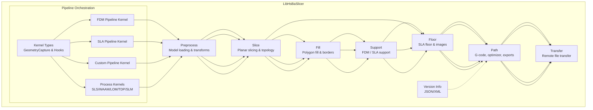
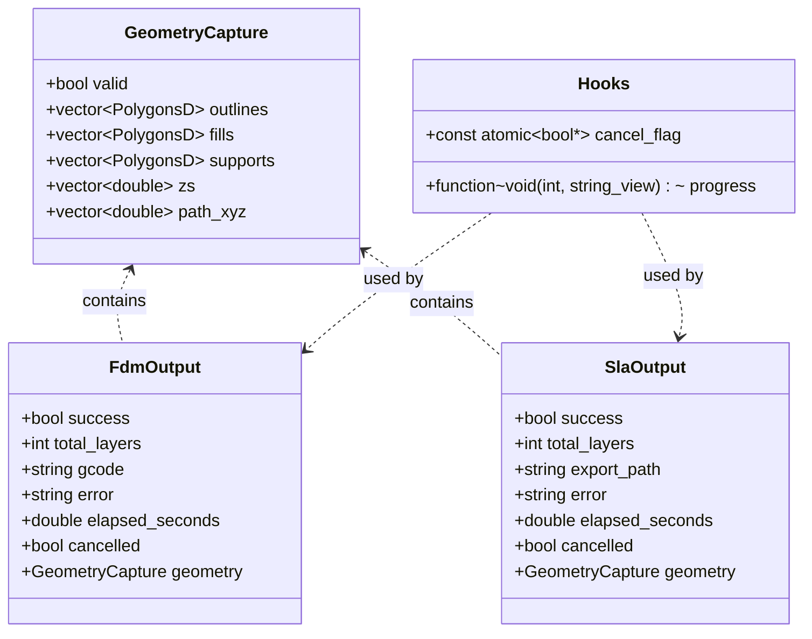
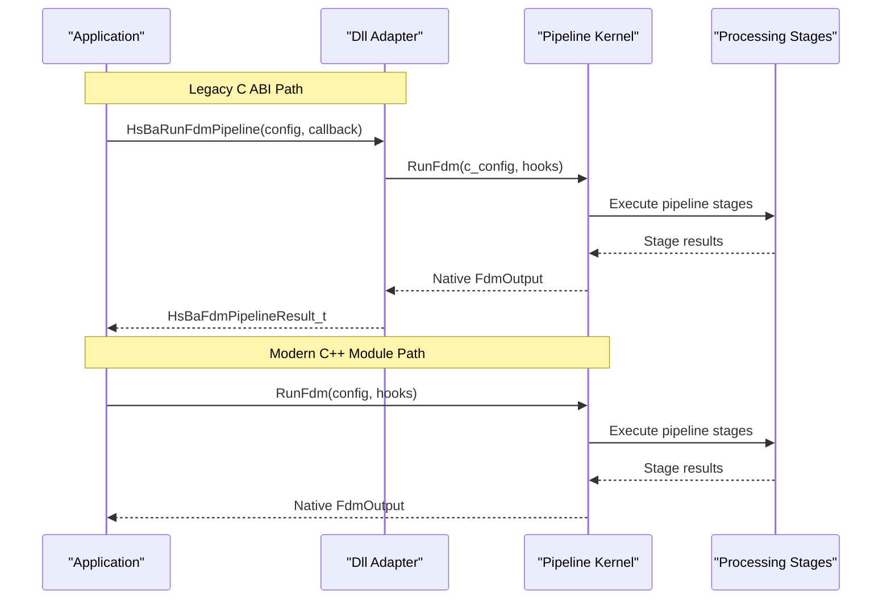
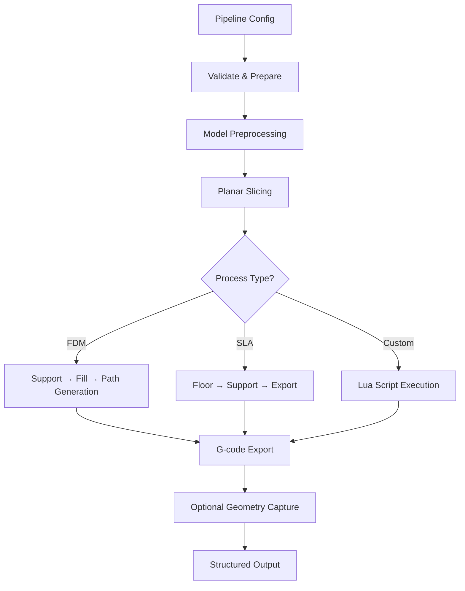
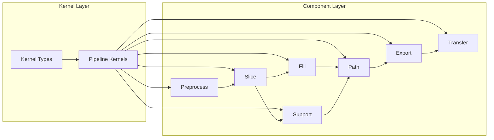
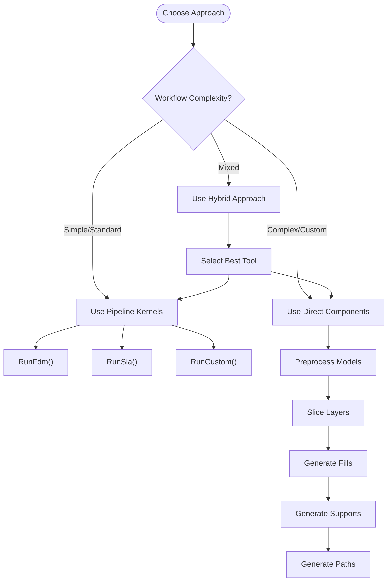

# Core Library API (LibHsBaSlicer/)

<cite>
**Referenced Files in This Document**
- [export.h](file://LibHsBaSlicer/export.h)
- [version_info.hpp](file://LibHsBaSlicer/version_info.hpp)
- [kernel_types.hpp](file://LibHsBaSlicer/Pipeline/kernel_types.hpp)
- [fdm_pipeline.hpp](file://LibHsBaSlicer/Pipeline/fdm_pipeline.hpp)
- [sla_pipeline.hpp](file://LibHsBaSlicer/Pipeline/sla_pipeline.hpp)
- [custom_pipeline.hpp](file://LibHsBaSlicer/Pipeline/custom_pipeline.hpp)
- [sls_pipeline.hpp](file://LibHsBaSlicer/Pipeline/sls_pipeline.hpp)
- [waam_pipeline.hpp](file://LibHsBaSlicer/Pipeline/waam_pipeline.hpp)
- [model_preprocess.hpp](file://LibHsBaSlicer/Preprocess/model_preprocess.hpp)
- [mesh_slice.hpp](file://LibHsBaSlicer/Slice/mesh_slice.hpp)
- [polygon_fill.hpp](file://LibHsBaSlicer/Fill/polygon_fill.hpp)
- [fdm_support.hpp](file://LibHsBaSlicer/Support/fdm_support.hpp)
- [sla_floor.hpp](file://LibHsBaSlicer/Floor/sla_floor.hpp)
- [path_generator.hpp](file://LibHsBaSlicer/Path/path_generator.hpp)
- [path_optimizer.hpp](file://LibHsBaSlicer/Path/path_optimizer.hpp)
- [sls_export.hpp](file://LibHsBaSlicer/Path/sls_export.hpp)
- [waam_export.hpp](file://LibHsBaSlicer/Path/waam_export.hpp)
- [file_transfer.hpp](file://LibHsBaSlicer/Transfer/file_transfer.hpp)
</cite>

## Update Summary
**Changes Made**
- Added comprehensive documentation for the new Pipeline orchestration kernel architecture
- Updated core components section to include the new kernel abstraction with GeometryCapture and Hooks types
- Added new section documenting the shared pipeline orchestration system
- Updated architecture overview to reflect the separation between DllHsBaSlicer adapters and LibHsBaSlicer kernels
- Enhanced examples to demonstrate both direct kernel usage and traditional component-based workflows

## Table of Contents
1. [Introduction](#introduction)
2. [Project Structure](#project-structure)
3. [Core Components](#core-components)
4. [Pipeline Orchestration Kernel](#pipeline-orchestration-kernel)
5. [Architecture Overview](#architecture-overview)
6. [Detailed Component Analysis](#detailed-component-analysis)
7. [Dependency Analysis](#dependency-analysis)
8. [Performance Considerations](#performance-considerations)
9. [Troubleshooting Guide](#troubleshooting-guide)
10. [Conclusion](#conclusion)
11. [Appendices](#appendices)

## Introduction
This document describes the Core Library API exposed by LibHsBaSlicer. The library now features a dual-interface architecture: **direct component APIs** for fine-grained control over individual slicing stages, and **pipeline orchestration kernels** for complete end-to-end process automation.

The core library provides C++ APIs for model preprocessing, planar slicing, polygon filling, support generation, floor and raft generation, path planning and optimization, export packaging, and file transfer. The new kernel abstraction enables both the legacy DllHsBaSlicer C ABI and the modern ModuleHsBaSlicer C++20 interface to share identical implementation logic through `Kernel::GeometryCapture` and `Kernel::Hooks` types.

The library uses consistent design patterns:
- Public functions are marked with HSBA_SLICER_LIB_API for cross-platform symbol visibility.
- Configuration is passed via plain structs.
- Geometry flows as 2D polygons (integer or double precision).
- Many algorithms expose both built-in implementations and Lua-driven customization points.
- Errors are reported through exceptions or boolean return values plus optional error strings.
- Pipeline kernels provide synchronous execution with cooperative cancellation support.

## Project Structure
LibHsBaSlicer organizes its public API by functional area with a new dedicated Pipeline orchestration layer:
- **Pipeline**: Process-specific orchestration kernels (FDM, SLA, SLS, WAAM, Custom) with shared kernel types.
- Preprocess: model loading, transforms, and advanced geometry operations.
- Slice: planar mesh slicing and reusable topology.
- Fill: polygon fill patterns and border generation.
- Support: FDM and SLA support generation, including Lua customization.
- Floor: SLA floor/raft generation, image rendering, and package export.
- Path: G-code path generation, spiral/vase mode, region-based path optimization, and process exports (SLS, WAAM).
- Transfer: remote file transfer with progress callbacks.
- Version info: JSON/XML version query helpers.



**Diagram sources**
- [kernel_types.hpp:33-62](file://LibHsBaSlicer/Pipeline/kernel_types.hpp#L33-L62)
- [fdm_pipeline.hpp:24-49](file://LibHsBaSlicer/Pipeline/fdm_pipeline.hpp#L24-L49)
- [sla_pipeline.hpp:23-49](file://LibHsBaSlicer/Pipeline/sla_pipeline.hpp#L23-L49)
- [custom_pipeline.hpp:22-45](file://LibHsBaSlicer/Pipeline/custom_pipeline.hpp#L22-L45)

**Section sources**
- [export.h:1-22](file://LibHsBaSlicer/export.h#L1-L22)

## Core Components
This section summarizes the main API modules and their responsibilities, now including the new pipeline orchestration layer.

### Pipeline Orchestration Kernels
- **Shared Kernel Types**: `GeometryCapture` for per-layer geometry snapshots and `Hooks` for progress reporting and cancellation.
- **FDM Pipeline**: Complete FDM workflow from model loading through G-code generation with spiral/vase support.
- **SLA Pipeline**: Full SLA workflow including floor/raft generation, support building, and package export.
- **Custom Pipeline**: Fully Lua-driven pipeline entry point with flexible stage orchestration.
- **Process-Specific Kernels**: SLS, SLM, LOM, TDP, and WAAM pipelines for specialized manufacturing processes.

### Traditional Component APIs
- Model preprocessing: Load, retrieve, transform, query, and remove models from an internal pool.
- Planar slicing: Safe and unsafe slicing at a given Z height with Lua-driven variants.
- Polygon filling: Line/zigzag/border fills with custom Lua fill patterns.
- Support generation: FDM support per layer and across all layers, SLA sacrificial support.
- SLA floor and export: Contact area, raft, border, and fill generation with image rendering.
- Path generation and optimization: G-code path generation, spiral/vase mode, region optimization.
- Process exports: SLS package export and WAAM robot program export.
- File transfer: Remote file transfer with connection pooling and progress callback.
- Version info: Query library version as JSON or XML.

**Section sources**
- [kernel_types.hpp:33-62](file://LibHsBaSlicer/Pipeline/kernel_types.hpp#L33-L62)
- [fdm_pipeline.hpp:24-49](file://LibHsBaSlicer/Pipeline/fdm_pipeline.hpp#L24-L49)
- [sla_pipeline.hpp:23-49](file://LibHsBaSlicer/Pipeline/sla_pipeline.hpp#L23-L49)
- [custom_pipeline.hpp:22-45](file://LibHsBaSlicer/Pipeline/custom_pipeline.hpp#L22-L45)
- [model_preprocess.hpp:22-187](file://LibHsBaSlicer/Preprocess/model_preprocess.hpp#L22-L187)
- [mesh_slice.hpp:22-103](file://LibHsBaSlicer/Slice/mesh_slice.hpp#L22-L103)
- [polygon_fill.hpp:17-53](file://LibHsBaSlicer/Fill/polygon_fill.hpp#L17-L53)
- [fdm_support.hpp:19-67](file://LibHsBaSlicer/Support/fdm_support.hpp#L19-L67)
- [sla_floor.hpp:21-195](file://LibHsBaSlicer/Floor/sla_floor.hpp#L21-L195)
- [path_generator.hpp:20-91](file://LibHsBaSlicer/Path/path_generator.hpp#L20-L91)
- [path_optimizer.hpp:23-186](file://LibHsBaSlicer/Path/path_optimizer.hpp#L23-L186)
- [sls_export.hpp:17-56](file://LibHsBaSlicer/Path/sls_export.hpp#L17-L56)
- [waam_export.hpp:17-72](file://LibHsBaSlicer/Path/waam_export.hpp#L17-L72)
- [file_transfer.hpp:20-60](file://LibHsBaSlicer/Transfer/file_transfer.hpp#L20-L60)
- [version_info.hpp:15-25](file://LibHsBaSlicer/version_info.hpp#L15-L25)

## Pipeline Orchestration Kernel

The new kernel abstraction represents a major architectural improvement that consolidates pipeline logic previously scattered across DllHsBaSlicer coroutines into a single, shared implementation. Both the legacy C ABI (`DllHsBaSlicer/*_pipeline.cpp`) and the modern C++20 module (`ModuleHsBaSlicer`) call into these kernels, ensuring identical behavior across interfaces.

### Shared Kernel Types

The kernel operates through two fundamental types that abstract away the differences between C ABI and native C++ calling conventions:

#### GeometryCapture
Captures per-layer geometry data when requested by the pipeline configuration. This structure mirrors the Dll geometry snapshot content but uses native C++ vectors for direct access from the module while maintaining compatibility with the Dll's id-based snapshot pool.

Key fields:
- `valid`: Boolean flag indicating whether capture was enabled and data was produced
- `outlines`: Vector of part contours per layer
- `fills`: Vector of infill/floor rings per layer  
- `supports`: Vector of support cross sections per layer
- `zs`: Vector of layer platform heights in millimeters
- `path_xyz`: Flattened x,y,z triples for continuous spiral paths

#### Hooks
Native callback interface replacing C-ABI callbacks, providing progress reporting and cooperative cancellation support.

Key fields:
- `progress`: Function pointer for progress updates (percentage 0-100 with human-readable stage text)
- `cancel_flag`: Atomic boolean pointer for cooperative cancellation polling



**Diagram sources**
- [kernel_types.hpp:33-62](file://LibHsBaSlicer/Pipeline/kernel_types.hpp#L33-L62)
- [fdm_pipeline.hpp:32-41](file://LibHsBaSlicer/Pipeline/fdm_pipeline.hpp#L32-L41)
- [sla_pipeline.hpp:32-41](file://LibHsBaSlicer/Pipeline/sla_pipeline.hpp#L32-L41)

### Pipeline Entry Points

Each manufacturing process has a dedicated kernel function that takes C-ABI configuration structures and returns native output types:

- `RunFdm(const HsBaFdmPipelineConfig_t& cfg, const Hooks& hooks)` - Complete FDM workflow
- `RunSla(const HsBaSlaPipelineConfig_t& cfg, const Hooks& hooks)` - Complete SLA workflow  
- `RunCustom(const HsBaCustomPipelineConfig_t& cfg, const Hooks& hooks)` - Lua-driven custom pipeline
- `RunSls(const HsBaSlsPipelineConfig_t& cfg, const Hooks& hooks)` - SLS export pipeline
- `RunWaam(const HsBaWaamPipelineConfig_t& cfg, const Hooks& hooks)` - WAAM robot programming
- Additional kernels for SLM, LOM, and TDP processes

All kernel functions are deliberately synchronous and never throw for expected failures - errors surface through structured result objects with success/cancelled/error fields.

**Section sources**
- [kernel_types.hpp:1-67](file://LibHsBaSlicer/Pipeline/kernel_types.hpp#L1-L67)
- [fdm_pipeline.hpp:24-49](file://LibHsBaSlicer/Pipeline/fdm_pipeline.hpp#L24-L49)
- [sla_pipeline.hpp:23-49](file://LibHsBaSlicer/Pipeline/sla_pipeline.hpp#L23-L49)
- [custom_pipeline.hpp:22-45](file://LibHsBaSlicer/Pipeline/custom_pipeline.hpp#L22-L45)

## Architecture Overview

The updated architecture separates concerns between orchestration kernels and low-level components:

### Dual Interface Design
1. **Kernel Layer** (`LibHsBaSlicer/Pipeline/`): Shared implementation containing all pipeline logic
2. **Adapter Layer** (`DllHsBaSlicer/`): C ABI marshalling and memory management
3. **Component Layer** (`LibHsBaSlicer/`): Individual processing stages (preprocess, slice, fill, etc.)

### Typical Workflow Patterns

#### Direct Component Usage (Fine-grained Control)
```
Application → Preprocess → Slice → Fill → Support → Path → Export → Transfer
```

#### Kernel-Based Usage (Complete Automation)
```
Application → RunFdm/RunSla/etc. → Internal Stage Orchestration → Results
```



**Diagram sources**
- [fdm_pipeline.cpp:138-156](file://DllHsBaSlicer/fdm_pipeline.cpp#L138-L156)
- [fdm_pipeline.hpp:49-49](file://LibHsBaSlicer/Pipeline/fdm_pipeline.hpp#L49-L49)

### Data Flow Between Stages
The kernel coordinates data flow between modules using shared types:
1. **Preprocess**: Load and transform models into internal pool
2. **Slice**: Produce layer outlines (Polygons/PolygonsD) 
3. **Fill**: Generate infill and borders from outlines
4. **Support**: Generate support polygons per layer
5. **Path**: Convert polygons to G-code paths; optionally optimize regions
6. **Export**: Package outputs for SLA/SLS/WAAM or write G-code
7. **Transfer**: Send files to remote devices

**Section sources**
- [fdm_pipeline.cpp:1-10](file://LibHsBaSlicer/Pipeline/fdm_pipeline.cpp#L1-L10)
- [kernel_types.hpp:1-17](file://LibHsBaSlicer/Pipeline/kernel_types.hpp#L1-L17)

## Detailed Component Analysis

### Pipeline Orchestration Kernels

The kernel abstraction provides complete pipeline automation with consistent behavior across different calling interfaces. Each kernel handles the full lifecycle of its respective manufacturing process.

#### FDM Pipeline Kernel
Coordinates the complete FDM workflow: model preprocessing → slicing → support generation → infill → path generation → G-code export. Includes support for spiral/vase mode, top/bottom solid layering, density-driven spacing, seam staggering, and model-preview thumbnails.

Key characteristics:
- Produces G-code text output
- Supports both V1 and V2 firmware formats
- Handles spiral mode for vase printing
- Generates preview thumbnails when configured
- Captures layer geometry for visualization

#### SLA Pipeline Kernel  
Manages the SLA workflow: model preprocessing → slicing → floor/raft generation → support building → package export. Handles contact area computation, raft generation, border creation, and image rendering.

Key characteristics:
- Produces SLA package files (zip archives)
- Supports multiple image formats (PNG, JPG, SVG)
- Handles both built-in and Lua-driven support generation
- Manages floor configuration parameters

#### Custom Pipeline Kernel
Provides a fully Lua-driven pipeline entry point where users can define arbitrary stage sequences and processing logic.

Key characteristics:
- Executes user-defined Lua scripts
- Returns script-defined output paths and result strings
- No automatic geometry capture (user-managed)



**Diagram sources**
- [fdm_pipeline.hpp:24-49](file://LibHsBaSlicer/Pipeline/fdm_pipeline.hpp#L24-L49)
- [sla_pipeline.hpp:23-49](file://LibHsBaSlicer/Pipeline/sla_pipeline.hpp#L23-L49)
- [custom_pipeline.hpp:22-45](file://LibHsBaSlicer/Pipeline/custom_pipeline.hpp#L22-L45)

**Section sources**
- [fdm_pipeline.hpp:24-49](file://LibHsBaSlicer/Pipeline/fdm_pipeline.hpp#L24-L49)
- [sla_pipeline.hpp:23-49](file://LibHsBaSlicer/Pipeline/sla_pipeline.hpp#L23-L49)
- [custom_pipeline.hpp:22-45](file://LibHsBaSlicer/Pipeline/custom_pipeline.hpp#L22-L45)

### Model Preprocessing API
Responsibilities:
- Manage a named model pool with lifecycle operations.
- Provide geometric transforms (translate, rotate, scale).
- Query model metadata (bounding box, volume).
- Optional advanced operations (thick-solid, Boolean) when compiled with CGAL.

Key types and functions:
- ModelInfo: bounding box min/max and volume.
- LoadModel, GetModel, InsertModel, RemoveModel, ContainsModel, ModelCount, CleanupModels, GetModelNames.
- TranslateModel, RotateModel, ScaleModel overloads.
- ThickSolidModel, BooleanUnion, BooleanIntersection, BooleanDifference, BooleanXor (CGAL-enabled).

Best practices:
- Use InsertModel when you already own an IModel instance.
- Call CleanupModels periodically to release unreferenced models.
- Prefer GetModelInfo before heavy operations to validate bounds and size.

**Section sources**
- [model_preprocess.hpp:22-120](file://LibHsBaSlicer/Preprocess/model_preprocess.hpp#L22-L120)
- [model_preprocess.hpp:122-187](file://LibHsBaSlicer/Preprocess/model_preprocess.hpp#L122-L187)

### Planar Slicing API
Responsibilities:
- Slice a model at a specific Z height.
- Provide safe vs unsafe slicing semantics.
- Enable Lua-driven slicing.
- Build reusable slicing topology for multi-layer performance.

Key types and functions:
- Slice: closed-contour polygons only.
- UnSafeSlice: includes open contours.
- SliceLua, UnSafeSliceLua: Lua-driven variants.
- NormalizeUnSafePolygons: clean and convert to PolygonsD.
- BuildSliceTopology: precompute topology once.
- SliceLayer: fast per-layer slicing from prebuilt topology.

Usage guidance:
- For single-layer or one-off slicing, use Slice or UnSafeSlice.
- For multi-layer pipelines, call BuildSliceTopology once and reuse it with SliceLayer.
- When downstream requires double-precision polygons, normalize unsafe results.

**Section sources**
- [mesh_slice.hpp:22-103](file://LibHsBaSlicer/Slice/mesh_slice.hpp#L22-L103)

### Polygon Filling API
Responsibilities:
- Generate fill patterns inside polygons.
- Add border loops around filled areas.
- Support Lua-driven custom fill patterns.

Key types and functions:
- FillPolygon: line/zigzag/border fills with configurable spacing and angle.
- FillWithBorder: border offset + interior fill.
- LuaCustomFillByFile: custom fill via Lua script file.

Configuration tips:
- Adjust spacing to balance print quality and speed.
- Use border_count to strengthen edges; combine with appropriate fill_mode.
- For complex patterns, prefer LuaCustomFillByFile.

**Section sources**
- [polygon_fill.hpp:17-53](file://LibHsBaSlicer/Fill/polygon_fill.hpp#L17-L53)

### Support Generation API
Responsibilities:
- Generate FDM support cross-sections per layer and across all layers.
- Generate SLA sacrificial supports across all layers.
- Replace built-in logic with Lua scripts.

Key types and functions:
- GenerateFdmSupport(current_layer, prev_layer, layer_height, config).
- GenerateAllFdmSupport(layers, config).
- GenerateAllSlaSupport(layers, sla_config).
- GenerateAllLuaSupport(layers, config, script, functionName).

Best practices:
- For first layer, pass empty previous layer.
- Tune layer_height and config parameters to match printer capabilities.
- Use GenerateAllLuaSupport to implement domain-specific support strategies.

**Section sources**
- [fdm_support.hpp:19-67](file://LibHsBaSlicer/Support/fdm_support.hpp#L19-L67)

### SLA Floor and Package Export API
Responsibilities:
- Compute contact area, raft, border, and fill for SLA builds.
- Render polygons to images (file or memory buffer).
- Package and export SLA artifacts.

Key types and functions:
- SlaFloorConfig: raft_offset, border_width, fill_spacing, fill_angle_deg, border_count, use_convex_hull, concave_hull_points.
- GenerateFloorContact, GenerateFloorRaft, GenerateFloorBorder, GenerateFloorFill.
- LuaCustomFloorByFile, LuaCustomFloorByString.
- RenderPolygonsToImage, RenderPolygonsToImageBuffer.
- SlaPackage: layer_outlines, layer_supports, floor_polygons, config_json, image settings, flags.
- SaveSlaPackage, SaveSlaPackageLua.

Configuration tips:
- Increase raft_offset for better adhesion; adjust border_width and fill_spacing for printability.
- Use convex hull simplification for large footprints.
- Choose image extension (.png/.jpg/.svg) based on downstream needs.

**Section sources**
- [sla_floor.hpp:21-195](file://LibHsBaSlicer/Floor/sla_floor.hpp#L21-L195)

### Path Generation and Optimization API
Responsibilities:
- Convert layer polygons into G-code paths.
- Provide firmware-aware path generation (V2).
- Generate spiralized vase-mode walls.
- Optimize visit order of independent regions to reduce air moves.
- Offer Lua-based region optimization.

Key types and functions:
- FdmPathConfig: layer_height, line_width, print_speed, travel_speed, extrusion_multiplier, units.
- LayerPathData: outlines, fills, supports, z_height.
- GenerateGCodePath, GenerateGCodePathV2.
- GenerateGCodePathSpiral.
- PolygonsToGPoints helper.
- RegionPathOptimizer: addRegion/addPolygonRegion, addRoute, optimizeOrder, buildPaths/buildPolygons.
- LuaOptimizeRegionPaths*, LuaOptimizeRegionPolygons*.

Usage guidance:
- Use GenerateGCodePathV2 for multi-firmware output.
- Use GenerateGCodePathSpiral for uniform-cross-section vase printing.
- Prefer RegionPathOptimizer in fill-result mode after filling to minimize travel between polylines.
- Use polygon mode before filling to reorder outline regions.

**Section sources**
- [path_generator.hpp:20-91](file://LibHsBaSlicer/Path/path_generator.hpp#L20-L91)
- [path_optimizer.hpp:23-186](file://LibHsBaSlicer/Path/path_optimizer.hpp#L23-L186)

### Process Export APIs (SLS and WAAM)
Responsibilities:
- SLS: package layer outlines and configuration for Lua-driven export.
- WAAM: generate robot programs for welding processes with optional Lua post-processing.

Key types and functions:
- SlsPackage: layer_outlines, layer_z_heights, config_json, spiral_mode.
- SaveSlsPackageLua(pkg, output_zip, lua_script, lua_func, error_out).
- WaamWeldParams: current, voltage, wire_feed_speed, gas_flow_rate, travel_speed, process.
- WaamRobotPackage: layer_outlines, layer_z_heights, weld, robot_type, bead_width, config_json, spiral_mode.
- SaveWaamRobotPath(pkg, output_path, lua_script, lua_func, error_out).

Configuration tips:
- Set spiral_mode=true to expose a continuous outer-wall path for SLS/WAAM where supported.
- For WAAM, choose robot_type and tune weld parameters to match hardware.

**Section sources**
- [sls_export.hpp:17-56](file://LibHsBaSlicer/Path/sls_export.hpp#L17-L56)
- [waam_export.hpp:17-72](file://LibHsBaSlicer/Path/waam_export.hpp#L17-L72)

### File Transfer API
Responsibilities:
- Validate files and establish a connection pool.
- Transfer files sequentially with progress reporting.
- Return aggregated results.

Key types and functions:
- FileTransferConfig: host, port, pool_size, files.
- FileTransferResult: success, files_transferred, total_files, error_message.
- FileTransferProgressFunc(percent, stage).
- TransferFiles(config, progress).

Best practices:
- Keep pool_size within [1, 16].
- Implement progress callback to update UI and handle cancellations.
- Inspect FileTransferResult.error_message on failure.

**Section sources**
- [file_transfer.hpp:20-60](file://LibHsBaSlicer/Transfer/file_transfer.hpp#L20-L60)

### Version Info API
Responsibilities:
- Provide library version information as JSON or XML.

Key functions:
- GetVersionJson(), GetVersionXml().

**Section sources**
- [version_info.hpp:15-25](file://LibHsBaSlicer/version_info.hpp#L15-L25)

## Dependency Analysis
High-level dependencies among LibHsBaSlicer components with the new kernel architecture:

### Kernel Dependencies
- **Pipeline Kernels** depend on all lower-level components (Preprocess, Slice, Fill, Support, Path, Export).
- **Kernel Types** provide shared abstractions consumed by all pipeline implementations.
- **ParallelForLayers** utility enables efficient layer-wise parallelization.

### Component Dependencies
- Preprocess depends on base model interfaces and optional CGAL-backed operations.
- Slice depends on model abstraction and produces 2D polygons consumed by Fill and Support.
- Fill and Support operate on 2D polygons and feed Path.
- Path consumes polygons and produces G-code or robot programs; also provides region optimization.
- Export modules consume processed layers and configuration to produce final artifacts.
- Transfer operates on generated files independently of slicing internals.



**Diagram sources**
- [kernel_types.hpp:1-17](file://LibHsBaSlicer/Pipeline/kernel_types.hpp#L1-L17)
- [fdm_pipeline.hpp:17-19](file://LibHsBaSlicer/Pipeline/fdm_pipeline.hpp#L17-L19)
- [parallel.hpp:178-200](file://base/parallel.hpp#L178-L200)

**Section sources**
- [export.h:1-22](file://LibHsBaSlicer/export.h#L1-L22)

## Performance Considerations
- **Kernel Efficiency**: Pipeline kernels eliminate redundant code paths between Dll and module interfaces, reducing maintenance overhead and ensuring consistent performance.
- **Reuse slicing topology**: BuildSliceTopology once and call SliceLayer repeatedly to avoid O(total_faces) rebuild per layer.
- **Batch operations**: Group polygon fills and supports per layer to reduce overhead.
- **Region optimization**: Use RegionPathOptimizer in fill-result mode to minimize air-move distance between polylines.
- **Image rendering**: Prefer RenderPolygonsToImageBuffer when avoiding temp files improves throughput.
- **Connection pooling**: Tune FileTransferConfig.pool_size for network conditions.
- **Memory management**: Call CleanupModels to release unused models and keep memory footprint low.
- **Parallel processing**: Leverage ParallelForLayers for efficient multi-threaded layer processing.

## Troubleshooting Guide
Common issues and remedies:

### Kernel-Specific Issues
- **Pipeline cancellation not working**: Ensure proper setup of `Hooks.cancel_flag` and check that cancellation is polled at stage boundaries.
- **Geometry capture not populated**: Verify that `config.capture_geometry` is set to true in the pipeline configuration.
- **Progress callback not firing**: Check that `Hooks.progress` function is properly initialized and not null.

### General Issues
- Model loading failures
  - Cause: unsupported format or duplicate name.
  - Action: verify file path and ensure unique names; catch InvalidArgumentError/RuntimeError.
- Open contours in slicing
  - Cause: non-manifold or damaged meshes.
  - Action: use NormalizeUnSafePolygons to filter invalid shapes; consider repairing upstream.
- Poor print quality
  - Cause: inappropriate fill spacing, angle, or border settings.
  - Action: tune FillPolygon/FillWithBorder parameters; experiment with LuaCustomFillByFile.
- Excessive travel time
  - Cause: unoptimized region visit order.
  - Action: apply RegionPathOptimizer.optimizeOrder and buildPaths/buildPolygons.
- Export failures
  - Cause: missing Lua script or invalid package fields.
  - Action: check SaveSlaPackageLua/SaveSlsPackageLua/SaveWaamRobotPath error_out messages.
- File transfer errors
  - Cause: unreachable host or invalid files.
  - Action: inspect FileTransferResult.error_message and FileTransferProgressFunc stage details.

**Section sources**
- [kernel_types.hpp:49-62](file://LibHsBaSlicer/Pipeline/kernel_types.hpp#L49-L62)
- [model_preprocess.hpp:40-47](file://LibHsBaSlicer/Preprocess/model_preprocess.hpp#L40-L47)
- [mesh_slice.hpp:67-77](file://LibHsBaSlicer/Slice/mesh_slice.hpp#L67-L77)
- [polygon_fill.hpp:25-53](file://LibHsBaSlicer/Fill/polygon_fill.hpp#L25-L53)
- [path_optimizer.hpp:75-95](file://LibHsBaSlicer/Path/path_optimizer.hpp#L75-L95)
- [sls_export.hpp:54-56](file://LibHsBaSlicer/Path/sls_export.hpp#L54-L56)
- [waam_export.hpp:69-72](file://LibHsBaSlicer/Path/waam_export.hpp#L69-L72)
- [file_transfer.hpp:59-60](file://LibHsBaSlicer/Transfer/file_transfer.hpp#L59-L60)

## Conclusion
LibHsBaSlicer provides a cohesive, modular C++ API for building production-grade slicing pipelines with a new unified kernel architecture. The separation between shared kernel implementations and interface-specific adapters ensures consistent behavior across both legacy C ABI and modern C++20 interfaces. By combining model preprocessing, robust slicing, flexible polygon filling, support generation, path planning and optimization, and process-specific exports, applications can implement end-to-end workflows for FDM, SLA, SLS, and WAAM.

The new kernel abstraction emphasizes configurability, extensibility via Lua, clear separation of concerns, and efficient resource management, enabling both high-level automation and fine-grained control for diverse integration scenarios.

## Appendices

### Complete Slicing Workflow Examples

#### Example 1: Using Pipeline Kernels (Recommended for Complete Workflows)
```cpp
#include "LibHsBaSlicer/Pipeline/fdm_pipeline.hpp"
#include "LibHsBaSlicer/Pipeline/kernel_types.hpp"

// Configure pipeline
HsBaFdmPipelineConfig_t config = HsBaFdmConfigDefault();
config.model_name = "my_model";
config.layer_height = 0.2f;
config.fill_spacing = 0.4;
config.output_path = "output.gcode";

// Setup hooks for progress and cancellation
HsBa::Slicer::Kernel::Hooks hooks;
hooks.progress = [](int percent, std::string_view stage) {
    printf("Progress: %d%% - %s\n", percent, stage.data());
};
std::atomic<bool> cancel_flag{false};
hooks.cancel_flag = &cancel_flag;

// Execute pipeline
auto result = HsBa::Slicer::Kernel::RunFdm(config, hooks);

if (result.success) {
    printf("Generated %d layers in %.2f seconds\n", 
           result.total_layers, result.elapsed_seconds);
} else if (result.cancelled) {
    printf("Pipeline was cancelled\n");
} else {
    printf("Pipeline failed: %s\n", result.error.c_str());
}
```

#### Example 2: Using Direct Components (For Fine-Grained Control)
```cpp
#include "LibHsBaSlicer/Preprocess/model_preprocess.hpp"
#include "LibHsBaSlicer/Slice/mesh_slice.hpp"
#include "LibHsBaSlicer/Fill/polygon_fill.hpp"
#include "LibHsBaSlicer/Support/fdm_support.hpp"
#include "LibHsBaSlicer/Path/path_generator.hpp"

// Manual workflow control
LoadModel("my_model", "model.stl");
auto topo = BuildSliceTopology(GetModel("my_model"));

for (int layer = 0; layer < num_layers; ++layer) {
    auto outlines = SliceLayer(topo, layer * layer_height);
    auto fills = FillPolygon(outlines, spacing, fill_mode, angle);
    auto supports = GenerateFdmSupport(layer, prev_layer, layer_height, support_config);
    auto paths = GenerateGCodePath(layer_data, path_config);
}
```

#### Example 3: Hybrid Approach (Kernels with Custom Components)
```cpp
#include "LibHsBaSlicer/Pipeline/sla_pipeline.hpp"
#include "LibHsBaSlicer/Floor/sla_floor.hpp"

// Use SLA kernel but customize floor generation
HsBaSlaPipelineConfig_t config = HsBaSlaConfigDefault();
config.model_name = "sla_model";
config.output_path = "sla_package.zip";

// Hook into floor generation through custom Lua script
config.floor_lua_script = "custom_floor.lua";
config.floor_lua_func = "GenerateCustomFloor";

auto result = HsBa::Slicer::Kernel::RunSla(config, hooks);
```



[No sources needed since this diagram shows conceptual workflow options, not actual code structure]

### Migration Guide: From DllHsBaSlicer to LibHsBaSlicer Kernels

#### Old DllHsBaSlicer Pattern
```cpp
// Legacy approach with separate coroutine implementations
HsBaFdmPipelineResult_t result = HsBaRunFdmPipeline(&config, callback, user_data);
// Memory management required for result strings
HsBaFreePipelineResult(&result);
```

#### New LibHsBaSlicer Kernel Pattern
```cpp
// Modern approach with shared kernel implementation
HsBa::Slicer::Kernel::Hooks hooks;
hooks.progress = callback; // Wrap your callback
auto result = HsBa::Slicer::Kernel::RunFdm(config, hooks);
// Automatic memory management, no manual cleanup needed
```

#### Benefits of Migration
- **Consistent Behavior**: Same implementation for both C ABI and C++20 interfaces
- **Better Performance**: Eliminated redundant code paths and improved memory management
- **Enhanced Features**: Cooperative cancellation, geometry capture, and progress reporting
- **Simplified Maintenance**: Single source of truth for pipeline logic

**Section sources**
- [fdm_pipeline.cpp:1-10](file://LibHsBaSlicer/Pipeline/fdm_pipeline.cpp#L1-L10)
- [kernel_types.hpp:1-17](file://LibHsBaSlicer/Pipeline/kernel_types.hpp#L1-L17)