# Core Library API (LibHsBaSlicer/)

<cite>
**Referenced Files in This Document**
- [export.h](file://LibHsBaSlicer/export.h)
- [version_info.hpp](file://LibHsBaSlicer/version_info.hpp)
- [model_preprocess.hpp](file://LibHsBaSlicer/Preprocess/model_preprocess.hpp)
- [mesh_slice.hpp](file://LibHsBaSlicer/Slice/mesh_slice.hpp)
- [polygon_fill.hpp](file://LibHsBaSlicer/Fill/polygon_fill.hpp)
- [fdm_support.hpp](file://LibHsBaSlicer/Support/fdm_support.hpp)
- [sla_floor.hpp](file://LibHsBaSlicer/Floor/sla_floor.hpp)
- [path_generator.hpp](file://LibHsBaSlicer/Path/path_generator.hpp)
- [path_optimizer.hpp](file://LibHsBaSlicer/Path/path_optimizer.hpp)
- [sls_export.hpp](file://LibHsBaSlicer/Path/sls_export.hpp)
- [waam_export.hpp](file://LibHsBaSlicer/Path/waam_export.hpp)
- [file_transfer.hpp](file://LibHsBaSlicer/Transfer/file_transfer.hpp)
</cite>

## Table of Contents
1. [Introduction](#introduction)
2. [Project Structure](#project-structure)
3. [Core Components](#core-components)
4. [Architecture Overview](#architecture-overview)
5. [Detailed Component Analysis](#detailed-component-analysis)
6. [Dependency Analysis](#dependency-analysis)
7. [Performance Considerations](#performance-considerations)
8. [Troubleshooting Guide](#troubleshooting-guide)
9. [Conclusion](#conclusion)
10. [Appendices](#appendices)

## Introduction
This document describes the Core Library API exposed by LibHsBaSlicer. It focuses on the C++ API surface for model preprocessing, planar slicing, polygon filling, support generation, floor and raft generation, path planning and optimization, export packaging, and file transfer. The goal is to help application developers orchestrate a complete slicing pipeline end-to-end: load and transform models, slice them into layers, generate fills and supports, compute toolpaths, export process-specific packages, and optionally transfer files to remote devices.

The library uses a consistent design pattern:
- Public functions are marked with HSBA_SLICER_LIB_API for cross-platform symbol visibility.
- Configuration is passed via plain structs.
- Geometry flows as 2D polygons (integer or double precision).
- Many algorithms expose both built-in implementations and Lua-driven customization points.
- Errors are reported through exceptions or boolean return values plus optional error strings.

## Project Structure
LibHsBaSlicer organizes its public API by functional area:
- Preprocess: model loading, transforms, and advanced geometry operations.
- Slice: planar mesh slicing and reusable topology.
- Fill: polygon fill patterns and border generation.
- Support: FDM and SLA support generation, including Lua customization.
- Floor: SLA floor/raft generation, image rendering, and package export.
- Path: G-code path generation, spiral/vase mode, region-based path optimization, and process exports (SLS, WAAM).
- Transfer: remote file transfer with progress callbacks.
- Version info: JSON/XML version query helpers.

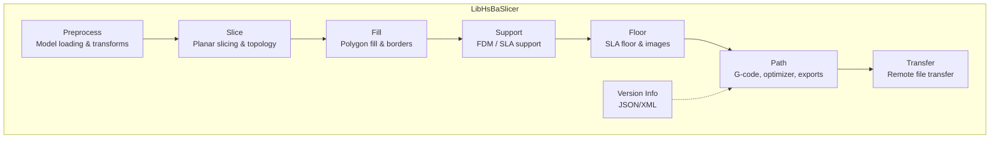

**Diagram sources**
- [model_preprocess.hpp:22-120](file://LibHsBaSlicer/Preprocess/model_preprocess.hpp#L22-L120)
- [mesh_slice.hpp:22-103](file://LibHsBaSlicer/Slice/mesh_slice.hpp#L22-L103)
- [polygon_fill.hpp:17-53](file://LibHsBaSlicer/Fill/polygon_fill.hpp#L17-L53)
- [fdm_support.hpp:19-67](file://LibHsBaSlicer/Support/fdm_support.hpp#L19-L67)
- [sla_floor.hpp:21-195](file://LibHsBaSlicer/Floor/sla_floor.hpp#L21-L195)
- [path_generator.hpp:20-91](file://LibHsBaSlicer/Path/path_generator.hpp#L20-L91)
- [path_optimizer.hpp:23-186](file://LibHsBaSlicer/Path/path_optimizer.hpp#L23-L186)
- [sls_export.hpp:17-56](file://LibHsBaSlicer/Path/sls_export.hpp#L17-L56)
- [waam_export.hpp:17-72](file://LibHsBaSlicer/Path/waam_export.hpp#L17-L72)
- [file_transfer.hpp:20-60](file://LibHsBaSlicer/Transfer/file_transfer.hpp#L20-L60)
- [version_info.hpp:15-25](file://LibHsBaSlicer/version_info.hpp#L15-L25)

**Section sources**
- [export.h:1-22](file://LibHsBaSlicer/export.h#L1-L22)

## Core Components
This section summarizes the main API modules and their responsibilities.

- Model preprocessing
  - Load, retrieve, transform, query, and remove models from an internal pool.
  - Advanced thick-solid and Boolean operations when CGAL is enabled.
- Planar slicing
  - Safe and unsafe slicing at a given Z height.
  - Lua-driven slicing.
  - Reusable topology build and per-layer slicing.
- Polygon filling
  - Line/zigzag/border fills.
  - Custom Lua fill patterns.
- Support generation
  - FDM support per layer and across all layers.
  - SLA sacrificial support across all layers.
  - Lua-driven custom support.
- SLA floor and export
  - Contact area, raft, border, and fill generation.
  - Image rendering to file or memory buffer.
  - SLA package zip export with optional Lua customization.
- Path generation and optimization
  - G-code path generation for FDM (V1/V2).
  - Spiral/vase mode continuous wall generation.
  - Region-based path optimizer (pre-fill and post-fill modes).
  - Lua-based region optimization.
- Process exports
  - SLS package export driven by Lua scripts.
  - WAAM robot program export with optional Lua post-processing.
- File transfer
  - Remote file transfer with connection pooling and progress callback.
- Version info
  - Query library version as JSON or XML.

**Section sources**
- [model_preprocess.hpp:22-187](file://LibHsBaSlicer/Preprocess/model_preprocess.hpp#L22-L187)
- [mesh_slice.hpp:22-103](file://LibHsBaSlicer/Slice/mesh_slice.hpp#L22-L103)
- [polygon_fill.hpp:17-53](file://LibHsBaSlicer/Fill/polygon_fill.hpp#L17-L53)
- [fdm_support.hpp:19-67](file://LibHsBaSlicer/Support/fdm_support.hpp#L19-L67)
- [sla_floor.hpp:21-195](file://LibHsBaSlicer/Floor/sla_floor.hpp#L21-L195)
- [path_generator.hpp:20-91](file://LibHsBaSlicer/Path/path_generator.hpp#L20-L91)
- [path_optimizer.hpp:23-186](file://LibHsBaSlicer/Path/path_optimizer.hpp#L23-L186)
- [sls_export.hpp:17-56](file://LibHsBaSlicer/Path/sls_export.hpp#L17-L56)
- [waam_export.hpp:17-72](file://LibHsBaSlicer/Path/waam_export.hpp#L17-L72)
- [file_transfer.hpp:20-60](file://LibHsBaSlicer/Transfer/file_transfer.hpp#L20-L60)
- [version_info.hpp:15-25](file://LibHsBaSlicer/version_info.hpp#L15-L25)

## Architecture Overview
The core slicing pipeline coordinates data between modules. A typical flow:
1. Preprocess: load and transform models.
2. Slice: produce layer outlines (Polygons/PolygonsD).
3. Fill: generate infill and borders.
4. Support: generate support polygons per layer.
5. Path: convert polygons to G-code paths; optionally optimize regions.
6. Export: package outputs for SLA/SLS/WAAM or write G-code.
7. Transfer: send files to remote devices.

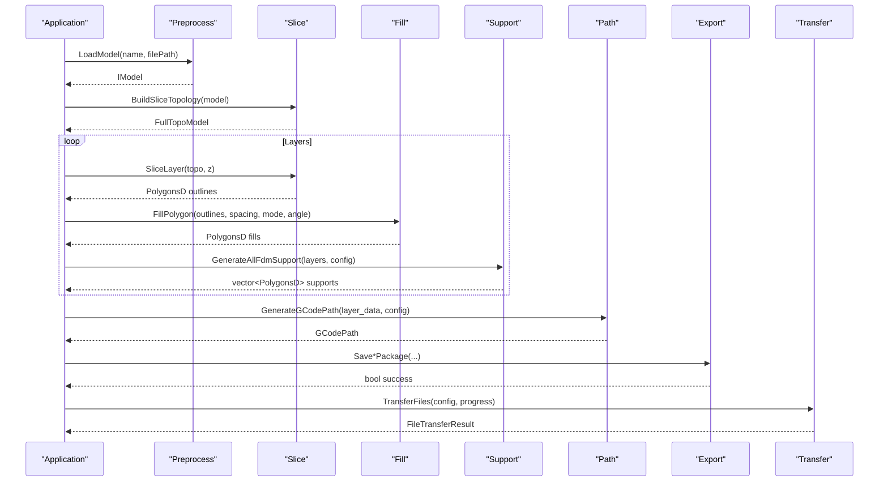

**Diagram sources**
- [model_preprocess.hpp:40-120](file://LibHsBaSlicer/Preprocess/model_preprocess.hpp#L40-L120)
- [mesh_slice.hpp:89-103](file://LibHsBaSlicer/Slice/mesh_slice.hpp#L89-L103)
- [polygon_fill.hpp:25-37](file://LibHsBaSlicer/Fill/polygon_fill.hpp#L25-L37)
- [fdm_support.hpp:27-37](file://LibHsBaSlicer/Support/fdm_support.hpp#L27-L37)
- [path_generator.hpp:50-62](file://LibHsBaSlicer/Path/path_generator.hpp#L50-L62)
- [sls_export.hpp:54-56](file://LibHsBaSlicer/Path/sls_export.hpp#L54-L56)
- [waam_export.hpp:69-72](file://LibHsBaSlicer/Path/waam_export.hpp#L69-L72)
- [sla_floor.hpp:183-195](file://LibHsBaSlicer/Floor/sla_floor.hpp#L183-L195)
- [file_transfer.hpp:59-60](file://LibHsBaSlicer/Transfer/file_transfer.hpp#L59-L60)

## Detailed Component Analysis

### Model Preprocessing API
Responsibilities:
- Manage a named model pool with lifecycle operations.
- Provide geometric transforms (translate, rotate, scale).
- Query model metadata (bounding box, volume).
- Optional advanced operations (thick-solid, Boolean) when compiled with CGAL.

Key types and functions:
- ModelInfo: bounding box min/max and volume.
- LoadModel, GetModel, InsertModel, RemoveModel, ContainsModel, ModelCount, CleanupModels, GetModelNames.
- TranslateModel, RotateModel, ScaleModel overloads.
- ThickSolidModel, BooleanUnion, BooleanIntersection, BooleanDifference, BooleanXor (CGAL-enabled).

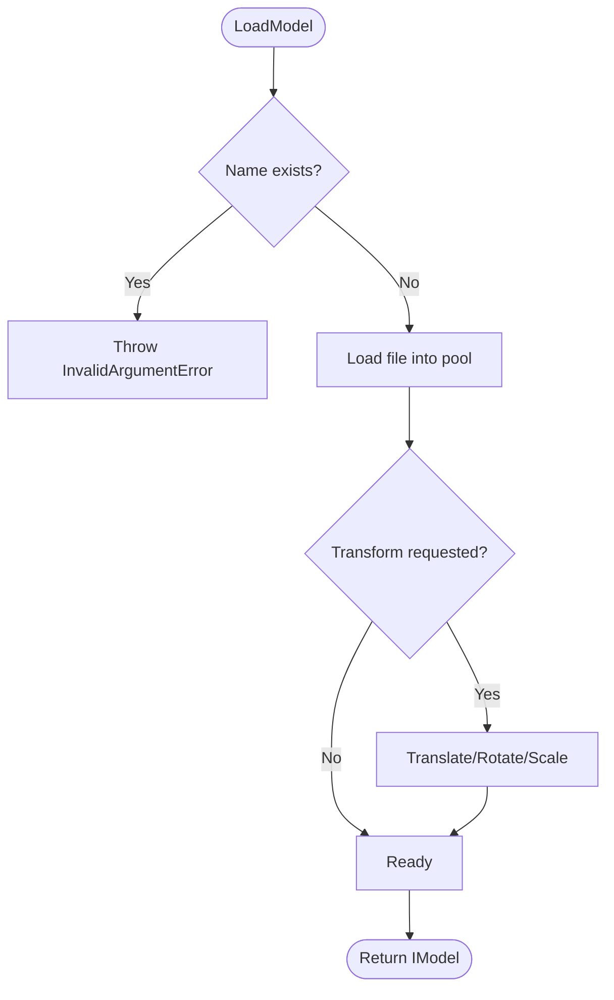

**Diagram sources**
- [model_preprocess.hpp:40-88](file://LibHsBaSlicer/Preprocess/model_preprocess.hpp#L40-L88)

Best practices:
- Use InsertModel when you already own an IModel instance.
- Call CleanupModels periodically to release unreferenced models.
- Prefer GetModelInfo before heavy operations to validate bounds and size.

**Section sources**
- [model_preprocess.hpp:22-120](file://LibHsBaSlicer/Preprocess/model_preprocess.hpp#L22-L120)
- [model_preprocess.hpp:122-187](file://LibHsBaSlicer/Preprocess/model_preprocess.hpp#L122-L187)

### Planar Slicing API
Responsibilities:
- Slice a model at a specific Z height.
- Provide safe vs unsafe slicing semantics.
- Enable Lua-driven slicing.
- Build reusable slicing topology for multi-layer performance.

Key types and functions:
- Slice: closed-contour polygons only.
- UnSafeSlice: includes open contours.
- SliceLua, UnSafeSliceLua: Lua-driven variants.
- NormalizeUnSafePolygons: clean and convert to PolygonsD.
- BuildSliceTopology: precompute topology once.
- SliceLayer: fast per-layer slicing from prebuilt topology.

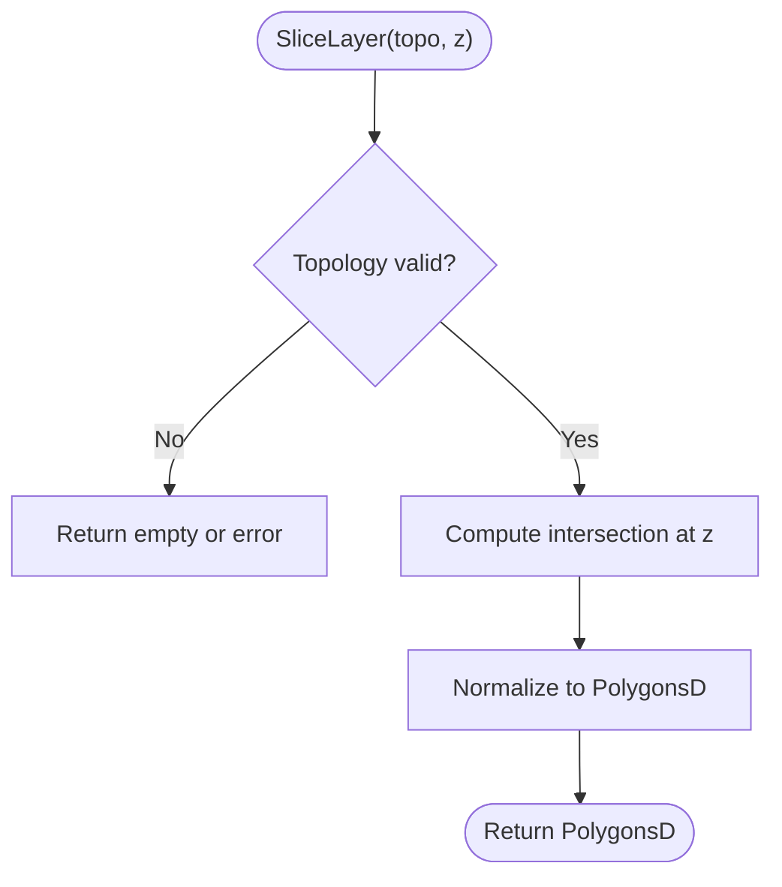

**Diagram sources**
- [mesh_slice.hpp:89-103](file://LibHsBaSlicer/Slice/mesh_slice.hpp#L89-L103)

Usage guidance:
- For single-layer or one-off slicing, use Slice or UnSafeSlice.
- For multi-layer pipelines, call BuildSliceTopology once and reuse it with SliceLayer.
- When downstream requires double-precision polygons, normalize unsafe results.

**Section sources**
- [mesh_slice.hpp:22-103](file://LibHsBaSlicer/Slice/mesh_slice.hpp#L22-L103)

### Polygon Filling API
Responsibilities:
- Generate fill patterns inside polygons.
- Add border loops around filled areas.
- Support Lua-driven custom fill patterns.

Key types and functions:
- FillPolygon: line/zigzag/border fills with configurable spacing and angle.
- FillWithBorder: border offset + interior fill.
- LuaCustomFillByFile: custom fill via Lua script file.

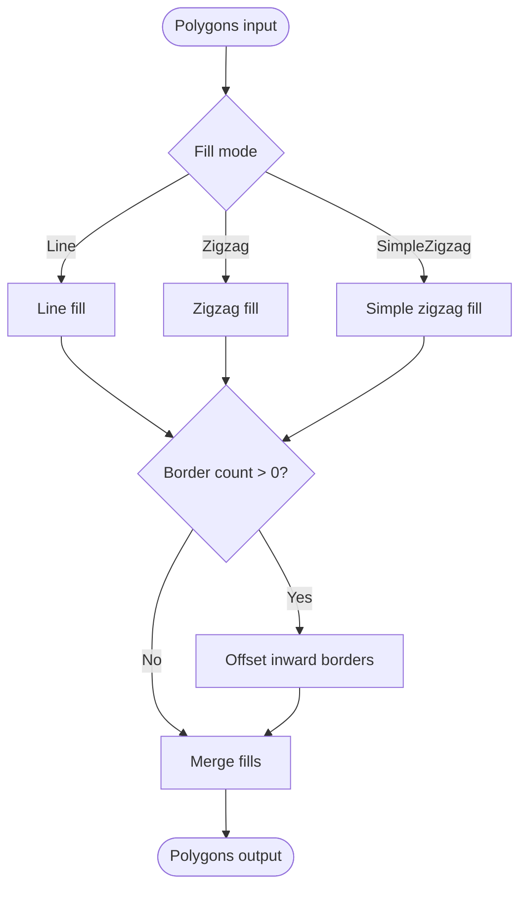

**Diagram sources**
- [polygon_fill.hpp:25-37](file://LibHsBaSlicer/Fill/polygon_fill.hpp#L25-L37)

Configuration tips:
- Adjust spacing to balance print quality and speed.
- Use border_count to strengthen edges; combine with appropriate fill_mode.
- For complex patterns, prefer LuaCustomFillByFile.

**Section sources**
- [polygon_fill.hpp:17-53](file://LibHsBaSlicer/Fill/polygon_fill.hpp#L17-L53)

### Support Generation API
Responsibilities:
- Generate FDM support cross-sections per layer and across all layers.
- Generate SLA sacrificial supports across all layers.
- Replace built-in logic with Lua scripts.

Key types and functions:
- GenerateFdmSupport(current_layer, prev_layer, layer_height, config).
- GenerateAllFdmSupport(layers, config).
- GenerateAllSlaSupport(layers, sla_config).
- GenerateAllLuaSupport(layers, config, script, functionName).

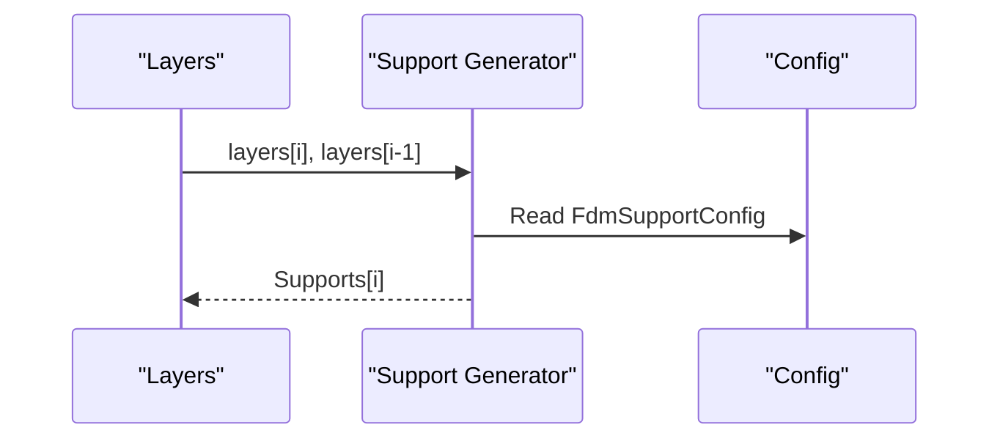

**Diagram sources**
- [fdm_support.hpp:27-37](file://LibHsBaSlicer/Support/fdm_support.hpp#L27-L37)

Best practices:
- For first layer, pass empty previous layer.
- Tune layer_height and config parameters to match printer capabilities.
- Use GenerateAllLuaSupport to implement domain-specific support strategies.

**Section sources**
- [fdm_support.hpp:19-67](file://LibHsBaSlicer/Support/fdm_support.hpp#L19-L67)

### SLA Floor and Package Export API
Responsibilities:
- Compute contact area, raft, border, and fill for SLA builds.
- Render polygons to images (file or memory buffer).
- Package and export SLA artifacts.

Key types and functions:
- SlaFloorConfig: raft_offset, border_width, fill_spacing, fill_angle_deg, border_count, use_convex_hull, concave_hull_points.
- GenerateFloorContact, GenerateFloorRaft, GenerateFloorBorder, GenerateFloorFill.
- LuaCustomFloorByFile, LuaCustomFloorByString.
- RenderPolygonsToImage, RenderPolygonsToImageBuffer.
- SlaPackage: layer_outlines, layer_supports, floor_polygons, config_json, image settings, flags.
- SaveSlaPackage, SaveSlaPackageLua.

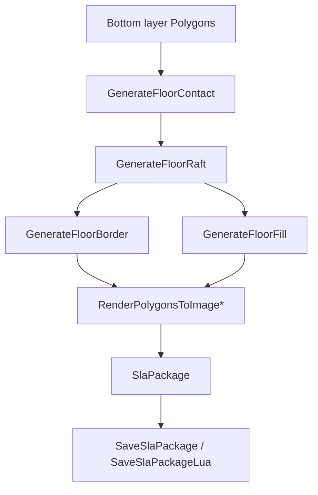

**Diagram sources**
- [sla_floor.hpp:24-116](file://LibHsBaSlicer/Floor/sla_floor.hpp#L24-L116)
- [sla_floor.hpp:134-195](file://LibHsBaSlicer/Floor/sla_floor.hpp#L134-L195)

Configuration tips:
- Increase raft_offset for better adhesion; adjust border_width and fill_spacing for printability.
- Use convex hull simplification for large footprints.
- Choose image extension (.png/.jpg/.svg) based on downstream needs.

**Section sources**
- [sla_floor.hpp:21-195](file://LibHsBaSlicer/Floor/sla_floor.hpp#L21-L195)

### Path Generation and Optimization API
Responsibilities:
- Convert layer polygons into G-code paths.
- Provide firmware-aware path generation (V2).
- Generate spiralized vase-mode walls.
- Optimize visit order of independent regions to reduce air moves.
- Offer Lua-based region optimization.

Key types and functions:
- FdmPathConfig: layer_height, line_width, print_speed, travel_speed, extrusion_multiplier, units.
- LayerPathData: outlines, fills, supports, z_height.
- GenerateGCodePath, GenerateGCodePathV2.
- GenerateGCodePathSpiral.
- PolygonsToGPoints helper.
- RegionPathOptimizer: addRegion/addPolygonRegion, addRoute, optimizeOrder, buildPaths/buildPolygons.
- LuaOptimizeRegionPaths*, LuaOptimizeRegionPolygons*.

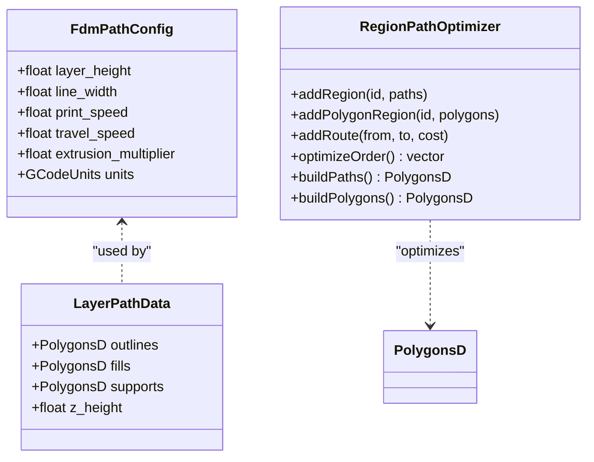

**Diagram sources**
- [path_generator.hpp:23-42](file://LibHsBaSlicer/Path/path_generator.hpp#L23-L42)
- [path_optimizer.hpp:44-99](file://LibHsBaSlicer/Path/path_optimizer.hpp#L44-L99)

Usage guidance:
- Use GenerateGCodePathV2 for multi-firmware output.
- Use GenerateGCodePathSpiral for uniform-cross-section vase printing.
- Prefer RegionPathOptimizer in fill-result mode after filling to minimize travel between polylines.
- Use polygon mode before filling to reorder outline regions.

**Section sources**
- [path_generator.hpp:20-91](file://LibHsBaSlicer/Path/path_generator.hpp#L20-L91)
- [path_optimizer.hpp:23-186](file://LibHsBaSlicer/Path/path_optimizer.hpp#L23-L186)

### Process Export APIs (SLS and WAAM)
Responsibilities:
- SLS: package layer outlines and configuration for Lua-driven export.
- WAAM: generate robot programs for welding processes with optional Lua post-processing.

Key types and functions:
- SlsPackage: layer_outlines, layer_z_heights, config_json, spiral_mode.
- SaveSlsPackageLua(pkg, output_zip, lua_script, lua_func, error_out).
- WaamWeldParams: current, voltage, wire_feed_speed, gas_flow_rate, travel_speed, process.
- WaamRobotPackage: layer_outlines, layer_z_heights, weld, robot_type, bead_width, config_json, spiral_mode.
- SaveWaamRobotPath(pkg, output_path, lua_script, lua_func, error_out).

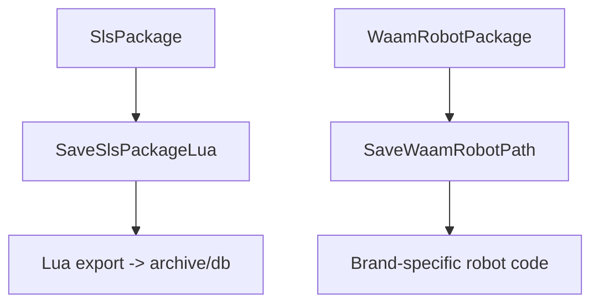

**Diagram sources**
- [sls_export.hpp:24-56](file://LibHsBaSlicer/Path/sls_export.hpp#L24-L56)
- [waam_export.hpp:23-72](file://LibHsBaSlicer/Path/waam_export.hpp#L23-L72)

Configuration tips:
- Set spiral_mode=true to expose a continuous outer-wall path for SLS/WAAM where supported.
- For WAAM, choose robot_type and tune weld parameters to match hardware.

**Section sources**
- [sls_export.hpp:17-56](file://LibHsBaSlicer/Path/sls_export.hpp#L17-L56)
- [waam_export.hpp:17-72](file://LibHsBaSlicer/Path/waam_export.hpp#L17-L72)

### File Transfer API
Responsibilities:
- Validate files and establish a connection pool.
- Transfer files sequentially with progress reporting.
- Return aggregated results.

Key types and functions:
- FileTransferConfig: host, port, pool_size, files.
- FileTransferResult: success, files_transferred, total_files, error_message.
- FileTransferProgressFunc(percent, stage).
- TransferFiles(config, progress).

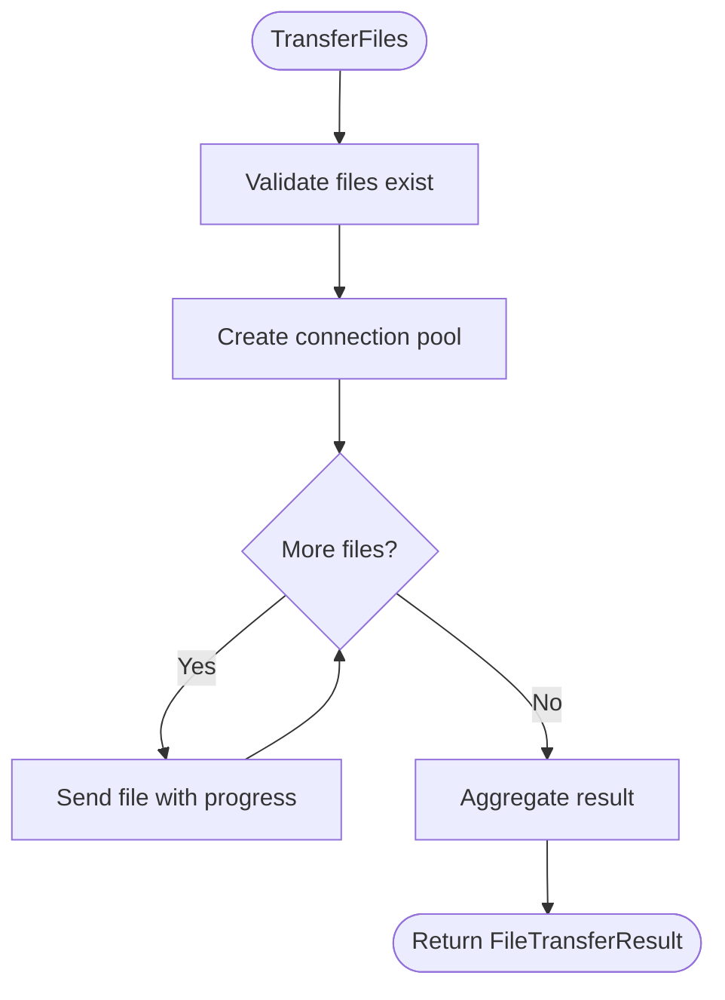

**Diagram sources**
- [file_transfer.hpp:23-60](file://LibHsBaSlicer/Transfer/file_transfer.hpp#L23-L60)

Best practices:
- Keep pool_size within [1, 16].
- Implement progress callback to update UI and handle cancellations.
- Inspect FileTransferResult.error_message on failure.

**Section sources**
- [file_transfer.hpp:20-60](file://LibHsBaSlicer/Transfer/file_transfer.hpp#L20-L60)

### Version Info API
Responsibilities:
- Provide library version information as JSON or XML.

Key functions:
- GetVersionJson(), GetVersionXml().

**Section sources**
- [version_info.hpp:15-25](file://LibHsBaSlicer/version_info.hpp#L15-L25)

## Dependency Analysis
High-level dependencies among LibHsBaSlicer components:
- Preprocess depends on base model interfaces and optional CGAL-backed operations.
- Slice depends on model abstraction and produces 2D polygons consumed by Fill and Support.
- Fill and Support operate on 2D polygons and feed Path.
- Path consumes polygons and produces G-code or robot programs; also provides region optimization.
- Export modules consume processed layers and configuration to produce final artifacts.
- Transfer operates on generated files independently of slicing internals.

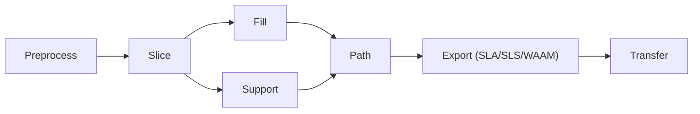

**Diagram sources**
- [model_preprocess.hpp:40-120](file://LibHsBaSlicer/Preprocess/model_preprocess.hpp#L40-L120)
- [mesh_slice.hpp:22-103](file://LibHsBaSlicer/Slice/mesh_slice.hpp#L22-L103)
- [polygon_fill.hpp:25-37](file://LibHsBaSlicer/Fill/polygon_fill.hpp#L25-L37)
- [fdm_support.hpp:27-37](file://LibHsBaSlicer/Support/fdm_support.hpp#L27-L37)
- [path_generator.hpp:50-62](file://LibHsBaSlicer/Path/path_generator.hpp#L50-L62)
- [sls_export.hpp:54-56](file://LibHsBaSlicer/Path/sls_export.hpp#L54-L56)
- [waam_export.hpp:69-72](file://LibHsBaSlicer/Path/waam_export.hpp#L69-L72)
- [file_transfer.hpp:59-60](file://LibHsBaSlicer/Transfer/file_transfer.hpp#L59-L60)

**Section sources**
- [export.h:1-22](file://LibHsBaSlicer/export.h#L1-L22)

## Performance Considerations
- Reuse slicing topology: BuildSliceTopology once and call SliceLayer repeatedly to avoid O(total_faces) rebuild per layer.
- Batch operations: Group polygon fills and supports per layer to reduce overhead.
- Region optimization: Use RegionPathOptimizer in fill-result mode to minimize air-move distance between polylines.
- Image rendering: Prefer RenderPolygonsToImageBuffer when avoiding temp files improves throughput.
- Connection pooling: Tune FileTransferConfig.pool_size for network conditions.
- Memory management: Call CleanupModels to release unused models and keep memory footprint low.

[No sources needed since this section provides general guidance]

## Troubleshooting Guide
Common issues and remedies:
- Model loading failures
  - Cause: unsupported format or duplicate name.
  - Action: verify file path and ensure unique names; catch InvalidArgumentError/RuntimeError.
- Open contours in slicing
  - Cause: non-manifold or damaged meshes.
  - Action: use NormalizeUnSafePolygons to filter invalid shapes; consider repairing upstream.
- Poor print quality
  - Cause: inappropriate fill spacing, angle, or border settings.
  - Action: tune FillPolygon/FillWithBorder parameters; experiment with LuaCustomFillByFile.
- Excessive travel time
  - Cause: unoptimized region visit order.
  - Action: apply RegionPathOptimizer.optimizeOrder and buildPaths/buildPolygons.
- Export failures
  - Cause: missing Lua script or invalid package fields.
  - Action: check SaveSlaPackageLua/SaveSlsPackageLua/SaveWaamRobotPath error_out messages.
- File transfer errors
  - Cause: unreachable host or invalid files.
  - Action: inspect FileTransferResult.error_message and FileTransferProgressFunc stage details.

**Section sources**
- [model_preprocess.hpp:40-47](file://LibHsBaSlicer/Preprocess/model_preprocess.hpp#L40-L47)
- [mesh_slice.hpp:67-77](file://LibHsBaSlicer/Slice/mesh_slice.hpp#L67-L77)
- [polygon_fill.hpp:25-53](file://LibHsBaSlicer/Fill/polygon_fill.hpp#L25-L53)
- [path_optimizer.hpp:75-95](file://LibHsBaSlicer/Path/path_optimizer.hpp#L75-L95)
- [sls_export.hpp:54-56](file://LibHsBaSlicer/Path/sls_export.hpp#L54-L56)
- [waam_export.hpp:69-72](file://LibHsBaSlicer/Path/waam_export.hpp#L69-L72)
- [file_transfer.hpp:59-60](file://LibHsBaSlicer/Transfer/file_transfer.hpp#L59-L60)

## Conclusion
LibHsBaSlicer provides a cohesive, modular C++ API for building production-grade slicing pipelines. By combining model preprocessing, robust slicing, flexible polygon filling, support generation, path planning and optimization, and process-specific exports, applications can implement end-to-end workflows for FDM, SLA, SLS, and WAAM. The API emphasizes configurability, extensibility via Lua, and clear separation of concerns, enabling efficient and maintainable integrations.

[No sources needed since this section summarizes without analyzing specific files]

## Appendices

### Complete Slicing Workflow Example (Conceptual)
Steps:
1. Load and transform model(s).
2. Build slicing topology once.
3. Iterate layers: slice, fill, generate supports.
4. Generate G-code paths (V2 recommended).
5. Optionally render images and package SLA artifacts.
6. Export SLS/WAAM if applicable.
7. Transfer files to remote device with progress updates.

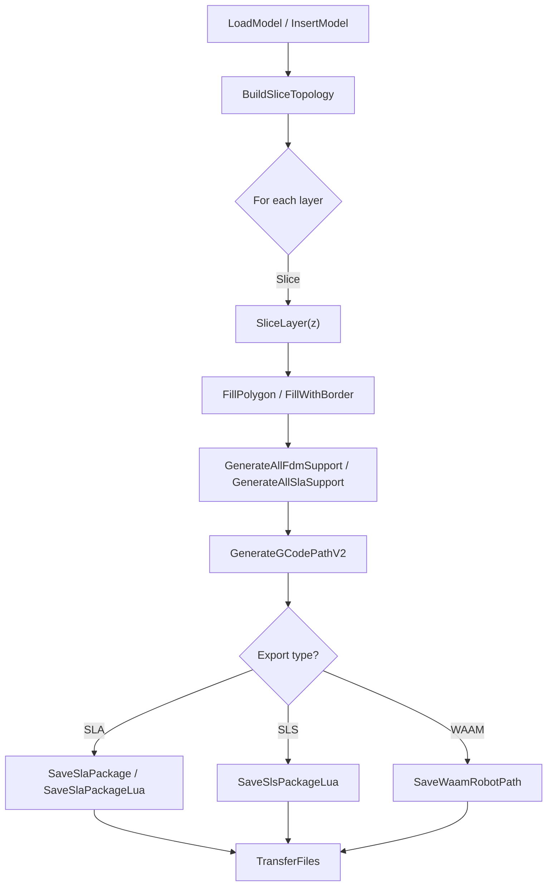

[No sources needed since this diagram shows conceptual workflow, not actual code structure]