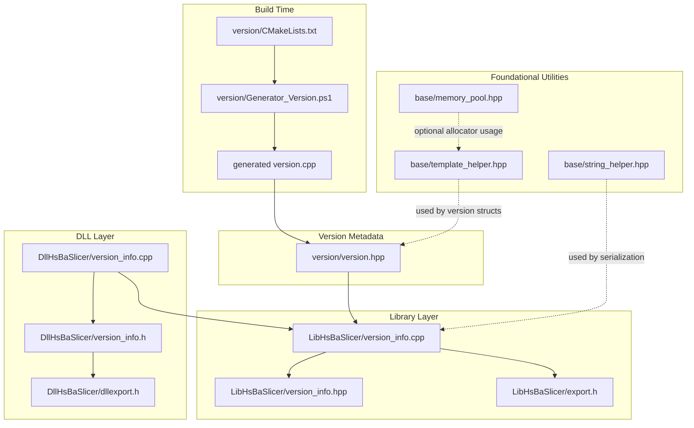
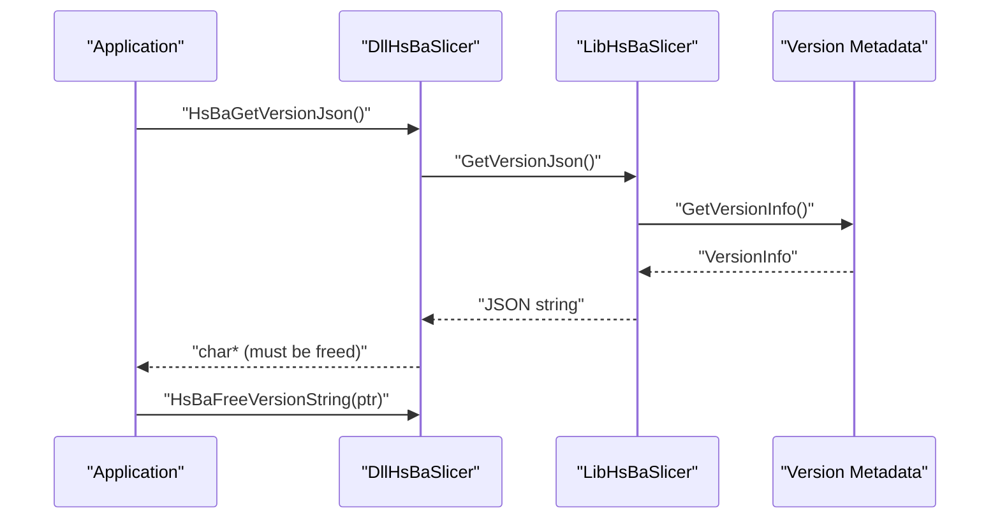
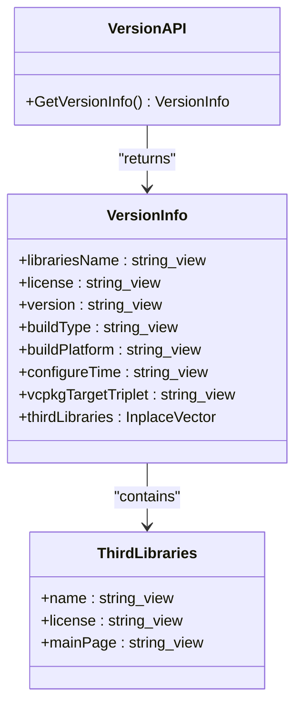
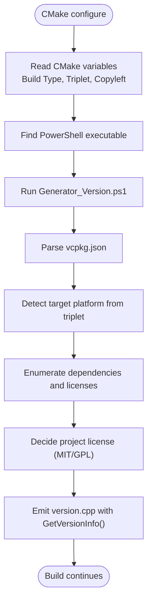
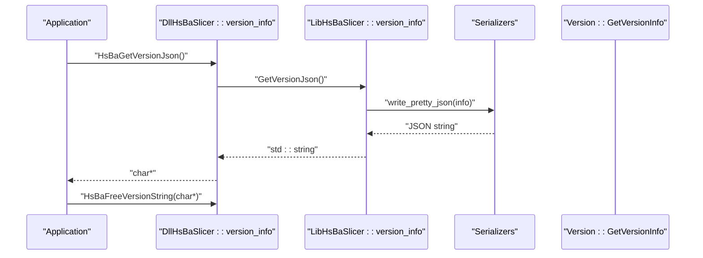
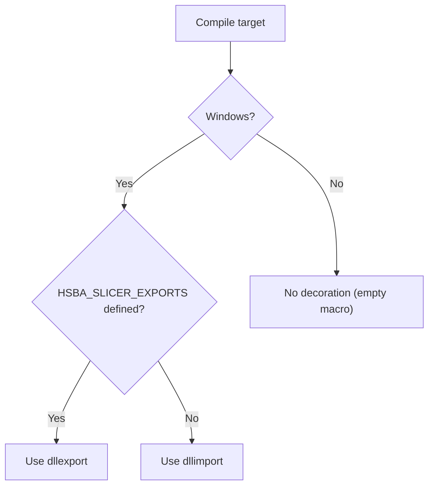
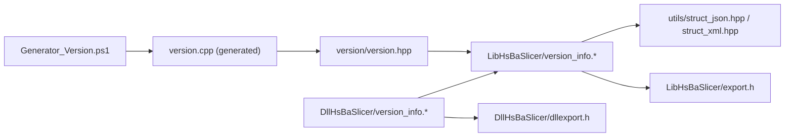

# Core Utilities API

<cite>
**Referenced Files in This Document**
- [version_info.h](file://DllHsBaSlicer/version_info.h)
- [version_info.cpp](file://DllHsBaSlicer/version_info.cpp)
- [export.h](file://LibHsBaSlicer/export.h)
- [version_info.hpp](file://LibHsBaSlicer/version_info.hpp)
- [version_info.cpp](file://LibHsBaSlicer/version_info.cpp)
- [version.hpp](file://version/version.hpp)
- [CMakeLists.txt](file://version/CMakeLists.txt)
- [Generator_Version.ps1](file://version/Generator_Version.ps1)
- [dllexport.h](file://DllHsBaSlicer/dllexport.h)
- [initialize.h](file://DllHsBaSlicer/initialize.h)
- [string_helper.hpp](file://base/string_helper.hpp)
- [template_helper.hpp](file://base/template_helper.hpp)
- [memory_pool.hpp](file://base/memory_pool.hpp)
</cite>

## Table of Contents
1. [Introduction](#introduction)
2. [Project Structure](#project-structure)
3. [Core Components](#core-components)
4. [Architecture Overview](#architecture-overview)
5. [Detailed Component Analysis](#detailed-component-analysis)
6. [Dependency Analysis](#dependency-analysis)
7. [Performance Considerations](#performance-considerations)
8. [Troubleshooting Guide](#troubleshooting-guide)
9. [Conclusion](#conclusion)
10. [Appendices](#appendices)

## Introduction
This document describes the Core Utilities API surface that applications use to:
- Check library version information at runtime.
- Understand and configure cross-platform export macros for both the shared DLL and the static C++ library.
- Configure build-time version metadata generation.
- Access foundational utilities such as string helpers, template helpers, and memory pools.

It focuses on practical integration guidance: how to initialize the library, how to query versions safely across platforms, and how to handle platform-specific considerations when integrating HsBaSlicer into different environments.

## Project Structure
The core utilities relevant to this document span three layers:
- Version metadata generation (build time).
- Library version query APIs (runtime).
- Export/import macros and foundational utilities.

**Diagram sources**
- [CMakeLists.txt:1-57](file://version/CMakeLists.txt#L1-L57)
- [Generator_Version.ps1:1-250](file://version/Generator_Version.ps1#L1-L250)
- [version.hpp:1-46](file://version/version.hpp#L1-L46)
- [version_info.hpp:1-30](file://LibHsBaSlicer/version_info.hpp#L1-L30)
- [version_info.cpp:1-26](file://LibHsBaSlicer/version_info.cpp#L1-L26)
- [export.h:1-22](file://LibHsBaSlicer/export.h#L1-L22)
- [version_info.h:1-48](file://DllHsBaSlicer/version_info.h#L1-L48)
- [version_info.cpp:1-43](file://DllHsBaSlicer/version_info.cpp#L1-L43)
- [dllexport.h:1-23](file://DllHsBaSlicer/dllexport.h#L1-L23)
- [string_helper.hpp:1-180](file://base/string_helper.hpp#L1-L180)
- [template_helper.hpp:1-780](file://base/template_helper.hpp#L1-L780)
- [memory_pool.hpp:1-375](file://base/memory_pool.hpp#L1-L375)

**Section sources**
- [CMakeLists.txt:1-57](file://version/CMakeLists.txt#L1-L57)
- [Generator_Version.ps1:1-250](file://version/Generator_Version.ps1#L1-L250)
- [version.hpp:1-46](file://version/version.hpp#L1-L46)
- [version_info.hpp:1-30](file://LibHsBaSlicer/version_info.hpp#L1-L30)
- [version_info.cpp:1-26](file://LibHsBaSlicer/version_info.cpp#L1-L26)
- [export.h:1-22](file://LibHsBaSlicer/export.h#L1-L22)
- [version_info.h:1-48](file://DllHsBaSlicer/version_info.h#L1-L48)
- [version_info.cpp:1-43](file://DllHsBaSlicer/version_info.cpp#L1-L43)
- [dllexport.h:1-23](file://DllHsBaSlicer/dllexport.h#L1-L23)
- [string_helper.hpp:1-180](file://base/string_helper.hpp#L1-L180)
- [template_helper.hpp:1-780](file://base/template_helper.hpp#L1-L780)
- [memory_pool.hpp:1-375](file://base/memory_pool.hpp#L1-L375)

## Core Components
This section summarizes the key APIs and macros you will interact with.

- Version metadata model
  - Provides a structured view of product name, license, version, build type, build platform, configure timestamp, vcpkg triplet, and third-party libraries.
  - Implemented via a generated source file produced during configuration.

- Library version query API (C++)
  - Returns pretty-printed JSON or XML strings containing version information.
  - Uses the version metadata model and utility serializers.

- C ABI version query API (DLL)
  - Exposes C functions to get JSON/XML version strings and free them.
  - Bridges to the C++ library implementation and handles memory ownership.

- Export/import macros
  - HSBA_SLICER_LIB_API for the static C++ library.
  - HSBA_SLICER_API for the shared DLL C ABI.

- Foundational utilities
  - String helpers: case conversion, trimming, splitting, regex split.
  - Template helpers: fixed-size compile-time strings, enum utilities, named pointers, async invoke helpers.
  - Memory pools: custom allocators for performance-critical containers.

How to check library versions
- From C++ applications linking against LibHsBaSlicer: call the JSON/XML getters and parse the returned strings.
- From external languages or C consumers: call the C ABI functions and free the returned buffers.

How to configure library builds
- Ensure PowerShell is available so the generator script can produce version metadata.
- Set vcpkg target triplet to control platform detection and dependency enumeration.
- Optionally enable copyleft feature to include GPL/LGPL dependencies in the generated inventory.

Cross-platform compatibility
- Use HSBA_SLICER_LIB_API when building or consuming the static library.
- Use HSBA_SLICER_API when building or consuming the shared DLL.
- Non-Windows platforms do not require symbol decoration.

Initialization
- Call the provided initialization function before running pipelines or using other features.

**Section sources**
- [version.hpp:1-46](file://version/version.hpp#L1-L46)
- [version_info.hpp:1-30](file://LibHsBaSlicer/version_info.hpp#L1-L30)
- [version_info.cpp:1-26](file://LibHsBaSlicer/version_info.cpp#L1-L26)
- [version_info.h:1-48](file://DllHsBaSlicer/version_info.h#L1-L48)
- [version_info.cpp:1-43](file://DllHsBaSlicer/version_info.cpp#L1-L43)
- [export.h:1-22](file://LibHsBaSlicer/export.h#L1-L22)
- [dllexport.h:1-23](file://DllHsBaSlicer/dllexport.h#L1-L23)
- [initialize.h:1-25](file://DllHsBaSlicer/initialize.h#L1-L25)
- [string_helper.hpp:1-180](file://base/string_helper.hpp#L1-L180)
- [template_helper.hpp:1-780](file://base/template_helper.hpp#L1-L780)
- [memory_pool.hpp:1-375](file://base/memory_pool.hpp#L1-L375)

## Architecture Overview
The version system spans build time and runtime:

- Build time
  - CMake invokes a PowerShell generator to create version.cpp with build metadata and third-party library inventory.
  - The generated code implements GetVersionInfo() returning a VersionInfo struct.

- Runtime
  - LibHsBaSlicer exposes GetVersionJson()/GetVersionXml() using the version metadata and serializers.
  - DllHsBaSlicer exposes C ABI functions that wrap the C++ API and manage memory.

**Diagram sources**
- [version_info.h:16-41](file://DllHsBaSlicer/version_info.h#L16-L41)
- [version_info.cpp:27-42](file://DllHsBaSlicer/version_info.cpp#L27-L42)
- [version_info.hpp:15-25](file://LibHsBaSlicer/version_info.hpp#L15-L25)
- [version_info.cpp:13-23](file://LibHsBaSlicer/version_info.cpp#L13-L23)
- [version.hpp:41-44](file://version/version.hpp#L41-L44)

## Detailed Component Analysis

### Version Information System
The version system provides a single source of truth for build-time metadata and runtime queries.

Key elements
- VersionInfo struct: product name, license, version, build type, build platform, configure time, vcpkg triplet, and third-party libraries.
- GetVersionInfo(): returns VersionInfo populated from build-time data.
- Generator script: parses vcpkg.json, determines platform from triplet, enumerates dependencies, and writes version.cpp.

**Diagram sources**
- [version.hpp:15-44](file://version/version.hpp#L15-L44)

Build-time generation flow
- CMake configures the generator with build type, vcpkg triplet, and copyleft flag.
- PowerShell script determines target platform, reads vcpkg.json, computes project license based on presence of copyleft dependencies, and emits version.cpp.

**Diagram sources**
- [CMakeLists.txt:1-57](file://version/CMakeLists.txt#L1-L57)
- [Generator_Version.ps1:28-250](file://version/Generator_Version.ps1#L28-L250)

Runtime query flow
- Application calls C ABI function to obtain JSON/XML.
- DLL layer duplicates the string and returns it; caller must free it.
- Lib layer serializes VersionInfo to JSON/XML.

**Diagram sources**
- [version_info.cpp:15-42](file://DllHsBaSlicer/version_info.cpp#L15-L42)
- [version_info.cpp:13-23](file://LibHsBaSlicer/version_info.cpp#L13-L23)
- [version.hpp:41-44](file://version/version.hpp#L41-L44)

Practical usage notes
- Always free strings returned by HsBaGetVersionJson/HsBaGetVersionXml using HsBaFreeVersionString.
- Prefer JSON for machine parsing and XML for human-readable diagnostics.
- Inspect VersionInfo fields to determine build type, platform, and third-party dependencies.

**Section sources**
- [version.hpp:15-44](file://version/version.hpp#L15-L44)
- [CMakeLists.txt:1-57](file://version/CMakeLists.txt#L1-L57)
- [Generator_Version.ps1:28-250](file://version/Generator_Version.ps1#L28-L250)
- [version_info.cpp:15-42](file://DllHsBaSlicer/version_info.cpp#L15-L42)
- [version_info.cpp:13-23](file://LibHsBaSlicer/version_info.cpp#L13-L23)

### Library Export Macros
Two macro families are used depending on whether you are building/consuming the static library or the shared DLL.

- HSBA_SLICER_LIB_API
  - Defined in LibHsBaSlicer/export.h.
  - On Windows: dllexport when building the library (HSBA_SLICER_EXPORTS), dllimport when consuming.
  - On non-Windows: empty macro.

- HSBA_SLICER_API
  - Defined in DllHsBaSlicer/dllexport.h.
  - On Windows: dllexport when building the DLL (HSBA_SLICER_EXPORTS), dllimport when consuming.
  - On non-Windows: empty macro.

Integration checklist
- When building LibHsBaSlicer, ensure HSBA_SLICER_EXPORTS is defined if needed by your build system.
- When building DllHsBaSlicer, ensure HSBA_SLICER_EXPORTS is defined.
- Consumers should include the appropriate header and link against the correct target.

**Diagram sources**
- [export.h:9-20](file://LibHsBaSlicer/export.h#L9-L20)
- [dllexport.h:9-20](file://DllHsBaSlicer/dllexport.h#L9-L20)

**Section sources**
- [export.h:1-22](file://LibHsBaSlicer/export.h#L1-L22)
- [dllexport.h:1-23](file://DllHsBaSlicer/dllexport.h#L1-L23)

### Foundational Utilities
These utilities support common tasks across the codebase and are useful when integrating HsBaSlicer.

- String helpers (base/string_helper.hpp)
  - to_lower/to_upper with locale support.
  - trim/trim_left/trim_right.
  - split by delimiter or regular expression.

- Template helpers (base/template_helper.hpp)
  - TemplateString: fixed-size compile-time string with conversions and formatting.
  - Enum utilities: EnumName, EnumFromName, validation helpers.
  - NamedRawPtr/NamedPtr: typed pointers with compile-time names.
  - AsyncInvoke and lambda helpers.

- Memory pools (base/memory_pool.hpp)
  - MemoryPool<T, PoolSize>: instance-scoped pool with thread-safe allocation/deallocation.
  - StaticMemoryPool<T, PoolSize>: global pool with static storage.

Usage tips
- Use string helpers for robust input normalization and parsing.
- Prefer TemplateString for compile-time identifiers and safe conversions.
- Use memory pools for high-frequency allocations in hot paths.

**Section sources**
- [string_helper.hpp:1-180](file://base/string_helper.hpp#L1-L180)
- [template_helper.hpp:1-780](file://base/template_helper.hpp#L1-L780)
- [memory_pool.hpp:1-375](file://base/memory_pool.hpp#L1-L375)

## Dependency Analysis
The following diagram shows how the components depend on each other.

**Diagram sources**
- [Generator_Version.ps1:28-250](file://version/Generator_Version.ps1#L28-L250)
- [version.hpp:1-46](file://version/version.hpp#L1-L46)
- [version_info.cpp:1-26](file://LibHsBaSlicer/version_info.cpp#L1-L26)
- [version_info.cpp:1-43](file://DllHsBaSlicer/version_info.cpp#L1-L43)
- [dllexport.h:1-23](file://DllHsBaSlicer/dllexport.h#L1-L23)
- [export.h:1-22](file://LibHsBaSlicer/export.h#L1-L22)

Coupling and cohesion
- The version metadata module is cohesive and isolated; it only depends on base utilities and generated code.
- The DLL layer has minimal coupling, delegating serialization to the library layer.
- Export macros are independent and reused across modules.

Potential circular dependencies
- None observed between version, DLL, and library layers.

External dependencies
- vcpkg.json drives third-party dependency enumeration.
- PowerShell is required at configure time.

**Section sources**
- [version.hpp:1-46](file://version/version.hpp#L1-L46)
- [version_info.cpp:1-26](file://LibHsBaSlicer/version_info.cpp#L1-L26)
- [version_info.cpp:1-43](file://DllHsBaSlicer/version_info.cpp#L1-L43)
- [dllexport.h:1-23](file://DllHsBaSlicer/dllexport.h#L1-L23)
- [export.h:1-22](file://LibHsBaSlicer/export.h#L1-L22)
- [CMakeLists.txt:1-57](file://version/CMakeLists.txt#L1-L57)
- [Generator_Version.ps1:28-250](file://version/Generator_Version.ps1#L28-L250)

## Performance Considerations
- Version queries return small JSON/XML strings; overhead is negligible compared to pipeline execution.
- Avoid frequent repeated queries in tight loops; cache results where appropriate.
- For heavy workloads, prefer precomputed constants or application-level caching of VersionInfo fields.
- Memory pools can reduce allocation pressure in hot paths; use StaticMemoryPool for global state and MemoryPool for scoped resources.

[No sources needed since this section provides general guidance]

## Troubleshooting Guide
Common issues and resolutions

- Missing PowerShell during configuration
  - Symptom: CMake fails to generate version.cpp.
  - Resolution: Install PowerShell (pwsh or powershell) and rerun configuration.

- Incorrect platform or triplet
  - Symptom: buildPlatform or vcpkgTargetTriplet is unexpected.
  - Resolution: Verify vcpkg target triplet and ensure Generator_Version.ps1 detects the intended platform.

- Uninitialized exported symbols on Windows
  - Symptom: Link errors or missing symbols.
  - Resolution: Ensure HSBA_SLICER_EXPORTS is defined when building the corresponding target and that the correct export header is included.

- Memory leaks from version strings
  - Symptom: Leaked char* from HsBaGetVersionJson/HsBaGetVersionXml.
  - Resolution: Always call HsBaFreeVersionString after use.

- Initialization order
  - Symptom: Unexpected behavior when calling pipeline functions before setup.
  - Resolution: Call the provided initialization function before invoking any pipeline or logging functionality.

**Section sources**
- [CMakeLists.txt:23-26](file://version/CMakeLists.txt#L23-L26)
- [version_info.h:16-41](file://DllHsBaSlicer/version_info.h#L16-L41)
- [version_info.cpp:39-42](file://DllHsBaSlicer/version_info.cpp#L39-L42)
- [initialize.h:19-19](file://DllHsBaSlicer/initialize.h#L19-L19)

## Conclusion
The Core Utilities API provides a clean separation between build-time version metadata generation and runtime version querying. It offers portable export macros for both static and shared libraries and includes foundational utilities for string manipulation, templated helpers, and memory management. By following the initialization and version-checking patterns described here, integrators can reliably embed HsBaSlicer across platforms while maintaining clear build-time configuration and safe runtime behavior.

[No sources needed since this section summarizes without analyzing specific files]

## Appendices

### Quick Reference: Version Query Functions

- C++ API (LibHsBaSlicer)
  - GetVersionJson(): returns UTF-8 JSON string.
  - GetVersionXml(): returns UTF-8 XML string.

- C ABI (DllHsBaSlicer)
  - HsBaGetVersionJson(): returns dynamically allocated UTF-8 JSON string.
  - HsBaGetVersionXml(): returns dynamically allocated UTF-8 XML string.
  - HsBaFreeVersionString(): frees a string obtained from the above functions.

- Version metadata model
  - VersionInfo: product name, license, version, build type, build platform, configure time, vcpkg triplet, third-party libraries.

**Section sources**
- [version_info.hpp:15-25](file://LibHsBaSlicer/version_info.hpp#L15-L25)
- [version_info.h:16-41](file://DllHsBaSlicer/version_info.h#L16-L41)
- [version.hpp:29-44](file://version/version.hpp#L29-L44)