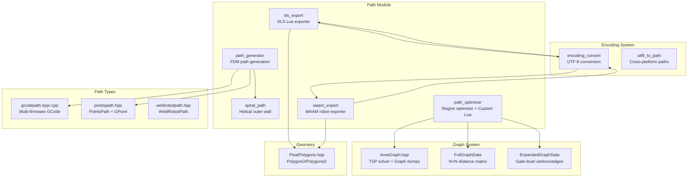
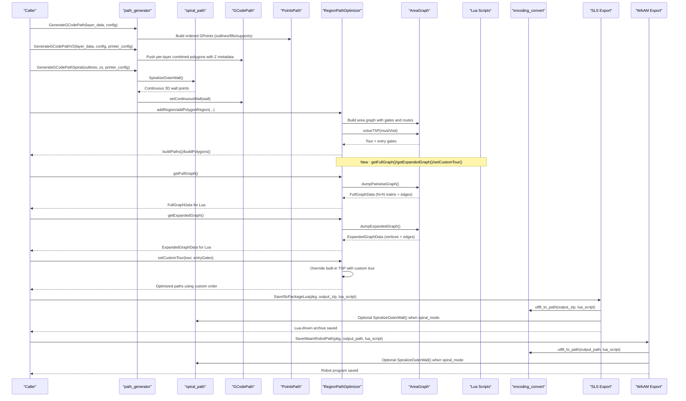
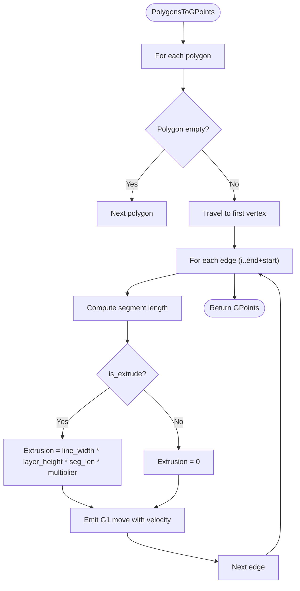
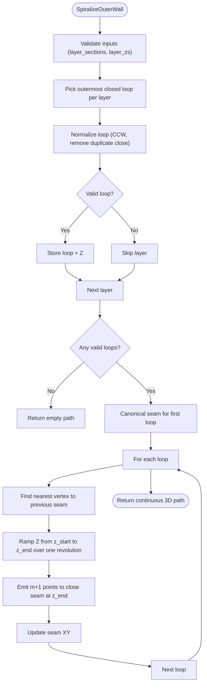
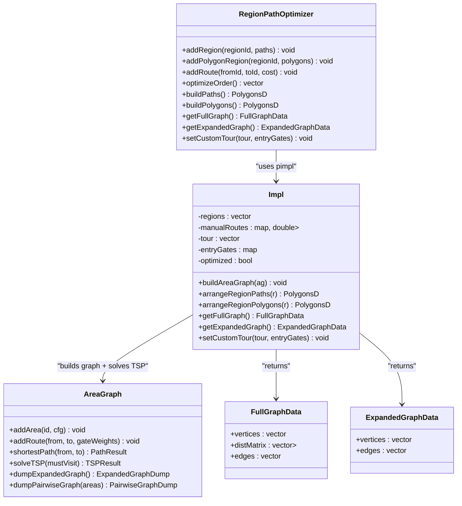
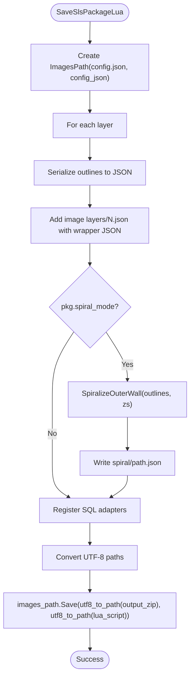
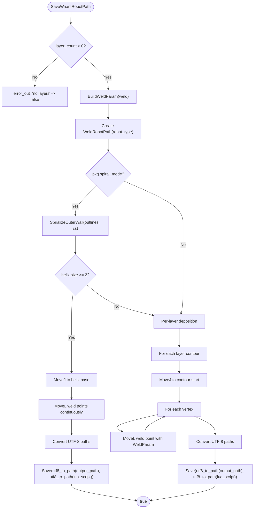
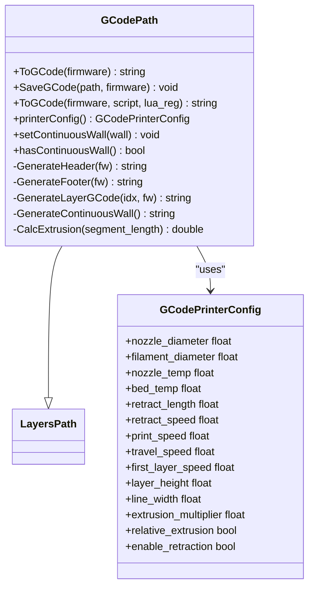
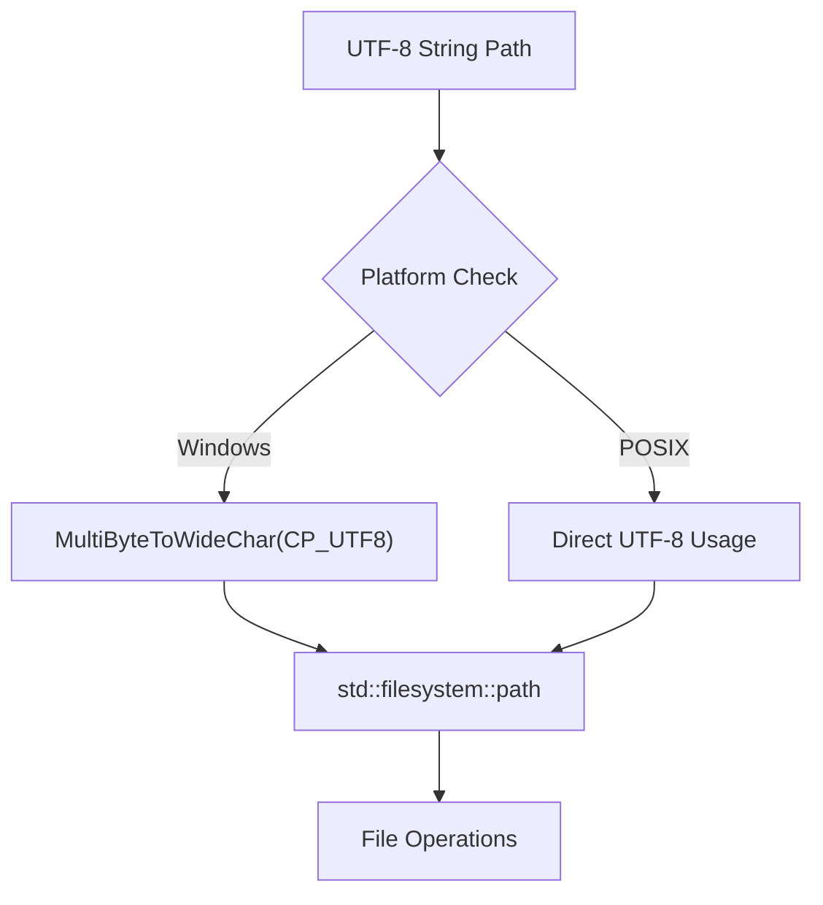
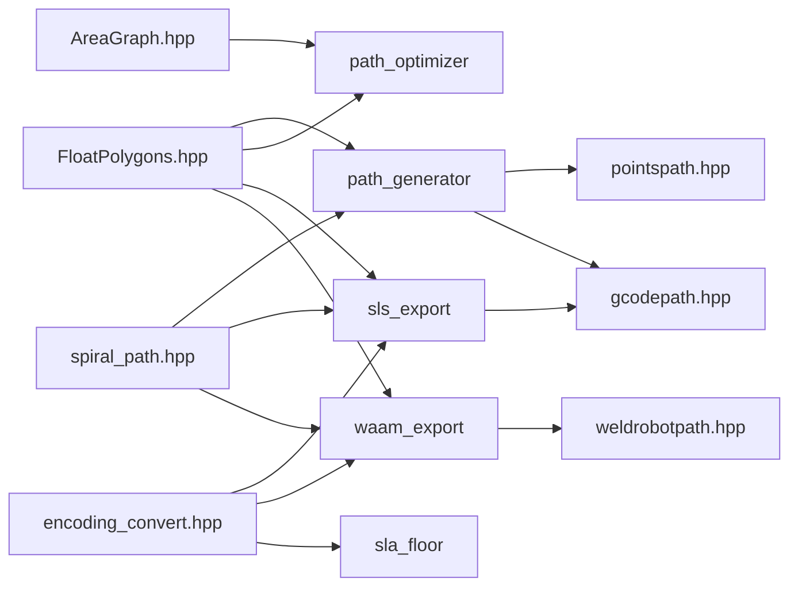

# Path Generation API

<cite>
**Referenced Files in This Document**
- [path_generator.hpp](file://LibHsBaSlicer/Path/path_generator.hpp)
- [path_generator.cpp](file://LibHsBaSlicer/Path/path_generator.cpp)
- [spiral_path.hpp](file://LibHsBaSlicer/Path/spiral_path.hpp)
- [spiral_path.cpp](file://LibHsBaSlicer/Path/spiral_path.cpp)
- [path_optimizer.hpp](file://LibHsBaSlicer/Path/path_optimizer.hpp)
- [path_optimizer.cpp](file://LibHsBaSlicer/Path/path_optimizer.cpp)
- [sls_export.hpp](file://LibHsBaSlicer/Path/sls_export.hpp)
- [sls_export.cpp](file://LibHsBaSlicer/Path/sls_export.cpp)
- [waam_export.hpp](file://LibHsBaSlicer/Path/waam_export.hpp)
- [waam_export.cpp](file://LibHsBaSlicer/Path/waam_export.cpp)
- [gcodepath.hpp](file://paths/gcodepath.hpp)
- [gcodepath.cpp](file://paths/gcodepath.cpp)
- [pointspath.hpp](file://paths/pointspath.hpp)
- [weldrobotpath.hpp](file://paths/weldrobotpath.hpp)
- [FloatPolygons.hpp](file://2D/FloatPolygons.hpp)
- [AreaGraph.hpp](file://utils/AreaGraph.hpp)
- [encoding_convert.hpp](file://base/encoding_convert.hpp)
- [encoding_convert.cpp](file://base/encoding_convert.cpp)
- [sla_floor.cpp](file://LibHsBaSlicer/Floor/sla_floor.cpp)
- [custom_tsp.lua](file://tests/PolygonFill/custom_tsp.lua)
</cite>

## Update Summary
**Changes Made**
- Added comprehensive documentation for enhanced RegionPathOptimizer with getFullGraph(), getExpandedGraph(), and setCustomTour() methods
- Updated Region Path Optimizer section to include new graph export capabilities and custom Lua algorithm support
- Added new section on Custom Lua Path Optimization Algorithms with practical examples
- Enhanced architecture diagrams to show the new graph data flow
- Updated troubleshooting guide with new method-specific issues

## Table of Contents
1. [Introduction](#introduction)
2. [Project Structure](#project-structure)
3. [Core Components](#core-components)
4. [Architecture Overview](#architecture-overview)
5. [Detailed Component Analysis](#detailed-component-analysis)
6. [Custom Lua Path Optimization Algorithms](#custom-lua-path-optimization-algorithms)
7. [Unicode File Path Handling](#unicode-file-path-handling)
8. [Dependency Analysis](#dependency-analysis)
9. [Performance Considerations](#performance-considerations)
10. [Troubleshooting Guide](#troubleshooting-guide)
11. [Conclusion](#conclusion)
12. [Appendices](#appendices)

## Introduction
This document explains the Path Generation API in LibHsBaSlicer/Path. It covers:
- Toolpath generation algorithms for FDM G-code and WAAM robot programs
- Spiral/vase mode implementation for continuous helical walls
- **Enhanced region-based path optimization** using AreaGraph and genetic TSP with full graph export capabilities
- Export format handling for SLS (Lua-driven) and WAAM (robot languages)
- **Custom Lua path optimization algorithms** through getFullGraph(), getExpandedGraph(), and setCustomTour() methods
- How to generate G-code paths, implement custom path generators, optimize toolpaths, handle multi-material-like layer data, and integrate with export formats
- The relationship between path generation, coordinate transformations, and final output formatting

The goal is to provide both a conceptual overview and code-level guidance so that users can extend or customize the pipeline while understanding how per-layer polygons become machine instructions, including advanced customization through Lua-based path optimization algorithms.

## Project Structure
The Path module provides:
- FDM path generation and conversion to G-code
- Continuous spiral wall generation
- **Enhanced region-based path optimization** with full graph export and custom algorithm support
- Exporters for SLS and WAAM with Unicode support



**Diagram sources**
- [path_generator.hpp:20-91](file://LibHsBaSlicer/Path/path_generator.hpp#L20-L91)
- [path_optimizer.hpp:45-164](file://LibHsBaSlicer/Path/path_optimizer.hpp#L45-L164)
- [AreaGraph.hpp:94-132](file://utils/AreaGraph.hpp#L94-L132)

**Section sources**
- [path_generator.hpp:20-91](file://LibHsBaSlicer/Path/path_generator.hpp#L20-L91)
- [path_optimizer.hpp:45-164](file://LibHsBaSlicer/Path/path_optimizer.hpp#L45-L164)
- [AreaGraph.hpp:94-132](file://utils/AreaGraph.hpp#L94-L132)

## Core Components
- FDM path generation: Converts per-layer outlines, fills, and supports into G-point sequences or layered G-code paths.
- Spiral/vase mode: Builds a single continuous helical wall by selecting the outermost loop per layer and aligning seams across layers.
- **Enhanced region path optimizer**: Treats independent polygon regions as graph areas and solves visit order via genetic TSP; now supports full graph export and custom Lua algorithms through getFullGraph(), getExpandedGraph(), and setCustomTour().
- **Enhanced exporters with Unicode support**:
  - SLS: Lua-driven package saving with optional spiral path JSON and UTF-8 file path handling.
  - WAAM: Robot program generation with weld parameters and optional spiral continuous deposition, supporting non-ASCII paths.
- **UTF-8 conversion system**: Cross-platform encoding utilities for proper file path handling.

Key types:
- LayerPathData: Per-layer outlines/fills/supports and Z height.
- FdmPathConfig: Print speeds, line width, layer height, units.
- GCodePrinterConfig: Firmware-specific printer settings.
- PointsPath/GCodePath: Ordered G-code points and multi-firmware G-code generation.
- SpiralPoint/PathPoint3D: 3D points for continuous walls.
- WaamWeldParams/WaamRobotPackage: WAAM process and robot configuration.
- **New FullGraphData/ExpandedGraphData**: Graph structures for custom Lua optimization algorithms.

**Section sources**
- [path_generator.hpp:20-91](file://LibHsBaSlicer/Path/path_generator.hpp#L20-L91)
- [path_optimizer.hpp:45-164](file://LibHsBaSlicer/Path/path_optimizer.hpp#L45-L164)
- [gcodepath.hpp:24-107](file://paths/gcodepath.hpp#L24-L107)
- [pointspath.hpp:16-94](file://paths/pointspath.hpp#L16-L94)
- [spiral_path.hpp:16-58](file://LibHsBaSlicer/Path/spiral_path.hpp#L16-L58)
- [waam_export.hpp:17-72](file://LibHsBaSlicer/Path/waam_export.hpp#L17-L72)

## Architecture Overview
The path generation pipeline transforms sliced polygons into machine instructions through several stages, now with enhanced custom Lua optimization support:



**Diagram sources**
- [path_generator.cpp:63-140](file://LibHsBaSlicer/Path/path_generator.cpp#L63-L140)
- [spiral_path.cpp:88-163](file://LibHsBaSlicer/Path/spiral_path.cpp#L88-L163)
- [path_optimizer.cpp:238-303](file://LibHsBaSlicer/Path/path_optimizer.cpp#L238-L303)
- [AreaGraph.hpp:402-450](file://utils/AreaGraph.hpp#L402-L450)

## Detailed Component Analysis

### FDM Path Generation (path_generator)
Responsibilities:
- Convert PolygonsD to GPoint sequences with travel/extrusion moves.
- Build PointsPath from per-layer outlines, fills, and supports.
- Build GCodePath with firmware-aware output and support for continuous spiral walls.

Key functions:
- PolygonsToGPoints: Emits a travel move to the first vertex, then extrude/travel moves along polygon edges, computing extrusion based on line_width, layer_height, segment length, and multiplier.
- GenerateGCodePath: Produces a PointsPath by concatenating outline, fill, and support GPoints per layer.
- GenerateGCodePathV2: Produces a GCodePath with per-layer combined polygons and Z metadata embedded in layer config strings.
- GenerateGCodePathSpiral: Uses SpiralizeOuterWall to create a continuous 3D wall and sets it on GCodePath.

Extrusion calculation highlights:
- Segment length computed from consecutive vertices.
- Extrusion amount proportional to cross-sectional volume divided by filament area.



**Diagram sources**
- [path_generator.cpp:14-61](file://LibHsBaSlicer/Path/path_generator.cpp#L14-L61)

**Section sources**
- [path_generator.hpp:20-91](file://LibHsBaSlicer/Path/path_generator.hpp#L20-L91)
- [path_generator.cpp:14-140](file://LibHsBaSlicer/Path/path_generator.cpp#L14-L140)
- [gcodepath.cpp:57-67](file://paths/gcodepath.cpp#L57-L67)

### Spiral/Vase Mode (spiral_path)
Algorithm summary:
- Select the outermost closed contour per layer by largest absolute signed area.
- Normalize loops to CCW and remove duplicate closing vertices.
- Determine seam: canonical seam for the first layer (lowest Y, then lowest X), then nearest XY vertex to previous seam for subsequent layers.
- Traverse each loop once, linearly ramping Z from current layer height to next layer height; last layer traversed flat at its own height.
- Output a continuous 3D polyline suitable for vase mode without retractions or per-layer travel jumps.



**Diagram sources**
- [spiral_path.cpp:88-163](file://LibHsBaSlicer/Path/spiral_path.cpp#L88-L163)

**Section sources**
- [spiral_path.hpp:16-58](file://LibHsBaSlicer/Path/spiral_path.hpp#L16-L58)
- [spiral_path.cpp:18-85](file://LibHsBaSlicer/Path/spiral_path.cpp#L18-L85)
- [spiral_path.cpp:88-163](file://LibHsBaSlicer/Path/spiral_path.cpp#L88-L163)

### Region Path Optimizer (path_optimizer)
Purpose:
- Optimize the visit order of independent polygon regions to minimize total air-move cost.
- Two modes:
  - Polygon mode (pre-fill): Regions are polygons; all vertices act as gates; outputs polygons in optimized order.
  - Fill-result mode (post-fill): Regions are polylines; head/tail endpoints act as gates; outputs complete fill paths.

**Updated** Enhanced with full graph export capabilities and custom Lua algorithm support:
- `getFullGraph()`: Returns area-level full combination graph with N×N distance matrix and edge list
- `getExpandedGraph()`: Returns gate-level expanded graph with all vertices and edges
- `setCustomTour()`: Allows user-defined region visit order, bypassing built-in genetic TSP

Implementation highlights:
- Models regions as AreaGraph areas with gates; intra-region gate-to-gate costs are straight-line distances.
- Inter-region routing uses minimum endpoint distance unless manually overridden via addRoute.
- Solves region visit order with genetic TSP; if TSP fails, keeps insertion order.
- Intra-region arrangement:
  - Fill-result mode: Greedy nearest-endpoint traversal, allowing path reversal.
  - Polygon mode: Greedy nearest-vertex traversal, rotating polygon start to entry gate without reversing winding.
- **New graph export methods**: Provide complete graph data for custom Lua optimization algorithms.



**Diagram sources**
- [path_optimizer.hpp:45-164](file://LibHsBaSlicer/Path/path_optimizer.hpp#L45-L164)
- [path_optimizer.cpp:238-303](file://LibHsBaSlicer/Path/path_optimizer.cpp#L238-L303)
- [AreaGraph.hpp:402-450](file://utils/AreaGraph.hpp#L402-L450)

**Section sources**
- [path_optimizer.hpp:45-164](file://LibHsBaSlicer/Path/path_optimizer.hpp#L45-L164)
- [path_optimizer.cpp:238-303](file://LibHsBaSlicer/Path/path_optimizer.cpp#L238-L303)
- [AreaGraph.hpp:402-450](file://utils/AreaGraph.hpp#L402-L450)

### SLS Export (sls_export)
Responsibilities:
- Serialize per-layer outlines and Z heights into a Lua-accessible package.
- Optionally compute and expose a continuous spiral path JSON when spiral_mode is enabled.
- Register SQL adapters and file functions for Lua scripts to produce archives or database entries.
- **Enhanced Unicode support**: Properly handles non-ASCII file paths through UTF-8 conversion.

Key behaviors:
- ImagesPath aggregates configuration and per-layer JSON images.
- Spiral path JSON is written to "spiral/path.json" when available.
- **File path conversion**: Uses `utf8_to_path()` for output_zip and lua_script parameters.
- Error handling returns false and populates error_out on RuntimeError.



**Diagram sources**
- [sls_export.cpp:80-143](file://LibHsBaSlicer/Path/sls_export.cpp#L80-L143)
- [sls_export.hpp:17-56](file://LibHsBaSlicer/Path/sls_export.hpp#L17-L56)

**Section sources**
- [sls_export.hpp:17-56](file://LibHsBaSlicer/Path/sls_export.hpp#L17-L56)
- [sls_export.cpp:27-75](file://LibHsBaSlicer/Path/sls_export.cpp#L27-L75)
- [sls_export.cpp:79-143](file://LibHsBaSlicer/Path/sls_export.cpp#L79-L143)

### WAAM Export (waam_export)
Responsibilities:
- Map C ABI robot type and welding process codes to internal enums.
- Build WeldParam from WaamWeldParams.
- Generate WeldRobotPath either as a continuous spiral weld bead or per-layer contours.
- Support optional Lua post-processing script during save.
- **Enhanced Unicode support**: Properly handles non-ASCII file paths through UTF-8 conversion.

Key behaviors:
- Spiral mode: Rapid MoveJ to base, then continuous MoveL weld points with no arc restarts between layers.
- Fallback mode: For each contour, emit MoveJ travel then MoveL weld points per vertex.
- **File path conversion**: Uses `utf8_to_path()` for output_path and lua_script parameters.
- Errors return false and populate error_out.



**Diagram sources**
- [waam_export.cpp:62-193](file://LibHsBaSlicer/Path/waam_export.cpp#L62-L193)
- [waam_export.hpp:17-72](file://LibHsBaSlicer/Path/waam_export.hpp#L17-L72)

**Section sources**
- [waam_export.hpp:17-72](file://LibHsBaSlicer/Path/waam_export.hpp#L17-L72)
- [waam_export.cpp:21-57](file://LibHsBaSlicer/Path/waam_export.cpp#L21-L57)
- [waam_export.cpp:61-193](file://LibHsBaSlicer/Path/waam_export.cpp#L61-L193)

### G-Code Path Types and Multi-Firmware Output
- PointsPath: Stores an ordered sequence of GPoint moves and serializes them to G-code text, optionally with Lua post-processing.
- GCodePath: Extends LayersPath to generate firmware-specific G-code (Marlin, RepRap/RRF, Klipper). Supports continuous spiral walls via setContinuousWall.
- GCodePrinterConfig: Controls nozzle diameter, filament diameter, temperatures, retraction, speeds, layer height, line width, extrusion multiplier, and relative extrusion mode.

Extrusion computation:
- Volume = line_width × layer_height × segment_length
- Filament area = π × (filament_diameter / 2)^2
- E value = (volume / area) × extrusion_multiplier



**Diagram sources**
- [gcodepath.hpp:24-107](file://paths/gcodepath.hpp#L24-L107)
- [gcodepath.cpp:57-67](file://paths/gcodepath.cpp#L57-L67)

**Section sources**
- [gcodepath.hpp:24-107](file://paths/gcodepath.hpp#L24-L107)
- [gcodepath.cpp:57-67](file://paths/gcodepath.cpp#L57-L67)
- [pointspath.hpp:16-94](file://paths/pointspath.hpp#L16-L94)

## Custom Lua Path Optimization Algorithms

**New Section** Enhanced RegionPathOptimizer now supports custom Lua path optimization algorithms through three key methods: getFullGraph(), getExpandedGraph(), and setCustomTour().

### Full Graph Export (getFullGraph)
Returns the area-level full combination graph containing:
- **vertices**: Array of region IDs in matrix order
- **distMatrix**: N×N distance matrix where distMatrix[i][j] represents the shortest-path cost from region i to region j (-1 indicates unreachable)
- **edges**: Flat edge list containing only reachable pairs with their costs

Use cases:
- Implement custom TSP algorithms (nearest neighbor, brute force for small N, simulated annealing)
- Apply domain-specific heuristics not covered by built-in genetic TSP
- Analyze path costs for visualization or debugging

### Expanded Graph Export (getExpandedGraph)
Returns the gate-level expanded graph containing:
- **vertices**: All entry/exit gate vertices with areaId, gateId, and isExit flags
- **edges**: All internal transit edges and inter-region route edges with weights

Use cases:
- Fine-grained custom path planning within and between regions
- Advanced collision avoidance strategies
- Complex constraint satisfaction problems

### Custom Tour Setting (setCustomTour)
Allows users to override the built-in genetic TSP with a custom region visit order:
- **tour**: Ordered array of region IDs defining the visit sequence
- **entryGates**: Optional map from region ID to entry gate index (-1 for default strategy)

When setCustomTour is called, the optimizer marks itself as optimized and uses the provided tour instead of running the genetic TSP algorithm.

### Practical Implementation Examples

The following Lua script demonstrates practical usage of these new capabilities:

```lua
-- Nearest neighbor greedy algorithm
function optimize_paths_custom(regions)
    local opt = PathOptimize.new()
    for i, paths in ipairs(regions) do
        opt:addRegion(i, paths)
    end

    -- Get the full combination graph
    local graph = opt:getFullGraph()
    
    -- Implement nearest neighbor algorithm
    local n = #graph.vertices
    local visited = {}
    local tour = {graph.vertices[1]}
    visited[graph.vertices[1]] = true
    
    for step = 2, n do
        local curr = tour[#tour]
        local bestId, bestCost = nil, math.huge
        
        for j = 1, n do
            local nextId = graph.vertices[j]
            if not visited[nextId] then
                local ci = indexOf(graph.vertices, curr)
                local cj = indexOf(graph.vertices, nextId)
                local cost = graph.distMatrix[ci][cj]
                
                if cost and cost < bestCost then
                    bestCost = cost
                    bestId = nextId
                end
            end
        end
        
        tour[#tour + 1] = bestId
        visited[bestId] = true
    end

    -- Set custom tour and build paths
    opt:setCustomTour(tour)
    return opt:buildPaths()
end
```

**Section sources**
- [path_optimizer.hpp:45-164](file://LibHsBaSlicer/Path/path_optimizer.hpp#L45-L164)
- [path_optimizer.cpp:238-303](file://LibHsBaSlicer/Path/path_optimizer.cpp#L238-L303)
- [custom_tsp.lua:17-55](file://tests/PolygonFill/custom_tsp.lua#L17-L55)

## Unicode File Path Handling

**Updated** Enhanced UTF-8 encoding system integration for cross-platform file path support.

The Path Generation API now includes comprehensive Unicode file path handling through the encoding conversion system. This ensures proper support for non-ASCII characters in file paths across different operating systems.

### UTF-8 Conversion System
The encoding conversion system provides:
- **Cross-platform path conversion**: `utf8_to_path()` converts UTF-8 strings to native filesystem paths
- **Windows-specific handling**: Proper UTF-8 to UTF-16 conversion on Windows systems
- **POSIX compatibility**: Direct UTF-8 usage on Linux, macOS, Android, and iOS
- **Error resilience**: Graceful fallback to native parsing when UTF-8 conversion fails

### Integration Points
Export functions now properly handle Unicode paths:
- **SLS Export**: `SaveSlsPackageLua` converts both `output_zip` and `lua_script` paths
- **WAAM Export**: `SaveWaamRobotPath` converts both `output_path` and `lua_script` paths  
- **SLA Export**: `SaveSlaPackageLua` and `SaveSlaPackage` convert output zip paths

### Platform-Specific Behavior
- **Windows**: UTF-8 bytes decoded to wide (UTF-16) representation for full Unicode support
- **POSIX systems**: Native UTF-8 encoding used directly without conversion
- **Mobile platforms**: Special handling for Android and iOS environments



**Diagram sources**
- [encoding_convert.cpp:101-144](file://base/encoding_convert.cpp#L101-L144)

**Section sources**
- [encoding_convert.hpp:32-53](file://base/encoding_convert.hpp#L32-L53)
- [encoding_convert.cpp:101-144](file://base/encoding_convert.cpp#L101-L144)
- [sls_export.cpp:132-133](file://LibHsBaSlicer/Path/sls_export.cpp#L132-L133)
- [waam_export.cpp:119-122](file://LibHsBaSlicer/Path/waam_export.cpp#L119-L122)
- [waam_export.cpp:171-174](file://LibHsBaSlicer/Path/waam_export.cpp#L171-L174)
- [sla_floor.cpp:523-599](file://LibHsBaSlicer/Floor/sla_floor.cpp#L523-L599)

## Dependency Analysis
Key dependencies:
- Geometry primitives: FloatPolygons defines Point2D, PolygonD, PolygonsD used throughout path generation and optimization.
- **Enhanced graph solver**: AreaGraph provides shortest-path and genetic TSP capabilities plus new graph dump methods used by RegionPathOptimizer.
- Output backends: PointsPath and GCodePath serialize to G-code; WeldRobotPath serializes to robot programs.
- Exporters: SLS and WAAM exporters depend on spiral_path for continuous walls and on their respective path types.
- **Encoding system**: All exporters now depend on encoding_convert for proper Unicode path handling.



**Diagram sources**
- [FloatPolygons.hpp:18-26](file://2D/FloatPolygons.hpp#L18-L26)
- [AreaGraph.hpp:402-450](file://utils/AreaGraph.hpp#L402-L450)
- [path_generator.cpp:14-140](file://LibHsBaSlicer/Path/path_generator.cpp#L14-L140)
- [path_optimizer.cpp:238-303](file://LibHsBaSlicer/Path/path_optimizer.cpp#L238-L303)
- [sls_export.cpp:79-143](file://LibHsBaSlicer/Path/sls_export.cpp#L79-L143)
- [waam_export.cpp:61-193](file://LibHsBaSlicer/Path/waam_export.cpp#L61-L193)
- [encoding_convert.hpp:32-53](file://base/encoding_convert.hpp#L32-L53)

**Section sources**
- [FloatPolygons.hpp:18-26](file://2D/FloatPolygons.hpp#L18-L26)
- [AreaGraph.hpp:402-450](file://utils/AreaGraph.hpp#L402-L450)
- [path_generator.cpp:14-140](file://LibHsBaSlicer/Path/path_generator.cpp#L14-L140)
- [path_optimizer.cpp:238-303](file://LibHsBaSlicer/Path/path_optimizer.cpp#L238-L303)
- [sls_export.cpp:79-143](file://LibHsBaSlicer/Path/sls_export.cpp#L79-L143)
- [waam_export.cpp:61-193](file://LibHsBaSlicer/Path/waam_export.cpp#L61-L193)
- [spiral_path.cpp:88-163](file://LibHsBaSlicer/Path/spiral_path.cpp#L88-L163)
- [encoding_convert.hpp:32-53](file://base/encoding_convert.hpp#L32-L53)

## Performance Considerations
- Extrusion computation: Avoid repeated sqrt calls where possible; segment lengths are already computed in PolygonsToGPoints.
- Spiralization: Complexity is linear in the total number of vertices across selected outer loops; seam alignment is O(n) per layer.
- **Enhanced region optimization**:
  - Building AreaGraph: O(R^2 × G^2) worst-case for inter-region gate pairs, where R is region count and G is average gate count.
  - Genetic TSP: Controlled by population size and generations; tune parameters for large region counts.
  - **New graph export methods**: getFullGraph() computes O(R^2) shortest paths; getExpandedGraph() builds expanded graph in O(V+E) time.
- Export serialization:
  - SLS: JSON serialization overhead scales with number of layers and polygon complexity.
  - WAAM: Spiral mode reduces arc restarts and travel moves, improving throughput.
- **Unicode path conversion**: Minimal overhead from UTF-8 conversions; primarily affects file I/O operations.
- **Custom Lua algorithms**: Performance depends on implemented algorithm complexity; consider caching results for expensive computations.

## Troubleshooting Guide
Common issues and resolutions:
- Empty or invalid polygons:
  - Ensure polygons have at least three distinct vertices after normalization; otherwise they are skipped in spiralization.
  - Verify input PolygonsD are not empty before calling PolygonsToGPoints.
- Spiral mode failures:
  - If fewer than two valid spiral points are produced, spiral mode falls back to per-layer deposition in WAAM export.
  - Confirm layer_zs matches layer_sections size and contains valid Z heights.
- **Enhanced region optimizer errors**:
  - Mixing polygon regions and path regions in one optimizer raises an error; use separate optimizers.
  - Duplicate region IDs raise an error; ensure unique IDs.
  - **New method-specific errors**:
    - `setCustomTour()` with empty tour throws RuntimeError("Custom tour cannot be empty")
    - Invalid entry gate indices in custom tours may cause unexpected behavior
    - Graph export methods require regions to be added before calling
- Export errors:
  - SLS and WAAM exports catch RuntimeError and return false; inspect error_out for details.
  - Lua script loading or function invocation errors propagate as RuntimeError; verify script paths and function names.
- **Unicode file path issues**:
  - Non-ASCII characters in file paths are now properly handled through UTF-8 conversion.
  - On Windows, ensure the application is compiled with UTF-8 support enabled.
  - File paths containing special characters should be passed as UTF-8 strings to export functions.
  - Verify that the target filesystem supports the character encoding being used.
- **Custom Lua algorithm issues**:
  - Ensure graph data structures are properly parsed in Lua scripts
  - Handle unreachable paths (marked as -1 or false in distance matrices)
  - Validate custom tour contains all required region IDs
  - Test custom algorithms with small datasets before scaling up

**Section sources**
- [spiral_path.cpp:120-133](file://LibHsBaSlicer/Path/spiral_path.cpp#L120-L133)
- [waam_export.cpp:67-75](file://LibHsBaSlicer/Path/waam_export.cpp#L67-L75)
- [path_optimizer.cpp:294-303](file://LibHsBaSlicer/Path/path_optimizer.cpp#L294-L303)
- [sls_export.cpp:135-143](file://LibHsBaSlicer/Path/sls_export.cpp#L135-L143)
- [waam_export.cpp:181-193](file://LibHsBaSlicer/Path/waam_export.cpp#L181-L193)
- [encoding_convert.cpp:101-144](file://base/encoding_convert.cpp#L101-L144)

## Conclusion
The Path Generation API provides a robust foundation for converting sliced geometry into machine instructions:
- FDM path generation supports both simple point-based paths and firmware-aware G-code output.
- Spiral/vase mode enables continuous helical walls for improved surface quality and strength.
- **Enhanced region-based optimization** minimizes travel costs using AreaGraph and genetic TSP, now with full graph export capabilities for custom Lua algorithms.
- Exporters for SLS and WAAM integrate seamlessly with spiral mode and offer extensibility via Lua scripts.
- **Custom Lua path optimization algorithms** enable advanced TSP implementations, domain-specific heuristics, and fine-grained control over path generation.
- **Enhanced Unicode support** ensures proper handling of non-ASCII file paths across all platforms.
Understanding the relationships between per-layer polygons, coordinate transformations, and output formatting allows developers to tailor toolpaths for specific printers and processes, including advanced customization through Lua-based path optimization algorithms and proper Unicode file path management.

## Appendices

### Practical Examples and Best Practices
- Generating G-code paths:
  - Use GenerateGCodePath for simple point sequences.
  - Use GenerateGCodePathV2 for firmware-specific G-code with printer configuration.
- Implementing custom path generators:
  - Extend PointsPath or GCodePath to incorporate custom motion strategies or post-processing.
  - Leverage PolygonsToGPoints for consistent extrusion and velocity handling.
- **Advanced path optimization with Lua**:
  - Use getFullGraph() to access complete distance matrices for custom TSP algorithms.
  - Use getExpandedGraph() for fine-grained control over gate-level path planning.
  - Use setCustomTour() to override built-in optimization with domain-specific heuristics.
  - Implement efficient algorithms considering the computational complexity of graph operations.
- Optimizing paths for different scenarios:
  - Pre-fill optimization: Use addPolygonRegion to reorder polygons before filling.
  - Post-fill optimization: Use addRegion to reorder fill polylines and arrange intra-region direction.
- Handling complex geometries:
  - Normalize polygons to simple, non-self-intersecting shapes before optimization.
  - Use AreaGraph's manual routes to encode known constraints or avoidances.
- Managing path continuity and collision avoidance:
  - Prefer spiral mode for continuous walls to reduce retractions and travel.
  - Use manual routes in RegionPathOptimizer to enforce safe transitions between regions.
- **Unicode file path best practices**:
  - Always pass UTF-8 encoded strings to export functions.
  - Use the provided encoding conversion utilities for cross-platform compatibility.
  - Test file path handling with various character sets on target platforms.

### Custom Lua Algorithm Development Guidelines
- **Algorithm selection**: Choose appropriate algorithms based on region count and performance requirements.
- **Graph data interpretation**: Understand the structure of FullGraphData and ExpandedGraphData for proper manipulation.
- **Performance optimization**: Cache frequently accessed graph data and avoid redundant computations.
- **Error handling**: Properly handle unreachable paths and invalid graph states.
- **Testing**: Validate custom algorithms against built-in genetic TSP for correctness verification.