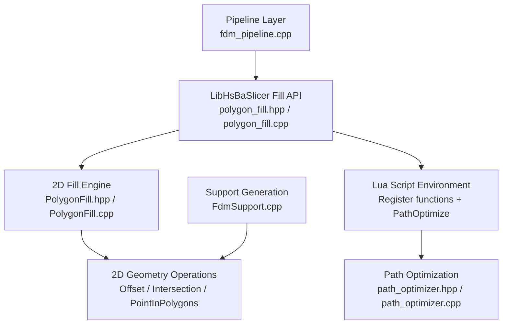
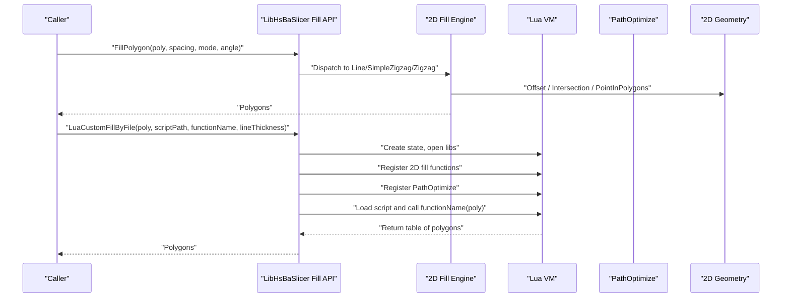
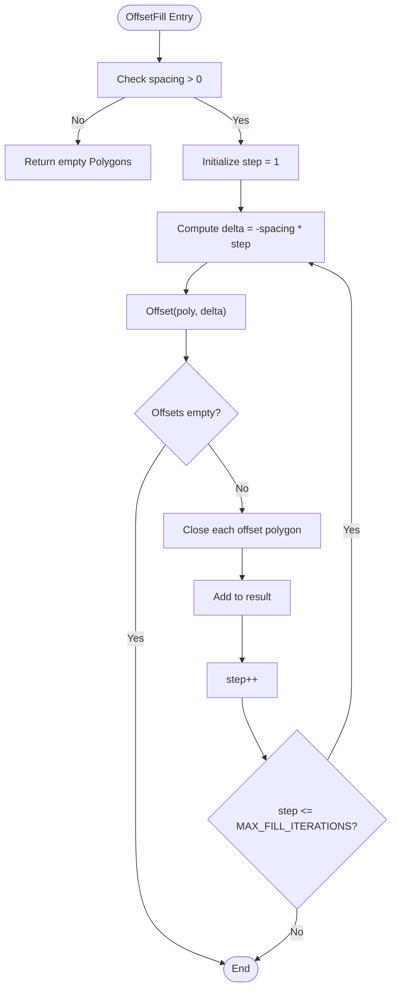
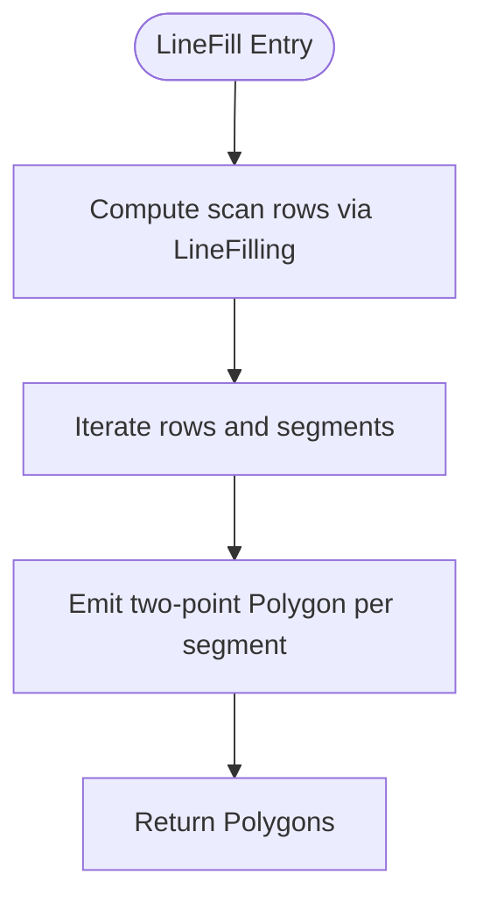
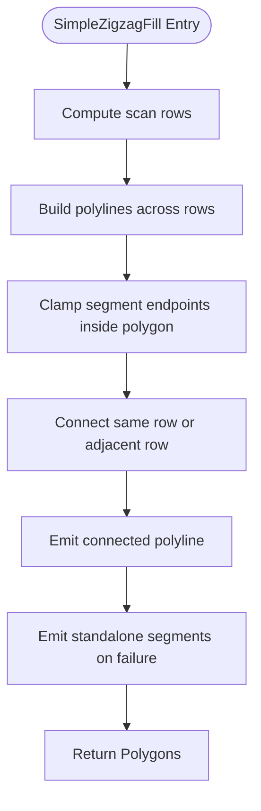
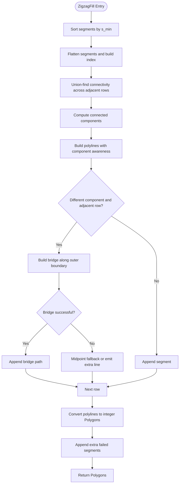
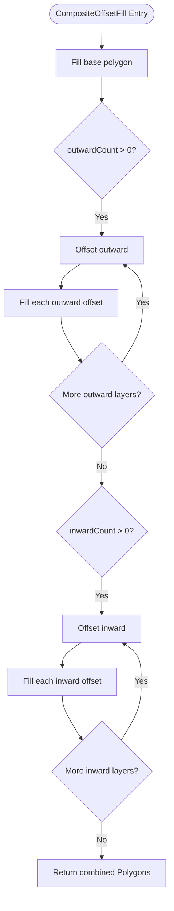
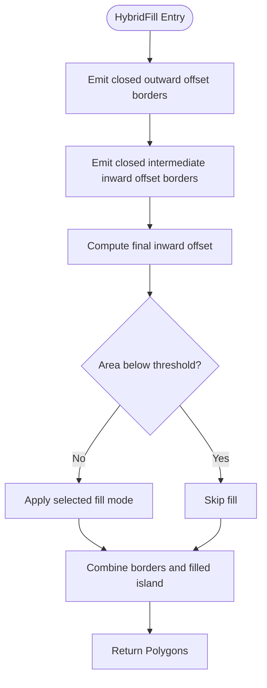
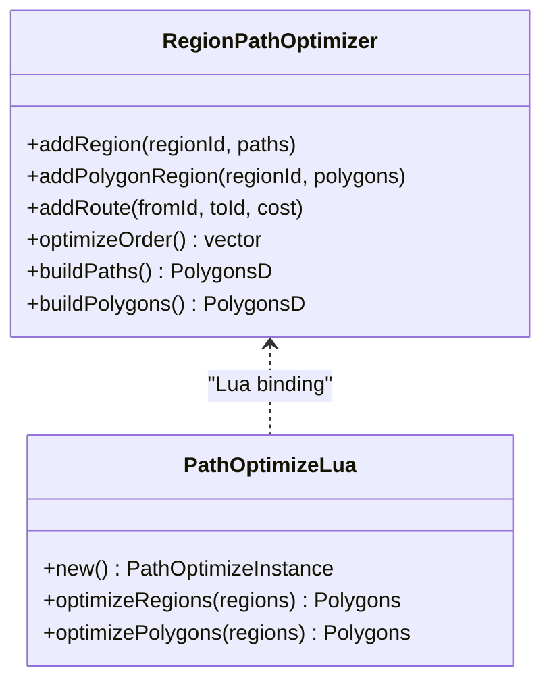
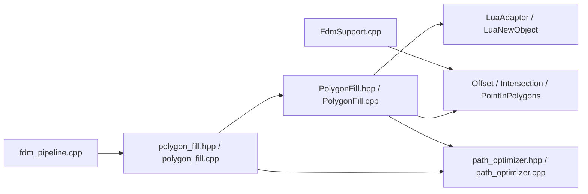

# Polygon Filling API

<cite>
**Referenced Files in This Document**
- [polygon_fill.hpp](file://LibHsBaSlicer/Fill/polygon_fill.hpp)
- [polygon_fill.cpp](file://LibHsBaSlicer/Fill/polygon_fill.cpp)
- [PolygonFill.hpp](file://2D/PolygonFill.hpp)
- [PolygonFill.cpp](file://2D/PolygonFill.cpp)
- [path_optimizer.hpp](file://LibHsBaSlicer/Path/path_optimizer.hpp)
- [path_optimizer.cpp](file://LibHsBaSlicer/Path/path_optimizer.cpp)
- [FdmSupport.hpp](file://support/FdmSupport.hpp)
- [FdmSupport.cpp](file://support/FdmSupport.cpp)
- [hsba_pipeline.d.lua](file://types/hsba_pipeline.d.lua)
- [fdm_pipeline.cpp](file://DllHsBaSlicer/fdm_pipeline.cpp)
- [polygon_fill_test.cpp](file://tests/PolygonFill/polygon_fill_test.cpp)
</cite>

## Table of Contents
1. [Introduction](#introduction)
2. [Project Structure](#project-structure)
3. [Core Components](#core-components)
4. [Architecture Overview](#architecture-overview)
5. [Detailed Component Analysis](#detailed-component-analysis)
6. [Dependency Analysis](#dependency-analysis)
7. [Performance Considerations](#performance-considerations)
8. [Troubleshooting Guide](#troubleshooting-guide)
9. [Conclusion](#conclusion)
10. [Appendices](#appendices)

## Introduction
This document explains the Polygon Filling API exposed by LibHsBaSlicer and implemented in the `2D` geometry engine. It covers:

- Built-in polygon fill algorithms: offset-based concentric borders, parallel line fills, simple zigzag fills, and advanced zigzag fills with bridge construction.
- Fill pattern generation through composite and hybrid strategies that combine border offsets with interior fills.
- Custom fill pattern generation via Lua scripting, including integration with path optimization utilities.
- Configuration for different fill modes, angles, spacing, join types, and line thickness.
- Integration points with the 2D geometry engine, path optimizer, and higher-level pipeline layers such as FDM support generation.

The goal is to help users choose fill patterns, tune fill density and continuity, implement custom Lua fill scripts, and balance print quality with material usage.

## Project Structure
The Polygon Filling API spans two main areas:

| Area | Responsibility | Key Files |
|---|---|---|
| LibHsBaSlicer C++ wrapper | Exposes a stable C++ API over the 2D fill engine and integrates Lua script execution with path optimization registration. | [polygon_fill.hpp](file://LibHsBaSlicer/Fill/polygon_fill.hpp), [polygon_fill.cpp](file://LibHsBaSlicer/Fill/polygon_fill.cpp) |
| 2D geometry fill engine | Implements offset fills, line fills, zigzag fills, composite/hybrid fills, and Lua-custom fills. | [PolygonFill.hpp](file://2D/PolygonFill.hpp), [PolygonFill.cpp](file://2D/PolygonFill.cpp) |
| Path optimization | Provides region-based path ordering and gate-based optimization for both pre-fill polygons and post-fill paths. | [path_optimizer.hpp](file://LibHsBaSlicer/Path/path_optimizer.hpp), [path_optimizer.cpp](file://LibHsBaSlicer/Path/path_optimizer.cpp) |
| Support and layer integration | Uses honeycomb generation for support structures and exposes fill-related configuration at the pipeline level. | [FdmSupport.hpp](file://support/FdmSupport.hpp), [FdmSupport.cpp](file://support/FdmSupport.cpp), [fdm_pipeline.cpp](file://DllHsBaSlicer/fdm_pipeline.cpp) |
| Lua type definitions | Documents Lua-facing types such as `PolygonFill`, `PathOptimize`, and support configuration fields. | [hsba_pipeline.d.lua](file://types/hsba_pipeline.d.lua) |
| Tests | Validate fill behavior, Lua integration, path optimization exposure, and complex polygon handling. | [polygon_fill_test.cpp](file://tests/PolygonFill/polygon_fill_test.cpp) |



**Diagram sources**
- [polygon_fill.hpp:1-58](file://LibHsBaSlicer/Fill/polygon_fill.hpp#L1-L58)
- [polygon_fill.cpp:1-52](file://LibHsBaSlicer/Fill/polygon_fill.cpp#L1-L52)
- [PolygonFill.hpp:1-141](file://2D/PolygonFill.hpp#L1-L141)
- [PolygonFill.cpp:1-1669](file://2D/PolygonFill.cpp#L1-L1669)
- [path_optimizer.cpp:1-596](file://LibHsBaSlicer/Path/path_optimizer.cpp#L1-L596)
- [fdm_pipeline.cpp:50-92](file://DllHsBaSlicer/fdm_pipeline.cpp#L50-L92)
- [FdmSupport.cpp:244-267](file://support/FdmSupport.cpp#L244-L267)

**Section sources**
- [polygon_fill.hpp:1-58](file://LibHsBaSlicer/Fill/polygon_fill.hpp#L1-L58)
- [polygon_fill.cpp:1-52](file://LibHsBaSlicer/Fill/polygon_fill.cpp#L1-L52)
- [PolygonFill.hpp:1-141](file://2D/PolygonFill.hpp#L1-L141)
- [PolygonFill.cpp:1-1669](file://2D/PolygonFill.cpp#L1-L1669)

## Core Components
The core components are:

1. **LibHsBaSlicer Fill API**
   - `FillPolygon`: Dispatches to built-in fill modes.
   - `FillWithBorder`: Generates border offsets plus interior fill using composite offset logic.
   - `LuaCustomFillByFile`: Loads a Lua script, registers 2D fill functions and path optimization functions, then executes a user-defined fill function.

2. **2D Fill Engine**
   - `OffsetFill`: Concentric inward offset rings.
   - `LineFill`: Parallel scan-line segments clipped to polygon boundaries.
   - `SimpleZigzagFill`: Connected zigzag polylines across adjacent scan rows.
   - `ZigzagFill`: Advanced zigzag with connectivity analysis, bridge construction around holes/notches, and fallback segment emission.
   - `CompositeOffsetFill`: Combines outward/inward offset layers with an interior fill mode.
   - `HybridFill`: Emits closed offset borders and fills only the final inward island.
   - `LuaCustomFill` / `LuaCustomFillString`: Execute Lua scripts returning polygon tables.
   - `RegisterLuaPolygonFillFunctions`: Registers `offsetFill`, `lineFill`, `simpleZigzagFill`, `zigzagFill`, `compositeOffsetFill`, `hybridFill`, and `offsetOnly`.

3. **Path Optimization**
   - `RegionPathOptimizer`: Optimizes visiting order of independent regions using area-graph modeling.
   - Two modes:
     - Polygon mode: optimizes polygon contours before filling.
     - Fill-result mode: optimizes complete multi-point polylines after filling.
   - Lua bindings expose `PathOptimize.new`, `optimizeRegions`, and `optimizePolygons`.

4. **Support and Layer Integration**
   - Honeycomb support generation uses geometric operations and cell intersection.
   - FDM pipeline configuration includes fill spacing, fill mode, fill angle, wall count, top/bottom layer counts, infill density, and Lua script/function hooks for support and infill.

**Section sources**
- [polygon_fill.hpp:17-53](file://LibHsBaSlicer/Fill/polygon_fill.hpp#L17-L53)
- [polygon_fill.cpp:13-49](file://LibHsBaSlicer/Fill/polygon_fill.cpp#L13-L49)
- [PolygonFill.hpp:20-136](file://2D/PolygonFill.hpp#L20-L136)
- [PolygonFill.cpp:504-1669](file://2D/PolygonFill.cpp#L504-L1669)
- [path_optimizer.cpp:38-596](file://LibHsBaSlicer/Path/path_optimizer.cpp#L38-L596)
- [FdmSupport.cpp:244-267](file://support/FdmSupport.cpp#L244-L267)
- [fdm_pipeline.cpp:50-92](file://DllHsBaSlicer/fdm_pipeline.cpp#L50-L92)

## Architecture Overview
The Polygon Filling API follows a layered architecture:



**Diagram sources**
- [polygon_fill.cpp:13-49](file://LibHsBaSlicer/Fill/polygon_fill.cpp#L13-L49)
- [PolygonFill.cpp:1493-1585](file://2D/PolygonFill.cpp#L1493-L1585)
- [path_optimizer.cpp:559-596](file://LibHsBaSlicer/Path/path_optimizer.cpp#L559-L596)

## Detailed Component Analysis

### Built-in Fill Algorithms

#### Offset Fill (Concentric Borders)
`OffsetFill` generates concentric inward offset rings until no more valid offsets remain. Each ring is closed and returned as a separate polygon. This is useful for border reinforcement and can be combined with other fills.

Key characteristics:
- Spacing controls distance between concentric rings.
- Join type affects corner rounding or mitering.
- Iteration limit prevents infinite loops on pathological geometries.



**Diagram sources**
- [PolygonFill.cpp:504-541](file://2D/PolygonFill.cpp#L504-L541)

**Section sources**
- [PolygonFill.hpp:20-28](file://2D/PolygonFill.hpp#L20-L28)
- [PolygonFill.cpp:504-541](file://2D/PolygonFill.cpp#L504-L541)

#### Line Fill (Parallel Scan Lines)
`LineFill` computes parallel scan lines at a given angle, clips them to the polygon boundary, and returns independent two-point segments. It does not connect segments into continuous paths; downstream systems typically handle extrusion and toolpath generation.

Key characteristics:
- Angle controls orientation of parallel lines.
- Spacing controls line density.
- Line thickness parameter exists but the implementation emits independent segments rather than thickened paths.



**Diagram sources**
- [PolygonFill.cpp:44-160](file://2D/PolygonFill.cpp#L44-L160)
- [PolygonFill.cpp:543-564](file://2D/PolygonFill.cpp#L543-L564)

**Section sources**
- [PolygonFill.hpp:30-38](file://2D/PolygonFill.hpp#L30-L38)
- [PolygonFill.cpp:44-160](file://2D/PolygonFill.cpp#L44-L160)
- [PolygonFill.cpp:543-564](file://2D/PolygonFill.cpp#L543-L564)

#### Simple Zigzag Fill
`SimpleZigzagFill` connects centers of adjacent scan segments into continuous zigzag polylines. It allows connectors only within the same row or adjacent rows, avoiding long jumps. It clamps segment endpoints to stay inside the polygon and emits standalone segments when connection fails.

Key characteristics:
- Produces connected paths suitable for continuous extrusion.
- Handles concave shapes by limiting connector scope.
- Uses binary search to find first/last interior points along candidate connectors.



**Diagram sources**
- [PolygonFill.cpp:566-800](file://2D/PolygonFill.cpp#L566-L800)

**Section sources**
- [PolygonFill.hpp:40-48](file://2D/PolygonFill.hpp#L40-L48)
- [PolygonFill.cpp:566-800](file://2D/PolygonFill.cpp#L566-L800)

#### Advanced Zigzag Fill
`ZigzagFill` improves corner handling and connectivity by:
- Sorting segments by projection along the fill direction.
- Building a connectivity graph using union-find across adjacent rows.
- Computing connected components.
- Attempting bridges along the outer boundary when components change between adjacent rows.
- Falling back to midpoint checks or emitting extra straight segments when bridging fails.

This makes it robust for complex concave polygons where simple zigzag would cut across voids.



**Diagram sources**
- [PolygonFill.cpp:803-1370](file://2D/PolygonFill.cpp#L803-L1370)

**Section sources**
- [PolygonFill.hpp:50-58](file://2D/PolygonFill.hpp#L50-L58)
- [PolygonFill.cpp:803-1370](file://2D/PolygonFill.cpp#L803-L1370)

#### Composite Offset Fill
`CompositeOffsetFill` combines:
- Interior fill of the base polygon.
- Optional outward offset layers.
- Optional inward offset layers.

Each layer uses the selected fill mode (`Line`, `SimpleZigzag`, or `Zigzag`). This is ideal for generating borders plus internal infill in one call.



**Diagram sources**
- [PolygonFill.cpp:1372-1428](file://2D/PolygonFill.cpp#L1372-L1428)

**Section sources**
- [PolygonFill.hpp:70-85](file://2D/PolygonFill.hpp#L70-L85)
- [PolygonFill.cpp:1372-1428](file://2D/PolygonFill.cpp#L1372-L1428)

#### Hybrid Fill
`HybridFill` differs from composite fill by:
- Emitting closed offset borders for outward layers.
- Emitting closed offset borders for intermediate inward layers.
- Applying the chosen fill mode only to the final inward island.

This strategy emphasizes strong perimeter walls while concentrating infill in the innermost region.



**Diagram sources**
- [PolygonFill.cpp:1430-1491](file://2D/PolygonFill.cpp#L1430-L1491)

**Section sources**
- [PolygonFill.hpp:87-102](file://2D/PolygonFill.hpp#L87-L102)
- [PolygonFill.cpp:1430-1491](file://2D/PolygonFill.cpp#L1430-L1491)

### Fill Pattern Configuration

| Parameter | Meaning | Typical Use |
|---|---|---|
| `spacing` | Distance between fill lines or offset rings | Controls fill density and material usage |
| `angle_deg` | Orientation of parallel or zigzag fills | Rotates fill direction to improve strength or reduce visible lines |
| `lineThickness` | Thickness used during clipping and bridge sampling | Affects precision and bridge sampling density |
| `join_type` | Corner join style for offset operations | Square, Bevel, Round, Miter |
| `outwardCount` | Number of outward offset layers | Adds external borders |
| `inwardCount` | Number of inward offset layers | Adds internal borders or isolates infill region |
| `mode` | Fill algorithm for interior regions | Line, SimpleZigzag, Zigzag |

Configuration examples appear in tests and Lua type definitions:

- Test usage demonstrates calling `offsetFill`, `lineFill`, `simpleZigzagFill`, `zigzagFill`, `compositeOffsetFill`, `hybridFill`, and `offsetOnly` with various parameters.
- Lua type definition documents `PolygonFill` functions and `PathOptimize` methods.

**Section sources**
- [polygon_fill_test.cpp:208-233](file://tests/PolygonFill/polygon_fill_test.cpp#L208-L233)
- [hsba_pipeline.d.lua:61-77](file://types/hsba_pipeline.d.lua#L61-L77)

### Custom Fill Patterns via Lua Scripting

The Lua integration allows users to define custom fill patterns by implementing a function that receives a polygon table and returns a table of polygons or polylines.

Key integration points:

- `LuaCustomFillByFile` loads a script file, registers 2D polygon operations and fill functions, and optionally registers path optimization functions.
- `LuaCustomFill` and `LuaCustomFillString` provide file-based and inline-script variants.
- The Lua environment exposes:
  - `PolygonFill.offsetFill`
  - `PolygonFill.lineFill`
  - `PolygonFill.simpleZigzagFill`
  - `PolygonFill.zigzagFill`
  - `PolygonFill.compositeOffsetFill`
  - `PolygonFill.hybridFill`
  - `PolygonFill.offsetOnly`
  - `PathOptimize.new`, `PathOptimize.optimizeRegions`, `PathOptimize.optimizePolygons`

```mermaid
sequenceDiagram
participant User as "User Script"
participant LibAPI as "LibHsBaSlicer Fill API"
participant Engine as "2D Fill Engine"
participant Lua as "Lua VM"
participant Opt as "PathOptimize"
User->>LibAPI : "LuaCustomFillByFile(poly, scriptPath, functionName, lineThickness)"
LibAPI->>Lua : "Create state and open libraries"
LibAPI->>Lua : "Register 2D polygon operations"
LibAPI->>Lua : "Register PolygonFill functions"
LibAPI->>Lua : "Register PathOptimize functions"
LibAPI->>Lua : "Load script and call functionName(poly)"
Lua->>Engine : "Call PolygonFill.* functions if needed"
Lua->>Opt : "Call PathOptimize.* functions if needed"
Lua-->>LibAPI : "Return table of polygons"
LibAPI-->>User : "Polygons"
```

**Diagram sources**
- [polygon_fill.cpp:35-49](file://LibHsBaSlicer/Fill/polygon_fill.cpp#L35-L49)
- [PolygonFill.cpp:1493-1585](file://2D/PolygonFill.cpp#L1493-L1585)
- [path_optimizer.cpp:559-596](file://LibHsBaSlicer/Path/path_optimizer.cpp#L559-L596)

**Section sources**
- [polygon_fill.hpp:39-53](file://LibHsBaSlicer/Fill/polygon_fill.hpp#L39-L53)
- [polygon_fill.cpp:35-49](file://LibHsBaSlicer/Fill/polygon_fill.cpp#L35-L49)
- [PolygonFill.hpp:106-136](file://2D/PolygonFill.hpp#L106-L136)
- [PolygonFill.cpp:231-495](file://2D/PolygonFill.cpp#L231-L495)
- [PolygonFill.cpp:1493-1585](file://2D/PolygonFill.cpp#L1493-L1585)
- [hsba_pipeline.d.lua:61-77](file://types/hsba_pipeline.d.lua#L61-L77)

### Path Optimization Integration

Path optimization reduces travel moves by ordering independent regions efficiently. It supports:

- **Polygon mode**: Input is polygon contours; gates are all vertices; output is ordered polygons for subsequent filling.
- **Fill-result mode**: Input is complete fill paths; gates are head/tail endpoints; output is reordered complete paths.

The fill stage exposes `PathOptimize` so Lua scripts can optimize regions before path output.



**Diagram sources**
- [path_optimizer.cpp:441-474](file://LibHsBaSlicer/Path/path_optimizer.cpp#L441-L474)
- [path_optimizer.cpp:559-596](file://LibHsBaSlicer/Path/path_optimizer.cpp#L559-L596)

**Section sources**
- [path_optimizer.hpp:1-200](file://LibHsBaSlicer/Path/path_optimizer.hpp#L1-L200)
- [path_optimizer.cpp:38-596](file://LibHsBaSlicer/Path/path_optimizer.cpp#L38-L596)
- [polygon_fill_test.cpp:493-540](file://tests/PolygonFill/polygon_fill_test.cpp#L493-L540)

### Handling Complex Polygon Geometries

The fill engine handles complex geometries through:

- Clipping scan segments to polygon boundaries.
- Binary search for first/last interior points along candidate connectors.
- Union-find connectivity across adjacent rows.
- Boundary-following bridges when components change between rows.
- Fallback strategies that emit standalone segments when connections fail.

Tests explicitly cover concave U-shaped polygons to drive bridge logic and ensure zigzag paths route around open notches rather than cutting across voids.

**Section sources**
- [PolygonFill.cpp:581-644](file://2D/PolygonFill.cpp#L581-L644)
- [PolygonFill.cpp:939-1002](file://2D/PolygonFill.cpp#L939-L1002)
- [PolygonFill.cpp:1004-1122](file://2D/PolygonFill.cpp#L1004-L1122)
- [polygon_fill_test.cpp:542-553](file://tests/PolygonFill/polygon_fill_test.cpp#L542-L553)

### Fill Density Control and Material Usage

Fill density is primarily controlled by:

- `spacing`: smaller spacing increases density and material usage.
- `outwardCount` and `inwardCount`: more offset layers increase perimeter reinforcement and total material.
- `lineThickness`: influences bridge sampling and minimum area thresholds in hybrid fill.
- `mode`: zigzag fills generally produce longer continuous paths; line fills produce many short segments.

For FDM pipelines, configuration fields include:

- `fill_spacing`
- `fill_mode`
- `fill_angle`
- `wall_count`
- `top_layer_count`
- `bottom_layer_count`
- `infill_density`

These fields allow balancing structural strength, surface quality, and material consumption.

**Section sources**
- [PolygonFill.hpp:20-102](file://2D/PolygonFill.hpp#L20-L102)
- [PolygonFill.cpp:1444-1491](file://2D/PolygonFill.cpp#L1444-L1491)
- [fdm_pipeline.cpp:50-92](file://DllHsBaSlicer/fdm_pipeline.cpp#L50-L92)

### Integrating with 2D Geometry Engine and Path Generation Systems

The fill engine relies on 2D geometry operations:

- `Offset`: Creates inward/outward polygon offsets.
- `Intersection`: Clips scan rectangles to polygon boundaries.
- `PointInPolygons`: Determines whether points lie inside polygons.
- `Integerization` / `UnIntegerization`: Converts between integer and floating-point polygon representations.

Path generation systems consume the resulting `Polygons` as either:
- Independent segments for line fills.
- Continuous polylines for zigzag fills.
- Ordered regions for path optimization.

**Section sources**
- [PolygonFill.cpp:44-160](file://2D/PolygonFill.cpp#L44-L160)
- [PolygonFill.cpp:581-644](file://2D/PolygonFill.cpp#L581-L644)
- [PolygonFill.cpp:1493-1585](file://2D/PolygonFill.cpp#L1493-L1585)

## Dependency Analysis



**Diagram sources**
- [polygon_fill.cpp:1-52](file://LibHsBaSlicer/Fill/polygon_fill.cpp#L1-L52)
- [PolygonFill.cpp:1-1669](file://2D/PolygonFill.cpp#L1-L1669)
- [path_optimizer.cpp:1-596](file://LibHsBaSlicer/Path/path_optimizer.cpp#L1-L596)
- [fdm_pipeline.cpp:50-92](file://DllHsBaSlicer/fdm_pipeline.cpp#L50-L92)
- [FdmSupport.cpp:244-267](file://support/FdmSupport.cpp#L244-L267)

**Section sources**
- [polygon_fill.cpp:1-52](file://LibHsBaSlicer/Fill/polygon_fill.cpp#L1-L52)
- [PolygonFill.cpp:1-1669](file://2D/PolygonFill.cpp#L1-L1669)
- [path_optimizer.cpp:1-596](file://LibHsBaSlicer/Path/path_optimizer.cpp#L1-L596)
- [fdm_pipeline.cpp:50-92](file://DllHsBaSlicer/fdm_pipeline.cpp#L50-L92)
- [FdmSupport.cpp:244-267](file://support/FdmSupport.cpp#L244-L267)

## Performance Considerations

- **Iteration limits**: Fill algorithms use maximum iteration constants to avoid excessive computation on degenerate inputs.
- **Binary search bounds**: Connector endpoint searches are bounded by a fixed number of iterations.
- **Row adjacency constraints**: Zigzag connectors are limited to same-row or adjacent-row connections to prevent long jumps.
- **Area thresholds**: Hybrid fill skips small islands based on line thickness to avoid unnecessary micro-fills.
- **Path optimization**: Region-based TSP-like ordering reduces air moves; manual routes can override costs for known bottlenecks.

Recommendations:
- Increase `spacing` to reduce print time and material usage when strength requirements allow.
- Use `Zigzag` for better continuity and fewer retractions; use `Line` when segment independence is preferred.
- Prefer `CompositeOffsetFill` for strong borders plus internal infill.
- Use `HybridFill` when perimeter walls should be emphasized and infill concentrated centrally.
- Apply `PathOptimize.optimizeRegions` after fill to reorder complete paths.
- Apply `PathOptimize.optimizePolygons` before fill to reorder polygon regions.

[No sources needed since this section provides general guidance]

## Troubleshooting Guide

Common issues and resolutions:

| Issue | Cause | Resolution |
|---|---|---|
| Lua script fails to load | Invalid script path or syntax error | Verify script path and Lua syntax; check error messages from `luaL_loadfile` / `lua_pcall`. |
| Lua function not found | Wrong function name passed | Ensure `functionName` matches the exported function in the script. |
| Lua function returns non-table | Script did not return a polygon table | Modify script to return a table of polygons or polylines. |
| Zigzag cuts across voids | Concave geometry causes disconnected components | Rely on `ZigzagFill` bridge logic; verify spacing and angle do not create overly sparse scans. |
| Too much material usage | Spacing too small or too many offset layers | Increase `spacing` or reduce `outwardCount`/`inwardCount`. |
| Path optimization throws mode mismatch | Mixing polygon regions and path regions | Use one mode per optimizer instance. |
| Honeycomb support produces no output | Overhang detection or gap offset yields empty geometry | Check overhang angle threshold, layer height, and gap settings. |

**Section sources**
- [PolygonFill.cpp:1493-1585](file://2D/PolygonFill.cpp#L1493-L1585)
- [polygon_fill_test.cpp:493-540](file://tests/PolygonFill/polygon_fill_test.cpp#L493-L540)
- [path_optimizer.cpp:68-103](file://LibHsBaSlicer/Path/path_optimizer.cpp#L68-L103)
- [FdmSupport.cpp:244-267](file://support/FdmSupport.cpp#L244-L267)

## Conclusion
The Polygon Filling API in LibHsBaSlicer provides a flexible system for generating polygon fills through built-in algorithms, composite/hybrid strategies, and Lua-driven custom patterns. It integrates tightly with the 2D geometry engine and path optimization subsystem, enabling users to balance fill strength, continuity, speed, and material usage. For most applications:

- Use `Line` for simple, independent scan segments.
- Use `SimpleZigzag` for connected fills with straightforward connectivity.
- Use `Zigzag` for robust handling of complex concave geometries.
- Use `CompositeOffsetFill` for borders plus internal infill.
- Use `HybridFill` for strong perimeter walls and centralized infill.
- Extend behavior with Lua scripts and `PathOptimize` for custom patterns and optimized path ordering.

[No sources needed since this section summarizes without analyzing specific files]

## Appendices

### API Reference Summary

| API | Purpose | Key Parameters | Output |
|---|---|---|---|
| `FillPolygon` | Dispatch built-in fill | `poly`, `spacing`, `mode`, `angle_deg` | `Polygons` |
| `FillWithBorder` | Border offsets + interior fill | `poly`, `spacing`, `border_count`, `fill_mode`, `angle_deg` | `Polygons` |
| `LuaCustomFillByFile` | Execute Lua fill script | `poly`, `scriptPath`, `functionName`, `lineThickness` | `Polygons` |
| `OffsetFill` | Concentric inward borders | `poly`, `spacing`, `join_type` | `Polygons` |
| `LineFill` | Parallel scan segments | `poly`, `spacing`, `angle_deg`, `lineThickness` | `Polygons` |
| `SimpleZigzagFill` | Connected zigzag paths | `poly`, `spacing`, `angle_deg`, `lineThickness` | `Polygons` |
| `ZigzagFill` | Advanced zigzag with bridges | `poly`, `spacing`, `angle_deg`, `lineThickness` | `Polygons` |
| `CompositeOffsetFill` | Base fill + outward/inward layers | `poly`, `spacing`, `offsetStep`, `outwardCount`, `inwardCount`, `mode`, `angle_deg`, `lineThickness`, `join_type` | `Polygons` |
| `HybridFill` | Closed borders + final island fill | `poly`, `spacing`, `offsetStep`, `outwardCount`, `inwardCount`, `mode`, `angle_deg`, `lineThickness`, `join_type` | `Polygons` |
| `LuaCustomFill` / `LuaCustomFillString` | Lua-based custom fill | `poly`, script source/path, `functionName`, `lineThickness`, optional `lua_reg` | `Polygons` |

**Section sources**
- [polygon_fill.hpp:17-53](file://LibHsBaSlicer/Fill/polygon_fill.hpp#L17-L53)
- [PolygonFill.hpp:20-136](file://2D/PolygonFill.hpp#L20-L136)