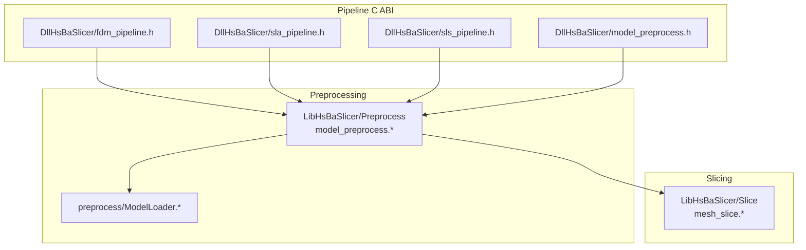
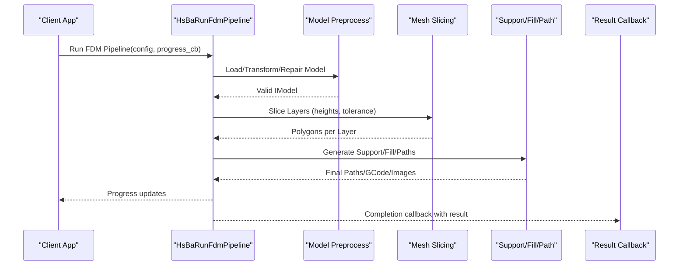
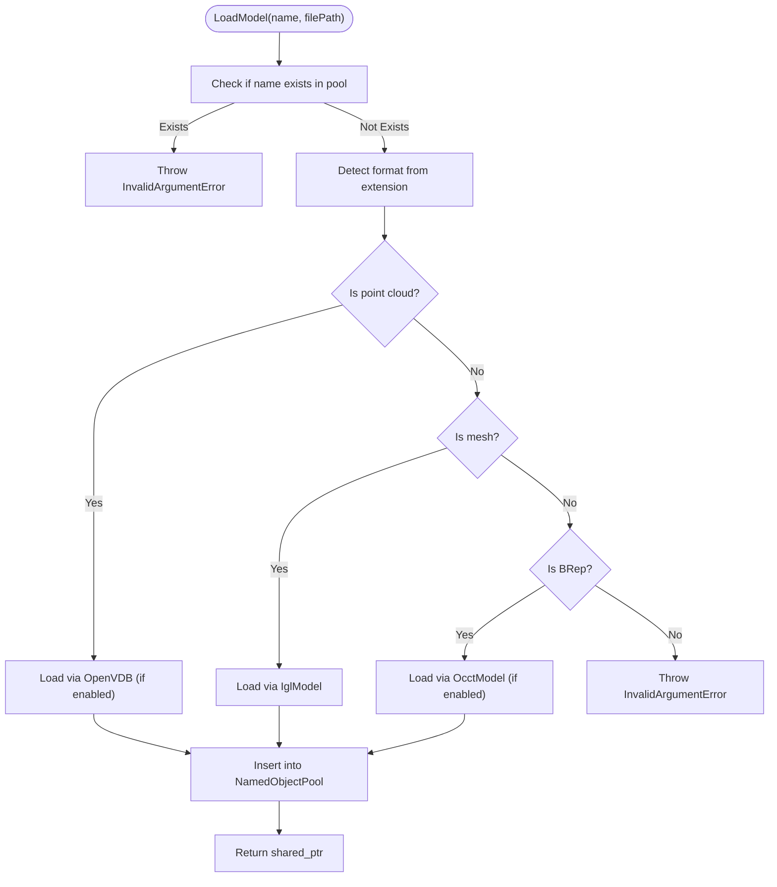
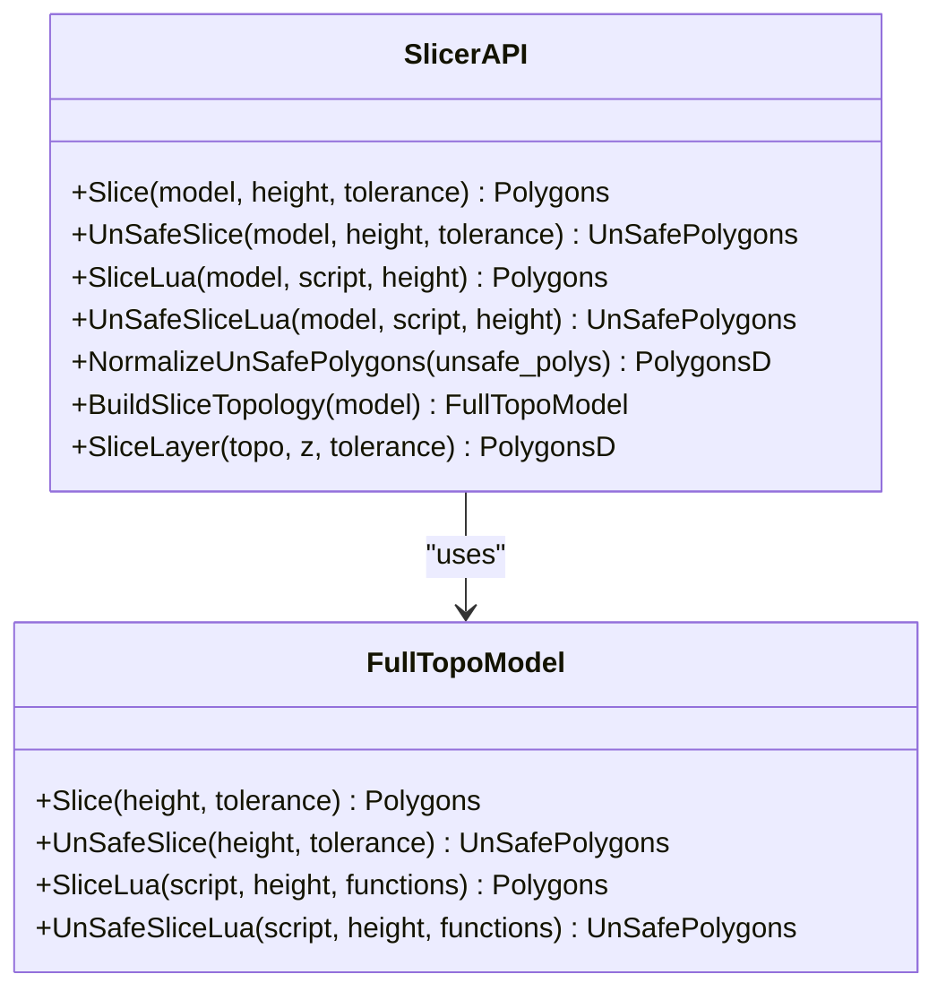
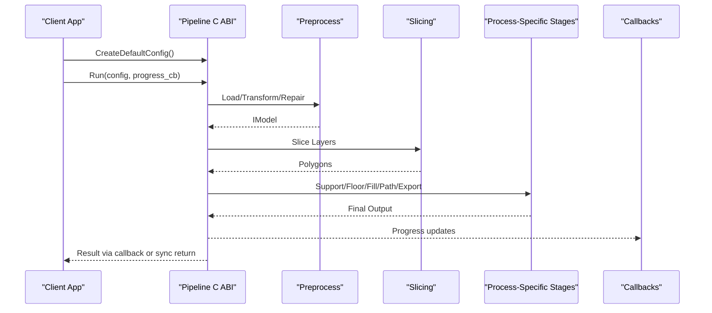
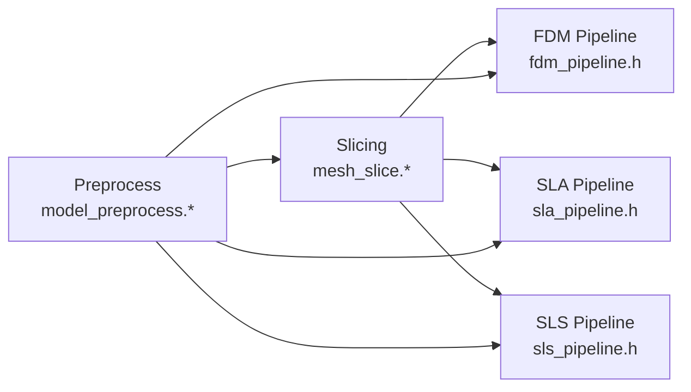
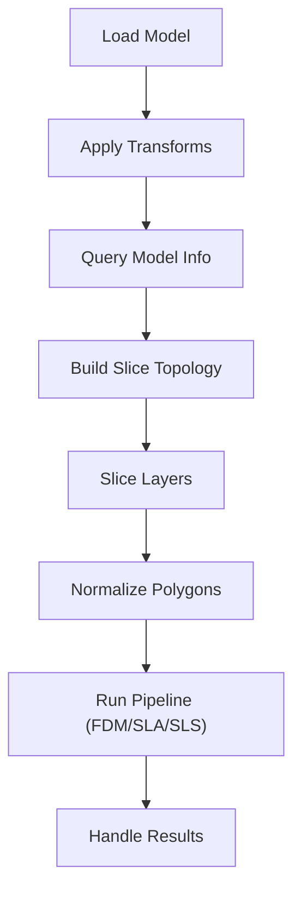

# Slicing Pipeline API

<cite>
**Referenced Files in This Document**   
- [mesh_slice.hpp](file://LibHsBaSlicer/Slice/mesh_slice.hpp)
- [mesh_slice.cpp](file://LibHsBaSlicer/Slice/mesh_slice.cpp)
- [model_preprocess.hpp](file://LibHsBaSlicer/Preprocess/model_preprocess.hpp)
- [model_preprocess.cpp](file://LibHsBaSlicer/Preprocess/model_preprocess.cpp)
- [ModelLoader.hpp](file://preprocess/ModelLoader.hpp)
- [ModelLoader.cpp](file://preprocess/ModelLoader.cpp)
- [fdm_pipeline.h](file://DllHsBaSlicer/fdm_pipeline.h)
- [sla_pipeline.h](file://DllHsBaSlicer/sla_pipeline.h)
- [sls_pipeline.h](file://DllHsBaSlicer/sls_pipeline.h)
- [model_preprocess.h](file://DllHsBaSlicer/model_preprocess.h)
</cite>

## Table of Contents
1. [Introduction](#introduction)
2. [Project Structure](#project-structure)
3. [Core Components](#core-components)
4. [Architecture Overview](#architecture-overview)
5. [Detailed Component Analysis](#detailed-component-analysis)
6. [Dependency Analysis](#dependency-analysis)
7. [Performance Considerations](#performance-considerations)
8. [Troubleshooting Guide](#troubleshooting-guide)
9. [Conclusion](#conclusion)
10. [Appendices](#appendices)

## Introduction
This document explains the Slicing Pipeline API exposed by LibHsBaSlicer and DllHsBaSlicer for planar mesh slicing, model preprocessing, and manufacturing-process pipelines such as FDM, SLA, and SLS. It focuses on:
- Main slicing orchestration functions in LibHsBaSlicer/Slice.
- Model preprocessing interfaces in LibHsBaSlicer/Preprocess and preprocess/ModelLoader.
- C ABI pipeline entry points for FDM, SLA, and SLS in DllHsBaSlicer.
- Data flow between preprocessing and slicing stages.
- Parameter validation rules, error handling patterns, progress reporting, and performance optimization techniques.

The goal is to help users configure different manufacturing processes, validate and repair models, manage slicing parameters, and process slice results through a consistent, robust API.

## Project Structure
The relevant parts of the repository are organized into three layers:
- Preprocessing layer: loads, transforms, queries, and repairs models.
- Slicing layer: slices models into 2D polygons per layer.
- Pipeline layer: orchestrates full manufacturing workflows (FDM, SLA, SLS).

**Diagram sources**
- [model_preprocess.hpp:22-120](file://LibHsBaSlicer/Preprocess/model_preprocess.hpp#L22-L120)
- [ModelLoader.hpp:23-92](file://preprocess/ModelLoader.hpp#L23-L92)
- [mesh_slice.hpp:22-103](file://LibHsBaSlicer/Slice/mesh_slice.hpp#L22-L103)
- [fdm_pipeline.h:17-61](file://DllHsBaSlicer/fdm_pipeline.h#L17-L61)
- [sla_pipeline.h:17-56](file://DllHsBaSlicer/sla_pipeline.h#L17-L56)
- [sls_pipeline.h:17-56](file://DllHsBaSlicer/sls_pipeline.h#L17-L56)
- [model_preprocess.h:20-195](file://DllHsBaSlicer/model_preprocess.h#L20-L195)

**Section sources**
- [model_preprocess.hpp:22-120](file://LibHsBaSlicer/Preprocess/model_preprocess.hpp#L22-L120)
- [ModelLoader.hpp:23-92](file://preprocess/ModelLoader.hpp#L23-L92)
- [mesh_slice.hpp:22-103](file://LibHsBaSlicer/Slice/mesh_slice.hpp#L22-L103)
- [fdm_pipeline.h:17-61](file://DllHsBaSlicer/fdm_pipeline.h#L17-L61)
- [sla_pipeline.h:17-56](file://DllHsBaSlicer/sla_pipeline.h#L17-L56)
- [sls_pipeline.h:17-56](file://DllHsBaSlicer/sls_pipeline.h#L17-L56)
- [model_preprocess.h:20-195](file://DllHsBaSlicer/model_preprocess.h#L20-L195)

## Core Components
- Model preprocessing API:
  - Load, retrieve, transform, query, and remove models from an internal pool.
  - Advanced operations: thick-solid shell, boolean union/intersection/difference/xor.
  - Optional point cloud operations when OpenVDB is enabled.
- Mesh slicing API:
  - Safe and unsafe planar slicing at a given Z height.
  - Lua-driven slicing for custom logic.
  - Reusable topology build and single-layer slicing with normalization.
- Manufacturing pipeline APIs:
  - FDM: Preprocess -> Slice -> Support -> Fill -> Path Generation.
  - SLA: Preprocess -> Slice -> Floor -> Support -> Export.
  - SLS: Preprocess -> Slice -> Export via Lua script.

Key responsibilities:
- Preprocessing ensures valid geometry before slicing.
- Slicing converts 3D geometry into 2D polygons per layer.
- Pipelines coordinate multiple stages and export final outputs.

**Section sources**
- [model_preprocess.hpp:22-187](file://LibHsBaSlicer/Preprocess/model_preprocess.hpp#L22-L187)
- [mesh_slice.hpp:22-103](file://LibHsBaSlicer/Slice/mesh_slice.hpp#L22-L103)
- [fdm_pipeline.h:17-61](file://DllHsBaSlicer/fdm_pipeline.h#L17-L61)
- [sla_pipeline.h:17-56](file://DllHsBaSlicer/sla_pipeline.h#L17-L56)
- [sls_pipeline.h:17-56](file://DllHsBaSlicer/sls_pipeline.h#L17-L56)

## Architecture Overview
The slicing pipeline architecture connects preprocessing, slicing, and manufacturing-specific stages. The C ABI exposes synchronous and asynchronous execution modes with progress callbacks.

**Diagram sources**
- [fdm_pipeline.h:23-51](file://DllHsBaSlicer/fdm_pipeline.h#L23-L51)
- [model_preprocess.hpp:40-82](file://LibHsBaSlicer/Preprocess/model_preprocess.hpp#L40-L82)
- [mesh_slice.hpp:33-103](file://LibHsBaSlicer/Slice/mesh_slice.hpp#L33-L103)

## Detailed Component Analysis

### Model Preprocessing API
The preprocessing API provides:
- Model lifecycle management: load, get, insert, remove, count, cleanup.
- Transformations: translation, rotation, uniform/non-uniform scaling.
- Queries: bounding box and volume.
- Advanced geometry operations: thick-solid shell and boolean operations.

Data model:
- ModelInfo contains bounding box min/max and volume.

Validation and error handling:
- Duplicate names or unsupported formats raise InvalidArgumentError.
- File loading failures raise RuntimeError.
- All exported functions wrap third-party exceptions into IOError (a RuntimeError subclass), ensuring stable boundaries across the C ABI.

**Diagram sources**
- [ModelLoader.cpp:45-84](file://preprocess/ModelLoader.cpp#L45-L84)
- [ModelLoader.hpp:47-92](file://preprocess/ModelLoader.hpp#L47-L92)

**Section sources**
- [model_preprocess.hpp:22-120](file://LibHsBaSlicer/Preprocess/model_preprocess.hpp#L22-L120)
- [model_preprocess.cpp:55-161](file://LibHsBaSlicer/Preprocess/model_preprocess.cpp#L55-L161)
- [ModelLoader.hpp:23-92](file://preprocess/ModelLoader.hpp#L23-L92)
- [ModelLoader.cpp:45-84](file://preprocess/ModelLoader.cpp#L45-L84)

### Mesh Slicing API
The slicing API offers:
- Safe slicing returning closed contours only.
- Unsafe slicing including open contours.
- Lua-driven slicing for custom behavior.
- Normalization of unsafe polygons to clean double-precision polygons.
- Reusable topology building to avoid repeated O(total_faces) rebuilds.

Processing logic:
- Guard wrappers translate foreign exceptions into project errors.
- NormalizeUnSafePolygons filters open polylines and non-simple polygons, then converts integer coordinates to double precision.
- BuildSliceTopology creates a self-contained FullTopoModel independent of source model lifetime.
- SliceLayer normalizes unsafe slice output for downstream processing.

**Diagram sources**
- [mesh_slice.hpp:33-103](file://LibHsBaSlicer/Slice/mesh_slice.hpp#L33-L103)
- [mesh_slice.cpp:46-116](file://LibHsBaSlicer/Slice/mesh_slice.cpp#L46-L116)

**Section sources**
- [mesh_slice.hpp:22-103](file://LibHsBaSlicer/Slice/mesh_slice.hpp#L22-L103)
- [mesh_slice.cpp:17-116](file://LibHsBaSlicer/Slice/mesh_slice.cpp#L17-L116)

### Manufacturing Pipeline APIs (FDM, SLA, SLS)
Each pipeline exposes:
- Default configuration creation.
- Synchronous run with progress callback.
- Asynchronous run with completion callback.
- Result memory freeing.

Pipeline stages:
- FDM: Preprocess -> Slice -> Support -> Fill -> Path Generation.
- SLA: Preprocess -> Slice -> Floor -> Support -> Export (zip).
- SLS: Preprocess -> Slice -> Export (Lua script: zip + database).

**Diagram sources**
- [fdm_pipeline.h:17-61](file://DllHsBaSlicer/fdm_pipeline.h#L17-L61)
- [sla_pipeline.h:17-56](file://DllHsBaSlicer/sla_pipeline.h#L17-L56)
- [sls_pipeline.h:17-56](file://DllHsBaSlicer/sls_pipeline.h#L17-L56)

**Section sources**
- [fdm_pipeline.h:17-61](file://DllHsBaSlicer/fdm_pipeline.h#L17-L61)
- [sla_pipeline.h:17-56](file://DllHsBaSlicer/sla_pipeline.h#L17-L56)
- [sls_pipeline.h:17-56](file://DllHsBaSlicer/sls_pipeline.h#L17-L56)

## Dependency Analysis
The slicing pipeline depends on:
- Preprocessing layer for model loading and transformations.
- Slicing layer for polygon generation.
- Process-specific stages for support, fill, floor, path generation, and export.

**Diagram sources**
- [model_preprocess.hpp:22-120](file://LibHsBaSlicer/Preprocess/model_preprocess.hpp#L22-L120)
- [mesh_slice.hpp:22-103](file://LibHsBaSlicer/Slice/mesh_slice.hpp#L22-L103)
- [fdm_pipeline.h:17-61](file://DllHsBaSlicer/fdm_pipeline.h#L17-L61)
- [sla_pipeline.h:17-56](file://DllHsBaSlicer/sla_pipeline.h#L17-L56)
- [sls_pipeline.h:17-56](file://DllHsBaSlicer/sls_pipeline.h#L17-L56)

**Section sources**
- [model_preprocess.hpp:22-120](file://LibHsBaSlicer/Preprocess/model_preprocess.hpp#L22-L120)
- [mesh_slice.hpp:22-103](file://LibHsBaSlicer/Slice/mesh_slice.hpp#L22-L103)
- [fdm_pipeline.h:17-61](file://DllHsBaSlicer/fdm_pipeline.h#L17-L61)
- [sla_pipeline.h:17-56](file://DllHsBaSlicer/sla_pipeline.h#L17-L56)
- [sls_pipeline.h:17-56](file://DllHsBaSlicer/sls_pipeline.h#L17-L56)

## Performance Considerations
- Reuse topology for multi-layer slicing:
  - Use BuildSliceTopology once and SliceLayer per height to avoid rebuilding O(total_faces) topology each call.
- Prefer safe slicing for closed contours unless open contours are required by material-fed processes.
- Normalize unsafe polygons to filter invalid geometry early.
- Use thread-local ModelLoader instances to reduce contention.
- Avoid unnecessary conversions between model types; prefer direct kernel paths where available.
- For large models, consider downsampling point clouds or reducing voxel sizes judiciously.

[No sources needed since this section provides general guidance]

## Troubleshooting Guide
Common issues and resolutions:
- Unsupported model format:
  - Ensure file extension matches supported mesh/BRep/point cloud formats.
  - Verify platform capabilities (OCCT/OpenVDB availability).
- Duplicate model names:
  - Use unique names or remove existing models before insertion.
- Geometry failures during slicing:
  - Inspect open contours and non-simple polygons; use NormalizeUnSafePolygons to clean results.
  - Adjust tolerance parameter to merge nearby points appropriately.
- Exception boundary violations:
  - All exported functions wrap foreign exceptions into IOError; catch RuntimeError-family types at the boundary.

Error handling patterns:
- Guard wrappers convert std::exception and third-party exceptions into project errors.
- Callers should handle RuntimeError-derived exceptions and inspect messages for diagnostics.

**Section sources**
- [mesh_slice.cpp:17-43](file://LibHsBaSlicer/Slice/mesh_slice.cpp#L17-L43)
- [model_preprocess.cpp:25-52](file://LibHsBaSlicer/Preprocess/model_preprocess.cpp#L25-L52)
- [ModelLoader.cpp:45-84](file://preprocess/ModelLoader.cpp#L45-L84)

## Conclusion
The Slicing Pipeline API provides a robust, layered architecture for model preprocessing, planar slicing, and manufacturing-specific workflows. By leveraging reusable topologies, normalized polygon outputs, and guarded exception boundaries, users can configure FDM, SLA, and SLS pipelines efficiently. Proper parameter validation, error handling, and performance optimizations ensure reliable operation across diverse model geometries and manufacturing processes.

[No sources needed since this section summarizes without analyzing specific files]

## Appendices

### Configuration and Parameters
- FDM pipeline:
  - Default config via HsBaCreateDefaultConfig.
  - Stages: Preprocess -> Slice -> Support -> Fill -> Path Generation.
- SLA pipeline:
  - Default config via HsBaCreateDefaultSlaConfig.
  - Stages: Preprocess -> Slice -> Floor -> Support -> Export (zip).
- SLS pipeline:
  - Default config via HsBaCreateDefaultSlsConfig.
  - Stages: Preprocess -> Slice -> Export (Lua script: zip + database).

Progress and results:
- Synchronous runs block until completion.
- Asynchronous runs invoke completion callbacks.
- Always free pipeline results using provided free functions.

**Section sources**
- [fdm_pipeline.h:17-61](file://DllHsBaSlicer/fdm_pipeline.h#L17-L61)
- [sla_pipeline.h:17-56](file://DllHsBaSlicer/sla_pipeline.h#L17-L56)
- [sls_pipeline.h:17-56](file://DllHsBaSlicer/sls_pipeline.h#L17-L56)

### Complete Slicing Workflow Example
End-to-end workflow:
1. Load model via HsBaLoadModel or LoadModel.
2. Apply transforms (translate/rotate/scale) as needed.
3. Validate model info (bounding box/volume).
4. Build reusable topology via BuildSliceTopology.
5. Slice layers via SliceLayer for each height.
6. Normalize unsafe polygons via NormalizeUnSafePolygons.
7. Run process-specific pipeline (FDM/SLA/SLS) with configured stages.
8. Handle progress callbacks and finalize results.

**Diagram sources**
- [model_preprocess.h:20-119](file://DllHsBaSlicer/model_preprocess.h#L20-L119)
- [mesh_slice.hpp:89-103](file://LibHsBaSlicer/Slice/mesh_slice.hpp#L89-L103)
- [fdm_pipeline.h:23-51](file://DllHsBaSlicer/fdm_pipeline.h#L23-L51)
- [sla_pipeline.h:23-47](file://DllHsBaSlicer/sla_pipeline.h#L23-L47)
- [sls_pipeline.h:23-47](file://DllHsBaSlicer/sls_pipeline.h#L23-L47)