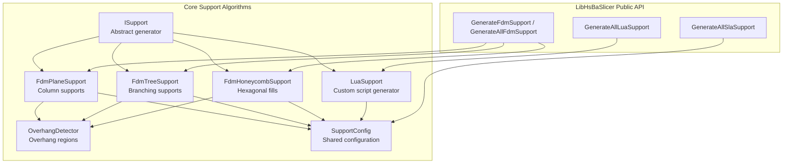
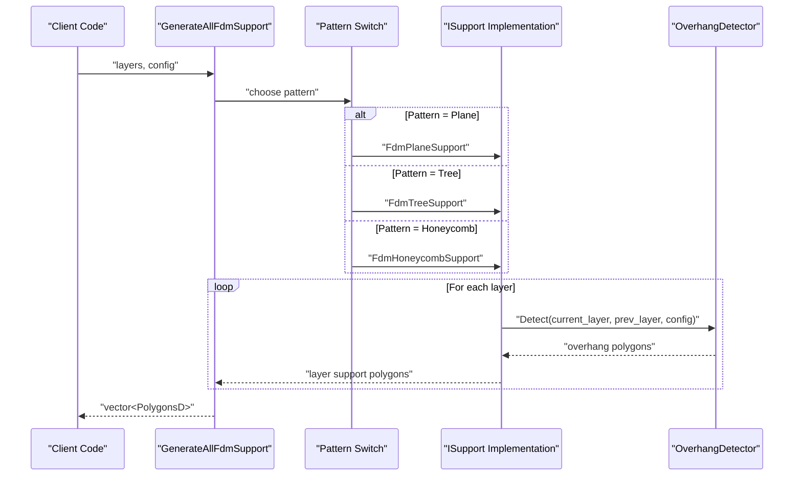
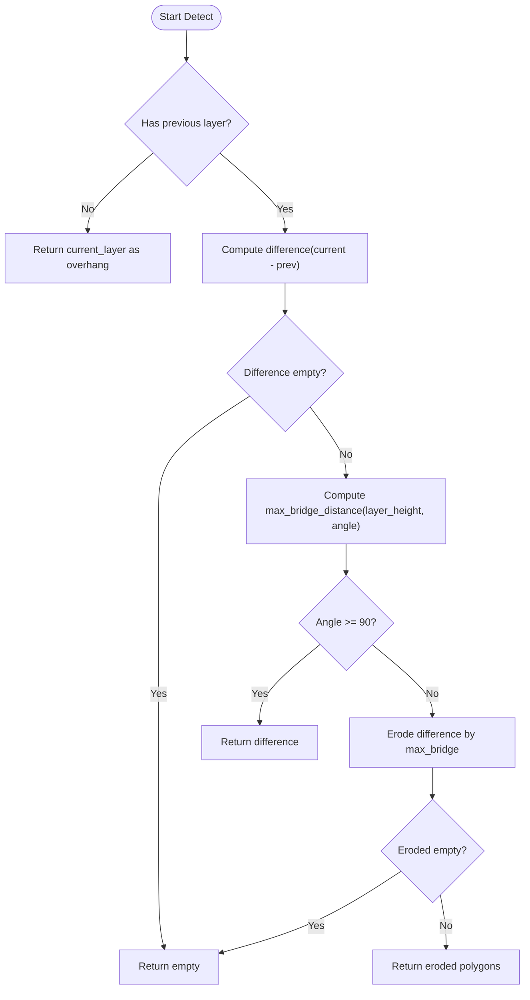
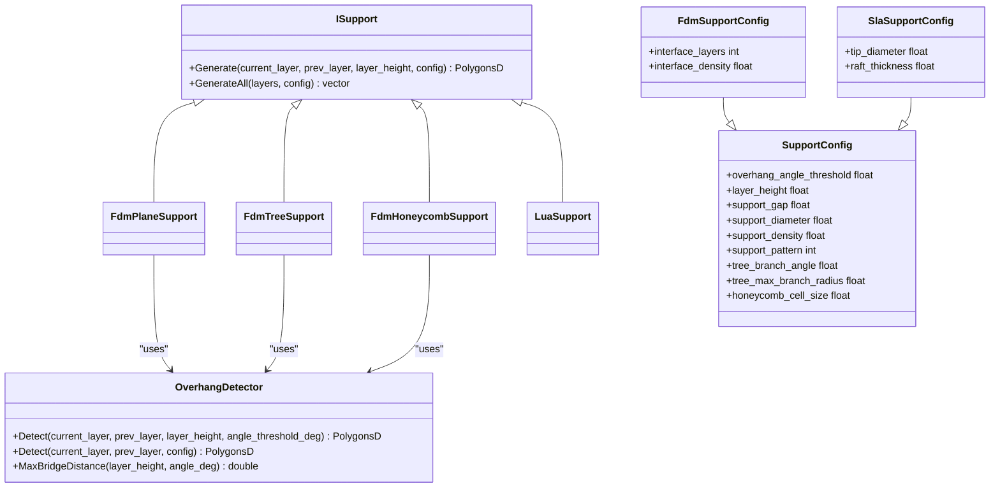

# Support Generation API

<cite>
**Referenced Files in This Document**
- [FdmSupport.hpp](file://support/FdmSupport.hpp)
- [FdmSupport.cpp](file://support/FdmSupport.cpp)
- [ISupport.hpp](file://support/ISupport.hpp)
- [ISupport.cpp](file://support/ISupport.cpp)
- [OverhangDetector.hpp](file://support/OverhangDetector.hpp)
- [OverhangDetector.cpp](file://support/OverhangDetector.cpp)
- [SupportConfig.hpp](file://support/SupportConfig.hpp)
- [LuaSupport.hpp](file://support/LuaSupport.hpp)
- [LuaSupport.cpp](file://support/LuaSupport.cpp)
- [fdm_support.hpp](file://LibHsBaSlicer/Support/fdm_support.hpp)
- [fdm_support.cpp](file://LibHsBaSlicer/Support/fdm_support.cpp)
</cite>

## Table of Contents
1. [Introduction](#introduction)
2. [Project Structure](#project-structure)
3. [Core Components](#core-components)
4. [Architecture Overview](#architecture-overview)
5. [Detailed Component Analysis](#detailed-component-analysis)
6. [Dependency Analysis](#dependency-analysis)
7. [Performance Considerations](#performance-considerations)
8. [Troubleshooting Guide](#troubleshooting-guide)
9. [Conclusion](#conclusion)
10. [Appendices](#appendices)

## Introduction
This document explains the Support Generation API used by LibHsBaSlicer to generate FDM support structures. It covers:
- Overhang detection between adjacent layers
- FDM support algorithms: plane, tree, and honeycomb
- SLA sacrificial support generation
- Lua-based custom support scripting
- Configuration options for density, spacing, gaps, and geometry
- Integration points for slicing pipelines and export formatting

The goal is to help you choose a support strategy, tune it for printability and removability, and integrate support generation into your own slicer or pipeline.

## Project Structure
The support system is split into two layers:
- Core support algorithms under `support/`
- Public C++ API under `LibHsBaSlicer/Support/`

**Diagram sources**
- [ISupport.hpp:14-45](file://support/ISupport.hpp#L14-L45)
- [FdmSupport.hpp:11-63](file://support/FdmSupport.hpp#L11-L63)
- [OverhangDetector.hpp:12-50](file://support/OverhangDetector.hpp#L12-L50)
- [SupportConfig.hpp:9-44](file://support/SupportConfig.hpp#L9-L44)
- [LuaSupport.hpp:19-81](file://support/LuaSupport.hpp#L19-L81)
- [fdm_support.hpp:17-67](file://LibHsBaSlicer/Support/fdm_support.hpp#L17-L67)

**Section sources**
- [ISupport.hpp:14-45](file://support/ISupport.hpp#L14-L45)
- [FdmSupport.hpp:11-63](file://support/FdmSupport.hpp#L11-L63)
- [OverhangDetector.hpp:12-50](file://support/OverhangDetector.hpp#L12-L50)
- [SupportConfig.hpp:9-44](file://support/SupportConfig.hpp#L9-L44)
- [LuaSupport.hpp:19-81](file://support/LuaSupport.hpp#L19-L81)
- [fdm_support.hpp:17-67](file://LibHsBaSlicer/Support/fdm_support.hpp#L17-L67)

## Core Components
- ISupport: Abstract interface for per-layer support generators. Provides `Generate` for one layer and default `GenerateAll` iteration over all layers.
- OverhangDetector: Computes unsupported regions between current and previous layers based on angle threshold and layer height.
- FdmPlaneSupport: Generates cylindrical column supports from overhang regions with configurable diameter and gap.
- FdmTreeSupport: Places circular branch tips within overhang regions; branches expand downward across layers.
- FdmHoneycombSupport: Fills overhang regions with hexagonal cells for lightweight rigid support.
- LuaSupport: Executes a user-provided Lua script to compute support polygons, exposing layer data, configuration, and helper functions.
- SupportConfig and derived configs: Shared parameters such as overhang angle, gap, diameter, density, pattern selection, tree/honeycomb tuning, plus FDM interface layers and SLA tip/raft settings.

Key responsibilities:
- Detect where supports are needed (overhang).
- Convert overhang regions into printable cross-sections.
- Provide multiple strategies and a scripting hook for customization.

**Section sources**
- [ISupport.hpp:14-45](file://support/ISupport.hpp#L14-L45)
- [ISupport.cpp:9-21](file://support/ISupport.cpp#L9-L21)
- [OverhangDetector.hpp:14-50](file://support/OverhangDetector.hpp#L14-L50)
- [FdmSupport.hpp:13-63](file://support/FdmSupport.hpp#L13-L63)
- [LuaSupport.hpp:21-81](file://support/LuaSupport.hpp#L21-L81)
- [SupportConfig.hpp:11-44](file://support/SupportConfig.hpp#L11-L44)

## Architecture Overview
The public API selects an algorithm based on configuration and delegates to the appropriate generator. The same flow applies to single-layer and multi-layer calls.

**Diagram sources**
- [fdm_support.cpp:14-51](file://LibHsBaSlicer/Support/fdm_support.cpp#L14-L51)
- [ISupport.cpp:9-21](file://support/ISupport.cpp#L9-L21)
- [OverhangDetector.cpp:41-87](file://support/OverhangDetector.cpp#L41-L87)

## Detailed Component Analysis

### Overhang Detection
Overhang detection determines which parts of the current layer are not supported by the previous layer. It uses:
- Layer difference to find unsupported areas
- A maximum bridge distance computed from layer height and angle threshold
- Erosion via negative offset to filter out small bridges that do not require support

**Diagram sources**
- [OverhangDetector.cpp:23-87](file://support/OverhangDetector.cpp#L23-L87)

Practical implications:
- Larger angle thresholds reduce support volume by allowing more bridging.
- Smaller layer heights increase resolution but may increase support count.
- Very low angles can make everything an overhang, maximizing support usage.

**Section sources**
- [OverhangDetector.hpp:14-50](file://support/OverhangDetector.hpp#L14-L50)
- [OverhangDetector.cpp:23-87](file://support/OverhangDetector.cpp#L23-L87)

### FDM Support Generators

#### Plane Support
Generates simple column supports from overhang regions:
- Applies a gap between model and support
- Inflates overhang by half the support diameter to create columns

Tuning guidance:
- Increase `support_gap` to improve removability at the cost of material.
- Increase `support_diameter` for stronger columns; decrease for easier removal.

**Section sources**
- [FdmSupport.hpp:13-24](file://support/FdmSupport.hpp#L13-L24)
- [FdmSupport.cpp:48-76](file://support/FdmSupport.cpp#L48-L76)

#### Tree Support
Places circular branch tips inside overhang regions and unions overlapping circles:
- Branch tip radius equals half the support diameter
- Spacing between candidate points is proportional to support diameter
- Branches expand downward across layers (handled by layer iteration)

Tuning guidance:
- Adjust `tree_branch_angle` and `tree_max_branch_radius` to control branching behavior.
- Use moderate `support_density` to balance strength and print time.

**Section sources**
- [FdmSupport.hpp:26-44](file://support/FdmSupport.hpp#L26-L44)
- [FdmSupport.cpp:81-168](file://support/FdmSupport.cpp#L81-L168)

#### Honeycomb Support
Fills overhang regions with flat-top hexagons:
- Cell size controlled by `honeycomb_cell_size`
- Hexagons are generated in a grid and intersected with the overhang region

Tuning guidance:
- Larger cell sizes reduce material and improve removability but lower stiffness.
- Smaller cells increase rigidity and material usage.

**Section sources**
- [FdmSupport.hpp:46-63](file://support/FdmSupport.hpp#L46-L63)
- [FdmSupport.cpp:173-267](file://support/FdmSupport.cpp#L173-L267)

### SLA Sacrificial Support
SLA support uses thin sacrificial columns suitable for resin printing:
- Uses `SlaSupportConfig` with fields like tip diameter and raft thickness
- Generated via `GenerateAllSlaSupport`

Tuning guidance:
- Reduce tip diameter for easier post-processing.
- Tune raft thickness for build plate adhesion.

**Section sources**
- [SupportConfig.hpp:36-44](file://support/SupportConfig.hpp#L36-L44)
- [fdm_support.cpp:54-59](file://LibHsBaSlicer/Support/fdm_support.cpp#L54-L59)

### Lua Custom Support Generator
LuaSupport allows replacing built-in algorithms with a user script:
- Exposes globals: `current_layer`, `prev_layer`, `layer_height`, `config`
- Supports returning polygons directly or defining a function named by `functionName`
- Registers polygon helpers and a Support module for advanced operations

Configuration exposure to Lua:
- `overhang_angle_threshold`, `layer_height`, `support_gap`, `support_diameter`, `support_density`, `support_pattern`, `tree_branch_angle`, `tree_max_branch_radius`, `honeycomb_cell_size`

Integration:
- Compose external 2D and 3D functions into the Lua environment
- Use `GenerateAllLuaSupport` to run the script across all layers

**Section sources**
- [LuaSupport.hpp:21-81](file://support/LuaSupport.hpp#L21-L81)
- [LuaSupport.cpp:19-177](file://support/LuaSupport.cpp#L19-L177)
- [fdm_support.cpp:61-75](file://LibHsBaSlicer/Support/fdm_support.cpp#L61-L75)

### Configuration Reference
Shared configuration fields:
- `overhang_angle_threshold`: Degrees; higher values reduce support volume
- `layer_height`: Millimeters; affects bridge tolerance and support resolution
- `support_gap`: Millimeters; separation between model and support
- `support_diameter`: Millimeters; base width for columns and branch tips
- `support_density`: Ratio [0,1]; fill density for patterns
- `support_pattern`: Integer; 0=Plane, 1=Tree, 2=Honeycomb
- `tree_branch_angle`: Degrees; controls branching behavior
- `tree_max_branch_radius`: Millimeters; limits branch expansion
- `honeycomb_cell_size`: Millimeters; hexagon cell size

FDM-specific:
- `interface_layers`: Number of interface layers between support and model
- `interface_density`: Fill density for interface layers

SLA-specific:
- `tip_diameter`: Millimeters; small tips for easy removal
- `raft_thickness`: Millimeters; bottom layer thickness

**Section sources**
- [SupportConfig.hpp:11-44](file://support/SupportConfig.hpp#L11-L44)

## Dependency Analysis
The core dependencies form a clear hierarchy:
- Public API depends on ISupport implementations
- All FDM generators depend on OverhangDetector
- LuaSupport depends on Lua runtime and registered helpers
- Config structs are shared across components

**Diagram sources**
- [ISupport.hpp:14-45](file://support/ISupport.hpp#L14-L45)
- [FdmSupport.hpp:11-63](file://support/FdmSupport.hpp#L11-L63)
- [OverhangDetector.hpp:12-50](file://support/OverhangDetector.hpp#L12-L50)
- [SupportConfig.hpp:9-44](file://support/SupportConfig.hpp#L9-L44)

**Section sources**
- [ISupport.hpp:14-45](file://support/ISupport.hpp#L14-L45)
- [FdmSupport.hpp:11-63](file://support/FdmSupport.hpp#L11-L63)
- [OverhangDetector.hpp:12-50](file://support/OverhangDetector.hpp#L12-L50)
- [SupportConfig.hpp:9-44](file://support/SupportConfig.hpp#L9-L44)

## Performance Considerations
- Prefer larger angle thresholds to reduce unnecessary supports when bridging is acceptable.
- Increase `support_gap` moderately to ease removal without excessive material.
- For tree supports, use reasonable spacing and branch radii to avoid dense clusters.
- Honeycomb cell size should be tuned to balance stiffness and print time.
- Avoid extremely small layer heights unless necessary; they increase layer count and processing time.
- When using Lua scripts, keep polygon operations efficient and avoid excessive iterations.

[No sources needed since this section provides general guidance]

## Troubleshooting Guide
Common issues and resolutions:
- No supports generated:
  - Check `overhang_angle_threshold`; too high may suppress overhangs.
  - Verify `layer_height` matches your slice configuration.
- Supports too weak:
  - Increase `support_diameter` or switch to tree/honeycomb patterns.
  - Increase `support_density`.
- Supports hard to remove:
  - Increase `support_gap`.
  - Reduce tip diameter for SLA supports.
- Lua script errors:
  - Ensure the script returns a table of polygons or defines the expected function name.
  - Validate that `current_layer`, `prev_layer`, `layer_height`, and `config` are present.
  - Inspect error messages thrown during load or execution.

**Section sources**
- [OverhangDetector.cpp:23-87](file://support/OverhangDetector.cpp#L23-L87)
- [LuaSupport.cpp:113-177](file://support/LuaSupport.cpp#L113-L177)

## Conclusion
The Support Generation API provides a flexible, layered approach to FDM and SLA support creation:
- Robust overhang detection drives support placement
- Multiple FDM strategies cover common needs
- SLA sacrificial supports optimize for resin workflows
- Lua scripting enables full customization
- Configuration fields allow fine-tuning for printability and removability

Use the public API to integrate support generation into your slicing pipeline, and leverage Lua hooks for domain-specific strategies.

[No sources needed since this section summarizes without analyzing specific files]

## Appendices

### Practical Examples

- Generating plane supports for a cantilever beam:
  - Set `support_pattern` to 0
  - Tune `support_gap` and `support_diameter` for removability vs strength
  - Use `GenerateAllFdmSupport` with your sliced layers

- Generating tree supports for complex organic geometry:
  - Set `support_pattern` to 1
  - Adjust `tree_branch_angle` and `tree_max_branch_radius`
  - Use moderate `support_density` to balance coverage and material

- Generating honeycomb supports for large flat overhangs:
  - Set `support_pattern` to 2
  - Choose `honeycomb_cell_size` based on required stiffness and print speed

- Integrating a custom Lua support algorithm:
  - Provide a script that reads `current_layer`, `prev_layer`, `layer_height`, and `config`
  - Return a table of polygons or define a function named by `functionName`
  - Call `GenerateAllLuaSupport` with your layers and config

- Handling different materials:
  - For brittle materials, increase `support_gap` and consider smaller tips for SLA
  - For flexible filaments, reduce `support_diameter` and use tree supports for better release

- Export formatting:
  - The API outputs `PolygonsD` per layer; downstream exporters convert these to G-code, STL, or other formats
  - Interface layers and densities can be applied before path generation

[No sources needed since this section provides conceptual examples]