# Core Modules

<cite>
**Referenced Files in This Document**
- [IModel.hpp](file://base/IModel.hpp)
- [memory_pool.hpp](file://base/memory_pool.hpp)
- [thread_pool.hpp](file://base/thread_pool.hpp)
- [static_reflect.hpp](file://base/static_reflect.hpp)
- [IntPolygon.hpp](file://2D/IntPolygon.hpp)
- [FloatPolygons.hpp](file://2D/FloatPolygons.hpp)
- [PolygonFill.hpp](file://2D/PolygonFill.hpp)
- [FullTopoModel.hpp](file://meshmodel/FullTopoModel.hpp)
- [OcctModel.hpp](file://cadmodel/OcctModel.hpp)
- [mesh_slice.hpp](file://LibHsBaSlicer/Slice/mesh_slice.hpp)
- [ISupport.hpp](file://support/ISupport.hpp)
- [FdmSupport.hpp](file://support/FdmSupport.hpp)
- [SupportConfig.hpp](file://support/SupportConfig.hpp)
- [path_generator.hpp](file://LibHsBaSlicer/Path/path_generator.hpp)
- [gcodepath.hpp](file://paths/gcodepath.hpp)
- [polygon_fill.hpp](file://LibHsBaSlicer/Fill/polygon_fill.hpp)
</cite>

## Table of Contents
1. [Introduction](#introduction)
2. [Project Structure](#project-structure)
3. [Core Components](#core-components)
4. [Architecture Overview](#architecture-overview)
5. [Detailed Component Analysis](#detailed-component-analysis)
6. [Dependency Analysis](#dependency-analysis)
7. [Performance Considerations](#performance-considerations)
8. [Troubleshooting Guide](#troubleshooting-guide)
9. [Conclusion](#conclusion)

## Introduction
This document explains HsBaSlicer’s core modules with a focus on implementation details, public interfaces, configuration options, performance characteristics, and integration patterns. It covers the base infrastructure (types, templates, memory management, threading, static reflection), 2D geometry processing (FloatPolygons, IntPolygon, Clipper2 integration, boolean operations, offsets, area), mesh model processing (IModel abstraction, FullTopoModel, CGAL/IGL backends, transformations), CAD model processing (OpenCascade B-Rep and boolean operations), slicing engine (mesh slicing, layer generation, adaptive slicing, tolerance control), support structure generation (overhang detection, FDM strategies, SLA sacrificial support), path generation and optimization (G-code, toolpath optimization, multi-firmware, spiral/vase mode), and fill algorithms (infill patterns and polygon fill operations).

## Project Structure
The core is organized by capability:
- Base infrastructure under `base/` provides foundational types, memory pools, thread pool, and static reflection utilities.
- 2D geometry under `2D/` provides integer and double-precision polygons, boolean operations, offsetting, area, and fill generators.
- Mesh model under `meshmodel/` provides topology reconstruction and slicing APIs.
- CAD model under `cadmodel/` provides OpenCascade B-Rep model support.
- Slicing API under `LibHsBaSlicer/Slice/` exposes planar slicing and reusable topology building.
- Support under `support/` defines the support interface, configurations, and FDM strategies.
- Path generation under `LibHsBaSlicer/Path/` and `paths/` generates G-code paths and supports multiple firmware targets.
- Fill API under `LibHsBaSlicer/Fill/` wraps 2D fill engines for consumption by higher layers.

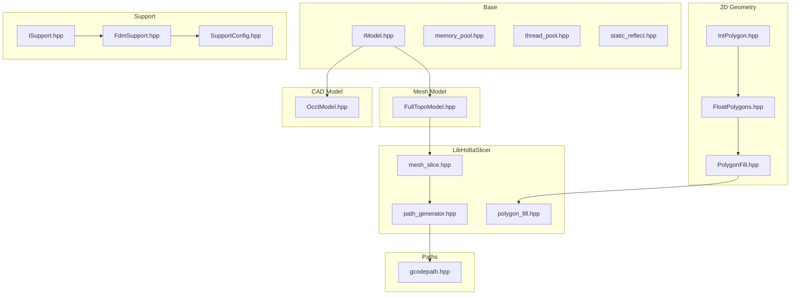

**Diagram sources**
- [IModel.hpp:110-139](file://base/IModel.hpp#L110-L139)
- [memory_pool.hpp:43-208](file://base/memory_pool.hpp#L43-L208)
- [thread_pool.hpp:29-162](file://base/thread_pool.hpp#L29-L162)
- [static_reflect.hpp:113-183](file://base/static_reflect.hpp#L113-L183)
- [IntPolygon.hpp:16-27](file://2D/IntPolygon.hpp#L16-L27)
- [FloatPolygons.hpp:18-25](file://2D/FloatPolygons.hpp#L18-L25)
- [PolygonFill.hpp:20-117](file://2D/PolygonFill.hpp#L20-L117)
- [FullTopoModel.hpp:53-142](file://meshmodel/FullTopoModel.hpp#L53-L142)
- [OcctModel.hpp:30-124](file://cadmodel/OcctModel.hpp#L30-L124)
- [mesh_slice.hpp:22-103](file://LibHsBaSlicer/Slice/mesh_slice.hpp#L22-L103)
- [path_generator.hpp:20-91](file://LibHsBaSlicer/Path/path_generator.hpp#L20-L91)
- [gcodepath.hpp:24-107](file://paths/gcodepath.hpp#L24-L107)
- [ISupport.hpp:22-44](file://support/ISupport.hpp#L22-L44)
- [FdmSupport.hpp:13-63](file://support/FdmSupport.hpp#L13-L63)
- [SupportConfig.hpp:14-43](file://support/SupportConfig.hpp#L14-L43)
- [polygon_fill.hpp:17-53](file://LibHsBaSlicer/Fill/polygon_fill.hpp#L17-L53)

**Section sources**
- [IModel.hpp:110-139](file://base/IModel.hpp#L110-L139)
- [memory_pool.hpp:43-208](file://base/memory_pool.hpp#L43-L208)
- [thread_pool.hpp:29-162](file://base/thread_pool.hpp#L29-L162)
- [static_reflect.hpp:113-183](file://base/static_reflect.hpp#L113-L183)
- [IntPolygon.hpp:16-27](file://2D/IntPolygon.hpp#L16-L27)
- [FloatPolygons.hpp:18-25](file://2D/FloatPolygons.hpp#L18-L25)
- [PolygonFill.hpp:20-117](file://2D/PolygonFill.hpp#L20-L117)
- [FullTopoModel.hpp:53-142](file://meshmodel/FullTopoModel.hpp#L53-L142)
- [OcctModel.hpp:30-124](file://cadmodel/OcctModel.hpp#L30-L124)
- [mesh_slice.hpp:22-103](file://LibHsBaSlicer/Slice/mesh_slice.hpp#L22-L103)
- [path_generator.hpp:20-91](file://LibHsBaSlicer/Path/path_generator.hpp#L20-L91)
- [gcodepath.hpp:24-107](file://paths/gcodepath.hpp#L24-L107)
- [ISupport.hpp:22-44](file://support/ISupport.hpp#L22-L44)
- [FdmSupport.hpp:13-63](file://support/FdmSupport.hpp#L13-L63)
- [SupportConfig.hpp:14-43](file://support/SupportConfig.hpp#L14-L43)
- [polygon_fill.hpp:17-53](file://LibHsBaSlicer/Fill/polygon_fill.hpp#L17-L53)

## Core Components
This section summarizes the major components and their responsibilities:
- Base infrastructure: IModel abstracts 3D models; MemoryPool/StaticMemoryPool provide fixed-size allocators; ThreadPool enables concurrent task execution; StaticReflect enables compile-time introspection.
- 2D geometry: IntPolygon and FloatPolygons wrap Clipper2 for robust boolean operations, offsets, area, and conversions; PolygonFill provides infill pattern generators.
- Mesh model: FullTopoModel reconstructs topology from meshes and exposes safe/unsafe/fast slice APIs plus Lua-driven slicing.
- CAD model: OcctModel implements IModel using OpenCascade for B-Rep operations, primitives, extrusions, and boolean operations.
- Slicing engine: mesh_slice.hpp exposes planar slicing, reusable topology building, and normalization to PolygonsD.
- Support generation: ISupport defines per-layer strategy; FdmSupport provides plane/tree/honeycomb strategies; SupportConfig centralizes parameters.
- Path generation: path_generator.hpp generates G-code paths, supports multi-firmware output via GCodePath, and includes spiral/vase mode.
- Fill API: polygon_fill.hpp wraps 2D fill engines for line/zigzag/border/Lua custom fills.

**Section sources**
- [IModel.hpp:110-139](file://base/IModel.hpp#L110-L139)
- [memory_pool.hpp:43-208](file://base/memory_pool.hpp#L43-L208)
- [thread_pool.hpp:29-162](file://base/thread_pool.hpp#L29-L162)
- [static_reflect.hpp:113-183](file://base/static_reflect.hpp#L113-L183)
- [IntPolygon.hpp:16-27](file://2D/IntPolygon.hpp#L16-L27)
- [FloatPolygons.hpp:18-25](file://2D/FloatPolygons.hpp#L18-L25)
- [PolygonFill.hpp:20-117](file://2D/PolygonFill.hpp#L20-L117)
- [FullTopoModel.hpp:53-142](file://meshmodel/FullTopoModel.hpp#L53-L142)
- [OcctModel.hpp:30-124](file://cadmodel/OcctModel.hpp#L30-L124)
- [mesh_slice.hpp:22-103](file://LibHsBaSlicer/Slice/mesh_slice.hpp#L22-L103)
- [ISupport.hpp:22-44](file://support/ISupport.hpp#L22-L44)
- [FdmSupport.hpp:13-63](file://support/FdmSupport.hpp#L13-L63)
- [SupportConfig.hpp:14-43](file://support/SupportConfig.hpp#L14-L43)
- [path_generator.hpp:20-91](file://LibHsBaSlicer/Path/path_generator.hpp#L20-L91)
- [gcodepath.hpp:24-107](file://paths/gcodepath.hpp#L24-L107)
- [polygon_fill.hpp:17-53](file://LibHsBaSlicer/Fill/polygon_fill.hpp#L17-L53)

## Architecture Overview
The system composes modular layers:
- Models implement IModel (mesh via FullTopoModel or IGAL/CGAL backends; CAD via OcctModel).
- Slicing consumes IModel to produce PolygonsD per layer.
- Fill algorithms generate infill patterns from Polygons.
- Support strategies compute support cross-sections per layer.
- Path generation converts outlines/fills/supports into G-code for multiple firmware targets.

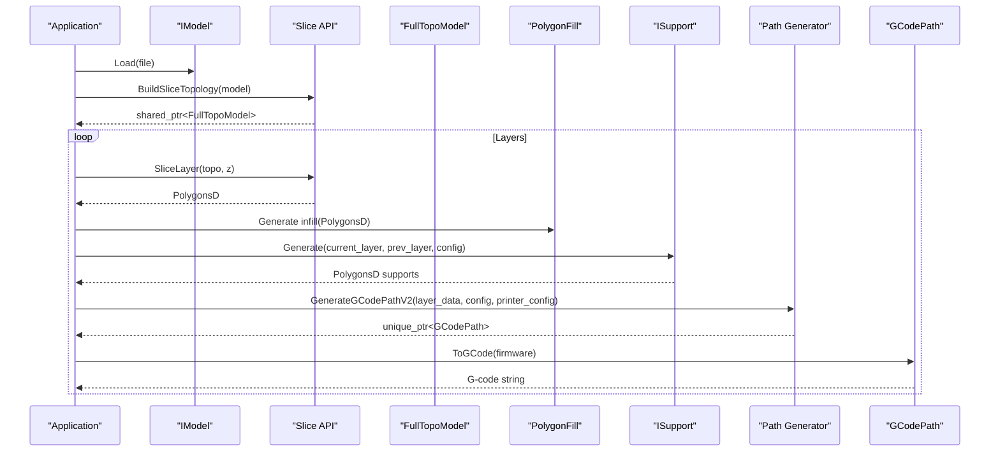

**Diagram sources**
- [IModel.hpp:110-139](file://base/IModel.hpp#L110-L139)
- [mesh_slice.hpp:79-103](file://LibHsBaSlicer/Slice/mesh_slice.hpp#L79-L103)
- [FullTopoModel.hpp:100-127](file://meshmodel/FullTopoModel.hpp#L100-L127)
- [PolygonFill.hpp:20-117](file://2D/PolygonFill.hpp#L20-L117)
- [ISupport.hpp:22-44](file://support/ISupport.hpp#L22-L44)
- [path_generator.hpp:44-80](file://LibHsBaSlicer/Path/path_generator.hpp#L44-L80)
- [gcodepath.hpp:74-96](file://paths/gcodepath.hpp#L74-L96)

## Detailed Component Analysis

### Base Infrastructure Module
The base module provides foundational abstractions and utilities:
- IModel: Abstract interface for 3D models supporting load/save, transforms, bounding box, volume, and triangle mesh extraction.
- MemoryPool and StaticMemoryPool: Fixed-size allocators with thread-safe allocation/deallocation and alignment guarantees.
- ThreadPool: Worker-thread pool with task submission, futures, active/pending counters, and optional coroutine executor integration.
- StaticReflect: Compile-time reflection utilities for fields and methods via Reflector and FieldInfo/MethodInfo templates.

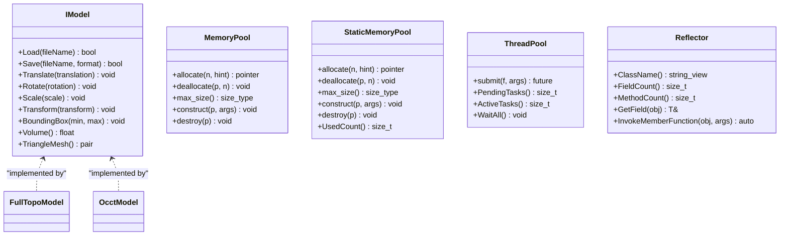

**Diagram sources**
- [IModel.hpp:110-139](file://base/IModel.hpp#L110-L139)
- [memory_pool.hpp:43-208](file://base/memory_pool.hpp#L43-L208)
- [memory_pool.hpp:215-372](file://base/memory_pool.hpp#L215-L372)
- [thread_pool.hpp:29-162](file://base/thread_pool.hpp#L29-L162)
- [static_reflect.hpp:113-183](file://base/static_reflect.hpp#L113-L183)

Implementation notes:
- MemoryPool uses a shared state and mutex-guarded allocation scanning; StaticMemoryPool uses a static buffer and global usage tracking.
- ThreadPool manages worker threads, condition variables, and atomic counters; exceptions in tasks are caught to avoid crashing workers.
- StaticReflect requires classes to expose FieldList, MethodList, and ClassName for compile-time introspection.

Configuration and performance considerations:
- Choose MemoryPool vs StaticMemoryPool based on whether instances should share memory.
- Tune ThreadPool size to hardware concurrency; use WaitAll for synchronization.
- Use StaticReflect for zero-cost introspection where possible.

**Section sources**
- [IModel.hpp:110-139](file://base/IModel.hpp#L110-L139)
- [memory_pool.hpp:43-208](file://base/memory_pool.hpp#L43-L208)
- [memory_pool.hpp:215-372](file://base/memory_pool.hpp#L215-L372)
- [thread_pool.hpp:29-162](file://base/thread_pool.hpp#L29-L162)
- [static_reflect.hpp:113-183](file://base/static_reflect.hpp#L113-L183)

### 2D Geometry Processing Module
Provides robust 2D polygon operations built on Clipper2:
- IntPolygon: Integer-coordinate types (Point64, Path64, Paths64) with MakeSimple, NormalizeToSimplePolygons, boolean ops (Union/Intersection/Difference/Xor), Offset, PointInPolygons, Area.
- FloatPolygons: Double-precision types (PointD, PathD, PathsD) with MakeSimple, boolean ops, Area, shape generators (rectangle/circle/ellipse/regular polygon), text-to-polygons, and integerization/un-integerization helpers.
- PolygonFill: Infill pattern generators including offset-based, line, zigzag, composite, hybrid, and Lua-custom fills.

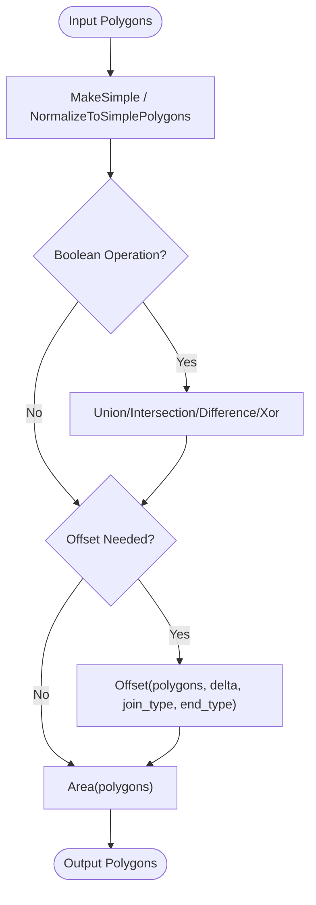

**Diagram sources**
- [IntPolygon.hpp:28-192](file://2D/IntPolygon.hpp#L28-L192)
- [FloatPolygons.hpp:27-135](file://2D/FloatPolygons.hpp#L27-L135)
- [PolygonFill.hpp:20-117](file://2D/PolygonFill.hpp#L20-L117)

Key capabilities:
- Robust boolean operations and offsets for both integer and double precision.
- Area computation and point-in-polygon tests.
- Shape generators and text-to-polygons for UI/debugging.
- Fill pattern generators for infill and border strategies.

Configuration and performance considerations:
- Use integerized polygons for Clipper2 stability; convert to double when needed for downstream operations.
- Adjust epsilon in MakeSimple to balance simplification and geometric fidelity.
- For large datasets, prefer batch operations and reuse intermediate results.

**Section sources**
- [IntPolygon.hpp:28-192](file://2D/IntPolygon.hpp#L28-L192)
- [FloatPolygons.hpp:27-135](file://2D/FloatPolygons.hpp#L27-L135)
- [PolygonFill.hpp:20-117](file://2D/PolygonFill.hpp#L20-L117)

### Mesh Model Processing Module
Focuses on topology reconstruction and slicing:
- FullTopoModel: Rebuilds vertex/edge/face topology from mesh data; exposes CheckTopo, EulerCharacteristic, TriangleMesh, and slicing APIs (Safe/Unsafe/Fast/Lua).
- Backends: IglModel/CgalModel are referenced for mesh processing; FullTopoModel integrates with them via IModel.

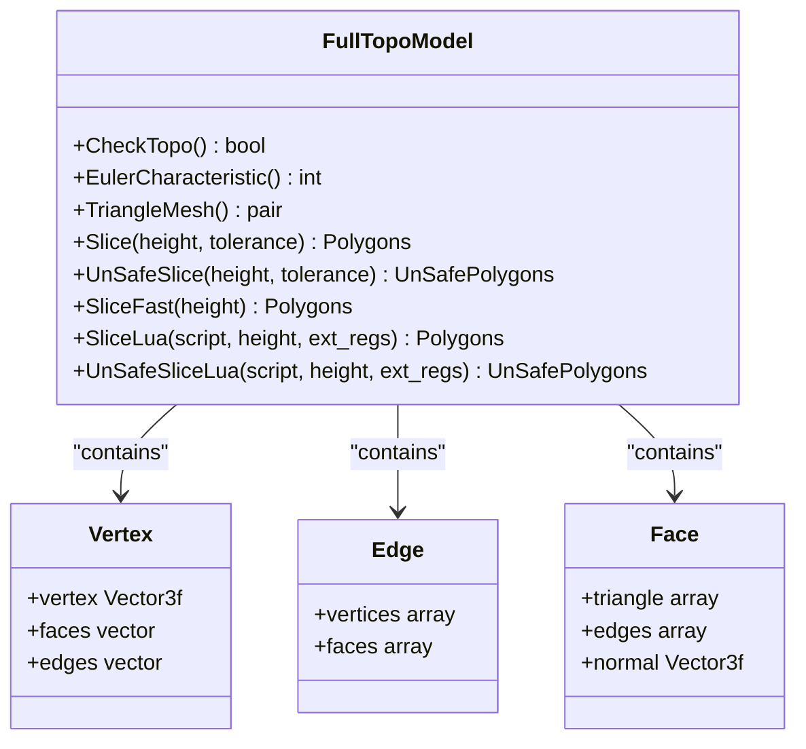

**Diagram sources**
- [FullTopoModel.hpp:53-142](file://meshmodel/FullTopoModel.hpp#L53-L142)

Implementation notes:
- Safe slicing returns only closed contours; unsafe slicing may include open polylines.
- Fast slicing leverages prebuilt topology and validates completeness before operation.
- Lua scripting allows custom contour extraction from V/E/F data.

Integration patterns:
- Use BuildSliceTopology once for multi-layer pipelines to avoid repeated topology rebuilds.
- Combine with mesh_slice.hpp SliceLayer for normalized PolygonsD outputs.

**Section sources**
- [FullTopoModel.hpp:53-142](file://meshmodel/FullTopoModel.hpp#L53-L142)
- [mesh_slice.hpp:79-103](file://LibHsBaSlicer/Slice/mesh_slice.hpp#L79-L103)

### CAD Model Processing Module
OpenCascade-based B-Rep model support:
- OcctModel implements IModel with Load/Save for STEP/IGES/VRML/BRep, affine transforms, bounding box, volume, tessellation, boolean operations (Union/Intersection/Difference/Xor), thick-solid operations, and primitive factories (box/sphere/cylinder/cone/torus/extrusion).

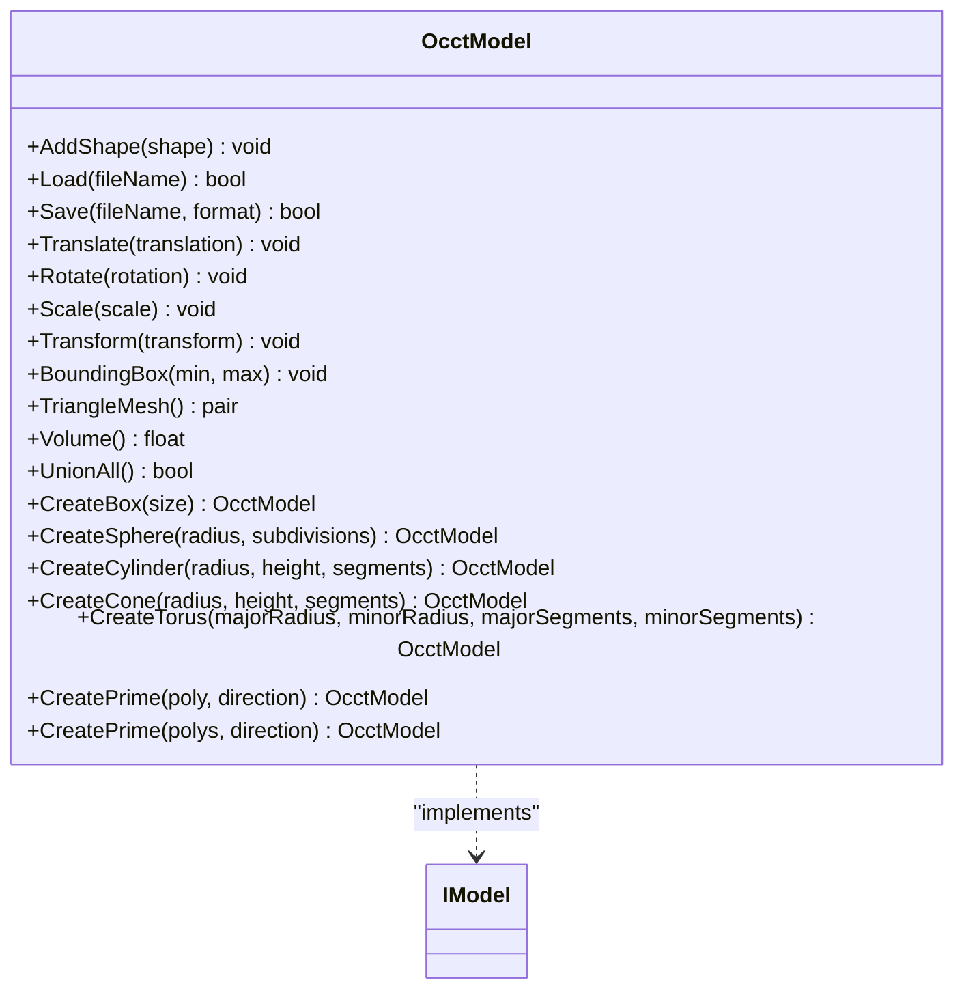

**Diagram sources**
- [OcctModel.hpp:30-124](file://cadmodel/OcctModel.hpp#L30-L124)
- [IModel.hpp:110-139](file://base/IModel.hpp#L110-L139)

Configuration and performance considerations:
- Prefer UnionAll to consolidate shapes before boolean operations.
- Tessellation quality affects downstream slicing accuracy and performance.

**Section sources**
- [OcctModel.hpp:30-124](file://cadmodel/OcctModel.hpp#L30-L124)
- [IModel.hpp:110-139](file://base/IModel.hpp#L110-L139)

### Slicing Engine Module
Planar mesh slicing and layer generation:
- Slice/UnSafeSlice: Produce closed or open contours at a given Z with configurable tolerance.
- SliceLua: Script-driven slicing returning PolygonsD or UnSafePolygons.
- BuildSliceTopology: Prebuild topology for efficient multi-layer slicing.
- SliceLayer: Slice a single layer from prebuilt topology and normalize to PolygonsD.

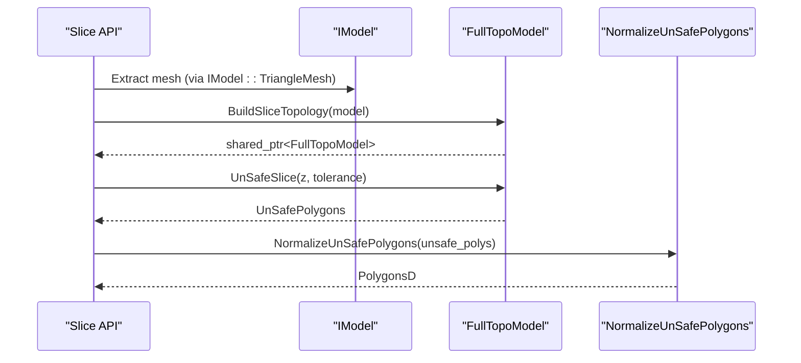

**Diagram sources**
- [mesh_slice.hpp:22-103](file://LibHsBaSlicer/Slice/mesh_slice.hpp#L22-L103)
- [FullTopoModel.hpp:100-127](file://meshmodel/FullTopoModel.hpp#L100-L127)

Adaptive slicing and tolerance control:
- Tolerance parameter controls point merging during slicing; adjust based on model scale and desired precision.
- Adaptive layering can be implemented by varying z steps based on curvature or overhang severity (outside this module but integrable).

**Section sources**
- [mesh_slice.hpp:22-103](file://LibHsBaSlicer/Slice/mesh_slice.hpp#L22-L103)
- [FullTopoModel.hpp:100-127](file://meshmodel/FullTopoModel.hpp#L100-L127)

### Support Structure Generation Module
Per-layer support generation strategies:
- ISupport: Abstract interface defining Generate(current_layer, prev_layer, layer_height, config) and default GenerateAll iteration.
- FdmPlaneSupport: Column supports inflated from overhang regions.
- FdmTreeSupport: Tree-like branching supports grown upward.
- FdmHoneycombSupport: Hexagonal honeycomb fill within overhang areas.
- SupportConfig: Shared configuration including overhang angle threshold, layer height, gap, diameter, density, pattern selection, tree parameters, and honeycomb cell size.

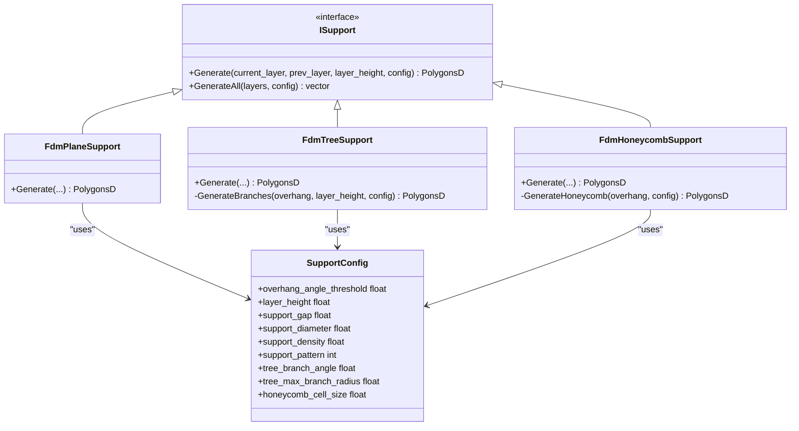

**Diagram sources**
- [ISupport.hpp:22-44](file://support/ISupport.hpp#L22-L44)
- [FdmSupport.hpp:13-63](file://support/FdmSupport.hpp#L13-L63)
- [SupportConfig.hpp:14-43](file://support/SupportConfig.hpp#L14-L43)

Overhang detection and SLA sacrificial support:
- Overhang detection is typically performed upstream using layer normals and angles; SupportConfig.overhang_angle_threshold drives classification.
- SLA sacrificial support is provided by SlaSupport (not detailed here); it complements FDM strategies.

Configuration guidance:
- Lower overhang_angle_threshold increases support coverage.
- Increase support_diameter for stronger columns; reduce support_density for lighter structures.
- Tree supports benefit from tuned branch angle and max radius; honeycomb benefits from cell size tuning.

**Section sources**
- [ISupport.hpp:22-44](file://support/ISupport.hpp#L22-L44)
- [FdmSupport.hpp:13-63](file://support/FdmSupport.hpp#L13-L63)
- [SupportConfig.hpp:14-43](file://support/SupportConfig.hpp#L14-L43)

### Path Generation and Optimization Module
G-code generation and multi-firmware support:
- path_generator.hpp: Generates G-code paths from per-layer data (outlines, fills, supports) with FdmPathConfig; supports standard and V2 firmware-specific output; includes spiral/vase mode via GenerateGCodePathSpiral.
- gcodepath.hpp: GCodePath extends LayersPath, adds ToGCode(firmware), SaveGCode, Lua post-processing, continuous wall support for spiralized printing, and printer configuration.

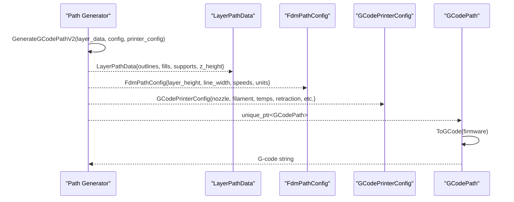

**Diagram sources**
- [path_generator.hpp:20-91](file://LibHsBaSlicer/Path/path_generator.hpp#L20-L91)
- [gcodepath.hpp:24-107](file://paths/gcodepath.hpp#L24-L107)

Multi-firmware support:
- GCodeFirmware enum supports Marlin, RepRap, Klipper.
- GCodePrinterConfig encapsulates nozzle, filament, temperatures, retraction, speeds, layer height, line width, extrusion multiplier, and relative/absolute extrusion modes.

Spiral/vase mode:
- GenerateGCodePathSpiral merges outer walls across layers into a continuous helical path; GCodePath.setContinuousWall stores the 3D path points for emission.

Optimization considerations:
- Tune print/travel speeds and extrusion multiplier for material behavior.
- Enable retraction to minimize stringing; adjust retract length/speed.
- Spiral mode avoids per-layer travel moves and infill/supports.

**Section sources**
- [path_generator.hpp:20-91](file://LibHsBaSlicer/Path/path_generator.hpp#L20-L91)
- [gcodepath.hpp:24-107](file://paths/gcodepath.hpp#L24-L107)

### Fill Algorithms Module
Infill pattern generation and polygon fill operations:
- PolygonFill.hpp: Provides offset-based, line, simple zigzag, advanced zigzag, composite offset, hybrid fill, and Lua-custom fills.
- LibHsBaSlicer Fill API: Wraps 2D fill engine with FillPolygon, FillWithBorder, and LuaCustomFillByFile.

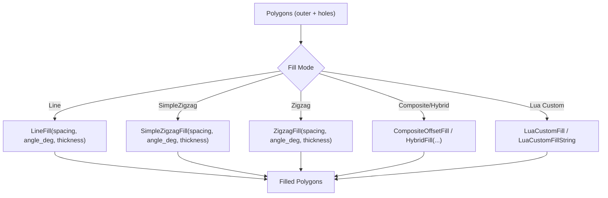

**Diagram sources**
- [PolygonFill.hpp:20-117](file://2D/PolygonFill.hpp#L20-L117)
- [polygon_fill.hpp:17-53](file://LibHsBaSlicer/Fill/polygon_fill.hpp#L17-L53)

Configuration and performance considerations:
- Spacing controls infill density; smaller spacing yields denser infill but longer print times.
- Angle_deg rotates fill orientation; consider anisotropy and strength implications.
- Composite/Hybrid fills combine border offsets with internal patterns for improved surface quality and structural integrity.
- Lua custom fills enable domain-specific patterns; ensure script efficiency to avoid bottlenecks.

**Section sources**
- [PolygonFill.hpp:20-117](file://2D/PolygonFill.hpp#L20-L117)
- [polygon_fill.hpp:17-53](file://LibHsBaSlicer/Fill/polygon_fill.hpp#L17-L53)

## Dependency Analysis
High-level dependencies among core modules:
- IModel is consumed by FullTopoModel and OcctModel.
- 2D geometry (IntPolygon/FloatPolygons) is used by PolygonFill and slicing normalization.
- Slicing API depends on IModel and FullTopoModel.
- Path generator consumes PolygonsD and produces GCodePath.
- Support strategies depend on PolygonsD and SupportConfig.

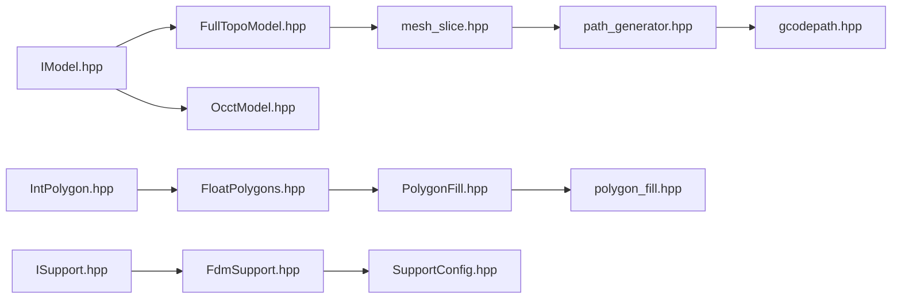

**Diagram sources**
- [IModel.hpp:110-139](file://base/IModel.hpp#L110-L139)
- [FullTopoModel.hpp:53-142](file://meshmodel/FullTopoModel.hpp#L53-L142)
- [OcctModel.hpp:30-124](file://cadmodel/OcctModel.hpp#L30-L124)
- [IntPolygon.hpp:16-27](file://2D/IntPolygon.hpp#L16-L27)
- [FloatPolygons.hpp:18-25](file://2D/FloatPolygons.hpp#L18-L25)
- [PolygonFill.hpp:20-117](file://2D/PolygonFill.hpp#L20-L117)
- [mesh_slice.hpp:22-103](file://LibHsBaSlicer/Slice/mesh_slice.hpp#L22-L103)
- [path_generator.hpp:20-91](file://LibHsBaSlicer/Path/path_generator.hpp#L20-L91)
- [gcodepath.hpp:24-107](file://paths/gcodepath.hpp#L24-L107)
- [ISupport.hpp:22-44](file://support/ISupport.hpp#L22-L44)
- [FdmSupport.hpp:13-63](file://support/FdmSupport.hpp#L13-L63)
- [SupportConfig.hpp:14-43](file://support/SupportConfig.hpp#L14-L43)
- [polygon_fill.hpp:17-53](file://LibHsBaSlicer/Fill/polygon_fill.hpp#L17-L53)

**Section sources**
- [IModel.hpp:110-139](file://base/IModel.hpp#L110-L139)
- [FullTopoModel.hpp:53-142](file://meshmodel/FullTopoModel.hpp#L53-L142)
- [OcctModel.hpp:30-124](file://cadmodel/OcctModel.hpp#L30-L124)
- [IntPolygon.hpp:16-27](file://2D/IntPolygon.hpp#L16-L27)
- [FloatPolygons.hpp:18-25](file://2D/FloatPolygons.hpp#L18-L25)
- [PolygonFill.hpp:20-117](file://2D/PolygonFill.hpp#L20-L117)
- [mesh_slice.hpp:22-103](file://LibHsBaSlicer/Slice/mesh_slice.hpp#L22-L103)
- [path_generator.hpp:20-91](file://LibHsBaSlicer/Path/path_generator.hpp#L20-L91)
- [gcodepath.hpp:24-107](file://paths/gcodepath.hpp#L24-L107)
- [ISupport.hpp:22-44](file://support/ISupport.hpp#L22-L44)
- [FdmSupport.hpp:13-63](file://support/FdmSupport.hpp#L13-L63)
- [SupportConfig.hpp:14-43](file://support/SupportConfig.hpp#L14-L43)
- [polygon_fill.hpp:17-53](file://LibHsBaSlicer/Fill/polygon_fill.hpp#L17-L53)

## Performance Considerations
- Memory management: Prefer MemoryPool/StaticMemoryPool for high-frequency allocations; avoid dynamic resizing in hot loops.
- Threading: Use ThreadPool for independent layer processing; ensure thread safety when sharing topology objects.
- 2D geometry: Batch boolean and offset operations; tune epsilon and segment counts to balance accuracy and speed.
- Slicing: Build topology once for multi-layer pipelines; use SliceLayer to avoid repeated rebuilds.
- Fill algorithms: Choose simpler patterns (line/zigzag) for speed; reserve composite/hybrid for critical regions.
- Path generation: Optimize print/travel speeds and retraction settings; use spiral mode for uniform-cross-section models to reduce travel moves.

[No sources needed since this section provides general guidance]

## Troubleshooting Guide
Common issues and resolutions:
- Slicing produces open contours: Use UnSafeSlice when open polylines are expected; normalize via NormalizeUnSafePolygons to clean PolygonsD.
- Poor boolean results: Ensure polygons are simplified (MakeSimple) and coordinates are integerized for Clipper2; adjust epsilon.
- Slow slicing: Prebuild topology with BuildSliceTopology; reuse FullTopoModel across layers.
- Excessive support material: Reduce support_density or switch to tree/honeycomb strategies; tune overhang_angle_threshold.
- G-code errors: Verify GCodePrinterConfig matches printer capabilities; check firmware-specific settings (Marlin/RRF/Klipper).

**Section sources**
- [mesh_slice.hpp:22-103](file://LibHsBaSlicer/Slice/mesh_slice.hpp#L22-L103)
- [IntPolygon.hpp:28-192](file://2D/IntPolygon.hpp#L28-L192)
- [FdmSupport.hpp:13-63](file://support/FdmSupport.hpp#L13-L63)
- [gcodepath.hpp:24-107](file://paths/gcodepath.hpp#L24-L107)

## Conclusion
HsBaSlicer’s core modules form a cohesive pipeline from model abstraction through 2D geometry, slicing, support generation, fill algorithms, and G-code path generation. The design emphasizes modularity, configurability, and performance, enabling flexible integration across mesh and CAD workflows while supporting multiple firmware targets and advanced features like spiral/vase printing.

[No sources needed since this section summarizes without analyzing specific files]