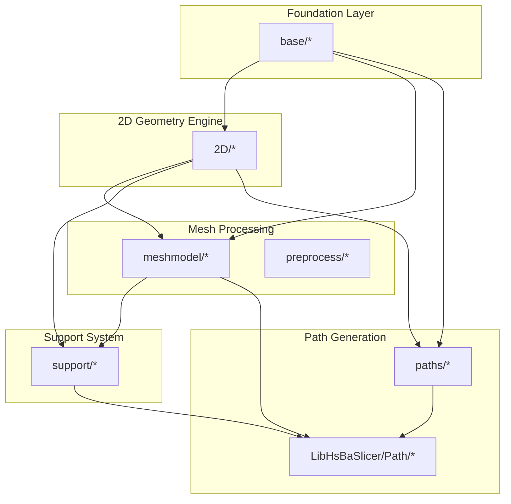
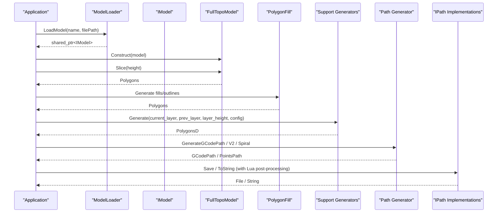
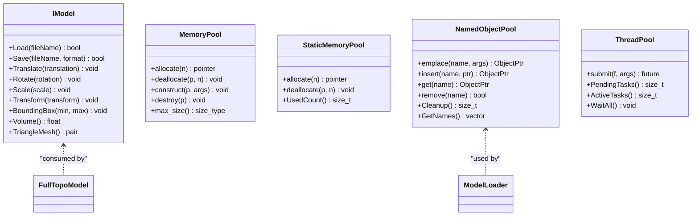
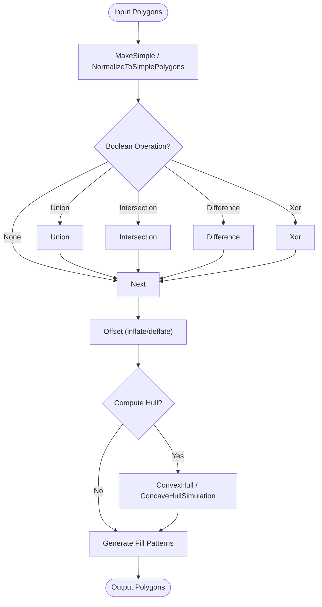
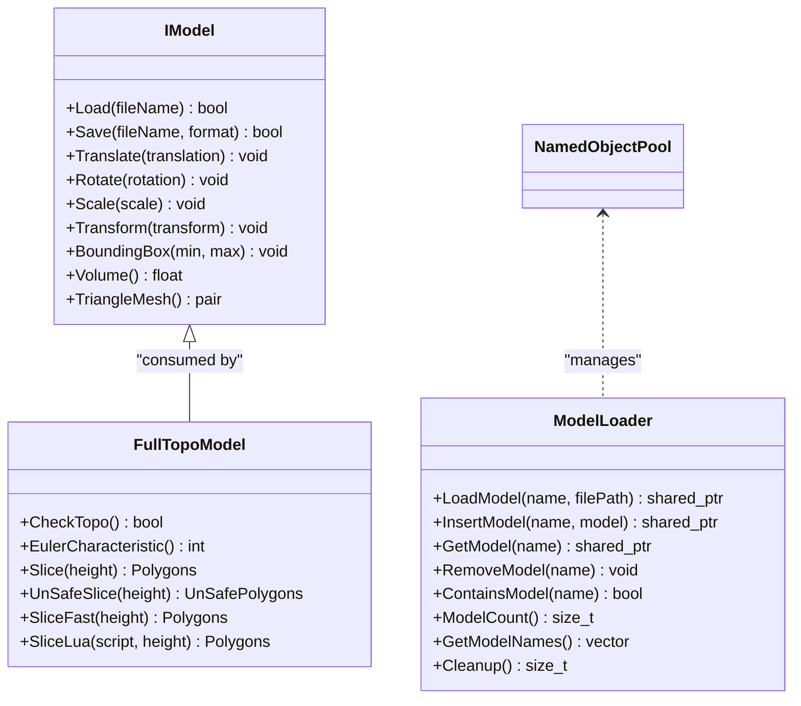
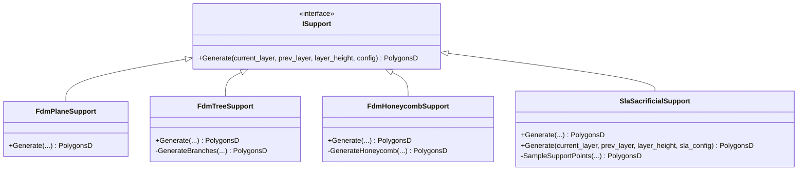
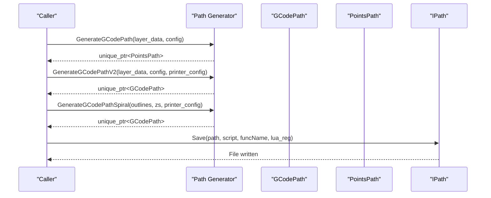
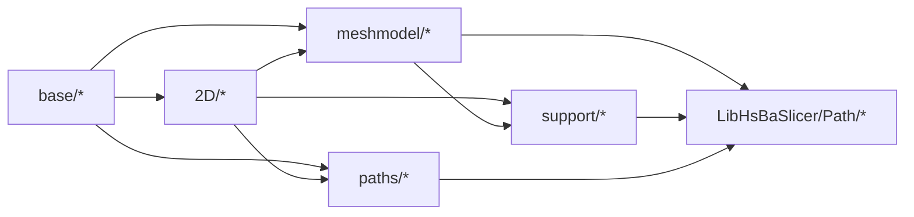

# Core Modules

<cite>
**Referenced Files in This Document**
- [base_interface.hpp](file://base/base_interface.hpp)
- [IModel.hpp](file://base/IModel.hpp)
- [memory_pool.hpp](file://base/memory_pool.hpp)
- [object_pool.hpp](file://base/object_pool.hpp)
- [thread_pool.hpp](file://base/thread_pool.hpp)
- [template_helper.hpp](file://base/template_helper.hpp)
- [IntPolygon.hpp](file://2D/IntPolygon.hpp)
- [FloatPolygons.hpp](file://2D/FloatPolygons.hpp)
- [PolygonFill.hpp](file://2D/PolygonFill.hpp)
- [2Dhull.hpp](file://2D/2Dhull.hpp)
- [FullTopoModel.hpp](file://meshmodel/FullTopoModel.hpp)
- [ModelLoader.hpp](file://preprocess/ModelLoader.hpp)
- [FdmSupport.hpp](file://support/FdmSupport.hpp)
- [SlaSupport.hpp](file://support/SlaSupport.hpp)
- [IPath.hpp](file://paths/IPath.hpp)
- [path_generator.hpp](file://LibHsBaSlicer/Path/path_generator.hpp)
</cite>

## Table of Contents
1. [Introduction](#introduction)
2. [Project Structure](#project-structure)
3. [Core Components](#core-components)
4. [Architecture Overview](#architecture-overview)
5. [Detailed Component Analysis](#detailed-component-analysis)
6. [Dependency Analysis](#dependency-analysis)
7. [Performance Considerations](#performance-considerations)
8. [Troubleshooting Guide](#troubleshooting-guide)
9. [Conclusion](#conclusion)

## Introduction
This document describes HsBaSlicer’s core modules with a focus on the Foundation Layer, 2D Geometry Engine, Mesh Processing, Support Structure System, Path Generation, and the Core Library API. It explains implementation details, interfaces, configuration options, usage patterns, relationships between modules, performance considerations, and common integration patterns. The content is grounded in the actual source files referenced below.

## Project Structure
The core modules are organized into layered components:
- Foundation Layer (base/): core data structures, memory management, threading, template utilities, and base interfaces.
- 2D Geometry Engine (2D/): polygon types, boolean operations, hull computation, and fill algorithms.
- Mesh Processing (meshmodel/, preprocess/): model loading, topology reconstruction, and geometric analysis.
- Support Structure System (support/): overhang detection and support generation for FDM/SLA.
- Path Generation (paths/, LibHsBaSlicer/Path/): G-code generation, robot paths, and optimization.
- Core Library API (LibHsBaSlicer/): main slicing pipeline orchestration and public C++ API.

**Diagram sources**
- [IModel.hpp:110-139](file://base/IModel.hpp#L110-L139)
- [IntPolygon.hpp:14-27](file://2D/IntPolygon.hpp#L14-L27)
- [FloatPolygons.hpp:16-25](file://2D/FloatPolygons.hpp#L16-L25)
- [FullTopoModel.hpp:53-142](file://meshmodel/FullTopoModel.hpp#L53-L142)
- [ModelLoader.hpp:30-202](file://preprocess/ModelLoader.hpp#L30-L202)
- [FdmSupport.hpp:11-63](file://support/FdmSupport.hpp#L11-L63)
- [SlaSupport.hpp:11-42](file://support/SlaSupport.hpp#L11-L42)
- [IPath.hpp:29-65](file://paths/IPath.hpp#L29-L65)
- [path_generator.hpp:23-91](file://LibHsBaSlicer/Path/path_generator.hpp#L23-L91)

**Section sources**
- [IModel.hpp:110-139](file://base/IModel.hpp#L110-L139)
- [IntPolygon.hpp:14-27](file://2D/IntPolygon.hpp#L14-L27)
- [FloatPolygons.hpp:16-25](file://2D/FloatPolygons.hpp#L16-L25)
- [FullTopoModel.hpp:53-142](file://meshmodel/FullTopoModel.hpp#L53-L142)
- [ModelLoader.hpp:30-202](file://preprocess/ModelLoader.hpp#L30-L202)
- [FdmSupport.hpp:11-63](file://support/FdmSupport.hpp#L11-L63)
- [SlaSupport.hpp:11-42](file://support/SlaSupport.hpp#L11-L42)
- [IPath.hpp:29-65](file://paths/IPath.hpp#L29-L65)
- [path_generator.hpp:23-91](file://LibHsBaSlicer/Path/path_generator.hpp#L23-L91)

## Core Components
This section summarizes the foundational building blocks that underpin all higher-level modules.

- IModel interface: defines load/save, transformations, bounding box, volume, and triangle mesh access; also exposes C ABI structs for vectors, quaternions, matrices, and polygons.
- Memory pools: MemoryPool and StaticMemoryPool provide fixed-size allocators with thread-safe allocation/deallocation and object construction helpers.
- NamedObjectPool: manages named shared objects with capacity limits, inactive cleanup, and concurrent access via shared_mutex.
- ThreadPool: worker-thread pool with task submission, futures, active/pending counters, WaitAll, and optional coroutine executor integration.
- Template utilities: compile-time string handling, enum name conversion, named pointers, Y combinator, formatter specialization, and other modern C++ helpers.

Key responsibilities and usage patterns:
- Use IModel as the abstraction for any 3D model type consumed by preprocessing and slicing.
- Prefer MemoryPool/StaticMemoryPool for high-frequency allocations within tight loops to reduce heap churn.
- Use NamedObjectPool to manage reusable models or intermediate results across pipeline stages.
- Offload CPU-bound tasks to ThreadPool; use ThreadPoolExecutor when integrating coroutines.
- Leverage template utilities for safe, fast, and readable code (e.g., TemplateString, EnumName).

**Section sources**
- [IModel.hpp:19-139](file://base/IModel.hpp#L19-L139)
- [memory_pool.hpp:28-208](file://base/memory_pool.hpp#L28-L208)
- [memory_pool.hpp:215-371](file://base/memory_pool.hpp#L215-L371)
- [object_pool.hpp:22-283](file://base/object_pool.hpp#L22-L283)
- [thread_pool.hpp:29-162](file://base/thread_pool.hpp#L29-L162)
- [thread_pool.hpp:164-209](file://base/thread_pool.hpp#L164-L209)
- [template_helper.hpp:50-305](file://base/template_helper.hpp#L50-L305)
- [template_helper.hpp:375-555](file://base/template_helper.hpp#L375-L555)
- [template_helper.hpp:558-687](file://base/template_helper.hpp#L558-L687)
- [template_helper.hpp:743-778](file://base/template_helper.hpp#L743-L778)
- [base_interface.hpp:19-25](file://base/base_interface.hpp#L19-L25)

## Architecture Overview
The slicing pipeline flows from model input through geometry processing, support generation, and path generation to final output.

**Diagram sources**
- [ModelLoader.hpp:47-77](file://preprocess/ModelLoader.hpp#L47-L77)
- [FullTopoModel.hpp:107-127](file://meshmodel/FullTopoModel.hpp#L107-L127)
- [PolygonFill.hpp:20-136](file://2D/PolygonFill.hpp#L20-L136)
- [FdmSupport.hpp:19-63](file://support/FdmSupport.hpp#L19-L63)
- [SlaSupport.hpp:20-42](file://support/SlaSupport.hpp#L20-L42)
- [path_generator.hpp:50-91](file://LibHsBaSlicer/Path/path_generator.hpp#L50-L91)
- [IPath.hpp:34-56](file://paths/IPath.hpp#L34-L56)

## Detailed Component Analysis

### Foundation Layer (base/)
The Foundation Layer provides the primitives and infrastructure used throughout the system.

- IModel interface:
  - Responsibilities: file I/O, transforms, bounding box/volume, triangle mesh extraction.
  - C ABI: vector/quaternion/matrix/polygon structs for cross-language interoperability.
  - Usage: implementers include IglModel, OcctModel, OpenVdbModel; consumers call Load/Save/TriangleMesh.

- Memory management:
  - MemoryPool<T, PoolSize>: per-instance fixed-size allocator with mutex protection; supports construct/destroy and rebind.
  - StaticMemoryPool<T, PoolSize>: static shared pool with global buffer; useful for process-wide pooling.
  - NamedObjectPool<T, MaxSize>: named shared-object registry with capacity control and inactive cleanup.

- Threading:
  - ThreadPool: worker threads, submit(), PendingTasks(), ActiveTasks(), WaitAll(); exception-safe task execution.
  - ThreadPoolExecutor: coroutine executor adapter with default pool fallback.

- Template utilities:
  - TemplateString: fixed-size string with conversions, split, case transforms, formatting.
  - Enum utilities: EnumName, EnumFromName, AllValidEnum with range validation.
  - NamedPtr/NamedRawPtr: debuggable pointer wrappers with compile-time names.
  - YCombinator, MakeNonCopyableArray, std::formatter specialization.

**Diagram sources**
- [IModel.hpp:110-139](file://base/IModel.hpp#L110-L139)
- [memory_pool.hpp:43-208](file://base/memory_pool.hpp#L43-L208)
- [memory_pool.hpp:215-371](file://base/memory_pool.hpp#L215-L371)
- [object_pool.hpp:22-283](file://base/object_pool.hpp#L22-L283)
- [thread_pool.hpp:29-162](file://base/thread_pool.hpp#L29-L162)

**Section sources**
- [IModel.hpp:19-139](file://base/IModel.hpp#L19-L139)
- [memory_pool.hpp:28-208](file://base/memory_pool.hpp#L28-L208)
- [memory_pool.hpp:215-371](file://base/memory_pool.hpp#L215-L371)
- [object_pool.hpp:22-283](file://base/object_pool.hpp#L22-L283)
- [thread_pool.hpp:29-162](file://base/thread_pool.hpp#L29-L162)
- [thread_pool.hpp:164-209](file://base/thread_pool.hpp#L164-L209)
- [template_helper.hpp:50-305](file://base/template_helper.hpp#L50-L305)
- [template_helper.hpp:375-555](file://base/template_helper.hpp#L375-L555)
- [template_helper.hpp:558-687](file://base/template_helper.hpp#L558-L687)
- [template_helper.hpp:743-778](file://base/template_helper.hpp#L743-L778)
- [base_interface.hpp:19-25](file://base/base_interface.hpp#L19-L25)

### 2D Geometry Engine (2D/)
The 2D engine provides robust polygon operations built on Clipper2.

- Types and conversions:
  - IntPolygon: Point2, Polygon, Polygons (Clipper2 64-bit integer), simplification, boolean ops, offset, area, point-in-polygon.
  - FloatPolygons: double-precision equivalents (PointD, PolygonD, PolygonsD), shape generators (rectangle, circle, ellipse, regular polygon), text-to-polygons, integerization/un-integerization.

- Boolean logic and offsets:
  - Union, Intersection, Difference, Xor for both single polygons and sets.
  - Offset for inflation/deflation with join/end types.

- Hull computation:
  - ConvexHull and ConcaveHullSimulation for integer, double, and multi-polygon inputs.

- Fill algorithms:
  - OffsetFill, LineFill, SimpleZigzagFill, ZigzagFill.
  - CompositeOffsetFill and HybridFill combining borders and internal fills.
  - LuaCustomFill and LuaCustomFillString for custom fill scripts; RegisterLuaPolygonFillFunctions exposes built-ins to Lua.

**Diagram sources**
- [IntPolygon.hpp:28-192](file://2D/IntPolygon.hpp#L28-L192)
- [FloatPolygons.hpp:27-221](file://2D/FloatPolygons.hpp#L27-L221)
- [2Dhull.hpp:14-72](file://2D/2Dhull.hpp#L14-L72)
- [PolygonFill.hpp:20-136](file://2D/PolygonFill.hpp#L20-L136)

**Section sources**
- [IntPolygon.hpp:14-241](file://2D/IntPolygon.hpp#L14-L241)
- [FloatPolygons.hpp:16-271](file://2D/FloatPolygons.hpp#L16-L271)
- [2Dhull.hpp:14-72](file://2D/2Dhull.hpp#L14-L72)
- [PolygonFill.hpp:20-136](file://2D/PolygonFill.hpp#L20-L136)

### Mesh Processing (meshmodel/, preprocess/)
Mesh processing bridges raw models and slicing-ready geometry.

- FullTopoModel:
  - Rebuilds full topology (vertices, edges, faces) from an IModel or vertex/triangle lists.
  - Provides CheckTopo, EulerCharacteristic, and multiple slicing methods:
    - Safe slice (closed contours only).
    - Unsafe slice (includes open contours).
    - Fast slice (topology-based, throws if incomplete).
    - Lua-assisted slicing with exposed V/E/F arrays and height.

- ModelLoader:
  - Unified loader dispatching to IglModel (mesh formats) or OcctModel (BRep formats).
  - Manages models via NamedObjectPool with configurable capacity.
  - Advanced operations (CGAL/OpenVDB) for thick-solid, boolean ops, point cloud to mesh, merging, downsampling, outlier removal, centroid/normals.

**Diagram sources**
- [IModel.hpp:110-139](file://base/IModel.hpp#L110-L139)
- [FullTopoModel.hpp:53-142](file://meshmodel/FullTopoModel.hpp#L53-L142)
- [ModelLoader.hpp:30-202](file://preprocess/ModelLoader.hpp#L30-L202)

**Section sources**
- [FullTopoModel.hpp:25-142](file://meshmodel/FullTopoModel.hpp#L25-L142)
- [ModelLoader.hpp:23-202](file://preprocess/ModelLoader.hpp#L23-L202)

### Support Structure System (support/)
Support generation creates build-friendly structures based on overhang regions.

- FDM strategies:
  - FdmPlaneSupport: columnar supports inflated from overhang areas.
  - FdmTreeSupport: branching tree-like supports grown upward.
  - FdmHoneycombSupport: lightweight honeycomb infill within overhang regions.

- SLA strategy:
  - SlaSacrificialSupport: thin sacrificial columns with tapered diameters.

All strategies implement ISupport.Generate(current_layer, prev_layer, layer_height, config) returning PolygonsD.

**Diagram sources**
- [FdmSupport.hpp:11-63](file://support/FdmSupport.hpp#L11-L63)
- [SlaSupport.hpp:11-42](file://support/SlaSupport.hpp#L11-L42)

**Section sources**
- [FdmSupport.hpp:11-63](file://support/FdmSupport.hpp#L11-L63)
- [SlaSupport.hpp:11-42](file://support/SlaSupport.hpp#L11-L42)

### Path Generation (paths/, LibHsBaSlicer/Path/)
Path generation converts 2D slices into printable toolpaths and outputs.

- IPath interface:
  - Abstract base for output products (points, layers, images, robot, G-code).
  - Supports Save/ToString with inline or file-based Lua post-processing.

- Path generator API:
  - FdmPathConfig: layer height, line width, speeds, extrusion multiplier, units.
  - LayerPathData: outlines, fills, supports, z-height per layer.
  - Functions:
    - GenerateGCodePath: returns PointsPath.
    - GenerateGCodePathV2: returns GCodePath with printer config.
    - GenerateGCodePathSpiral: continuous helical wall for vase mode.
    - PolygonsToGPoints: helper converting PolygonsD to G-point sequences.

**Diagram sources**
- [IPath.hpp:29-65](file://paths/IPath.hpp#L29-L65)
- [path_generator.hpp:23-91](file://LibHsBaSlicer/Path/path_generator.hpp#L23-L91)

**Section sources**
- [IPath.hpp:29-65](file://paths/IPath.hpp#L29-L65)
- [path_generator.hpp:23-91](file://LibHsBaSlicer/Path/path_generator.hpp#L23-L91)

### Core Library API (LibHsBaSlicer/)
The Core Library API exposes the slicing pipeline orchestration and key algorithms as stable C++ entry points.

- Path generation functions:
  - GenerateGCodePath, GenerateGCodePathV2, GenerateGCodePathSpiral, PolygonsToGPoints.
  - Configuration via FdmPathConfig and GCodePrinterConfig.

- Integration patterns:
  - Build LayerPathData from FullTopoModel slices and PolygonFill outputs.
  - Call path generator to obtain GCodePath/PointsPath.
  - Use IPath Save/ToString with optional Lua post-processing for customization.

**Section sources**
- [path_generator.hpp:23-91](file://LibHsBaSlicer/Path/path_generator.hpp#L23-L91)

## Dependency Analysis
The following diagram shows how modules depend on each other:

**Diagram sources**
- [IModel.hpp:110-139](file://base/IModel.hpp#L110-L139)
- [IntPolygon.hpp:14-27](file://2D/IntPolygon.hpp#L14-L27)
- [FloatPolygons.hpp:16-25](file://2D/FloatPolygons.hpp#L16-L25)
- [FullTopoModel.hpp:53-142](file://meshmodel/FullTopoModel.hpp#L53-L142)
- [ModelLoader.hpp:30-202](file://preprocess/ModelLoader.hpp#L30-L202)
- [FdmSupport.hpp:11-63](file://support/FdmSupport.hpp#L11-L63)
- [SlaSupport.hpp:11-42](file://support/SlaSupport.hpp#L11-L42)
- [IPath.hpp:29-65](file://paths/IPath.hpp#L29-L65)
- [path_generator.hpp:23-91](file://LibHsBaSlicer/Path/path_generator.hpp#L23-L91)

**Section sources**
- [IModel.hpp:110-139](file://base/IModel.hpp#L110-L139)
- [IntPolygon.hpp:14-27](file://2D/IntPolygon.hpp#L14-L27)
- [FloatPolygons.hpp:16-25](file://2D/FloatPolygons.hpp#L16-L25)
- [FullTopoModel.hpp:53-142](file://meshmodel/FullTopoModel.hpp#L53-L142)
- [ModelLoader.hpp:30-202](file://preprocess/ModelLoader.hpp#L30-L202)
- [FdmSupport.hpp:11-63](file://support/FdmSupport.hpp#L11-L63)
- [SlaSupport.hpp:11-42](file://support/SlaSupport.hpp#L11-L42)
- [IPath.hpp:29-65](file://paths/IPath.hpp#L29-L65)
- [path_generator.hpp:23-91](file://LibHsBaSlicer/Path/path_generator.hpp#L23-L91)

## Performance Considerations
- Use Fixed-size Pools:
  - Prefer MemoryPool/StaticMemoryPool for short-lived, high-volume allocations to avoid frequent heap operations.
  - Use StaticMemoryPool when a process-wide pool is appropriate.

- Concurrency:
  - Offload heavy computations (e.g., boolean ops, fill generation, slicing) to ThreadPool.
  - Use ThreadPoolExecutor for coroutine-based pipelines where available.

- 2D Operations:
  - Simplify polygons before boolean operations to reduce complexity.
  - Choose appropriate epsilon values for MakeSimple to balance accuracy and speed.

- Mesh Processing:
  - Validate topology with CheckTopo and consider EulerCharacteristic to detect issues early.
  - Use SliceFast when topology is known to be complete to avoid rebuild overhead.

- Path Generation:
  - Tune FdmPathConfig (layer height, line width, speeds) to balance print quality and time.
  - For vase-mode prints, prefer GenerateGCodePathSpiral to minimize travel and improve continuity.

[No sources needed since this section provides general guidance]

## Troubleshooting Guide
Common issues and resolutions:

- Model loading failures:
  - Ensure supported formats and correct extensions; ModelLoader dispatches to IglModel/OcctModel based on extension.
  - Verify USE_OCCT/USE_CGAL/USE_OPENVDB flags match compiled features.

- Topology errors:
  - Call FullTopoModel::CheckTopo; odd or >2 Euler characteristic indicates non-manifold geometry.
  - Repair meshes upstream or simplify polygons before slicing.

- Support generation problems:
  - Adjust SupportConfig parameters (overhang thresholds, spacing, diameter) for better coverage.
  - For SLA, tune tip/base diameters and sampling spacing.

- Path generation anomalies:
  - Validate LayerPathData consistency (outlines/fills/supports sizes and Z heights).
  - Use PolygonsToGPoints to inspect generated points and ensure expected extrude/travel states.

- Lua post-processing:
  - Provide valid script paths and function names; register additional functions via lua_reg callbacks.

**Section sources**
- [ModelLoader.hpp:47-77](file://preprocess/ModelLoader.hpp#L47-L77)
- [FullTopoModel.hpp:80-127](file://meshmodel/FullTopoModel.hpp#L80-L127)
- [FdmSupport.hpp:19-63](file://support/FdmSupport.hpp#L19-L63)
- [SlaSupport.hpp:20-42](file://support/SlaSupport.hpp#L20-L42)
- [path_generator.hpp:50-91](file://LibHsBaSlicer/Path/path_generator.hpp#L50-L91)
- [IPath.hpp:34-56](file://paths/IPath.hpp#L34-L56)

## Conclusion
HsBaSlicer’s core modules form a cohesive, extensible architecture:
- The Foundation Layer supplies robust abstractions and utilities.
- The 2D Geometry Engine delivers precise polygon operations and fills.
- Mesh Processing reconstructs topology and prepares models for slicing.
- The Support System generates practical structures for FDM/SLA.
- Path Generation translates slices into efficient toolpaths and outputs.
- The Core Library API ties these pieces together with clear, configurable entry points.

By leveraging the documented interfaces, configuration options, and integration patterns, developers can build reliable, high-performance slicing pipelines tailored to their workflows.

[No sources needed since this section summarizes without analyzing specific files]