# Core Modules

<cite>
**Referenced Files in This Document**
- [base_interface.hpp](file://base/base_interface.hpp)
- [IModel.hpp](file://base/IModel.hpp)
- [memory_pool.hpp](file://base/memory_pool.hpp)
- [object_pool.hpp](file://base/object_pool.hpp)
- [thread_pool.hpp](file://base/thread_pool.hpp)
- [parallel.hpp](file://base/parallel.hpp)
- [template_helper.hpp](file://base/template_helper.hpp)
- [IntPolygon.hpp](file://2D/IntPolygon.hpp)
- [FloatPolygons.hpp](file://2D/FloatPolygons.hpp)
- [PolygonFill.hpp](file://2D/PolygonFill.hpp)
- [2Dhull.hpp](file://2D/2Dhull.hpp)
- [FullTopoModel.hpp](file://meshmodel/FullTopoModel.hpp)
- [ModelLoader.hpp](file://preprocess/ModelLoader.hpp)
- [FdmSupport.hpp](file://support/FdmSupport.hpp)
- [SlaSupport.hpp](file://support/SlaSupport.hpp)
- [IPath.hpp](file://paths/IPath.hpp)
- [path_generator.hpp](file://LibHsBaSlicer/Path/path_generator.hpp)
- [spiral_path.hpp](file://LibHsBaSlicer/Path/spiral_path.hpp)
- [job_control.h](file://DllHsBaSlicer/job_control.h)
- [job_control.cpp](file://DllHsBaSlicer/job_control.cpp)
- [progress_stage.h](file://DllHsBaSlicer/progress_stage.h)
- [progress_stage.cpp](file://DllHsBaSlicer/progress_stage.cpp)
- [geometry_export.h](file://DllHsBaSlicer/geometry_export.h)
- [geometry_store.hpp](file://DllHsBaSlicer/geometry_store.hpp)
- [geometry_store.cpp](file://DllHsBaSlicer/geometry_store.cpp)
- [pipeline_types.h](file://pipelinetypes/pipeline_types.h)
- [pipeline_executor.hpp](file://restapi/pipeline_executor.hpp)
- [job_manager.hpp](file://restapi/job_manager.hpp)
</cite>

## Update Summary
**Changes Made**
- Added new Job Control System section documenting non-blocking pipeline execution, cooperative cancellation, and structured progress callbacks.
- Added Geometry Export and Visualization section covering per-layer geometry snapshots, continuous spiral path export, and process-wide snapshot pool.
- Added Progress Stage System section documenting stage classification, stable identifiers, and GUI integration.
- Updated Pipeline Execution section to reflect enhanced REST API integration with non-blocking operations.
- Enhanced Architecture Overview diagrams to include new core modules.
- Updated Dependency Analysis to show relationships between new components.

## Table of Contents
1. [Introduction](#introduction)
2. [Project Structure](#project-structure)
3. [Core Components](#core-components)
4. [Architecture Overview](#architecture-overview)
5. [Detailed Component Analysis](#detailed-component-analysis)
6. [Dependency Analysis](#dependency-analysis)
7. [Performance Considerations](#performance-considerations)
8. [Troubleshooting Guide](#troubleshooting-guide)
9. [Conclusion](#conclusion)

## Introduction
This document describes HsBaSlicer's core modules with a focus on the Foundation Layer, 2D Geometry Engine, Mesh Processing, Support Structure System, Path Generation, Core Library API, and the newly added Job Control System, Geometry Export capabilities, Progress Stage System, and enhanced Pipeline Execution infrastructure. It explains implementation details, interfaces, configuration options, usage patterns, relationships between modules, performance considerations, and common integration patterns. The content is grounded in the actual source files referenced below.

## Project Structure
The core modules are organized into layered components:
- Foundation Layer (base/): core data structures, memory management, threading, template utilities, base interfaces, and parallel execution helpers.
- 2D Geometry Engine (2D/): polygon types, boolean operations, hull computation, and fill algorithms.
- Mesh Processing (meshmodel/, preprocess/): model loading, topology reconstruction, and geometric analysis.
- Support Structure System (support/): overhang detection and support generation for FDM/SLA.
- Path Generation (paths/, LibHsBaSlicer/Path/): G-code generation, robot paths, optimization, and spiral path generation.
- Core Library API (LibHsBaSlicer/): main slicing pipeline orchestration and public C++ API.
- Job Control System (DllHsBaSlicer/): non-blocking job execution, cooperative cancellation, and structured progress reporting.
- Geometry Export System (DllHsBaSlicer/): per-layer geometry snapshots, continuous path export, and process-wide snapshot pooling.
- Progress Stage System (DllHsBaSlicer/): stage classification, stable identifiers, and GUI integration.
- Enhanced Pipeline Execution (restapi/): REST API integration with non-blocking operations and job management.

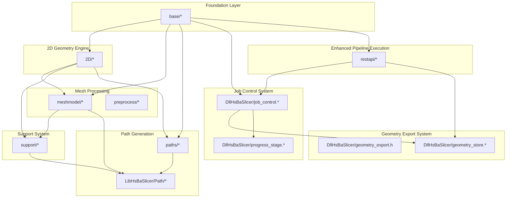

**Diagram sources**
- [IModel.hpp:110-139](file://base/IModel.hpp#L110-L139)
- [IntPolygon.hpp:14-27](file://2D/IntPolygon.hpp#L14-L27)
- [FloatPolygons.hpp:16-25](file://2D/FloatPolygons.hpp#L16-L25)
- [FullTopoModel.hpp:53-142](file://meshmodel/FullTopoModel.hpp#L53-L142)
- [ModelLoader.hpp:30-202](file://preprocess/ModelLoader.hpp#L30-L202)
- [FdmSupport.hpp:11-63](file://support/FdmSupport.hpp#L11-L63)
- [SlaSupport.hpp:11-42](file://support/SlaSupport.hpp#L11-L42)
- [IPath.hpp:29-65](file://paths/IPath.hpp#L29-L65)
- [path_generator.hpp:23-91](file://LibHsBaSlicer/Path/path_generator.hpp#L23-L91)
- [job_control.h:34-146](file://DllHsBaSlicer/job_control.h#L34-L146)
- [progress_stage.h:23-42](file://DllHsBaSlicer/progress_stage.h#L23-L42)
- [geometry_export.h:37-143](file://DllHsBaSlicer/geometry_export.h#L37-L143)
- [geometry_store.hpp:39-91](file://DllHsBaSlicer/geometry_store.hpp#L39-L91)
- [pipeline_executor.hpp:28-102](file://restapi/pipeline_executor.hpp#L28-L102)
- [job_manager.hpp:28-200](file://restapi/job_manager.hpp#L28-L200)

**Section sources**
- [IModel.hpp:110-139](file://base/IModel.hpp#L110-L139)
- [IntPolygon.hpp:14-27](file://2D/IntPolygon.hpp#L14-L27)
- [FloatPolygons.hpp:16-25](file://2D/FloatPolygons.hpp#L16-L25)
- [FullTopoModel.hpp:53-142](file://meshmodel/FullTopoModel.hpp#L53-L142)
- [ModelLoader.hpp:30-202](file://preprocess/ModelLoader.hpp#L30-L202)
- [FdmSupport.hpp:11-63](file://support/FdmSupport.hpp#L11-L63)
- [SlaSupport.hpp:11-42](file://support/SlaSupport.hpp#L11-L42)
- [IPath.hpp:29-65](file://paths/IPath.hpp#L29-L65)
- [path_generator.hpp:23-91](file://LibHsBaSlicer/Path/path_generator.hpp#L23-L91)
- [job_control.h:34-146](file://DllHsBaSlicer/job_control.h#L34-L146)
- [progress_stage.h:23-42](file://DllHsBaSlicer/progress_stage.h#L23-L42)
- [geometry_export.h:37-143](file://DllHsBaSlicer/geometry_export.h#L37-L143)
- [geometry_store.hpp:39-91](file://DllHsBaSlicer/geometry_store.hpp#L39-L91)
- [pipeline_executor.hpp:28-102](file://restapi/pipeline_executor.hpp#L28-L102)
- [job_manager.hpp:28-200](file://restapi/job_manager.hpp#L28-L200)

## Core Components
This section summarizes the foundational building blocks that underpin all higher-level modules.

- IModel interface: defines load/save, transformations, bounding box, volume, and triangle mesh access; also exposes C ABI structs for vectors, quaternions, matrices, and polygons.
- Memory pools: MemoryPool and StaticMemoryPool provide fixed-size allocators with thread-safe allocation/deallocation and object construction helpers.
- NamedObjectPool: manages named shared objects with capacity limits, inactive cleanup, and concurrent access via shared_mutex.
- ThreadPool: worker-thread pool with task submission, futures, active/pending counters, WaitAll, and optional coroutine executor integration.
- Parallel execution helpers: Process-wide ThreadPool with ResolvePipelineThreads, ParallelForLayers, and ParallelMap for layer-parallel processing.
- Template utilities: compile-time string handling, enum name conversion, named pointers, Y combinator, formatter specialization, and other modern C++ helpers.

Key responsibilities and usage patterns:
- Use IModel as the abstraction for any 3D model type consumed by preprocessing and slicing.
- Prefer MemoryPool/StaticMemoryPool for high-frequency allocations within tight loops to reduce heap churn.
- Use NamedObjectPool to manage reusable models or intermediate results across pipeline stages.
- Offload CPU-bound tasks to ThreadPool; use ThreadPoolExecutor when integrating coroutines.
- Leverage template utilities for safe, fast, and readable code (e.g., TemplateString, EnumName).

**Section sources**
- [IModel.hpp:19-139](file://base/IModel.hpp#L19-L139)
- [memory_pool.hpp:28-208](file://base/memory_pool.hpp#L28-L208)
- [memory_pool.hpp:215-371](file://base/memory_pool.hpp#L215-L371)
- [object_pool.hpp:22-283](file://base/object_pool.hpp#L22-L283)
- [thread_pool.hpp:29-162](file://base/thread_pool.hpp#L29-L162)
- [thread_pool.hpp:164-209](file://base/thread_pool.hpp#L164-L209)
- [parallel.hpp:30-205](file://base/parallel.hpp#L30-L205)
- [template_helper.hpp:50-305](file://base/template_helper.hpp#L50-L305)
- [template_helper.hpp:375-555](file://base/template_helper.hpp#L375-L555)
- [template_helper.hpp:558-687](file://base/template_helper.hpp#L558-L687)
- [template_helper.hpp:743-778](file://base/template_helper.hpp#L743-L778)
- [base_interface.hpp:19-25](file://base/base_interface.hpp#L19-L25)

## Architecture Overview
The slicing pipeline flows from model input through geometry processing, support generation, and path generation to final output, now enhanced with non-blocking job control, structured progress reporting, and geometry visualization capabilities.

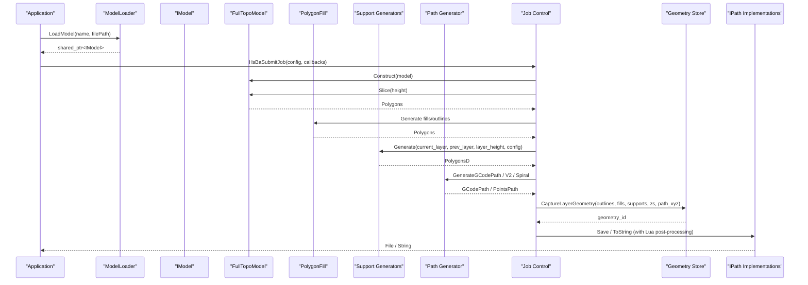

**Diagram sources**
- [ModelLoader.hpp:47-77](file://preprocess/ModelLoader.hpp#L47-L77)
- [FullTopoModel.hpp:107-127](file://meshmodel/FullTopoModel.hpp#L107-L127)
- [PolygonFill.hpp:20-136](file://2D/PolygonFill.hpp#L20-L136)
- [FdmSupport.hpp:19-63](file://support/FdmSupport.hpp#L19-L63)
- [SlaSupport.hpp:20-42](file://support/SlaSupport.hpp#L20-L42)
- [path_generator.hpp:50-91](file://LibHsBaSlicer/Path/path_generator.hpp#L50-L91)
- [IPath.hpp:34-56](file://paths/IPath.hpp#L34-L56)
- [job_control.h:74-146](file://DllHsBaSlicer/job_control.h#L74-L146)
- [geometry_store.hpp:65-91](file://DllHsBaSlicer/geometry_store.hpp#L65-L91)

## Detailed Component Analysis

### Foundation Layer (base/)
The Foundation Layer provides the primitives and infrastructure used throughout the system.

- IModel interface:
  - Responsibilities: file I/O, transforms, bounding box/volume, triangle mesh extraction.
  - C ABI: vector/quaternion/matrix/polygon structs for cross-language interoperability.
  - Usage: implementers include IglModel, OcctModel, OpenVdbModel; consumers call Load/Save/TriangleMesh.

- Memory management:
  - MemoryPool<T, PoolSize>: per-instance fixed-size allocator with mutex protection; supports construct/destroy and rebind.
  - StaticMemoryPool<T, PoolSize>: static shared pool with global buffer; useful for process-wide pooling.
  - NamedObjectPool<T, MaxSize>: named shared-object registry with capacity control and inactive cleanup.

- Threading and parallel execution:
  - ThreadPool: worker threads, submit(), PendingTasks(), ActiveTasks(), WaitAll(); exception-safe task execution.
  - ThreadPoolExecutor: coroutine executor adapter with default pool fallback.
  - Parallel helpers: Process-wide PipelinePool() with ResolvePipelineThreads(), ParallelForLayers(), ParallelMap() for layer-parallel processing.

- Template utilities:
  - TemplateString: fixed-size string with conversions, split, case transforms, formatting.
  - Enum utilities: EnumName, EnumFromName, AllValidEnum with range validation.
  - NamedPtr/NamedRawPtr: debuggable pointer wrappers with compile-time names.
  - YCombinator, MakeNonCopyableArray, std::formatter specialization.

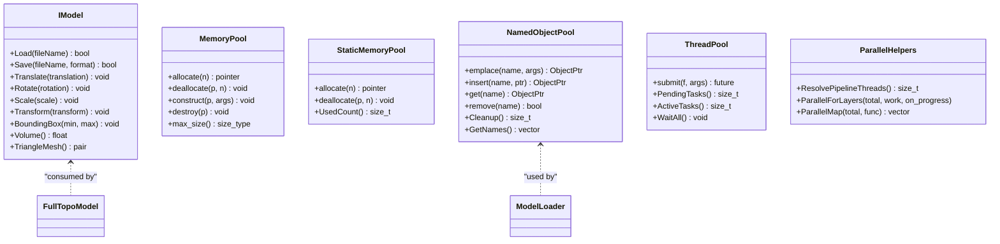

**Diagram sources**
- [IModel.hpp:110-139](file://base/IModel.hpp#L110-L139)
- [memory_pool.hpp:43-208](file://base/memory_pool.hpp#L43-L208)
- [memory_pool.hpp:215-371](file://base/memory_pool.hpp#L215-L371)
- [object_pool.hpp:22-283](file://base/object_pool.hpp#L22-L283)
- [thread_pool.hpp:29-162](file://base/thread_pool.hpp#L29-L162)
- [parallel.hpp:30-205](file://base/parallel.hpp#L30-L205)

**Section sources**
- [IModel.hpp:19-139](file://base/IModel.hpp#L19-L139)
- [memory_pool.hpp:28-208](file://base/memory_pool.hpp#L28-L208)
- [memory_pool.hpp:215-371](file://base/memory_pool.hpp#L215-L371)
- [object_pool.hpp:22-283](file://base/object_pool.hpp#L22-L283)
- [thread_pool.hpp:29-162](file://base/thread_pool.hpp#L29-L162)
- [thread_pool.hpp:164-209](file://base/thread_pool.hpp#L164-L209)
- [parallel.hpp:30-205](file://base/parallel.hpp#L30-L205)
- [template_helper.hpp:50-305](file://base/template_helper.hpp#L50-L305)
- [template_helper.hpp:375-555](file://base/template_helper.hpp#L375-L555)
- [template_helper.hpp:558-687](file://base/template_helper.hpp#L558-L687)
- [template_helper.hpp:743-778](file://base/template_helper.hpp#L743-L778)
- [base_interface.hpp:19-25](file://base/base_interface.hpp#L19-L25)

### 2D Geometry Engine (2D/)
The 2D engine provides robust polygon operations built on Clipper2.

- Types and conversions:
  - IntPolygon: Point2, Polygon, Polygons (Clipper2 64-bit integer), simplification, boolean ops, offset, area, point-in-polygon.
  - FloatPolygons: double-precision equivalents (PointD, PolygonD, PolygonsD), shape generators (rectangle, circle, ellipse, regular polygon), text-to-polygons, integerization/un-integerization.

- Boolean logic and offsets:
  - Union, Intersection, Difference, Xor for both single polygons and sets.
  - Offset for inflation/deflation with join/end types.

- Hull computation:
  - ConvexHull and ConcaveHullSimulation for integer, double, and multi-polygon inputs.

- Fill algorithms:
  - OffsetFill, LineFill, SimpleZigzagFill, ZigzagFill.
  - CompositeOffsetFill and HybridFill combining borders and internal fills.
  - LuaCustomFill and LuaCustomFillString for custom fill scripts; RegisterLuaPolygonFillFunctions exposes built-ins to Lua.

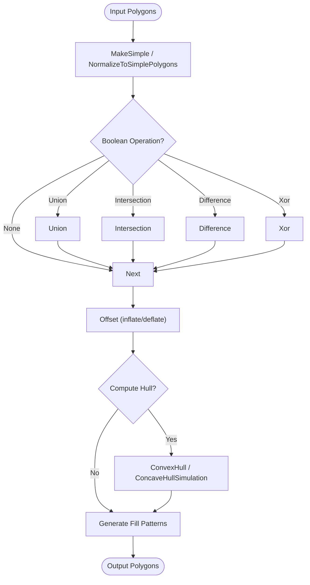

**Diagram sources**
- [IntPolygon.hpp:28-192](file://2D/IntPolygon.hpp#L28-L192)
- [FloatPolygons.hpp:27-221](file://2D/FloatPolygons.hpp#L27-L221)
- [2Dhull.hpp:14-72](file://2D/2Dhull.hpp#L14-L72)
- [PolygonFill.hpp:20-136](file://2D/PolygonFill.hpp#L20-L136)

**Section sources**
- [IntPolygon.hpp:14-241](file://2D/IntPolygon.hpp#L14-L241)
- [FloatPolygons.hpp:16-271](file://2D/FloatPolygons.hpp#L16-L271)
- [2Dhull.hpp:14-72](file://2D/2Dhull.hpp#L14-L72)
- [PolygonFill.hpp:20-136](file://2D/PolygonFill.hpp#L20-L136)

### Mesh Processing (meshmodel/, preprocess/)
Mesh processing bridges raw models and slicing-ready geometry.

- FullTopoModel:
  - Rebuilds full topology (vertices, edges, faces) from an IModel or vertex/triangle lists.
  - Provides CheckTopo, EulerCharacteristic, and multiple slicing methods:
    - Safe slice (closed contours only).
    - Unsafe slice (includes open contours).
    - Fast slice (topology-based, throws if incomplete).
    - Lua-assisted slicing with exposed V/E/F arrays and height.

- ModelLoader:
  - Unified loader dispatching to IglModel (mesh formats) or OcctModel (BRep formats).
  - Manages models via NamedObjectPool with configurable capacity.
  - Advanced operations (CGAL/OpenVDB) for thick-solid, boolean ops, point cloud to mesh, merging, downsampling, outlier removal, centroid/normals.

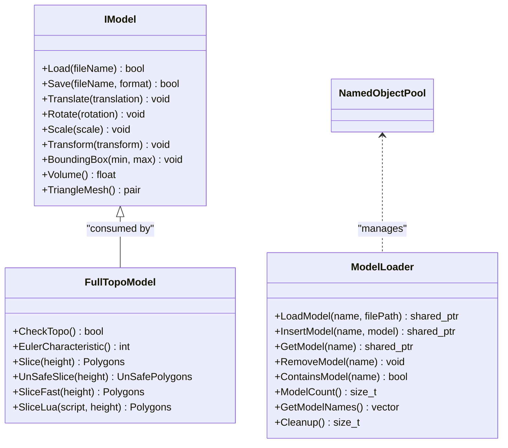

**Diagram sources**
- [IModel.hpp:110-139](file://base/IModel.hpp#L110-L139)
- [FullTopoModel.hpp:53-142](file://meshmodel/FullTopoModel.hpp#L53-L142)
- [ModelLoader.hpp:30-202](file://preprocess/ModelLoader.hpp#L30-L202)

**Section sources**
- [FullTopoModel.hpp:25-142](file://meshmodel/FullTopoModel.hpp#L25-L142)
- [ModelLoader.hpp:23-202](file://preprocess/ModelLoader.hpp#L23-L202)

### Support Structure System (support/)
Support generation creates build-friendly structures based on overhang regions.

- FDM strategies:
  - FdmPlaneSupport: columnar supports inflated from overhang areas.
  - FdmTreeSupport: branching tree-like supports grown upward.
  - FdmHoneycombSupport: lightweight honeycomb infill within overhang regions.

- SLA strategy:
  - SlaSacrificialSupport: thin sacrificial columns with tapered diameters.

All strategies implement ISupport.Generate(current_layer, prev_layer, layer_height, config) returning PolygonsD.

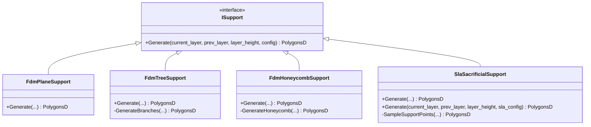

**Diagram sources**
- [FdmSupport.hpp:11-63](file://support/FdmSupport.hpp#L11-L63)
- [SlaSupport.hpp:11-42](file://support/SlaSupport.hpp#L11-L42)

**Section sources**
- [FdmSupport.hpp:11-63](file://support/FdmSupport.hpp#L11-L63)
- [SlaSupport.hpp:11-42](file://support/SlaSupport.hpp#L11-L42)

### Path Generation (paths/, LibHsBaSlicer/Path/)
Path generation converts 2D slices into printable toolpaths and outputs.

- IPath interface:
  - Abstract base for output products (points, layers, images, robot, G-code).
  - Supports Save/ToString with inline or file-based Lua post-processing.

- Path generator API:
  - FdmPathConfig: layer height, line width, speeds, extrusion multiplier, units.
  - LayerPathData: outlines, fills, supports, z-height per layer.
  - Functions:
    - GenerateGCodePath: returns PointsPath.
    - GenerateGCodePathV2: returns GCodePath with printer config.
    - GenerateGCodePathSpiral: continuous helical wall for vase mode.
    - PolygonsToGPoints: helper converting PolygonsD to G-point sequences.

- Spiral path generation:
  - SpiralPoint: x,y,z coordinates for continuous deposition path.
  - SpiralizeOuterWall: builds continuous helical outer-wall path from per-layer closed contours.
  - Deterministic algorithm selecting largest area closed contour per layer with aligned seams.

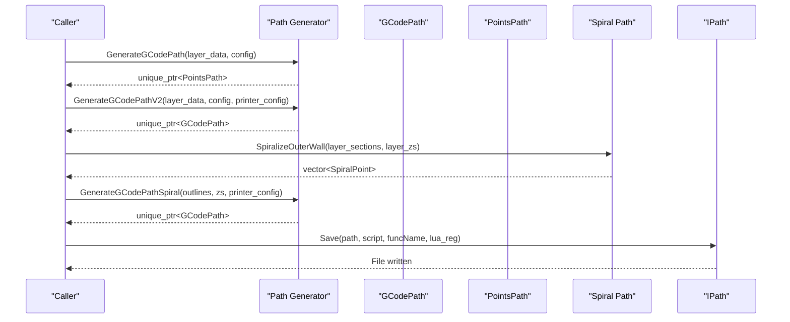

**Diagram sources**
- [IPath.hpp:29-65](file://paths/IPath.hpp#L29-L65)
- [path_generator.hpp:23-91](file://LibHsBaSlicer/Path/path_generator.hpp#L23-L91)
- [spiral_path.hpp:24-40](file://LibHsBaSlicer/Path/spiral_path.hpp#L24-L40)

**Section sources**
- [IPath.hpp:29-65](file://paths/IPath.hpp#L29-L65)
- [path_generator.hpp:23-91](file://LibHsBaSlicer/Path/path_generator.hpp#L23-L91)
- [spiral_path.hpp:24-40](file://LibHsBaSlicer/Path/spiral_path.hpp#L24-L40)

### Job Control System (DllHsBaSlicer/job_control.*)
The Job Control System provides non-blocking pipeline execution with cooperative cancellation and structured progress reporting.

- HsBaJobHandle: opaque handle representing a submitted pipeline job running on a dedicated library thread.
- Lifecycle states: HSBA_JOB_PENDING, HSBA_JOB_RUNNING, HSBA_JOB_SUCCEEDED, HSBA_JOB_FAILED, HSBA_JOB_CANCELLED.
- Structured progress callback: HsBaProgressCallbackEx with percent, classified stage (HsBaStage_t), and original stage text.
- Completion callback: HsBaJobDoneCallback invoked on the job thread with finished job handle.

Key APIs:
- HsBaSubmitJob: starts pipeline on dedicated thread, copies config including strings, returns job handle.
- HsBaCancelJob: requests cooperative cancellation at next stage/layer checkpoint.
- HsBaWaitJob: blocks until job reaches final state with timeout support.
- HsBaJobGetState: polls current lifecycle state.
- HsBaJobGetProgress: polls progress without installing callback.
- HsBaJobGeometryId: gets geometry snapshot id once job is final.
- HsBaJobCopyResult: copies job result into caller-owned view.
- HsBaReleaseJob: releases job handle reference.

Threading contract:
- Progress and completion callbacks run on job's own thread, never on submitting thread.
- GUI must marshal into UI thread (Qt: signal/slot, wxWidgets: CallAfter).
- Lifetime contract: job holds two references (running work + caller); completion callback drops library reference.

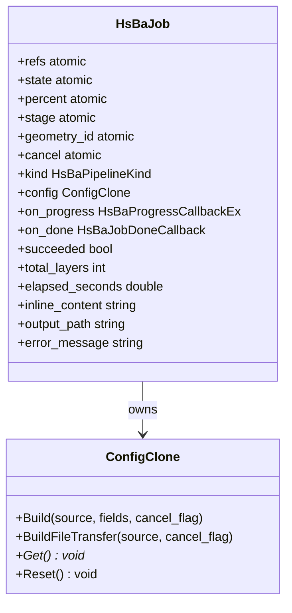

**Diagram sources**
- [job_control.h:34-146](file://DllHsBaSlicer/job_control.h#L34-L146)
- [job_control.cpp:89-135](file://DllHsBaSlicer/job_control.cpp#L89-L135)
- [job_control.cpp:48-79](file://DllHsBaSlicer/job_control.cpp#L48-L79)

**Section sources**
- [job_control.h:34-146](file://DllHsBaSlicer/job_control.h#L34-L146)
- [job_control.cpp:89-135](file://DllHsBaSlicer/job_control.cpp#L89-L135)
- [job_control.cpp:48-79](file://DllHsBaSlicer/job_control.cpp#L48-L79)

### Geometry Export System (DllHsBaSlicer/geometry_export.h, geometry_store.*)
The Geometry Export System provides per-layer geometry snapshots and continuous path export capabilities.

- HsBaRing: planar ring with point_count, interleaved xy coordinates, and closed flag.
- HsBaLayerGeometry: complete layer geometry with outlines, fills, supports, bounds, and metadata.
- HsBaGeometryPath: continuous 3D polyline with xyz triples, bounds, and z-range.

Process-wide snapshot pool:
- GeometrySnapshot: contains kind, outlines/fills/supports per layer, zs heights, bounds, and path_xyz.
- PoolEntry: snapshot with reference count and insertion sequence for LRU eviction.
- HSBA_GEOMETRY_POOL_MAX environment variable controls pool capacity (default 4).

Key APIs:
- HsBaGeometryLayerCount: gets layer count for snapshot.
- HsBaGetLayerGeometry: exports one layer geometry into allocated block.
- HsBaFreeLayerGeometry: frees layer geometry block.
- HsBaGeometryPathPointCount: gets continuous path point count.
- HsBaGetGeometryPath: exports continuous path into allocated block.
- HsBaFreeGeometryPath: frees path block.
- HsBaRetainGeometrySnapshot: pins snapshot to prevent recycling.
- HsBaReleaseGeometrySnapshot: unpins snapshot for recycling.

Memory contract:
- Single malloc block per exported structure with internal pointers.
- Host must call matching free function once per export.
- Snapshot lifetime tied to geometry_id and reference counting.

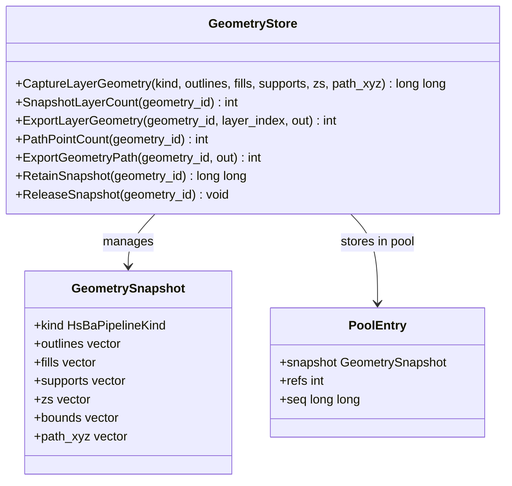

**Diagram sources**
- [geometry_export.h:37-143](file://DllHsBaSlicer/geometry_export.h#L37-L143)
- [geometry_store.hpp:39-91](file://DllHsBaSlicer/geometry_store.hpp#L39-L91)
- [geometry_store.cpp:22-41](file://DllHsBaSlicer/geometry_store.cpp#L22-L41)

**Section sources**
- [geometry_export.h:37-143](file://DllHsBaSlicer/geometry_export.h#L37-L143)
- [geometry_store.hpp:39-91](file://DllHsBaSlicer/geometry_store.hpp#L39-L91)
- [geometry_store.cpp:22-41](file://DllHsBaSlicer/geometry_store.cpp#L22-L41)
- [geometry_store.cpp:177-200](file://DllHsBaSlicer/geometry_store.cpp#L177-L200)
- [geometry_store.cpp:404-436](file://DllHsBaSlicer/geometry_store.cpp#L404-L436)

### Progress Stage System (DllHsBaSlicer/progress_stage.*)
The Progress Stage System translates pipeline progress text into stable stage identifiers for GUI integration.

- HsBaStage_t enumeration: stable stage values from HSBA_STAGE_UNKNOWN to HSBA_STAGE_CANCELLED.
- Stage classification table: exact-match rules and prefix rules mapping human-readable text to stages.
- Stable identifiers: snake_case stage names and localized display labels.

Key APIs:
- HsBaStageFromText: classifies progress stage text to HsBaStage_t.
- HsBaStageName: returns stable snake_case identifier for stage.
- HsBaStageLabel: returns English display label for stage.

Classification rules:
- Exact matches: "Loading model", "Slicing", "Generating floor", etc.
- Prefix matches: "Slicing layer...", "Exporting...", "Writing..."
- Unknown text maps to HSBA_STAGE_UNKNOWN with "unknown" name.

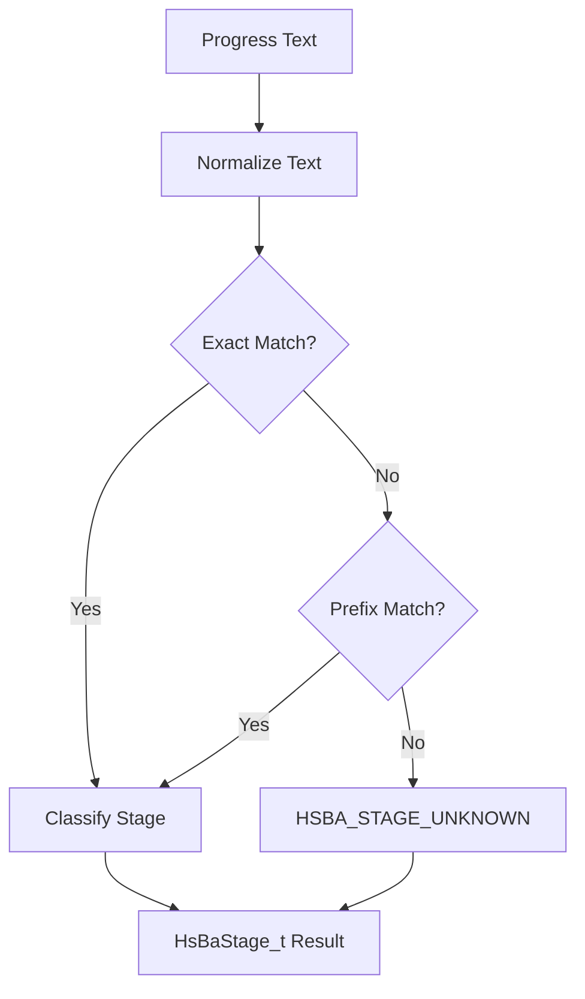

**Diagram sources**
- [progress_stage.h:23-42](file://DllHsBaSlicer/progress_stage.h#L23-L42)
- [progress_stage.cpp:33-95](file://DllHsBaSlicer/progress_stage.cpp#L33-L95)
- [progress_stage.cpp:121-169](file://DllHsBaSlicer/progress_stage.cpp#L121-L169)

**Section sources**
- [progress_stage.h:23-42](file://DllHsBaSlicer/progress_stage.h#L23-L42)
- [progress_stage.cpp:33-95](file://DllHsBaSlicer/progress_stage.cpp#L33-L95)
- [progress_stage.cpp:121-169](file://DllHsBaSlicer/progress_stage.cpp#L121-L169)

### Enhanced Pipeline Execution (restapi/)
The Enhanced Pipeline Execution layer provides REST API integration with non-blocking operations and comprehensive job management.

- SliceOutcome: normalized view of any pipeline result with success, layers, output paths, timing, and geometry_id.
- JobManager: thread-safe job queue with fixed worker pool, status/result lookups, and cancellation support.
- PipelineExecutor: kind-dispatched wrapper over DllHsBaSlicer C ABI with config creation, sync run, and result management.

Key features:
- Non-blocking job submission with worker thread pool.
- Cooperative cancellation through atomic flags.
- Structured progress reporting with stage classification.
- Geometry snapshot integration for visualization.
- Terminal state observation and cleanup.

Configuration extensions:
- capture_geometry: enables per-layer geometry capture.
- cancel_flag: points to std::atomic<bool> for cooperative cancellation.
- gcode_thumbnails: embeds model projection previews in G-code headers.

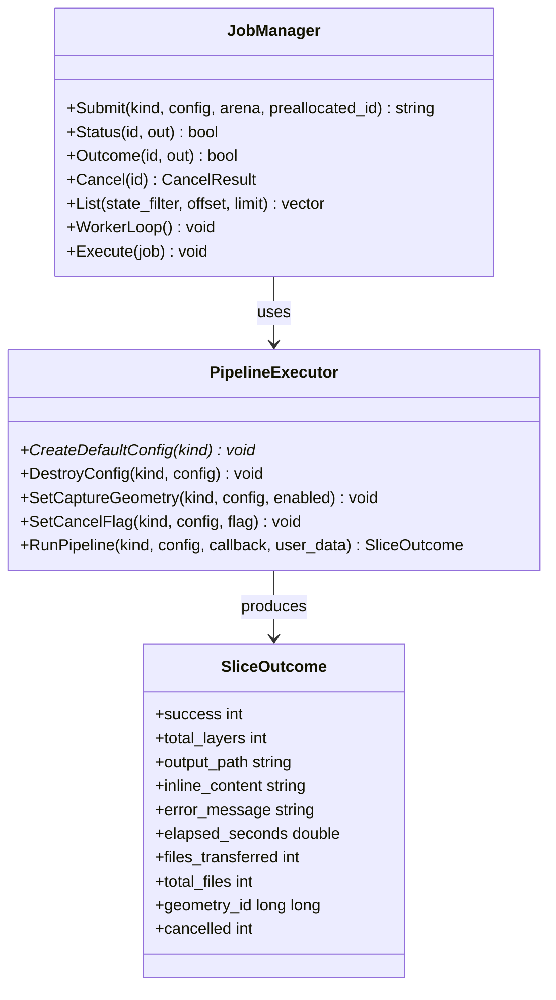

**Diagram sources**
- [pipeline_executor.hpp:28-102](file://restapi/pipeline_executor.hpp#L28-L102)
- [job_manager.hpp:28-200](file://restapi/job_manager.hpp#L28-L200)

**Section sources**
- [pipeline_executor.hpp:28-102](file://restapi/pipeline_executor.hpp#L28-L102)
- [job_manager.hpp:28-200](file://restapi/job_manager.hpp#L28-L200)

### Core Library API (LibHsBaSlicer/)
The Core Library API exposes the slicing pipeline orchestration and key algorithms as stable C++ entry points.

- Path generation functions:
  - GenerateGCodePath, GenerateGCodePathV2, GenerateGCodePathSpiral, PolygonsToGPoints.
  - Configuration via FdmPathConfig and GCodePrinterConfig.

- Integration patterns:
  - Build LayerPathData from FullTopoModel slices and PolygonFill outputs.
  - Call path generator to obtain GCodePath/PointsPath.
  - Use IPath Save/ToString with optional Lua post-processing for customization.

**Section sources**
- [path_generator.hpp:23-91](file://LibHsBaSlicer/Path/path_generator.hpp#L23-L91)

## Dependency Analysis
The following diagram shows how modules depend on each other, including the new core modules:

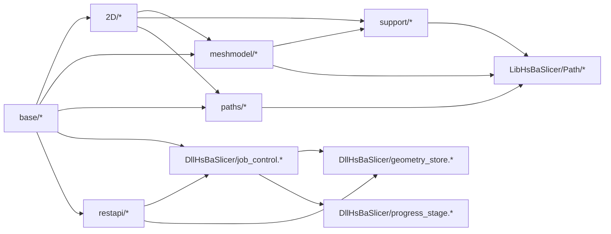

**Diagram sources**
- [IModel.hpp:110-139](file://base/IModel.hpp#L110-L139)
- [IntPolygon.hpp:14-27](file://2D/IntPolygon.hpp#L14-L27)
- [FloatPolygons.hpp:16-25](file://2D/FloatPolygons.hpp#L16-L25)
- [FullTopoModel.hpp:53-142](file://meshmodel/FullTopoModel.hpp#L53-L142)
- [ModelLoader.hpp:30-202](file://preprocess/ModelLoader.hpp#L30-L202)
- [FdmSupport.hpp:11-63](file://support/FdmSupport.hpp#L11-L63)
- [SlaSupport.hpp:11-42](file://support/SlaSupport.hpp#L11-L42)
- [IPath.hpp:29-65](file://paths/IPath.hpp#L29-L65)
- [path_generator.hpp:23-91](file://LibHsBaSlicer/Path/path_generator.hpp#L23-L91)
- [job_control.h:34-146](file://DllHsBaSlicer/job_control.h#L34-L146)
- [geometry_store.hpp:39-91](file://DllHsBaSlicer/geometry_store.hpp#L39-L91)
- [progress_stage.h:23-42](file://DllHsBaSlicer/progress_stage.h#L23-L42)
- [pipeline_executor.hpp:28-102](file://restapi/pipeline_executor.hpp#L28-L102)
- [job_manager.hpp:28-200](file://restapi/job_manager.hpp#L28-L200)

**Section sources**
- [IModel.hpp:110-139](file://base/IModel.hpp#L110-L139)
- [IntPolygon.hpp:14-27](file://2D/IntPolygon.hpp#L14-L27)
- [FloatPolygons.hpp:16-25](file://2D/FloatPolygons.hpp#L16-L25)
- [FullTopoModel.hpp:53-142](file://meshmodel/FullTopoModel.hpp#L53-L142)
- [ModelLoader.hpp:30-202](file://preprocess/ModelLoader.hpp#L30-L202)
- [FdmSupport.hpp:11-63](file://support/FdmSupport.hpp#L11-L63)
- [SlaSupport.hpp:11-42](file://support/SlaSupport.hpp#L11-L42)
- [IPath.hpp:29-65](file://paths/IPath.hpp#L29-L65)
- [path_generator.hpp:23-91](file://LibHsBaSlicer/Path/path_generator.hpp#L23-L91)
- [job_control.h:34-146](file://DllHsBaSlicer/job_control.h#L34-L146)
- [geometry_store.hpp:39-91](file://DllHsBaSlicer/geometry_store.hpp#L39-L91)
- [progress_stage.h:23-42](file://DllHsBaSlicer/progress_stage.h#L23-L42)
- [pipeline_executor.hpp:28-102](file://restapi/pipeline_executor.hpp#L28-L102)
- [job_manager.hpp:28-200](file://restapi/job_manager.hpp#L28-L200)

## Performance Considerations
- Use Fixed-size Pools:
  - Prefer MemoryPool/StaticMemoryPool for short-lived, high-volume allocations to avoid frequent heap operations.
  - Use StaticMemoryPool when a process-wide pool is appropriate.

- Concurrency:
  - Offload heavy computations (e.g., boolean ops, fill generation, slicing) to ThreadPool.
  - Use ThreadPoolExecutor for coroutine-based pipelines where available.
  - Leverage ParallelForLayers and ParallelMap for layer-parallel processing.

- 2D Operations:
  - Simplify polygons before boolean operations to reduce complexity.
  - Choose appropriate epsilon values for MakeSimple to balance accuracy and speed.

- Mesh Processing:
  - Validate topology with CheckTopo and consider EulerCharacteristic to detect issues early.
  - Use SliceFast when topology is known to be complete to avoid rebuild overhead.

- Path Generation:
  - Tune FdmPathConfig (layer height, line width, speeds) to balance print quality and time.
  - For vase-mode prints, prefer GenerateGCodePathSpiral to minimize travel and improve continuity.

- Job Control:
  - Use non-blocking HsBaSubmitJob for responsive applications.
  - Implement proper callback marshalling to UI threads.
  - Use cooperative cancellation at natural checkpoints.

- Geometry Export:
  - Enable capture_geometry only when needed to avoid memory overhead.
  - Manage snapshot lifecycle with Retain/Release to control pool usage.
  - Monitor HSBA_GEOMETRY_POOL_MAX to prevent excessive memory consumption.

## Troubleshooting Guide
Common issues and resolutions:

- Model loading failures:
  - Ensure supported formats and correct extensions; ModelLoader dispatches to IglModel/OcctModel based on extension.
  - Verify USE_OCCT/USE_CGAL/USE_OPENVDB flags match compiled features.

- Topology errors:
  - Call FullTopoModel::CheckTopo; odd or >2 Euler characteristic indicates non-manifold geometry.
  - Repair meshes upstream or simplify polygons before slicing.

- Support generation problems:
  - Adjust SupportConfig parameters (overhang thresholds, spacing, diameter) for better coverage.
  - For SLA, tune tip/base diameters and sampling spacing.

- Path generation anomalies:
  - Validate LayerPathData consistency (outlines/fills/supports sizes and Z heights).
  - Use PolygonsToGPoints to inspect generated points and ensure expected extrude/travel states.

- Lua post-processing:
  - Provide valid script paths and function names; register additional functions via lua_reg callbacks.

- Job control issues:
  - Ensure proper callback marshalling to UI threads (Qt signals/slots, wxWidgets CallAfter).
  - Handle cooperative cancellation gracefully; cancellation occurs at natural checkpoints.
  - Properly release job handles to prevent memory leaks.

- Geometry export problems:
  - Verify capture_geometry was enabled during job submission.
  - Check geometry_id validity and snapshot availability.
  - Manage snapshot lifecycle with Retain/Release to prevent premature recycling.

- Progress stage classification:
  - Unknown stages map to HSBA_STAGE_UNKNOWN; update classification table for new stage texts.
  - Use HsBaStageName and HsBaStageLabel for consistent GUI presentation.

**Section sources**
- [ModelLoader.hpp:47-77](file://preprocess/ModelLoader.hpp#L47-L77)
- [FullTopoModel.hpp:80-127](file://meshmodel/FullTopoModel.hpp#L80-L127)
- [FdmSupport.hpp:19-63](file://support/FdmSupport.hpp#L19-L63)
- [SlaSupport.hpp:20-42](file://support/SlaSupport.hpp#L20-L42)
- [path_generator.hpp:50-91](file://LibHsBaSlicer/Path/path_generator.hpp#L50-L91)
- [IPath.hpp:34-56](file://paths/IPath.hpp#L34-L56)
- [job_control.h:74-146](file://DllHsBaSlicer/job_control.h#L74-L146)
- [geometry_export.h:89-143](file://DllHsBaSlicer/geometry_export.h#L89-L143)
- [progress_stage.h:23-42](file://DllHsBaSlicer/progress_stage.h#L23-L42)

## Conclusion
HsBaSlicer's core modules form a cohesive, extensible architecture with significant enhancements:
- The Foundation Layer supplies robust abstractions, utilities, and parallel execution infrastructure.
- The 2D Geometry Engine delivers precise polygon operations and fills.
- Mesh Processing reconstructs topology and prepares models for slicing.
- The Support System generates practical structures for FDM/SLA.
- Path Generation translates slices into efficient toolpaths and outputs, including continuous spiral paths.
- The Core Library API ties these pieces together with clear, configurable entry points.
- The Job Control System provides non-blocking execution, cooperative cancellation, and structured progress reporting.
- The Geometry Export System enables per-layer visualization and continuous path inspection.
- The Progress Stage System offers stable stage classification for GUI integration.
- The Enhanced Pipeline Execution integrates REST API with comprehensive job management.

By leveraging the documented interfaces, configuration options, and integration patterns, developers can build reliable, high-performance slicing pipelines tailored to their workflows, with modern non-blocking operation patterns and rich visualization capabilities.