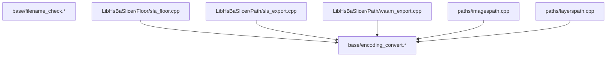
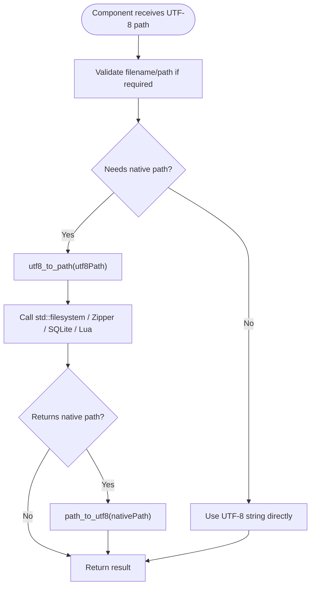
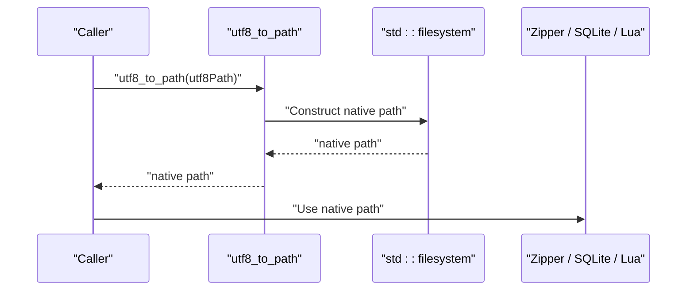
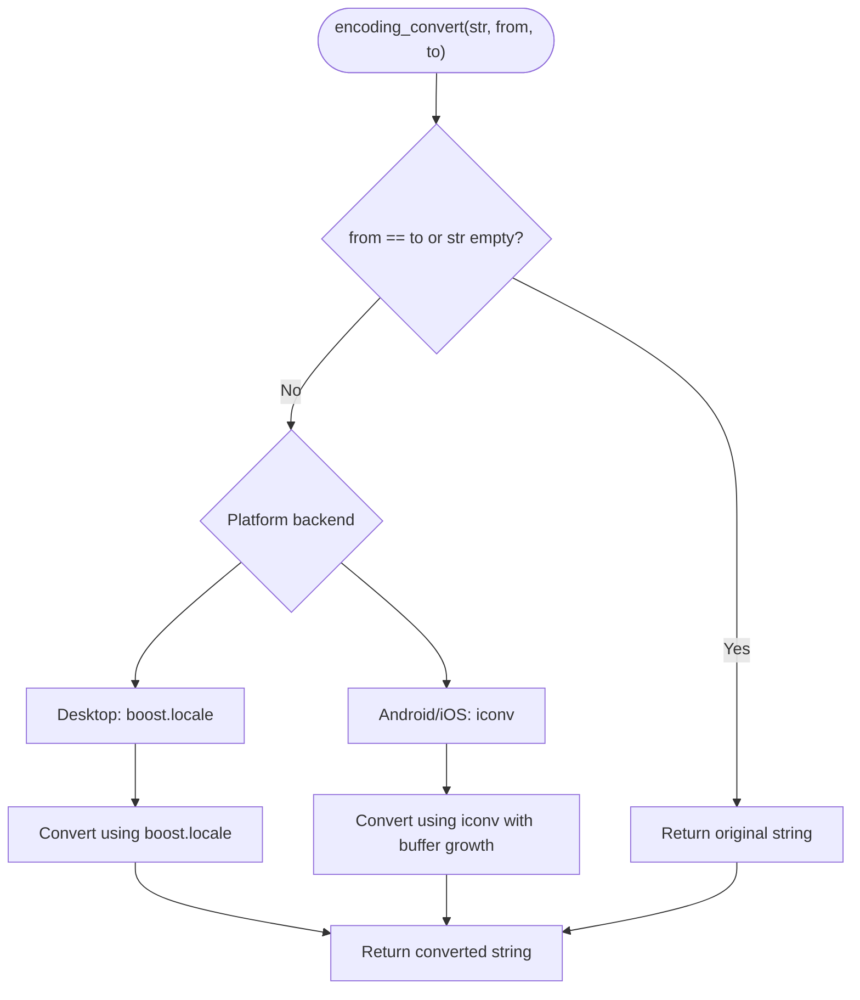
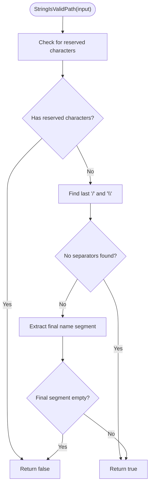
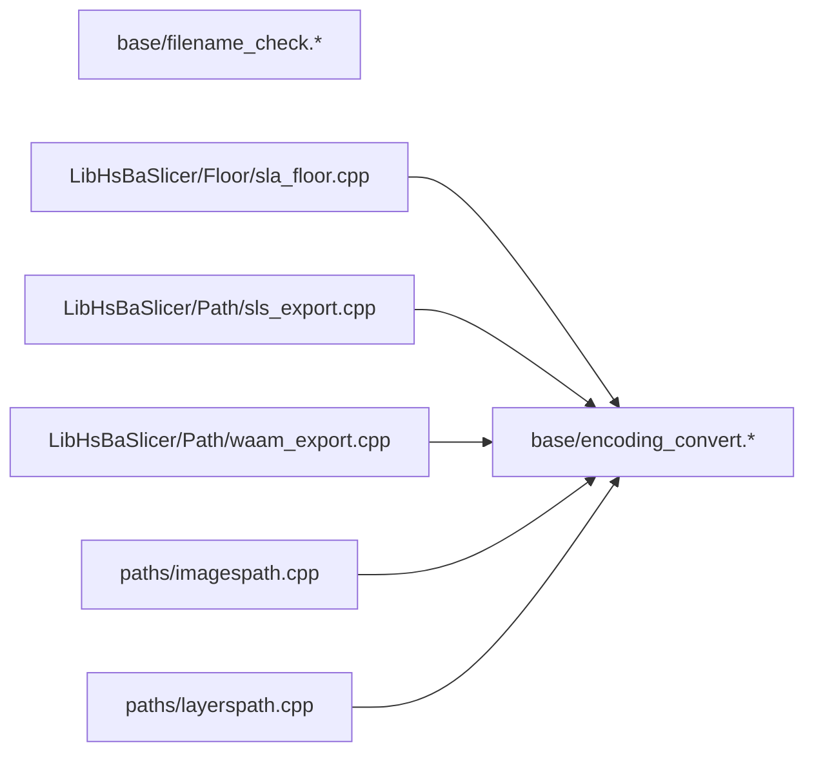

# File Path Encoding System

<cite>
**Referenced Files in This Document**
- [encoding_convert.hpp](file://base/encoding_convert.hpp)
- [encoding_convert.cpp](file://base/encoding_convert.cpp)
- [filename_check.hpp](file://base/filename_check.hpp)
- [filename_check.cpp](file://base/filename_check.cpp)
- [encoding_convert_test.cpp](file://tests/EncodingConvert/encoding_convert_test.cpp)
- [sla_floor.cpp](file://LibHsBaSlicer/Floor/sla_floor.cpp)
- [sls_export.cpp](file://LibHsBaSlicer/Path/sls_export.cpp)
- [waam_export.cpp](file://LibHsBaSlicer/Path/waam_export.cpp)
- [imagespath.cpp](file://paths/imagespath.cpp)
- [layerspath.cpp](file://paths/layerspath.cpp)
</cite>

## Table of Contents
1. [Introduction](#introduction)
2. [Project Structure](#project-structure)
3. [Core Components](#core-components)
4. [Architecture Overview](#architecture-overview)
5. [Detailed Component Analysis](#detailed-component-analysis)
6. [Dependency Analysis](#dependency-analysis)
7. [Performance Considerations](#performance-considerations)
8. [Troubleshooting Guide](#troubleshooting-guide)
9. [Conclusion](#conclusion)

## Introduction
This document explains the file path encoding system used by HsBaSlicer. It focuses on how UTF-8 strings are converted to native operating-system paths, how native paths are converted back to UTF-8, how generic string encodings are handled, and how filenames and paths are validated before being passed to the filesystem or archive APIs. The goal is to make sure Unicode file names work reliably across Windows, POSIX-like systems, Android, and iOS while keeping internal data consistently UTF-8.

## Project Structure
The file path encoding logic lives primarily under `base/`, with usage spread through pipeline exporters and path utilities:

**Diagram sources**
- [encoding_convert.hpp:32-53](file://base/encoding_convert.hpp#L32-L53)
- [encoding_convert.cpp:101-143](file://base/encoding_convert.cpp#L101-L143)
- [sla_floor.cpp:523-599](file://LibHsBaSlicer/Floor/sla_floor.cpp#L523-L599)
- [sls_export.cpp:132](file://LibHsBaSlicer/Path/sls_export.cpp#L132)
- [waam_export.cpp:119-174](file://LibHsBaSlicer/Path/waam_export.cpp#L119-L174)
- [imagespath.cpp:49-175](file://paths/imagespath.cpp#L49-L175)
- [layerspath.cpp:36](file://paths/layerspath.cpp#L36)

**Section sources**
- [encoding_convert.hpp:1-53](file://base/encoding_convert.hpp#L1-L53)
- [encoding_convert.cpp:1-143](file://base/encoding_convert.cpp#L1-L143)
- [filename_check.hpp:1-89](file://base/filename_check.hpp#L1-L89)
- [filename_check.cpp:1-100](file://base/filename_check.cpp#L1-L100)

## Core Components
The encoding system has two main responsibilities:

1. **Encoding conversion and platform path bridging**
   - Convert between UTF-8 and local/native encodings.
   - Convert between internal UTF-8 strings and `std::filesystem::path`.
   - Provide generic encoding conversion for arbitrary source/target encodings.
   - Provide Windows console code-page helpers.

2. **Filename and path validation**
   - Check whether a string can be used as a filename or full path.
   - Detect ASCII-only vs non-ASCII content.
   - Support both narrow (`std::string`) and wide (`std::wstring`) inputs.

Key API surface:

| Area | Functionality | Purpose |
|---|---|---|
| UTF-8 ↔ Local | `utf8_to_local`, `local_to_utf8` | Bridge internal UTF-8 strings to the current system locale when needed. |
| UTF-8 ↔ Native path | `utf8_to_path`, `path_to_utf8` | Safely convert between UTF-8 strings and `std::filesystem::path`. |
| Generic encoding | `encoding_convert` | Convert between named encodings such as UTF-8 and ISO-8859-1. |
| Windows console | `windows_chcp_utf8`, `set_windows_console_utf8`, etc. | Configure Windows console input/output code pages. |
| Filename checks | `StringIsOnlyASCII`, `StringIsValidFileName`, `StringIsValidPath`, plus non-ASCII variants | Validate user-provided filenames and paths before filesystem operations. |

**Section sources**
- [encoding_convert.hpp:21-63](file://base/encoding_convert.hpp#L21-L63)
- [encoding_convert.hpp:65-94](file://base/encoding_convert.hpp#L65-L94)
- [filename_check.hpp:18-85](file://base/filename_check.hpp#L18-L85)

## Architecture Overview
At runtime, most components keep filenames as UTF-8 strings. When a native filesystem or archive API is called, the code converts the UTF-8 path into a native path. Conversely, when an external API returns a native path, it is converted back to UTF-8.

**Diagram sources**
- [encoding_convert.cpp:101-143](file://base/encoding_convert.cpp#L101-L143)
- [filename_check.cpp:16-53](file://base/filename_check.cpp#L16-L53)
- [imagespath.cpp:49-175](file://paths/imagespath.cpp#L49-L175)
- [layerspath.cpp:36](file://paths/layerspath.cpp#L36)

## Detailed Component Analysis

### UTF-8 and Native Path Conversion
The central contract is:

- Internal strings representing file paths should be UTF-8.
- `utf8_to_path` produces a native `std::filesystem::path`.
- `path_to_utf8` produces a UTF-8 string from a native path.

On Windows, this avoids ANSI code-page mangling by decoding UTF-8 bytes into UTF-16 before constructing the native path. On POSIX-like platforms, the native path encoding is already treated as UTF-8.

**Diagram sources**
- [encoding_convert.cpp:101-121](file://base/encoding_convert.cpp#L101-L121)

Usage examples in the codebase include:

- SLA floor export passes output ZIP paths through `utf8_to_path`.
- SLS export passes output ZIP and Lua script paths through `utf8_to_path`.
- WAAM export converts output spiral paths and Lua script paths through `utf8_to_path`.
- Image path saving uses `path_to_utf8` when writing to archives or pushing paths to Lua.
- Layer database connection uses `path_to_utf8` when connecting to SQLite.

**Section sources**
- [encoding_convert.cpp:101-143](file://base/encoding_convert.cpp#L101-L143)
- [sla_floor.cpp:523-599](file://LibHsBaSlicer/Floor/sla_floor.cpp#L523-L599)
- [sls_export.cpp:132](file://LibHsBaSlicer/Path/sls_export.cpp#L132)
- [waam_export.cpp:119-174](file://LibHsBaSlicer/Path/waam_export.cpp#L119-L174)
- [imagespath.cpp:49-175](file://paths/imagespath.cpp#L49-L175)
- [layerspath.cpp:36](file://paths/layerspath.cpp#L36)

### Generic String Encoding Conversion
When a component needs to convert between named encodings rather than just UTF-8 and the local encoding, `encoding_convert(str, from, to)` is used. Its documented contract is:

- `from`: source encoding.
- `to`: target encoding.

On desktop platforms without Qt, the implementation uses Boost.Locale. On Android and iOS, where Boost.Locale is not available, it falls back to `iconv`. The tests explicitly verify that:

- Converting from an encoding to itself is a passthrough.
- UTF-8 to ISO-8859-1 collapses multi-byte characters correctly.
- ISO-8859-1 to UTF-8 expands them back.
- Round-tripping is lossless for shared character sets.
- Pure ASCII survives `utf8_to_local` and `local_to_utf8` unchanged.

**Diagram sources**
- [encoding_convert.cpp:147-222](file://base/encoding_convert.cpp#L147-L222)
- [encoding_convert_test.cpp:16-59](file://tests/EncodingConvert/encoding_convert_test.cpp#L16-L59)

**Section sources**
- [encoding_convert.hpp:55-63](file://base/encoding_convert.hpp#L55-L63)
- [encoding_convert.cpp:147-222](file://base/encoding_convert.cpp#L147-L222)
- [encoding_convert_test.cpp:1-62](file://tests/EncodingConvert/encoding_convert_test.cpp#L1-L62)

### Windows Console Code Page Helpers
On Windows, several helpers manage console input/output code pages:

- `windows_chcp_utf8`: check whether the active console code page is UTF-8.
- `set_windows_console_utf8`: set both input and output to UTF-8.
- `set_windows_console_ansi`: set both input and output to the system ANSI code page.
- `set_windows_console_in_ansi_out_utf8`: mix ANSI input with UTF-8 output.
- `set_windows_console_out_ansi_in_utf8`: mix UTF-8 input with ANSI output.
- `windows_win7_or_greater`, `windows_win10_or_greater`: version checks used by higher-level Windows behavior.

These functions are part of the same encoding subsystem because console text handling is closely related to how UTF-8 and local encodings interact at the OS boundary.

**Section sources**
- [encoding_convert.hpp:65-94](file://base/encoding_convert.hpp#L65-L94)
- [encoding_convert.cpp:225-263](file://base/encoding_convert.cpp#L225-L263)

### Filename and Path Validation
Before passing strings to filesystem or archive APIs, the system validates them:

| Function | Input Type | Behavior |
|---|---|---|
| `StringIsOnlyASCII` | `std::string` or `std::wstring` | Returns true if every code unit is within ASCII range. |
| `StringIsValidFileName` | `std::string` or `std::wstring` | Rejects reserved characters and empty names. |
| `StringIsValidPath` | `std::string` or `std::wstring` | Rejects reserved characters and requires a non-empty final name segment. |
| `StringIsValidFileNameWithNonASCII` | `std::string` or `std::wstring` | Requires non-ASCII content and valid filename rules. |
| `StringIsValidPathWithNonASCII` | `std::string` or `std::wstring` | Requires non-ASCII content and valid path rules. |

The implementation uses regular expressions for ASCII detection and reserved-character checks, then handles mixed forward-slash and backslash separators by inspecting the last separator position.

**Diagram sources**
- [filename_check.cpp:21-45](file://base/filename_check.cpp#L21-L45)
- [filename_check.cpp:66-89](file://base/filename_check.cpp#L66-L89)

**Section sources**
- [filename_check.hpp:18-85](file://base/filename_check.hpp#L18-L85)
- [filename_check.cpp:11-53](file://base/filename_check.cpp#L11-L53)
- [filename_check.cpp:56-97](file://base/filename_check.cpp#L56-L97)

## Dependency Analysis
The encoding and filename-check modules are low-level utilities consumed by higher-level pipeline exporters and path utilities.

**Diagram sources**
- [encoding_convert.hpp:32-53](file://base/encoding_convert.hpp#L32-L53)
- [encoding_convert.cpp:101-143](file://base/encoding_convert.cpp#L101-L143)
- [sla_floor.cpp:523-599](file://LibHsBaSlicer/Floor/sla_floor.cpp#L523-L599)
- [sls_export.cpp:132](file://LibHsBaSlicer/Path/sls_export.cpp#L132)
- [waam_export.cpp:119-174](file://LibHsBaSlicer/Path/waam_export.cpp#L119-L174)
- [imagespath.cpp:49-175](file://paths/imagespath.cpp#L49-L175)
- [layerspath.cpp:36](file://paths/layerspath.cpp#L36)

**Section sources**
- [encoding_convert.hpp:1-53](file://base/encoding_convert.hpp#L1-L53)
- [encoding_convert.cpp:1-143](file://base/encoding_convert.cpp#L1-L143)
- [filename_check.hpp:1-89](file://base/filename_check.hpp#L1-L89)
- [filename_check.cpp:1-100](file://base/filename_check.cpp#L1-L100)

## Performance Considerations
- `utf8_to_path` and `path_to_utf8` perform one-time conversions around filesystem calls. They avoid unnecessary work by returning early for empty inputs and by falling back to native parsing when UTF-8 decoding fails on Windows.
- `encoding_convert` avoids conversion when source and target encodings are identical or the input is empty.
- On Android and iOS, `encoding_convert` uses `iconv` with a growing output buffer. The implementation caps expansion to prevent unbounded growth.
- Filename validation uses regular expressions; repeated validation of large numbers of paths may benefit from caching results if callers validate the same strings multiple times.

[No sources needed since this section provides general guidance]

## Troubleshooting Guide

### Unicode Filenames Fail on Windows
If filenames containing non-ASCII characters fail on Windows, ensure that:

- Paths are constructed through `utf8_to_path` instead of directly from UTF-8 strings.
- Output paths are passed through `path_to_utf8` when calling APIs that expect UTF-8 strings, such as SQLite or archive libraries.
- Console output is configured appropriately if debugging via the Windows console.

Relevant implementation behavior:

- `utf8_to_path` decodes UTF-8 to UTF-16 on Windows before creating the native path.
- `path_to_utf8` re-encodes the native path to UTF-8.
- Windows console helpers allow setting UTF-8 or ANSI input/output code pages.

**Section sources**
- [encoding_convert.cpp:101-143](file://base/encoding_convert.cpp#L101-L143)
- [encoding_convert.cpp:225-263](file://base/encoding_convert.cpp#L225-L263)

### Generic Encoding Conversion Produces Wrong Characters
If `encoding_convert` appears to reverse source and target encodings, verify the call order:

- First argument: string to convert.
- Second argument: source encoding.
- Third argument: target encoding.

The test suite confirms that UTF-8 to ISO-8859-1 and ISO-8859-1 to UTF-8 behave as expected and that round-tripping is lossless for shared characters.

**Section sources**
- [encoding_convert.cpp:147-222](file://base/encoding_convert.cpp#L147-L222)
- [encoding_convert_test.cpp:16-47](file://tests/EncodingConvert/encoding_convert_test.cpp#L16-L47)

### Invalid Filename or Path Errors
If filesystem operations reject a filename or path:

- Use `StringIsValidFileName` for bare filenames.
- Use `StringIsValidPath` for full paths.
- Use the non-ASCII variants when you intentionally need Unicode in the filename or path.
- Remember that reserved characters such as backslash, forward slash, asterisk, question mark, quote, less-than, greater-than, and pipe are rejected.

**Section sources**
- [filename_check.cpp:16-53](file://base/filename_check.cpp#L16-L53)
- [filename_check.cpp:61-97](file://base/filename_check.cpp#L61-L97)

## Conclusion
HsBaSlicer’s file path encoding system keeps UTF-8 as the internal representation while safely bridging to native filesystem and archive APIs. On Windows, UTF-8 is decoded to UTF-16 to avoid ANSI code-page corruption; on POSIX-like platforms, UTF-8 is used directly. Generic encoding conversion is supported through Boost.Locale or `iconv`, and filename/path validation helps catch invalid inputs before they reach the filesystem. Pipeline exporters and path utilities rely on these utilities to handle Unicode filenames consistently across platforms.