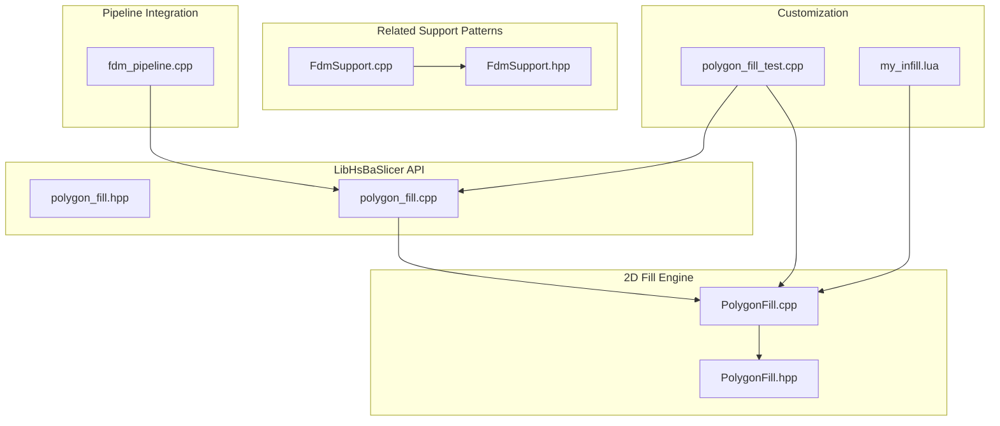
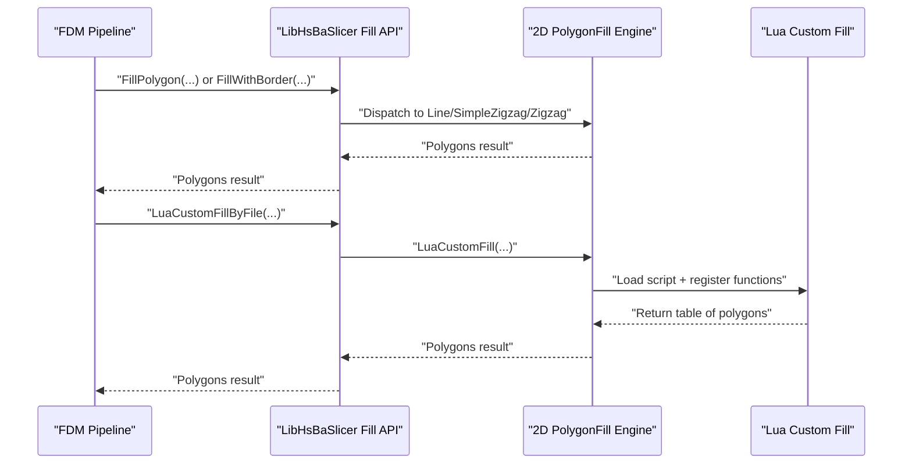
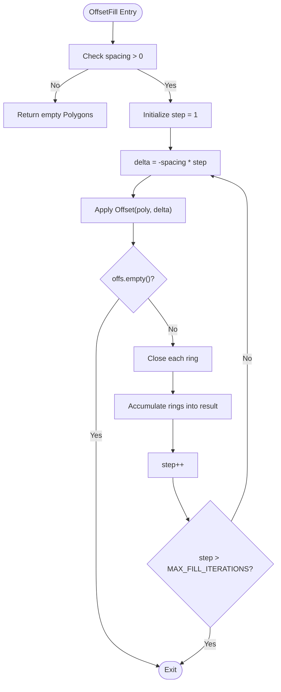
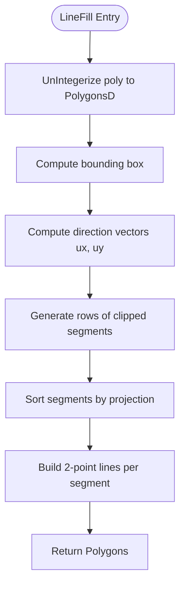
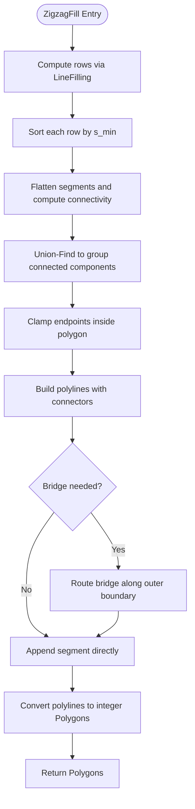
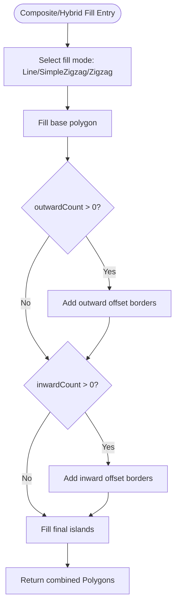
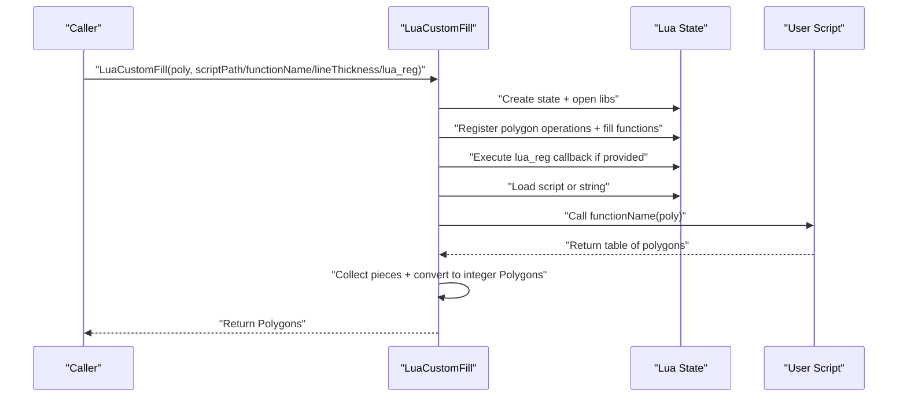
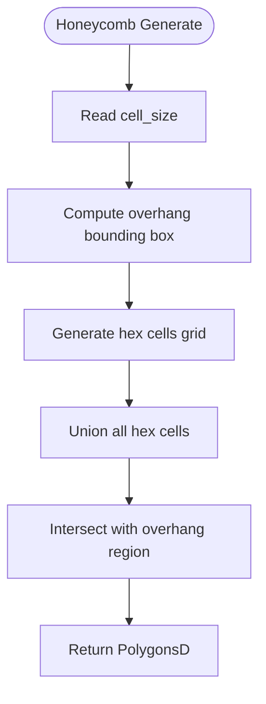
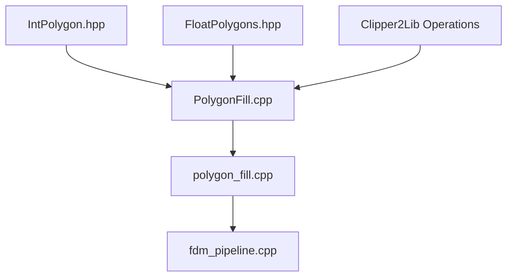

# Fill Algorithms

<cite>
**Referenced Files in This Document**
- [PolygonFill.hpp](file://2D/PolygonFill.hpp)
- [PolygonFill.cpp](file://2D/PolygonFill.cpp)
- [polygon_fill.hpp](file://LibHsBaSlicer/Fill/polygon_fill.hpp)
- [polygon_fill.cpp](file://LibHsBaSlicer/Fill/polygon_fill.cpp)
- [FdmSupport.hpp](file://support/FdmSupport.hpp)
- [FdmSupport.cpp](file://support/FdmSupport.cpp)
- [fdm_pipeline.cpp](file://DllHsBaSlicer/fdm_pipeline.cpp)
- [my_infill.lua](file://samples/FDM/scripts/my_infill.lua)
- [polygon_fill_test.cpp](file://tests/PolygonFill/polygon_fill_test.cpp)
</cite>

## Table of Contents
1. [Introduction](#introduction)
2. [Project Structure](#project-structure)
3. [Core Components](#core-components)
4. [Architecture Overview](#architecture-overview)
5. [Detailed Component Analysis](#detailed-component-analysis)
6. [Dependency Analysis](#dependency-analysis)
7. [Performance Considerations](#performance-considerations)
8. [Troubleshooting Guide](#troubleshooting-guide)
9. [Conclusion](#conclusion)
10. [Appendices](#appendices)

## Introduction
This document explains the fill algorithms module that generates infill patterns and polygon filling operations for sliced layers. It focuses on PolygonFill functionality, including offset-based fills, parallel line fills, zigzag fills, composite/hybrid fills with border offsets, and Lua-driven custom fills. It also documents integration with 2D geometry processing for precise boundary adherence, fill density controls via spacing, pattern orientation via angle, transition strategies between fill types, performance optimization for large fills, memory-efficient handling of sparse patterns, and customization hooks for proprietary fill strategies. Practical examples are provided through tests and sample scripts, along with notes on mechanical implications such as anisotropy, stiffness, and support structure behavior.

## Project Structure
The fill system is implemented primarily in the 2D geometry layer and exposed through a LibHsBaSlicer API:

- 2D core fill algorithms: `2D/PolygonFill.hpp`, `2D/PolygonFill.cpp`
- LibHsBaSlicer wrapper API: `LibHsBaSlicer/Fill/polygon_fill.hpp`, `LibHsBaSlicer/Fill/polygon_fill.cpp`
- Related support structures using honeycomb: `support/FdmSupport.hpp`, `support/FdmSupport.cpp`
- Pipeline integration for FDM infill: `DllHsBaSlicer/fdm_pipeline.cpp`
- Sample custom fill script: `samples/FDM/scripts/my_infill.lua`
- Tests validating behavior: `tests/PolygonFill/polygon_fill_test.cpp`



**Diagram sources**
- [PolygonFill.hpp:1-141](file://2D/PolygonFill.hpp#L1-L141)
- [PolygonFill.cpp:1-1669](file://2D/PolygonFill.cpp#L1-L1669)
- [polygon_fill.hpp:1-58](file://LibHsBaSlicer/Fill/polygon_fill.hpp#L1-L58)
- [polygon_fill.cpp:1-52](file://LibHsBaSlicer/Fill/polygon_fill.cpp#L1-L52)
- [FdmSupport.hpp:1-67](file://support/FdmSupport.hpp#L1-L67)
- [FdmSupport.cpp:1-269](file://support/FdmSupport.cpp#L1-L269)
- [fdm_pipeline.cpp:362-394](file://DllHsBaSlicer/fdm_pipeline.cpp#L362-L394)
- [my_infill.lua:1-89](file://samples/FDM/scripts/my_infill.lua#L1-L89)
- [polygon_fill_test.cpp:1-691](file://tests/PolygonFill/polygon_fill_test.cpp#L1-L691)

**Section sources**
- [PolygonFill.hpp:1-141](file://2D/PolygonFill.hpp#L1-L141)
- [polygon_fill.hpp:1-58](file://LibHsBaSlicer/Fill/polygon_fill.hpp#L1-L58)

## Core Components
The core components provide both C++ APIs and Lua bindings for generating infill patterns within polygon boundaries:

- Offset-based fills: nested inward rings generated by repeated negative offsets.
- Parallel line fills: scanline-style segments clipped to polygon interiors.
- Zigzag fills: connected serpentine paths with improved corner handling and bridging across disconnected components.
- Composite and hybrid fills: combinations of outward/inward offsets with internal fill modes.
- Lua custom fills: user-defined patterns executed inside a controlled Lua environment with access to polygon operations and path optimization utilities.

Key public functions include:
- `OffsetFill(poly, spacing, join_type)`
- `LineFill(poly, spacing, angle_deg, lineThickness)`
- `SimpleZigzagFill(poly, spacing, angle_deg, lineThickness)`
- `ZigzagFill(poly, spacing, angle_deg, lineThickness)`
- `CompositeOffsetFill(poly, spacing, offsetStep, outwardCount, inwardCount, mode, angle_deg, lineThickness, join_type)`
- `HybridFill(poly, spacing, offsetStep, outwardCount, inwardCount, mode, angle_deg, lineThickness, join_type)`
- `LuaCustomFill(poly, scriptPath, functionName, lineThickness, lua_reg)`
- `LuaCustomFillString(poly, script, functionName, lineThickness, lua_reg)`
- `RegisterLuaPolygonFillFunctions(L)`

LibHsBaSlicer exposes:
- `FillPolygon(poly, spacing, mode, angle_deg)`
- `FillWithBorder(poly, spacing, border_count, fill_mode, angle_deg)`
- `LuaCustomFillByFile(poly, scriptPath, functionName, lineThickness)`

**Section sources**
- [PolygonFill.hpp:20-136](file://2D/PolygonFill.hpp#L20-L136)
- [polygon_fill.hpp:17-53](file://LibHsBaSlicer/Fill/polygon_fill.hpp#L17-L53)

## Architecture Overview
The architecture separates algorithmic logic from API exposure and pipeline integration:

- The 2D engine implements geometric algorithms and Lua bindings.
- The LibHsBaSlicer wrapper provides a stable C++ API and composes Lua registration callbacks to expose additional tools like path optimization.
- The FDM pipeline selects either Lua custom fills or built-in C++ fills per layer and reports progress.
- Honeycomb support demonstrates another pattern generator integrated into the broader slicer ecosystem.



**Diagram sources**
- [fdm_pipeline.cpp:362-394](file://DllHsBaSlicer/fdm_pipeline.cpp#L362-L394)
- [polygon_fill.cpp:13-49](file://LibHsBaSlicer/Fill/polygon_fill.cpp#L13-L49)
- [PolygonFill.cpp:1494-1585](file://2D/PolygonFill.cpp#L1494-L1585)

## Detailed Component Analysis

### Offset-Based Fill
Offset-based fill repeatedly applies negative offsets to generate concentric rings until the polygon vanishes. Each ring is closed to ensure consistent output.



**Diagram sources**
- [PolygonFill.cpp:504-541](file://2D/PolygonFill.cpp#L504-L541)

**Section sources**
- [PolygonFill.cpp:504-541](file://2D/PolygonFill.cpp#L504-L541)

### Parallel Line Fill
Parallel line fill computes scanlines at a given angle and thickness, clips them to the polygon interior, and returns independent two-point segments.



**Diagram sources**
- [PolygonFill.cpp:44-160](file://2D/PolygonFill.cpp#L44-L160)
- [PolygonFill.cpp:543-564](file://2D/PolygonFill.cpp#L543-L564)

**Section sources**
- [PolygonFill.cpp:44-160](file://2D/PolygonFill.cpp#L44-L160)
- [PolygonFill.cpp:543-564](file://2D/PolygonFill.cpp#L543-L564)

### Zigzag Fill (Connected Serpentine Path)
Zigzag fill builds connected polylines by connecting centers of adjacent scanline segments. It uses binary search to clamp endpoints inside the polygon and supports bridging across disconnected components by routing along the outer boundary.



**Diagram sources**
- [PolygonFill.cpp:803-1370](file://2D/PolygonFill.cpp#L803-L1370)

**Section sources**
- [PolygonFill.cpp:803-1370](file://2D/PolygonFill.cpp#L803-L1370)

### Composite and Hybrid Fills
Composite fill applies base fill plus outward and inward offset layers, each filled with the selected mode. Hybrid fill first adds outward offset borders, then progressively adds inward offset borders until area becomes too small, finally filling the smallest remaining islands.



**Diagram sources**
- [PolygonFill.cpp:1372-1491](file://2D/PolygonFill.cpp#L1372-L1491)

**Section sources**
- [PolygonFill.cpp:1372-1491](file://2D/PolygonFill.cpp#L1372-L1491)

### Lua Custom Fill
Lua custom fill loads a script or inline code, registers polygon operations and fill functions, optionally injects path optimization utilities, calls a user function with polygon data, and collects returned polygons.



**Diagram sources**
- [PolygonFill.cpp:1494-1585](file://2D/PolygonFill.cpp#L1494-L1585)
- [polygon_fill.cpp:35-49](file://LibHsBaSlicer/Fill/polygon_fill.cpp#L35-L49)

**Section sources**
- [PolygonFill.cpp:1494-1585](file://2D/PolygonFill.cpp#L1494-L1585)
- [polygon_fill.cpp:35-49](file://LibHsBaSlicer/Fill/polygon_fill.cpp#L35-L49)

### Honeycomb Support Pattern
Although not part of the main PolygonFill API, honeycomb support illustrates a distinct pattern generator used for lightweight rigid support structures. It creates flat-top hexagons over a bounding box and intersects them with the overhang region.



**Diagram sources**
- [FdmSupport.cpp:173-242](file://support/FdmSupport.cpp#L173-L242)

**Section sources**
- [FdmSupport.cpp:173-242](file://support/FdmSupport.cpp#L173-L242)

## Dependency Analysis
The fill module depends on 2D geometry primitives and Clipper2 operations for offsetting, intersection, union, and point-in-polygon checks. The LibHsBaSlicer API wraps these capabilities and integrates with the FDM pipeline.



**Diagram sources**
- [PolygonFill.cpp:1-20](file://2D/PolygonFill.cpp#L1-L20)
- [polygon_fill.cpp:1-10](file://LibHsBaSlicer/Fill/polygon_fill.cpp#L1-L10)
- [fdm_pipeline.cpp:362-394](file://DllHsBaSlicer/fdm_pipeline.cpp#L362-L394)

**Section sources**
- [PolygonFill.cpp:1-20](file://2D/PolygonFill.cpp#L1-L20)
- [polygon_fill.cpp:1-10](file://LibHsBaSlicer/Fill/polygon_fill.cpp#L1-L10)

## Performance Considerations
- Iteration limits: `MAX_FILL_ITERATIONS` prevents infinite loops during nested offset generation.
- Binary search bounds: `MAX_BINARY_SEARCH_ITERATIONS` caps endpoint clamping iterations for robustness.
- Row scanning efficiency: `LineFilling` computes bounding boxes and projects corners to minimize unnecessary intersections.
- Memory usage: Zigzag fill constructs intermediate polylines and component maps; it avoids excessive duplication by reusing sorted rows and compact segment lists.
- Large fills: Use appropriate spacing and angle to reduce segment count; prefer zigzag for connected paths to minimize travel distance.
- Sparse patterns: Lua custom fills can return only necessary regions, reducing downstream processing.

[No sources needed since this section provides general guidance]

## Troubleshooting Guide
Common issues and resolutions:

- Invalid spacing: Offset-based fills return empty results when spacing is non-positive. Ensure spacing > 0.
- Missing Lua function: If the requested function name does not exist, a runtime error is thrown. Verify the function name matches the script definition.
- Non-table return: Lua functions must return a table of polygons; otherwise, a runtime error occurs.
- Boundary violations: Zigzag fill ensures vertices remain inside the polygon; tests validate containment for concave shapes and stacked/staggered islands.
- Path optimization availability: When using `LuaCustomFillByFile`, the environment includes `PathOptimize`; verify assertions in custom scripts.

**Section sources**
- [PolygonFill.cpp:504-541](file://2D/PolygonFill.cpp#L504-L541)
- [PolygonFill.cpp:1494-1585](file://2D/PolygonFill.cpp#L1494-L1585)
- [polygon_fill_test.cpp:177-200](file://tests/PolygonFill/polygon_fill_test.cpp#L177-L200)
- [polygon_fill_test.cpp:516-540](file://tests/PolygonFill/polygon_fill_test.cpp#L516-L540)

## Conclusion
The fill algorithms module provides a comprehensive set of infill pattern generators tailored for 2D polygon boundaries. It supports offset-based, line, zigzag, composite, and hybrid fills, with robust boundary adherence and configurable orientation and density. Lua scripting enables proprietary strategies and integration with path optimization utilities. The design balances performance and correctness through iteration limits, efficient scanning, and careful geometric operations. Practical tests and sample scripts demonstrate expected behaviors and customization possibilities.

[No sources needed since this section summarizes without analyzing specific files]

## Appendices

### API Reference Summary
- `OffsetFill`: Nested inward rings based on spacing and join type.
- `LineFill`: Independent parallel segments clipped to polygon interior.
- `SimpleZigzagFill`: Connected serpentine paths with basic connector logic.
- `ZigzagFill`: Advanced serpentine with bridging and component-aware transitions.
- `CompositeOffsetFill`: Base fill plus outward/inward offset layers.
- `HybridFill`: Border-first approach with progressive inward offsets.
- `LuaCustomFill/LuaCustomFillString`: Execute user scripts to generate polygons.
- `FillPolygon/FillWithBorder/LuaCustomFillByFile`: LibHsBaSlicer wrappers.

**Section sources**
- [PolygonFill.hpp:20-136](file://2D/PolygonFill.hpp#L20-L136)
- [polygon_fill.hpp:17-53](file://LibHsBaSlicer/Fill/polygon_fill.hpp#L17-L53)

### Practical Examples and Mechanical Implications
- Parallel line fills produce strong directional stiffness aligned with print direction; rotating angle changes anisotropy.
- Zigzag fills improve continuity and reduce travel, beneficial for dense infill where structural integrity matters.
- Composite/hybrid fills combine border strength with internal density, useful for parts requiring surface quality and core rigidity.
- Honeycomb support patterns offer lightweight yet rigid support structures, balancing material usage and stability.

**Section sources**
- [polygon_fill_test.cpp:26-84](file://tests/PolygonFill/polygon_fill_test.cpp#L26-L84)
- [FdmSupport.cpp:173-242](file://support/FdmSupport.cpp#L173-L242)

### Custom Fill Script Example
The sample script demonstrates generating angled parallel lines and intersecting them with the current layer to achieve precise boundary adherence.

```lua
-- my_infill.lua
local PO = PolygonOperations

function generate_fill(current_layer)
    -- Compute bounding box and generate parallel lines at specified angle
    -- Intersect with current_layer to clip to valid region
    return result
end
```

**Section sources**
- [my_infill.lua:1-89](file://samples/FDM/scripts/my_infill.lua#L1-L89)