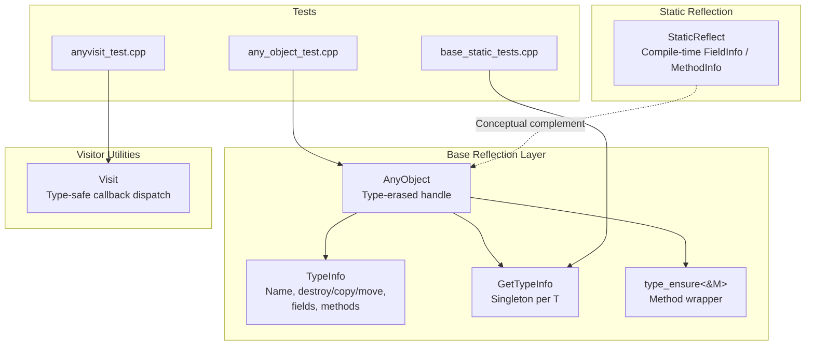
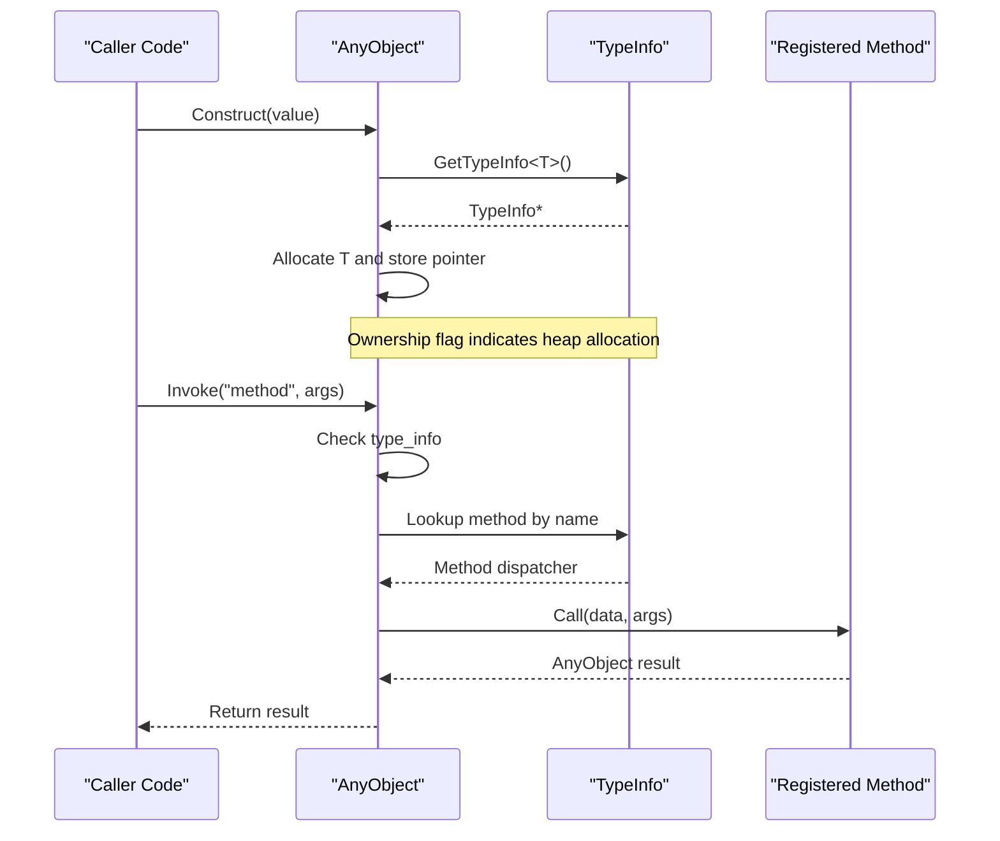
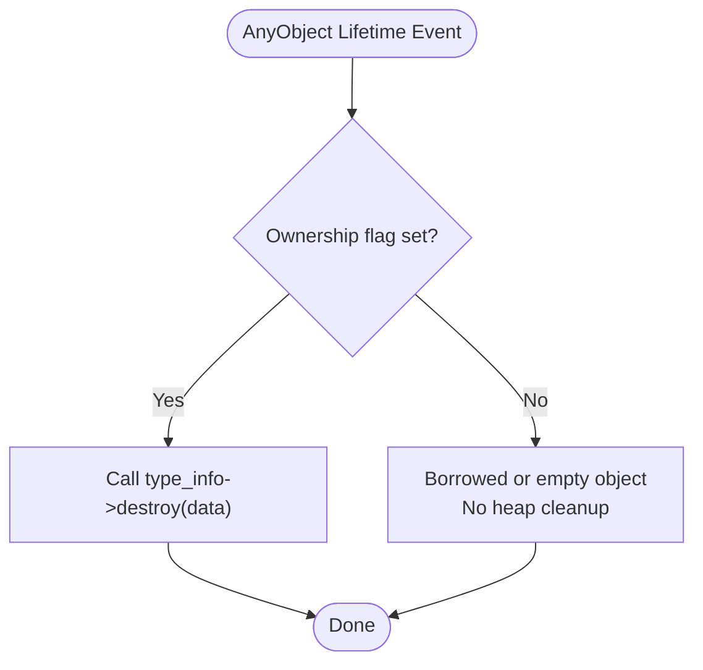
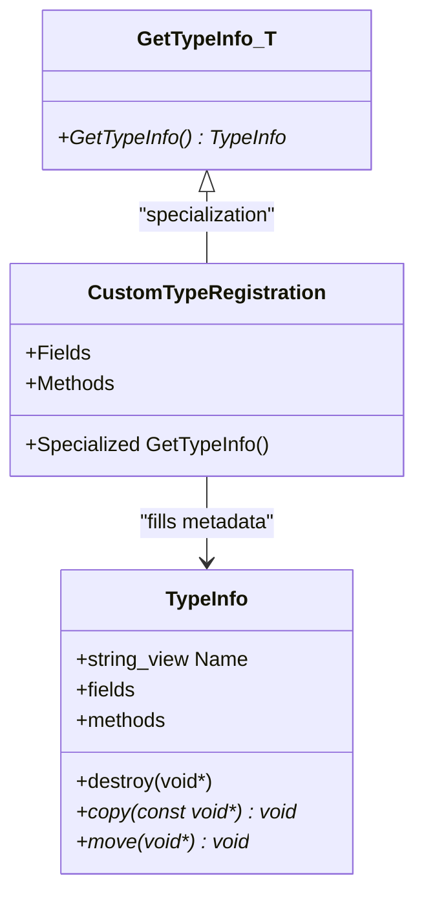
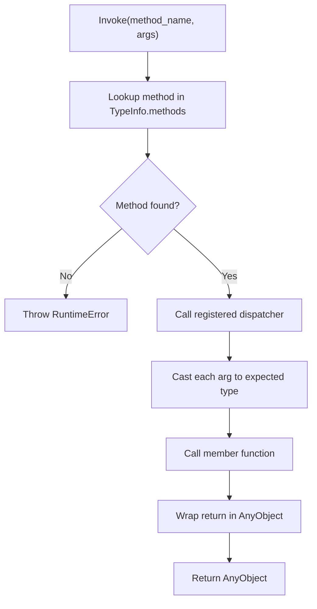
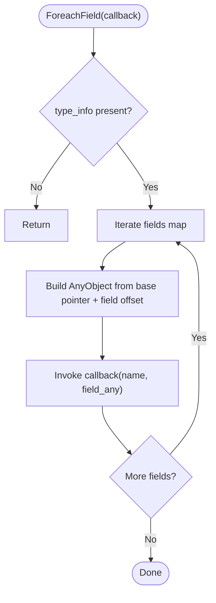
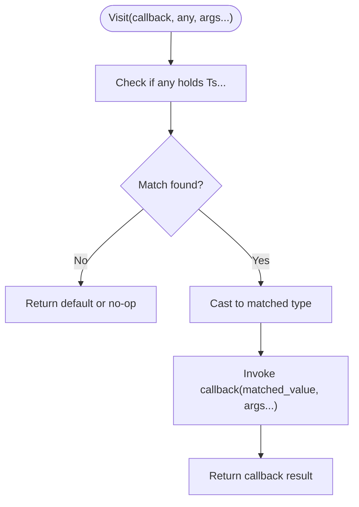
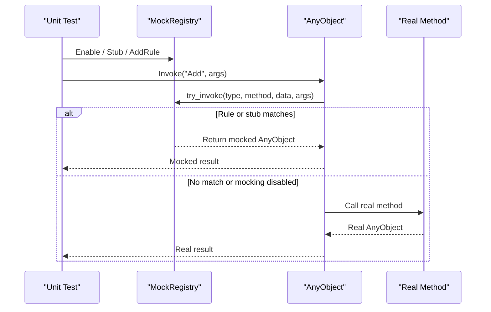
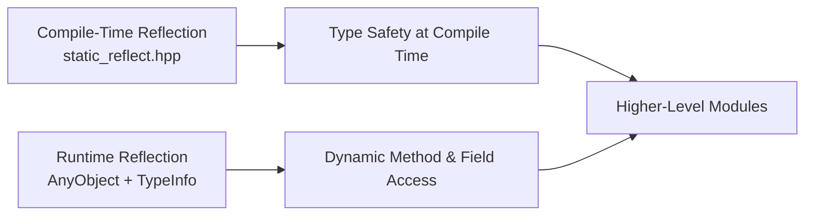
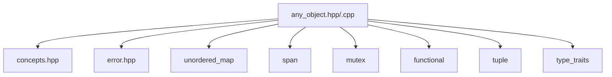

# AnyObject Type System

<cite>
**Referenced Files in This Document**
- [any_object.hpp](file://base/any_object.hpp)
- [any_object.cpp](file://base/any_object.cpp)
- [any_visit.hpp](file://base/any_visit.hpp)
- [static_reflect.hpp](file://base/static_reflect.hpp)
- [concepts.hpp](file://base/concepts.hpp)
- [error.hpp](file://base/error.hpp)
- [any_object_test.cpp](file://tests/AnyObject/any_object_test.cpp)
- [anyvisit_test.cpp](file://tests/AnyVisit/anyvisit_test.cpp)
- [base_static_tests.cpp](file://static_tests/base_static_tests/base_static_tests.cpp)
</cite>

## Table of Contents
1. [Introduction](#introduction)
2. [Project Structure](#project-structure)
3. [Core Components](#core-components)
4. [Architecture Overview](#architecture-overview)
5. [Detailed Component Analysis](#detailed-component-analysis)
6. [Dependency Analysis](#dependency-analysis)
7. [Performance Considerations](#performance-considerations)
8. [Troubleshooting Guide](#troubleshooting-guide)
9. [Conclusion](#conclusion)
10. [Appendices](#appendices)

## Introduction
This document explains the `AnyObject` type system in HsBaSlicer’s `base/` directory. It is a type-erased object wrapper that enables dynamic typing with compile-time safety through reflection capabilities. The system supports:

- Storing heterogeneous objects in containers through a uniform `AnyObject` handle.
- Runtime method invocation and field traversal via registered `TypeInfo`.
- Safe retrieval using typed `cast<T>()` operations backed by runtime type checks.
- Integration with visitor-style utilities for `std::any` and `boost::any`.
- Optional mock-driven testing support for intercepting `Invoke` calls.

The design separates runtime behavior (type erasure, dispatch, ownership) from compile-time registration (`GetTypeInfo`, `type_ensure`) so higher-level modules can expose custom types to reflection, scripting, serialization, and parameter systems without losing static type guarantees where possible.

## Project Structure
The `AnyObject` system lives primarily under `base/`:

| File | Responsibility |
|---|---|
| `base/any_object.hpp` | Defines `TypeInfo`, `AnyObject`, type registration helpers, method dispatch wrappers, and optional mock registry. |
| `base/any_object.cpp` | Implements copy/move semantics, destruction, field iteration, and runtime method dispatch. |
| `base/any_visit.hpp` | Provides `Visit` overloads for `std::any` and `boost::any`. |
| `base/static_reflect.hpp` | Provides compile-time reflection utilities used conceptually alongside runtime reflection. |
| `base/concepts.hpp` | Supplies concepts used by reflection and template helpers. |
| `base/error.hpp` | Supplies `RuntimeError` thrown by unsafe casts and missing methods. |
| `tests/AnyObject/any_object_test.cpp` | Exercises basic usage, virtual/bitmap fields, Lua integration, and mock behavior. |
| `tests/AnyVisit/anyvisit_test.cpp` | Exercises `Visit` overloads for `std::any` and `boost::any`. |
| `static_tests/base_static_tests/base_static_tests.cpp` | Demonstrates manual `GetTypeInfo` specialization and static assertions around field iteration. |

**Diagram sources**
- [any_object.hpp:48-115](file://base/any_object.hpp#L48-L115)
- [any_object.hpp:690-730](file://base/any_object.hpp#L690-L730)
- [any_visit.hpp:36-114](file://base/any_visit.hpp#L36-L114)
- [static_reflect.hpp:26-183](file://base/static_reflect.hpp#L26-L183)
- [any_object_test.cpp:10-31](file://tests/AnyObject/any_object_test.cpp#L10-L31)
- [anyvisit_test.cpp:8-42](file://tests/AnyVisit/anyvisit_test.cpp#L8-L42)
- [base_static_tests.cpp:227-245](file://static_tests/base_static_tests/base_static_tests.cpp#L227-L245)

**Section sources**
- [any_object.hpp:1-115](file://base/any_object.hpp#L1-L115)
- [any_object.cpp:1-113](file://base/any_object.cpp#L1-L113)
- [any_visit.hpp:1-118](file://base/any_visit.hpp#L1-L118)
- [static_reflect.hpp:1-188](file://base/static_reflect.hpp#L1-L188)

## Core Components
The core runtime model consists of two main pieces:

| Component | Purpose | Key Behaviors |
|---|---|---|
| `TypeInfo` | Holds metadata for a concrete type stored inside `AnyObject`. | Stores name, destruction/copy/move callbacks, field descriptors, and method dispatchers. |
| `AnyObject` | Type-erased handle owning or borrowing a value described by `TypeInfo`. | Supports construction from arbitrary values, safe casting, method invocation, and field iteration. |

### TypeInfo
`TypeInfo` is the bridge between runtime data and compile-time type information:

- `Name`: Human-readable or debuggable type identifier.
- `destroy`, `copy`, `move`: Ownership and lifetime management for the underlying value.
- `fields`: Maps field names to `(TypeInfo*, offset)` pairs for reflective traversal.
- `methods`: Maps method names to function pointers taking `(void* self, std::span<AnyObject> args)` and returning `AnyObject`.

This structure makes it possible to treat heterogeneous objects uniformly while still preserving enough information to reconstruct typed accessors.

### AnyObject
`AnyObject` stores three private members:

- `type_info`: Pointer to the `TypeInfo` describing the stored type.
- `data`: Opaque pointer to the actual value.
- `flag`: Indicates whether `data` is heap-owned; when set, copy/move/destruction use `TypeInfo` callbacks.

Public operations include:

- Construction from any value `T`, which registers `GetTypeInfo<std::remove_cvref_t<T>>()` and allocates a new instance.
- `cast<T>()`: Returns a reference after verifying the runtime type matches `T`.
- `cast_new<T>()`: Returns a copy after verifying the runtime type matches `T`.
- `get_type_info()`: Exposes the runtime type descriptor.
- `get_data()`: Exposes the raw pointer for consumers that need direct access without naming the concrete type.
- `Invoke(method_name, args)`: Dispatches to a registered method.
- `ForeachField(callback)`: Iterates over declared fields and invokes the callback with each field name and an `AnyObject` view into that field.

**Section sources**
- [any_object.hpp:48-115](file://base/any_object.hpp#L48-L115)
- [any_object.cpp:9-87](file://base/any_object.cpp#L9-L87)

## Architecture Overview
At a high level, `AnyObject` implements type erasure through a small vtable-like structure (`TypeInfo`). When you construct `AnyObject(value)`, the system:

1. Determines the decayed type `T`.
2. Obtains `TypeInfo` for `T` through `GetTypeInfo<T>()`.
3. Allocates a new `T` on the heap.
4. Stores the pointer and marks ownership via `flag`.

Later, `Invoke` and `ForeachField` operate purely through `TypeInfo`, allowing heterogeneous objects to be stored in containers such as `std::vector<AnyObject>` and processed uniformly.

**Diagram sources**
- [any_object.hpp:732-739](file://base/any_object.hpp#L732-L739)
- [any_object.cpp:88-111](file://base/any_object.cpp#L88-L111)

## Detailed Component Analysis

### Type Erasure and Ownership Model
`AnyObject` uses a simple ownership flag:

- If the lowest bit of `flag` is set, the object owns its `data` pointer and must call `type_info->destroy(data)` during destruction or assignment.
- Copy construction and copy assignment allocate a new value through `type_info->copy`.
- Move construction and move assignment transfer ownership and clear the source state.

This design avoids virtual inheritance and keeps the runtime representation minimal: one pointer to `TypeInfo`, one opaque pointer to data, and one byte for ownership.

**Diagram sources**
- [any_object.cpp:9-19](file://base/any_object.cpp#L9-L19)
- [any_object.cpp:28-48](file://base/any_object.cpp#L28-L48)
- [any_object.cpp:50-74](file://base/any_object.cpp#L50-L74)

**Section sources**
- [any_object.cpp:9-74](file://base/any_object.cpp#L9-L74)

### Registration Mechanism for Custom Types
Custom types are registered by specializing `GetTypeInfo<T>()`. The default template provides a generic implementation that sets:

- `Name` from `typeid(T).name()`.
- `destroy` to delete the typed pointer.
- `copy` to allocate a new copy.
- `move` to allocate a moved copy.

For richer behavior, tests and examples override this template to add:

- A stable human-readable `Name`.
- Explicit field descriptors.
- Method dispatchers.

**Diagram sources**
- [any_object.hpp:721-730](file://base/any_object.hpp#L721-L730)
- [any_object_test.cpp:18-31](file://tests/AnyObject/any_object_test.cpp#L18-L31)
- [base_static_tests.cpp:227-245](file://static_tests/base_static_tests/base_static_tests.cpp#L227-L245)

**Section sources**
- [any_object.hpp:721-730](file://base/any_object.hpp#L721-L730)
- [any_object_test.cpp:18-31](file://tests/AnyObject/any_object_test.cpp#L18-L31)
- [base_static_tests.cpp:227-245](file://static_tests/base_static_tests/base_static_tests.cpp#L227-L245)

### Method Dispatch via type_ensure
Member functions can be exposed to `AnyObject::Invoke` through `type_ensure<&Class::Method>()`. This helper inspects member function traits to extract:

- The class type.
- The return type.
- The argument types.

It then generates a dispatcher that:

1. Casts the opaque `void*` back to the class pointer.
2. Converts each `AnyObject` argument to the expected type using `cast<T>()`.
3. Calls the member function.
4. Wraps the return value in `AnyObject`, or returns an empty `AnyObject` for `void` methods.

**Diagram sources**
- [any_object.hpp:690-714](file://base/any_object.hpp#L690-L714)
- [any_object.cpp:88-111](file://base/any_object.cpp#L88-L111)

**Section sources**
- [any_object.hpp:690-714](file://base/any_object.hpp#L690-L714)
- [any_object.cpp:88-111](file://base/any_object.cpp#L88-L111)

### Field Traversal via ForeachField
`ForeachField` walks the `fields` map in `TypeInfo`. For each field, it constructs a temporary `AnyObject` pointing directly at the field memory using the stored offset. This allows reflection consumers to inspect nested objects without requiring them to know the concrete type ahead of time.

**Diagram sources**
- [any_object.cpp:76-87](file://base/any_object.cpp#L76-L87)

**Section sources**
- [any_object.cpp:76-87](file://base/any_object.cpp#L76-L87)

### Visitor Pattern Integration via AnyVisit
`any_visit.hpp` provides `Visit` overloads for `std::any` and `boost::any`. Unlike `AnyObject`, these utilities do not define a new runtime type system; instead, they provide a convenient way to match a known list of types against a value stored in `std::any` or `boost::any`.

Key behaviors:

- Accepts a variadic list of candidate types.
- Compares the runtime type of the contained value against each candidate.
- Invokes the provided callback with the correctly cast value.
- Supports both `void` and non-`void` return types.
- Uses `AllTheSame` to enforce consistent callback return types across candidates.

**Diagram sources**
- [any_visit.hpp:36-69](file://base/any_visit.hpp#L36-L69)
- [any_visit.hpp:81-114](file://base/any_visit.hpp#L81-L114)

**Section sources**
- [any_visit.hpp:36-114](file://base/any_visit.hpp#L36-L114)

### Mockit-Style Invocation Interception
When test framework macros are detected, `HSBA_ANY_OBJECT_ENABLE_MOCK` enables a mock registry that can intercept `AnyObject::Invoke`. This is useful for isolating unit tests from real behavior.

Important aspects:

- Mocking is disabled by default even when compiled in.
- `MockRegistry` supports stubs, argument-dependent rules, exception throwing, call recording, and RAII scoping helpers.
- `AnyObject::Invoke` first checks the mock registry before falling back to the real method.

**Diagram sources**
- [any_object.hpp:276-614](file://base/any_object.hpp#L276-L614)
- [any_object.cpp:88-111](file://base/any_object.cpp#L88-L111)

**Section sources**
- [any_object.hpp:276-614](file://base/any_object.hpp#L276-L614)
- [any_object.cpp:88-111](file://base/any_object.cpp#L88-L111)

### Relationship Between AnyObject and the Broader Type System
`AnyObject` is the runtime side of HsBaSlicer’s type system. It complements compile-time reflection tools:

- `static_reflect.hpp` provides compile-time introspection through `FieldInfo`, `MethodInfo`, and `Reflector`.
- `AnyObject` provides runtime introspection through `TypeInfo`, `ForeachField`, and `Invoke`.
- Higher-level modules can use compile-time reflection to generate or validate runtime registrations, but the current codebase also supports manual registration patterns shown in tests.

**Diagram sources**
- [static_reflect.hpp:26-183](file://base/static_reflect.hpp#L26-L183)
- [any_object.hpp:48-115](file://base/any_object.hpp#L48-L115)

**Section sources**
- [static_reflect.hpp:26-183](file://base/static_reflect.hpp#L26-L183)
- [any_object.hpp:48-115](file://base/any_object.hpp#L48-L115)

## Dependency Analysis
The `AnyObject` system depends on several foundational headers:

| Dependency | Role |
|---|---|
| `concepts.hpp` | Supplies concepts used by reflection and template helpers. |
| `error.hpp` | Supplies `RuntimeError` for invalid casts and missing methods. |
| `<unordered_map>` | Stores field and method lookup tables. |
| `` | Passes argument lists to method dispatchers. |
| `<mutex>` | Guards mock registry state. |
| `<functional>` | Supports mock actions and predicates. |
| `<tuple>` and `<type_traits>` | Support member function trait extraction. |

**Diagram sources**
- [any_object.hpp:9-23](file://base/any_object.hpp#L9-L23)
- [any_object.hpp:276-614](file://base/any_object.hpp#L276-L614)

**Section sources**
- [any_object.hpp:9-23](file://base/any_object.hpp#L9-L23)
- [any_object.hpp:276-614](file://base/any_object.hpp#L276-L614)

## Performance Considerations
Type erasure introduces measurable overhead compared to direct static typing:

| Operation | Cost | Notes |
|---|---:|---|
| Construction from `T` | Heap allocation | Each `AnyObject(T)` allocates a new `T` unless borrowed through external mechanisms. |
| Copy | Heap allocation + copy | Uses `TypeInfo::copy`. |
| Move | Pointer transfer | Avoids deep copy when moving. |
| `cast<T>()` | Pointer comparison | Fast, but throws on mismatch. |
| `Invoke` | Map lookup + dispatcher call | Hash map lookup plus indirect call. |
| `ForeachField` | Linear iteration over fields | Depends on number of registered fields. |
| Mock interception | Conditional lock + rule evaluation | Only active when mocking is enabled. |

Recommendations:

- Prefer storing `AnyObject` only when heterogeneity is required.
- Cache frequently accessed `TypeInfo` pointers when iterating many objects.
- Avoid excessive `Invoke` calls in tight loops; prefer statically typed paths when possible.
- Use move semantics to reduce allocations.
- Keep method and field registries small and focused.

[No sources needed since this section provides general guidance]

## Troubleshooting Guide

### Common Errors and Their Causes

| Symptom | Likely Cause | Resolution |
|---|---|---|
| `RuntimeError("Bad AnyObject cast: type mismatch")` | `cast<T>()` called on an `AnyObject` whose `TypeInfo` does not match `T`. | Verify the stored type or use `get_type_info()` to inspect before casting. |
| `RuntimeError("Invoke on empty AnyObject")` | Calling `Invoke` on a default-constructed `AnyObject`. | Ensure the object was constructed from a valid value. |
| `RuntimeError("Method not found: ...")` | The method name is not registered in `TypeInfo::methods`. | Register the method using `type_ensure<&Class::Method>()` or a custom dispatcher. |
| Missing behavior in tests | Mocking is disabled by default. | Enable mocking explicitly or use `ScopedStubs` / `ScopedEnable`. |
| Unexpected real method execution despite stub | Mocking is disabled or no matching rule/stub exists. | Check `MockRegistry::is_enabled()` and verify rule precedence. |

**Section sources**
- [any_object.hpp:83-100](file://base/any_object.hpp#L83-L100)
- [any_object.cpp:88-111](file://base/any_object.cpp#L88-L111)
- [any_object_test.cpp:509-519](file://tests/AnyObject/any_object_test.cpp#L509-L519)

## Conclusion
`AnyObject` is the foundation of HsBaSlicer’s runtime type system. It provides a compact, flexible mechanism for storing heterogeneous objects, invoking methods dynamically, and traversing fields reflectively. Its design balances runtime flexibility with compile-time safety through explicit type registration and safe casting.

For higher-level modules, the recommended approach is:

- Define clear domain types.
- Register only the fields and methods needed by serialization, scripting, or inspection layers.
- Use `AnyObject` at boundaries where heterogeneity is unavoidable.
- Prefer static typing internally.
- Use `AnyVisit` for `std::any`/`boost::any` workflows where a simpler visitor pattern is sufficient.
- Use mock facilities in tests to isolate behavior without modifying production logic.

[No sources needed since this section summarizes without analyzing specific files]

## Appendices

### Concrete Usage Patterns

#### Storing Heterogeneous Objects in Containers
You can store different types in a single container by converting them to `AnyObject`:

- Create `AnyObject` instances from various types.
- Store them in `std::vector<AnyObject>` or similar containers.
- Iterate and process them through `Invoke` or `ForeachField`.

This pattern is demonstrated in tests that construct `AnyObject` from integers, strings, and custom types.

**Section sources**
- [any_object_test.cpp:105-140](file://tests/AnyObject/any_object_test.cpp#L105-L140)

#### Type-Safe Retrieval Operations
Use `cast<T>()` for references and `cast_new<T>()` for copies:

- `cast<T>()` validates the runtime type and returns a reference.
- `cast_new<T>()` validates the runtime type and returns a copied value.
- Both throw `RuntimeError` on type mismatch.

**Section sources**
- [any_object.hpp:83-100](file://base/any_object.hpp#L83-L100)

#### Extending the System with New Types
To extend `AnyObject` with a new type:

1. Define your type.
2. Specialize `GetTypeInfo<YourType>()`.
3. Set `Name`, `destroy`, `copy`, and `move`.
4. Optionally register fields using `offsetof`.
5. Optionally register methods using `type_ensure<&YourType::Method>()`.

**Section sources**
- [any_object_test.cpp:18-31](file://tests/AnyObject/any_object_test.cpp#L18-L31)
- [base_static_tests.cpp:227-245](file://static_tests/base_static_tests/base_static_tests.cpp#L227-L245)