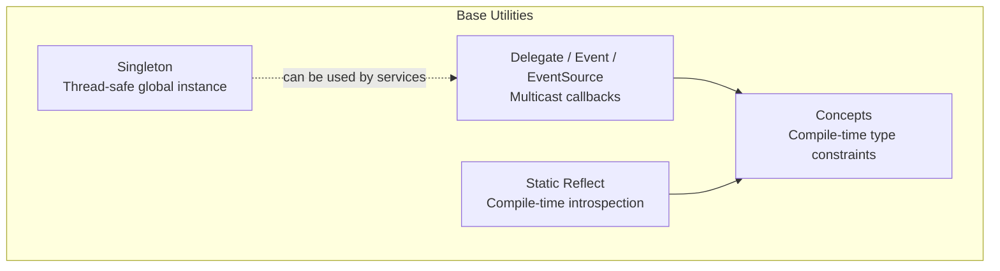
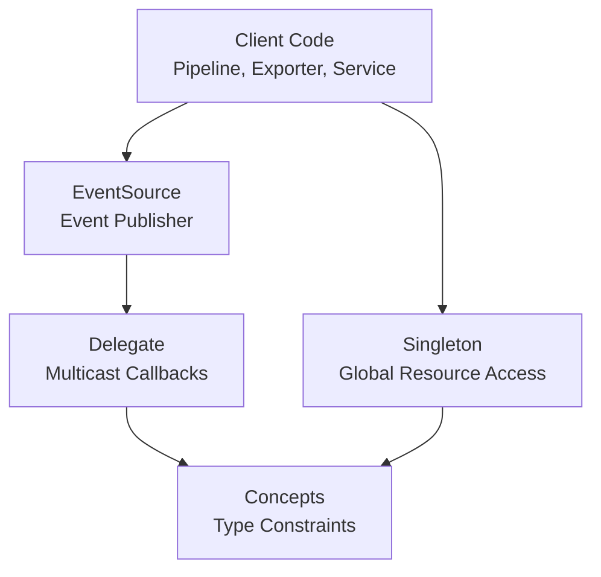
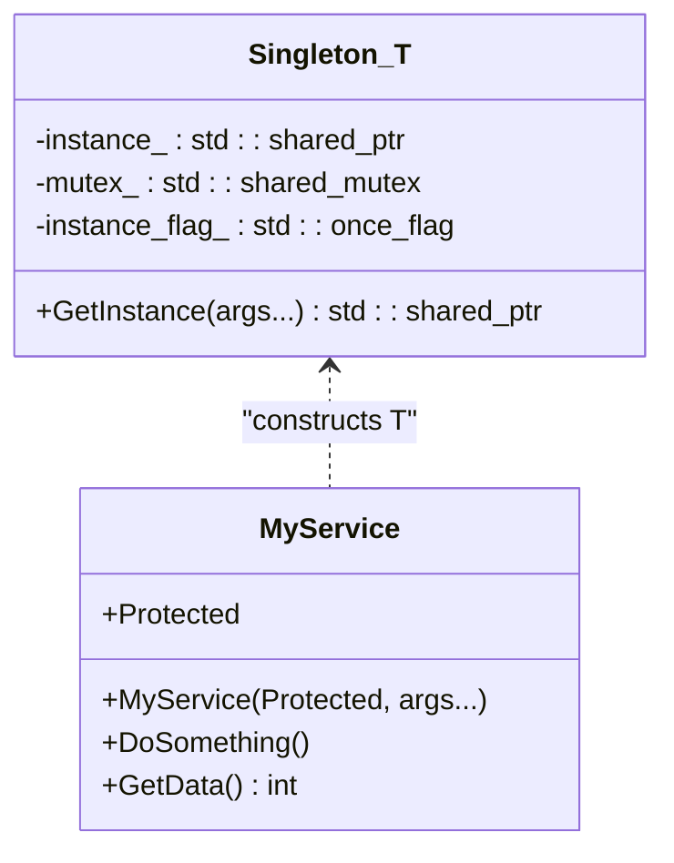
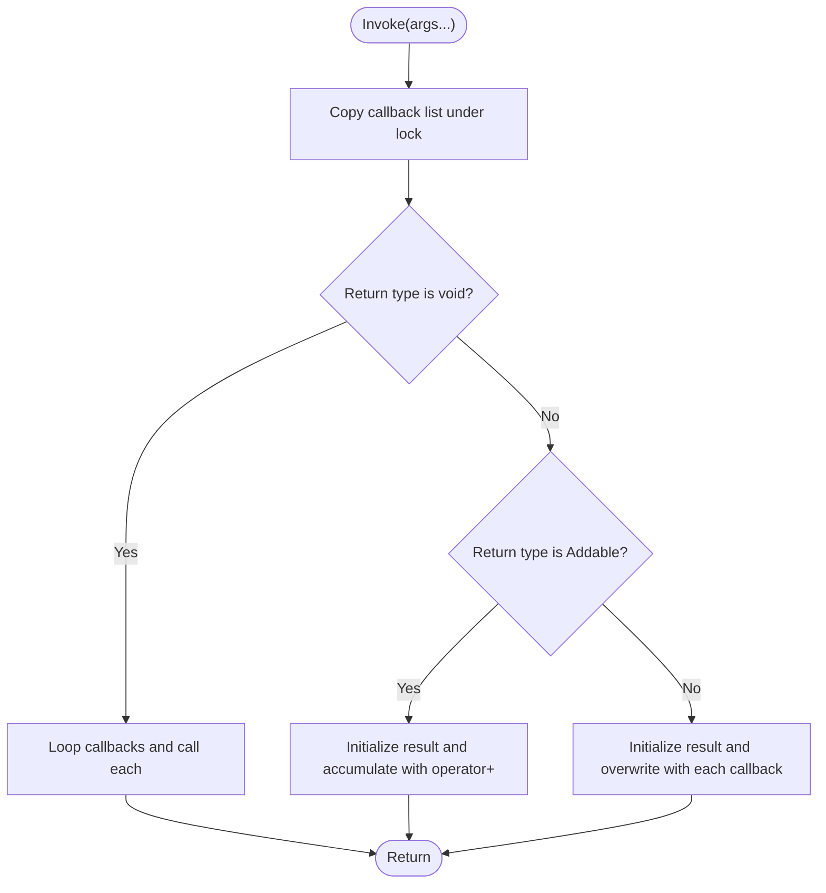
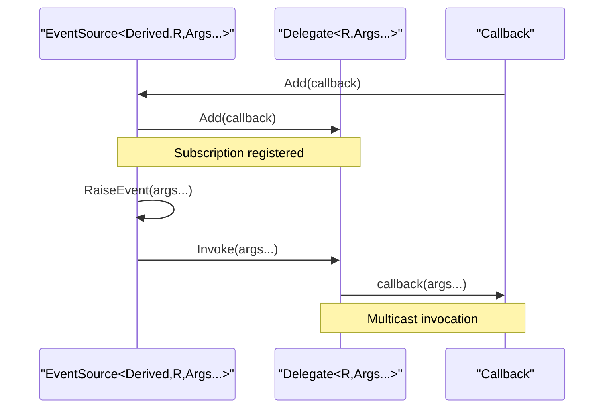
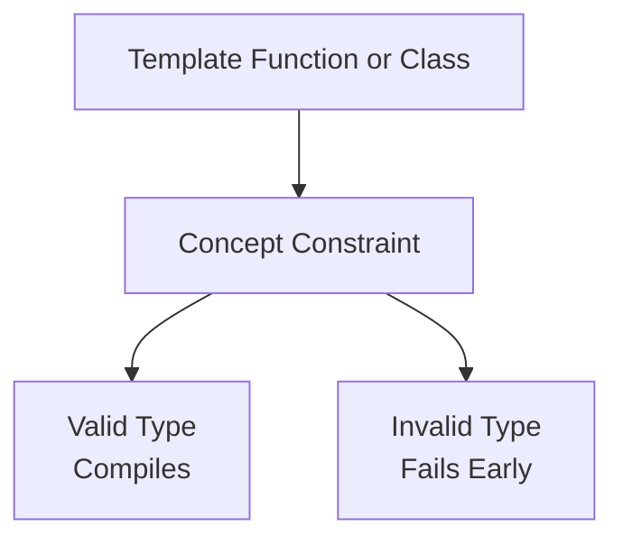
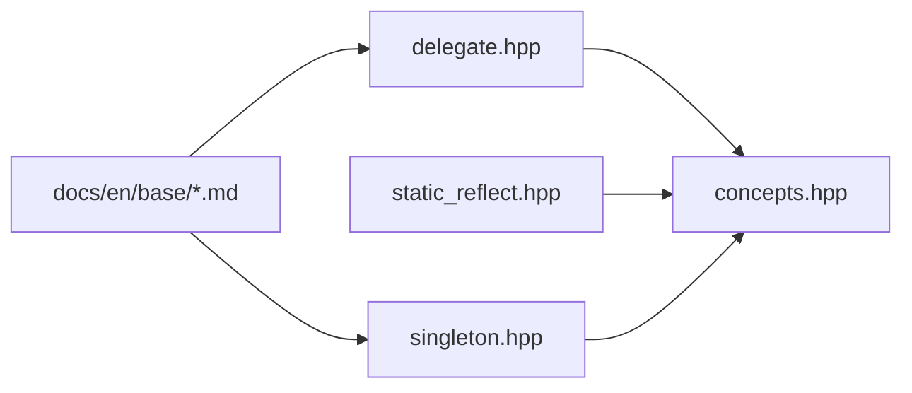

# Design Patterns and Utilities

<cite>
**Referenced Files in This Document**
- [singleton.hpp](file://base/singleton.hpp)
- [delegate.hpp](file://base/delegate.hpp)
- [concepts.hpp](file://base/concepts.hpp)
- [static_reflect.hpp](file://base/static_reflect.hpp)
- [README.md](file://docs/en/base/README.md)
- [singleton.md](file://docs/en/base/singleton.md)
- [delegate.md](file://docs/en/base/delegate.md)
</cite>

## Table of Contents
1. [Introduction](#introduction)
2. [Project Structure](#project-structure)
3. [Core Components](#core-components)
4. [Architecture Overview](#architecture-overview)
5. [Detailed Component Analysis](#detailed-component-analysis)
6. [Dependency Analysis](#dependency-analysis)
7. [Performance Considerations](#performance-considerations)
8. [Troubleshooting Guide](#troubleshooting-guide)
9. [Conclusion](#conclusion)

## Introduction
This document explains the design patterns and utility templates provided by HsBaSlicer’s base directory, focusing on three foundational mechanisms:

- Singleton pattern for global resource management.
- Delegate and event system for event-driven architectures and callbacks.
- C++20 concepts for compile-time type constraints.

These utilities are designed to improve modularity, testability, and safety across the codebase. The singleton provides a controlled global access point with thread-safe initialization; the delegate/event system enables loose coupling between producers and consumers; and the concept library enforces generic interfaces at compile time, reducing runtime errors and improving template error messages.

The base module is documented as a general-purpose foundation that includes singletons, delegates, coroutines, tuple iteration, any visitation, static reflection, pools, and threading utilities.

**Section sources**
- [README.md:1-17](file://docs/en/base/README.md#L1-L17)

## Project Structure
The relevant implementation lives under `base/`:

- `singleton.hpp` defines a thread-safe singleton template.
- `delegate.hpp` defines multicast delegates, events, and event sources.
- `concepts.hpp` defines reusable C++20 concepts used throughout the project.
- `static_reflect.hpp` provides compile-time reflection utilities built on top of these concepts.

**Diagram sources**
- [singleton.hpp:14-53](file://base/singleton.hpp#L14-L53)
- [delegate.hpp:20-243](file://base/delegate.hpp#L20-L243)
- [concepts.hpp:15-267](file://base/concepts.hpp#L15-L267)
- [static_reflect.hpp:26-183](file://base/static_reflect.hpp#L26-L183)

**Section sources**
- [singleton.hpp:1-63](file://base/singleton.hpp#L1-L63)
- [delegate.hpp:1-247](file://base/delegate.hpp#L1-L247)
- [concepts.hpp:1-270](file://base/concepts.hpp#L1-L270)
- [static_reflect.hpp:1-188](file://base/static_reflect.hpp#L1-L188)

## Core Components
This section summarizes the three core components and their architectural role.

### Singleton Pattern
- Provides a thread-safe, globally accessible instance through a template.
- Uses `std::call_once` to ensure one-time construction.
- Stores the instance in a static `std::shared_ptr`, enabling shared ownership semantics.
- Requires the target class to expose a protected constructor taking a sentinel `Protected` parameter, preventing arbitrary construction.

Architectural benefits:
- Centralizes configuration, logging, or service state without tight coupling.
- Simplifies testing by allowing replacement through dependency injection when combined with interfaces.

**Section sources**
- [singleton.hpp:14-53](file://base/singleton.hpp#L14-L53)
- [singleton.md:1-10](file://docs/en/base/singleton.md#L1-L10)

### Delegate and Event System
- `Delegate<R, Args...>` stores multiple callbacks with a common signature.
- Supports void and non-void return types:
  - For addable return types, results are accumulated using addition.
  - For other return types, the last callback’s result is returned.
- Thread-safe registration and invocation via `std::shared_mutex`.
- `Event<R, Args...>` encapsulates a delegate for an event.
- `EventSource<Derived, R, Args...>` exposes `Add`, `RaiseEvent`, and operator overloads for ergonomic event handling.

Architectural benefits:
- Enables decoupled communication between pipeline stages, exporters, and observers.
- Encourages event-driven architecture where components react to changes without direct dependencies.

**Section sources**
- [delegate.hpp:20-167](file://base/delegate.hpp#L20-L167)
- [delegate.hpp:169-243](file://base/delegate.hpp#L169-L243)
- [delegate.md:1-12](file://docs/en/base/delegate.md#L1-L12)

### C++20 Concepts
- Defines reusable compile-time constraints such as streamability, string-like types, hashability, allocators, arithmetic operations, and pointer-like behavior.
- Used by other utilities to constrain templates and provide clearer diagnostics.

Architectural benefits:
- Improves generic interface contracts.
- Reduces template instantiation failures by catching mismatches early.
- Makes algorithm interfaces explicit and self-documenting.

**Section sources**
- [concepts.hpp:15-267](file://base/concepts.hpp#L15-L267)

## Architecture Overview
The base utilities form a small but powerful foundation:

- Singletons manage global resources such as configuration, logging, or shared services.
- Delegates and events connect loosely coupled components, especially useful in slicing pipelines and export stages.
- Concepts enforce generic interfaces so algorithms and adapters can be reused safely.

**Diagram sources**
- [singleton.hpp:14-53](file://base/singleton.hpp#L14-L53)
- [delegate.hpp:20-243](file://base/delegate.hpp#L20-L243)
- [concepts.hpp:15-267](file://base/concepts.hpp#L15-L267)

## Detailed Component Analysis

### Singleton Implementation and Usage

#### Class Design
The singleton template controls construction and lifetime:

- `GetInstance` constructs the instance exactly once using `std::call_once`.
- The constructed object is stored in a static `std::shared_ptr`.
- Copy/move constructors and assignment operators are deleted to prevent accidental duplication.
- The target class must define a nested `Protected` struct and make `Singleton<T>` a friend to allow construction through the protected constructor.

**Diagram sources**
- [singleton.hpp:21-53](file://base/singleton.hpp#L21-L53)

#### Thread-Safety Model
- Initialization uses `std::call_once`, ensuring only one instance is created even under concurrent access.
- A `std::shared_mutex` is declared as a static member, indicating a design intent for synchronization around instance access.
- Because `GetInstance` currently returns a `std::shared_ptr`, callers share ownership of the singleton instance.

Practical implications:
- Safe for multi-threaded initialization.
- Callers should avoid mutating shared state without additional synchronization inside the service itself.

#### Example: Service Singleton
A typical service singleton follows this structure:

1. Define a nested `Protected` struct.
2. Make `HsBa::Slicer::Utils::Singleton<ServiceType>` a friend.
3. Provide a constructor that accepts `Protected` as the first parameter.
4. Obtain the instance via `Singleton<ServiceType>::GetInstance(...)`.

Recommended usage patterns:
- Use singletons for cross-cutting concerns such as configuration, logging, or plugin registries.
- Prefer interfaces and dependency injection where possible to keep tests replaceable.

**Section sources**
- [singleton.hpp:14-53](file://base/singleton.hpp#L14-L53)
- [singleton.md:12-48](file://docs/en/base/singleton.md#L12-L48)

### Delegate and Event System

#### Delegate Behavior
`Delegate<R, Args...>` manages a list of callbacks:

- `Add` registers a callable compatible with `std::invocable<CallbackType, Args...>`.
- `Invoke` executes all callbacks:
  - If `R` is `void`, callbacks run sequentially with no aggregated result.
  - If `R` satisfies the `Addable` concept, results are accumulated using `operator+`.
  - Otherwise, the last callback’s result is returned.
- Registration and inspection methods are thread-safe.

**Diagram sources**
- [delegate.hpp:57-94](file://base/delegate.hpp#L57-L94)
- [concepts.hpp:232-239](file://base/concepts.hpp#L232-L239)

#### Event Source Pattern
`EventSource<Derived, R, Args...>` provides a publish-subscribe style API:

- Consumers subscribe via `Add` or `+=`.
- Producers raise events via `RaiseEvent`.
- Removal APIs exist but are deprecated because `std::function` does not support equality comparison.

**Diagram sources**
- [delegate.hpp:197-243](file://base/delegate.hpp#L197-L243)
- [delegate.hpp:27-167](file://base/delegate.hpp#L27-L167)

#### Practical Example: Event-Driven Pipeline Stage
A pipeline stage can emit progress or completion events:

- Define a stage class inheriting from `EventSource`.
- Expose public methods that raise events after processing steps.
- Register listeners in higher-level orchestration code.

Benefits:
- Decouples processing logic from UI, logging, telemetry, or external systems.
- Allows multiple independent observers without modifying the producer.

**Section sources**
- [delegate.hpp:27-167](file://base/delegate.hpp#L27-L167)
- [delegate.hpp:169-243](file://base/delegate.hpp#L169-L243)
- [delegate.md:59-82](file://docs/en/base/delegate.md#L59-L82)

### C++20 Concepts for Generic Interfaces

#### Key Concepts
The concepts file defines reusable constraints:

- Streamability: `CharStream`, `WCharStream`.
- String-like types: `StdString`, `CStyleString`, `String`, `StringView`.
- Hashing and equality: `StdHash`, `Hash`, `EqualAndStdHash`, `EqualAndHash`.
- Allocators: `TAllocator`, `NoStateAllocator`.
- Arithmetic operations: `Addable`, `Subtractable`, `Multipliable`, `Dividable`.
- Pointer-like behavior: `PointerOrIt`, `PointerLike`.
- Optional-like behavior: `OptionalLike`.
- Reference and enumeration helpers: `Ref`, `LvalueRef`, `RvalueRef`, `Enum`.

These concepts enable generic algorithms and utilities to express requirements clearly.

#### Concept-Driven Delegate Integration
The delegate uses `std::invocable` to validate callbacks and `Addable` to decide how to aggregate non-void results. This demonstrates how concepts guide runtime behavior through compile-time checks.

**Diagram sources**
- [concepts.hpp:21-267](file://base/concepts.hpp#L21-L267)
- [delegate.hpp:37-42](file://base/delegate.hpp#L37-L42)
- [delegate.hpp:76-93](file://base/delegate.hpp#L76-L93)

#### Best Practices for Concept Design
- Keep concepts focused on a single responsibility.
- Prefer named concepts over inline `requires` clauses for readability.
- Combine simple concepts into compound concepts only when they represent a stable interface.
- Use concepts to document expected behavior, not just syntax.

**Section sources**
- [concepts.hpp:15-267](file://base/concepts.hpp#L15-L267)

### Static Reflection Utilities
Although not part of the primary objective, static reflection utilities build on the same philosophy:

- `FieldInfo` and `MethodInfo` describe class members at compile time.
- `Reflectable` is a concept requiring `FieldList`, `MethodList`, and `ClassName`.
- `Reflector<T>` provides indexed access to fields and methods and supports invoking methods by name.

This reinforces the project’s preference for compile-time guarantees and type-safe introspection.

**Section sources**
- [static_reflect.hpp:26-183](file://base/static_reflect.hpp#L26-L183)

## Dependency Analysis
The following diagram shows how the three core utilities relate to each other and to documentation.

**Diagram sources**
- [concepts.hpp:15-267](file://base/concepts.hpp#L15-L267)
- [singleton.hpp:14-53](file://base/singleton.hpp#L14-L53)
- [delegate.hpp:20-243](file://base/delegate.hpp#L20-L243)
- [static_reflect.hpp:26-183](file://base/static_reflect.hpp#L26-L183)
- [singleton.md:1-92](file://docs/en/base/singleton.md#L1-L92)
- [delegate.md:1-184](file://docs/en/base/delegate.md#L1-L184)

**Section sources**
- [concepts.hpp:15-267](file://base/concepts.hpp#L15-L267)
- [singleton.hpp:14-53](file://base/singleton.hpp#L14-L53)
- [delegate.hpp:20-243](file://base/delegate.hpp#L20-L243)
- [static_reflect.hpp:26-183](file://base/static_reflect.hpp#L26-L183)

## Performance Considerations

### Singleton Performance
- Construction is guarded by `std::call_once`, which has low overhead after initialization.
- Returning `std::shared_ptr` introduces reference-counting overhead if copied frequently.
- Consider whether a raw pointer or reference is sufficient for read-only access after initialization.

Recommendations:
- Avoid copying the singleton handle unnecessarily.
- Ensure the singleton’s internal state is either immutable or internally synchronized.

### Delegate vs Virtual Dispatch
- Delegates use `std::function` storage and iterate over a vector of callbacks.
- Invocation cost grows linearly with the number of callbacks.
- Non-void return types may allocate or copy results depending on aggregation strategy.
- Virtual dispatch incurs a vtable lookup per call but avoids callback iteration.

Guidelines:
- Use delegates for multicast callbacks and event-driven workflows.
- Use virtual interfaces when you need a fixed set of polymorphic operations with predictable performance.
- Minimize the number of callbacks attached to hot-path delegates.

### Concept Overhead
- Concepts impose zero runtime cost; they are resolved at compile time.
- Poorly designed concepts can increase compilation time and error verbosity.
- Favor precise, minimal constraints to reduce template bloat and improve diagnostics.

[No sources needed since this section provides general guidance]

## Troubleshooting Guide

### Singleton Issues
- **Multiple instances observed:** Verify that the target class defines the required `Protected` struct and grants friendship to `Singleton<T>`.
- **Initialization order problems:** Be cautious about singletons depending on other singletons during startup.
- **Thread-safety surprises:** Remember that `GetInstance` ensures one-time construction, but shared mutable state still requires synchronization inside the service.

**Section sources**
- [singleton.hpp:21-53](file://base/singleton.hpp#L21-L53)

### Delegate and Event Issues
- **Callback removal warnings:** The removal APIs are deprecated because `std::function` lacks equality comparison. Prefer designs that do not require unregistration, or use distinct functor types when necessary.
- **Unexpected return values:** For non-void delegates, understand whether the return type is `Addable`. If it is, results are accumulated; otherwise, the last callback’s result wins.
- **Dangling callbacks:** Delegates store copies or wrappers of callables. Ensure captured objects outlive the delegate.

**Section sources**
- [delegate.hpp:43-56](file://base/delegate.hpp#L43-L56)
- [delegate.hpp:57-94](file://base/delegate.hpp#L57-L94)
- [delegate.md:129-136](file://docs/en/base/delegate.md#L129-L136)

### Concept Issues
- **Template compilation errors:** Narrow down which concept constraint failed.
- **Overly broad concepts:** Refine constraints to avoid accepting unintended types.
- **Missing operations:** Ensure custom types implement the required operators or functions referenced by the concept.

**Section sources**
- [concepts.hpp:21-267](file://base/concepts.hpp#L21-L267)

## Conclusion
HsBaSlicer’s base utilities provide a cohesive foundation for robust, modular C++ code:

- The singleton template offers a controlled, thread-safe mechanism for global resources.
- The delegate and event system enables flexible, decoupled communication suitable for event-driven architectures.
- The concept library enforces clear generic interfaces, improving safety and maintainability.

Together, these patterns promote loose coupling, testability, and predictable behavior across the slicing engine and its extensions. When applying them, prioritize thread safety, minimize unnecessary allocations, and design concepts that reflect real semantic requirements rather than mere syntactic compatibility.

[No sources needed since this section summarizes without analyzing specific files]