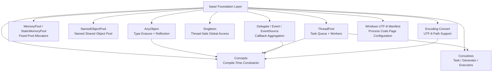
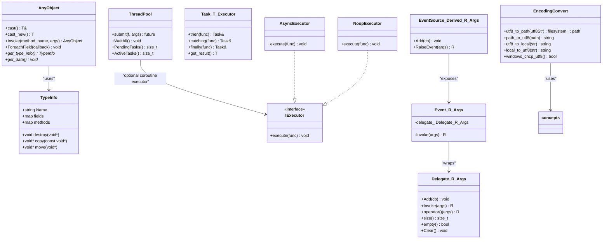
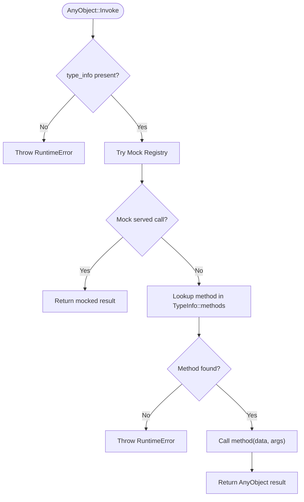
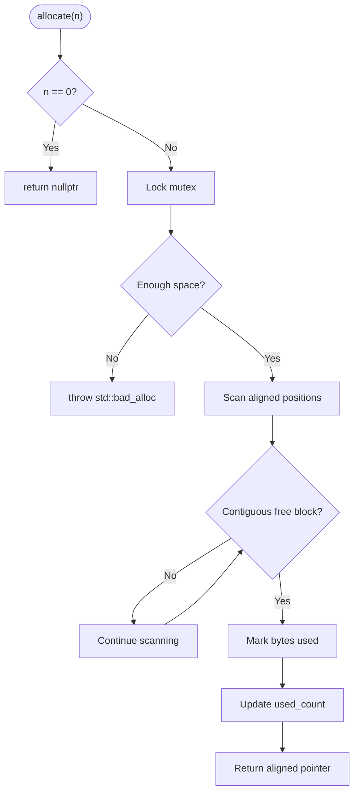
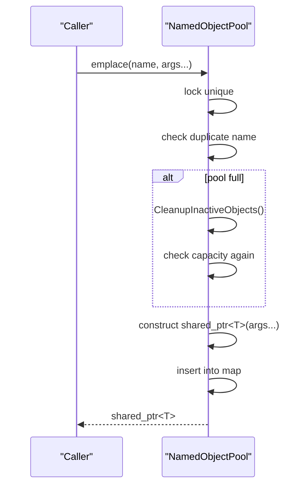
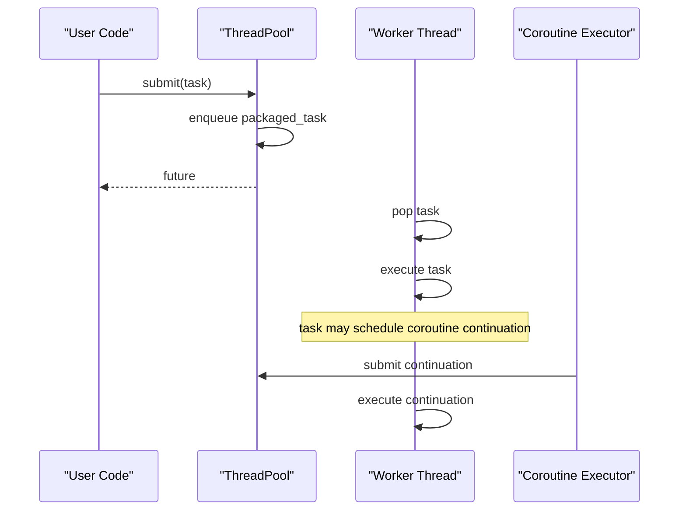
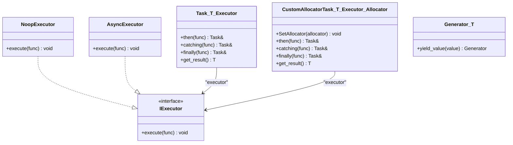
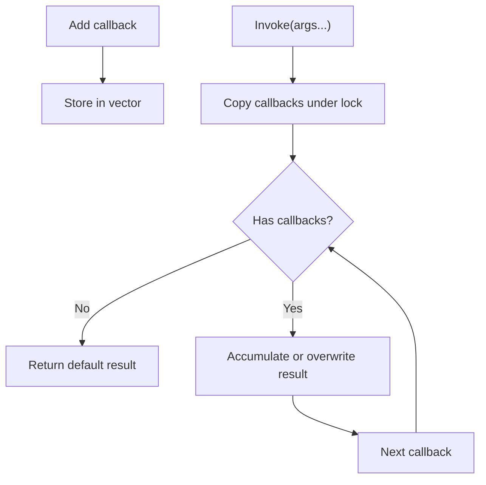
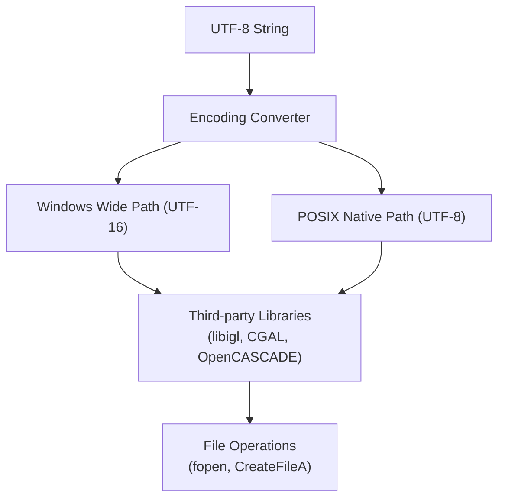
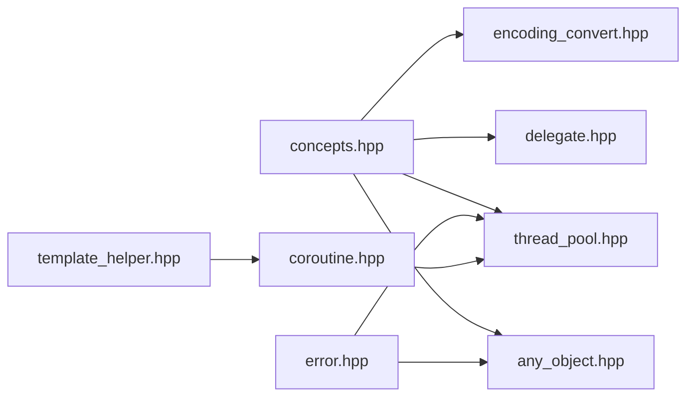

# Foundation Layer (base/)

<cite>
**Referenced Files in This Document**
- [any_object.hpp](file://base/any_object.hpp)
- [any_object.cpp](file://base/any_object.cpp)
- [memory_pool.hpp](file://base/memory_pool.hpp)
- [object_pool.hpp](file://base/object_pool.hpp)
- [thread_pool.hpp](file://base/thread_pool.hpp)
- [singleton.hpp](file://base/singleton.hpp)
- [concepts.hpp](file://base/concepts.hpp)
- [coroutine.hpp](file://base/coroutine.hpp)
- [delegate.hpp](file://base/delegate.hpp)
- [encoding_convert.hpp](file://base/encoding_convert.hpp)
- [encoding_convert.cpp](file://base/encoding_convert.cpp)
- [hsba_utf8.manifest](file://cmake/hsba_utf8.manifest)
- [HsBaWindowsUtf8.cmake](file://cmake/HsBaWindowsUtf8.cmake)
</cite>

## Update Summary
**Changes Made**
- Added comprehensive UTF-8 path support system documentation
- Documented new encoding conversion functions (utf8_to_path, path_to_utf8, utf8_to_local, local_to_utf8)
- Added Windows UTF-8 manifest integration details
- Updated file I/O layer Unicode compatibility information
- Enhanced cross-platform encoding handling documentation

## Table of Contents
1. [Introduction](#introduction)
2. [Project Structure](#project-structure)
3. [Core Components](#core-components)
4. [Architecture Overview](#architecture-overview)
5. [Detailed Component Analysis](#detailed-component-analysis)
6. [UTF-8 Path Support System](#utf-8-path-support-system)
7. [Dependency Analysis](#dependency-analysis)
8. [Performance Considerations](#performance-considerations)
9. [Troubleshooting Guide](#troubleshooting-guide)
10. [Conclusion](#conclusion)
11. [Appendices](#appendices)

## Introduction
The `base/` directory is the foundation layer for HsBaSlicer. It provides type-erased object handling, reflection-style dispatch, memory and object pools, a thread pool with coroutine integration, a singleton helper, C++20 concepts for compile-time constraints, coroutine primitives, a delegate/event system, and comprehensive UTF-8 path support for cross-platform Unicode compatibility. These components are reused by higher-level slicing modules such as model processing, path generation, support generation, and pipeline orchestration.

This document explains how these building blocks work together, how to use them safely, and what performance and safety trade-offs they introduce. The UTF-8 path support system ensures proper Unicode handling across all platforms, particularly addressing Windows ANSI code page limitations through manifest-based configuration.

## Project Structure
The foundation layer is organized around focused headers:

- Type erasure and reflection: `any_object.hpp`, `any_object.cpp`
- Memory and object lifetime: `memory_pool.hpp`, `object_pool.hpp`
- Concurrency: `thread_pool.hpp`, `coroutine.hpp`
- Global state: `singleton.hpp`
- Compile-time type contracts: `concepts.hpp`
- Callback and event patterns: `delegate.hpp`
- **New**: UTF-8 path encoding and conversion: `encoding_convert.hpp`, `encoding_convert.cpp`
- **New**: Windows UTF-8 manifest integration: `hsba_utf8.manifest`, `HsBaWindowsUtf8.cmake`



**Diagram sources**
- [any_object.hpp:43-115](file://base/any_object.hpp#L43-L115)
- [memory_pool.hpp:19-208](file://base/memory_pool.hpp#L19-L208)
- [object_pool.hpp:16-283](file://base/object_pool.hpp#L16-L283)
- [thread_pool.hpp:25-162](file://base/thread_pool.hpp#L25-L162)
- [coroutine.hpp:41-773](file://base/coroutine.hpp#L41-L773)
- [singleton.hpp:14-61](file://base/singleton.hpp#L14-L61)
- [concepts.hpp:15-267](file://base/concepts.hpp#L15-L267)
- [delegate.hpp:20-243](file://base/delegate.hpp#L20-L243)
- [encoding_convert.hpp:32-53](file://base/encoding_convert.hpp#L32-L53)
- [hsba_utf8.manifest:22-26](file://cmake/hsba_utf8.manifest#L22-L26)

**Section sources**
- [any_object.hpp:1-115](file://base/any_object.hpp#L1-L115)
- [memory_pool.hpp:1-208](file://base/memory_pool.hpp#L1-L208)
- [object_pool.hpp:1-283](file://base/object_pool.hpp#L1-L283)
- [thread_pool.hpp:1-162](file://base/thread_pool.hpp#L1-L162)
- [coroutine.hpp:1-773](file://base/coroutine.hpp#L1-L773)
- [singleton.hpp:1-61](file://base/singleton.hpp#L1-L61)
- [concepts.hpp:1-267](file://base/concepts.hpp#L1-L267)
- [delegate.hpp:1-243](file://base/delegate.hpp#L1-L243)
- [encoding_convert.hpp:1-304](file://base/encoding_convert.hpp#L1-L304)
- [encoding_convert.cpp:1-264](file://base/encoding_convert.cpp#L1-L264)
- [hsba_utf8.manifest:1-29](file://cmake/hsba_utf8.manifest#L1-L29)
- [HsBaWindowsUtf8.cmake:1-58](file://cmake/HsBaWindowsUtf8.cmake#L1-L58)

## Core Components
This section summarizes the foundational primitives and their roles.

| Component | Responsibility | Key Interfaces | Typical Use in HsBaSlicer |
|---|---|---|---|
| `AnyObject` | Type-erased wrapper with runtime method dispatch and field traversal | `cast<T>()`, `Invoke()`, `ForeachField()` | Dynamic typing, scripting bridges, generic serialization |
| `TypeInfo` | Runtime metadata for a registered type | `Name`, `destroy`, `copy`, `move`, `fields`, `methods` | Enables reflection-like behavior for `AnyObject` |
| `MemoryPool` / `StaticMemoryPool` | Fixed-capacity allocators compatible with STL containers | `allocate`, `deallocate`, `construct`, `destroy` | Performance-critical allocations during mesh or polygon processing |
| `NamedObjectPool` | Named shared-object registry with capacity limits | `emplace`, `get`, `remove`, `Cleanup` | Reusable models, caches, or pipeline stage objects |
| `ThreadPool` | Worker-thread task queue with futures | `submit`, `WaitAll`, `PendingTasks`, `ActiveTasks` | Parallel slicing, path optimization, I/O-bound work |
| `Task` / `Generator` | C++20 coroutine abstractions | `then`, `catching`, `finally`, `yield_value` | Asynchronous pipelines and streaming generators |
| `IExecutor` / `AsyncExecutor` / `NoopExecutor` | Execution policy for coroutines | `execute(func)` | Control where coroutine continuations run |
| `Singleton` | Thread-safe global instance access | `GetInstance(args...)` | Configuration, logging, or shared resources |
| `Concepts` | Compile-time type requirements | `String`, `StdHash`, `TAllocator`, `Addable`, etc. | Enforce API contracts without runtime checks |
| `Delegate` / `Event` / `EventSource` | Multicast callbacks and events | `Add`, `Invoke`, `RaiseEvent` | Pipeline events, progress notifications, plugin hooks |
| **`utf8_to_path` / `path_to_utf8`** | **Cross-platform UTF-8 path conversion** | **UTF-8 ↔ std::filesystem::path** | **Unicode file paths across all platforms** |
| **`utf8_to_local` / `local_to_utf8`** | **Local encoding conversion for narrow APIs** | **UTF-8 ↔ Local narrow encoding** | **Third-party library compatibility (libigl, CGAL, OpenCASCADE)** |

**Section sources**
- [any_object.hpp:46-115](file://base/any_object.hpp#L46-L115)
- [memory_pool.hpp:28-208](file://base/memory_pool.hpp#L28-L208)
- [object_pool.hpp:22-283](file://base/object_pool.hpp#L22-L283)
- [thread_pool.hpp:29-162](file://base/thread_pool.hpp#L29-L162)
- [coroutine.hpp:47-773](file://base/coroutine.hpp#L47-L773)
- [singleton.hpp:21-61](file://base/singleton.hpp#L21-L61)
- [concepts.hpp:17-267](file://base/concepts.hpp#L17-L267)
- [delegate.hpp:27-243](file://base/delegate.hpp#L27-L243)
- [encoding_convert.hpp:32-53](file://base/encoding_convert.hpp#L32-L53)

## Architecture Overview
The foundation layer forms a layered base:

- Concepts define compile-time contracts used across the layer.
- `AnyObject` depends on concepts and error types to provide dynamic typing.
- `ThreadPool` integrates with coroutines through an executor interface.
- `NamedObjectPool` manages long-lived shared objects that may be wrapped in `AnyObject`.
- `Singleton` provides controlled global access to configuration or services.
- `Delegate` and `EventSource` enable decoupled communication between pipeline stages.
- **Encoding conversion utilities provide cross-platform Unicode path handling**, with Windows-specific manifest integration for full UTF-8 support.



**Diagram sources**
- [any_object.hpp:46-115](file://base/any_object.hpp#L46-L115)
- [thread_pool.hpp:29-162](file://base/thread_pool.hpp#L29-L162)
- [coroutine.hpp:47-773](file://base/coroutine.hpp#L47-L773)
- [delegate.hpp:27-243](file://base/delegate.hpp#L27-L243)
- [encoding_convert.hpp:32-53](file://base/encoding_convert.hpp#L32-L53)

**Section sources**
- [any_object.hpp:43-115](file://base/any_object.hpp#L43-L115)
- [thread_pool.hpp:25-162](file://base/thread_pool.hpp#L25-L162)
- [coroutine.hpp:41-773](file://base/coroutine.hpp#L41-L773)
- [delegate.hpp:20-243](file://base/delegate.hpp#L20-L243)
- [encoding_convert.hpp:32-53](file://base/encoding_convert.hpp#L32-L53)

## Detailed Component Analysis

### AnyObject and TypeInfo
`AnyObject` is a type-erased wrapper that stores a `TypeInfo*` and an opaque `void*`. `TypeInfo` holds destruction, copy, move, field, and method descriptors. Construction from arbitrary values registers the type information and owns the underlying data when the ownership flag indicates so.

Key behaviors:
- `cast<T>()` performs a runtime-checked cast and throws on mismatch.
- `Invoke()` dispatches by method name using `TypeInfo::methods`.
- `ForeachField()` iterates over `TypeInfo::fields` and constructs temporary `AnyObject` views into subobjects.
- A mock registry can intercept `Invoke()` calls when test macros are detected.



**Diagram sources**
- [any_object.cpp:88-111](file://base/any_object.cpp#L88-L111)
- [any_object.hpp:94-110](file://base/any_object.hpp#L94-L110)

Practical usage pattern:
- Wrap a domain object in `AnyObject` to pass it through generic pipelines.
- Register `TypeInfo` for custom types so fields and methods become discoverable.
- Use `cast<T>()` at boundaries where the concrete type is known.
- In tests, enable mocking to replace expensive or external-dependent methods.

**Section sources**
- [any_object.hpp:46-115](file://base/any_object.hpp#L46-L115)
- [any_object.hpp:673-730](file://base/any_object.hpp#L673-L730)
- [any_object.cpp:9-87](file://base/any_object.cpp#L9-L87)
- [any_object.cpp:88-111](file://base/any_object.cpp#L88-L111)

### MemoryPool and StaticMemoryPool
`MemoryPool<T, PoolSize>` is a per-instance fixed-size allocator. `StaticMemoryPool<T, PoolSize>` is a process-wide static allocator. Both implement the standard allocator interface (`allocate`, `deallocate`, `construct`, `destroy`) and can be used with STL containers.

Important characteristics:
- Allocations scan aligned positions in a byte buffer until enough contiguous free bytes are found.
- Allocation failures throw `std::bad_alloc`.
- Deallocations validate pointer bounds and mark bytes as unused.
- Both classes are mutex-protected; concurrent allocation is safe but serialized.



**Diagram sources**
- [memory_pool.hpp:111-142](file://base/memory_pool.hpp#L111-L142)
- [memory_pool.hpp:266-296](file://base/memory_pool.hpp#L266-L296)

Best practices:
- Choose `PoolSize` based on measured peak allocation sizes.
- Prefer `StaticMemoryPool` when multiple containers should share one pool.
- Avoid storing pointers across reallocation boundaries if the pool reallocates its backing storage.
- Monitor `UsedCount()` or pool utilization in performance-sensitive paths.

**Section sources**
- [memory_pool.hpp:28-208](file://base/memory_pool.hpp#L28-L208)
- [memory_pool.hpp:215-372](file://base/memory_pool.hpp#L215-L372)

### NamedObjectPool
`NamedObjectPool<T, MaxSize>` maintains named `std::shared_ptr<T>` entries. When adding an object at capacity, inactive entries are cleaned up before insertion.

Key operations:
- `emplace(name, args...)` constructs and inserts.
- `insert(name, shared_ptr)` inserts an existing object.
- `get(name)` returns a shared pointer or null.
- `Cleanup()` removes inactive objects whose only owner is the pool itself.



**Diagram sources**
- [object_pool.hpp:66-92](file://base/object_pool.hpp#L66-L92)
- [object_pool.hpp:262-279](file://base/object_pool.hpp#L262-L279)

Usage guidance:
- Use named pools for reusable models, geometry caches, or pipeline-stage objects.
- Ensure callers release `shared_ptr` references promptly so cleanup can reclaim memory.
- Treat `get(name)` returning null as a missing-object case rather than assuming existence.

**Section sources**
- [object_pool.hpp:22-283](file://base/object_pool.hpp#L22-L283)

### ThreadPool and Coroutine Executor Integration
`ThreadPool` manages worker threads, a task queue, futures, and completion signaling. Tasks are submitted via `submit`, which wraps callable arguments in a `packaged_task` and returns a `future`.

Coroutine integration:
- When C++20 coroutines are available and `HSBA_ENABLE_THREAD_POOL_COROUTINE` is defined, `Utils::ThreadPoolExecutor` implements `IExecutor`.
- The executor submits tasks to a `ThreadPool`, allowing coroutine continuations to run on worker threads.
- A default pool can be set globally or created lazily.



**Diagram sources**
- [thread_pool.hpp:67-90](file://base/thread_pool.hpp#L67-L90)
- [thread_pool.hpp:118-154](file://base/thread_pool.hpp#L118-L154)
- [thread_pool.hpp:170-206](file://base/thread_pool.hpp#L170-L206)

Recommended patterns:
- Construct `ThreadPool` once per application or per major subsystem.
- Use `WaitAll()` when you need to synchronize all submitted work.
- For coroutine-heavy code, configure `ThreadPoolExecutor` to avoid blocking the main thread.

**Section sources**
- [thread_pool.hpp:29-162](file://base/thread_pool.hpp#L29-L162)
- [thread_pool.hpp:164-206](file://base/thread_pool.hpp#L164-L206)

### Coroutines: Task, Generator, and Executors
The coroutine layer defines:
- `IExecutor`: abstract execution policy.
- `NoopExecutor`: runs synchronously.
- `AsyncExecutor`: uses `std::async`.
- `Task<T, Executor>`: coroutine-based asynchronous computation with `then`, `catching`, `finally`, and result retrieval.
- `CustomAllocatorTask`: coroutine task backed by a custom allocator constrained by concepts.
- `Generator<T>`: lazy generator coroutine yielding values.



**Diagram sources**
- [coroutine.hpp:47-773](file://base/coroutine.hpp#L47-L773)

Design notes:
- `Task` uses a promise with initial suspension through `DispatchAwaiter`, ensuring continuations run on the configured executor.
- Exceptions are captured and rethrown when retrieving results.
- Generators suspend and resume to produce sequences, useful for streaming geometry or path data.

**Section sources**
- [coroutine.hpp:47-773](file://base/coroutine.hpp#L47-L773)

### Singleton
`Singleton<T>` provides thread-safe global access through `GetInstance(args...)`. Construction is guarded by `std::call_once`, and instances are managed as `std::shared_ptr`.

Usage guidance:
- Derive your service class from `Singleton` or use composition with a singleton factory.
- Keep constructors minimal because initialization happens lazily.
- Avoid holding mutable global state without explicit synchronization beyond the singleton mechanism.

**Section sources**
- [singleton.hpp:21-61](file://base/singleton.hpp#L21-L61)

### Concepts
`concepts.hpp` defines reusable compile-time constraints:
- Streamability: `CharStream`, `WCharStream`
- String handling: `StdString`, `CStyleString`, `String`, `StringView`
- Hashing and equality: `StdHash`, `Hash`, `EqualAndStdHash`, `EqualAndHash`
- Pointers and iterators: `PointerLike`, `PointerOrIt`, `CStylePointer`
- Optional-like types: `OptionalLike`
- Allocators: `TAllocator`, `NoStateAllocator`
- Arithmetic operations: `Addable`, `Subtractable`, `Multipliable`, `Dividable`

These concepts constrain templates and improve error messages at compile time. They are used by other foundation components, including delegates and coroutine utilities.

**Section sources**
- [concepts.hpp:17-267](file://base/concepts.hpp#L17-L267)

### Delegate, Event, and EventSource
`Delegate<R, Args...>` aggregates multiple callbacks with the same signature:
- `Add` appends a callback.
- `Invoke` calls all callbacks; for additive return types, results are summed; otherwise, the last result wins.
- Thread-safe read/write access is protected by a shared mutex.

`Event<R, Args...>` encapsulates a private `Delegate`, while `EventSource<Derived, R, Args...>` exposes registration and raising APIs.



**Diagram sources**
- [delegate.hpp:37-94](file://base/delegate.hpp#L37-L94)

Best practices:
- Use `+=` to subscribe and prefer explicit unsubscribe patterns where possible.
- Be aware that `Remove` is deprecated because `std::function` does not support equality comparison.
- Use `EventSource` to expose publish-subscribe semantics to consumers.

**Section sources**
- [delegate.hpp:27-167](file://base/delegate.hpp#L27-L167)
- [delegate.hpp:173-243](file://base/delegate.hpp#L173-L243)

## UTF-8 Path Support System

**Updated** Added comprehensive UTF-8 path support system for cross-platform Unicode compatibility, addressing Windows ANSI code page limitations through manifest-based configuration.

The UTF-8 path support system provides robust Unicode file path handling across all platforms, with special attention to Windows platform limitations. The system consists of three main components:

### Core Encoding Conversion Functions

The primary interface provides four key functions for path and string encoding conversion:

- **`utf8_to_path`**: Converts UTF-8 strings to native `std::filesystem::path`
  - On Windows: Decodes UTF-8 to wide (UTF-16) representation, bypassing ANSI code page limitations
  - On POSIX/Android/iOS: Pass-through since native encoding is already UTF-8
  
- **`path_to_utf8`**: Converts native paths back to UTF-8 strings
  - On Windows: Encodes wide (UTF-16) paths to UTF-8
  - On other platforms: Equivalent to `path.string()`

- **`utf8_to_local` / `local_to_utf8`**: Convert between UTF-8 and local narrow encoding
  - Used for third-party libraries that only accept narrow `char*` parameters
  - Becomes pass-through when process code page is UTF-8 (via manifest)



**Diagram sources**
- [encoding_convert.cpp:101-144](file://base/encoding_convert.cpp#L101-L144)
- [encoding_convert.hpp:32-53](file://base/encoding_convert.hpp#L32-L53)

### Windows UTF-8 Manifest Integration

The system addresses Windows-specific limitations through an embedded application manifest that sets the process code page to UTF-8:

**Manifest Configuration** (`cmake/hsba_utf8.manifest`):
```xml
<activeCodePage xmlns="http://schemas.microsoft.com/SMI/2019/WindowsSettings">UTF-8</activeCodePage>
<longPathAware xmlns="http://schemas.microsoft.com/SMI/2016/WindowsSettings">true</longPathAware>
```

**Build Integration** (`cmake/HsBaWindowsUtf8.cmake`):
- Provides `hsba_apply_utf8_codepage(target)` function
- Embeds manifest via MSVC linker options `/MANIFEST:EMBED` and `/MANIFESTINPUT:`
- Applied automatically to desktop executables in root CMakeLists.txt

**Effect**: Sets `GetACP()` to 65001 (UTF-8), making `utf8_to_local()` a pass-through and enabling full Unicode support for all narrow-API formats.

### Platform-Specific Behavior

| Platform | Native Encoding | `utf8_to_path` Behavior | `utf8_to_local` Behavior |
|----------|----------------|------------------------|-------------------------|
| Windows | UTF-16 (wide) | UTF-8 → UTF-16 conversion | UTF-8 → ANSI (unless manifest active) |
| Linux/macOS | UTF-8 | Pass-through | Pass-through |
| Android/iOS | UTF-8 | Pass-through | Pass-through |

### Usage Patterns and Best Practices

**Correct Usage**:
```cpp
// For std::filesystem APIs (recommended)
std::filesystem::path fsPath = utf8_to_path("model_with_中文文件名.stl");
std::ifstream file(fsPath);

// For third-party libraries requiring narrow char*
std::string narrowPath = utf8_to_local("model_with_中文文件名.stl");
some_library_function(narrowPath.c_str());

// Converting back to UTF-8 for storage/logging
std::string utf8Path = path_to_utf8(fsPath);
```

**Anti-patterns to Avoid**:
- ❌ `std::filesystem::path(utf8Str).string()` - Double-corrupts non-ASCII paths on Windows
- ❌ Mixing conversion functions unnecessarily
- ❌ Assuming `path.string()` works correctly on Windows for non-ASCII paths

### Integration Across HsBaSlicer

The UTF-8 path support is applied throughout the codebase:

**Model Reading**: `IglModel`, `CgalModel`, `OcctModel`, `OpenVdbModel` use `utf8_to_local` for narrow backends.

**Result Saving**: `Zipper`/`Bit7zZipper` archives, `ImagesPath`/`LayersPath` result savers, and export functions in `LibHsBaSlicer` properly handle Unicode paths.

**Testing**: Comprehensive unit tests verify encoding conversion correctness and round-trip integrity.

**Section sources**
- [encoding_convert.hpp:32-53](file://base/encoding_convert.hpp#L32-L53)
- [encoding_convert.cpp:60-144](file://base/encoding_convert.cpp#L60-L144)
- [hsba_utf8.manifest:22-26](file://cmake/hsba_utf8.manifest#L22-L26)
- [HsBaWindowsUtf8.cmake:30-57](file://cmake/HsBaWindowsUtf8.cmake#L30-L57)

## Dependency Analysis
The foundation layer has clear internal dependencies:

- `AnyObject` depends on `concepts.hpp` and `error.hpp`.
- `ThreadPool` depends on `coroutine.hpp` and `error.hpp`.
- `Delegate` and `EventSource` depend on `concepts.hpp`.
- `coroutine.hpp` depends on `template_helper.hpp` and standard library coroutine facilities.
- Pools and singletons have minimal cross-dependencies, keeping them reusable.
- **Encoding conversion depends on `concepts.hpp` and platform-specific headers**.



**Diagram sources**
- [any_object.hpp:22-24](file://base/any_object.hpp#L22-L24)
- [thread_pool.hpp:22-24](file://base/thread_pool.hpp#L22-L24)
- [delegate.hpp:18](file://base/delegate.hpp#L18)
- [coroutine.hpp:25-39](file://base/coroutine.hpp#L25-L39)
- [encoding_convert.hpp:10-15](file://base/encoding_convert.hpp#L10-L15)

**Section sources**
- [any_object.hpp:22-24](file://base/any_object.hpp#L22-L24)
- [thread_pool.hpp:22-24](file://base/thread_pool.hpp#L22-L24)
- [delegate.hpp:18](file://base/delegate.hpp#L18)
- [coroutine.hpp:25-39](file://base/coroutine.hpp#L25-L39)
- [encoding_convert.hpp:10-15](file://base/encoding_convert.hpp#L10-L15)

## Performance Considerations
- `AnyObject` introduces runtime type checks and method dispatch. Reserve it for boundaries where dynamic typing is necessary.
- `MemoryPool` and `StaticMemoryPool` reduce heap fragmentation and allocation overhead, but misconfigured `PoolSize` can cause frequent `std::bad_alloc`.
- `NamedObjectPool` avoids repeated construction of large objects, but excessive growth can delay cleanup; ensure short-lived references are released.
- `ThreadPool` parallelizes work, but too many workers can increase contention; tune `num_threads` based on workload characteristics.
- Coroutines add abstraction overhead compared to direct function calls; use them where asynchronous control flow improves clarity.
- `Delegate::Invoke` copies the callback list under lock; keep callback counts reasonable and avoid heavy work inside hot-path callbacks.
- **UTF-8 conversions add minimal overhead but provide critical Unicode support; prefer `utf8_to_path` for `std::filesystem` operations to avoid double-conversion issues**.

[No sources needed since this section provides general guidance]

## Troubleshooting Guide
Common issues and resolutions:

| Symptom | Likely Cause | Resolution |
|---|---|---|
| `RuntimeError("Bad AnyObject cast: type mismatch")` | Casting `AnyObject` to an unexpected type | Verify the stored type matches `T`; inspect `GetTypeInfo` registration |
| `RuntimeError("Method not found: ...")` | Invoking an unregistered method name | Register the method in `TypeInfo::methods` for the type |
| `std::bad_alloc` from pool allocator | `PoolSize` too small or fragmented allocation request | Increase pool size or adjust allocation strategy |
| `std::invalid_argument("Pointer out of pool bounds")` | Deallocating a pointer not returned by the pool | Only deallocate pointers obtained from the same allocator instance |
| `RuntimeError("Pool is full ...")` | `NamedObjectPool` reached capacity with no inactive objects | Release `shared_ptr` references or increase `MaxSize` |
| `InvalidArgumentError("Number of threads must be greater than 0")` | Constructing `ThreadPool` with zero threads | Pass a positive thread count |
| `RuntimeError("Cannot submit task to stopped ThreadPool")` | Submitting after destructor began shutdown | Do not submit new tasks after stopping or destroying the pool |
| Coroutine continuation never resumes | Executor not configured or default pool unavailable | Configure `ThreadPoolExecutor` or set a default pool |
| **Non-ASCII file paths fail on Windows** | Missing UTF-8 manifest or incorrect conversion usage | Apply `hsba_apply_utf8_codepage()` and use `utf8_to_path`/`utf8_to_local` appropriately |
| **Chinese/emoji characters corrupted in filenames** | Using `path.string()` instead of proper conversion functions | Replace with `path_to_utf8()` for UTF-8 APIs or `utf8_to_local()` for narrow APIs |

**Section sources**
- [any_object.hpp:83-100](file://base/any_object.hpp#L83-L100)
- [any_object.cpp:88-111](file://base/any_object.cpp#L88-L111)
- [memory_pool.hpp:111-175](file://base/memory_pool.hpp#L111-L175)
- [memory_pool.hpp:266-324](file://base/memory_pool.hpp#L266-L324)
- [object_pool.hpp:71-155](file://base/object_pool.hpp#L71-L155)
- [thread_pool.hpp:37-46](file://base/thread_pool.hpp#L37-L46)
- [thread_pool.hpp:77-89](file://base/thread_pool.hpp#L77-L89)
- [encoding_convert.cpp:101-144](file://base/encoding_convert.cpp#L101-L144)

## Conclusion
The `base/` foundation layer provides the essential primitives for HsBaSlicer: dynamic typing through `AnyObject`, efficient memory management through pools, concurrency through `ThreadPool` and coroutines, global state through `Singleton`, compile-time safety through `Concepts`, decoupled communication through `Delegate` and `EventSource`, and comprehensive UTF-8 path support for cross-platform Unicode compatibility. The UTF-8 path support system ensures proper Unicode handling across all platforms, particularly addressing Windows ANSI code page limitations through manifest-based configuration. Higher-level slicing functionality builds on these components to manage models, compute paths, generate supports, and export outputs. Correct usage requires respecting ownership semantics, sizing pools appropriately, tuning concurrency, preferring compile-time constraints where possible, and using the appropriate encoding conversion functions for file path handling.

[No sources needed since this section summarizes without analyzing specific files]

## Appendices

### Concrete Usage Examples

#### Using AnyObject for Dynamic Typing
- Construct `AnyObject` from a value to wrap it.
- Use `cast<T>()` when the concrete type is known.
- Use `Invoke()` for string-keyed method dispatch.
- Use `ForeachField()` to traverse fields registered in `TypeInfo`.

Reference locations:
- [any_object.hpp:71-115](file://base/any_object.hpp#L71-L115)
- [any_object.cpp:76-87](file://base/any_object.cpp#L76-L87)

#### Using MemoryPool for Performance-Critical Allocations
- Define a container with `std::vector<T, MemoryPool<T, PoolSize>>`.
- Ensure `PoolSize` accommodates expected peak usage.
- Handle `std::bad_alloc` when capacity is exceeded.

Reference locations:
- [memory_pool.hpp:43-208](file://base/memory_pool.hpp#L43-L208)

#### Using ThreadPool for Parallel Processing
- Create a `ThreadPool` with an appropriate worker count.
- Submit tasks with `submit` and collect results via futures.
- Call `WaitAll()` to synchronize completion.

Reference locations:
- [thread_pool.hpp:37-90](file://base/thread_pool.hpp#L37-L90)
- [thread_pool.hpp:107-111](file://base/thread_pool.hpp#L107-L111)

#### Using Concepts for Compile-Time Type Checking
- Constrain template parameters with concepts like `String`, `StdHash`, `TAllocator`, `Addable`.
- Use concept errors to guide API design and improve diagnostics.

Reference locations:
- [concepts.hpp:17-267](file://base/concepts.hpp#L17-L267)

#### Using UTF-8 Path Conversion Functions
- Use `utf8_to_path()` for `std::filesystem` operations with Unicode paths.
- Use `utf8_to_local()` for third-party libraries requiring narrow `char*`.
- Use `path_to_utf8()` to convert paths back to UTF-8 for storage or logging.
- Apply Windows UTF-8 manifest via `hsba_apply_utf8_codepage()` for full Unicode support.

Reference locations:
- [encoding_convert.hpp:32-53](file://base/encoding_convert.hpp#L32-L53)
- [encoding_convert.cpp:101-144](file://base/encoding_convert.cpp#L101-L144)
- [HsBaWindowsUtf8.cmake:30-57](file://cmake/HsBaWindowsUtf8.cmake#L30-L57)