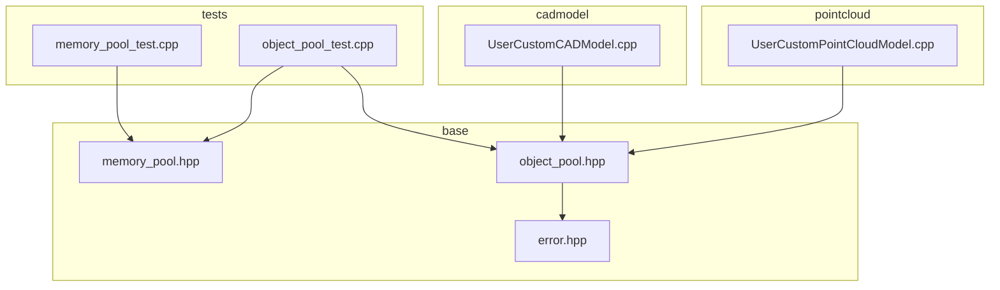
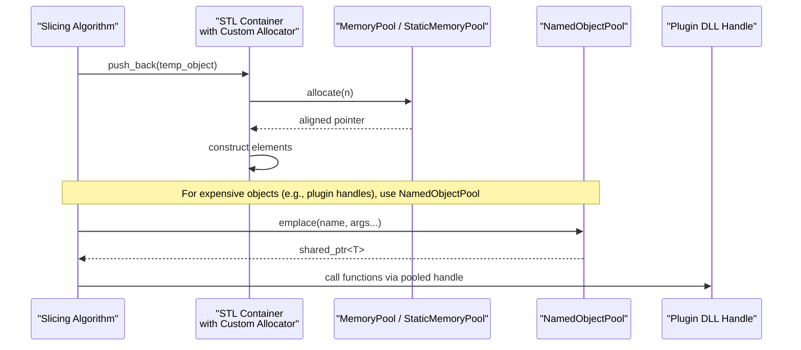
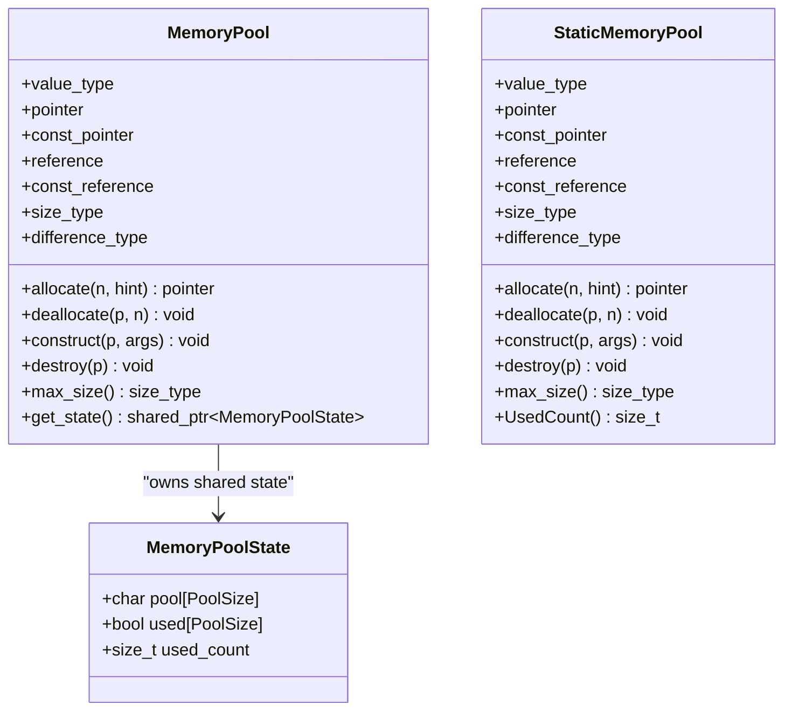
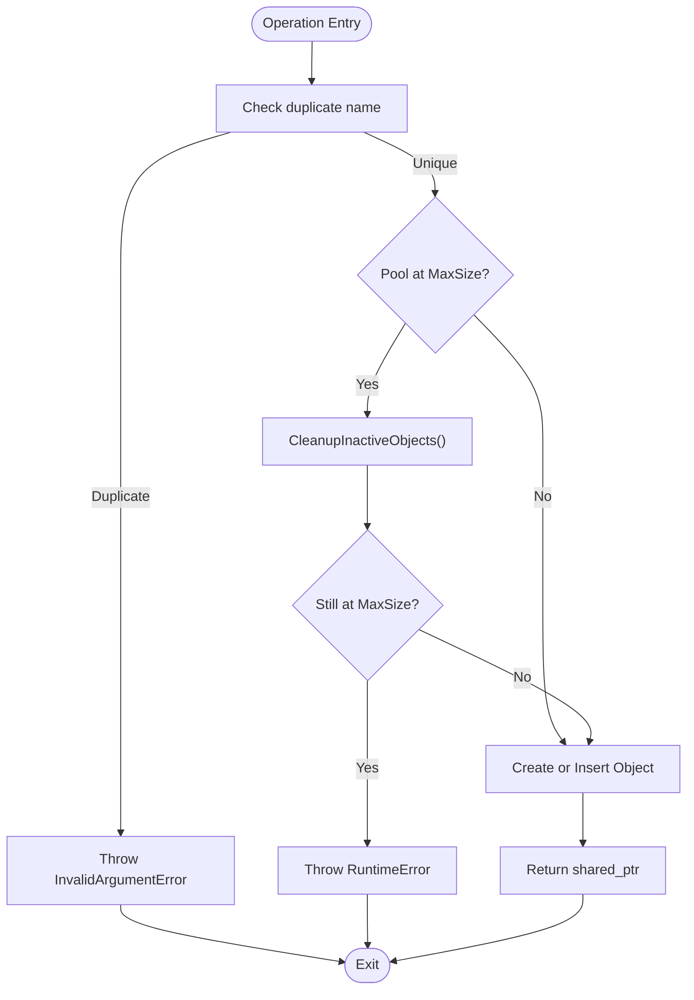
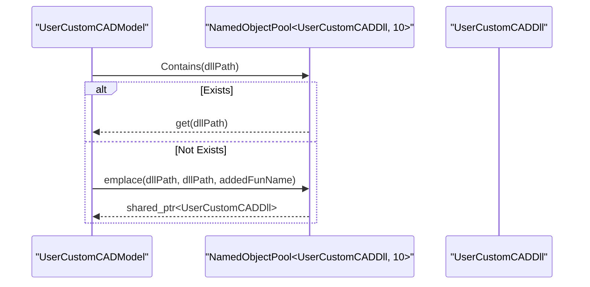
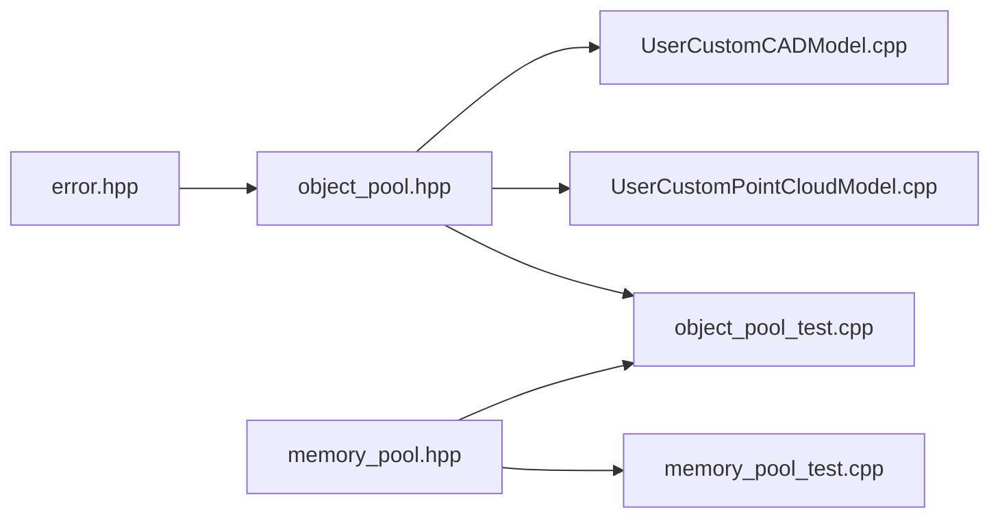

# Memory Management Systems

<cite>
**Referenced Files in This Document**
- [memory_pool.hpp](file://base/memory_pool.hpp)
- [object_pool.hpp](file://base/object_pool.hpp)
- [error.hpp](file://base/error.hpp)
- [memory_pool_test.cpp](file://tests/Pool/memory_pool_test.cpp)
- [object_pool_test.cpp](file://tests/Pool/object_pool_test.cpp)
- [UserCustomCADModel.cpp](file://cadmodel/UserCustomCADModel.cpp)
- [UserCustomPointCloudModel.cpp](file://pointcloud/UserCustomPointCloudModel.cpp)
</cite>

## Table of Contents
1. [Introduction](#introduction)
2. [Project Structure](#project-structure)
3. [Core Components](#core-components)
4. [Architecture Overview](#architecture-overview)
5. [Detailed Component Analysis](#detailed-component-analysis)
6. [Dependency Analysis](#dependency-analysis)
7. [Performance Considerations](#performance-considerations)
8. [Troubleshooting Guide](#troubleshooting-guide)
9. [Conclusion](#conclusion)
10. [Appendices](#appendices)

## Introduction
This document explains the memory management subsystem implemented in HsBaSlicer’s base directory. It focuses on two complementary mechanisms:

- Memory allocation pools for high-frequency, small-object allocations with custom allocators compatible with STL containers.
- A named object pool for managing reusable shared objects with lifecycle control and thread-safe access.

The goal is to reduce allocator overhead, improve locality, and provide predictable resource management for slicing algorithms and geometry processing workflows.

## Project Structure
The relevant implementation lives under `base/`, while usage examples and tests are spread across unit tests and plugin loaders.

**Diagram sources**
- [memory_pool.hpp:1-375](file://base/memory_pool.hpp#L1-L375)
- [object_pool.hpp:1-286](file://base/object_pool.hpp#L1-L286)
- [error.hpp:1-147](file://base/error.hpp#L1-L147)
- [memory_pool_test.cpp:1-100](file://tests/Pool/memory_pool_test.cpp#L1-L100)
- [object_pool_test.cpp:1-162](file://tests/Pool/object_pool_test.cpp#L1-L162)
- [UserCustomCADModel.cpp:1-200](file://cadmodel/UserCustomCADModel.cpp#L1-L200)
- [UserCustomPointCloudModel.cpp:1-200](file://pointcloud/UserCustomPointCloudModel.cpp#L1-L200)

**Section sources**
- [memory_pool.hpp:1-375](file://base/memory_pool.hpp#L1-L375)
- [object_pool.hpp:1-286](file://base/object_pool.hpp#L1-L286)
- [memory_pool_test.cpp:1-100](file://tests/Pool/memory_pool_test.cpp#L1-L100)
- [object_pool_test.cpp:1-162](file://tests/Pool/object_pool_test.cpp#L1-L162)
- [UserCustomCADModel.cpp:1-200](file://cadmodel/UserCustomCADModel.cpp#L1-L200)
- [UserCustomPointCloudModel.cpp:1-200](file://pointcloud/UserCustomPointCloudModel.cpp#L1-L200)

## Core Components
- MemoryPool: An instance-scoped, fixed-size byte pool allocator that can be used as a custom STL allocator. It supports alignment-aware allocation, construction/destruction helpers, and thread safety via a mutex.
- StaticMemoryPool: A process-wide static pool with identical allocator semantics but shared state across all instances.
- NamedObjectPool: A name-based registry of shared objects with capacity limits, lazy cleanup of inactive objects, read/write separation through shared_mutex, and optional custom allocator support.

Key design goals:
- Pre-allocation within bounded buffers to avoid frequent heap calls.
- Alignment guarantees for any type.
- Thread-safe operations where required.
- Integration with STL containers and smart pointers.

**Section sources**
- [memory_pool.hpp:28-208](file://base/memory_pool.hpp#L28-L208)
- [memory_pool.hpp:215-372](file://base/memory_pool.hpp#L215-L372)
- [object_pool.hpp:22-283](file://base/object_pool.hpp#L22-L283)

## Architecture Overview
At runtime, slicing and geometry code may allocate many small temporary objects or reuse larger complex objects. The system provides two layers:

- Low-level allocator layer: MemoryPool and StaticMemoryPool supply contiguous memory blocks from a fixed buffer, reducing fragmentation and allocation overhead.
- Object lifecycle layer: NamedObjectPool manages long-lived or expensive-to-create objects by name, reusing them when possible and cleaning up inactive entries.

**Diagram sources**
- [memory_pool.hpp:111-142](file://base/memory_pool.hpp#L111-L142)
- [memory_pool.hpp:266-296](file://base/memory_pool.hpp#L266-L296)
- [object_pool.hpp:66-92](file://base/object_pool.hpp#L66-L92)
- [UserCustomCADModel.cpp:134-143](file://cadmodel/UserCustomCADModel.cpp#L134-L143)

## Detailed Component Analysis

### MemoryPool and StaticMemoryPool
MemoryPool and StaticMemoryPool implement the C++ allocator interface. They maintain a fixed-size buffer, track used bytes, and ensure alignment. Both are thread-safe at the allocation/deallocation boundary.

Key behaviors:
- Allocation scans for a contiguous free region sized for n elements.
- Deallocate validates pointer bounds and clears usage flags.
- Construct/destroy enable placement new semantics.
- Equality semantics differ:
  - MemoryPool compares underlying state pointers.
  - StaticMemoryPool considers all instances equal because they share global state.

Thread-safety:
- Both allocate and deallocate lock a mutex before modifying pool state.

Alignment:
- The internal buffer is aligned to std::max_align_t, ensuring safe storage for any type.

Capacity and errors:
- If the requested allocation exceeds the pool size or there is insufficient free space, std::bad_alloc is thrown.
- Invalid deallocation pointers throw std::invalid_argument.

Integration with STL:
- Tests demonstrate using these allocators with std::vector and std::list.
- Smart pointers can be allocated from the pool via std::allocate_shared.

**Diagram sources**
- [memory_pool.hpp:28-34](file://base/memory_pool.hpp#L28-L34)
- [memory_pool.hpp:43-208](file://base/memory_pool.hpp#L43-L208)
- [memory_pool.hpp:215-372](file://base/memory_pool.hpp#L215-L372)

Practical usage patterns:
- High-frequency small allocations in tight loops: Use MemoryPool or StaticMemoryPool as the container allocator to avoid per-element heap calls.
- Smart pointers: Allocate shared_ptr control blocks and managed objects from the pool using std::allocate_shared with the pool allocator.
- Coroutines: Tests show integration with coroutine utilities that accept a custom allocator type.

**Section sources**
- [memory_pool.hpp:111-142](file://base/memory_pool.hpp#L111-L142)
- [memory_pool.hpp:156-175](file://base/memory_pool.hpp#L156-L175)
- [memory_pool.hpp:266-296](file://base/memory_pool.hpp#L266-L296)
- [memory_pool.hpp:305-324](file://base/memory_pool.hpp#L305-L324)
- [memory_pool_test.cpp:30-51](file://tests/Pool/memory_pool_test.cpp#L30-L51)
- [memory_pool_test.cpp:53-74](file://tests/Pool/memory_pool_test.cpp#L53-L74)
- [memory_pool_test.cpp:76-98](file://tests/Pool/memory_pool_test.cpp#L76-L98)

### NamedObjectPool
NamedObjectPool maintains a map of named shared objects with capacity limits and lazy cleanup. It is designed for scenarios where objects are expensive to create or need centralized lifecycle management.

Key behaviors:
- emplace constructs an object with given arguments and registers it by name.
- insert accepts an already constructed shared_ptr.
- allocate allows constructing with a custom allocator (for example, a MemoryPool).
- get returns a shared_ptr; operator[] provides convenient access.
- Contains checks existence without mutation.
- Cleanup removes inactive objects (use count equals one).
- Capacity enforcement: When full, it attempts to clean inactive objects; if still full, throws RuntimeError.

Thread-safety:
- Uses shared_mutex to allow concurrent reads (get, Contains, size, InactiveCount, ActiveCount, GetNames) and exclusive writes (emplace, insert, allocate, remove, Cleanup).

Error handling:
- Duplicate names throw InvalidArgumentError.
- Full pool after cleanup throws RuntimeError.

**Diagram sources**
- [object_pool.hpp:66-92](file://base/object_pool.hpp#L66-L92)
- [object_pool.hpp:99-115](file://base/object_pool.hpp#L99-L115)
- [object_pool.hpp:135-156](file://base/object_pool.hpp#L135-L156)
- [object_pool.hpp:261-279](file://base/object_pool.hpp#L261-L279)

Real-world usage:
- Plugin DLL handles: Both CAD and point-cloud plugin loaders use a NamedObjectPool to cache loaded DLL wrappers by path, avoiding repeated load/unload overhead.

**Diagram sources**
- [UserCustomCADModel.cpp:22-23](file://cadmodel/UserCustomCADModel.cpp#L22-L23)
- [UserCustomCADModel.cpp:134-143](file://cadmodel/UserCustomCADModel.cpp#L134-L143)
- [object_pool.hpp:66-92](file://base/object_pool.hpp#L66-L92)

**Section sources**
- [object_pool.hpp:22-283](file://base/object_pool.hpp#L22-L283)
- [object_pool_test.cpp:9-33](file://tests/Pool/object_pool_test.cpp#L9-L33)
- [object_pool_test.cpp:35-59](file://tests/Pool/object_pool_test.cpp#L35-L59)
- [object_pool_test.cpp:61-80](file://tests/Pool/object_pool_test.cpp#L61-L80)
- [object_pool_test.cpp:83-113](file://tests/Pool/object_pool_test.cpp#L83-L113)
- [object_pool_test.cpp:116-141](file://tests/Pool/object_pool_test.cpp#L116-L141)
- [object_pool_test.cpp:143-160](file://tests/Pool/object_pool_test.cpp#L143-L160)
- [UserCustomCADModel.cpp:134-143](file://cadmodel/UserCustomCADModel.cpp#L134-L143)
- [UserCustomPointCloudModel.cpp:175-185](file://pointcloud/UserCustomPointCloudModel.cpp#L175-L185)

## Dependency Analysis
The memory management components have clear dependencies:

- NamedObjectPool depends on error types for exception signaling.
- Tests validate behavior of both pools and their integration with STL containers and smart pointers.
- Plugin loaders depend on NamedObjectPool for DLL handle caching.

**Diagram sources**
- [error.hpp:1-147](file://base/error.hpp#L1-L147)
- [object_pool.hpp:1-286](file://base/object_pool.hpp#L1-L286)
- [memory_pool.hpp:1-375](file://base/memory_pool.hpp#L1-L375)
- [memory_pool_test.cpp:1-100](file://tests/Pool/memory_pool_test.cpp#L1-L100)
- [object_pool_test.cpp:1-162](file://tests/Pool/object_pool_test.cpp#L1-L162)
- [UserCustomCADModel.cpp:1-200](file://cadmodel/UserCustomCADModel.cpp#L1-L200)
- [UserCustomPointCloudModel.cpp:1-200](file://pointcloud/UserCustomPointCloudModel.cpp#L1-L200)

**Section sources**
- [object_pool.hpp:1-286](file://base/object_pool.hpp#L1-L286)
- [memory_pool.hpp:1-375](file://base/memory_pool.hpp#L1-L375)
- [memory_pool_test.cpp:1-100](file://tests/Pool/memory_pool_test.cpp#L1-L100)
- [object_pool_test.cpp:1-162](file://tests/Pool/object_pool_test.cpp#L1-L162)
- [UserCustomCADModel.cpp:1-200](file://cadmodel/UserCustomCADModel.cpp#L1-L200)
- [UserCustomPointCloudModel.cpp:1-200](file://pointcloud/UserCustomPointCloudModel.cpp#L1-L200)

## Performance Considerations
- Pre-allocation strategy: Both MemoryPool and StaticMemoryPool allocate from a fixed buffer, eliminating per-object heap calls and reducing fragmentation.
- Alignment: Buffers are aligned to std::max_align_t, enabling efficient storage of any type without violating alignment requirements.
- Contiguous allocation search: Allocation scans for a contiguous free block sized for n elements. This ensures simple lifetime management but may produce fragmentation under heavy mixed lifetimes.
- Thread-safety cost: Mutexes protect allocation and deallocation. In hot paths, consider batching allocations or using per-thread pools to reduce contention.
- Lazy cleanup: NamedObjectPool only cleans inactive objects when adding new ones at capacity, minimizing unnecessary traversal overhead.
- STL integration: Using these allocators with containers reduces dynamic allocation churn during resizing and element insertion.

Benchmarking guidance:
- Compare throughput and latency of allocating thousands of small objects with std::new versus MemoryPool/StaticMemoryPool-backed containers.
- Measure time spent in allocation vs computation in slicing loops.
- Profile memory growth and fragmentation with tools such as Valgrind, AddressSanitizer, or platform-specific profilers.
- Validate that SharedPointer allocations also benefit from the custom allocator when using std::allocate_shared.

[No sources needed since this section provides general guidance]

## Troubleshooting Guide
Common issues and resolutions:

- Out-of-memory in pools:
  - Symptom: std::bad_alloc during allocate.
  - Cause: Requested allocation exceeds pool capacity or no contiguous free region exists.
  - Resolution: Increase PoolSize, reduce per-operation allocation sizes, or adjust algorithm to reuse buffers.

- Invalid pointer deallocation:
  - Symptom: std::invalid_argument during deallocate.
  - Cause: Pointer not belonging to the pool or out-of-bounds offset.
  - Resolution: Ensure pointers originate from the same pool instance and are not manually modified.

- Duplicate object names:
  - Symptom: InvalidArgumentError when inserting into NamedObjectPool.
  - Cause: Name collision.
  - Resolution: Use unique keys or check Contains before insertion.

- Pool full:
  - Symptom: RuntimeError indicating pool is full.
  - Cause: MaxSize reached and no inactive objects available.
  - Resolution: Increase MaxSize, explicitly call Cleanup, or redesign object lifetimes to release unused references earlier.

- Thread contention:
  - Symptom: Slowdown under multi-threaded workloads.
  - Cause: Mutex contention in pool operations.
  - Resolution: Use per-thread pools or batch allocations to minimize lock frequency.

- Leak detection:
  - For MemoryPool/StaticMemoryPool: Track used_count or instrument allocations to detect unmatched deallocations.
  - For NamedObjectPool: Monitor ActiveCount and InactiveCount; call Cleanup periodically to reclaim inactive objects.

**Section sources**
- [memory_pool.hpp:111-142](file://base/memory_pool.hpp#L111-L142)
- [memory_pool.hpp:156-175](file://base/memory_pool.hpp#L156-L175)
- [memory_pool.hpp:266-296](file://base/memory_pool.hpp#L266-L296)
- [memory_pool.hpp:305-324](file://base/memory_pool.hpp#L305-L324)
- [object_pool.hpp:66-92](file://base/object_pool.hpp#L66-L92)
- [object_pool.hpp:99-115](file://base/object_pool.hpp#L99-L115)
- [object_pool.hpp:135-156](file://base/object_pool.hpp#L135-L156)
- [object_pool.hpp:261-279](file://base/object_pool.hpp#L261-L279)
- [error.hpp:17-45](file://base/error.hpp#L17-L45)

## Conclusion
HsBaSlicer’s memory management subsystem provides two complementary strategies:

- MemoryPool and StaticMemoryPool deliver fast, aligned, fixed-capacity allocation suitable for high-frequency small-object workloads and STL integration.
- NamedObjectPool offers robust lifecycle management for expensive or shared objects, with thread-safe access, capacity limits, and lazy cleanup.

Together, they reduce allocation overhead, improve locality, and simplify resource management in slicing and geometry processing pipelines. Proper sizing, careful lifetime management, and periodic cleanup are essential to achieving optimal performance and stability.

[No sources needed since this section summarizes without analyzing specific files]

## Appendices

### Practical Examples

- High-frequency allocations in slicing algorithms:
  - Use MemoryPool or StaticMemoryPool as the allocator for vectors/lists holding intermediate points, edges, or small geometric primitives.
  - Prefer contiguous allocation patterns and batched operations to maximize pool efficiency.

- Reusing complex geometry objects:
  - Use NamedObjectPool to cache large structures such as precomputed meshes, transformation matrices, or plugin handles.
  - Access via get or operator[], and rely on shared_ptr semantics for automatic cleanup when no longer referenced.

- Integration with STL containers:
  - Pass the pool instance to vector/list constructors to bind the container to the pool allocator.
  - Use std::allocate_shared with the pool allocator for shared_ptr-managed objects.

- Memory profiling and leak detection:
  - Instrument UsedCount or equivalent metrics to monitor pool utilization.
  - Combine with sanitizers and profilers to identify leaks or excessive fragmentation.

- Benchmarking against standard allocators:
  - Compare allocation throughput and latency between std::allocator and pool-backed allocators.
  - Measure end-to-end pipeline performance improvements in slicing routines.

[No sources needed since this section provides general guidance]